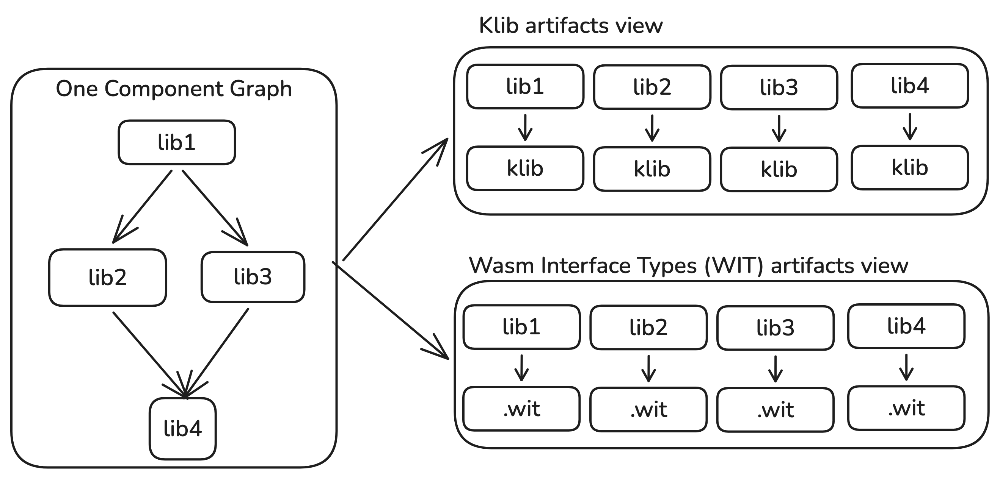

# Consumable Configurations & Secondary Variants Guide

This guide explains how to choose between consumable configurations and secondary variants when sharing artifacts between projects.

## Terminology

The following terms are used throughout this guide. For more details, see the
[Gradle documentation on variant-aware resolution](https://docs.gradle.org/current/userguide/variant_aware_resolution.html).

### Component

A component is a container of variants. In Gradle, it can take two forms:

* **Library component**: An external or published Maven library, such as `org.jetbrains.kotlin:kotlin-gradle-plugin-api:2.5.0`.
* **Project component**: A Gradle project in the same build. A Gradle build can contain multiple projects, each represented by a component.

### Variant

A variant consists of attributes and artifacts, together with dependencies on other components.

### Consumable Configuration: Primary & Secondary Variants

A project component can contain multiple consumable configurations. Each consumable configuration exposes
**one primary variant** for project-to-project dependency resolution.
It can also expose **multiple secondary variants**. By default, secondary variants inherit the attributes of their
primary variant, but they can override them.

## Dependency Resolution Nuances

Gradle resolves dependencies in two stages.

First, Gradle resolves the component graph. It traverses the declared root dependencies and selects variants based on
the requested attributes. **Only primary variants participate in component graph resolution.**

Second, Gradle resolves the artifacts for the selected components from the previous step. For each resolved project component, it considers
the secondary variants; for each resolved external component, it creates a virtual variant for each artifact using the
`artifactType` attribute.

> [!NOTE]
> When a consumable configuration is published to a Maven repository with Gradle Module Metadata, its secondary variants
> are published alongside the primary variant by default, unless explicitly skipped. They can then participate in component
> graph resolution when consumed as published variants.

A consumer can request multiple artifact views from a single resolved component graph. In the diagram below, WIT stands
for WebAssembly Interface Types; `.wit` files describe interfaces for WebAssembly components.



## Use a Secondary Variant When

* You need to associate additional information with a particular Kotlin Multiplatform (KMP) target.
* The information is tied to the component graph, and the main artifacts and additional information must be resolved
  consistently. Resolving separate component graphs can yield unexpected artifacts or omit expected ones.
* You need to share information for a group of targets, such as project structure metadata or commonized cinterops.
  In this case, use a secondary variant of the `metadataApiElements` configuration.

If the information is needed at compile time, create a secondary variant of the `target.apiElements` configuration.
An example is commonized cinterop metadata.

If the information is needed at runtime or link time, create a secondary variant of the `target.runtimeElements`
configuration. Examples include WebAssembly System Interface (WASI) WIT files and npm dependencies associated with a
JavaScript target artifact.

### Attributes in Secondary Variants

* Don't rely only on the `artifactType` attribute for discriminating secondary variants. Gradle treat artifactType as special attribute type internally. 
   And generally [Gradle team recommends using other attributes](https://github.com/gradle/gradle/issues/33298#issuecomment-3258657525). 
* Use a discriminator attribute to distinguish the primary artifact from a secondary artifact.
  * Use a different `org.gradle.usage` attribute than in primary variant. 
  * When you control multiple secondary variants, use a single `org.gradle.usage` value and specify an additional discriminator
    attribute, such as `org.jetbrains.kotlin.packaging=zip/tar`.
  * Always namespace custom attributes with `org.jetbrains.kotlin.`.
* Request all relevant attributes in the artifact view to improve resolution stability and help avoid disambiguation bugs.

### Prefer the `KotlinSecondaryVariantsDataSharing` Service

Use `KotlinSecondaryVariantsDataSharing` to share project configuration state between Kotlin projects in the same build,
when that state is associated with one or more targets. Examples include publication coordinates and cross-compilation
state. The service is intended for project-to-project sharing, not for consuming state from published external components.

## Use a Different Consumable Configuration When

* You need to expose information unrelated to a specific target.
* You need to publish an artifact separately, even if it is related to a specific target.

## Consume Secondary Variants via Artifact Views

Use the `artifactView` API to consume secondary variants:

```kotlin
fun artifactViewOf(resolvable: Configuration): FileCollection {
    return resolvable.incoming.artifactView {
        it.attributes {
            it.attribute(yourDiscriminatingAttribute, yourValue)
        }
    }.files
}
```

### Avoid Variant Reselection

When using `artifactView` to consume secondary variants, avoid enabling variant reselection with
`artifactView { it.withVariantReselection() }`. Variant reselection ignores the attributes configured on the parent
resolvable configuration, which can lead to unexpected resolution errors. For example, attributes added to the
resolvable configuration will not be considered unless they are also requested in the artifact view.

### Use a Component Filter

When only project components provide the information you need, filter out other components:

```kotlin
artifactView {
    it.componentFilter { componentId ->
        componentId is ProjectComponentIdentifier
    }
}
```

This helps avoid triggering artifact transformations for external components.
