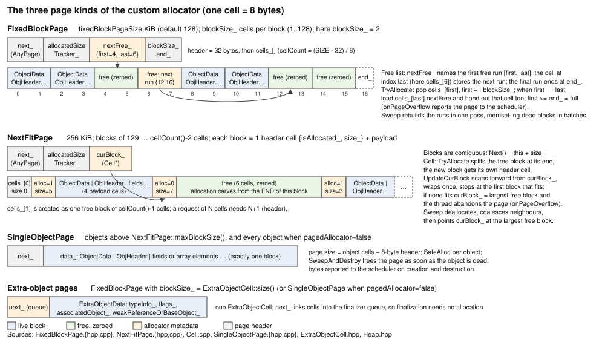
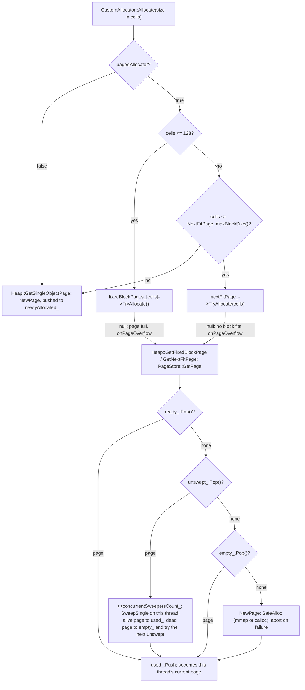
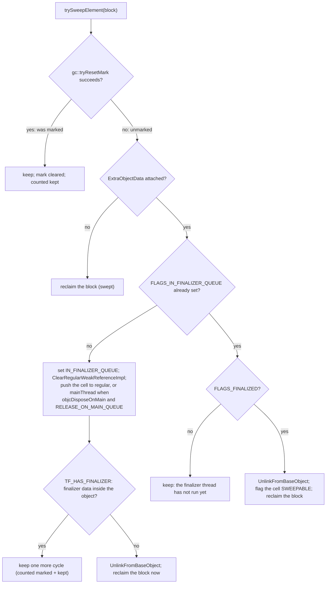

# Kotlin/Native allocator: pages, sweeping, finalizer queues and accounting

The allocator owns every heap object's bytes: it hands out zeroed blocks to mutators, lets the GC reclaim unmarked blocks, keeps
the side records (`ExtraObjectData`) alive for weak references and ObjC associated objects, builds the finalizer queues and
reports allocated bytes to the GC scheduler. This page is the deep dive that [runtime.md](runtime.md#allocation-and-accounting)
summarizes. Marking, barriers and epoch scheduling belong to [gc.md](gc.md); object layout, `TypeInfo` and the `AllocInstance`
ABI to [compiler-runtime-contract.md](compiler-runtime-contract.md); stack allocation to [optimizations.md](optimizations.md).
The design note in [alloc/custom/README.md](../../kotlin-native/runtime/src/alloc/custom/README.md) is the author's overview;
where it has drifted from the code this page says so.

`RUNTIME` below means `kotlin-native/runtime/src`. The allocator API is in `RUNTIME/main/cpp/alloc`; the two implementations are
`RUNTIME/alloc/custom` (default, module `custom_alloc`) and `RUNTIME/alloc/legacy` (`-Xallocator=std`, module `legacy_alloc`).

## Key concepts

| Term | Meaning | Where |
|------|---------|-------|
| Cell | The 8-byte unit of every custom-allocator size; `AllocationSize` converts bytes to cells (rounding up, `uint64_t`, KT-54659) | [Cell.hpp], [AllocationSize.hpp] |
| Block | One allocation inside a page: `GC::ObjectData` header word followed by the `ObjHeader` (`HeapObject<ObjectData>`) | [HeapObject.hpp], [GCApi.hpp] |
| Page | A unit of memory obtained from the OS, swept independently; three kinds (below). Linked into exactly one `AtomicStack` through `AnyPage::next_` | [AnyPage.hpp], [AtomicStack.hpp] |
| Size class | For blocks of ≤128 cells, the block size in cells *is* the size class: 128 `PageStore`s, one per cell count | [Heap.hpp] `fixedBlockPages_[]` |
| `PageStore` | Per page kind and size class: the `empty_` / `ready_` / `used_` / `unswept_` stacks and the page state machine | [PageStore.hpp] |
| `Heap` | Global, one per process: all `PageStore`s, the mutator-sweeper counter, the pending finalizer queue, the byte tracker | [Heap.hpp] |
| `CustomAllocator` | Per mutator (`Allocator::ThreadData::Impl`): the thread's current page per size class, its finalizer queue | [CustomAllocator.hpp] |
| `ExtraObjectCell` | `ExtraObjectData` plus an intrusive `next_` link; the finalizer queue is a stack of these cells | [ExtraObjectCell.hpp] |
| `FinalizerQueue` | `SegregatedFinalizerQueue<AtomicStack<ExtraObjectCell>>`: a `regular` and a `mainThread` stack | [CustomFinalizerProcessor.hpp], [SegregatedFinalizerQueue.hpp] |
| `AllocatedSizeTracker` | Page-granular byte accounting feeding `OnMemoryAllocation` → `gcScheduler().setAllocatedBytes` | [AllocatedSizeTracker.hpp] |

## The API the rest of the runtime uses

[Allocator.hpp] is the only allocator header `mm/`, `gc/` and `gcScheduler/` include. `GlobalData` owns one `alloc::Allocator`
([GlobalData.hpp]), each `mm::ThreadData` owns an `alloc::Allocator::ThreadData` ([ThreadData.hpp]); both hide an `Impl` that
each module defines (`AllocatorImpl.hpp` in [custom][AllocatorImpl.hpp] and [legacy][LegacyAllocatorImpl.hpp]).

| Call | Caller | Custom implementation |
|------|--------|-----------------------|
| `ThreadData::allocateObject/allocateArray(typeInfo, n)` | `mm::AllocateObject/AllocateArray` ([ObjectOps.cpp]) behind `AllocInstance`/`AllocArrayInstance` ([mm/Memory.cpp]) | `CustomAllocator::CreateObject/CreateArray` |
| `ThreadData::allocateExtraObjectData(obj, typeInfo)` | `ExtraObjectData::Install` ([ExtraObjectData.cpp]) and `CreateObject` for `TF_HAS_FINALIZER` types | `CreateExtraObjectDataForObject`: a cell from the extra-object `PageStore` |
| `ThreadData::destroyUnattachedExtraObjectData` | `Install` lost the CAS race on `typeInfoOrMeta_` | sets `FLAGS_SWEEPABLE`; the cell is reclaimed at the next extra-object sweep (legacy frees it at once) |
| `destroyExtraObjectData(extra)` | `ObjHeader::destroyMetaObject` from `RunFinalizers` ([FinalizerHooks.cpp]) and `FinalizerQueueTraits::processSingle` | releases the ObjC associated object, then flags `FINALIZED` (object still attached) or `SWEEPABLE` |
| `ThreadData::prepareForGC()`, `Allocator::prepareForGC()` | `MainGCThread` in STW, threads first, then global ([MainGCThread.hpp]) | drop the thread's cached pages; move every page to `unswept_`, free `empty_` pages |
| `Allocator::sweep(gcHandle)` | `MainGCThread`, after `resumeTheWorld` for CMS/PMCS (`kConcurrentSweep`), inside STW for STWMS | `Heap::Sweep` + merge every thread's finalizer queue into `pendingFinalizers_` |
| `Allocator::scheduleFinalization(gcHandle)` | `MainGCThread`, last step of the epoch | hand `pendingFinalizers_` to `SegregatedFinalizerProcessor::schedule` |
| `objectDataForObject` / `objectForObjectData` | mark code and barriers (`tryMark`, `markUncontended`) | pointer arithmetic on `HeapObject<GC::ObjectData>`; asserts `object->heap()` |
| `allocatedHeapSize(obj)`, `allocatedBytes()` | sweep statistics; `GC.lastGCInfo.memoryUsage*` ([GCStatistics.cpp]) | block size from `TypeInfo`; total bytes currently obtained from the OS |
| `TraverseAllocatedObjects/ExtraObjects` | memory dump ([MemoryDump.cpp]), tests | walks all four stacks of every `PageStore`; only safe when mutators are stopped |
| `startFinalizerThreadIfNeeded`, `stopFinalizerThreadIfRunning`, `configureMainThreadFinalizerProcessor`, … | tests (`clearForTests`); `Kotlin_native_internal_GC_*` setters in [mm/Memory.cpp]. In production the finalizer thread starts lazily from `ScheduleTasks` | `SegregatedFinalizerProcessor` (shared with legacy) |

Facts about the entry path that the allocator relies on: `AllocateObject` asserts `kRunnable`; `AllocArrayInstance` throws
`IllegalArgumentException` for a negative count; after allocation `gc().onAllocation(obj)` runs (CMS marks new objects black
only while a mark scope is open, `shouldMarkNewObjects` in [cms/Barriers.cpp]) and a release fence publishes the header
(KT-58995). Both `KObject::descriptor::construct` and `KArray::descriptor::construct` ([KObject.hpp]) assert the memory is
already zeroed: **zeroed memory is part of the allocator contract**, which is why fresh pages come from `mmap`/`calloc`,
`FixedBlockPage::Sweep` memsets reclaimed runs, and `Cell::Deallocate` memsets the payload.

## The custom allocator

### Heap structure

```
GlobalData.allocator()                          per mm::ThreadData
┌─ Heap ──────────────────────────────────────┐  ┌─ CustomAllocator ──────────────────┐
│ fixedBlockPages_[1..128]  PageStore<Fixed>  │  │ fixedBlockPages_[1..128] → page*   │
│ nextFitPages_             PageStore<NextFit>│←─│ nextFitPage_             → page*   │
│ singleObjectPages_        PageStore<Single> │  │ extraObjectPage_         → page*   │
│ fixedBlockExtraObjectPages_ (ExtraObjectCell│  │ finalizerQueue_ (cells swept here) │
│ singleExtraObjectPages_    size class)      │  └────────────────────────────────────┘
│ pendingFinalizerQueue_ + mutex              │
│ concurrentSweepersCount_ (atomic)           │   PageStore<T>: empty_  ready_  used_  unswept_
│ allocatedSizeTracker_ (atomic bytes)        │                 (four lock-free AtomicStack<T>)
└─────────────────────────────────────────────┘
```

Every object block is `[GC::ObjectData (8 bytes: mark bit / mark-queue link)][ObjHeader …]`, 8-byte aligned; the byte-level
layout of the block, the array header and the meta-object is drawn once in
[compiler-runtime-contract.md](compiler-runtime-contract.md#object-layout). The three page kinds and how blocks, free runs and
block headers are laid out inside them, from [FixedBlockPage.hpp]/[FixedBlockPage.cpp], [NextFitPage.hpp]/[NextFitPage.cpp],
[Cell.hpp], [SingleObjectPage.cpp] and [ExtraObjectCell.hpp]:



### Routing an allocation (`CustomAllocator::Allocate`)

`CreateObject` computes `HeapObject::descriptorFrom(typeInfo).size()` = 8 + `instanceSize_`, `CreateArray` uses
`KArray::descriptor::size` (`AlignUp(AlignUp(sizeof(ArrayHeader), elemSize) + elemSize*count, 8)`, `elemSize = -instanceSize_`),
both rounded up to cells by `AllocationSize::bytesAtLeast` ([CustomAllocator.cpp]).

| Size in cells | Page kind | Constant | Per-thread cache |
|---|---|---|---|
| 1 … 128 (≤ 1 KiB) | `FixedBlockPage` of exactly that block size | `FixedBlockPage::MAX_BLOCK_SIZE = 128` ([FixedBlockPage.hpp]) | `fixedBlockPages_[cells]` |
| 129 … `NextFitPage::maxBlockSize()` (256 KiB minus the page header, sentinel and block header) | `NextFitPage` | `NextFitPage::SIZE = 256 * KiB`, `maxBlockSize = cellCount() - 2` ([NextFitPage.hpp]) | `nextFitPage_` |
| larger | `SingleObjectPage` of exactly this size | — | none; created per allocation |
| `ExtraObjectCell` (any size) | `FixedBlockPage` in the dedicated extra-object store | `ExtraObjectCell::size()` | `extraObjectPage_` |
| anything, if `pagedAllocator=false` | `SingleObjectPage` (objects and extra objects alike) | `compiler::pagedAllocator()` | none |

There is no size-class rounding beyond cells: a 24-byte object and a 32-byte object live in different page stores. The 1 KiB
threshold and the 256 KiB next-fit page are not justified in code or history beyond the README's "arbitrary"; the fixed page
size has a recorded rationale (below).

### Fast path, slow path, page acquisition

Fast path (no atomics, no locks): `fixedBlockPages_[cells]->TryAllocate()` ([FixedBlockPage.cpp]) pops the first cell of the
current free range (`nextFree_.first += blockSize_`); when a range is exhausted it loads the next range from the range's last
cell and zeroes that cell. `NextFitPage::TryAllocate` ([NextFitPage.cpp]) bump-allocates from the end of `curBlock_`
(`Cell::TryAllocate` splits the free block, the new block gets a 1-cell header), otherwise `UpdateCurBlock` scans forward from
`curBlock_`, wrapping once, for the first free block that fits; if none fits it leaves `curBlock_` on the largest free block,
the allocation fails and the thread abandons the page.

Slow path: `heap_.GetFixedBlockPage / GetNextFitPage(cells, finalizerQueue_)` → `PageStore::GetPage` ([PageStore.hpp]):

1. `ready_.Pop()` — a page the GC thread already swept this cycle; push to `used_` and return.
2. Otherwise bump `Heap::concurrentSweepersCount_`, `unswept_.Pop()` and **sweep it on the mutator** (`SweepSingle`) into
   `used_`; pages that turn out empty go to `empty_` and the next unswept one is tried. The sweep is charged to
   `GCHandle::currentEpoch()` and the finalizable cells land in *this thread's* `finalizerQueue_`.
3. Otherwise `empty_.Pop()` (a page with no live objects, kept since the last sweep) → `used_`.
4. Otherwise `NewPage`: `T::Create` → `SafeAlloc(size)` → `used_`.

Routing, fast path and slow path together, as coded in `CustomAllocator::Allocate`/`AllocateIn*Page` ([CustomAllocator.cpp])
and `PageStore::GetPage` ([PageStore.hpp]):



`SingleObjectPage`s skip all of this: `Heap::GetSingleObjectPage` always calls `NewPage`, which pushes to a separate
`newlyAllocated_` stack so that the GC's non-atomic sweep of `unswept_`/`used_` never races with mutators
([PageStore.hpp] specialization; commit `71b353136505`). `AllocateInFixedBlockPage` loops until a page yields a block; the
only way it returns `nullptr` is `SafeAlloc` failing, which aborts the process instead ([GCApi.cpp] "Out of memory").

### Page state machine and sweeping

```
                 PrepareForGC (STW): ready_, used_ → unswept_ ; empty_ pages → Destroy()
   NewPage ──► used_ ──────────────────────────────────────────► unswept_
                 ▲                                                  │  Sweep (GC thread): alive → ready_ ; dead → empty_
                 │ GetPage: ready_.Pop / empty_.Pop                 │  GetPage (mutator): alive → used_ ; dead → empty_
                 └───────────────────────── ready_ / empty_ ◄───────┘
```

`Allocator::prepareForGC` runs with every mutator stopped: `CustomAllocator::PrepareForGC` nulls the thread's cached page
pointers (plain stores, hence STW), then `Heap::PrepareForGC` moves every store's `ready_` and `used_` into `unswept_` and
destroys the `empty_` pages. From this point no page is reachable from a mutator except through `GetPage`, so **a page is
swept by exactly one thread and is never swept while a mutator allocates into it**. The GC thread's `Heap::Sweep`
([Heap.cpp]) drains every object store, then the two extra-object stores (so extra objects flagged sweepable during the object
pass are reclaimed in the same cycle), then spins until `concurrentSweepersCount_` is zero, because a mutator may still be
sweeping the last page it popped and filling its own finalizer queue. Only then does `Allocator::sweep` take
`ThreadRegistry::LockForIter` and `ExtractFinalizerQueue()` from each thread ([AllocatorImpl.cpp]); threads that exited
earlier already pushed their queue to `Heap::AddToFinalizerQueue` under `pendingFinalizerQueueMutex_` (`~CustomAllocator`).

Per-block decision, `ObjectSweepTraits::trySweepElement` in [GCApi.cpp]:

| State of the block | Action | Counted as |
|---|---|---|
| `tryResetMark` succeeds (was marked) | keep, clear mark | kept |
| unmarked, no `ExtraObjectData` | reclaim | swept |
| unmarked, extra object not yet `IN_FINALIZER_QUEUE` | set the flag, `ClearRegularWeakReferenceImpl`, push the cell to `regular` or (`objcDisposeOnMain` && `RELEASE_ON_MAIN_QUEUE`) `mainThread`; if `TF_HAS_FINALIZER` keep the object, else `UnlinkFromBaseObject` and reclaim the object now | marked + kept / swept |
| in queue, not yet `FINALIZED` | keep (finalizer thread has not run yet) | marked + kept |
| `FINALIZED` | `UnlinkFromBaseObject`, flag the extra object `SWEEPABLE`, reclaim | swept |

The same decision as a tree (`ObjectSweepTraits::trySweepElement` in [GCApi.cpp]; `HasFinalizersDataInObject` is
`TF_HAS_FINALIZER`, [FinalizerHooks.cpp]):



`ExtraDataSweepTraits::trySweepElement` reclaims a cell iff `FLAGS_SWEEPABLE`. Net effect: a Cleaner's object dies two cycles
after becoming unreachable (cycle N queues and keeps it, the finalizer thread flags `FINALIZED`, cycle N+1 frees object and
cell); an object whose only finalization data is in the extra object (weak reference, ObjC associated object) is freed in cycle
N and only the cell waits for the finalizer thread. This is the "one extra cycle" rule in
[runtime.md](runtime.md#finalizers-and-cleaners).

Page-level sweep: `FixedBlockPage::Sweep` walks the old free-range list, calls `trySweepElement` on every occupied block, and
rebuilds the list in one pass, zeroing dead runs with batched `memset`; the page is alive iff the header range does not cover
the whole page. `NextFitPage::Sweep` deallocates dead cells, coalesces adjacent free cells and points `curBlock_` at the largest
free block; it asserts its byte count against `GetAllocatedSizeBytes()`. `SingleObjectPage::SweepAndDestroy` frees the page
immediately when the object is dead. Dead multi-object pages are **not** freed at sweep time: they sit in `empty_` until the
next `PrepareForGC`, so memory returns to the OS one GC cycle after it became free, unless reused first (step 3 above).

### Memory from and to the OS

`SafeAlloc` / `Free` ([GCApi.cpp]): with `compiler::disableMmap()` false, `mmap(MAP_ANONYMOUS|MAP_PRIVATE)` per page, plus
`MAP_NORESERVE|MAP_POPULATE` on Linux and `VM_MAKE_TAG(mmapTag)` on Apple so pages show up under their own tag in `vmmap`/
Instruments (commit `1bd8f36a08be`, KT-74831; default tag 246 "doesn't seem to be used in the wild",
[NativeSecondStageCompilationConfig.kt]); `munmap` on free. With `disableMmap` true it is `calloc`/`free`. On MinGW the mmap
branch is `RuntimeFail("mmap is not available on mingw")`, and the compiler forces `disableMmap=true` there with a warning if
you ask otherwise. `allocatedBytesCounter` tracks the total obtained from the OS; this is what `GC.lastGCInfo` reports as heap
usage, so it counts partially empty pages as used. Peak RSS (`peakResidentSetSizeBytes`, [MemoryUsageInfo.hpp]) is an OS query
unrelated to the allocator.

### Accounting into the GC scheduler

The scheduler does not see individual allocations. `AllocatedSizeTracker::Page::onPageOverflow` ([AllocatedSizeTracker.cpp])
runs when a `FixedBlockPage` has no free cell left or a `NextFitPage` cannot satisfy a request: it reports the bytes allocated
in that page since its last sweep to `Heap::allocatedSizeTracker_` and calls `OnMemoryAllocation(total)` →
`gcScheduler().setAllocatedBytes(total)` ([mm/Memory.cpp]). `afterSweep` subtracts dead bytes without notifying.
`SingleObjectPage` reports on creation and destruction ([SingleObjectPage.cpp]). Consequence: each thread can hold up to one
partially filled page per size class (128 fixed-block classes, the next-fit page and the extra-object page, 128–256 KiB each)
whose bytes the scheduler has not seen yet; `-Xbinary=gcSchedulerType=` thresholds are therefore approximate at the scale of
`threads × size classes × fixedBlockPageSize`. The three `CustomAllocTest.*SchedulerNotification` tests pin this behaviour
through `test_support::setSchedulerNotificationHook`.

### Finalizer queues and the finalizer threads

The queue costs no allocation during GC: it is a stack of `ExtraObjectCell`s linked through `next_` ("preallocated place for
finalizers", [AllocatorImpl.hpp]). `Allocator::scheduleFinalization` passes it to
`SegregatedFinalizerProcessor::schedule` ([SegregatedFinalizerProcessor.hpp]): the `mainThread` part goes to
`MainThreadFinalizerProcessor` when a run loop processor is available (otherwise it is merged into `regular`), the rest to
`FinalizerProcessor::ScheduleTasks` ([FinalizerProcessor.hpp]). That thread ("GC finalizer processor") is started lazily on the
first non-empty queue, calls `Kotlin_initRuntimeIfNeeded` (it is a registered mutator), and processes each batch in `kRunnable`
inside an autorelease pool: `FinalizerQueueTraits::processSingle` ([CustomFinalizerProcessor.hpp]) pops a cell and runs
`RunFinalizers(baseObject)` (Cleaner → `DisposeCleaner`, weak ref → `DisposeRegularWeakReferenceImpl`, then
`destroyMetaObject`) or, for a cell with no base object, `destroyExtraObjectData` directly. When the batch is done it calls
`gc().onEpochFinalized(epoch)`, which is what `GC.collect()` waits for. With `-Xbinary=objcDisposeWithRunLoop=true` on
ObjC-interop targets the thread runs a `CFRunLoop` instead of a condition-variable loop (`makeProcessingLoop`); the
main-thread variant is throttled by `RunLoopFinalizerProcessorConfig` (300 ms per task, 1 ms between tasks,
[RunLoopFinalizerProcessor.hpp]), configured from the stdlib `GC` object through `configureMainThreadFinalizerProcessor`
([mm/Memory.cpp]).

The path of one `ExtraObjectCell` from the sweep to the finalizer, from [GCApi.cpp] (`trySweepElement`), [Heap.cpp]
(`Sweep`, `AddToFinalizerQueue`), [AllocatorImpl.cpp] (`sweep`, `scheduleFinalization`), [SegregatedFinalizerProcessor.hpp]
and [FinalizerProcessor.hpp]:

```mermaid
flowchart LR
    T["trySweepElement pushes the ExtraObjectCell<br/>(GC thread, or a mutator sweeping a page in GetPage)"] --> R["queue.regular"]
    T --> MT["queue.mainThread<br/>(objcDisposeOnMain and RELEASE_ON_MAIN_QUEUE)"]
    R --> TQ["mutator: its finalizerQueue_<br/>GC thread: Heap::Sweep result<br/>exited thread: Heap::pendingFinalizerQueue_"]
    MT --> TQ
    TQ -->|"Allocator::sweep: ExtractFinalizerQueue from every thread and from Heap"| PF["Impl::pendingFinalizers_"]
    PF -->|"Allocator::scheduleFinalization, last step of the epoch"| SP["SegregatedFinalizerProcessor::schedule"]
    SP -->|"regular, plus mainThread when no run loop processor is available"| FP["FinalizerProcessor::ScheduleTasks<br/>GC finalizer processor thread, kRunnable, autoreleasepool"]
    SP -->|"mainThread"| MP["MainThreadFinalizerProcessor<br/>main run loop, 100 cells per batch, 300 ms per task"]
    FP --> RF["processSingle: RunFinalizers(baseObject),<br/>or destroyExtraObjectData for a cell without a base object"]
    MP --> RF
    FP -->|"batch done"| OE["gc().onEpochFinalized(epoch) = GCStateHolder::finalized"]
```



### `pagedAllocator=false`

`compiler::pagedAllocator()` false routes every object and extra object to its own `SingleObjectPage`, obtained with `calloc`
because `disableMmap` then defaults to true ([NativeSecondStageCompilationConfig.kt] `defaultDisableMmap`). Each object is a
separate heap allocation that the system allocator — and therefore ASan/TSan — knows about, which is why it is the default
whenever `sanitizer` is set (`defaultPagedAllocator = sanitizer == null`) and why the compiler warns "Sanitizers are not useful
with the paged allocator" (KT-75916). Costs: no reuse of freed memory inside the allocator, every allocation notifies the
scheduler, and the sweep walks a linked list of pages (KT-80678 "pagedAllocator=false sweep is slow" in the 2.3 changelog).
Hypothesis: `disableMmap` is forced because one `mmap` per object would waste a VM page per object.

## The legacy allocator (`-Xallocator=std`)

Same `Allocator` API, different storage ([LegacyAllocatorImpl.hpp], [ObjectFactory.hpp]): every object is a `calloc`ed
`ObjectFactoryStorage::Node` (an owning `next_` pointer, then the block at `kObjectAlignment`) inserted into a per-thread
producer list; `prepareForGC` publishes those lists into one global intrusive list under a lock, and `Sweep`
([ObjectFactorySweep.hpp]) walks the whole list with `LockForIter`, `free`ing dead nodes one by one and moving finalizable nodes
into the queue (the object itself is the queue node). `allocateInObjectPool` ([ObjectAlloc.cpp]) reports **every** allocation
to `OnMemoryAllocation`; `AllocatorWithGC::OnOOM` forces a GC and retries once before aborting. Extra objects live in a
`MultiSourceQueue` with a spin lock ([ExtraObjectDataFactory.hpp]). It is deprecated with a strong warning (KT-75918,
[SetupConfiguration.kt]); `-Xallocator=mimalloc` is an error. Only the `legacy_alloc.bc` module name still says "legacy": the
mimalloc backend was removed when the modules were restructured (commit `1fa0ef6f567a`, KT-60928).

## Choosing the allocator; binary options

| Knob | Where | Default | Effect / cache flavor |
|---|---|---|---|
| `-Xallocator=std|custom` (CLI, not `-Xbinary`) | [K2NativeCompilerArguments.kt] → `ALLOCATION_MODE` ([SetupConfiguration.kt]) → `allocationMode` ([NativeSecondStageCompilationConfig.kt]) → `RuntimeModule.ALLOC_LEGACY/ALLOC_CUSTOM` in [CompilerOutput.kt] | `CUSTOM` since commit `da1fde24777e` (2023-05, KT-55364; all GCs since `281895768995`) | suffix `-allocator<NAME>` |
| `-Xbinary=pagedAllocator=` | `Kotlin_pagedAllocator` ([CompilerConstants.hpp]) | `sanitizer == null` | `-paged_allocator…` |
| `-Xbinary=fixedBlockPageSize=` (KiB) | `Kotlin_fixedBlockPageSize`, read by `FixedBlockPage::SIZE()` | 128 (was 256; commit `b265851a63c8`: ~20% less peak RSS on benchmarks "at an insignificant cost in execution time", "expect better performance with powers of 2") | `-fixed_block_page_size…` |
| `-Xbinary=disableMmap=` | `Kotlin_disableMmap` | `target.family == MINGW \|\| !pagedAllocator` | `-disable_mmap…` |
| `-Xbinary=mmapTag=` (1..255) | weak global `Kotlin_mmapTag`, Apple only | 246 | none (overridable weak global) |
| `-Xbinary=objcDisposeOnMain=` | `Kotlin_objcDisposeOnMain` | see [export.md](export.md) | which finalizer queue an object with `RELEASE_ON_MAIN_QUEUE` joins |

`FixedBlockPage::SIZE()` is `constexpr` over an `extern const` that the compiler emits per binary, so LLVM folds it after the
runtime bitcode is linked; nothing checks that the value is a power of two.

## Invariants and implied contracts

- **8-byte alignment only.** Cells, pages (`kPageAlignment = 8`) and `kObjectAlignment = 8` ([Alignment.hpp]) agree; the
  runtime never reads `TypeInfo::instanceAlignment_` (grep: declared in `TypeInfo.h`, used only by tests), so a class whose
  compiler-side `instanceAlignment_` exceeds 8 is not guaranteed that alignment by either allocator.
- **Sizes come from `TypeInfo`, never stored per block.** `instanceSize_` for objects, `-instanceSize_` as element size for
  arrays with `count_` from the header; `allocatedHeapSize` and the sweep recompute them, so a corrupted header makes the
  sweeper walk off the block (`FixedBlockPage` tolerates it because block size is in the page; `NextFitPage` does not).
- **Zeroed memory on allocation** (above). Codegen does not zero fields after `AllocInstance`.
- **`GC::ObjectData` precedes the object** at a fixed 8-byte offset, is trivially destructible and never deinitialized; GCs
  that need more per-object state must change [HeapObject.hpp] and both allocators (see [gc.md](gc.md)).
- **Only heap objects are allocated here.** Permanent objects (string literals, box caches, `OBJECT_TAG_PERMANENT`) are
  compiler data; escape-analysis stack objects (`OBJECT_TAG_STACK`) are `alloca`s. `HeapObject::from` asserts `heap()`, so
  `objectDataForObject` on either is a runtime assert; callers check the tag first.
- **`TF_HAS_FINALIZER` types get an `ExtraObjectData` at allocation** (`CreateObject`), so `HasFinalizers` is true from birth
  and the sweep keeps them one cycle; the compiler sets the flag from `@HasFinalizer` (Cleaner, weak reference impl).
- **Thread-local vs global.** Thread-local: the `CustomAllocator` page pointers and `finalizerQueue_`. Global with atomics:
  the `AtomicStack`s, `concurrentSweepersCount_`, `allocatedBytes_` counters. Global with a mutex: `Heap::pendingFinalizerQueue_`,
  the finalizer processors. Global with no synchronization and therefore STW-only: `PrepareForGC`, `TraverseAllocated*`,
  destroying multi-object pages ([AtomicStack.hpp] comment on `Pop`).
- **Mutators allocate during a concurrent sweep** (CMS, PMCS) and may sweep pages themselves; the GC never touches a page
  after a mutator owns it; new objects are unmarked (CMS marks allocations black only during marking).
- **OOM aborts.** Neither allocator throws `OutOfMemoryError`; `SafeAlloc` prints "Out of memory trying to allocate" and
  `std::abort()`s; `array_out_of_memory.kt` under `native/native.tests/stress` allocates arrays at the size limit.

## Trade-offs

| Choice | Custom (default) | Alternative | Notes |
|---|---|---|---|
| Storage | Pages per size class, intrusive free ranges, no per-object header beyond `ObjectData` | Legacy: one `calloc` + 8-byte list node per object | Custom sweeps linearly through memory and frees whole pages; legacy frees per object and depends on libc |
| GC accounting | Page-granular (`onPageOverflow`) | Legacy/`pagedAllocator=false`: per allocation | Custom is cheaper on the fast path but lags the scheduler by up to a page per size class per thread |
| Memory source | `mmap`/`munmap` per page, Apple VM tag | `calloc` (`disableMmap`, MinGW, per-object mode) | `munmap` returns memory to the OS deterministically; libc may keep it |
| Sanitizers | Invisible to ASan/TSan (large pages) | `pagedAllocator=false`: every object a libc allocation | Default flips automatically when `sanitizer` is set |
| Fixed page size | 128 KiB | 256 KiB before 2024-05 | RSS vs. throughput, see commit `b265851a63c8` |

## Connections to other subsystems

- **GC** ([gc.md](gc.md)): `prepareForGC`/`sweep`/`scheduleFinalization` order in `MainGCThread`; `GCHandle` sweep scopes
  supply `GC.lastGCInfo` sweep timing and kept/swept counts; `keptSizeBytes` from the sweep drives the adaptive scheduler's
  next target. The mark bit lives in the allocator's block header.
- **Scheduler** ([runtime.md](runtime.md#gc-scheduler)): `setAllocatedBytes` is the only input the allocator provides; mutator
  assists and `targetHeapBytes` are computed from it.
- **Codegen** ([compiler-runtime-contract.md](compiler-runtime-contract.md#allocation-initialization-exceptions-lifecycle)):
  `AllocInstance`/`AllocArrayInstance` are the only entry points; `Runtime.objectAlignment = 8` mirrors `kObjectAlignment`;
  stack-allocated objects and permanent objects bypass the allocator entirely.
- **ObjC export** ([export.md](export.md)): associated objects live in `ExtraObjectData`; `SetAssociatedObject` on the main
  thread sets `FLAGS_RELEASE_ON_MAIN_QUEUE` ([mm/Memory.cpp]), which with `objcDisposeOnMain` routes the release to the
  main-thread finalizer processor; `destroyExtraObjectData` performs the `release`.
- **cinterop** ([cinterop.md](cinterop.md)): `nativeHeap`, `memScoped` and `alloc<T>()` are **not** this allocator; they call
  `Kotlin_interop_malloc` → `aligned_malloc` ([Natives.cpp]), invisible to the GC and to `GC.lastGCInfo`.
- **Memory dump** ([runtime.md](runtime.md#runtime-variants-constants-and-diagnostics)): walks `TraverseAllocatedObjects`
  under STW; `Heap::GetAllocatedObjects` (tests) additionally filters out `FINALIZED` objects.

## Investigating

| Symptom | Where to look |
|---|---|
| Crash inside `*Page::Sweep`, `trySweepElement`, bad `TypeInfo` in `GetAllocatedHeapSize` | Usually a missing root or a write past an object's end (sizes are recomputed from `TypeInfo`). Rebuild with `-Xbinary=pagedAllocator=false -Xbinary=sanitizer=address` (or `-Pkn.sanitizer=THREAD`), `runtimeAssertionsMode=panic` (enables the zeroed-memory and `NextFitPage` byte-count asserts), `-Pkn.gcScheduler=AGGRESSIVE`; compare `-Pkn.gcType=STWMS` to rule out concurrent sweep |
| Object freed while still used ("use after sweep") | Confirm the reference was in a root; check for a finalizer touching object fields (only `ExtraObjectData` is safe after the sweep, [runtime.md](runtime.md#invariants-and-ordering-rules)); `FixedBlockPageRandomExercise`, `*SweepReuse` gtests reproduce allocator-side bugs |
| Memory not returned / high RSS | Empty pages are freed one cycle late and partially full pages never are; a thread holds one page per size class; `allocatedBytes()` vs `GC.lastGCInfo` kept bytes shows fragmentation; try `-Xbinary=fixedBlockPageSize=64`; on Apple filter `vmmap` by tag 246 (`mmapTag`) |
| Scheduler triggers late or early | `AllocatedSizeTracker` only reports on page overflow; `-Xruntime-logs=gcScheduler=info,alloc=info` |
| Finalizer/Cleaner never runs | The object must be unmarked in one cycle and `FINALIZED` in the next; check `objcDisposeOnMain` routing and that the "GC finalizer processor" thread exists |
| Windows-only allocator failure | `disableMmap` must be true on MinGW; `SafeAlloc` fails fast otherwise |

Logging: `-Xruntime-logs=alloc=info` prints page creation/sweep events, `alloc=debug` prints every allocation and sweep decision
(tag `kAlloc` = `"alloc"` in [Logging.hpp]; macros in [CustomLogging.hpp]). Heap contents: `Debugging.dumpMemory(fd)`.

Tests:

- gtests, group `custom_alloc_test` in [runtime/build.gradle.kts] (links `noop_gc` + `manual_gcScheduler`):
  `CustomAllocatorTest.*` (page thresholds, sweep/reuse per page kind, `TraverseAllocatedExtraObjects`, `ExtraDataSweep*`,
  [CustomAllocatorTest.cpp] with `FakeSweepTraits` from [CustomAllocatorTestSupport.hpp]), `CustomAllocTest.*SchedulerNotification`,
  `AtomicStackTest.StressPushPop`, `FinalizerHooksTest.*`; shared processors in `FinalizerProcessorTest`,
  `RunLoopFinalizerProcessorTest`, `HeapObjectTest` (`RUNTIME/main/cpp/alloc`); legacy in `legacy_alloc_test`
  (`ObjectFactory*Test`). Every GC's `*_gc_custom_test` group links `custom_alloc`, `*_gc_test` links `legacy_alloc`.
  Run: `./gradlew :kotlin-native:runtime:hostRuntimeTests -Pgtest_filter='CustomAlloc*:FinalizerProcessor*'`.
- Integration: any `native.tests` task with `-Pkn.alloc=STD|CUSTOM` or `-Pkn.pagedAllocator=true|false` (mutually exclusive,
  `computeAllocator` in [NativeTestSupport.kt]; flags in [TestProcessSettings.kt]; how properties become flags is in
  [test-infrastructure.md](test-infrastructure.md#from-gradle-property-to-compiler-flag)), `-Pkn.sanitizer=THREAD`;
  `:native:native.tests:gcTest` ([testData/gc]); stress tests [native.tests/stress] (`stress_gc_allocations.kt`,
  `array_out_of_memory.kt`, `kt63423_dispose_on_main_stress.kt`); GC fuzzing ([gc-fuzzing-tests/README.md]).

## README drift (verified against code)

The custom README says fixed pages are 256 KiB (now `fixedBlockPageSize`, default 128 KiB), next-fit pages are "64 KiB for
experiments" (256 KiB), that only the page stacks use atomics (`AllocatedSizeTracker` and `ExtraObjectData` flags do too), and
it predates extra objects moving into `FixedBlockPage`s (commit `bfd214e7984b`, KT-58866) and the `newlyAllocated_` stack.
Its description of `PageStore` states, mutator-side sweeping and the finalizer chain through `ExtraObjectCell` matches the code.

## Open questions

- `instanceAlignment_` is emitted by the compiler but ignored by both allocators; is over-aligned object layout expected to be
  handled elsewhere, or is it currently unsupported on the heap? (`KObject::descriptor::alignment()` is a constant 8.)
- Why `disableMmap` defaults to true when `pagedAllocator=false`: the commit (`33e0bfd53a37`) carries no rationale.
- `MAP_POPULATE` on Linux pre-faults every page at `mmap` time, trading RSS for fewer page faults; no benchmark or issue was
  found justifying it (introduced with the mmap path in `1fa0ef6f567a`).
- Whether the GC thread's `Heap::Sweep` spin on `concurrentSweepersCount_` can be long: a mutator that popped an unswept page
  and was then descheduled delays the end of the epoch for everyone.
- The 1 KiB fixed-block limit and the 256 KiB next-fit page remain "arbitrary" per the README; no later tuning was found.

[Cell.hpp]: ../../kotlin-native/runtime/src/alloc/custom/cpp/Cell.hpp
[AllocationSize.hpp]: ../../kotlin-native/runtime/src/alloc/custom/cpp/AllocationSize.hpp
[HeapObject.hpp]: ../../kotlin-native/runtime/src/main/cpp/alloc/HeapObject.hpp
[GCApi.hpp]: ../../kotlin-native/runtime/src/alloc/custom/cpp/GCApi.hpp
[GCApi.cpp]: ../../kotlin-native/runtime/src/alloc/custom/cpp/GCApi.cpp
[AnyPage.hpp]: ../../kotlin-native/runtime/src/alloc/custom/cpp/AnyPage.hpp
[AtomicStack.hpp]: ../../kotlin-native/runtime/src/alloc/custom/cpp/AtomicStack.hpp
[Heap.hpp]: ../../kotlin-native/runtime/src/alloc/custom/cpp/Heap.hpp
[Heap.cpp]: ../../kotlin-native/runtime/src/alloc/custom/cpp/Heap.cpp
[PageStore.hpp]: ../../kotlin-native/runtime/src/alloc/custom/cpp/PageStore.hpp
[CustomAllocator.hpp]: ../../kotlin-native/runtime/src/alloc/custom/cpp/CustomAllocator.hpp
[CustomAllocator.cpp]: ../../kotlin-native/runtime/src/alloc/custom/cpp/CustomAllocator.cpp
[ExtraObjectCell.hpp]: ../../kotlin-native/runtime/src/alloc/custom/cpp/ExtraObjectCell.hpp
[CustomFinalizerProcessor.hpp]: ../../kotlin-native/runtime/src/alloc/custom/cpp/CustomFinalizerProcessor.hpp
[CustomLogging.hpp]: ../../kotlin-native/runtime/src/alloc/custom/cpp/CustomLogging.hpp
[SegregatedFinalizerQueue.hpp]: ../../kotlin-native/runtime/src/main/cpp/alloc/SegregatedFinalizerQueue.hpp
[SegregatedFinalizerProcessor.hpp]: ../../kotlin-native/runtime/src/main/cpp/alloc/SegregatedFinalizerProcessor.hpp
[FinalizerProcessor.hpp]: ../../kotlin-native/runtime/src/main/cpp/alloc/FinalizerProcessor.hpp
[RunLoopFinalizerProcessor.hpp]: ../../kotlin-native/runtime/src/main/cpp/alloc/RunLoopFinalizerProcessor.hpp
[AllocatedSizeTracker.hpp]: ../../kotlin-native/runtime/src/alloc/custom/cpp/AllocatedSizeTracker.hpp
[AllocatedSizeTracker.cpp]: ../../kotlin-native/runtime/src/alloc/custom/cpp/AllocatedSizeTracker.cpp
[Allocator.hpp]: ../../kotlin-native/runtime/src/main/cpp/alloc/Allocator.hpp
[AllocatorImpl.hpp]: ../../kotlin-native/runtime/src/alloc/custom/cpp/AllocatorImpl.hpp
[AllocatorImpl.cpp]: ../../kotlin-native/runtime/src/alloc/custom/cpp/AllocatorImpl.cpp
[LegacyAllocatorImpl.hpp]: ../../kotlin-native/runtime/src/alloc/legacy/cpp/AllocatorImpl.hpp
[ObjectFactory.hpp]: ../../kotlin-native/runtime/src/alloc/legacy/cpp/ObjectFactory.hpp
[ObjectFactorySweep.hpp]: ../../kotlin-native/runtime/src/alloc/legacy/cpp/ObjectFactorySweep.hpp
[ObjectAlloc.cpp]: ../../kotlin-native/runtime/src/alloc/legacy/cpp/ObjectAlloc.cpp
[ExtraObjectDataFactory.hpp]: ../../kotlin-native/runtime/src/alloc/legacy/cpp/ExtraObjectDataFactory.hpp
[FixedBlockPage.hpp]: ../../kotlin-native/runtime/src/alloc/custom/cpp/FixedBlockPage.hpp
[FixedBlockPage.cpp]: ../../kotlin-native/runtime/src/alloc/custom/cpp/FixedBlockPage.cpp
[NextFitPage.hpp]: ../../kotlin-native/runtime/src/alloc/custom/cpp/NextFitPage.hpp
[NextFitPage.cpp]: ../../kotlin-native/runtime/src/alloc/custom/cpp/NextFitPage.cpp
[SingleObjectPage.cpp]: ../../kotlin-native/runtime/src/alloc/custom/cpp/SingleObjectPage.cpp
[CustomAllocatorTest.cpp]: ../../kotlin-native/runtime/src/alloc/custom/cpp/CustomAllocatorTest.cpp
[CustomAllocatorTestSupport.hpp]: ../../kotlin-native/runtime/src/alloc/custom/cpp/CustomAllocatorTestSupport.hpp
[GlobalData.hpp]: ../../kotlin-native/runtime/src/main/cpp/mm/GlobalData.hpp
[ThreadData.hpp]: ../../kotlin-native/runtime/src/main/cpp/mm/ThreadData.hpp
[ObjectOps.cpp]: ../../kotlin-native/runtime/src/main/cpp/mm/ObjectOps.cpp
[mm/Memory.cpp]: ../../kotlin-native/runtime/src/main/cpp/mm/Memory.cpp
[ExtraObjectData.cpp]: ../../kotlin-native/runtime/src/main/cpp/mm/ExtraObjectData.cpp
[FinalizerHooks.cpp]: ../../kotlin-native/runtime/src/main/cpp/FinalizerHooks.cpp
[MainGCThread.hpp]: ../../kotlin-native/runtime/src/main/cpp/gc/MainGCThread.hpp
[GCStatistics.cpp]: ../../kotlin-native/runtime/src/main/cpp/gc/GCStatistics.cpp
[MemoryDump.cpp]: ../../kotlin-native/runtime/src/main/cpp/mm/MemoryDump.cpp
[cms/Barriers.cpp]: ../../kotlin-native/runtime/src/gc/cms/cpp/Barriers.cpp
[KObject.hpp]: ../../kotlin-native/runtime/src/main/cpp/KObject.hpp
[Alignment.hpp]: ../../kotlin-native/runtime/src/main/cpp/Alignment.hpp
[CompilerConstants.hpp]: ../../kotlin-native/runtime/src/main/cpp/CompilerConstants.hpp
[Logging.hpp]: ../../kotlin-native/runtime/src/main/cpp/Logging.hpp
[MemoryUsageInfo.hpp]: ../../kotlin-native/runtime/src/main/cpp/MemoryUsageInfo.hpp
[Natives.cpp]: ../../kotlin-native/runtime/src/main/cpp/Natives.cpp
[runtime/build.gradle.kts]: ../../kotlin-native/runtime/build.gradle.kts
[K2NativeCompilerArguments.kt]: ../../compiler/cli/cli-base/gen/org/jetbrains/kotlin/cli/common/arguments/K2NativeCompilerArguments.kt
[SetupConfiguration.kt]: ../../kotlin-native/backend.native/compiler/ir/backend.native/src/org/jetbrains/kotlin/backend/konan/SetupConfiguration.kt
[NativeSecondStageCompilationConfig.kt]: ../../kotlin-native/backend.native/compiler/ir/backend.native/src/org/jetbrains/kotlin/backend/konan/NativeSecondStageCompilationConfig.kt
[CompilerOutput.kt]: ../../kotlin-native/backend.native/compiler/ir/backend.native/src/org/jetbrains/kotlin/backend/konan/CompilerOutput.kt
[NativeTestSupport.kt]: ../../native/native.tests/testFixtures/org/jetbrains/kotlin/konan/test/blackbox/support/NativeTestSupport.kt
[TestProcessSettings.kt]: ../../native/native.tests/testFixtures/org/jetbrains/kotlin/konan/test/blackbox/support/settings/TestProcessSettings.kt
[testData/gc]: ../../native/native.tests/testData/gc
[native.tests/stress]: ../../native/native.tests/stress
[gc-fuzzing-tests/README.md]: ../../native/native.tests/gc-fuzzing-tests/README.md
