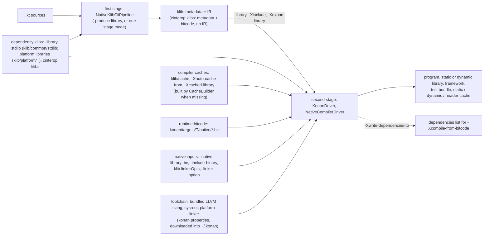
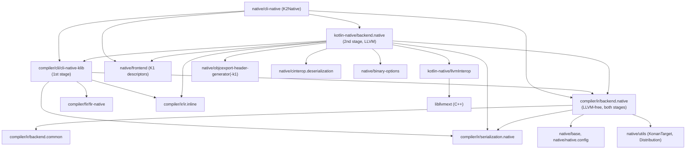
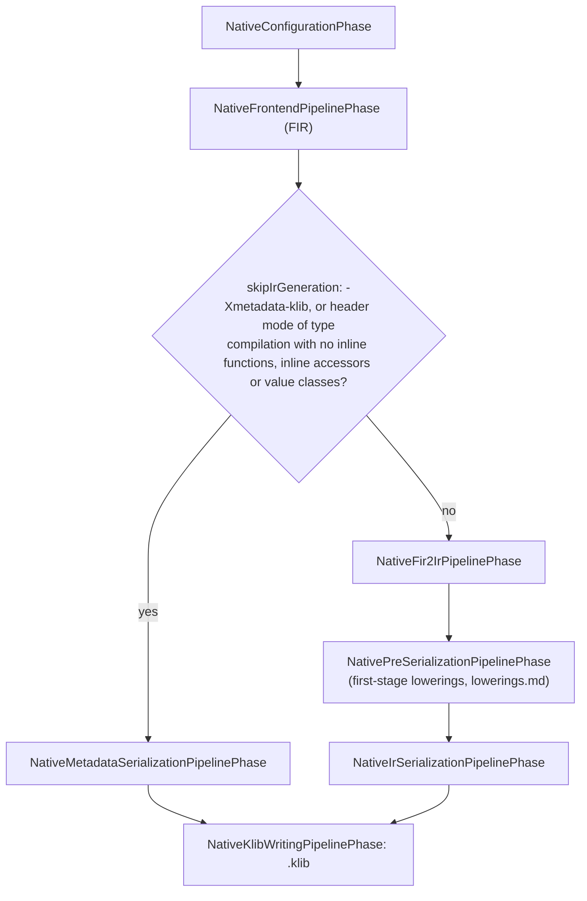

# Kotlin/Native: architecture overview

A map of the Kotlin/Native (K/N) code: where things live, how they depend on each other, and what runs when the compiler is invoked.
This document assumes you already know compilers. The user-facing compilation model (klibs, binaries, caches, interop, export) is
covered in [compilation-model.md](compilation-model.md). Read that first if the terms are unfamiliar.

## Big picture

K/N compiles in two stages:

1. **First stage:** `.kt` → `.klib`. This uses the regular K2 pipeline (FIR → fir2ir → a few pre-serialization lowerings → IR and
   metadata serialization). It does not touch LLVM.
2. **Second stage:** `.klib`s → binary. The compiler deserializes all klibs into one closed-world IR, lowers it, runs whole-program
   optimizations, generates LLVM IR, links it with the runtime bitcode, compiles object files with LLVM, and links them with the
   platform linker.

The runtime (C++) is compiled to LLVM bitcode at build time and shipped in the distribution. The second stage selects runtime modules
(GC, allocator, etc.) based on the compilation options and links them into the program's LLVM module.

Inputs and outputs of the two stages, from the stage selection in `K2Native.doExecute` (`native/cli-native`), the library and cache
handling in `KonanDriver.kt` / `NativeSecondStageCompilationConfig.kt`, the bitcode selection in `CompilerOutput.kt` and the linker
inputs in `Linker.kt` (the project-level view with Gradle tasks is in [compilation-model.md](compilation-model.md)):

## Where the code lives

The code is spread across the repository. The **Gradle path** column is the name to use in `./gradlew <path>:<task>`. It does not
always match the directory.

| Directory                                               | Gradle path                                          | What it is                                                                                             |
|---------------------------------------------------------|------------------------------------------------------|--------------------------------------------------------------------------------------------------------|
| `native/cli-native`                                     | `:native:cli-native`                                 | `K2Native` CLI entry point; picks the first or second stage, or both ("one-stage" mode)                 |
| `compiler/cli/cli-native-klib`                          | `:compiler:cli:cli-native-klib`                      | First-stage pipeline `NativeKlibCliPipeline` (sources → klib)                                          |
| `compiler/fir/fir-native`, `compiler/fir/checkers/checkers.native` | `:compiler:fir:fir-native`, `...:checkers.native` | Native-specific FIR parts and frontend checkers                                                        |
| `compiler/ir/backend.native`                            | `:compiler:ir.backend.native`                        | LLVM-free Native IR code shared by both stages: first-stage lowerings, checkers, runtime names          |
| `compiler/ir/serialization.native`                      | `:compiler:ir.serialization.native`                  | Native-specific IR serialization and deserialization for klibs                                         |
| `kotlin-native/backend.native/compiler/ir/backend.native` | `:kotlin-native:backend.native`                    | **The backend.** Second stage: driver, lowerings, optimizations, LLVM codegen, caches, ObjC/C export   |
| `kotlin-native/runtime`                                 | `:kotlin-native:runtime`                             | C++ runtime (memory manager, GCs, allocators, ObjC interop, launcher), plus the Native part of the stdlib |
| `kotlin-native/Interop`                                 | `:kotlin-native:Interop:*`                           | cinterop tool (`Indexer`, `StubGenerator`) and the `kotlinx.cinterop` runtime (`Runtime`)               |
| `kotlin-native/llvmInterop`, `libclangInterop`          | `:kotlin-native:llvmInterop`, `:...:libclangInterop` | JVM bindings to the LLVM and libclang C APIs (generated with cinterop's JVM mode)                      |
| `kotlin-native/libllvmext`, `libclangext`               | same                                                 | C++ extensions to the LLVM/libclang C APIs, and custom LLVM passes                                     |
| `kotlin-native/llvmDebugInfoC`                          | same                                                 | DWARF helpers; the `konan_lldb.py` LLDB plugin; see [debug-info.md](debug-info.md)                     |
| `kotlin-native/platformLibs`                            | `:kotlin-native:platformLibs`                        | `.def` files and the build of platform libraries (POSIX, Apple frameworks, …)                          |
| `kotlin-native/build-tools`                             | included build `native-build-tools`                  | Gradle plugins used to build K/N: bitcode compilation, distribution layout, platform libs, Xcode       |
| `kotlin-native/konan/konan.properties`                  | —                                                    | Per-target toolchains, sysroots, clang/linker flags, Xcode versions                                    |
| `kotlin-native/cmd`                                     | —                                                    | Launcher scripts (`konanc`, `kotlinc-native`, `cinterop`, `klib`, `run_konan`)                         |
| `kotlin-native/prepare`                                 | `:kotlin-native:prepare:*`                           | Packaging of `kotlin-native-compiler-embeddable.jar`                                                   |
| `kotlin-native/performance`                             | separate Gradle build                                | Benchmarks; see its README                                                                             |
| `native/utils`                                          | `:native:kotlin-native-utils`                        | `KonanTarget`, `HostManager`, `konan.properties` access, `.def` file parsing, dependency downloader; see [targets-and-toolchains.md](targets-and-toolchains.md) |
| `native/base`, `native/native.config`                   | `:native:base`, `:native:native.config`              | Small shared types (`KonanFqNames`, …) and `NativeConfigurationKeys`                                   |
| `native/binary-options`                                 | `:native:binary-options`                             | `-Xbinary=` options (`BinaryOptions.kt`)                                                               |
| `native/frontend`                                       | `:native:frontend.native`                            | K1 descriptors for Native (`KonanBuiltIns`, platform resolution), still used by the second stage        |
| `native/cinterop.deserialization`                       | `:native:cinterop.deserialization`                   | Builds IR for cinterop klibs, which carry metadata only, at link time                                  |
| `native/objcexport-header-generator`                    | `:native:objcexport-header-generator*`               | ObjC header generation: the `k1` implementation (used by the compiler) and the `analysis-api` one (IDE) |
| `native/swift`                                          | `:native:swift:*`                                    | Swift export, a standalone tool built on the Analysis API; see [swift-export](../swift-export/README.md) |
| `native/commonizer*`                                    | `:native:kotlin-klib-commonizer*`                    | klib commonizer for shared native source sets; see [commonizer.md](commonizer.md)                      |
| `native/executors`                                      | `:native:executors`                                  | Run binaries on host, simulators, emulators, devices (used by tests)                                   |
| `native/native.tests`                                   | `:native:native.tests*`                              | Compiler integration tests; usage in [Testing](../../kotlin-native/HACKING.md#testing), internals in [test-infrastructure.md](test-infrastructure.md) |
| `libraries/stdlib/native-wasm`                          | —                                                    | stdlib sources shared by Native and Wasm                                                               |
| `libraries/tools/kotlin-gradle-plugin/.../targets/native` | —                                                  | The Kotlin Gradle plugin side of Native (tasks, cinterop, caches, CocoaPods)                           |

The K/N-specific projects (`:kotlin-native:*`, `:native:cli-native`, …) are included only when `kotlin.native.enabled=true`
(see `settings.gradle.kts`).

### Module dependencies

Dependencies as declared in the modules' `build.gradle.kts` files (`native/cli-native`, `compiler/cli/cli-native-klib`,
`compiler/ir/backend.native`, `kotlin-native/backend.native/compiler/ir/backend.native`); only the Native-specific projects are shown,
the shared compiler projects (`ir.tree`, `fir:*`, `core:*`) are omitted:

The rule that matters most: **`compiler/ir/backend.native` and `cli-native-klib` must not depend on `:kotlin-native:backend.native`.**
This keeps the first stage free of LLVM, so it can run without native libraries (for example in KGP or the IDE).

## Compiler execution path

### Entry and stage selection

`native/cli-native/src/org/jetbrains/kotlin/cli/bc/K2Native.kt`:
- `-produce library` runs the first stage: `NativeKlibCliPipeline`.
- Any other output kind (the default is `program`) runs the second stage: `KonanDriver`.
- If sources are passed together with a binary output kind, the compiler runs both stages in a row through an intermediate klib
  ("one-stage" mode, `oneStageMode.kt`). Gradle always uses the two stages separately.

### First stage (`compiler/cli/cli-native-klib/.../pipeline/NativeKlibCliPipeline.kt`)

The pipeline runs these phases in order:

1. `NativeConfigurationPhase`
2. `NativeFrontendPipelinePhase` (FIR)
3. One of two branches:
   - for metadata-only klibs (`-Xmetadata-klib`, header mode): `NativeMetadataSerializationPipelinePhase`
   - otherwise: `NativeFir2IrPipelinePhase` → `NativePreSerializationPipelinePhase` (lowerings from `compiler/ir/backend.native/.../lower`)
     → `NativeIrSerializationPipelinePhase`
4. `NativeKlibWritingPipelinePhase`

The branch, as composed with `then` / `thenIf` in `NativeKlibCliPipeline.createCompoundPhase` and decided by `skipIrGeneration`:

### Second stage (`kotlin-native/backend.native/compiler/ir/backend.native/src/org/jetbrains/kotlin/backend/konan/`)

All paths below are relative to that directory.

1. **`KonanDriver.run()`** prepares a `NativeSecondStageCompilationConfig`. If dependency caches are missing, `CacheBuilder` builds them
   first by spawning sub-compilations.
2. **`driver/NativeCompilerDriver.run()`** dispatches on the output kind (program, static or dynamic library, framework, cache, test
   bundle). Every output kind follows the same skeleton:
   - `runK1Frontend`: builds module descriptors for all klibs. The second stage still uses descriptors as its "frontend".
   - Export interface, framework or C API only: ObjC export or C export interface building (`driver/phases/ObjCExport.kt`,
     `CExport.kt`).
   - `linkKlibs` (`driver/phases/LinkKlibs.kt`, `linkKlibs.kt`): deserializes IR from all klibs into one IR module set, with partial
     linkage.
   - `runBackend`.
3. **`driver/phases/TopLevelPhases.kt` `runBackend`** runs the rest:
   - It splits the IR into fragments: one for a whole program, or one per library or file when building caches.
   - **Lowerings** run per file, with validation at the points where all fragments are synchronized:
     - `getLoweringsUpToAndIncludingSyntheticAccessors()`
     - inlining of all functions (`NativeAllFunctionInlining`)
     - `getLoweringsAfterInlining()`

     These lists are defined in `driver/phases/NativeLoweringPhases.kt` (Native lowerings live in `lower/`, shared ones in
     `compiler/ir/backend.common`).
   - **`runCodegen`**:
     - whole-program analyses and optimizations over a dataflow IR (`optimizations/`): devirtualization, DCE, escape analysis,
       pre-codegen inlining, static-initializer optimization
     - LLVM declarations, RTTI
     - IR → LLVM IR (`llvm/IrToBitcode.kt` and its neighbours in `llvm/`)
   - **`compileModule` / `compileAndLink`**:
     1. link in the runtime bitcode modules (`llvm/runtime/RuntimeModule.kt`; chosen in `CompilerOutput.kt`)
     2. run the LLVM optimization pipeline (`OptimizationPipeline.kt`)
     3. produce object files (`BitcodeCompiler.kt`)
     4. link with the platform linker (`Linker.kt`), with caches prelinked where needed
   - After lowerings, fragments can be compiled in parallel (`threadsCount`).

The phase engine itself is `driver/Machinery.kt` (`PhaseEngine`). Phases are `NamedCompilerPhase`s, so
`-Xphases-to-dump-after`/`-Xdisable-phases` and similar options work by phase name.

### Other entry points

- **cinterop** (`Interop/StubGenerator/.../gen/jvm/main.kt`, class `Interop`):
  1. `.def` file → libclang-based `Indexer` → stub IR (`StubIrDriver`).
  2. The stub IR is emitted as klib **metadata**. IR for it is produced later, at link time, by `native/cinterop.deserialization`.
  3. The C bridges are compiled by clang to `.bc` and packaged into the klib.
- **Compiler caches:** these are ordinary second-stage compilations with `-produce static_cache` (or a similar cache kind). See the
  "Compiler caches" section of [compilation-model.md](compilation-model.md).
- **Swift export** does not go through `K2Native` export phases. It is a separate Analysis API-based tool that generates Swift plus
  Kotlin bridges, which are then compiled by K/N.

## Runtime

`kotlin-native/runtime` contains:
- `src/main/cpp`: the core runtime
- `src/*`: optional modules, one per GC, GC scheduler, allocator, crash handler, …
- `src/main/kotlin`: the Kotlin part of the Native stdlib

The [runtime README](../../kotlin-native/runtime/README.md) has the module map.

At build time each module is compiled to one `.bc` file per target, by the `compile-to-bitcode` plugin from `build-tools`. The files
end up in `dist/konan/targets/<target>/native/`.

At compile time `RuntimeModule` selects the set of modules (for example `concurrent_ms_gc.bc` vs `pmcs_gc.bc`) from binary options.
The list of modules is duplicated in `runtime/build.gradle.kts`, so keep the two in sync.

Compiler ↔ runtime contract:
- The compiler calls runtime entry points by name (`llvm/Runtime.kt`, `RuntimeNames.kt`), relies on the runtime object layout and
  type info (`RTTIGenerator.kt`), and on safepoint and thread-state conventions.
- The runtime calls back into Kotlin through `@ExportForCppRuntime` and similar functions in the stdlib.

Changes to either side usually need a matching change on the other.

The **stdlib klib** is built by `:kotlin-native:runtime:stdlibBuildTask` from `libraries/stdlib/{common,native-wasm,…}`,
`kotlin-native/Interop/Runtime/src/{main,native}/kotlin` and `kotlin-native/runtime/src/main/kotlin`.

## Distribution

`./gradlew :kotlin-native:dist` assembles `kotlin-native/dist`, a full distribution that both the tests and KGP (`kotlin.native.home`)
can use:

| Path                               | Contents                                                       |
|------------------------------------|----------------------------------------------------------------|
| `bin/`                             | launcher scripts                                               |
| `konan/lib/`                       | compiler jar (`kotlin-native-compiler-embeddable.jar`) and deps |
| `konan/konan.properties`           | toolchain config                                               |
| `konan/targets/<target>/native/`   | runtime bitcode                                                |
| `klib/common/stdlib`               | stdlib klib                                                    |
| `klib/platform/<target>/`          | platform libraries (`distPlatformLibs`)                        |
| `klib/cache/`                      | prebuilt caches                                                |

The table is abridged: a shipped distribution also has `konan/nativelib`, `konan/platformDef`, `konan/swift_export`,
`konan/compiler.fingerprint`, `tools/` and `sources/`; the full tree, how it is discovered and how `konan.properties` is read are in
[targets-and-toolchains.md](targets-and-toolchains.md#the-distribution-layout-and-discovery).

Toolchains (LLVM, sysroots) are downloaded on demand into `~/.konan/dependencies` (archives are kept in
`~/.konan/dependencies/cache`; override the root with `KONAN_DATA_DIR`).

**Integration tests load the compiler from the distribution, not from the IDE classpath.** After a compiler change, the test task
rebuilds `:kotlin-native:dist`, unless you pass `-Pkn.nativeHome`.

## Further reading

This page is the map; the subsystem pages of the [knowledge base](README.md) go one level deeper:
[second-stage-pipeline.md](second-stage-pipeline.md), [lowerings.md](lowerings.md), [optimizations.md](optimizations.md),
[llvm-codegen.md](llvm-codegen.md), [compiler-runtime-contract.md](compiler-runtime-contract.md), [runtime.md](runtime.md),
[caches.md](caches.md), [klib-linking.md](klib-linking.md), [cinterop.md](cinterop.md), [export.md](export.md), and for bug
hunting [debugging.md](debugging.md) and the [glossary](glossary.md). Algorithm-level deep dives and integration pages are
listed in the [README](README.md#deep-dives); among them [targets-and-toolchains.md](targets-and-toolchains.md) (targets,
`konan.properties`, the distribution), [intrinsics.md](intrinsics.md), [coroutines.md](coroutines.md),
[exceptions.md](exceptions.md), [debug-info.md](debug-info.md), [llvm-passes.md](llvm-passes.md),
[commonizer.md](commonizer.md) and [test-infrastructure.md](test-infrastructure.md).

- [compilation-model.md](compilation-model.md): user-visible compilation model, caches, interop and export.
- [kotlin-native/HACKING.md](../../kotlin-native/HACKING.md): building, testing, debugging, LLVM tricks.
- [kotlin-native/runtime/README.md](../../kotlin-native/runtime/README.md): runtime modules; also
  [custom allocator](../../kotlin-native/runtime/src/alloc/custom/README.md) and the
  [external calls checker](../../kotlin-native/runtime/src/externalCallsChecker/README.md).
- [klib inlining](../inlining/klib-inining.md): cross-module inlining in klib-based backends.
- [swift-export](../swift-export/README.md), [commonizer](../../native/commonizer/README.md),
  [ObjC header generator](../../native/objcexport-header-generator/ReadMe.md).
