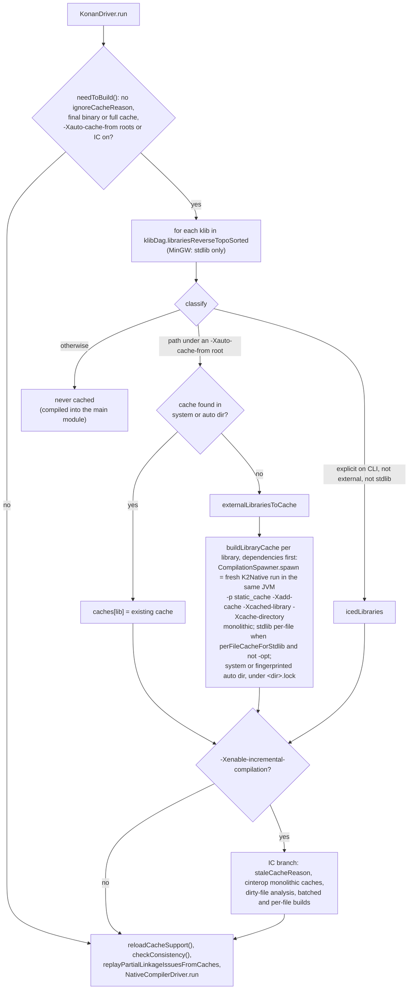
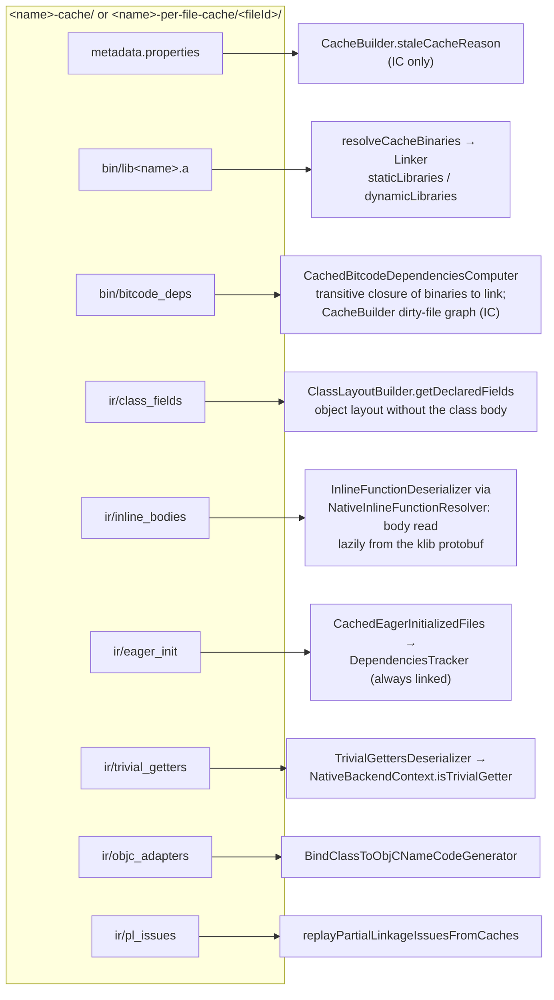
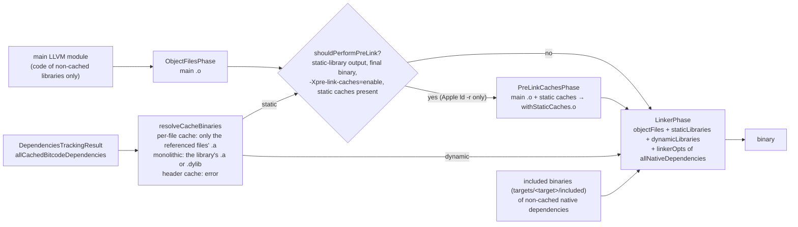

# Kotlin/Native: compiler caches (implementation)

How the second stage reuses machine code built by earlier compiler invocations: how caches are found, built, consumed and
linked, and what breaks when the cache boundary is crossed carelessly. The user-visible semantics and rationale are in
[compilation-model.md](compilation-model.md) ("Compilation time optimization", "Compiler caches", "Incremental second
compilation stage"); the module map is in [architecture.md](architecture.md). Paths below are relative to
`kotlin-native/backend.native/compiler/ir/backend.native/src/org/jetbrains/kotlin/backend/konan/` unless they start with a
repository directory.

## Role and fit

A cache is a precompiled klib (or a single file of a klib) plus the side information the consumer needs instead of IR.
Caching is a mode of the normal second stage: a cache is produced by a compilation with `-produce static_cache`
(or `dynamic_cache`, `header_cache`) and `-Xadd-cache=<klib>`, and consumed by any later second-stage compilation that
finds the cache directory. The driver ([KonanDriver.kt](../../kotlin-native/backend.native/compiler/ir/backend.native/src/org/jetbrains/kotlin/backend/konan/KonanDriver.kt)
`KonanDriver.run`) builds missing caches before the main compilation by spawning sub-compilations
([CacheBuilder.kt](../../kotlin-native/backend.native/compiler/ir/backend.native/src/org/jetbrains/kotlin/backend/konan/CacheBuilder.kt)).
Incremental compilation (IC) is per-file caches of the project's own klibs plus a dirty-file analysis, implemented in the
same class; it has its own page, [incremental-compilation.md](incremental-compilation.md). Everything else in the backend
sees caches through two queries: "is this library cached?"
(`CachedLibraries`) and "does my LLVM module contain this declaration?" (`LlvmModuleSpecification`).

## Terminology

| Term | Meaning | Where |
|------|---------|-------|
| Static / dynamic / header cache | `CompilerOutputKind.STATIC_CACHE` (`.a`), `DYNAMIC_CACHE` (`.dylib`/`.so`), `HEADER_CACHE` (no code, side info only). `isFullCache` = static or dynamic; `isCache` includes header | [CompilerOutputKind.kt](../../native/utils/src/org/jetbrains/kotlin/konan/target/CompilerOutputKind.kt) |
| Monolithic (whole-library) cache | one binary for the whole klib: `<name>-cache/bin/lib<name>-cache.a` | `CachedLibraries.Cache.Monolithic`, [CachedLibraries.kt](../../kotlin-native/backend.native/compiler/ir/backend.native/src/org/jetbrains/kotlin/backend/konan/CachedLibraries.kt) |
| Per-file cache | one binary per klib file: `<name>-per-file-cache/<fileId>/bin/lib<fileId>.a`; `fileId` = `<package or ROOT>.<hash36(path)>` (`CacheSupport.cacheFileId`). Built with `-Xmake-per-file-cache`, subset with `-Xfile-to-cache` | `Cache.PerFile`, [CacheSupport.kt](../../kotlin-native/backend.native/compiler/ir/backend.native/src/org/jetbrains/kotlin/backend/konan/CacheSupport.kt) |
| Cache flavor | directory name encoding target, `-g`/`-opt`, and every option that changes generated code, e.g. `macos_arm64-gSTATIC-system`. Two flavor strings: system and user | `appendCommonCacheFlavor` in [NativeSecondStageCompilationConfig.kt](../../kotlin-native/backend.native/compiler/ir/backend.native/src/org/jetbrains/kotlin/backend/konan/NativeSecondStageCompilationConfig.kt) |
| System cache | caches of distribution libraries (stdlib, platform libs) under `<dist>/klib/cache/<system flavor>`; prebuilt by the K/N build | `systemCacheDirectory`; [DistributionUtils.kt](../../kotlin-native/backend.native/compiler/ir/backend.native/src/org/jetbrains/kotlin/backend/konan/util/DistributionUtils.kt) |
| Auto cache | cache of an "external" klib (located under a `-Xauto-cache-from` root), built on demand into `<-Xauto-cache-dir or system root>/<user flavor>/<uniqueName>/<fingerprint of lib + all deps>/` | `CachedLibraries.computeLibraryCacheDirectory` |
| IC cache | per-file caches of klibs passed explicitly on the CLI that are not external and not stdlib, under `-Xic-cache-dir/<user flavor>`; requires `-Xenable-incremental-compilation` | `CacheBuilder.isSubjectOfIC` |
| Additional cache info | the `ir/` side files: `inline_bodies`, `class_fields`, `eager_init`, `trivial_getters`, `objc_adapters`, `pl_issues`, plus `bin/bitcode_deps` and `metadata.properties` | [CacheStorage.kt](../../kotlin-native/backend.native/compiler/ir/backend.native/src/org/jetbrains/kotlin/backend/konan/CacheStorage.kt), [OutputFiles.kt](../../kotlin-native/backend.native/compiler/ir/backend.native/src/org/jetbrains/kotlin/backend/konan/OutputFiles.kt) |
| Cache ABI | accessor functions (`INTERNAL_ABI_ORIGIN`) that let code in one object file reach private state of another | [CachesAbiLowering.kt](../../kotlin-native/backend.native/compiler/ir/backend.native/src/org/jetbrains/kotlin/backend/konan/lower/CachesAbiLowering.kt) |
| Prelink | `ld -r` of the main object file with all static caches into one `.o` before the final link; only for static-library outputs | `shouldPerformPreLink` in [CacheBinariesResolver.kt](../../kotlin-native/backend.native/compiler/ir/backend.native/src/org/jetbrains/kotlin/backend/konan/CacheBinariesResolver.kt) |
| Bitcode dependency | "this cache's code references library L (whole) / files F of L"; recorded per cache in `bitcode_deps` and used to pick cache binaries at link time | [DependenciesTracker.kt](../../kotlin-native/backend.native/compiler/ir/backend.native/src/org/jetbrains/kotlin/backend/konan/DependenciesTracker.kt) |

## How it works

### 1. Deciding what to build: `KonanDriver` → `CacheBuilder`

`KonanDriver.run` constructs `CacheBuilder` and calls `build()` if `needToBuild()`: no `ignoreCacheReason`, the output is a
final binary or a full cache, and either `-Xauto-cache-from` roots or IC are configured. Afterwards it calls
`config.reloadCacheSupport()` so the main compilation sees the new caches, then `cacheSupport.checkConsistency()`.

`ignoreCacheReason` (`NativeSecondStageCompilationConfig`) is non-null when optimizations are on and the binary option
`enableReleaseBinaryCache` is not set, or `forceNativeThreadStateForFunctions` is non-default. Then all cache directories are
ignored with a warning: **release builds do not use caches** (see the optimization section below for why).

`CacheBuilder.build()` walks `klibDag.librariesReverseTopoSorted` (dependencies first) and classifies each library:

| Class | Predicate | Built as | Cache directory |
|-------|-----------|----------|-----------------|
| external | path under a `-Xauto-cache-from` root (`isExternal`) | monolithic static cache (stdlib: per-file when `perFileCacheForStdlib` and not optimized) | system dir for stdlib/distribution libs, otherwise auto dir |
| IC'ed | `isExplicitlySpecifiedByUserInCLIArgument && !isExternal && !isNativeStdlib` | per-file; cinterop klibs monolithic | `incrementalCacheDirectory` |
| anything else | project klibs when IC is off, the klib being linked | never cached | — |

On MinGW only stdlib is cached (`KonanTarget.MINGW_X64` check in `build()` and `CachedLibraries.allCaches`).

Every cache is built by `trySpawningCacheBuild`, which calls `CompilationSpawner.spawn` (a fresh `K2Native` run in the same
process with a new `CompilerConfiguration`): `konanProducedArtifactKind = STATIC_CACHE`, `-nostdlib -no-default-libs`, all
transitive dependencies plus the library as `-library`, every dependency's cache as `-Xcached-library=<lib>,<cacheDir>`,
`-Xcache-directory=<target dir>`, `-Xadd-cache=<lib>`, and the options copied by `setupCommonOptionsForCaches`
([SetupConfiguration.kt](../../kotlin-native/backend.native/compiler/ir/backend.native/src/org/jetbrains/kotlin/backend/konan/SetupConfiguration.kt)).
Note that auto-built caches are always static; dynamic caches are only produced when a user asks for `-produce dynamic_cache`.
A library is skipped ("SKIPPING ... as some of the dependencies aren't cached") if any dependency has no cache, which is why
the reverse topological order matters. External caches are built under an OS file lock (`buildUnderFileLock`) because several
Gradle workers may race to build the same stdlib cache; IC caches live in a per-project directory and are not locked.

How `KonanDriver.run` and `CacheBuilder.build` decide which sub-compilations to spawn, and in which order (the IC branch
is expanded in [incremental-compilation.md](incremental-compilation.md)):



The IC branch (`icEnabled`) adds:
1. staleness check of existing IC caches (`staleCacheReason`): `metadata.properties` compiler fingerprint, dependencies
   fingerprint, companion-initialization mode, and for monolithic cinterop caches the klib hash; a stale per-file cache is
   fully rebuilt in place, a stale monolithic one is deleted first;
2. dirty-file analysis: for each cached file compare `SerializedIrFileFingerprint` of the klib file with the hash stored in the
   file's metadata, collect added/removed files, and propagate through the reversed per-file dependency graph read from each
   file's `bitcode_deps` (weak edges propagate only from removed files);
3. optional batched build (`batchedCacheBuild`, default on): all libraries needing a full rebuild are compiled in one spawned
   compilation (`CACHE_BATCH` configuration key), split into groups that share no top-level signatures
   (`splitIntoNonConflictingGroups`), because the IR linker binds one declaration per signature;
4. per-library builds with `-Xfile-to-cache` for the dirty files only.

The IC analysis is logged with `reportLog` ("IC analysis results", "CACHING ...", "DIRTY FILES"). `-Xdump-built-caches-to`
writes the list of rebuilt archives.

### 2. Finding caches: `CacheSupport` and `CachedLibraries`

`CacheSupport` builds the list of implicit cache roots in this order: every `-Xcache-directory`, the system directory (only
when auto-caching or IC is on), the auto-cache directory, the IC directory. `CachedLibraries.allCaches` resolves, per library:
explicit `-Xcached-library` path, else the first implicit root containing `<name>-per-file-cache` or `<name>-cache`, else the
fingerprinted auto-cache directory. `trySelectCacheFor` classifies a directory by what `bin/` contains: a `.a` → STATIC, a
dynamic library → DYNAMIC, `.header` → HEADER, none of these → per-file, with `complete` set when every file of the klib has
a directory. An incomplete per-file cache is visible only with `allowIncomplete = true`, which callers pass only for the
library currently being (re)built. An empty cache directory counts as "no cache" (left over from an interrupted
`FinalizeCache`).

Outputs of a cache build are placed by `CacheSupport.tryGetImplicitOutput` into the *first* implicit cache root; in a
per-file build each fragment gets `<root>/<name>-per-file-cache/<fileId>`.

The three implicit roots and what a monolithic and a per-file cache look like on disk, with names from the
`CachedLibraries` companion constants, `computeLibraryCacheDirectory`, `OutputFiles` and `CacheBuilder.buildLibraryCache`
(flavor strings are examples for a debug macOS build):

```
<dist>/klib/cache/                                        systemCacheRootDirectory (DistributionUtils.kt)
├── macos_arm64-gSTATIC-system/                           systemCacheFlavorString; -optSTATIC-system for -opt
│   ├── stdlib-per-file-cache/                            debug stdlib: per-file (perFileCacheForStdlib)
│   │   └── <package>.<hash36(path)>/                     cacheFileId
│   │       ├── metadata.properties
│   │       ├── bin/  lib<fileId>.a  bitcode_deps
│   │       └── ir/   inline_bodies  class_fields  eager_init  trivial_getters  objc_adapters  [pl_issues]
│   └── org.jetbrains.kotlin.native.platform.posix-cache/ monolithic (getCachedLibraryName)
│       ├── metadata.properties                           CacheMetadata (CacheStorage.generateCacheMetadata)
│       ├── bin/  liborg.jetbrains.kotlin.native.platform.posix-cache.a   bitcode_deps
│       └── ir/   same side files
└── macos_arm64-gSTATIC-user-pl/                          userCacheFlavorString: default -Xauto-cache-dir is this root
    └── <uniqueName>/<fingerprint(lib + all deps)>/       computeLibraryCacheDirectory (auto cache)
        ├── <uniqueName>-cache/  { metadata.properties, bin/, ir/ }
        └── <uniqueName>-cache.lock                       buildUnderFileLock, external caches only
<-Xic-cache-dir>/macos_arm64-gSTATIC-user-pl/             IC root, see incremental-compilation.md
├── <uniqueName>-per-file-cache/<fileId>/ ...
└── <cinterop uniqueName>-cache/ ...
```

`trySelectCacheFor` classifies a directory by `bin/`: `lib<name>-cache.a` → STATIC, `.dylib`/`.so` → DYNAMIC, `.header` →
HEADER, none of these → per-file (one subdirectory per `cacheFileId`).

### 3. A cache-building compilation

The pipeline is the ordinary `NativeCompilerDriver.produceBinary` → `runBackend`
([TopLevelPhases.kt](../../kotlin-native/backend.native/compiler/ir/backend.native/src/org/jetbrains/kotlin/backend/konan/driver/phases/TopLevelPhases.kt)),
with these cache-specific points:

- **What is deserialized.** `librariesToCache` maps the klib to a `PartialCacheInfo(klib, strategy)` with a
  [CacheDeserializationStrategy](../../compiler/ir/serialization.native/src/org/jetbrains/kotlin/backend/konan/serialization/CacheDeserializationStrategy.kt):
  `WholeModule`, `MultipleFiles` (`-Xfile-to-cache`) or, per fragment, `SingleFile`. In
  [linkKlibs.kt](../../kotlin-native/backend.native/compiler/ir/backend.native/src/org/jetbrains/kotlin/backend/konan/linkKlibs.kt)
  `scheduleDependenciesForDeserialization` a fully cached dependency is deserialized with `ONLY_DECLARATION_HEADERS`
  (`WITH_INLINE_BODIES` for header klibs); `KonanPartialModuleDeserializer`
  ([KonanIrLinker.kt](../../compiler/ir/serialization.native/src/org/jetbrains/kotlin/backend/konan/serialization/KonanIrLinker.kt))
  uses `ON_DEMAND` for files outside the strategy. Because header-only deserialization loses inter-module edges, modules are
  re-sorted by `KlibDAG` (`reverseTopoSortUsingKlibDAG`), not by what the IR linker observed.
- **Fragments.** `splitIntoFragments`: without `-Xmake-per-file-cache`, one `BackendJobFragment` for the whole module with
  `CacheLlvmModuleSpecification`. Per-file: one fragment per `IrFile`, skipping synthetic function-interface files. Two
  stdlib special cases: the fragment for `kotlin.native.internal/KFunctionImpl.kt` also receives the function-interface
  files (`containsKFunctionImpl`), and the fragment for `Runtime.kt` records a dependency on every file holding
  `@ExportTypeInfo`/`@ExportForCppRuntime` declarations (`isReferencedByNativeRuntime`), because the C++ runtime references
  those symbols by name without any IR edge. `Boxing.kt` similarly owns the cached boxes (`shouldDefineCachedBoxes` in
  [CompilerOutput.kt](../../kotlin-native/backend.native/compiler/ir/backend.native/src/org/jetbrains/kotlin/backend/konan/CompilerOutput.kt)).
- **Module boundary.** [LlvmModuleSpecificationImpl.kt](../../kotlin-native/backend.native/compiler/ir/backend.native/src/org/jetbrains/kotlin/backend/konan/LlvmModuleSpecificationImpl.kt):
  `DefaultLlvmModuleSpecification.containsLibrary = !isLibraryCached` (final binaries emit code for every non-cached
  library); `CacheLlvmModuleSpecification.containsLibrary = library == libraryToCache`, and `containsDeclaration` further
  restricts to the fragment's file for `SingleFile`. `findDependenciesToCompile`/`mergeDependencies` in `TopLevelPhases`
  use `containsModule` to merge the files that must be lowered and emitted together.
- **Additional cache info** is collected by `BuildAdditionalCacheInfoPhase`
  ([CacheBuilding.kt](../../kotlin-native/backend.native/compiler/ir/backend.native/src/org/jetbrains/kotlin/backend/konan/driver/phases/CacheBuilding.kt))
  in `createGenerationState`, i.e. **before any lowering**, by
  [CacheInfoBuilder.kt](../../kotlin-native/backend.native/compiler/ir/backend.native/src/org/jetbrains/kotlin/backend/konan/lower/CacheInfoBuilder.kt):
  - `class_fields`: for every exported, non-interface, non-local class the declared fields from `ClassLayoutBuilder`
    (names, binary types, alignment, `outerThisIndex`), so consumers can lay out objects without the class body;
  - `inline_bodies`: for every exported inline function a reference (file, declaration index, body index, default-value
    indices) into the klib's IR protobuf, so the consumer deserializes the body lazily from the klib, not from the cache;
    `trackCallees` additionally marks every non-cached callee reachable from such a body as
    `isCalledFromExportedInlineFunction` (classes: `isConstructedFromExportedInlineFunctions`);
  - `eager_init`: files with `@EagerInitialization` top-level properties; `trivial_getters`: exported trivial `val` getters;
    `objc_adapters` (consumed by `BindClassToObjCNameCodeGenerator`); `klibHash` (whole klib or file fingerprint).
  For cinterop klibs only the klib fingerprint is recorded. `SaveAdditionalCacheInfoPhase` runs in `runPostCodegen` after
  bitcode post-processing and writes everything into a temporary directory (`OutputFiles.tempCacheDirectory`), including
  `bitcode_deps` = `dependenciesTracker.immediateBitcodeDependencies` and the recorded partial-linkage issues.
- **Lowerings.** `ExportCachesAbiVisitor` runs only for caches (`isCache` in
  [NativeLoweringPhases.kt](../../kotlin-native/backend.native/compiler/ir/backend.native/src/org/jetbrains/kotlin/backend/konan/driver/phases/NativeLoweringPhases.kt)),
  adding accessors for inner-class outer-this fields, non-private `lateinit` backing fields, non-private top-level fields
  and fake overrides of private members. `ImportCachesAbiTransformer` runs always and redirects reads of fields the current
  module does not contain to those accessors (also registering the dependency).
- **Codegen.** `ContextUtils.isExternal(declaration) = !containsDeclaration`
  ([ContextUtils.kt](../../kotlin-native/backend.native/compiler/ir/backend.native/src/org/jetbrains/kotlin/backend/konan/llvm/ContextUtils.kt)):
  such declarations become external LLVM prototypes. `linkageOf` gives external linkage to exported functions and, in
  per-file builds, to functions flagged `isCalledFromExportedInlineFunction`; `LlvmDeclarations` does the same for type
  infos of classes constructed from exported inline functions.
- **Link.** In `compileAndLink`, `STATIC_CACHE` passes no cache binaries at all: the `.a` only contains this fragment's
  code; dependencies are resolved by the final link. `DYNAMIC_CACHE` is linked as a shared library with
  `-install_name` and gets the `EXCEPTIONS_SUPPORT` runtime module (`CompilerOutput.kt`). `HEADER_CACHE` skips codegen
  (`runAfterLowerings` returns after saving the info and creating an empty binary file). `FinalizeCachePhase` renames the
  temp directory over the final one (`CacheStorage.renameOutput`; overwrite only for per-file caches).

### 4. Consuming caches

Which consumer reads each file of a cache directory, as wired in `CachedLibraries.Cache`, `CacheSerializationSupport.kt`,
`DependenciesTracker.kt`, `CacheBuilder.staleCacheReason` and `PartialLinkageIssuesReplay.kt`:



- **Side info instead of IR.** `ModuleDeserializerProvider.getDeserializerOrNull`
  ([ModuleDeserializerProvider.kt](../../kotlin-native/backend.native/compiler/ir/backend.native/src/org/jetbrains/kotlin/backend/konan/serialization/ModuleDeserializerProvider.kt))
  returns a deserializer exactly for declarations from cached klibs that are not being compiled now. `ClassLayoutBuilder.getDeclaredFields`
  ([ClassLayoutBuilder.kt](../../kotlin-native/backend.native/compiler/ir/backend.native/src/org/jetbrains/kotlin/backend/konan/ir/ClassLayoutBuilder.kt))
  then reads `class_fields`; `NativeInlineFunctionResolver`
  ([NativeInlineFunctionResolver.kt](../../kotlin-native/backend.native/compiler/ir/backend.native/src/org/jetbrains/kotlin/backend/konan/lower/NativeInlineFunctionResolver.kt))
  deserializes bodiless inline functions through `InlineFunctionDeserializer`; `CachedEagerInitializedFiles` feeds the
  dependency tracker (all in [CacheSerializationSupport.kt](../../kotlin-native/backend.native/compiler/ir/backend.native/src/org/jetbrains/kotlin/backend/konan/serialization/CacheSerializationSupport.kt)).
- **Which binaries to link.** `DependenciesTrackerImpl` records every used declaration as a dependency on a file
  (`CertainFile`) or on a whole cinterop module; `weak` marks link-time-only references. `allCachedBitcodeDependencies`
  closes this set transitively through the `bitcode_deps` of the caches themselves, always adding eager-initialized files and
  treating `-Xinclude`d libraries as whole-module. It resolves names against `loadedKlibs.all`, not the post-linkage set,
  because platform libraries unused by IR may still be needed by a cache (comment on `CachedBitcodeDependenciesComputer`).
  `allBitcodeDependencies` keeps reverse topological order: the global initializer chain depends on it.
  `resolveCacheBinaries` turns the result into `.a`/`.dylib` paths (per-file caches: only the referenced files).
- **Link.** `compileAndLink`: `shouldPerformPreLink` (static-library output, final binary, `-Xpre-link-caches=enable`,
  which is off by default since `PRE_LINK_CACHES` is read with `getBoolean`, some static caches) → `PreLinkCachesPhase`
  runs `ld -r` (Apple only; other targets `error`, see
  [native/utils Linker.kt](../../native/utils/src/org/jetbrains/kotlin/konan/target/Linker.kt) `preLinkCommands`) so
  the user's static library carries the cached code inside one object. Otherwise static caches are appended to
  `staticLibraries` and dynamic caches to `dynamicLibraries` in [Linker.kt](../../kotlin-native/backend.native/compiler/ir/backend.native/src/org/jetbrains/kotlin/backend/konan/Linker.kt).
  Native binaries bundled in cached klibs are not re-added (`includedBinariesLibraries` filters cached ones).
- **Split compilation.** `-Xwrite-dependencies-to` serializes `DependenciesTrackingResult`
  (`collectAndMaybeSerializeDependencies`); `-Xcompile-from-bitcode` + `-Xread-dependencies-from` resume from a bitcode
  file (`produceBinaryFromBitcode` in [NativeCompilerDriver.kt](../../kotlin-native/backend.native/compiler/ir/backend.native/src/org/jetbrains/kotlin/backend/konan/driver/NativeCompilerDriver.kt)).
- **Diagnostics.** Partial-linkage issues stored in a cache are replayed by consumers
  ([PartialLinkageIssuesReplay.kt](../../kotlin-native/backend.native/compiler/ir/backend.native/src/org/jetbrains/kotlin/backend/konan/PartialLinkageIssuesReplay.kt)),
  skipping caches built in this very run.

The link step of a final binary with caches, as sequenced in `compileAndLink` (`TopLevelPhases.kt`),
`CacheBinariesResolver.kt` and `Linker.linkCommands`:



For a `-p static_cache` build the same function passes an empty `ResolvedCacheBinaries`: the archive contains only this
fragment's code and `FinalizeCachePhase` renames the temporary directory over the cache directory.

### Consequences for optimizations

`runCodegen` sets `runGlobalOptimizations = optimize && !cachedLibraries.hasStaticCaches` and disables `GHAPhase` for any
cache output. Devirtualization, DCE, escape analysis and the pre-codegen inliner work on a data-flow graph of the whole
program (`BuildDFGPhase`); with a static cache present, part of the program is already machine code whose call graph and
class hierarchy are invisible, so "no other implementation exists" conclusions would be unsound. Global hierarchy analysis
(`GlobalHierarchyAnalysis` in `ClassLayoutBuilder.kt`) assigns interface ids and class-id ranges to the whole hierarchy and
bakes them into type infos (`RTTIGenerator`, `CodeGenerator`); a cache built with its own numbering could not interoperate
with a consumer's numbering, hence it is off for caches and, transitively, for binaries using them. This is the reason
caches are a debug-build feature (`ignoreCacheReason`); `enableReleaseBinaryCache` is an opt-in used by the test
infrastructure and exposed by KGP as the internal property `kotlin.internal.native.enableReleaseBinaryCache`. The same boundary
exists at the LLVM level: a cache is a separate object file, so LLVM never inlines across it, and the `kotlin-hide-symbols` pass
hides everything a cache does not export ([llvm-passes.md](llvm-passes.md#the-custom-passes)).

### Versioning and invalidation

The flavor string (section Terminology) is the versioning key for options; `-Xauto-cache` directories add a fingerprint of
the library and all its dependencies (`computeLibraryCacheDirectory`), so a dependency upgrade yields a new directory.
System caches live inside the distribution, so a new compiler brings new caches. IC caches are keyed by name only, hence
`metadata.properties` (`CacheMetadata`: klib hash, host, target, `compiler.fingerprint` from `<dist>/konan/`, runtime
fingerprint for stdlib, dependencies fingerprint, companion-initialization mode) and the `staleCacheReason` check. Nothing
purges old auto-cache directories.

How the two flavor strings are derived from the compilation options and which directory each one keys, following
`appendCommonCacheFlavor`, `systemCacheFlavorString` and `userCacheFlavorString` in `NativeSecondStageCompilationConfig.kt`
(every part after `STATIC` is appended only when the option differs from its default):

```mermaid
flowchart TD
    OPT["second-stage options<br/>(CLI flags and -Xbinary=name=value)"] --> COMMON["appendCommonCacheFlavor<br/>#lt;target#gt; -g | -opt STATIC<br/>+ stdlib_cache, lazy_init, sanitizer, check_state_at_external_calls,<br/>stack_protector, generic_safe_casts, macabi, ccall_mode,<br/>latin1_strings, asserts"]
    COMMON --> SYS["systemCacheFlavorString<br/>+ -system<br/>+ runtime_debug, allocator, gc, gc_scheduler, runtime_asserts,<br/>disable_mmap, gc_mark_single_threaded, fixed_block_page_size,<br/>paged_allocator, concurrent_weak_sweep, with_crash_dumps,<br/>runtime_logs_enabled"]
    COMMON --> USR["userCacheFlavorString<br/>+ -user-pl<br/>+ -swift_export when enabled"]
    SYS --> SYSDIR["#lt;dist#gt;/klib/cache/#lt;system flavor#gt;/<br/>stdlib and platform-library caches"]
    USR --> AUTODIR["#lt;-Xauto-cache-dir or dist klib/cache#gt;/#lt;user flavor#gt;/<br/>#lt;uniqueName#gt;/#lt;fingerprint of lib + deps#gt;/"]
    USR --> ICDIR["#lt;-Xic-cache-dir#gt;/#lt;user flavor#gt;/<br/>IC per-file and cinterop caches"]
    COMMON -. "every entry must also be forwarded by" .-> FWD["setupCommonOptionsForCaches<br/>into the spawned cache build"]
``` Distribution caches are produced by `KonanCacheTask`
([KonanCacheTask.kt](../../kotlin-native/build-tools/src/main/kotlin/org/jetbrains/kotlin/gradle/plugin/konan/tasks/KonanCacheTask.kt))
from [runtime/build.gradle.kts](../../kotlin-native/runtime/build.gradle.kts) (`<target>StdlibCache`, per-file for debug) and
[platformLibs/build.gradle.kts](../../kotlin-native/platformLibs/build.gradle.kts); `cacheableTargets.<host>` in
[konan.properties](../../kotlin-native/konan/konan.properties) lists which targets get them (the property schema and lookup rules
are in [targets-and-toolchains.md](targets-and-toolchains.md#konanproperties-the-schema)). The debug stdlib cache is per-file and
carries a `runtime_debug` flavor component; what the debugger needs from it is in [debug-info.md](debug-info.md#linking-dsym-and-runtime-debug-info).

### KGP side

[KotlinNativeLink.kt](../../libraries/tools/kotlin-gradle-plugin/src/common/kotlin/org/jetbrains/kotlin/gradle/targets/native/tasks/KotlinNativeLink.kt)
`compile()` adds `-Xauto-cache-from=<Gradle user home>` and `-Xbackend-threads` when the cache kind is not `NONE`, the
binary is not optimized (or caches are enabled for optimized builds) and `cacheWorksFor(target)`; with
`kotlin.incremental.native` it adds `-Xenable-incremental-compilation -Xic-cache-dir=<build>/kotlin-native-ic-cache/<binary>`.
The kind comes from `KonanPropertiesBuildService.defaultCacheKindForTarget`
([KonanPropertiesBuildService.kt](../../libraries/tools/kotlin-gradle-plugin/src/common/kotlin/org/jetbrains/kotlin/gradle/targets/native/KonanPropertiesBuildService.kt)),
i.e. `cacheableTargets` minus `optInCacheableTargets` from `konan.properties`; `NativeCacheKind`
([KotlinProjectExtension.kt](../../libraries/tools/kotlin-gradle-plugin/src/common/kotlin/org/jetbrains/kotlin/gradle/dsl/KotlinProjectExtension.kt))
maps to `-produce` values. For prebuilt distributions KGP never computes cache paths or flavors; only the compiler does. The
exception is the `light` distribution type, where KGP's `PlatformLibrariesGenerator` builds `<dist>/klib/cache/<target>-g<KIND>`
itself and passes `-cache-directory` to `generatePlatformLibraries` (see [platform-libraries.md](platform-libraries.md) and
[tooling-integration.md](tooling-integration.md)). Because the Gradle user home is the auto-cache root, only klibs resolved
from repositories are "external"; project klibs are never auto-cached.

## Invariants and ordering constraints

- **Dependencies before dependents, everywhere.** `CacheBuilder.build`, `CachedLibraries.allCaches`, `checkConsistency`
  and `DependenciesTrackerImpl.usefulLibrariesInRTO` all rely on `klibDag.librariesReverseTopoSorted`. A library may be
  cached only if all its dependencies are cached (`checkConsistency` fails with "`X is cached, but its dependency isn't`").
- **One kind per cache.** A `bin/` with both a static and a dynamic file is an error; header caches cannot be linked
  (`resolveCacheBinaries`). A library that already has a monolithic cache cannot be cached again.
- **Caches are built against unlowered IR info.** `BuildAdditionalCacheInfoPhase` runs before lowerings, and the consumer
  reads `class_fields` through the same `ClassLayoutBuilder` entry point; a lowering that adds or removes fields of exported
  classes, or changes what `isExported` (mangler) means, changes the cache ABI.
- **Flavor completeness.** Any option that changes generated code must be appended in `appendCommonCacheFlavor` /
  `systemCacheFlavorString` *and* forwarded in `setupCommonOptionsForCaches`; the comment above `systemCacheFlavorString`
  states this. The test infrastructure duplicates the flavor in `CacheMode.computeCacheDirName`
  ([TestProcessSettings.kt](../../native/native.tests/testFixtures/org/jetbrains/kotlin/konan/test/blackbox/support/settings/TestProcessSettings.kt)).
- **Dependency tracker is sealed** on first query (`DependenciesTrackerImpl.add` throws afterwards), and any use of a
  library absent from `usefulLibrariesInRTO` throws "`Library ... is used but not requested`".
- **Per-file only for Kotlin klibs.** cinterop klibs are always monolithic; the stdlib per-file layout must match the one the
  distribution ships (`buildLibraryCache` comment).
- **Private declarations cross object files only via the cache ABI** or by being flagged from an exported inline function
  (`isCalledFromExportedInlineFunction`); everything else is `internal` LLVM linkage.
- **Batch members must not share top-level signatures**, and a batch member may depend only on batch members or up-to-date
  caches (`tryBuildCacheBatch`).

## Extension points and typical changes

| Change | Touch |
|--------|-------|
| New compiler/binary option affecting codegen | `appendCommonCacheFlavor` or `systemCacheFlavorString`, `setupCommonOptionsForCaches`, `CacheMode.computeCacheDirName` (tests), `cacheFlavor` in `runtime/build.gradle.kts` if distribution caches depend on it |
| New kind of side information | list in `NativeGenerationState`, collector in `CacheInfoBuilder`, serializer in `CacheSerializationSupport.kt`, file constant and accessors in `CachedLibraries.Cache` (both subclasses), `OutputFiles`, `CacheStorage.saveAdditionalCacheInfo`, the consumer |
| A lowering that references private state of another file/class | add an accessor to `CachesAbiSupport`, export it in `ExportCachesAbiVisitor`, import in `ImportCachesAbiTransformer`, call `dependenciesTracker.add` |
| New synthetic declaration emitted into LLVM | decide its linkage in `ContextUtils.linkageOf`/`LlvmDeclarations`; if the runtime references it by name, make sure it lands in the `Runtime.kt` fragment or is tracked by `isReferencedByNativeRuntime` |
| New stale-cache condition for IC | `CacheMetadata` + `CacheMetadataSerializer`, `generateCacheMetadata` in `CacheStorage.kt`, `staleCacheReason` |
| New runtime module needed by cached code | `CompilerOutput.kt` (`additionalBitcodeFiles`), see [runtime.md](runtime.md) |

Cross-subsystem impact: lowering order ([lowerings.md](lowerings.md)) changes what `Export/ImportCachesAbi` see; klib
serialization format changes ([klib-linking.md](klib-linking.md)) invalidate `inline_bodies` indices, which point into the
klib protobuf; runtime symbol renames ([compiler-runtime-contract.md](compiler-runtime-contract.md)) change which stdlib
file owns them; ObjC export ([export.md](export.md)) stores `objc_adapters` in caches.

## Investigating bugs

| Symptom | Where to look |
|---------|---------------|
| Undefined symbol at link only when caches are on | a private/internal declaration crossed a cache boundary: `linkageOf`, `isCalledFromExportedInlineFunction` (`trackCallees`), `CachesAbiSupport`; check `bin/bitcode_deps` of the consumer and the cache to see whether the owning file was requested; for static-library outputs compare with and without `-Xpre-link-caches=enable` |
| Different behaviour between `cacheMode=NO` and `STATIC_EVERYWHERE` | field layout from `class_fields` vs IR (`ClassLayoutBuilder.getDeclaredFields`), inline body deserialized without a lowering (`NativeInlineFunctionResolver.lower`), initializer order (`allBitcodeDependencies`, `eager_init`), or an optimization that silently turned off (`runGlobalOptimizations`, GHA) |
| Works with monolithic caches, fails with `STATIC_PER_FILE_EVERYWHERE` | file-level ownership: function-interface files, `Runtime.kt`/`KFunctionImpl.kt`/`Boxing.kt` special cases, `CacheLlvmModuleSpecification.containsDeclaration`, weak dependencies |
| Stale code after a compiler change | system caches are in `<dist>/klib/cache` (delete them or rebuild the dist); IC caches rebuild when `konan/compiler.fingerprint` differs (log "`Incremental cache for ... rebuilding it`"); auto caches never expire by compiler version unless the dist changes |
| "`X is cached, but its dependency isn't`" / "`Library ... is used but not requested`" | `checkConsistency`; `DependenciesTrackerImpl.usefulLibrariesInRTO` (KT-88867 workaround) |
| "`Failed to build cache for ...`" | the spawned compilation failed; the message names the workaround switch; rerun the printed `-p static_cache -Xadd-cache=...` command manually |
| IC does not rebuild a changed file | `SerializedIrFileFingerprint` is an IR hash, not a source hash; see the "IC analysis results" log and `bitcode_deps` of dependents |

Manual reproduction of what `CacheBuilder` does (from `NativeStaticCacheSanityTest`):

```bash
konanc lib.kt -p library -o lib.klib
konanc -g -p static_cache -Xadd-cache=lib.klib -Xcache-directory=./cache -Xcache-directory=<dist>/klib/cache/<flavor>
konanc main.kt -l lib.klib -g -Xcache-directory=./cache -Xauto-cache-from=<dist>/klib -o main   # consumer
```

Tests (`@Tag("caches")`, task `:native:native.tests:cachesTest`):

```bash
./gradlew :native:native.tests:cachesTest                                   # all cache tests
./gradlew :native:native.tests:test --tests "org.jetbrains.kotlin.konan.test.blackbox.NativeIncrementalCompilationTestGenerated*"
./gradlew :native:native.tests:test --tests "org.jetbrains.kotlin.konan.test.blackbox.CachesAutoBuildTest"
./gradlew :native:native.tests:test --tests "org.jetbrains.kotlin.konan.test.blackbox.CacheBatchTest"
# any suite in a cache mode: NO | STATIC_ONLY_DIST (default) | STATIC_EVERYWHERE | STATIC_PER_FILE_EVERYWHERE | STATIC_USE_HEADERS_EVERYWHERE
./gradlew :native:native.tests:codegen-box:test -Pkn.cacheMode=STATIC_PER_FILE_EVERYWHERE \
    --tests "org.jetbrains.kotlin.konan.test.blackbox.FirNativeCodegenBoxTestGenerated\$Box\$*"
```

`-Pkn.cacheMode` is read in `computeCacheMode`
([NativeTestSupport.kt](../../native/native.tests/testFixtures/org/jetbrains/kotlin/konan/test/blackbox/support/NativeTestSupport.kt));
under `optimizationMode=OPT` the default is `NO`, and on MinGW only `NO`/`STATIC_ONLY_DIST` are allowed. In
`*_EVERYWHERE` modes the infrastructure builds a static (or header) cache for each test klib with `-Xadd-cache` before
linking, and passes `-Xauto-cache-from=<dist>/klib -Xbinary=enableReleaseBinaryCache=true` for distribution caches
([TestCompilation.kt](../../native/native.tests/testFixtures/org/jetbrains/kotlin/konan/test/blackbox/support/compilation/TestCompilation.kt)).
In shared `compiler/testData`, expected failures are marked `// IGNORE_NATIVE: cacheMode=STATIC_EVERYWHERE` (see
[HACKING.md](../../kotlin-native/HACKING.md#testing)). Note the real default: `STATIC_ONLY_DIST` only when the test target is in
`cacheableTargets.<host>` (plus MinGW), `NO` otherwise; the per-mode compilation steps are in
[test-infrastructure.md](test-infrastructure.md#cache-modes). IC scenarios are directories under
[native/native.tests/testData/caches/ic](../../native/native.tests/testData/caches/ic) with `project.info`/`module.info` step
scripts and expectations like `added cache`, `unchanged cache`, `removed cache`
([AbstractNativeIncrementalCompilationTest.kt](../../native/native.tests/testFixtures/org/jetbrains/kotlin/konan/test/blackbox/AbstractNativeIncrementalCompilationTest.kt));
auto-cache scenarios are under `testData/caches/testAutoBuild` ([CachesAutoBuildTest.kt](../../native/native.tests/tests/org/jetbrains/kotlin/konan/test/blackbox/CachesAutoBuildTest.kt)).

## Open questions

- How `reportLog` messages ("IC analysis results", "CACHING ...") are surfaced to a user: Hypothesis: they are LOGGING-severity
  messages shown with `-verbose` / Gradle `--info`; not verified in this page.
- Why the `KFunctionImpl.kt` fragment, specifically, owns the synthetic function-interface files (rather than a dedicated
  fragment) is not documented in code; only the mechanism is.
- Whether the native binaries bundled in a cached cinterop klib are linked into the static cache archive or only skipped by
  the final link (`Linker.linkCommands` filters them; the archive step for `STATIC_CACHE` was not traced).
- Dynamic caches: no code path builds them automatically and no test mode exercises them here; their current support level
  is unverified.
- Whether anything cleans old fingerprinted auto-cache directories (none found in the compiler; KGP not checked beyond
  `KotlinNativeLink`).
