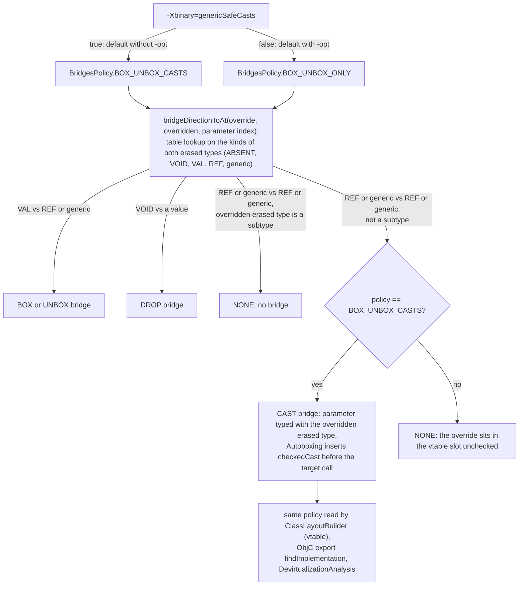
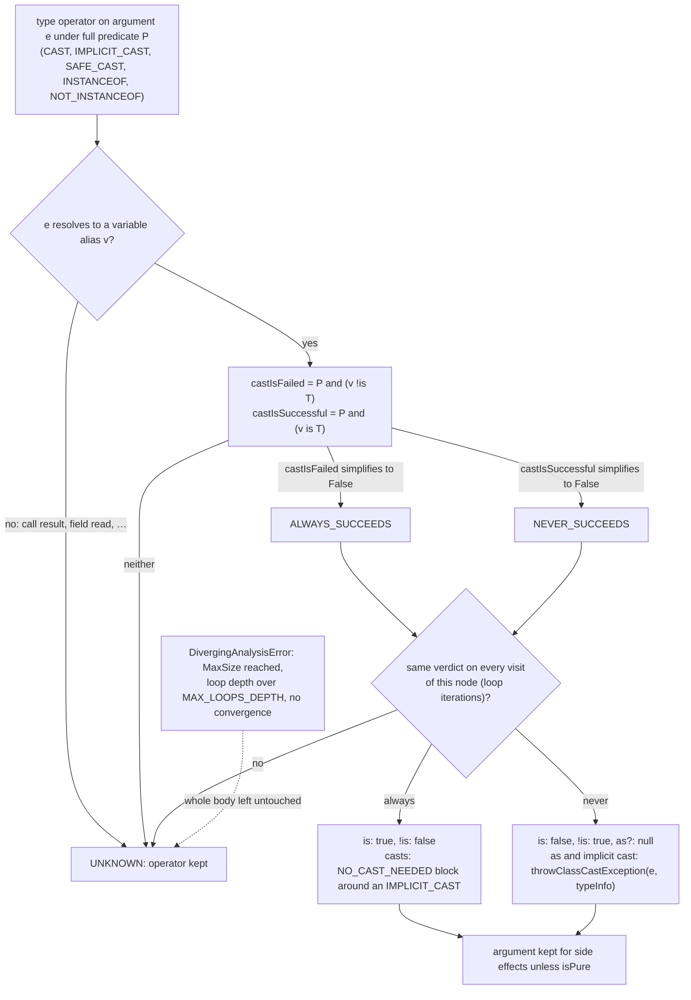
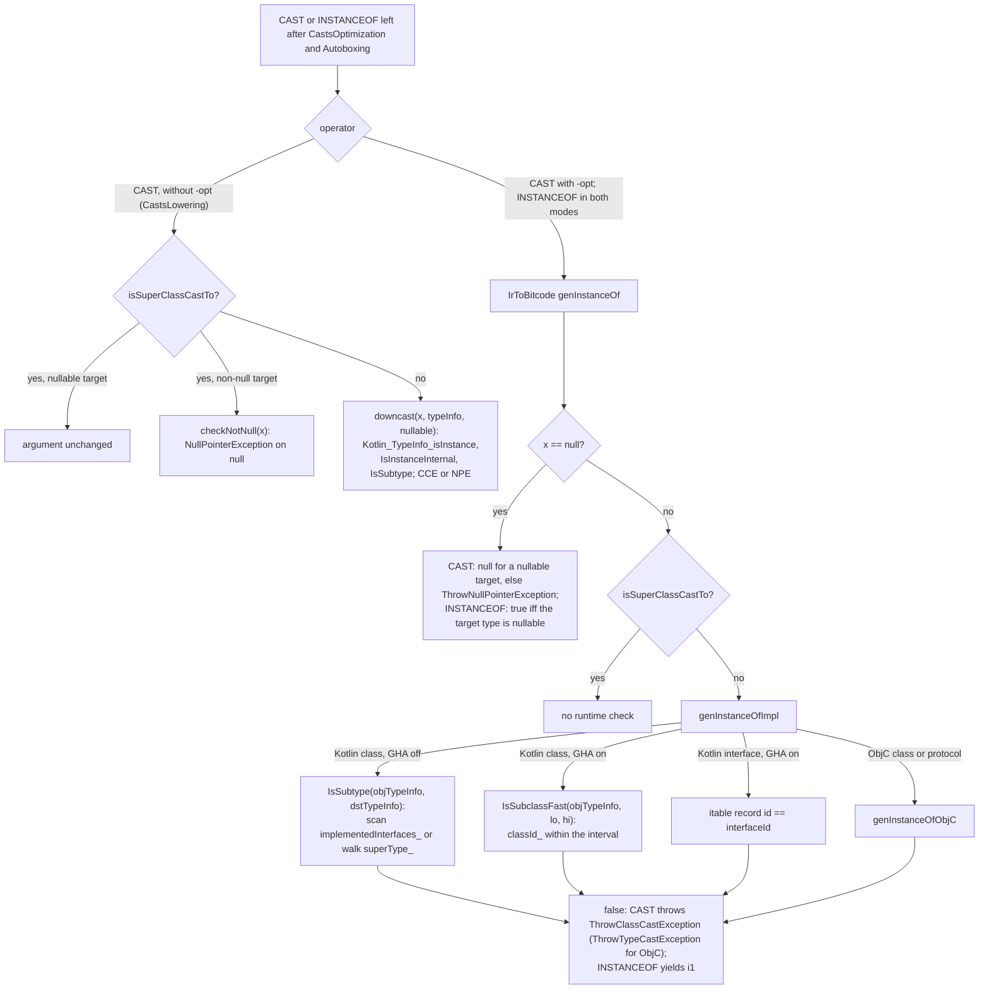

# Kotlin/Native: type checks and casts

Kotlin erases generics, so a value that reaches a `T`-typed slot may have any runtime type. On the JVM every such slot is
guarded by a `checkcast` emitted by the compiler; historically Kotlin/Native emitted no such check, so a bad unchecked cast could
silently pollute the heap (KT-40613, KT-42903, KT-65197) and, since fields are read at fixed offsets, corrupt memory. The binary
option `genericSafeCasts` (KT-68165) adds those checks, and because they are expensive the backend also carries two passes that
prove checks redundant: `ComputeTypesPass` (recompute precise static types) and `CastsOptimization` (a path-sensitive predicate
analysis over `is`/`as`/implicit casts). This page explains how a cast travels from IR to the runtime, what each pass removes,
why the default differs between `-g` and `-opt`, and what the runtime does with the checks that remain.

All code paths below are relative to `kotlin-native/backend.native/compiler/ir/backend.native/src/org/jetbrains/kotlin/backend/konan/`
("BACKEND") unless stated otherwise. Whole-program analyses are in [optimizations.md](optimizations.md), the lowering pipeline
in [lowerings.md](lowerings.md), the TypeInfo layout in [compiler-runtime-contract.md](compiler-runtime-contract.md).

## Key concepts

| Term                        | Meaning                                                                                                                                                            |
|-----------------------------|--------------------------------------------------------------------------------------------------------------------------------------------------------------------|
| Type operator               | `IrTypeOperatorCall` with `CAST` (`as`), `SAFE_CAST` (`as?`), `INSTANCEOF`/`NOT_INSTANCEOF` (`is`/`!is`), `IMPLICIT_CAST` (frontend smart casts, inliner erasure), coercions. Only `CAST` and the `INSTANCEOF`s are ever checked at run time; `IMPLICIT_CAST` is a no-op in codegen (`evaluateTypeOperator` in [IrToBitcode.kt](../../kotlin-native/backend.native/compiler/ir/backend.native/src/org/jetbrains/kotlin/backend/konan/llvm/IrToBitcode.kt)). |
| Generic safe casts          | `-Xbinary=genericSafeCasts`: `Autoboxing` turns every value use whose static type is not provably assignable to the expected erased type into an explicit `CAST`; `BridgesBuilding` adds "cast bridges" for overrides whose erased parameter types differ. Default `!optimizationsEnabled` ([NativeSecondStageCompilationConfig.kt](../../kotlin-native/backend.native/compiler/ir/backend.native/src/org/jetbrains/kotlin/backend/konan/NativeSecondStageCompilationConfig.kt) `defaultGenericSafeCasts`). |
| Super-class cast            | A cast whose source type is already a subtype of the target class (`IrType.isSuperClassCastTo` in [CastsLowering.kt](../../kotlin-native/backend.native/compiler/ir/backend.native/src/org/jetbrains/kotlin/backend/konan/lower/CastsLowering.kt)): reduces to a null check or nothing. Never assumed when the source is a type parameter ("due to unsafe casts, see unchecked_cast8.kt"). |
| `NO_CAST_NEEDED`            | `IrBlock` origin `STATEMENT_ORIGIN_NO_CAST_NEEDED` wrapping a single `IMPLICIT_CAST`: a proof token saying "this implicit cast was verified, do not re-check it". Produced by `CastsOptimization`, `TypeOperatorLowering`, `GenericCallsReturnTypeEraser`; consumed by `Autoboxing.visitBlock`. |
| Predicate                   | `CastsOptimization`'s fact about the current program point: a CNF formula over leaf terms `v is C`, `v == null` and opaque "complex terms". |
| `IsSubtype` / `IsSubclassFast` | Runtime functions in [Types.cpp](../../kotlin-native/runtime/src/main/cpp/Types.cpp): walk `superType_`/scan `implementedInterfaces_`, or compare GHA interval ids. |

## The pipeline

All of this happens per file in `getLoweringsAfterInlining()`
([NativeLoweringPhases.kt](../../kotlin-native/backend.native/compiler/ir/backend.native/src/org/jetbrains/kotlin/backend/konan/driver/phases/NativeLoweringPhases.kt));
phase names for `-Xdisable-phases` are the class names (`LoweringPhase` in
[PhaseFactories.kt](../../compiler/ir/backend.common/src/org/jetbrains/kotlin/backend/common/phaser/PhaseFactories.kt) uses
`loweringClass.simpleName`).

| # | Phase                                   | Gate                     | What it hands to the next                                                                                                   |
|---|-----------------------------------------|--------------------------|------------------------------------------------------------------------------------------------------------------------------|
| 1 | `ComputeTypesPass` (first run)          | always, after `NativeFinallyBlocksLowering` | Variables, `IrGetValue`s, `when`/block/try results get their least-common-ancestor class type; implicit casts that became upcasts are deleted. Comment: "Inliner erases generics." |
| 2 | …many lowerings…                        |                          | Suspend functions, enums, strings, default arguments, `ObjectClassLowering`, `StaticInitializersLowering` run in between.  |
| 3 | `ComputeTypesPass` (second run)         | always                   | Same again; comment: "not only helps the following heavy analysis but also corrects some lowerings' inaccuracies in IR types". |
| 4 | `RemoveCastsFromNothingLowering`        | always                   | Any type operator whose argument is `Nothing` is replaced by the argument (commit `db514e71979d`: "makes [the two passes] work faster"). |
| 5 | `CastsOptimization`                     | `genericSafeCasts`       | Type operators proven always-true become the argument (`is` → `true`, casts → `NO_CAST_NEEDED` implicit cast); proven always-false become `false`/`null`/`throwClassCastException`. |
| 6 | `TypeOperatorLowering`                  | always                   | Type operands are erased to classes (ObjC forward declarations → `Any`); `SAFE_CAST` becomes `if (tmp is T) NO_CAST_NEEDED(tmp) else null`. Codegen rejects `SAFE_CAST`. |
| 7 | `BridgesBuilding`, `WorkersBridgesBuilding` | always               | Bridges per `BridgesPolicy`: with `genericSafeCasts`, `BOX_UNBOX_CASTS` adds bridges whose parameters carry the overridden erased type. |
| 8 | `GenericCallsReturnTypeEraser`          | always                   | Call expressions take the callee's erased return type and are wrapped in an `IMPLICIT_CAST` to the substituted type.        |
| 9 | `Autoboxing`                            | always                   | With `genericSafeCasts`: `checkedCast` (an explicit `CAST`) where the actual type is not assignable to the expected one; otherwise only box/unbox. |
| 10 | `CastsLowering`                        | `!optimizationsEnabled`  | Remaining `CAST`s become calls to stdlib `downcast`/`checkNotNull` (smaller bitcode, KT-83697). With `-opt` casts stay `IrTypeOperatorCall`s and are inlined by codegen. |

Steps 7–9 are where the *new* checks of safe-casts mode are created; step 5 therefore cannot see them. Its job is the checks that
are already in the IR: user `is`/`as`/`as?`, smart-cast `IMPLICIT_CAST`s (one per use of the smart-cast variable), and the
`IMPLICIT_CAST`s the inliner leaves behind when a `T`-typed parameter becomes an `Any?` variable. `ComputeTypesPass` serves both:
a narrower static type makes `Autoboxing.canBeAssignedTo` succeed (no check inserted) and makes `isSuperClassCastTo` true in
`CastsLowering`/codegen (check compiled to nothing).

## Generic safe casts: what is checked and where

`Autoboxing` ([Autoboxing.kt](../../kotlin-native/backend.native/compiler/ir/backend.native/src/org/jetbrains/kotlin/backend/konan/lower/Autoboxing.kt))
is a value-usage transformer: every argument, return value, receiver, field store and type-operator argument passes through
`useAs(expectedType)`. With `insertSafeCasts` (= `config.genericSafeCasts`):

- `adaptIfNecessary` inserts `checkedCast(actualType, erasedExpectedType)` — an `IMPLICIT_CAST` to the actual type followed by
  `irAs(..)` to the *nullable* expected type — when the actual class is unknown (type parameter: "conservatively insert type check
  for them (due to unsafe casts)") or not a subtype of the expected class. Nullability is **not** checked here, which is why the
  KT-77653 QA note says the binary "still might segfault but only with null pointer access".
- Unboxing of a value whose expected type is an inline class first checks the box type
  (`checkedCast(actualType, conversion.owner.returnType)`).
- Skipped for: `NO_CAST_NEEDED` blocks (`forceSkipTypeCheck = true`), expressions that already are a `CAST`, the dispatch receiver
  inside a bridge ("A bridge cannot be called on an improper receiver"), inline-class-typed actual types, partially-linked classes,
  `Nothing?` (KT-82040) and **all ObjC classes** — a long comment explains duck typing, forward declarations (KT-84678), cinterop
  mistranslations (KT-56860) and concludes a wrong ObjC type "won't lead to heap corruption" because dispatch is dynamic (KT-85681
  tracks revisiting this).
- `IMPLICIT_CAST` handling: `useInTypeOperator` adapts the *argument* to the operand type (through `Any?` first for inline
  classes), after which the cast's own type is trusted (`useAs` takes `this.type` of an `IMPLICIT_CAST` as the actual type).

`BridgesBuilding` ([BridgesBuilding.kt](../../kotlin-native/backend.native/compiler/ir/backend.native/src/org/jetbrains/kotlin/backend/konan/lower/BridgesBuilding.kt),
direction table in [IrUtils.kt](../../kotlin-native/backend.native/compiler/ir/backend.native/src/org/jetbrains/kotlin/backend/konan/ir/IrUtils.kt)):
`bridgeDirectionToAt` yields `BridgeDirectionKind.CAST` when an override's erased parameter type is narrower than the overridden
one (the `REF/<T>` cells of the table), but only under `BOX_UNBOX_CASTS`; under `BOX_UNBOX_ONLY` the direction collapses to `NONE`.
A cast bridge carries no cast of its own: its parameters are typed with the overridden erased type and it calls the target with
`irGet(parameter)`, so `Autoboxing` later inserts the `checkedCast`. This is what makes `(Derived<D>() as Base<C>).foo(C())` throw
`ClassCastException` in `unchecked_cast8.kt` instead of reading `x.z` from a `C`. The same `bridgesPolicy` is read by
`OverriddenFunctionInfo` in `ClassLayoutBuilder.kt` (vtable layout) and by ObjC export's `findImplementation`
([ObjCExportCodeGenerator.kt](../../kotlin-native/backend.native/compiler/ir/backend.native/src/org/jetbrains/kotlin/backend/konan/llvm/objcexport/ObjCExportCodeGenerator.kt)),
so the option changes the set of bridge symbols a binary contains.

Interplay with `-opt`: `DevirtualizationAnalysis.devirtualize` normally calls the bridge *target* directly and re-derives
box/unbox coercions, but with `genericSafeCasts` it calls the bridge ("Can't easily inline bridges with casts",
[DevirtualizationAnalysis.kt](../../kotlin-native/backend.native/compiler/ir/backend.native/src/org/jetbrains/kotlin/backend/konan/optimizations/DevirtualizationAnalysis.kt)).

The difference for the `unchecked_cast8.kt` case (`Derived<T : I1, I2>.foo(x: T)` overriding `Base<T : I1>.foo(x: T)`, called as
`(Derived<D>() as Base<C>).foo(C())`), derived from the `Cast` builder in `IrUtils.kt`, `BridgesBuilding.buildBridge` and
`Autoboxing.adaptIfNecessary`:

```
genericSafeCasts = false (BOX_UNBOX_ONLY)           genericSafeCasts = true (BOX_UNBOX_CASTS)

Base.foo slot in Derived's vtable                   Base.foo slot in Derived's vtable
  └─► Derived.foo(x: <erasure of T>)                  └─► <bridge-...>foo(x: I1)        parameter typed as in Base
        println(x.z)   // reads I2.z from a C              ├─ checkedCast(x, <erasure of T>) inserted by Autoboxing
        garbage value or memory fault                      │     fails for C: ThrowClassCastException
                                                           └─► Derived.foo(x)             reached only on success
```

How the policy decides whether such a bridge exists at all, from `bridgeDirectionToAt` and the direction table in `IrUtils.kt`:



History: option added 2024-01 (`6b1becbea312`, KT-68165) with default `false` "due to performance penalty"; `CastsOptimization`
landed 2024-10 (`122343cfceb0`, KT-77653: "without it turning on the casts … would lead to a big performance hit");
`ComputeTypesPass` 2025-12 (`6e2ddeeae081`, KT-83036); default flipped to `!optimizationsEnabled` in 2025-08 (`21b204a9b2de`,
KT-77676, shipped in 2.3.0-Beta1); `CastsLowering` extracted 2026-01 (`eb2cb8170371`, KT-83697: inline cast code swelled bitcode
by 10–15% on some projects).

## ComputeTypesPass

[ComputeTypesPass.kt](../../kotlin-native/backend.native/compiler/ir/backend.native/src/org/jetbrains/kotlin/backend/konan/optimizations/ComputeTypesPass.kt)
(`@PhasePrerequisites(FinallyBlocksLowering)`) is a per-body forward dataflow over *variable writes*. Its header comment is the
authoritative description; in short:

1. **Reaching definitions as bitsets.** Each `IrVariable` write (`visitVariable`, `visitSetValue`) and each value flowing into a
   control-flow merge point (`when` branch, returnable-block `return`, `try`/`catch` result, suspension point) gets an index in
   `allVariablesWrites`; the dataflow value is the `BitSet` of writes that may reach the current point. `setVariable` clears the
   variable's previous writes (`andNot`) and sets the new one.
2. **Merge points** (`ControlFlowMergePointInfo`) union the incoming bitsets; `needValues` — whether the phi value itself is
   recorded — is decided from the node's *original* type being non-final (`cfmpNeedValues`, KT-86949: once narrowed to a final
   class a merge point could never widen again during loop iteration).
3. **Loops** are iterated to a fixpoint (`handleDoWhileLoop`; `while` is modelled as `if (c) do {..} while (c)`), merging with the
   previous iteration from the second one on. Only `IrGetValue` nodes accumulate across iterations (`getValueVariablesWrites`).
4. **try/catch**: every write inside a `try` is also made visible to all its `catch`es (`catchesVariablesValues`), a deliberate
   over-approximation of "an exception may be thrown anywhere".
5. **Type computation** (`leastCommonAncestor`): the LCA of the erased classes of all reaching values, after
   `tryShortcutToArgument` looks through implicit upcasts; `Nothing` values are ignored; **any interface gives up** ("nothing we can
   do about interfaces … without knowing the whole types' hierarchy").
6. **Rewrite.** `IrGetValue.type`, `IrVariable.type`, `when`/block/`try` types are updated; an `IrGetValue` whose computed type
   differs from the declaration's type is wrapped in an `IMPLICIT_CAST` (so the IR stays well-typed); implicit casts that are now
   upcasts and `IMPLICIT_COERCION_TO_UNIT` of a `Unit` are removed. Two guards protect user-visible behaviour:
   `trySwitchVariableType` refuses to change a `DEFINED` (source) variable's type if that would change boxing (KT-86678,
   KT-87165), and a nullable `DEFINED` variable stays nullable (long comment citing KT-84727: unboxing a `null` segfaulted).

Why twice: the first run (right after inlining-related lowerings and `NativeFinallyBlocksLowering`) undoes the inliner's erasure;
it also replaced the fragile "return wrapped in `IMPLICIT_CAST` is a tail call" heuristic of the suspend lowering
(`2435a7609fc2`, KT-72999; the tail-suspend-call classification is in [coroutines.md](coroutines.md#step-1--classifying-suspend-calls)). The second run sits immediately before `CastsOptimization`, after suspend/enum/string/initializer
lowerings have created new variables and casts. **Unverified:** which lowerings produce the "inaccuracies in IR types" the comment
refers to.

## CastsOptimization: the algorithm

[CastsOptimization.kt](../../kotlin-native/backend.native/compiler/ir/backend.native/src/org/jetbrains/kotlin/backend/konan/optimizations/CastsOptimization.kt)
is a `BodyLoweringPass`: per function body, `TypeCheckResolver` computes a `TypeCheckResult`
(`ALWAYS_SUCCEEDS`/`NEVER_SUCCEEDS`/`UNKNOWN`) for each type operator, then a transformer rewrites them.

### Data structures

| Structure                  | Role                                                                                                                                                       |
|----------------------------|------------------------------------------------------------------------------------------------------------------------------------------------------------|
| `LeafTerm`                 | `SimpleTerm.Is(variable, class)`, `SimpleTerm.IsNull(variable)` (interned per `(variable, class)` in `simpleTermsMap`), or `ComplexTerm(element, depth)` for anything opaque (a call result, a parameter's boolean value). |
| `Disjunction`              | A `CustomBitSet` over leaf terms; bit `2*i` means term `i` is true, `2*i+1` means it is false (`LeafIndexWithValue.bitIndex`). |
| `Predicate`                | `True`, `False`, or `Conjunction(List<Disjunction>)` — CNF. `Predicates.and/or/invert` do the algebra with absorption (`followsFrom`), contradiction detection via the `0x5555…` checkerboard mask, and the distributive blow-up for `or`. |
| `BooleanPredicate`         | `(ifTrue, ifFalse)` for a boolean expression; `NullablePredicate` = `(ifNull, ifNotNull)`.                                                                   |
| `VisitorResult`            | `(predicate after the expression, variable the value came from or null)`; `Unreachable` = `False`.                                                       |
| `upperLevelPredicates`     | A stack of enclosing facts; `getFullPredicate` ands them. Branch conditions, loop conditions and `&&`/`||` left sides are pushed while visiting the right side. |
| `variableAliases`          | Current "SSA name" of each mutable variable: a phantom `IrVariable` (`x$3`) created per write (`createPhantomVariable`) or per merge (phi). |
| `ControlFlowMergePointInfo`| Per `when`/returnable block/loop: the or-ed predicate of all incoming edges, a `phiNodeAlias` (kept only if every edge delivers the *same* variable and no non-variable value flowed in, KT-87261) and merged aliases. |

### Steps

1. **Walk with a predicate.** `visitElement` threads the predicate through children in evaluation order. Reads of a value
   (`visitGetValue`) return the current alias; a read that sees different aliases on different visits (loop iterations) degrades to
   the variable itself (`getValueMergedVariableAliases`).
2. **Conditions become `BooleanPredicate`s** (`buildBooleanPredicate`). Pattern matching on lowered IR recognises `a && b`
   (`if (a) b else false`), `a || b`, `!a`, `==`/`===`/IEEE equality with `null`, constants, `is`/`!is`, `x as? A != null`, safe
   calls `recv?.foo()` (`matchSafeCall`: a block of `val tmp = recv; if (tmp == null) null else ...`). Everything else becomes a
   fresh complex term — fresh per evaluation for expressions (KT-86959: memoizing a call across loop iterations conflated two
   evaluations) but shared for value declarations.
3. **Subtype facts** (`Predicates.isSubtypeOf`): `v is B` for `v: A?` gives `(v == null) | (v is B)` when `B?`, just `(v is B)`
   otherwise; a super-class cast yields `v != null` or `True`. Terms are per *class*, with no hierarchy knowledge: `v is B` and
   `v is A` for `B <: A` are unrelated terms (TODO KT-77671, "treats all types as independent").
4. **Control flow.** `visitWhen` visits each branch under `and(previous conditions false, this condition true)`, merges branch
   results, and for a non-exhaustive `when` also merges the fall-through; `visitBlock` handles returnable blocks (inlined lambdas)
   via `visitReturn`; `break`/`continue` merge into their loop's info; `throw`, `return` and `Nothing`-typed calls are
   `Unreachable`, so a guard like `if (x !is A) return` leaves `x is A` on the fall-through path.
5. **Assignments** (`setVariable`). A boolean variable stores its `BooleanPredicate` under a phantom alias, so
   `val ok = x is A; if (ok) …` is as precise as inlining the condition. A nullable variable stores a `NullablePredicate` (through
   `buildNullablePredicate`, which also understands `x as? A` and safe calls). Any other variable aliases to the variable its value
   came from (`result.variable`), with cycle breaking (`aliasesTo`).
6. **Property reads.** A call to a trivial `val` getter with a backing field (`isTrivialValGetter`, cache-aware via
   `NativeBackendContext.isTrivialGetter`) is modelled as a phantom variable `recv.prop` / `<ROOT>.prop`, so `if (b.a is A) b.a.x`
   needs no second check. Only `val`s: a `var` could change between the check and the use. (KT-85403 was a bug here: the getter
   read dropped the branch predicate.)
7. **Loops** (`handleDoWhileLoop`): iterate the body up to `MAX_LOOP_ITERATIONS = 10`, or-ing the loop-start predicate and the
   exit predicates of all iterations (comment explains why: a value assigned from a call is pinned to one IR node, so without
   merging exits `do { o = foo() } while (o !is A)` would lose `o is A` after the loop). Nesting deeper than `MAX_LOOPS_DEPTH = 5`
   aborts (`5a0c14de97d1`, KT-81617 "explodes on deep nested loops").
8. **try/catch** (`visitTry`): the `try` body and each `catch` are analysed under `True`, and every variable changed inside gets a
   fresh phantom alias before each `catch` ("conservatively assume that the try block might throw an exception right away").
9. **Complex-term pruning** (`optimizeAwayComplexTerms`): at each merge point, disjunctions containing complex terms that do not
   escape the merge (`ComplexTerm.depth`) are dropped. The long comment above the function explains why this must happen only
   after the whole `if/else` is processed: `if (foo() || x !is A) … else …` still knows `x is A` in the `else`.
10. **Decision** (`tryOptimizeTypeCheck`): for a check `v is T` under full predicate `P`, if `P & (v !is T)` simplifies to `False`
    the check always succeeds; if `P & (v is T)` is `False` it never succeeds. This is syntactic unsatisfiability through the CNF
    simplifier, not SAT ("further improvement will be to … find the combination of leaf terms satisfying the predicate"). A node
    visited several times (loops) must get the same verdict every time or it becomes `UNKNOWN` (KT-86948); an argument that is not
    a variable also forces `UNKNOWN`.
11. **Rewrite** (`lower`). `INSTANCEOF`/`NOT_INSTANCEOF` → boolean constant; `CAST`/`IMPLICIT_CAST`/`SAFE_CAST` that always
    succeed → `NO_CAST_NEEDED { IMPLICIT_CAST }`; a `SAFE_CAST` that never succeeds → `null`; a `CAST`/`IMPLICIT_CAST` that never
    succeeds → a direct call to `throwClassCastException(argument, typeInfo)`. The argument is kept for its side effects unless
    `isPure` (`keepingSideEffectsOf`, KT-86947).

The verdict and rewrite for one type operator, from `TypeCheckResolver.visitTypeOperator` / `tryOptimizeTypeCheck` and
`CastsOptimization.lower` in `CastsOptimization.kt`:



### Bail-outs and complexity

`Predicates.or` is the distributive product of two CNFs; when the running size reaches `MaxSize = 10_000` leaf occurrences, or a
loop does not converge, or loops nest too deep, `DivergingAnalysisError` is thrown and **the whole body is left untouched**
(`context.log { "ERROR: the analysis has diverged …" }`, `5a9bd9d64775`, KT-77672). So the pass is best-effort per function:
a diverging function keeps every check and still compiles. The visitor's `context.logMultiple` output (`TYPE CHECK:`, `WHEN:`,
`LOOP ITER #n`, `SET VAR:`) is the debugging aid; enable it with `-Xverbose-phases=CastsOptimization`.

### What it deliberately does not know

- Class hierarchy (KT-77671) and never-succeeding casts between unrelated final classes: `x is B` after `x is A` is `UNKNOWN`
  unless the static type already makes it a super-class cast.
- Inline classes: a cast only forwards the variable alias if boxing does not change
  (`getInlinedClassNative()` equality in `visitTypeOperator` and `isSubtypeOf`), so `(v as Int)` from `v: Any` is a check, not
  an alias.
- Interfaces vs classes: no difference at this level; both are `SimpleTerm.Is` with an `IrClass`. Arrays likewise (one class each).
- Values produced by non-trivial getters, `var` properties, array elements and calls are opaque complex terms.
- Casts created later by `Autoboxing`/bridges (see pipeline above).

## From type operator to machine code

With `-opt`, `CastsLowering` is skipped and `IrToBitcode.evaluateTypeOperator` sees the operators directly:

- `CAST` → `evaluateCast` → `genInstanceOf`: if `isSuperClassCastTo`, only a null check (non-null operand: `ThrowNullPointerException`);
  otherwise `instance_of_null`/`instance_of_notnull` blocks, `genInstanceOfImpl` and, on failure, `ThrowClassCastException(obj, typeInfo)`
  (ObjC classes: `genInstanceOfObjC` and `ThrowTypeCastException(obj, "fq.Name")`).
- `INSTANCEOF` → same skeleton returning `i1`; `NOT_INSTANCEOF` negates it. `IMPLICIT_CAST` evaluates its argument.
- `genInstanceOfImpl` → `VirtualTablesLookup.checkIsSubtype`
  ([CodeGenerator.kt](../../kotlin-native/backend.native/compiler/ir/backend.native/src/org/jetbrains/kotlin/backend/konan/llvm/CodeGenerator.kt)):
  without GHA a call to the runtime `IsSubtype(objTypeInfo, dstTypeInfo)`; with GHA (`-opt`, no caches, not producing a cache, see
  [dce-and-gha.md](dce-and-gha.md)) `IsSubclassFast(objTypeInfo, lo, hi)` for classes and an itable record id comparison for
  interfaces. Both runtime functions are imported from runtime bitcode (`importRtFunction` in
  [ContextUtils.kt](../../kotlin-native/backend.native/compiler/ir/backend.native/src/org/jetbrains/kotlin/backend/konan/llvm/ContextUtils.kt))
  (whether LLVM inlines them afterwards is not relevant to the FileCheck tests, which run at the `CStubs` stage); this GHA split
  is why the tests pair `CHECK-DEBUG: … @IsSubtype` with `CHECK-OPT: … @IsSubclassFast`.
- The stdlib intrinsic `isSubtype<T>(typeInfo)` (`IntrinsicType.IS_SUBTYPE`, `emitIsSubtype` in
  [IntrinsicGenerator.kt](../../kotlin-native/backend.native/compiler/ir/backend.native/src/org/jetbrains/kotlin/backend/konan/llvm/IntrinsicGenerator.kt))
  reuses `checkIsSubtype`; devirtualization's type switches are built on it. The intrinsic catalogue is in [intrinsics.md](intrinsics.md).

Without `-opt`, `CastsLowering` rewrites each remaining `CAST` (except to ObjC classes) into `checkNotNull(x)` (super-class cast
to non-null), nothing (super-class cast to nullable) or `downcast(x, typeInfo, nullable)`
([KClassImpl.kt](../../kotlin-native/runtime/src/main/kotlin/kotlin/native/internal/KClassImpl.kt)); `downcast` calls
`Kotlin_TypeInfo_isInstance` → `IsInstanceInternal` → `IsSubtype`, and throws `NullPointerException` or
`ThrowClassCastException`. `INSTANCEOF` is never outlined, so an `is` always compiles to `IsSubtype`/`IsSubclassFast` inline.

Runtime side ([Types.cpp](../../kotlin-native/runtime/src/main/cpp/Types.cpp)): `IsSubtype` scans `implementedInterfaces_` for
interface targets (`TF_INTERFACE`) and walks `superType_` otherwise; `IsSubclassFast` is two integer comparisons on `classId_`;
`IsArray` is `instanceSize_ < 0`. Exceptions are Kotlin functions exported to C++
([RuntimeUtils.kt](../../kotlin-native/runtime/src/main/kotlin/kotlin/native/internal/RuntimeUtils.kt)):
`ThrowClassCastException` builds `"<obj class> cannot be cast to <KClass>"`, `ThrowTypeCastException` (ObjC)
`"<obj class> cannot be cast to class <name>"`. Both `CastsLowering`'s helpers are `@TransparentForDebugger`.

The path of one surviving check from IR to the runtime, from `CastsLowering.kt`, `evaluateCast` / `genInstanceOf` /
`genInstanceOfImpl` in `IrToBitcode.kt`, `VirtualTablesLookup.checkIsSubtype` in `CodeGenerator.kt` and `Types.cpp` (the GHA ids
come from [dce-and-gha.md](dce-and-gha.md)):



## Flags and options

| Flag                                                        | Effect                                                                                                    |
|-------------------------------------------------------------|-----------------------------------------------------------------------------------------------------------|
| `-g` / `-opt`                                               | Default of `genericSafeCasts`; `CastsLowering` only without `-opt`; GHA-based `IsSubclassFast` only with `-opt`. |
| `-Xbinary=genericSafeCasts=true|false`                      | Gates `CastsOptimization`, `Autoboxing.insertSafeCasts`, `BridgesPolicy.BOX_UNBOX_CASTS`, bridge inlining in devirtualization. A non-default value is appended to the cache flavor (`-generic_safe_castsENABLE/DISABLE`, `appendCommonCacheFlavor`), so caches built with the other value are not reused. |
| `-Xdisable-phases=ComputeTypesPass,CastsOptimization,RemoveCastsFromNothingLowering,TypeOperatorLowering,CastsLowering,Autoboxing,BridgesBuilding` | Bisect; the first two are safe to disable (only lose optimization), the rest break codegen invariants. |
| `-Xverbose-phases=CastsOptimization` / `ComputeTypesPass`   | The predicate / bitset traces described above.                                                            |
| `-Xphases-to-dump-after=CastsOptimization` (`-Xdump-fqname=`) | See `NO_CAST_NEEDED` blocks and rewritten operators in IR.                                              |
| `-Xsave-llvm-ir-after=Codegen`                              | Check for `@IsSubtype`, `@IsSubclassFast`, `kfun:kotlin.native.internal#downcast`, `ThrowClassCastException` calls. |

## Tests

| What                                                     | Where / how                                                                                                                                                                       |
|----------------------------------------------------------|-----------------------------------------------------------------------------------------------------------------------------------------------------------------------------------|
| The analysis itself (FileCheck on `IsSubtype`/`IsSubclassFast`/`downcast`) | `native/native.tests/testData/codegen/fileCheck/`: `remove_redundant_type_checks.kt` (~50 cases), `generic_safe_casts.kt` (bridges, `as Int`, call result), `kt85403.kt`, `kt86948.kt` (`-Xdisable-phases=ComputeTypesPass`), `kt86949.kt` (`-Xdisable-phases=CastsOptimization`), `kt86959.kt`, `kt87261.kt`. All force `-Xbinary=genericSafeCasts=true` and carry `CHECK-DEBUG`/`CHECK-OPT` lines; they are ignored for `OPT && STATIC_*` cache modes. Run `./gradlew :native:native.tests:test --tests "org.jetbrains.kotlin.konan.test.blackbox.FirNativeCodegenLocalTestGenerated\$FileCheck*"` with and without `-Pkn.optimizationMode=OPT`. |
| Semantics of unchecked casts                             | `compiler/testData/codegen/box/basics/unchecked_cast*.kt`, `casts/kt65197.kt`, `casts/genericLambdaBridgeCast.kt`, `bridges/test19..24.kt`, `delegatedProperty/genericDelegateUncheckedCast1.kt` — all `// FREE_COMPILER_ARGS: -Xbinary=genericSafeCasts=true`, expecting `ClassCastException`. `./gradlew :native:native.tests:codegen-box:test --tests "…FirNativeCodegenBoxTestGenerated\$Box\$Basics*"`. |
| ObjC interplay                                           | `native/native.tests/testData/codegen/cinterop/kt57640.kt` (Apple hosts).                                                                                                           |
| Other cast tests (no option forced)                      | `compiler/testData/codegen/box/casts/` (52 files), `native/native.tests/testData/codegen/interfaceCallsNCasts/`.                                                                    |

Tests load the compiler from `kotlin-native/dist`; see [kotlin-native/AGENTS.md](../../kotlin-native/AGENTS.md).

## Trade-offs, contracts and compatibility

- **Observable semantics differ by build mode.** With the default settings a debug binary throws `ClassCastException` at a generic
  boundary (bridge, erased return value, erased parameter) where a release binary reads memory through the wrong type. This is the
  only K/N option that changes which exceptions user code sees between `-g` and `-opt`; KT-77676's "leads to" links (9 issues) are
  the fallout. Bugs reported as "CCE only in debug" are usually the debug build being right.
- **Which exception, where.** Explicit `as` failure: `ClassCastException` (both modes; via `downcast` in debug). Null to non-null
  target: `NullPointerException` (`checkNotNull`/`downcast`/`ThrowNullPointerException`), never a CCE. ObjC target:
  `TypeCastException`. A cast `CastsOptimization` proves impossible throws CCE at the cast even if the value is never used.
- **Soundness of the optimizer is a type-safety contract.** A wrong `ALWAYS_SUCCEEDS` deletes a real check and reintroduces memory
  unsafety (the QA note on KT-77653 makes exactly this point); hence the conservative rules (fresh complex terms per evaluation,
  phi alias only for a single variable, forgetting aliases around `try`, `UNKNOWN` on disagreeing visits).
- **`NO_CAST_NEEDED` is a protocol.** Any pass creating such a block promises the implicit cast inside is correct; `Autoboxing`
  errors if the block does not contain exactly one `IMPLICIT_CAST`, and skips the check. A future pass that moves or duplicates IR
  must preserve the block around the cast.
- **Bridge sets and cache ABI.** `BOX_UNBOX_CASTS` adds bridge functions, so a cache and the program using it must agree on the
  option. The cache flavor (`appendCommonCacheFlavor`) already contains `-g`/`-opt`, which fixes the default, and appends
  `-generic_safe_castsENABLE/DISABLE` only for an explicit non-default value — so an explicit value never silently reuses a cache
  built with the other one.
- **Performance.** Every surviving check in `-opt` is an inlined `IsSubclassFast` (two compares) or an interface itable probe; in
  debug a call to `downcast`. The default stays off in `-opt` purely for speed ("For now disabled in -opt due to performance
  penalty"); the predicate analysis was written to make enabling it everywhere feasible (KT-77653) but that step has not been taken.
- **Devirtualization and inline classes.** With `genericSafeCasts` in `-opt`, devirtualized calls go through bridges, so
  box/unbox pairs that `RedundantCoercionsCleaner` would otherwise remove may remain.

## Symptoms → where to look

| Symptom                                                              | First suspects                                                                                                          |
|----------------------------------------------------------------------|-------------------------------------------------------------------------------------------------------------------------|
| `ClassCastException` only with `-g`, works with `-opt`                | Expected: a generic-boundary check (`Autoboxing.checkedCast` or a cast bridge). Confirm with `-opt -Xbinary=genericSafeCasts=true`. |
| Memory corruption / garbage field only with `-opt`                   | Same root cause, unchecked. Compile with `genericSafeCasts=true` to get the CCE and the stack.                           |
| Missing CCE, wrong `is` result, only with `genericSafeCasts=true`     | `CastsOptimization` proved too much: rerun with `-Xdisable-phases=CastsOptimization`, then `ComputeTypesPass`; read `-Xverbose-phases=CastsOptimization`. |
| Wrong `is` only in `-opt` without caches                             | GHA ids (`IsSubclassFast` intervals, itable colors): `-Xdisable-phases=GHAPhase`; [dce-and-gha.md](dce-and-gha.md).   |
| "Expected exactly one statement in IrBlock marked with NO_CAST_NEEDED" | A lowering between `CastsOptimization`/`TypeOperatorLowering` and `Autoboxing` rewrote the inside of a proof block.  |
| Compile time blows up in a huge function                             | `MaxSize`/nested loops in `CastsOptimization` (KT-81617); it should bail out, check the log for "diverged".             |
| Bridge-related crash with inline classes, differs by mode            | Bridge directions depend on `bridgesPolicy`; compare `<bridge-…>` names in LLVM IR between modes; devirtualization's `bridgeTarget` path. |
| `TypeCastException` instead of `ClassCastException`                  | Target is an ObjC class (`isObjCObjectType` path in `evaluateCast`).                                                     |

## Open questions

- The second `ComputeTypesPass` run: the comment names "some lowerings' inaccuracies in IR types" but no lowering is identified in
  code or history; which ones (suspend functions? enums?) and whether a single run before `CastsOptimization` would now suffice.
- `@PhasePrerequisites(FinallyBlocksLowering)` on `ComputeTypesPass`: presumably because the pass models `IrTry` without
  `finally` (only `tryResult` and `catches` are visited). Hypothesis, not stated anywhere.
- Whether `genericSafeCasts=true` with `-opt` is a supported configuration: the FileCheck tests cover it, but it is ignored with
  static caches, and the devirtualization "can't inline bridges" path has no dedicated test.
- `Autoboxing.checkedCast` casts to the *nullable* expected type on purpose (nullability is left to the eventual dereference);
  whether that is a deliberate ABI decision or an artefact of avoiding double NPE checks is not documented.
- The `MaxSize = 10_000`, `MAX_LOOP_ITERATIONS = 10`, `MAX_LOOPS_DEPTH = 5` limits have no recorded tuning rationale.
- KT-77671 (type hierarchy in the predicate algebra) would let the pass prove `x is A` from `x is B`; its interaction with
  `Predicates.and`'s contradiction rule (`v is A` and `v !is A` on the same term only) is the main design question left.
