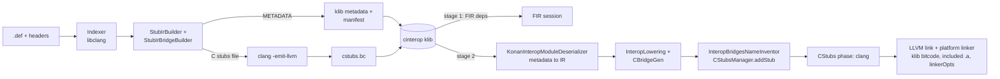

# Kotlin/Native: C and Objective-C interop (cinterop)

How C and Objective-C libraries become Kotlin API and machine code: the `cinterop` tool, the "cinterop klib" it produces, what the
compiler does with that klib in each stage, the `kotlinx.cinterop` runtime library, and the platform libraries. The user-visible model
is in [compilation-model.md](compilation-model.md#consuming-c-or-objective-c-libraries-in-kotlin-aka-cinterop); the module table is in
[kotlin-native/Interop/README.md](../../kotlin-native/Interop/README.md); module locations are in [architecture.md](architecture.md).

Path shorthands used below: `STUBGEN` = `kotlin-native/Interop/StubGenerator/src/org/jetbrains/kotlin/native/interop/gen/`,
`INDEXER` = `kotlin-native/Interop/Indexer/src/main/kotlin/org/jetbrains/kotlin/native/interop/indexer/`,
`BACKEND` = `kotlin-native/backend.native/compiler/ir/backend.native/src/org/jetbrains/kotlin/backend/konan/`.

## Role and fit

Interop is split across three places that must agree on one contract. The **tool** (`Interop/Indexer`, `Interop/StubGenerator`)
parses headers with libclang and emits a klib that contains Kotlin *metadata* for stubs, annotations that describe how each stub maps
to C (`@CCall`, `@CStruct.MemberAt`, `@ObjCMethod`, …), and optionally clang-compiled bitcode of C bridges. The **compiler** never
sees C headers: the first stage treats the klib as an ordinary metadata dependency, and the second stage converts metadata to IR at
link time (`native/cinterop.deserialization`), rewrites every interop call into a Kotlin bridge plus a generated C stub
(`BACKEND/lower/InteropLowering.kt`, `BACKEND/cgen/CBridgeGen.kt`), compiles the C stubs with clang (`BACKEND/CStubsManager.kt`),
and links them with the klib's bitcode and the user's native libraries. The **runtime** (`kotlinx.cinterop` in the stdlib klib and
`runtime/src/main/cpp/ObjCInterop.mm`) provides the pointer/memory API, most of it as compiler intrinsics, and the ObjC glue.

## Key concepts

| Term | Meaning |
|------|---------|
| `.def` file | Properties + optional `---` C preamble; parsed by `DefFile` in [`native/utils/.../DefFile.kt`](../../native/utils/src/org/jetbrains/kotlin/konan/util/DefFile.kt). Properties with a `.<target>`, `.<arch>` or `.<family>` suffix are appended to the base value for that target ([`DefFilePropertySubstitution.kt`](../../native/utils/src/org/jetbrains/kotlin/konan/util/DefFilePropertySubstitution.kt)). |
| Native index | libclang-derived model of declarations (`NativeIndex`, `StructDecl`, `ObjCClass`, `FunctionDecl`, …) in [`INDEXER/NativeIndex.kt`](../../kotlin-native/Interop/Indexer/src/main/kotlin/org/jetbrains/kotlin/native/interop/indexer/NativeIndex.kt). |
| Stub IR | The tool's own IR of the Kotlin API to emit (`StubIr.kt`, `AnnotationStub`), built by `StubIrBuilder`, emitted as metadata or as source text. |
| cinterop klib | Klib with manifest `interop=true`, `ir_provider=kotlin.native.cinterop`, metadata only (no IR), plus `targets/<t>/native/*.bc` bridges and `included/` static libraries. |
| `@CCall(id)` / `@CCall.Direct(name)` | Indirect call goes through a function pointer `id` exported from the klib's bitcode; direct call references the C symbol `name` by `__asm`. Which one is used is `CCallMode` on both sides. |
| C bridge / `knbridge` | C function generated by the compiler per call site, compiled by clang in the `CStubs` phase; the Kotlin side is an `external` function annotated with `@KotlinToCBridge`/`@CToKotlinBridge`. |
| Forward declarations | Synthetic packages `cnames.structs`, `objcnames.classes`, `objcnames.protocols` (`NativeForwardDeclarationKind` in [`core/compiler.common.native`](../../core/compiler.common.native/src/org/jetbrains/kotlin/name/NativeForwardDeclarationKind.kt)); declared in the manifest, synthesized by the frontend and the linker. |
| Platform libraries | Prebuilt cinterop klibs in `dist/klib/platform/<target>/org.jetbrains.kotlin.native.platform.*`, loaded implicitly unless `-nodefaultlibs`. |
| Foreign exception mode | Per-klib manifest property `foreignExceptionMode` (`terminate` or `objc-wrap`), see [`native/utils/.../Exceptions.kt`](../../native/utils/src/org/jetbrains/kotlin/konan/Exceptions.kt). |

## How it works



### The cinterop tool

Entry: `main()` / class `Interop` in [`STUBGEN/jvm/main.kt`](../../kotlin-native/Interop/StubGenerator/src/org/jetbrains/kotlin/native/interop/gen/jvm/main.kt).
`dist/bin/cinterop` is `run_konan cinterop …` which dispatches in
[`cli-runner/main.kt`](../../kotlin-native/utilities/cli-runner/src/org/jetbrains/kotlin/cli/utilities/main.kt) to `invokeInterop("native", …)`;
tests call `Interop.interopViaReflection`, and KGP runs the tool through
[`cinteropRunner.kt`](../../libraries/tools/kotlin-gradle-plugin/src/common/kotlin/org/jetbrains/kotlin/internal/compilerRunner/native/cinteropRunner.kt).
`processCLib` in `main.kt` is the whole pipeline; read it top to bottom:

1. **Configuration.** `DefFile(file, target)` parses the `.def`; `-pkg` or `package=` or the file name gives the Kotlin package
   (`checkPackageName` rejects `kotlin.*` and `kotlinx.cinterop.*`). `loadLibraries` loads the stdlib and, unless `-no-default-libs`,
   the platform libs for the target with `KlibLoader`; `parseImports` maps every `includedHeaders` entry of those klibs to their
   package. This is how a klib depending on another cinterop klib reuses its declarations instead of redeclaring them.
2. **Native library description.** `buildNativeLibrary` combines `headers`, `compilerOpts` (+ `-compiler-option`), the target's
   default clang flags from `ToolConfig`, the `---` preamble, and the header filter: `headerFilter`/`excludeFilter` globs become
   `HeaderInclusionPolicyImpl`, imported headers become `HeaderExclusionPolicyImpl` ([`STUBGEN/Imports.kt`](../../kotlin-native/Interop/StubGenerator/src/org/jetbrains/kotlin/native/interop/gen/Imports.kt)).
   With `modules=` (Objective-C only, no `headers`, no `headerFilter`) the filter is `Predefined` from
   [`INDEXER/ModuleSupport.kt`](../../kotlin-native/Interop/Indexer/src/main/kotlin/org/jetbrains/kotlin/native/interop/indexer/ModuleSupport.kt).
   Predefined macros like `__FILE__` are redefined to constant strings for reproducible output (KT-54284).
3. **Indexing.** `buildNativeIndexImpl` in [`INDEXER/Indexer.kt`](../../kotlin-native/Interop/Indexer/src/main/kotlin/org/jetbrains/kotlin/native/interop/indexer/Indexer.kt)
   parses one translation unit with detailed preprocessing records, fails on any clang error, determines the "own" headers,
   and visits declarations located in them (`NativeIndexImpl.indexDeclaration`). Headers are identified by `HeaderId`: the path
   relative to the sysroot, or a content hash for headers outside it ([`HeaderToIdMapper.kt`](../../kotlin-native/Interop/Indexer/src/main/kotlin/org/jetbrains/kotlin/native/interop/indexer/HeaderToIdMapper.kt)),
   so `includedHeaders` in a manifest is comparable across machines only for sysroot headers.
   Declarations from imported headers are kept in the index but not "included" (`LocatableDeclarationRegistry.shouldBeIncluded`).
   Objective-C specifics: nullability comes from a libclangext extension `clang_Type_getNullabilityKind`
   ([`libclangext/ClangExt.cpp`](../../kotlin-native/libclangext/src/main/cpp/ClangExt.cpp)); lightweight generics are read as
   `typeParameters`; categories are merged into a class only for names in `objcClassesIncludingCategories` plus `NSView`/`UIView`
   (`predefinedObjCClassesIncludingCategories` in `main.kt`); API notes can override `swift_name` (`apiNotesSwiftName`).
   **Objective-C forward declarations are always "included"**, whatever header they come from, because libclang does not index
   forward declarations in system headers (long comment in `ObjCClassOrProtocolRegistry.shouldBeIncluded`, KT-71435).
4. **Stub IR.** `StubIrDriver.run()` ([`STUBGEN/StubIrDriver.kt`](../../kotlin-native/Interop/StubGenerator/src/org/jetbrains/kotlin/native/interop/gen/StubIrDriver.kt))
   runs `StubIrBuilder` then `StubIrBridgeBuilder`, writes the C stubs file, and emits either:
   - `GenerationMode.METADATA` (flavor `native`): `StubIrMetadataEmitter` produces `KlibModuleMetadata`. This is what every
     Native cinterop klib contains.
   - `GenerationMode.SOURCE_CODE` (flavor `jvm`): `StubIrTextEmitter` writes a `.kt` file and the tool builds a JNI shared
     library. This is used only for the compiler's own bindings: `kotlin-native/llvmInterop` (`llvm.def`) and `libclangInterop`
     via the `native-interop-plugin` Gradle plugin; `StubGeneratorConsistencyCheck` guards the prebuilt copies.
   Mapping decisions worth knowing: `isStrictEnum` in [`STUBGEN/StubIrBuilder.kt`](../../kotlin-native/Interop/StubGenerator/src/org/jetbrains/kotlin/native/interop/gen/StubIrBuilder.kt)
   makes an enum a Kotlin `enum class` if named in `strictEnums`, an integer typealias if in `nonStrictEnums`, otherwise by the
   heuristic "no constant has an explicit value" (KT-81145: not transitive across klibs). Structs without a definition map to
   `cnames.structs.<Name>`; forward-declared ObjC classes/protocols map to `objcnames.*` ([`STUBGEN/Mappings.kt`](../../kotlin-native/Interop/StubGenerator/src/org/jetbrains/kotlin/native/interop/gen/Mappings.kt)).
   Which annotations a stub gets is the `AnnotationStub` hierarchy in [`STUBGEN/StubIr.kt`](../../kotlin-native/Interop/StubGenerator/src/org/jetbrains/kotlin/native/interop/gen/StubIr.kt);
   their runtime counterparts are in [`Interop/Runtime/src/native/kotlin/kotlinx/cinterop/internal/Annotations.kt`](../../kotlin-native/Interop/Runtime/src/native/kotlin/kotlinx/cinterop/internal/Annotations.kt)
   and `ObjectiveCImpl.kt` (`@ObjCMethod`, `@ObjCConstructor`, `@ExternalObjCClass`, …).
5. **C bridges of the tool.** `-Xccall-mode` (`CCallMode` in [`STUBGEN/jvm/InteropConfiguration.kt`](../../kotlin-native/Interop/StubGenerator/src/org/jetbrains/kotlin/native/interop/gen/jvm/InteropConfiguration.kt),
   default `both`) decides whether functions get `@CCall(id)` (a bridge pointer defined in the C stubs file), `@CCall.Direct(name)`,
   or both. The C stubs file is compiled with `<llvmHome>/bin/clang <compilerArgs> -emit-llvm -x c|objective-c -c - -o <lib>.bc`
   (source via stdin for determinism), skipped entirely for `direct` and for `-Xheader-mode`. `-Xcompile-source` files are compiled
   the same way; `entryPoint=` and `-Xcompile-source` require `indirect` (`checkCCallModeCompatibility`, KT-79747/KT-79749).
6. **Klib writing.** `createInteropLibrary` in [`STUBGEN/jvm/InteropLibraryCreation.kt`](../../kotlin-native/Interop/StubGenerator/src/org/jetbrains/kotlin/native/interop/gen/jvm/InteropLibraryCreation.kt)
   writes metadata, `includeBitcode` (bridges + compiled sources), `includeNativeIncludedBinaries` (`staticLibraries` resolved
   through `libraryPaths`), a signature index of top-level public declarations (`IdSignaturesExtractorFromCInteropKlib`), and the
   manifest. Manifest keys set here or in `StubIrContext.addManifestProperties`: all unsubstituted `.def` properties (except
   `depends`), `package`, `interop=true`, `ir_provider=kotlin.native.cinterop`, `includedHeaders`, `exportForwardDeclarations`,
   `includedForwardDeclarations`, `foreignExceptionMode`, `header=true` (header mode), `userSetupHint`. Dependencies are the stdlib
   plus the klibs whose headers were actually imported (`Imports.requiredLibraries`).

`.def` properties that reach the compiler, not just the tool: `linkerOpts` (read by `KotlinLibrary.linkerOpts` in
[`native/utils/.../KonanLibrary.kt`](../../native/utils/src/org/jetbrains/kotlin/konan/library/KonanLibrary.kt) and passed to the
linker), `staticLibraries` (packed into the klib, linked by `Linker.kt`), `language` (selects `.c` vs `.m` vs `.cpp` for the
compiler's own C stubs, read from the manifest in `InteropLowering`), `foreignExceptionMode`, `exportForwardDeclarations` and
`includedForwardDeclarations`, `package`, `userSetupHint`.

### First stage: a cinterop klib is just metadata

`NativeFrontendPipelinePhase` ([`compiler/cli/cli-native-klib`](../../compiler/cli/cli-native-klib/src/main/kotlin/org/jetbrains/kotlin/native/pipeline/NativeFrontendPipelinePhase.kt))
partitions dependencies with `isCInteropLibrary()` and puts interop klibs into their own `FirBinaryDependenciesModuleData` with
`ImplicitIntegerCoercionModuleCapability`; that capability is what allows passing an `Int` literal where the C signature says
`Long` ([`ImplicitIntegerCoercion.kt`](../../compiler/fir/resolve/src/org/jetbrains/kotlin/fir/resolve/ImplicitIntegerCoercion.kt)).
`FirNativeSessionFactory` registers `NativeForwardDeclarationsSymbolProvider`
([`compiler/fir/entrypoint`](../../compiler/fir/entrypoint/src/org/jetbrains/kotlin/fir/session/NativeForwardDeclarationsSymbolProvider.kt)),
which synthesizes `cnames.structs.X` etc. only for class ids listed in some dependency's `includedForwardDeclarations`.
ObjC method/constructor semantics for resolution live in
[`compiler/fir/fir-native/.../FirObjCInterop.kt`](../../compiler/fir/fir-native/src/org/jetbrains/kotlin/fir/backend/native/interop/FirObjCInterop.kt),
interop restrictions in `compiler/fir/checkers/checkers.native` (`FirNativeObjC*Checker`, `FirNativeForwardDeclaration*Checker`,
`FirNativeVariadic*Checker`), and the remaining IR-level checks in `SpecialBackendChecksTraversal`
([`compiler/ir/backend.native`](../../compiler/ir/backend.native/src/org/jetbrains/kotlin/backend/konan/lower/SpecialBackendChecksTraversal.kt)),
run by `NativeFir2IrPipelinePhase` and again by `BackendPhases.kt`. Nothing in the first stage lowers interop calls: user code that
calls a C function is serialized to the klib as a plain call to an external function, with the stub's annotations intact.
Shared predicates (`isObjCClass`, `getExternalObjCMethodInfo`, …) are in
[`compiler/ir/ir.objcinterop/.../ObjCInterop.kt`](../../compiler/ir/ir.objcinterop/src/org/jetbrains/kotlin/ir/objcinterop/ObjCInterop.kt).

### Second stage: metadata to IR

`KonanIrLinker.createModuleDeserializer` ([`compiler/ir/serialization.native`](../../compiler/ir/serialization.native/src/org/jetbrains/kotlin/backend/konan/serialization/KonanIrLinker.kt))
picks `KonanInteropModuleDeserializer` ([`BACKEND/serialization/KonanInteropModuleDeserializer.kt`](../../kotlin-native/backend.native/compiler/ir/backend.native/src/org/jetbrains/kotlin/backend/konan/serialization/KonanInteropModuleDeserializer.kt))
for `isCInteropLibrary()` klibs and `KonanForwardDeclarationModuleDeserializer` for the synthetic forward-declarations module.
The interop deserializer:
- reads klib metadata lazily with a soft-referenced cache and converts it to body-less IR with
  `CInteropKlibMetadata2IRTransformer` ([`native/cinterop.deserialization`](../../native/cinterop.deserialization/src/main/kotlin/org/jetbrains/kotlin/backend/konan/serialization/CInteropKlibMetadata2IRTransformer.kt)),
  at top-level-class granularity: asking for one member deserializes the whole top-level class and nested classes;
- answers `contains()` only for signatures flagged `IS_NATIVE_INTEROP_LIBRARY` in the one package named by the manifest;
- sets `preferLinkingToTheCurrentModule = false`, so two klibs declaring the same C declaration bind to whichever was deserialized
  first (KT-89825);
- puts most declarations in an `IrExternalPackageFragment` (never lowered), **except** classes inheriting `CStructVar`/`CEnum`,
  which go into a real `IrFile` so that lowerings run on them (`getOrCreateContainingPackageFragment`); for a cached klib they stay
  external because the cache already has their code.

After linking, `generateImplForCStructsAndEnums` in [`BACKEND/linkKlibs.kt`](../../kotlin-native/backend.native/compiler/ir/backend.native/src/org/jetbrains/kotlin/backend/konan/linkKlibs.kt)
runs `IrImplementationGeneratorForCStructsAndEnums`, which builds constructor and companion bodies from `@CStruct.VarType`,
`@CEnumEntryAlias`, `@CEnumVarTypeSize` and `@ConstantValue.*`, so structs and enums are compiled like ordinary Kotlin classes
(and reuse `EnumClassLowering` etc.). When *caching* a cinterop klib, `ensureCStructsAndEnumsAreLoadedForCaching` forces all of them
to be deserialized. Platform-library modules with no linked declaration are dropped (`filterOutUnusedPlatformLibraryModules`).

### Second stage: lowering interop calls

Order in [`BACKEND/driver/phases/NativeLoweringPhases.kt`](../../kotlin-native/backend.native/compiler/ir/backend.native/src/org/jetbrains/kotlin/backend/konan/driver/phases/NativeLoweringPhases.kt)
(all after inlining): `InteropLowering` → `SpecialInteropIntrinsicsLowering` → … → `InteropBridgesNameInventor` → local
declaration lowerings. [`BACKEND/lower/InteropLowering.kt`](../../kotlin-native/backend.native/compiler/ir/backend.native/src/org/jetbrains/kotlin/backend/konan/lower/InteropLowering.kt)
is two passes:

- **Part 1 (Objective-C classes and calls).** `lowerKotlinObjCClass` adds `@ObjCAction`/`@ObjCOutlet` IMPs and `@ObjCOverrideInit`
  constructors to Kotlin subclasses of ObjC classes; `visitConstructorCall` turns `Foo()` into `alloc` + `init` selector call;
  `visitCall` turns calls with `getExternalObjCMethodInfo()` into `generateObjCCall` (an `objc_msgSend` through a C bridge, with
  the messenger obtained by the `OBJC_GET_MESSENGER[_STRET]` intrinsic and a possible `objc_super`).
- **Part 2 (C).** `visitCall` dispatches: `isCFunctionOrGlobalAccessor()` → `generateCFunctionCallOrGlobalAccess`, which selects
  indirect vs direct through `config.cCallMode.select` (`CCallMode` in
  [`native/binary-options`](../../native/binary-options/src/main/kotlin/org/jetbrains/kotlin/config/nativeBinaryOptions/CCallMode.kt),
  default `IndirectOrDirect`, overridable with `-Xbinary=cCallMode=`); `tryGenerateInteropMemberAccess`
  ([`InteropCallConvertors.kt`](../../kotlin-native/backend.native/compiler/ir/backend.native/src/org/jetbrains/kotlin/backend/konan/lower/InteropCallConvertors.kt))
  rewrites `@CStruct.MemberAt/ArrayMemberAt/BitField` and `CEnumVar.value` accessors into raw memory reads/writes through
  `nativeMemUtils` intrinsics (no C involved); `INTEROP_STATIC_C_FUNCTION` → `generateCFunctionPointer` (a C function that calls
  back into Kotlin); `BLOCK_PTR_TO_FUNCTION_OBJECT`, `INTEROP_CONVERT`, `INTEROP_SIGN_EXTEND`/`NARROW` and constant folding of
  `bitsToFloat` are handled inline. `INTEROP_FUNPTR_INVOKE` (`CPointer<CFunction<…>>.invoke`) is `generateCCall(isInvoke = true)`.

[`BACKEND/cgen/CBridgeGen.kt`](../../kotlin-native/backend.native/compiler/ir/backend.native/src/org/jetbrains/kotlin/backend/konan/cgen/CBridgeGen.kt)
is the only place that knows how a Kotlin type is passed to C (`mapType`, `*ValuePassing` classes: trivial, boolean, struct by
value, enum, ObjC reference with retain/consume rules, blocks, `CValuesRef`, `CString`). For each call it creates a Kotlin
`external` bridge function plus C lines; `finishBuilding` stores the C text in a `@KotlinToCBridge(language, impl, library)`
annotation (callbacks use `@CToKotlinBridge`). Direct calls declare `<signature> __asm("<symbol>")`; indirect calls declare
`extern const <fnptr> __asm("<id>")`, which the klib's bitcode defines. Names inside the C text are placeholders quoted with `\0`
(`InteropLowering.NAME_PLACEHOLDER_QUOTE`); [`InteropBridgesNameInventor.kt`](../../kotlin-native/backend.native/compiler/ir/backend.native/src/org/jetbrains/kotlin/backend/konan/lower/InteropBridgesNameInventor.kt)
later makes them unique per file and scope (the `interopCallMarker` intrinsic delimits a scope; this two-phase scheme exists because
bridges generated inside inline lambdas get copied by inlining) and calls `CStubsManager.addStub`.

### Second stage: codegen and link

- **C stubs.** The `CStubs` phase ([`driver/phases/Bitcode.kt`](../../kotlin-native/backend.native/compiler/ir/backend.native/src/org/jetbrains/kotlin/backend/konan/driver/phases/Bitcode.kt),
  called from `runBackendCodegen` in `TopLevelPhases.kt`) runs `CStubsManager.compile`: one temp file per `language`
  (`.c`, `.m` with `-fobjc-arc` on Apple targets, `.cpp`), `clang -O2 -fexceptions -emit-llvm`, then `parseAndLinkBitcodeFile`
  into the program's LLVM module (`produceCStubs` in `CompilerOutput.kt`). Clang errors are mapped back to the Kotlin location of
  the stub (`NATIVE_BACKEND_ERROR "Unable to compile C bridge"`); `-verbose` keeps a `cstubs.c` copy.
- **Intrinsics.** `IntrinsicType` ([`native/base`](../../native/base/src/main/kotlin/org/jetbrains/kotlin/backend/konan/IntrinsicType.kt))
  `INTEROP_READ/WRITE_PRIMITIVE`, `INTEROP_READ/WRITE_BITS`, `INTEROP_NATIVE_PTR_*`, `OBJC_GET_SELECTOR`, `OBJC_GET_MESSENGER`,
  `OBJC_GET_OBJC_CLASS`, `OBJC_CREATE_SUPER_STRUCT` are emitted by [`llvm/IntrinsicGenerator.kt`](../../kotlin-native/backend.native/compiler/ir/backend.native/src/org/jetbrains/kotlin/backend/konan/llvm/IntrinsicGenerator.kt);
  the ones listed in the lowering above must not survive to codegen.
- **ObjC data.** [`llvm/objc/ObjCDataGenerator.kt`](../../kotlin-native/backend.native/compiler/ir/backend.native/src/org/jetbrains/kotlin/backend/konan/llvm/objc/ObjCDataGenerator.kt)
  emits selector refs, class refs and (for `@ExportObjCClass`) class structures modeled on clang's `CGObjCMac.cpp`;
  `ObjCCodeGenerator.kt` declares `objc_msgSend`, `objc_alloc` and the ARC intrinsics. Kotlin subclasses of ObjC classes are not
  emitted as ObjC classes at compile time: `KotlinObjCClassInfoGenerator.kt` emits a `KotlinObjCClassInfo` record and the runtime
  creates the class lazily in `CreateKotlinObjCClass` ([`ObjCInterop.mm`](../../kotlin-native/runtime/src/main/cpp/ObjCInterop.mm)).
  `linkObjC.kt` patches the runtime's `objc.bc` with the export namer's names for final Apple binaries. `@BindClassToObjCName` and
  `@BindReverseBridgeToMethod` ([`compiler/ir/backend.native/.../ir/annotations`](../../compiler/ir/backend.native/src/org/jetbrains/kotlin/backend/konan/ir/annotations/BindClassToObjCName.kt))
  are the Swift-export side of this machinery, handled in `BindClassToObjCNameCodeGenerator.kt`. The runtime ABI (`TypeInfo`
  additions, `Kotlin_objc_*` entry points in `ObjectiveCImpl.kt`) belongs to [compiler-runtime-contract.md](compiler-runtime-contract.md).
- **Foreign exceptions.** Bridges are `-fexceptions`; the Kotlin-side bridge call gets a `filteringExceptionHandler`
  (`IrToBitcode.kt` `call()`, `CodeGenerator.filteringExceptionHandler`) that terminates on any non-Kotlin exception, or, when the
  callee's klib manifest says `foreignExceptionMode=objc-wrap` (read in `InteropLowering` and passed to `CBridgeGen`), catches
  `NSException` and calls `CreateForeignException` ([`ForeignException.kt`](../../kotlin-native/Interop/Runtime/src/native/kotlin/kotlinx/cinterop/ForeignException.kt)).
  `objc-wrap` has an effect only on Apple targets (`wrapExceptionMode` check).
- **Link.** `DependenciesTracker` ([`BACKEND/DependenciesTracker.kt`](../../kotlin-native/backend.native/compiler/ir/backend.native/src/org/jetbrains/kotlin/backend/konan/DependenciesTracker.kt))
  records which klibs contributed code. `collectLlvmModules` in `CompilerOutput.kt` links each used klib's `bitcode(target)` files
  (skipping cinterop bitcode when `cCallMode == Direct`); `Linker.kt` adds `nativeIncludedBinaries` (the `staticLibraries`) of
  used, non-cached klibs and `linkerOpts` of `allNativeDependencies`, i.e. the used libraries plus the libraries referenced by
  the used caches' `bitcode_deps`. A cinterop klib whose declarations are never referenced contributes neither bitcode nor
  linker flags, unless it was passed explicitly on the command line (`isExplicitlySpecifiedByUserInCLIArgument`); KGP never
  passes platform libraries explicitly, so an unused platform library adds no `-framework`/`-l` flags
  ([platform-libraries.md](platform-libraries.md)).

### The `kotlinx.cinterop` runtime library

Sources: `Interop/Runtime/src/main/kotlin` (common: `CPointer`, `CValue(s)`, `CVariable`, `CStructVar`, `CEnumVar`, `memScoped`,
`Arena`, `nativeHeap`, `StableRef`) and `src/native/kotlin` (Native-only: `NativeMem.kt`, `FunctionPointers.kt`,
`ObjectiveCImpl.kt`, `Pinning.kt`, …). Both are compiled **into the stdlib klib** (`srcDir` entries in
[`kotlin-native/runtime/build.gradle.kts`](../../kotlin-native/runtime/build.gradle.kts) and `libraries/stdlib/build.gradle.kts`), so
`kotlinx.cinterop` is not a separate dependency. `src/jvm` and `src/callbacks` back the JVM bindings used by the compiler itself.
Most Native-only operations are `@TypedIntrinsic` (pointer arithmetic, primitive memory access, `staticCFunction`, `typeOf`,
vector ops) and some are `@GCUnsafeCall` runtime calls (`Kotlin_objc_*`, pinning, `Kotlin_Interop_*` in `Interop.cpp`);
`memScoped`, `Arena`, `CValues` and `StableRef` are plain Kotlin on top of them. `interpretPointed`/`CPointer` creation is not
magic: `InteropLowering` only replaces `NativePointed.rawPtr` and `CPointer.rawValue` getters with intrinsics.

### Platform libraries

Summary only; how they are built, shipped, cached, commonized and what silently depends on them is in
[platform-libraries.md](platform-libraries.md).

`kotlin-native/platformLibs/src/platform/<family>/*.def` (hundreds for Apple families; `posix`, `linux`, `android`, `mingw`
otherwise). [`platformLibs/build.gradle.kts`](../../kotlin-native/platformLibs/build.gradle.kts) registers one `KonanInteropTask`
per `(target, def)` with `-Xshort-module-name <name> -Xdisable-experimental-annotation -no-default-libs -Xccall-mode indirect`
(KT-82062) and, on Apple, `-fmodules-cache-path`; `depends=` in a `.def` becomes `-library` of the already-built sibling (and
`updateDefFileDependencies` recomputes it for Apple families through the `defFileDependencies` utility in
`STUBGEN/defFileDependencies.kt`, dispatched by the cli-runner). Results are synced
into `dist/klib/platform/<target>/org.jetbrains.kotlin.native.platform.<name>` and, for cacheable targets, cached by
`KonanCacheTask`. The compiler loads them implicitly: `loadNativeKlibs.kt`
([`compiler/ir/serialization.native`](../../compiler/ir/serialization.native/src/org/jetbrains/kotlin/backend/konan/serialization/loadNativeKlibs.kt))
uses `KlibNativeDistributionLibraryProvider` with `withPlatformLibs(target)` unless `konanNoDefaultLibs` (`-nodefaultlibs`); such
klibs get `isImplicitlyLoadedFromKotlinNativeDistribution = true`, which drives cache placement and the "unused platform lib"
pruning above. The cinterop tool loads them the same way, which is how a user `.def` can refer to `platform.posix` types.

## Invariants and ordering constraints

- **Tool and compiler share a stub contract.** `IrImplementationGeneratorForCStructsAndEnums` and `InteropCallConvertors` read
  `kotlinx.cinterop.internal.*` annotations by FQ name; `CBridgeGen` reads `@CCall`/`@CCall.Direct`/`@CGlobalAccess`/`@ObjCMethod`
  arguments; `KonanInteropModuleDeserializer` assumes one package per klib, C structs/enums as top-level classes, and no context
  parameters or generic classes. Changing stub shape in `StubIrBuilder` or `StubIrMetadataEmitter` needs matching changes there, and
  old klibs in the wild keep the old shape.
- **`CCallMode` must be satisfiable on both sides.** A klib built with `-Xccall-mode direct` has no bitcode and fails under
  `-Xbinary=cCallMode=Indirect`; platform libs are `indirect` only, so `-Xbinary=cCallMode=Direct` fails on them
  (`"the call is incompatible with cCallMode"` from `generateCFunctionCallOrGlobalAccess`).
- **C stubs and the klib bitcode need the same clang/sysroot as the final link.** Both the tool and `CStubsManager` call the
  distribution clang with target flags from `konan.properties`; a klib built against a different sysroot can still compile stubs
  whose headers mismatch at link time. Header mode (`-Xheader-mode`) deliberately defers such errors to the compiler.
- **Metadata-only klibs cannot be lowered in stage 1**, and in stage 2 only `CStructVar`/`CEnum` classes are placed in an `IrFile`.
  A lowering that assumes every referenced declaration has a body, or that `IrExternalPackageFragment` members are plain Kotlin,
  will break on interop stubs.
- **Forward declarations resolve by manifest, not by headers.** The frontend synthesizes `cnames.structs.X` only if some
  dependency lists it in `includedForwardDeclarations`; `exportForwardDeclarations` additionally allows `import <pkg>.X`. A real
  class with the same name in another klib wins over the synthetic one only through the linker's deserializer order.
- **`InteropLowering` runs after inlining and before `InteropBridgesNameInventor`**, which must run before local declaration
  lowerings (bridges are added as local functions inside `interopCallMarker` blocks). `SpecialInteropIntrinsicsLowering`
  (`typeOf<T>()` → companion object, needed by `sizeOf`/`alignOf`/`alloc` after inlining) is listed right after it; the exact
  dependency between the two is unverified.
- **Imports between cinterop klibs are header-identity based.** `includedHeaders` of a dependency decide which declarations are
  *not* regenerated; a dependency built with `headerFilter` that partially includes a header is unsafe to depend on (TODO in `main.kt`).

## Extension points and typical changes

| Change | Where | Also touch |
|--------|-------|-----------|
| New `.def` property | `DefFileProperty.kt` + `DefFileConfig` in `native/utils`; consume in `main.kt`/`buildNativeLibrary` | If the compiler needs it: manifest key + reader in `native/utils/.../KonanLibrary.kt`; KGP DSL if user-facing |
| New C/ObjC construct mapping | `Indexer.kt` (collect) → `StubIrBuilder.kt`/`StubIrElementBuilders.kt` (stub) → `StubIrBridgeBuilder.kt` (tool-side bridge) | Compiler side: `CBridgeGen.kt` passing, `InteropCallConvertors.kt`, golden files under `testData/CInterop` |
| New stub annotation | `AnnotationStub` in `StubIr.kt`, `StubIrMetadataEmitter.kt`, runtime `internal/Annotations.kt` | Reader in `BACKEND` (lowering or `IrImplementationGeneratorForCStructsAndEnums`), `NativeStandardInteropNames` |
| Calling-convention or ABI fix | `CBridgeGen.kt` (`*ValuePassing`, `mapType`), `CBridgeGenUtils.kt`, `cgen/CSyntaxSupport.kt` | `AbiSpecific.kt` in the tool for struct layout; `fileCheck/cinterop` tests with `FILECHECK_STAGE: CStubs` |
| ObjC runtime behaviour (class creation, retain/release) | `ObjectiveCImpl.kt` ↔ `ObjCInterop.mm`, `KotlinObjCClassInfoGenerator.kt` | [compiler-runtime-contract.md](compiler-runtime-contract.md); ObjC export shares `ObjCExport.mm` |
| New platform library | `.def` under `platformLibs/src/platform/<family>`, `depends=` | `updateDefFileDependencies`, commonizer inputs, distribution size |

Cross-subsystem impact: caches (a cached cinterop klib ships compiled struct/enum code; see [caches.md](caches.md)), klib linking
and partial linkage (interop signatures are flagged, deserialization order matters; see [klib-linking.md](klib-linking.md)),
ObjC/Swift export (shares `ObjCDataGenerator`, `linkObjC.kt`, reverse bridges; see [export.md](export.md)), the commonizer
(consumes cinterop klib metadata and manifests).

## Investigating bugs

| Symptom | First look | Then |
|---------|-----------|------|
| Unresolved reference to a C symbol in Kotlin | `dist/bin/klib dump-metadata <klib>`: is the stub there? If not, it is the tool: `headerFilter`/`excludeFilter` globs, `excludedFunctions`, `modules`, or the declaration lives in an imported header of a dependency (`includedHeaders`) | Run `cinterop -verbose` to see the clang command; `-Xdump-bridges` prints generated Kotlin/C lines; `Indexer.kt` `shouldBeIncluded` |
| Unresolved `cnames.structs.X` / `objcnames.classes.X` | `includedForwardDeclarations` in the manifests of all dependencies; `NativeForwardDeclarationsSymbolProvider` | KT-71435 comment in `Indexer.kt`; the linker's `KonanForwardDeclarationModuleDeserializer` |
| "Unable to compile C bridge" | Compile with `-verbose` to keep `cstubs.c`; the error line maps to a Kotlin location | `CBridgeGen.kt` for the construct; `language` manifest property (C vs ObjC stubs file) |
| Crash or garbage when calling a C function | Check which call mode was used (`-Xbinary=cCallMode=Indirect` vs `Direct`), struct-by-value passing (`StructValuePassing`), variadics (`addVariadicArguments`), `CValuesRef` lifetime (`cValuesRefToPointer`) | `fileCheck/cinterop` tests; compare with the tool's own bridge in the klib bitcode (`llvm-dis` on `targets/<t>/native/*.bc`) |
| Wrong nullability or type for ObjC | `getNullability` in `Indexer.kt` (needs `CXTypeAttributes`), `ObjCPointer` mapping in `Mappings.kt`, API notes | Golden `contents.gold*.txt` under `testData/CInterop/framework*` (skipped on 32-bit targets when ObjC encodings are present, KT-70980) |
| Link error for `staticLibraries`/`linkerOpts` | `linkerOpts` is per-target substituted at tool time and stored unsubstituted in the manifest; `nativeIncludedBinaries` only for used klibs | `Linker.kt` `linkStaticLibraries`; `userSetupHint` text is what the user sees |
| Platform lib missing / wrong version | `dist/klib/platform/<target>` contents; `-nodefaultlibs`; `KlibNativeDistributionLibraryProvider` filters by name prefix | `./gradlew :kotlin-native:distPlatformLibs` (slow); `-Pkn.nativeHome` for tests |
| Different behaviour with caches | Cached cinterop klibs keep structs/enums external (`isLibraryCached` in the deserializer) | [caches.md](caches.md); `CacheBuilder.kt` treats `isCInteropLibrary()` specially |

Useful flags: cinterop `-verbose`, `-Xdump-bridges`, `-Xccall-mode`, `-Xheader-mode`, `-Xdisable-exception-prettifier`,
`-Xmacro-collection-impl`; compiler `-Xbinary=cCallMode=…`, `-Xphases-to-dump-after=InteropLowering`, `-verbose`.

Manual run from a distribution (`./gradlew :kotlin-native:dist :kotlin-native:distPlatformLibs` first):

```bash
kotlin-native/dist/bin/cinterop -def foo.def -compiler-option -I/path/include -target macos_arm64 -o foo.klib -verbose
kotlin-native/dist/bin/klib info foo.klib               # manifest: interop, package, includedForwardDeclarations, linkerOpts
kotlin-native/dist/bin/klib dump-metadata foo.klib      # the generated Kotlin API; also dump-abi, dump-signatures
unzip -l foo.klib | grep -E 'native|included'           # bridges bitcode and embedded static libraries
kotlin-native/dist/bin/kotlinc-native main.kt -l foo.klib -o main
```

Tests (`cinterop` JUnit tag, `./gradlew :native:native.tests:cinteropTest`; see
[HACKING.md#testing](../../kotlin-native/HACKING.md#testing)):
- Golden metadata tests: `native/native.tests/testData/CInterop/{simple,framework,framework.macros,builtins,cCallMode,swiftName*}`,
  driven by `AbstractNativeCInteropTest` (`contents.gold.txt` = `klib dump-metadata` output; variants with/without `-fmodules`,
  header mode, macro collection modes). Add a `.def` directory and a golden file.
- End-to-end: `testData/interop/{objc,embedStaticLibraries,staticLibraryPaths,swift,withSpaces}` (`ComplexCInteropTest`), plus
  `// MODULE: cinterop` / `// FILE: x.def` modules inside codegen tests (129 files under `testData/codegen`, e.g.
  [`fileCheck/cinterop/direct.kt`](../../native/native.tests/testData/codegen/fileCheck/cinterop/direct.kt) with `FILECHECK_STAGE: CStubs`).
- Focused: `CInteropDeserializationTest`, `CInteropKlibDependenciesTest`, `CInteropHeaderModeValidationTest`,
  `CInteropStaticLibraryPathsTest`, `FrameworkDependenciesTest` in `native/native.tests/tests/.../blackbox/`.
- Unit: `kotlin-native/Interop/StubGenerator/test` (ObjC signatures, include categories, direct access, swift names),
  `kotlin-native/Interop/Indexer/src/test` (`IndexerTests`, `ModuleTests`); run with `./gradlew :kotlin-native:Interop:StubGenerator:test`.
- KGP: `libraries/tools/kotlin-gradle-plugin-integration-tests/.../testProject/{native-cinterop,cinterop-fmodules,cinterop-failing}`.

## Open questions

- **IDE / Analysis API use of the tool.** No code under `analysis/` or KGP references `StubGenerator` directly; the IDE consumes
  cinterop klibs as metadata and relies on `NativeForwardDeclarationsSymbolProvider`. Unverified whether any IDE flow runs the
  JVM (`SOURCE_CODE`) mode.
- **`entryPoint=` and `-Xcompile-source`.** Both are restricted to `-Xccall-mode indirect` with references to KT-79747/KT-79749;
  the long-term plan (deprecate or support in direct mode) is not visible in code.
- **Why platform libs stay `indirect`.** The build script cites KT-82062 only; the blocker is not recorded in the repository.
- **Determinism of `includedHeaders` across machines.** Headers outside the sysroot are identified by content hash, which makes
  `Imports` for user klibs depend on exact header bytes. Unverified whether KGP or the commonizer relies on this.
- **`language` for mixed C/ObjC stubs.** `CStubsManager` compiles all stubs of one language into one file and uses `.m` for every
  non-C++ stub on Apple targets (TODO in the code). Whether a pure-C klib's bridges can be miscompiled as ObjC was not tested.
- **Hypothesis:** `preferLinkingToTheCurrentModule = false` means duplicate declarations across cinterop klibs resolve to the first
  klib in CLI order via `KlibDAG`; this follows from `linkKlibs.kt` ordering but was not confirmed with a test.
