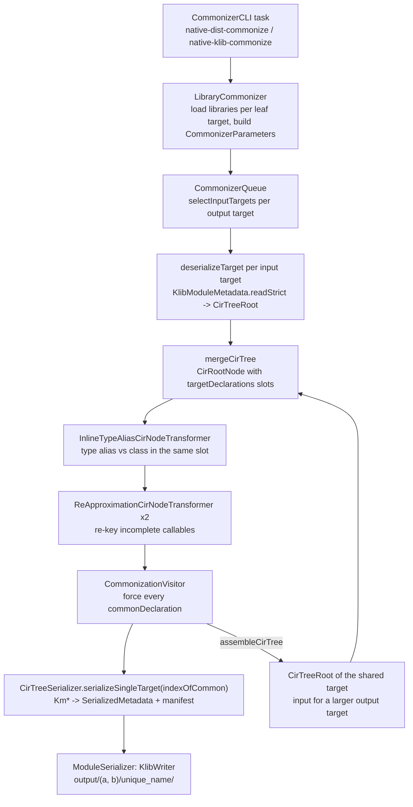
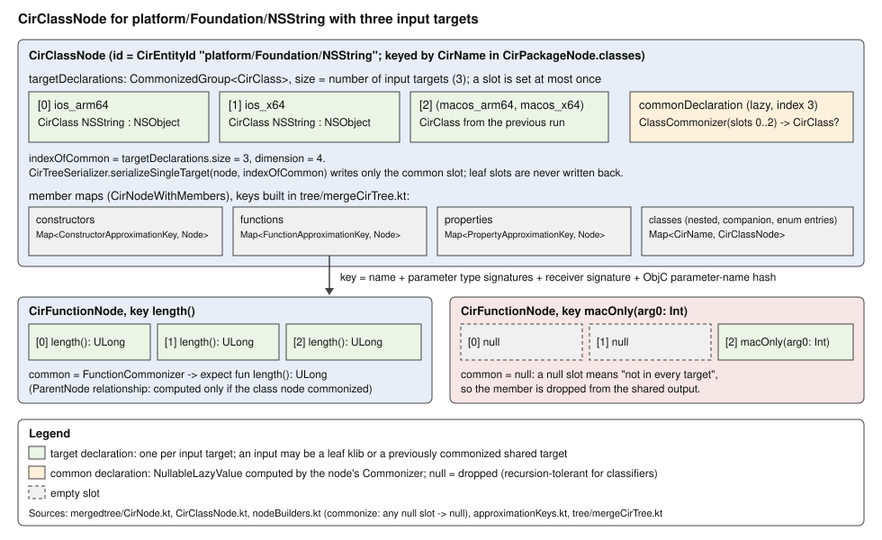
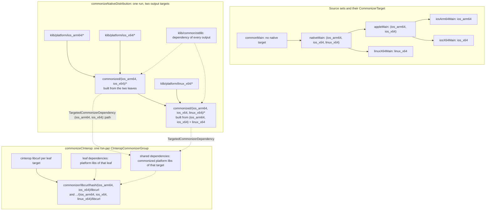

# Kotlin/Native: the klib commonizer

The commonizer takes the *same* library compiled for several Kotlin/Native targets (platform libraries such as `Foundation` for
`ios_arm64` and `ios_x64`, or a cinterop klib built per target) and produces, for every shared source set of a multiplatform
project, one metadata-only klib that contains what the targets have in common: identical declarations verbatim and `expect`
declarations where the targets differ in a way that `expect`/`actual` can express. It never touches IR, never produces binaries
and never rewrites the leaf klibs; the platform compilations keep using the original per-target klibs, so nothing is ever
"actualized" — the shared source set simply sees a different, narrower module than the platform source sets. This page covers
the model (targets, identity strings, output layout), the algorithm end to end (deserialization into CIR, the merged node tree,
the transformers, the per-declaration and per-type commonizers, serialization and manifests), how runs depend on each other,
the KGP tasks and caches around it, the consumers, tests and the contracts other code silently relies on.

Read this when a declaration you expect in a shared native source set is missing or has a surprising shape (`expect`, dropped,
`@UnsafeNumber`, different parameter names), when a cinterop does not commonize, when `commonizeNativeDistribution` is slow or
stale, or when you change platform libraries, cinterop output or klib manifests and need to know what the commonizer will do with
the change.

Related pages: [platform-libraries.md](platform-libraries.md) (the usual input and the distribution cache),
[cinterop.md](cinterop.md) (the other input), [tooling-integration.md](tooling-integration.md#commonizer) (KGP task wiring and IDE
import, summarized here only where the commonizer's own behaviour depends on it), [klib-linking.md](klib-linking.md) (why a
metadata-only klib is never linked), [compatibility-and-migration.md](compatibility-and-migration.md) (manifest keys and target
lists), [compilation-model.md](compilation-model.md).

Code layout (Gradle paths in [architecture.md](architecture.md)): `:native:kotlin-klib-commonizer` =
[native/commonizer](../../native/commonizer) (algorithm and CLI; `SRC` below = `native/commonizer/src/org/jetbrains/kotlin/commonizer/`),
`:native:kotlin-klib-commonizer-api` = [native/commonizer-api](../../native/commonizer-api) (the small public model shared with KGP:
targets, dependencies, settings, output layout, `CliCommonizer`), `:native:kotlin-klib-commonizer-embeddable` =
[native/commonizer-embeddable](../../native/commonizer-embeddable) (the repackaged artifact KGP downloads and runs). The user-facing
description and the limitations list are in [native/commonizer/README.md](../../native/commonizer/README.md); note that its first
limitation ("supports only interop libraries shipped with Kotlin/Native") is out of date — user cinterop klibs are commonized by
`CInteropCommonizerTask` (see [KGP tasks](#kgp-tasks-caching-and-the-forked-jvm)).

## Key concepts

| Term | Meaning | Source |
|------|---------|--------|
| `CommonizerTarget` | `LeafCommonizerTarget(name)` wraps a `KonanTarget` name; `SharedCommonizerTarget(targets: Set<LeafCommonizerTarget>)` is a *flat* set of leaves. `Serializable`, used as a key everywhere. | [CommonizerTarget.kt](../../native/commonizer-api/src/org/jetbrains/kotlin/commonizer/CommonizerTarget.kt) |
| identity string | `toString()` of a target: the leaf name, or `(a, b, c)` with the leaves *sorted* and comma-separated. Parsed back by `parseCommonizerTarget`; nested `((a, b), c)` is accepted and flattened to `(a, b, c)`. It is the directory name of commonized output, the `commonizer_target` manifest value and the CLI syntax. | [parseCommonizerTarget.kt](../../native/commonizer-api/src/org/jetbrains/kotlin/commonizer/parseCommonizerTarget.kt), [TargetLibrariesLayout.kt](../../native/commonizer-api/src/org/jetbrains/kotlin/commonizer/TargetLibrariesLayout.kt) |
| output target | Always a `SharedCommonizerTarget` with at least two leaves (`LibraryCommonizer.checkPreconditions` exits with "Too few targets specified" otherwise). Leaf targets are inputs only; their klibs are never rewritten. | [LibraryCommonizer.kt](../../native/commonizer/src/org/jetbrains/kotlin/commonizer/konan/LibraryCommonizer.kt) |
| CIR | "Commonizer IR": the declaration model the algorithm works on — `CirRoot` ⊃ `CirModule` ⊃ `CirPackage` ⊃ `CirClass`/`CirTypeAlias`/`CirFunction`/`CirProperty`/`CirClassConstructor`, with `CirType` (`CirClassType`, `CirTypeAliasType`, `CirTypeParameterType`, `CirFlexibleType`). Built from `kotlinx-metadata-klib` `Km*` objects; heavily interned. | [cir/CirDeclaration.kt](../../native/commonizer/src/org/jetbrains/kotlin/commonizer/cir/CirDeclaration.kt), [cir/CirType.kt](../../native/commonizer/src/org/jetbrains/kotlin/commonizer/cir/CirType.kt) |
| `CirEntityId` | Interned classifier identity: package name + relative name segments, rendered `platform/Foundation/NSString` or `kotlinx/cinterop/CPointer.Companion`. Identity across targets is purely by name. | [cir/CirName.kt](../../native/commonizer/src/org/jetbrains/kotlin/commonizer/cir/CirName.kt) |
| `CirProvided.*` | A cheaper classifier model (`RegularClass`, `TypeAlias`, `ExportedForwardDeclarationClass`, types without declarations) for *dependencies*, read straight from protobuf without building CIR. | [cir/CirProvided.kt](../../native/commonizer/src/org/jetbrains/kotlin/commonizer/cir/CirProvided.kt), [CirProvidedClassifiersByModules.kt](../../native/commonizer/src/org/jetbrains/kotlin/commonizer/mergedtree/CirProvidedClassifiersByModules.kt) |
| `CirTree*` | The per-target deserialized tree (`CirTreeRoot` → `CirTreeModule` → `CirTreePackage` → `CirTreeClass`…): plain data, one per input target. | [tree/CirTree.kt](../../native/commonizer/src/org/jetbrains/kotlin/commonizer/tree/CirTree.kt) |
| `CirNode` (merged tree) | One node per declaration *name/signature*, holding `targetDeclarations: CommonizedGroup<T>` (fixed size = number of inputs, slot *i* = declaration of input *i* or null) and `commonDeclaration: NullableLazyValue<R>`. `indexOfCommon == targetDeclarations.size`. | [mergedtree/CirNode.kt](../../native/commonizer/src/org/jetbrains/kotlin/commonizer/mergedtree/CirNode.kt) |
| approximation key | How callables are matched across targets: `FunctionApproximationKey(name, value parameter type signatures, extension receiver signature, objCFunctionApproximation)`, `PropertyApproximationKey(name, receiver signature)`, `ConstructorApproximationKey(parameter signatures, objC…)`. Signatures are `CirTypeSignature`s (classifier ids + arguments + nullability). | [mergedtree/approximationKeys.kt](../../native/commonizer/src/org/jetbrains/kotlin/commonizer/mergedtree/approximationKeys.kt), [CirTypeSignature.kt](../../native/commonizer/src/org/jetbrains/kotlin/commonizer/mergedtree/CirTypeSignature.kt) |
| `Commonizer<T, R>` | The fold interface: `commonizeWith(next): Boolean` + `result`. `AbstractStandardCommonizer` is a three-state machine (EMPTY → IN_PROGRESS → ERROR); `AssociativeCommonizer` and `SingleInvocationCommonizer` are the list-at-once variants. `commonize(values)` returns null as soon as one `commonizeWith` fails. | [core/Commonizer.kt](../../native/commonizer/src/org/jetbrains/kotlin/commonizer/core/Commonizer.kt), [core/AssociativeCommonizer.kt](../../native/commonizer/src/org/jetbrains/kotlin/commonizer/core/AssociativeCommonizer.kt) |
| `CirKnownClassifiers` | Everything type commonization can resolve: `classifierIndices` (per input target, from the trees), `targetDependencies` (per target `CirProvidedClassifiers`), `commonDependencies` (for the output target), `commonizedNodes` (registry of class/type-alias nodes), `associatedIdsResolver`. | [mergedtree/CirKnownClassifiers.kt](../../native/commonizer/src/org/jetbrains/kotlin/commonizer/mergedtree/CirKnownClassifiers.kt) |
| lifted-up declaration | `CirLiftedUpDeclaration.isLiftedUp`: a declaration that goes to the common output *as is*, not as `expect` — every type alias and every `const val` whose value is the same on all targets. | [cir/CirDeclaration.kt](../../native/commonizer/src/org/jetbrains/kotlin/commonizer/cir/CirDeclaration.kt), [CirTypeAlias.kt](../../native/commonizer/src/org/jetbrains/kotlin/commonizer/cir/CirTypeAlias.kt), [CirProperty.kt](../../native/commonizer/src/org/jetbrains/kotlin/commonizer/cir/CirProperty.kt) |
| `@kotlinx.cinterop.UnsafeNumber` | Annotation synthesized when optimistic number commonization chose one width for a type that differs per target; its `actualPlatformTypes` lists `"<leaf>: <type>"`. | [core/UnsafeNumberAnnotationUtils.kt](../../native/commonizer/src/org/jetbrains/kotlin/commonizer/core/UnsafeNumberAnnotationUtils.kt) |
| `@kotlin.commonizer.ObjCCallable` | Annotation synthesized on a callable when every target carried an `ObjCMethod`/`ObjCConstructor`/`ObjCFactory` annotation. | [utils/names.kt](../../native/commonizer/src/org/jetbrains/kotlin/commonizer/utils/names.kt), [core/AnnotationsCommonizer.kt](../../native/commonizer/src/org/jetbrains/kotlin/commonizer/core/AnnotationsCommonizer.kt) |
| `commonizer_target`, `commonizer_native_targets` | Manifest keys of a commonized klib: the identity string and the sorted space-separated leaf names. | [KotlinLibrary.kt](../../compiler/util-klib/src/org/jetbrains/kotlin/library/KotlinLibrary.kt) (`KLIB_PROPERTY_COMMONIZER_TARGET`, `KLIB_PROPERTY_COMMONIZER_NATIVE_TARGETS`), [NativeSensitiveManifestData.kt](../../native/commonizer/src/org/jetbrains/kotlin/commonizer/konan/NativeSensitiveManifestData.kt) |

## Design in one paragraph

A run is a pure function from (a set of input klibs grouped by target, a set of dependency klibs, a set of requested output
targets, two boolean settings) to one directory of metadata klibs per output target. Inside the run everything is lazy and
name-driven: each input target is deserialized into a `CirTreeRoot`, all trees for one output are superimposed into one merged
tree whose nodes are keyed by name (classifiers) or by approximate signature (callables), and each node's common declaration is a
lazy fold over its per-target slots — null if any slot is empty or any component disagrees. The output of a smaller shared target is
itself a valid *input* for a larger one (`assembleCirTree` turns the merged tree back into a `CirTreeRoot`), which is how a
source-set hierarchy with `appleMain ⊂ nativeMain` is served by one process without re-reading leaves twice
(`CommonizerQueue`). Types are compared structurally after type-alias expansion, and when the classifiers differ the algorithm
searches for a type alias/underlying-type chain that reaches a classifier present on every target ("type alias substitution").
Only the common slot is ever serialized; `expect` is a serialization flag set on classes and non-lifted callables of the common
output. There is no notion of `actual` anywhere in the commonizer.

The whole pipeline, as sequenced by [facade.kt](../../native/commonizer/src/org/jetbrains/kotlin/commonizer/facade.kt)
(`runCommonization`, `deserializeTarget`, `commonizeTarget`, `serializeTarget`) and
[CommonizerQueue.kt](../../native/commonizer/src/org/jetbrains/kotlin/commonizer/CommonizerQueue.kt):

## Step 0 — entry points: the CLI tasks and what they load

[cli.kt](../../native/commonizer/src/org/jetbrains/kotlin/commonizer/cli/cli.kt) (`CommonizerCLI.main`) parses one or more tasks
from the arguments (argfiles `@file` are expanded with the compiler's `preprocessCommandLineArguments`), runs informational tasks
first and then commonization tasks. The task types are in
[TaskType.kt](../../native/commonizer/src/org/jetbrains/kotlin/commonizer/cli/TaskType.kt), their bodies in
[nativeTasks.kt](../../native/commonizer/src/org/jetbrains/kotlin/commonizer/cli/nativeTasks.kt):

| Task | Inputs | Dependencies given to the algorithm | Used by |
|------|--------|-------------------------------------|---------|
| `native-dist-commonize` | `KonanDistributionRepository`: for every leaf of every output target, `klib/platform/<target>/*` loaded through `KlibNativeDistributionLibraryProvider { withPlatformLibs(target) }` ([KonanDistributionRepository.kt](../../native/commonizer/src/org/jetbrains/kotlin/commonizer/repository/KonanDistributionRepository.kt)) | `StdlibRepository` (`<dist>/klib/common/stdlib`) | `commonizeNativeDistribution` |
| `native-klib-commonize` | `FilesRepository` over `-input-libraries`, grouped by the `konanTargets` of each klib's manifest (`commonizer_target` if present, else `native_targets`) ([FilesRepository.kt](../../native/commonizer/src/org/jetbrains/kotlin/commonizer/repository/FilesRepository.kt)) | stdlib + `CommonizerDependencyRepository` over `-dependency-libraries` | `commonizeCInterop` |
| `native-dist-print-targets` | lists `klib/platform/*` | — | only `CommonizerCliTest` |

Every klib is loaded with `KlibLoader` and must have a `metadataVersion` in its manifest, otherwise the process exits
([NativeLibraryLoader.kt](../../native/commonizer/src/org/jetbrains/kotlin/commonizer/NativeLibraryLoader.kt)). A leaf target
without any libraries is excluded with a warning ("No libraries found for target …"), which is how running on a Linux host with an
Apple target in the project degrades gracefully (`LibraryCommonizer.loadLibraries`). `LibraryCommonizer` then builds the
`CommonizerParameters`: one `TargetProvider` per leaf (a `DefaultModulesProvider` over the loaded klibs; two klibs with the same
`unique_name` in one target is an error, among dependencies only a warning), a manifest provider per output target, and
a dependencies provider for every output *and* leaf target
([CommonizerParameters.kt](../../native/commonizer/src/org/jetbrains/kotlin/commonizer/CommonizerParameters.kt)).

Only modules whose `unique_name` is present in *every* leaf of some output target are processed at all
(`commonModuleNames`, [commonModuleNames.kt](../../native/commonizer/src/org/jetbrains/kotlin/commonizer/commonModuleNames.kt));
if no output target has any, the run ends with `Status.NOTHING_TO_DO`. This is the first filter: a platform library that exists
for `ios_arm64` but not for `linux_x64` never reaches `nativeMain`.

## Step 1 — the queue and input-target selection

`CommonizerQueue` registers every requested output target and, for each, chooses its inputs with `selectInputTargets(available,
output)` ([InputTargetsSelector.kt](../../native/commonizer/src/org/jetbrains/kotlin/commonizer/InputTargetsSelector.kt)), where
`available` = all leaf targets that have a provider + all *other* output targets. The rule: take the candidates whose leaves are a
subset of the output's leaves, drop any candidate that is a proper subset of another candidate, then walk the output's leaves in
order and pick, for each leaf not yet covered, the first candidate containing it. A leaf that no candidate covers is an
`IllegalArgumentException` ("Failed selecting input targets"). Consequences:

- With outputs `{(a, b), (c, d), (a, b, c, d)}`, `(a, b, c, d)` is built from the two *commonized* trees, not from four leaves.
  The hierarchical tests rely on exactly this (`HierarchicalClassAndTypeAliasCommonizationTest`, "hierarchically" cases).
- With outputs `{(a, b), (a, b, c)}` the second is built from `(a, b)` and `c`.
- The output set is unordered; laziness orders the work. Trees are held in `NullableLazyValue`s and released as soon as no pending
  output references them (`removeTargetDependencies`), and `invokeAll` asserts that everything was released.

The merged tree of a shared target is converted back to a `CirTreeRoot` by
[assembelCirTree.kt](../../native/commonizer/src/org/jetbrains/kotlin/commonizer/tree/assembelCirTree.kt): only common
declarations survive, and a type-alias node whose common result became a class
(see [Step 4](#step-4--transformers-type-aliases-against-classes-and-re-approximation)) is emitted as a class. The `dependencies` of that tree are the output target's `CirProvidedClassifiers`.

## Step 2 — deserialization into per-target CIR trees

[RootCirTreeDeserializer](../../native/commonizer/src/org/jetbrains/kotlin/commonizer/tree/deserializer/RootCirTreeDeserializer.kt)
reads each common module's `SerializedMetadata` with `KlibModuleMetadata.readStrict` (the `kotlinx-metadata-klib` `Km*` model)
and converts it through [CirDeserializers.kt](../../native/commonizer/src/org/jetbrains/kotlin/commonizer/metadata/CirDeserializers.kt).
Points that matter for the result:

- **Packages** merge all fragments with the same `fqName` of one module ([CirTreePackageDeserializer.kt](../../native/commonizer/src/org/jetbrains/kotlin/commonizer/tree/deserializer/CirTreePackageDeserializer.kt)).
  Classes are regrouped by parent id ([ClassesToProcess.kt](../../native/commonizer/src/org/jetbrains/kotlin/commonizer/tree/deserializer/ClassesToProcess.kt));
  enum entries that are not stored as `KmClass` get a synthetic `CirClass` of kind `ENUM_ENTRY` (`CirDeserializers.defaultEnumEntry`).
- **Dropped at deserialization** ([excludes.kt](../../native/commonizer/src/org/jetbrains/kotlin/commonizer/utils/excludes.kt),
  [CirTreeFunctionDeserializer.kt](../../native/commonizer/src/org/jetbrains/kotlin/commonizer/tree/deserializer/CirTreeFunctionDeserializer.kt)):
  fake overrides (functions and properties), `kniBridge*` functions, and **top-level functions annotated `@Deprecated`**. The last
  rule has no comment; it dates from the first CIR-tree deserializer (commit `eddeef1d515a`, 2021) and the rationale is undocumented.
- **Types** are resolved against a `CirTypeResolver` whose `providedClassifiers` are the target's own modules plus the target's
  dependency classifiers ([CirTypeResolver.kt](../../native/commonizer/src/org/jetbrains/kotlin/commonizer/metadata/CirTypeResolver.kt));
  an unknown classifier is a hard `error("Unresolved classifier: …")`, which is the usual failure when a cinterop depends on another
  klib that was not passed as a dependency. The *abbreviated* type is preferred (`source.abbreviatedType ?: source`) so that
  `CirTypeAliasType` keeps the alias identity, and every alias type is expanded eagerly through
  [CirTypeAliasExpander.kt](../../native/commonizer/src/org/jetbrains/kotlin/commonizer/metadata/CirTypeAliasExpander.kt) so it
  carries its `underlyingType` chain. Type parameters are addressed by index with class-nesting offsets.
- **Forward declarations.** Every cinterop module's `exportForwardDeclarations` are registered as
  `CirProvided.ExportedForwardDeclarationClass` under both the synthetic id (`cnames/structs/X`) and the main-package id, and a
  type that resolves to one is rewritten to the *synthetic* id (`CirDeserializers.type`). Synthetic packages (`cnames.*`,
  `objcnames.*`) are always considered resolvable once any module has forward declarations, with a public
  `FALLBACK_FORWARD_DECLARATION_CLASS`
  ([CirProvidedClassifiersByModules.kt](../../native/commonizer/src/org/jetbrains/kotlin/commonizer/mergedtree/CirProvidedClassifiersByModules.kt)),
  and `CirProvided.ExportedForwardDeclarationClass` gets artificial supertypes (`COpaque`, `ObjCObjectBase`, `ObjCObject`) by
  package, mirroring the compiler's forward-declarations module ([cinterop.md](cinterop.md)).
- **Dependency classifiers** for a target (`CommonizerParameters.dependencyClassifiers`) are the composition of
  [CirFictitiousFunctionClassifiers](../../native/commonizer/src/org/jetbrains/kotlin/commonizer/mergedtree/CirFictitiousFunctionClassifiers.kt)
  (`kotlin.Function0..Function255` and `SuspendFunction*`, which the stdlib metadata does not declare), the *union* of exported
  forward declarations of all input and dependency modules, and the classifiers of the dependency modules read by `readModule`
  directly from protobuf (classes with type parameters, supertypes minus `Any`, visibility, kind; type aliases with underlying
  types).

The per-target tree is then indexed by [CirClassifierIndex](../../native/commonizer/src/org/jetbrains/kotlin/commonizer/mergedtree/CirClassifierIndex.kt)
(classifier by id, type aliases by underlying classifier) and the `CirKnownClassifiers` for the run are assembled in
`commonizeTarget` (facade.kt).

## Step 3 — merging into one node tree

[mergeCirTree.kt](../../native/commonizer/src/org/jetbrains/kotlin/commonizer/tree/mergeCirTree.kt) creates a `CirRootNode` of
size *n* (number of inputs) and superimposes each tree with its `targetIndex`: modules by name, packages by name, classes by simple
name within their parent (nested classes recurse, with a `CirMemberContext` of enclosing classes for type-parameter resolution),
type aliases by name, and functions/properties/constructors by approximation key. A slot can be set only once (`CommonizedGroup.set`
checks it), so two declarations of one target mapping to the same key is an internal error — except that the comment "Multiple
type substitutions could in result in the same commonization result" marks the callable case as tolerated.

Every node is created by [nodeBuilders.kt](../../native/commonizer/src/org/jetbrains/kotlin/commonizer/mergedtree/nodeBuilders.kt)
with (a) the `Commonizer` that will fold it, (b) a `CirNodeRelationship` and (c) a lazy `commonDeclaration`. The lazy value is the
heart of the dropping rule: `commonize()` returns **null if any slot is null**, otherwise folds the slots. The relationship adds two
gates ([CirNodeRelationship.kt](../../native/commonizer/src/org/jetbrains/kotlin/commonizer/mergedtree/CirNodeRelationship.kt)):
`ParentNode` — members commonize only if their class did; `PreferredNode` — an artificial class node (next step) commonizes only if
the type-alias node it shadows did *not*. Class and type-alias nodes use `createRecursionTolerantNullableLazyValue` with
`CirClassRecursionMarker`/`CirTypeAliasRecursionMarker` ([RecursionMarkers.kt](../../native/commonizer/src/org/jetbrains/kotlin/commonizer/cir/RecursionMarkers.kt))
because commonizing a type inside a class may ask for the class's own common declaration. Each class/type-alias node is also
registered in `CirCommonizedClassifierNodes`; registering the same `CirEntityId` twice is the check failure "Rewriting class node",
relaxed for a fixed list of `platform/CoreGraphics/CG*` ids because Xcode 14 moved them from CoreGraphics to CoreFoundation
(`CFCGTypes`) on iOS/tvOS/watchOS but not on macOS — the comment in facade.kt says "TODO: Remove hack after Xcode 14.1" and it is
still there (commit `289f540530dc`).

The resulting structure for one class, derived from `CirNode.kt`, `CirClassNode.kt`, `nodeBuilders.kt` and `mergeCirTree.kt`:

## Step 4 — transformers: type aliases against classes, and re-approximation

Two passes rewrite the merged tree before anything is commonized (`commonizeTarget` in facade.kt):

**`InlineTypeAliasCirNodeTransformer`**
([InlineTypeAliasCirNodeTransformer.kt](../../native/commonizer/src/org/jetbrains/kotlin/commonizer/transformer/InlineTypeAliasCirNodeTransformer.kt)).
Platform libraries frequently declare `typealias X = SomeStruct` on one target and `class X` on another (or alias different
classes). For every type-alias node the transformer finds the class node with the same id (or creates an *artificial* class node
with relationship `ParentNode(package) + PreferredNode(typeAliasNode)`) and, for every target where the alias exists and the class
slot is empty, puts an `ArtificialAliasedCirClass` into that slot: the aliased class renamed to the alias (if the aliased class is in
the same module its constructors, functions and properties are copied into the artificial node too), or a synthetic final class
whose supertypes are those of the expansion. Limitations in code comments: parameterized aliases and aliases of parameterized
types are skipped; nullable expansions get no supertypes and no members. Net effect (test
`HierarchicalClassAndTypeAliasCommonizationTest`): `typealias X = Int` + `class X` → `expect class X`; `typealias X = B` +
`typealias X = C` with `B : A`, `C : A` in a dependency → `expect class X : A`. The prototype commit is `8272564ca0b9`
("Commonize TypeAliases with Classes", 2021-05).

**`ReApproximationCirNodeTransformer`**, run twice
([ReApproximationCirNodeTransformer.kt](../../native/commonizer/src/org/jetbrains/kotlin/commonizer/transformer/ReApproximationCirNodeTransformer.kt)).
Approximation keys are built from raw classifier ids, so `fun f(x: NSUInteger)` and `fun f(x: ULong)` land in different nodes even
though one is an alias of the other. For every callable node that is *incomplete* (some slot null), each present declaration is
re-keyed with a `TypeAliasInvariant` signature (classifier ids replaced by their `AssociatedClassifierIds`, below) — first keeping
type arguments, then (`skipArguments = true`) ignoring them — and moved into the node with the new key if that slot is free.
Introduced as "two phased re-approximation" in commit `cf0f061db59c`.

## Step 5 — commonization per declaration kind

[CommonizationVisitor](../../native/commonizer/src/org/jetbrains/kotlin/commonizer/core/CommonizationVisitor.kt) walks the merged
tree top-down and forces every `commonDeclaration`; for a class it first forces the class, then members only if the class
commonized, and finally sets `companion` on the common class if all targets name the same companion and that companion node
commonized. The folds themselves (all under `SRC/core/`):

| Node | Commonizer | Must agree, otherwise dropped | Merged |
|------|------------|-------------------------------|--------|
| module | [ModuleCommonizer](../../native/commonizer/src/org/jetbrains/kotlin/commonizer/core/ModuleCommonizer.kt) | name (by construction) | `metadataVersion = min` |
| package | [PackageCommonizer](../../native/commonizer/src/org/jetbrains/kotlin/commonizer/core/PackageCommonizer.kt) | — | — |
| class | [ClassCommonizer](../../native/commonizer/src/org/jetbrains/kotlin/commonizer/core/ClassCommonizer.kt) | `kind`, `isInner`, `isValue`, `isCompanion`; visibility equal and not private (`VisibilityCommonizer.equalizing`); type parameters (name, `reified`, variance, upper bounds commonized as types); annotations | modality: `FINAL`+`OPEN` → `FINAL`, otherwise equal ([ModalityCommonizer](../../native/commonizer/src/org/jetbrains/kotlin/commonizer/core/ModalityCommonizer.kt)); `hasEnumEntries` = AND; `isData` is always `false` in the output; supertypes: [ClassSuperTypeCommonizer](../../native/commonizer/src/org/jetbrains/kotlin/commonizer/core/ClassSuperTypeCommonizer.kt) resolves the transitive supertype tree per target (through `SimpleCirSupertypesResolver` over the target index and common dependencies) and keeps every classifier reachable on all targets, at most one of them a `CLASS` kind; each group is type-commonized |
| type alias | [TypeAliasCommonizer](../../native/commonizer/src/org/jetbrains/kotlin/commonizer/core/TypeAliasCommonizer.kt) | name; type parameters; underlying type commonizes (with *backwards* substitution disabled); visibility lowered, not private | `@UnsafeNumber` added if the underlying type was optimistically commonized. A type alias in the output is always lifted up, never `expect` |
| function | [FunctionCommonizer](../../native/commonizer/src/org/jetbrains/kotlin/commonizer/core/FunctionCommonizer.kt) + [FunctionOrPropertyBaseCommonizer](../../native/commonizer/src/org/jetbrains/kotlin/commonizer/core/AbstractFunctionOrPropertyCommonizer.kt) | kind equal and not `DELEGATION`; not a `SYNTHESIZED` member of a data/value class; return type commonizes ([ReturnTypeCommonizer](../../native/commonizer/src/org/jetbrains/kotlin/commonizer/core/ReturnTypeCommonizer.kt): nullability may widen for *top-level, non-`var`* callables); modality; visibility lowered — but if any target's callable is virtual, all visibilities must be equal; extension receiver all-or-none and commonized; type parameters; `suspend` equal; value parameters (below) | `operator`/`infix`/`inline` = AND; annotations (below) |
| property | [PropertyCommonizer](../../native/commonizer/src/org/jetbrains/kotlin/commonizer/core/PropertyCommonizer.kt) | same base rules; no `lateinit` ("expect property can't be lateinit") | `const`: kept as a lifted-up `const val` with its value only if every target is `const` with the *same* value, otherwise a plain (`expect`) `val`; setter: both present with equal visibility → common setter, mixed → a private setter kept only for final properties ([PropertySetterCommonizer](../../native/commonizer/src/org/jetbrains/kotlin/commonizer/core/PropertySetterCommonizer.kt)); `isVar = setter != null` |
| constructor | [ClassConstructorCommonizer](../../native/commonizer/src/org/jetbrains/kotlin/commonizer/core/ClassConstructorCommonizer.kt) | never for singletons (objects, enum entries) or sealed classes; `isPrimary` equal; visibility equal; type parameters; value parameters | annotations |

**Value parameters** ([CallableValueParametersCommonizer](../../native/commonizer/src/org/jetbrains/kotlin/commonizer/core/CallableValueParametersCommonizer.kt),
[ValueParameterCommonizer](../../native/commonizer/src/org/jetbrains/kotlin/commonizer/core/ValueParameterCommonizer.kt)): same
count, types commonize, vararg-ness equal, **no default values** on any target (`!next.declaresDefaultValue`), `crossinline`/`noinline`
= AND. Names: a callable has *generated* names if they are `arg0, arg1, …` / `variadicArguments` (what cinterop emits for C
functions). Real names win over generated ones and the generated side is **patched in place** (`patchCallables`, which mutates the
*target* declarations' `valueParameters` and clears `hasStableParameterNames`); two different sets of real names fall back to generated
names everywhere. A callable carrying an ObjC interop annotation can never be renamed (`canNamesBeOverwritten`), so ObjC methods with
different parameter names do not commonize — their names are also part of the approximation key (`objCFunctionApproximation`).

**Annotations** ([AnnotationsCommonizer](../../native/commonizer/src/org/jetbrains/kotlin/commonizer/core/AnnotationsCommonizer.kt)):
only annotations present on every target survive, and only "simple" ones (no arguments) are copied verbatim. `@Deprecated` is merged
by [DeprecationAnnotationCommonizer](../../native/commonizer/src/org/jetbrains/kotlin/commonizer/core/DeprecationAnnotationCommonizer.kt):
level = the stricter one, message kept if identical else `"See concrete deprecation messages in actual declarations"`,
`ReplaceWith` kept only if identical and non-empty. `@kotlin.native.ObjCName` is kept only if identical
([ObjCNameAnnotationCommonizer](../../native/commonizer/src/org/jetbrains/kotlin/commonizer/core/ObjCNameAnnotationCommonizer.kt),
commit `55b8e1272076`). If every target has some `ObjCMethod`/`ObjCConstructor`/`ObjCFactory` annotation the output gets
`@kotlin.commonizer.ObjCCallable` plus the per-class merge of the real ones: `selector`/`initSelector` must match or the annotation
is dropped, `encoding` falls back to `""`, `designated` to `false`, `isStret` is dropped (commit `0a07f168966c`). Annotations on
*types* are lost entirely (doc comment on `CirSimpleType`); backing-field and receiver annotations are not read (KT-44625,
KT-42490 TODOs in `CirDeserializers`).

## Step 6 — types, type-alias substitution and the number features

[TypeCommonizer](../../native/commonizer/src/org/jetbrains/kotlin/commonizer/core/TypeCommonizer.kt) dispatches on the type
kind: type-parameter types must be identical (index and nullability); flexible types commonize both bounds; class/type-alias types go
through [ClassOrTypeAliasTypeCommonizer](../../native/commonizer/src/org/jetbrains/kotlin/commonizer/core/ClassOrTypeAliasTypeCommonizer.kt),
which is where most of the subtlety lives:

1. **Nullability** of the *expansions* must be equal, unless the `Context` enables covariant commonization (set by
   `ReturnTypeCommonizer` for top-level, non-`var` return types), in which case the result is nullable if any input is.
2. **Same classifier on all targets** → proceed. Otherwise **type-alias substitution** (`substituteTypesIfNecessary`):
   - [AssociatedClassifierIdsResolver](../../native/commonizer/src/org/jetbrains/kotlin/commonizer/mergedtree/AssociatedClassifierIdsResolver.kt)
     computes, for a classifier id, the set of ids connected to it through type-alias edges in either direction on *any* target
     (BFS over "aliases whose underlying type is X" and "underlying type of alias X", across the target indices, target dependencies
     and common dependencies), keeping only ids that resolve on **every** target. All inputs must yield the same set.
   - For each candidate id, [CirTypeDistance](../../native/commonizer/src/org/jetbrains/kotlin/commonizer/mergedtree/CirTypeDistance.kt)
     is measured per target: positive = number of underlying-type hops forward from the input type to the candidate, negative =
     the input is *the underlying type of* the candidate alias (backwards), unreachable otherwise. The candidate with the smallest
     maximum `penalty` wins; the penalty prefers forward over backwards and short over long.
   - Forward substitution follows the underlying chain; backwards substitution builds a `CirTypeAliasType` for the candidate alias
     and is refused for parameterized source types or aliases ("Selecting reasonable arguments for such types would be complicated").
     `TypeAliasCommonizer` disables backwards substitution for underlying types.
3. If no substitution exists and the setting is on, the **number commonizers** get the *expanded* types:
   [PlatformIntegerCommonizer](../../native/commonizer/src/org/jetbrains/kotlin/commonizer/core/PlatformIntegerCommonizer.kt)
   (`-platform-integers`, default `false`) maps `Int`/`Long` (and `UInt`/`ULong`, `IntArray`/`LongArray`, ranges, progressions,
   `IntVarOf`/`LongVarOf`) to `kotlin.PlatformInt` & co. when every input's width matches the target's width in the hard-coded
   [PlatformWidthIndex](../../native/commonizer/src/org/jetbrains/kotlin/commonizer/mergedtree/PlatformWidthIndex.kt) table
   (`watchos_arm64` and `linux_arm32_hfp` are `INT`, everything else listed is `LONG`, targets not listed disable the feature);
   otherwise [OptimisticNumbersTypeCommonizer](../../native/commonizer/src/org/jetbrains/kotlin/commonizer/core/OptimisticNumbersTypeCommonizer.kt)
   (`-optimistic-numbers`, default `true`) picks the **narrowest** type within one family — signed, unsigned, floating point and
   their `*VarOf` counterparts — and tags the result with `OptimisticCommonizationMarker`, which makes
   `createUnsafeNumberAnnotationIfNecessary` emit `@UnsafeNumber(["a: kotlin.Byte", "b: kotlin.Short"])` on the declaration (test `HierarchicalOptimisticNumbersTypeCommonizerTest`;
   history: commits `814a147a530f`, `f7839e847abd`, `60ccdf23ea41`, 2021-08; platform integers `8f4d04dad273`, `f2572975058c`,
   2022-02). An existing `@UnsafeNumber` from a previous (hierarchical) run is merged into the new one.
4. Type arguments commonize recursively with equal projection kinds ([TypeArgumentCommonizer](../../native/commonizer/src/org/jetbrains/kotlin/commonizer/core/TypeArgumentCommonizer.kt));
   outer types of inner classes likewise.
5. Finally the chosen classifier must be **expressible in the common output**: anything in a forward-declaration package; a class or
   type alias provided by the *common* dependencies (for a dependency alias the underlying type is re-derived from the dependency);
   or a class/type-alias node of this run whose own `commonDeclaration` is non-null. Anything else → null → the enclosing declaration
   is dropped. This is the rule that makes "a type mentions a classifier that did not commonize" cascade upwards.

## Step 7 — serialization and the manifest

`serializeTarget` (facade.kt) runs [CirTreeSerializer.serializeSingleTarget](../../native/commonizer/src/org/jetbrains/kotlin/commonizer/metadata/CirTreeSerializer.kt)
with `targetIndex = indexOfCommon`, so **only the common slot is written**; the leaf indices are supported by the serializer but
nothing calls it with them. Each module becomes a `KlibModuleMetadata` through
[CirSerializers.kt](../../native/commonizer/src/org/jetbrains/kotlin/commonizer/metadata/CirSerializers.kt) and
[flags.kt](../../native/commonizer/src/org/jetbrains/kotlin/commonizer/metadata/flags.kt):

- `isExpect` is set on classes (`isCommon`), on functions (`isCommon && kind != SYNTHESIZED`) and on properties
  (`isCommon && !isLiftedUp`, i.e. not for same-value `const val`s); type aliases are never `expect`. `protected` members of
  *final* expect classes are omitted ("prohibited inside final expect classes"). A class without supertypes gets `kotlin.Any`
  except `Any`/`Nothing` themselves; sealed classes are linked to their subclasses within the package; enum entries are emitted as
  `KmEnumEntry`, not as nested classes.
- Alias types are written as expansion + abbreviation, exactly like the compiler's metadata, using the eagerly computed
  `underlyingType` chain.
- The module is written with `ChunkedKlibModuleFragmentWriteStrategy()` — 64 top-level classifiers / 128 callables per fragment
  file ([ChunkedKlibModuleFragmentWriteStrategy.kt](../../libraries/kotlinx-metadata/klib/src/kotlinx/metadata/klib/ChunkedKlibModuleFragmentWriteStrategy.kt)).
  Nested classes may land in a different chunk than their outer class; the IDE decompiler works around this
  ([NearFileClassDataFinder.kt](../../analysis/decompiled/decompiler/src/org/jetbrains/kotlin/analysis/decompiler/konan/NearFileClassDataFinder.kt),
  KT-68202, KT-65414).
- The manifest comes from [NativeSensitiveManifestData.kt](../../native/commonizer/src/org/jetbrains/kotlin/commonizer/konan/NativeSensitiveManifestData.kt)
  via `CommonNativeManifestDataProvider` ([NativeLibrary.kt](../../native/commonizer/src/org/jetbrains/kotlin/commonizer/konan/NativeLibrary.kt)):
  `unique_name` and `short_name`/`package` from the inputs (first one), `depends` = **intersection** of the inputs' `depends`,
  `native_targets` = **union**, `interop=true` only if every input is interop, `exportForwardDeclarations`/`includedForwardDeclarations`
  = intersection (interop only), plus `commonizer_target=<identity string>` and `commonizer_native_targets=<sorted leaf names>`.
  `ir_provider` is deliberately not written ("Commonized libraries were never supposed to provide any IR"). Versions are copied from
  the first input; the `builtins_platform` is `NATIVE`.
- [ModuleSerializer](../../native/commonizer/src/org/jetbrains/kotlin/commonizer/konan/ModuleSerializer.kt) writes each module with
  `KlibWriter` in its default `KlibFormat.Directory`, i.e. an **unpacked** klib directory named `<unique_name>` (`:` replaced by `_`)
  under `<output>/<identity string>/` ([CommonizerOutputFileLayout](../../native/commonizer-api/src/org/jetbrains/kotlin/commonizer/TargetLibrariesLayout.kt);
  identity strings longer than 150 characters are truncated and suffixed with a URL-safe base64 SHA-1 — the KGP IT "KT-46856 filename
  too long" covers this). `-log-stats raw|aggregated` additionally writes per-declaration/per-target presence tables into the output
  directory ([stats/](../../native/commonizer/src/org/jetbrains/kotlin/commonizer/stats/StatsCollector.kt)).

## Dependencies between runs and the target hierarchy

A commonizer run resolves types against three kinds of classifiers: the inputs themselves, *per-target* dependencies and
*common* dependencies (the dependencies registered for the output target). [CommonizerDependency.kt](../../native/commonizer-api/src/org/jetbrains/kotlin/commonizer/CommonizerDependency.kt)
models the CLI form: `TargetedCommonizerDependency(target, file)` is rendered `<identity string>::<canonical path>` and
`NonTargetedCommonizerDependency(file)` is a bare path, joined with `;` in `-dependency-libraries`
([CliCommonizer.kt](../../native/commonizer-api/src/org/jetbrains/kotlin/commonizer/CliCommonizer.kt)). Inside,
[CommonizerDependencyRepository](../../native/commonizer/src/org/jetbrains/kotlin/commonizer/repository/CommonizerDependencyRepository.kt)
answers `getLibraries(target)` with the targeted ones for exactly that target plus the non-targeted ones grouped by their own
manifest targets, and the stdlib is always added by `StdlibRepository`. Hence the layering:

1. **Platform libraries** are commonized against the stdlib only (`native-dist-commonize`).
2. **Cinterop klibs** are commonized against the stdlib, the platform libraries of each leaf (what the cinterop was compiled
   against) and the *commonized* platform libraries of each shared target in the group, plus commonized cinterops coming from other
   projects. KGP builds exactly this set in `CInteropCommonizerTask.groupedCommonizerDependencies`: for a leaf, the cinterop's own
   `libraries` plus `getNativeDistributionDependenciesWithNativeDownloadTask(leaf)` (= `klib/platform/<target>`); for a shared
   target, the `<sourceSet>CInterop` configuration view plus `commonizedNativeDistributionKlibsOrNull(target)`
   ([CInteropCommonizerTask.kt](../../libraries/tools/kotlin-gradle-plugin/src/common/kotlin/org/jetbrains/kotlin/gradle/targets/native/internal/CInteropCommonizerTask.kt),
   [SetupKotlinNativePlatformDependenciesAndStdlib.kt](../../libraries/tools/kotlin-gradle-plugin/src/common/kotlin/org/jetbrains/kotlin/gradle/targets/native/internal/SetupKotlinNativePlatformDependenciesAndStdlib.kt)).
   That is why `commonizeCInterop` depends on `commonizeNativeDistribution`.

Cinterops are batched into [CInteropCommonizerGroup](../../libraries/tools/kotlin-gradle-plugin/src/common/kotlin/org/jetbrains/kotlin/gradle/targets/native/internal/CInteropCommonizerGroup.kt)s
(one CLI invocation per group, output under `build/classes/kotlin/commonizer/<interop names>/<hash>/<identity string>/`): every
shared-native compilation and source set with a `SharedCommonizerTarget` and cinterops is a `CInteropCommonizerDependent`; the
"root" scope sets (not contained in another) define the groups, each with all targets and interops of the dependents it covers.

A hierarchy with three leaves, which klib each run produces and which dependencies each run sees, as computed by
`selectInputTargets`, `CommonizerQueue`, `NativeDistributionCommonizerTask.commonizerTargets` and `CInteropCommonizerTask`:

Which klib a source set compiles against is decided by `getNativeDistributionDependencies(target)`: a `LeafCommonizerTarget` gets
the original `klib/platform/<target>` libraries, a `SharedCommonizerTarget` gets the commonized directory for its identity string.
Leaf compilations therefore never see a commonized klib (see [Consumers](#consumers-and-the-expectactual-question)).

## KGP tasks, caching and the forked JVM

The wiring is described in [tooling-integration.md](tooling-integration.md#commonizer); the facts the commonizer's behaviour depends
on, from [CommonizerTasks.kt](../../libraries/tools/kotlin-gradle-plugin/src/common/kotlin/org/jetbrains/kotlin/gradle/targets/native/internal/CommonizerTasks.kt),
[NativeDistributionCommonizerTask.kt](../../libraries/tools/kotlin-gradle-plugin/src/common/kotlin/org/jetbrains/kotlin/gradle/targets/native/internal/NativeDistributionCommonizerTask.kt),
[NativeDistributionCommonizerCache.kt](../../libraries/tools/kotlin-gradle-plugin/src/common/kotlin/org/jetbrains/kotlin/gradle/targets/native/internal/NativeDistributionCommonizerCache.kt),
[commonizerTarget.kt](../../libraries/tools/kotlin-gradle-plugin/src/common/kotlin/org/jetbrains/kotlin/gradle/targets/native/internal/commonizerTarget.kt)
and [GradleCliCommonizer.kt](../../libraries/tools/kotlin-gradle-plugin/src/common/kotlin/org/jetbrains/kotlin/compilerRunner/GradleCliCommonizer.kt):

| Aspect | Behaviour |
|--------|-----------|
| Target of a source set | Inferred, not declared: the leaves of all platform compilations the source set participates in; one leaf → `LeafCommonizerTarget`, several → `SharedCommonizerTarget` (`inferCommonizerTarget`). A "shared" source set with one native target is a leaf and is never commonized. |
| `commonizeNativeDistribution` | Output targets = all `SharedCommonizerTarget`s of the project's source sets. Output root `<konanHome>/klib/commonized/<URL-encoded KGP version>/` (`KONAN_DISTRIBUTION_COMMONIZED_LIBS_DIR`), one subdirectory per identity string. The task writes `build/kotlin/commonizedNativeDistributionLocation.txt` pointing at that root so that consumers map through a file instead of declaring an output they share with other projects (KDoc on `commonizedNativeDistributionLocationFile`). |
| Distribution cache | `NativeDistributionCommonizerCache`: a target directory is "done" when it contains `.success`; the task's `upToDateWhen` and the action both go through `KotlinInterprocessDirectoryLock` on the root, so concurrent Gradle daemons serialize. Only the targets without a marker are passed to the CLI (`writeCacheForUncachedTargets`). If *no* leaf of the missing targets has a `klib/platform/<target>` directory the run is skipped with only an `--info` log line. `kotlin.mpp.enableNativeDistributionCommonizationCache=false` bypasses the markers but keeps the lock. The cache key is the KGP version and the distribution path only — the content of `klib/platform` is not fingerprinted. `cleanNativeDistributionCommonization` deletes the root. |
| `commonizeCInterop` | Registered only if the host is supported, the project has native targets and `cInteropCommonizationEnabled()` (`kotlin.mpp.separateKmpCompilation`, or `kotlin.mpp.enableCInteropCommonization`, or a flag set by an external plugin; default `false`). `@CacheableTask` with the cinterop klibs, dependency classpath and groups as inputs; the output directory of a group is deleted before each run. `copyCommonizeCInteropForIde` copies the result into the root project's Kotlin metadata dir for the IDE. |
| Process | Always a forked JVM (`shouldRunInProcessMode = false`) through `KotlinNativeToolRunner` with main class `org.jetbrains.kotlin.commonizer.cli.CommonizerCLI`, arguments via argfile, classpath = the `kotlin-klib-commonizer-embeddable` artifact of the KGP version (`maybeCreateCommonizerClasspathConfiguration`), JVM args from `kotlin.mpp.commonizerJvmArgs`, assertions enabled, C2 disabled, default max heap. |
| Settings pass-through | `additionalCommonizerSettings` always passes both `-optimistic-numbers` and `-platform-integers` from the Gradle properties ([CommonizerProjectExtensions.kt](../../libraries/tools/kotlin-gradle-plugin/src/common/kotlin/org/jetbrains/kotlin/gradle/targets/native/internal/CommonizerProjectExtensions.kt)). |

## Consumers and the expect/actual question

- **Metadata compilations of shared source sets** (`compile<SourceSet>KotlinMetadata`, `-Xmetadata-klib`) get the commonized
  platform libraries through `getNativeDistributionDependencies` and the commonized cinterops through
  `setupCInteropCommonizerDependencies` ([CInteropCommonizerDependencies.kt](../../libraries/tools/kotlin-gradle-plugin/src/common/kotlin/org/jetbrains/kotlin/gradle/targets/native/internal/CInteropCommonizerDependencies.kt)).
  Their own output is again metadata-only and, per [writeKlib.kt](../../compiler/cli/cli-native-klib/src/main/kotlin/org/jetbrains/kotlin/native/writeKlib.kt),
  has no `depends`, with "commonized cinterops" cited as one reason a consumer cannot reproduce the producer's classpath.
- **Separate KMP compilation** (K2, `-Xseparate-kmp-compilation`): `KotlinCompilationK2MultiplatformConfigurator.retrieveFragmentDependencies`
  adds, for every *intermediate* native fragment, the stdlib, the commonized platform libs of the fragment's target and the
  commonized cinterops as `-Xfragment-dependencies <fragment>:<path>` of the platform compile task
  ([KotlinCompilationK2MultiplatformConfigurator.kt](../../libraries/tools/kotlin-gradle-plugin/src/common/kotlin/org/jetbrains/kotlin/gradle/plugin/mpp/compilationImpl/KotlinCompilationK2MultiplatformConfigurator.kt));
  the leaf fragment keeps the platform klibs.
- **IDE**: `IdeCommonizedNativePlatformDependencyResolver` and `IdeCommonizedCinteropDependencyResolver`
  ([dependencyResolvers/](../../libraries/tools/kotlin-gradle-plugin/src/common/kotlin/org/jetbrains/kotlin/gradle/plugin/ide/dependencyResolvers/IdeCommonizedCinteropDependencyResolver.kt))
  hand the same directories to the IDE, flagged `isCommonized`; `IdeResolvedDependencyJson` carries `commonizerTarget` and
  `commonizerNativeTargets` read from the manifest. The Analysis API then reads ordinary metadata klibs, with the chunking
  workaround mentioned above.
- **The compiler** knows about commonization in exactly three places: `isCommonizedCInteropLibrary()` (`interop=true` and a
  `commonizer_target`, [utils.kt](../../compiler/util-klib-metadata/src/org/jetbrains/kotlin/library/metadata/utils.kt)) lets
  K2's `NativeForwardDeclarationsSymbolProvider` read `includedForwardDeclarations` from commonized cinterops
  ([NativeForwardDeclarationsSymbolProvider.kt](../../compiler/fir/entrypoint/src/org/jetbrains/kotlin/fir/session/NativeForwardDeclarationsSymbolProvider.kt));
  `KlibPlatformChecker.Native` accepts a klib for target *t* if `commonizer_native_targets` contains *t*
  ([KlibPlatformChecker.kt](../../compiler/util-klib/src/org/jetbrains/kotlin/library/loader/KlibPlatformChecker.kt)); and K1's
  `KlibResolvedModuleDescriptorsFactoryImpl` makes its synthetic forward declarations `expect` during metadata compilation so that
  `getFirstClassifierDiscriminateHeaders` does not prefer them over "a real `expect` declaration from a commonized interop library"
  ([KlibResolvedModuleDescriptorsFactoryImpl.kt](../../kotlin-native/backend.native/compiler/ir/backend.native/src/org/jetbrains/kotlin/backend/konan/KlibResolvedModuleDescriptorsFactoryImpl.kt)).
- **No actualization.** Nothing in the compiler matches a commonized `expect` with a platform declaration: platform compilations
  resolve `platform.Foundation.NSString` in the platform klib, shared-source-set compilations resolve it in the commonized klib, and
  the two are never in one module's own scope. K2's deserialized symbol provider only treats a found `expect` class specially by also
  looking for a typealias with the same id (KT-65840,
  [AbstractFirDeserializedSymbolProvider.kt](../../compiler/fir/fir-deserialization/src/org/jetbrains/kotlin/fir/deserialization/AbstractFirDeserializedSymbolProvider.kt)).
  **Unverified:** in separate KMP compilation, where a platform fragment's `dependsOn` fragment has the commonized klib as a fragment
  dependency, which classifier the platform fragment's session sees first for an id present in both klibs; no code specific to
  commonized klibs was found in the session factories.
- **Never linked.** Commonized klibs contain metadata only (no `ir_provider`, no IR component), so they are never passed to the
  second stage; the KGP wiring above only ever adds them to metadata compilations and to fragment dependencies
  ([klib-linking.md](klib-linking.md)).

## Flags and options

CLI options ([TaskType.kt](../../native/commonizer/src/org/jetbrains/kotlin/commonizer/cli/TaskType.kt),
[CommonizerArguments.kt](../../native/commonizer-api/src/org/jetbrains/kotlin/commonizer/cli/CommonizerArguments.kt),
[SettingOptionTypes.kt](../../native/commonizer/src/org/jetbrains/kotlin/commonizer/cli/SettingOptionTypes.kt)); all are `-name value`
pairs after the task alias:

| Option | Tasks | Default | Effect |
|--------|-------|---------|--------|
| `-distribution-path` | all | mandatory | `konanHome`; source of `klib/platform/*` and the stdlib |
| `-output-path` | commonize tasks | mandatory | root for `<identity string>/<unique_name>/` |
| `-output-targets` | commonize tasks | mandatory | `;`-separated identity strings; each must parse to a `SharedCommonizerTarget` |
| `-input-libraries` | `native-klib-commonize` | mandatory | `;`-separated klib paths, grouped by manifest targets |
| `-dependency-libraries` | `native-klib-commonize` | none | `;`-separated `[<identity>::]<path>` |
| `-log-level` | commonize tasks | `quiet` | `quiet` prints warnings/errors only; `info` adds per-target progress lines with timings ([CliLogger.kt](../../native/commonizer/src/org/jetbrains/kotlin/commonizer/cli/CliLogger.kt), [ProgressLogger.kt](../../native/commonizer/src/org/jetbrains/kotlin/commonizer/utils/ProgressLogger.kt)) |
| `-log-stats` | commonize tasks | `none` | `raw` or `aggregated`: write commonization statistics files into the output directory |
| `-optimistic-numbers` | commonize tasks | `true` | `OptimisticNumberCommonizationEnabledKey` |
| `-platform-integers` | commonize tasks | `false` | `PlatformIntegerCommonizationEnabledKey` |
| `-targets`, `-copy-stdlib`, `-copy-endorsed-libs` | `native-dist-commonize` | optional | **Parsed but never read** by `NativeDistributionCommonize.execute` (dead options; the two `copy-*` descriptions are identical copy-paste) |

Gradle properties ([PropertiesProvider.kt](../../libraries/tools/kotlin-gradle-plugin/src/common/kotlin/org/jetbrains/kotlin/gradle/plugin/PropertiesProvider.kt)):

| Property | Default | Effect |
|----------|---------|--------|
| `kotlin.mpp.enableCInteropCommonization` | unset → `false` (unless `kotlin.mpp.separateKmpCompilation` or an external plugin enables it) | registers `commonizeCInterop`; when off in a project that would need it, `DisabledCinteropCommonizationInHmppProjectChecker` warns unless `kotlin.mpp.enableCInteropCommonization.nowarn=true` |
| `kotlin.mpp.enableOptimisticNumberCommonization` | `true` | passed as `-optimistic-numbers` |
| `kotlin.mpp.enablePlatformIntegerCommonization` | `false` | passed as `-platform-integers` |
| `kotlin.mpp.commonizerLogLevel` | `info` if Gradle runs with `--info`, else `quiet` | passed as `-log-level` |
| `kotlin.mpp.commonizerJvmArgs` (deprecated alias `kotlin.commonizer.jvmArgs`) | none | JVM arguments of the forked commonizer |
| `kotlin.mpp.enableNativeDistributionCommonizationCache` | `true` | `.success` markers honoured or not |

`kotlin.mpp.enableIntransitiveMetadataConfiguration` is not a commonizer property (no reader found in KGP sources).

## Tests and how to run them

| Suite | What it covers | Command |
|-------|----------------|---------|
| [native/commonizer/tests](../../native/commonizer/tests/org/jetbrains/kotlin/commonizer) — `hierarchical/*` (`HierarchicalClassCommonizationTest`, `…ClassAndTypeAlias…`, `…OptimisticNumbersTypeCommonizerTest`, `…PlatformIntegerCommonizationTest`, `…CInteropCallableAnnotation…`, `…ObjCNameAnnotation…`, `BackwardsTypeSubstitutionCommonizationTest`, …) | Inline-source tests: Kotlin sources per target are compiled to metadata with the K2 metadata pipeline against the bootstrap K/N stdlib (`kotlin.internal.native.test.nativeHome`, set by `build.gradle.kts` from `NativeCompilerDownloader`), commonized in-process, and compared with `result.assertCommonized("(a, b)", "expect class X")` ([AbstractInlineSourcesCommonizationTest.kt](../../native/commonizer/tests/org/jetbrains/kotlin/commonizer/AbstractInlineSourcesCommonizationTest.kt), [utils/metadataCompilation.kt](../../native/commonizer/tests/org/jetbrains/kotlin/commonizer/utils/metadataCompilation.kt)). `registerFakeStdlibIntegersDependency` fakes the numeric classes. | `./gradlew :native:kotlin-klib-commonizer:test --tests "org.jetbrains.kotlin.commonizer.hierarchical.*"` |
| `*CommonizationFromSourcesTest` + [native/commonizer/testData](../../native/commonizer/testData) (`classifierCommonization/typeAliases`, `functionCommonization/valueParameters`, `propertyCommonization/liftingUpConst`, …) | Older golden-style tests: a directory per case with per-target sources. | `./gradlew :native:kotlin-klib-commonizer:test --tests "*CommonizationFromSourcesTest"` |
| `core/*CommonizerTest`, `tree/deserializer/*`, `tree/merge/*`, `transformer/*`, `CirTypeDistanceTest`, `AssociatedClassifierIdsResolverTest`, `SelectInputTargetsTest`, `CommonizerQueueTest`, `CommonizerCliTest`, `PlatformBitWidthTest` | Unit tests of the individual pieces named in this page. | same module |
| [native/commonizer-api/test](../../native/commonizer-api/test/org/jetbrains/kotlin/commonizer) — `CommonizeNativeDistributionTest`, `CommonizeLibcurlTest` (uses `testData/libcurl/{linux_x64,linux_arm64}/libcurl.klib`), `CommonizerTargetIdentityStringTest`, `CommonizerDependencyTest` | End-to-end through `CliCommonizer` against a real distribution. | `./gradlew :native:kotlin-klib-commonizer-api:test` |
| KGP integration tests `CommonizerIT`, `CommonizerHierarchicalIT` ([kotlin-gradle-plugin-integration-tests](../../libraries/tools/kotlin-gradle-plugin-integration-tests/src/test/kotlin/org/jetbrains/kotlin/gradle/CommonizerIT.kt); projects `commonize-*`, `commonizeHierarchically`, `commonizeSQLiteAndCurlInterop`) | Task wiring, up-to-date checks, cache, IDE copy, many `KT-xxxxx` regressions. | `./gradlew :kotlin-gradle-plugin-integration-tests:kgpNativeTests --tests "org.jetbrains.kotlin.gradle.CommonizerIT"` (see that module's [AGENTS.md](../../libraries/tools/kotlin-gradle-plugin-integration-tests/AGENTS.md)) |
| `NativeKlibPlatformCheckerTest` ([compiler/util-klib/test](../../compiler/util-klib/test/org/jetbrains/kotlin/library/NativeKlibPlatformCheckerTest.kt)) | `commonizer_native_targets` acceptance in the loader. | `./gradlew :kotlin-util-klib:test` |

No test commonizes the *shipped* platform libraries for Apple targets in this repository; the distribution tests above use Linux
targets ([platform-libraries.md](platform-libraries.md#tests)).

## Typical bugs and how to investigate

| Symptom | Likely cause | First things to try |
|---------|--------------|---------------------|
| A declaration exists in every platform klib but is missing from the shared source set | some component did not commonize: a type mentions a classifier that is not common (step 6.5), different nullability, a default value, `lateinit`, mixed visibilities on a virtual member, different ObjC parameter names, a top-level `@Deprecated` function, a sealed-class constructor | Run the CLI by hand (copy the argfile from `--info` output; `-log-level info -log-stats raw`), compare `klib dump-metadata` of the leaf klibs for that declaration; look for the first type in its signature whose classifier is absent in one leaf |
| `error: Unresolved classifier: …` during "Deserialized declarations" | an input references a klib that was not passed as `-dependency-libraries` (cinterop depending on another cinterop, or on a platform lib not in the distribution) | check the cinterop's `libraries`/`depends`; in KGP, the `<sourceSet>CInterop` configuration |
| `Rewriting class node …` | the same `CirEntityId` is declared by two modules of one target | `klib dump-metadata` both modules; see the CFCGTypes `allowedDuplicates` precedent in facade.kt |
| `Duplicated libraries: <name>` | two input klibs with the same `unique_name` for one target | check cinterop `name`s / `-Xshort-module-name`s |
| `@UnsafeNumber` warnings in user code | optimistic number commonization chose the narrow type | the annotation lists the real type per leaf; `kotlin.mpp.enableOptimisticNumberCommonization=false` to see the declaration disappear instead |
| Shared source set still sees the old API after a distribution change | `.success` marker from a previous run under the same KGP version | `./gradlew cleanNativeDistributionCommonization` or delete `<konanHome>/klib/commonized/<version>/<identity>`; `kotlin.mpp.enableNativeDistributionCommonizationCache=false` |
| IDE and Gradle disagree about commonized cinterops | stale copy in the IDE output root | rerun `copyCommonizeCInteropForIde` (`commonize` task during import) |
| Shared native source set with one target has no `expect`s / platform API is fully visible | target inferred as a leaf; nothing commonized by design | check `inferCommonizerTarget` inputs (platform compilations of the source set) |
| `OutOfMemoryError` / very slow `commonizeNativeDistribution` | all Apple platform libs for many targets in one JVM | `kotlin.mpp.commonizerJvmArgs=-Xmx…`; `-log-level info` prints per-phase timings |
| "No libraries found for target …" warning and a target missing from the output manifest | `klib/platform/<target>` absent on this host | expected on non-Darwin hosts for Apple targets; `commonizer_native_targets` of the result lists only the commonized leaves |

## Trade-offs and known limitations

- Metadata only. No IR is produced, so commonized klibs can never be linked; their only readers are the frontend (shared source
  sets) and the IDE. This keeps the tool independent of the backend but means the "actual" side is whatever the platform klib
  declares — there is no check that the `expect` shape is actually compatible with it beyond having been derived from it.
- "Missing anywhere → dropped everywhere": a declaration absent on one leaf is not emitted as an `expect` with partial actuals; it is
  simply not available in the shared source set. This is what makes `nativeMain` far poorer than `appleMain`.
- Type-alias substitution is limited to unparameterized types for backwards substitution and to unparameterized aliases for inlining
  into classes; type annotations, receiver annotations, backing-field annotations and constructor type parameters are lost
  (TODOs in `CirDeserializers`/`CirSerializers`).
- Optimistic number commonization is a deliberate unsoundness (a `Short` on one target is presented as `Byte`), made visible through
  `@UnsafeNumber`; it exists because `platform.posix` and friends differ in integer widths across targets.
- Platform-integer commonization is off by default and depends on `kotlin.PlatformInt`-style `expect` classes. **Unverified:** no
  such classes exist in this repository's stdlib (only the test fake in
  [InlineSourceCommonizationTestDependencyUtils.kt](../../native/commonizer/tests/org/jetbrains/kotlin/commonizer/hierarchical/InlineSourceCommonizationTestDependencyUtils.kt));
  `LanguageFeature.AllowExpectValueClassesWithNoPrimaryConstructor` / `AllowMultipleExpectsForSingleActual` are described as
  "only used for compiling the commonizer's support library with numeric expect classes" (KT-85824, KT-88307), so that library is
  built elsewhere or not yet.
- `PlatformWidthIndex` is a hand-maintained table; a new target is silently excluded from platform-integer commonization until it is
  added.
- One JVM, all libraries in memory: the distribution run for all Apple targets is the dominant cost of a first KMP build; the queue
  releases trees eagerly and `CirTreeSerializationVisitor` calls `System.gc()` after each root, which is a hint about the pressure.
- The distribution cache is keyed by KGP version and path only; it assumes `klib/platform` under a given `konanHome` never changes
  (true for `prebuilt` distributions, not necessarily for the light distribution where platform libs are generated on demand,
  [platform-libraries.md](platform-libraries.md)).

## Implied contracts

- Platform compilations never receive commonized klibs, and shared-source-set compilations never receive the leaf klibs of the same
  library, so no `expect` from a commonized klib ever needs an `actual`; enforced by: KGP wiring only
  (`getNativeDistributionDependencies`, `retrieveFragmentDependencies`), no compiler check.
- The same library has the same `unique_name` on every target (platform libraries and cinterops are built per target from one
  `.def`), because `commonModuleNames` matches modules by name only; enforced by: nothing in the commonizer (a renamed module is
  silently dropped from the output).
- Classifier identity across targets is the `CirEntityId` (package + name); a platform library that moves a class to another
  package on one target makes it disappear from the shared API; enforced by: nothing.
- One classifier id belongs to one module per target; enforced by: the "Rewriting class node" check, with the hard-coded CoreGraphics
  exception.
- KGP, the IDE import JSON and the commonizer agree on the identity-string syntax and the output directory layout; enforced by: shared
  code in `commonizer-api` (`identityString`, `parseCommonizerTarget`, `CommonizerOutputFileLayout`) — but the KGP plugin version
  and the embeddable artifact version are the same by construction, not checked.
- `commonizer_native_targets` of a commonized klib is a superset of every leaf that may consume it; enforced by: `KlibPlatformChecker.Native`
  at load time (the only manifest-level check on commonized klibs, [compatibility-and-migration.md](compatibility-and-migration.md)).
- Commonized platform libraries under `<konanHome>/klib/commonized/<version>` are immutable once `.success` exists; enforced by: nothing
  (no fingerprint of `klib/platform`).
- The output is deterministic for identical inputs (manifest lists are sorted; nodes are kept in insertion order of the first target);
  enforced by: no test compares two runs.
- Consumers tolerate `kotlin.commonizer.ObjCCallable` as an unknown annotation class: no declaration of it was found anywhere in this
  repository (stdlib, runtime, compiler, IDE-facing code), so the annotation in the metadata is unresolvable; enforced by: nothing
  (the frontend ignores unresolved annotation classes in libraries). **Hypothesis:** it is consumed by the IntelliJ Kotlin plugin
  or by nothing.
- Cinterop output for the same `.def` is structurally stable across targets apart from genuine platform differences (parameter names
  `arg0…`, forward-declaration packages, `depends`); the re-approximation and name-patching logic assumes cinterop's naming
  conventions (`REGULAR_ARGUMENT_PREFIX = "arg"`, `variadicArguments`); enforced by: nothing on the cinterop side.

## Open questions

- Who, if anyone, reads `@kotlin.commonizer.ObjCCallable`? It is emitted on every commonized ObjC method but has no declaration or
  reader in this repository.
- Where is the "commonizer's support library with numeric expect classes" (`kotlin.PlatformInt`, `PlatformIntVarOf`, …) that the two
  `LanguageFeature`s refer to, and is `-platform-integers` usable without it?
- Should the dead `-targets`, `-copy-stdlib` and `-copy-endorsed-libs` options of `native-dist-commonize` be removed?
- Is the Xcode 14 CoreGraphics `allowedDuplicates` hack in facade.kt still needed with the SDKs the current `platformLibs` are built
  against?
- Why are top-level `@Deprecated` functions excluded at deserialization (`isTopLevelDeprecatedFunction`) while deprecated members and
  classes are commonized with a merged `@Deprecated`?
- In separate KMP compilation, does the platform fragment's FIR session ever observe both the commonized `expect class` and the
  platform `class` for one id, and if so which wins?
- Does the IDE parse identity strings from `IdeResolvedDependencyJson.commonizerTarget`, or treat them as opaque labels?
