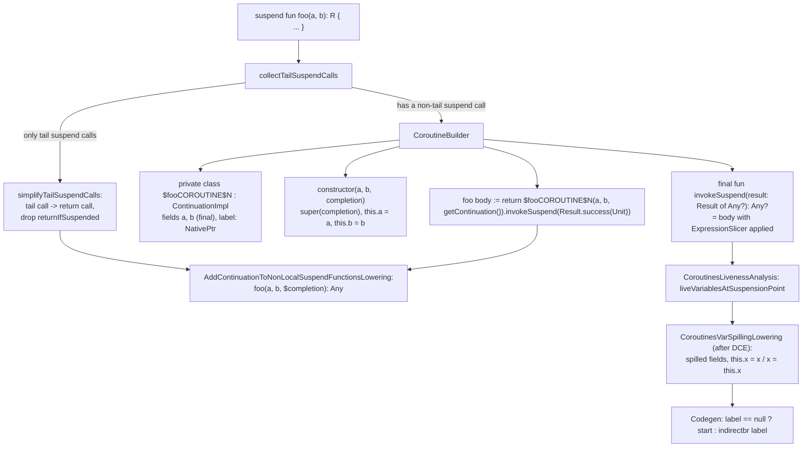
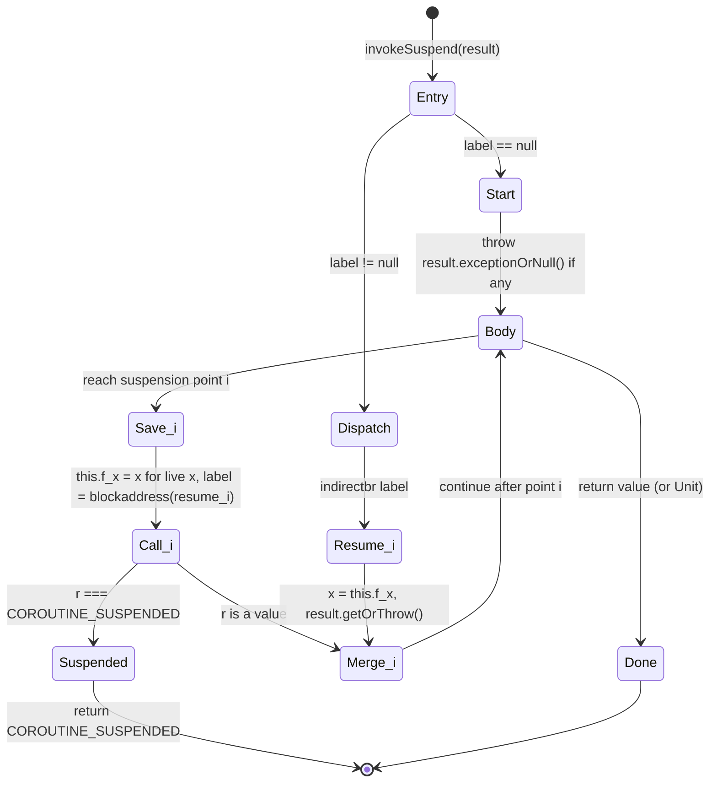
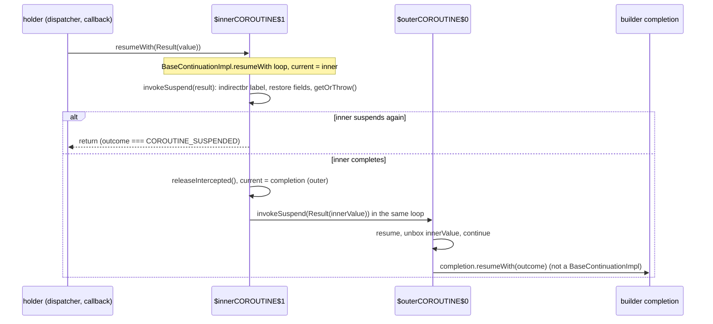
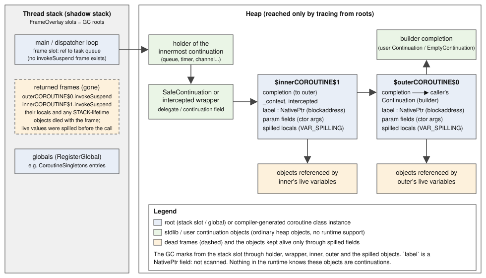

# Coroutines in Kotlin/Native: suspend functions from IR to LLVM

This page follows a `suspend` function through the Native backend: how `NativeSuspendFunctionsLowering` decides whether a
function needs a state machine, what the generated `$<name>COROUTINE$N` class looks like, how suspension points survive as
`IrSuspendableExpression`/`IrSuspensionPoint` nodes until codegen turns them into `indirectbr` dispatch, why the spilling of
locals into fields happens late (after DCE) and how the whole-program analyses model it, what the stdlib classes
(`BaseContinuationImpl`, `ContinuationImpl`, `SafeContinuation`) assume about the compiled shape, and what the GC and the C++
runtime know about continuations (nothing, except in ObjC export). The frontend semantics of coroutines are not covered.

**Read this when…** a suspend function crashes or returns garbage at a resume point, a variable "loses" its value across a
suspension, a stack allocation decision looks wrong inside a coroutine, an exception thrown by a suspend function is lost or
duplicated, an `invokeSuspend` frame appears in an unexpected place in a stack trace, or you change the stdlib coroutine
classes or the lowering order around `NativeSuspendFunctionsLowering`.

Related pages: [lowerings.md](lowerings.md) (where the phases sit; per-file invariant),
[dataflow-ir.md](dataflow-ir.md) (`SaveCoroutineState` node), [escape-analysis.md](escape-analysis.md) (intestines, lifetimes),
[devirtualization.md](devirtualization.md), [pre-codegen-inliner.md](pre-codegen-inliner.md), [llvm-codegen.md](llvm-codegen.md),
[gc.md](gc.md) and [compiler-runtime-contract.md](compiler-runtime-contract.md) (roots, shadow stack), [export.md](export.md)
(ObjC completion handlers), [debug-info.md](debug-info.md) (debug info; written in parallel with this page).

## Key concepts

| Term | Meaning | Source |
|---|---|---|
| Tail suspend call | A suspend call whose value is directly returned (or, in a `Unit` function, is the last statement before an implicit/explicit `return Unit`) and is not inside a `try`. Needs no state machine. | [TailSuspendCallsCollector.kt][tsc] `collectTailSuspendCalls` |
| Coroutine class | `private class $<fn>COROUTINE$<n> : ContinuationImpl` (or `RestrictedContinuationImpl`) generated per suspend function that has a non-tail suspend call; holds parameters, `label` and spilled locals. | [AbstractSuspendFunctionsLowering.kt][asfl] `CoroutineBuilder`, [NativeGenerationState.kt][ngs] `getCoroutineImplUniqueName` |
| `invokeSuspend` | The state-machine method of the coroutine class, overriding `BaseContinuationImpl.invokeSuspend(result: Result<Any?>): Any?`. | [NativeSuspendFunctionLowering.kt][nsfl] `buildStateMachine` |
| `label` | Field of type `kotlin.native.internal.NativePtr` holding the LLVM `blockaddress` of the block to resume at; `null` means "not started". | [NativeSuspendFunctionLowering.kt][nsfl] (`labelField`), [IrToBitcode.kt][i2b] `SuspensionPointScope.genGetValue` |
| `IrSuspendableExpression` | IR node: `suspensionPointId` (the `label` read) plus `result` (the whole body). Codegen emits `label == null ? start : indirectbr label`. | [IrTree.kt][irtree] `suspendableExpression`, [IrToBitcode.kt][i2b] `evaluateSuspendableExpression` |
| `IrSuspensionPoint` | IR node: `suspensionPointIdParameter` (a variable that codegen evaluates to the block address), `result` (first pass: save state, call, return if suspended) and `resumeResult` (resume pass: restore state, unwrap `Result`). | [IrTree.kt][irtree] `suspensionPoint`, [IrToBitcode.kt][i2b] `evaluateSuspensionPoint` |
| `saveCoroutineState` / `restoreCoroutineState` | `@TypedIntrinsic` placeholders inserted by the suspend lowering and replaced by field stores/loads by `CoroutinesVarSpillingLowering`; between the two they are `SaveCoroutineState` DFG nodes. | [Coroutines.kt][rt-coroutines], [CoroutinesVarSpillingLowering.kt][cvs], [DFGBuilder.kt][dfgb] |
| `getContinuation` / `returnIfSuspended` | `@TypedIntrinsic`s that `suspendCoroutineUninterceptedOrReturn` inlines to; the first becomes the `$completion` parameter or `this`, the second a `=== COROUTINE_SUSPENDED` check. | [Coroutines.kt][rt-coroutines], [AddContinuationToFunctionCallsLowering.kt][acc] |
| `$completion` | The continuation parameter added as the last parameter of every suspend function that is not a state machine; origin `CONTINUATION`; the function's origin becomes `LOWERED_SUSPEND_FUNCTION` and its return type `Any`/`Any?`. | [AddContinuationToFunctionsLowering.kt][acf] `createSuspendFunctionStub` |
| `COROUTINE_SUSPENDED` | `kotlin.coroutines.intrinsics.COROUTINE_SUSPENDED`, a getter returning the `CoroutineSingletons.COROUTINE_SUSPENDED` enum entry; compared by identity. | [Intrinsics.kt][stdlib-intrinsics], symbol `coroutineSuspendedGetter` in [Ir.kt][ir] |
| Liveness / spilling | `CoroutinesLivenessAnalysis` records, per suspension point, which locals are live afterwards (attribute `liveVariablesAtSuspensionPoint`); `CoroutinesVarSpillingLowering` stores exactly those into fields before the call and reloads them on resume. | [CoroutinesLivenessAnalysis.kt][cla], [CoroutinesVarSpillingLowering.kt][cvs] |
| Restricted suspension | Functions/lambdas under `@RestrictsSuspension`; their coroutine class extends `RestrictedContinuationImpl` (no `_context`/`intercepted` fields). Lambdas carry the `isRestrictedSuspensionInvokeMethod` IR flag. | [NativeSuspendFunctionLowering.kt][nsfl] `getCoroutineBaseClass`, [NativeFunctionReferenceLowering.kt][nfrl] |

## Design in one paragraph

Kotlin/Native compiles coroutines the same way as the JVM and JS backends conceptually, in the CPS-by-state-machine style:
a suspend function is split into a *stub* that takes an extra `Continuation` parameter and a *coroutine class* whose
`invokeSuspend` method is the function body with a dispatch on a `label`. Three choices are Native-specific. First, the label
is not an integer but a code address: the body stays a single structured expression (`IrSuspendableExpression`) whose
suspension points are `IrSuspensionPoint` nodes, and codegen resolves each to an LLVM `blockaddress` and dispatches with
`indirectbr` ([IrToBitcode.kt][i2b]), so no `when (label)` is ever built in IR. Second, which locals must survive a
suspension is decided by a real liveness analysis and the field stores/loads are materialized *after* devirtualization,
escape analysis and DCE ([NativeLoweringPhases.kt][nlp], `runCodegen` in `TopLevelPhases.kt`); until then the analyses see
a symbolic `SaveCoroutineState(liveVariables)` node ([dataflow-ir.md](dataflow-ir.md)). Third, suspend lambdas are not their
own state machines: their `invoke` is lowered like any other suspend function, with a separate coroutine class
(`buildCoroutine(function, isSuspendLambdaInvokeMethod = false)` in [NativeSuspendFunctionLowering.kt][nsfl]). The runtime
and the GC have no notion of a continuation: a suspended coroutine is an ordinary heap object graph reachable from whoever
holds the innermost continuation, and the frames that executed `invokeSuspend` are gone.

## Where it runs

The coroutine phases are file lowerings in `getLoweringsAfterInlining` ([NativeLoweringPhases.kt][nlp]), i.e. after all
inlining and after `NativeLocalDeclarationsLowering`/`LocalDeclarationPopupLowering` (lambdas are already classes), after
`NativeFinallyBlocksLowering` (the tail-call collector asserts `finallyExpression == null`) and after
`KotlinNothingValueExceptionLowering`; these three are the declared `@PhasePrerequisites` of `NativeSuspendFunctionsLowering`.
In order:

```text
KotlinNothingValueExceptionLowering
NativeSuspendFunctionsLowering                 state machine classes; tail calls simplified
AddContinuationToNonLocalSuspendFunctionsLowering   suspend fun -> fun(..., $completion): Any?
NativeAddContinuationToFunctionCallsLowering   suspend calls get the continuation argument; getContinuation() materialized
AddFunctionSupertypeToSuspendFunctionLowering  SuspendFunctionN classes also implement Function{N+1}
CoroutinesLivenessAnalysis                     "This is more optimal"
CoroutinesLivenessAnalysisFallback             "While this is simple"; no-op unless the previous phase was disabled
ExpressionBodyTransformer, ObjectClassLowering, StaticInitializersLowering, ComputeTypesPass (2nd run), ...
Autoboxing, ...                                boxes the Any-typed results of suspend calls
--- whole-program part (runCodegen in TopLevelPhases.kt, see optimizations.md) ---
BuildDFG -> Devirtualization -> EscapeAnalysis -> DCE
CoroutinesVarSpillingLowering                  saveCoroutineState/restoreCoroutineState -> field stores/loads
Codegen                                        IrSuspendableExpression / IrSuspensionPoint -> indirectbr
```

The comment in the phase list says that either liveness phase "could be turned off without losing correctness"; the
fallback skips itself when `NativeGenerationState.coroutinesLivenessAnalysisPhasePerformed` is set
([CoroutinesLivenessAnalysis.kt][cla]). Separating liveness and spilling from the lowering was done for KT-65153 (commit
`6c05219485f8`, "could be turned off in the future (by providing trivial replacement) as a workaround"), and the spilling was
moved down the pipeline in `ade70d52e6f4` (commit message gives no rationale; see Open questions). Phase names for
`-Xphases-to-dump-after=` / `-Xdisable-phases=` are the lowering class names (`loweringClass.simpleName` in
[PhaseFactories.kt][phasefactories]); `-Xdisable-phases=CoroutinesLivenessAnalysis` is exercised by
[liveness_analysis_fallback.kt][t-fallback].

The transformation of one function, as implemented in [NativeSuspendFunctionLowering.kt][nsfl] and
[AbstractSuspendFunctionsLowering.kt][asfl]:



## Step 1 — classifying suspend calls

`collectTailSuspendCalls` ([TailSuspendCallsCollector.kt][tsc]) walks the body with a `(insideTryBlock, isTailExpression)`
state. A suspend call is a tail call if it is in tail position and not inside a `try` body (catch results inherit the outer
state). Tail position is the value of a `return` to the function (or to a returnable block that is itself in tail position),
the last statement of a tail container, `when` branch results, and, for `Unit`-returning functions, any statement directly
followed by `return Unit` (`isUnitRead`). Two special cases exist for `returnIfSuspended`: a tail `returnIfSuspended(x)` makes
`x` a tail expression too, and an `IMPLICIT_CAST`/`IMPLICIT_COERCION_TO_UNIT` wrapped around it is looked through. The comment
marks this as a workaround for KT-85589 (the type parameter of `suspendCoroutineUninterceptedOrReturn` is not reified, so the
cast would otherwise block the optimization; the issue says the FileCheck tests cover it).

If `hasNotTailSuspendCalls` is false, `simplifyTailSuspendCalls` replaces each tail suspend call `c` by `return c` and unwraps
`returnIfSuspended(x)` to `x`. Because the lowered function returns `Any`/`Any?`, a callee's `COROUTINE_SUSPENDED` simply
propagates through the `return`. No class is generated: [suspend_tailcalls_functions.kt][t-tail-fn] checks with
`CHECK-NOT: call void @"kfun:$s1COROUTINE${{[0-9]*}}#<init>` that `s1`…`sN` allocate nothing, and
[suspend_tailcalls_lambdas.kt][t-tail-lambda] does the same for lambdas. A function whose only suspend call is inside `try`
or whose result is used (`val x = s()`) gets a state machine.

## Step 2 — the coroutine class

`CoroutineBuilder` ([AbstractSuspendFunctionsLowering.kt][asfl]) is shared with JS; Native supplies `stateMachineMethodName =
"invokeSuspend"`, `getCoroutineBaseClass` (`RestrictedContinuationImpl` if `function.isRestrictedSuspensionFunction()` or the
`isRestrictedSuspensionInvokeMethod` flag set by [NativeFunctionReferenceLowering.kt][nfrl] `postprocessInvoke`, else
`ContinuationImpl`), `nameForCoroutineClass` (`"${function.name}COROUTINE$${coroutineCount++}"`, a per-file counter in
`FileLowerState`, [NativeGenerationState.kt][ngs]) and `generateCoroutineStart`.

The generated class is `private`, origin `COROUTINE_IMPL`, placed in the function's parent (so a member suspend function's
class is a nested class of the same parent), with the function's type parameters copied ("TODO: remap types"). It has:

- one `private final` field per parameter of the original function, including receivers (`argumentToPropertiesMap`);
- `label: NativePtr`, mutable (added by Native's `buildStateMachine`);
- later, one mutable field per spilled local, origin `COROUTINE_VAR_SPILLING` ([CoroutinesVarSpillingLowering.kt][cvs]);
- a primary constructor `(params..., completion: Continuation<R>)` that delegates to the base class constructor "with exactly
  one regular parameter" (`single { it.hasShape(regularParameters = 1) }`; for `ContinuationImpl` that is the secondary
  constructor `(completion)`, which derives `_context` from `completion?.context`), runs the instance initializer and stores
  the parameters;
- `final fun invokeSuspend(result: Result<Any?>): Any?` with origin `COROUTINE_IMPL_INVOKE`, overriding
  `BaseContinuationImpl.invokeSuspend`;
- fake overrides for the rest (`addFakeOverrides`).

The original function keeps its signature at this point; its body is replaced by
`return $fooCOROUTINE$N(args, getContinuation<R>()).invokeSuspend(Result.success(Unit))` (`generateCoroutineStart` in
[NativeSuspendFunctionLowering.kt][nsfl]). The first run of the body therefore happens *directly*, not through
`BaseContinuationImpl.resumeWith`; exceptions thrown before the first suspension propagate straight to the caller, which is
what the `Continuation` protocol requires of `startCoroutineUninterceptedOrReturn`. Classes with origin `COROUTINE_IMPL` are
skipped when the lowering descends into classes (`visitClass`), so `invokeSuspend` is never re-transformed.

For suspend lambdas the shared builder has an `isSuspendLambda` mode (the lambda class itself becomes the state machine and
gets `create(...)` factory methods), but Native never uses it: `tryTransformSuspendFunction` always passes
`isSuspendLambdaInvokeMethod = false`, so a lambda's `invoke` gets its own `$invokeCOROUTINE$N` class and the lambda object
is **not** a `BaseContinuationImpl`. The consequences for `createCoroutineUnintercepted` are in "The stdlib side" below.

## Step 3 — the body: `ExpressionSlicer` and the suspension nodes

`buildStateMachine` ([NativeSuspendFunctionLowering.kt][nsfl]) declares `var suspendResult: Any?`, rewrites parameter accesses
to field accesses and `return`s to return from `invokeSuspend`, moves the declarations' parent, and wraps the body into

```text
IrSuspendableExpression(
    suspensionPointId = this.label,
    result = {
        if (result.exceptionOrNull() != null) throw it      // "Coroutine might start with an exception."
        <original statements>
    })
if the function returns Unit: return Unit                 // explicit, because invokeSuspend returns Any?
```

Before that, `ExpressionSlicer` visits every `IrSetField` and `IrMemberAccessExpression` (calls, constructor calls, …) whose
children contain suspend calls, innermost first, and does two things ("TODO: optimize - it has square complexity"):

1. **Preserve evaluation order.** Children evaluated *before* a child that contains a suspend call are hoisted into
   temporaries (`tmp<N>`, origin `COROUTINE_IMPL`) unless they are pure (`IrConst`, non-`var` `IrGetValue`, non-cast type
   operators over pure expressions; every `IrCall` counts as impure) or the child is the first argument and holds the only
   suspend call. Constructor calls are special because `ConstructorsLowering` will later make the allocated instance the real
   first argument. Temporaries from inner slices (blocks with origin `COROUTINE_IMPL`) are flattened into the outer block.
   Hoisting matters beyond semantics: a hoisted receiver or argument becomes an `IrVariable`, which is exactly what liveness
   analysis and spilling operate on.
2. **Save state as late as possible.** For a suspend call, the last non-null argument `e` is replaced by
   `{ val t = e; saveCoroutineState(); this.label = <id>; t }` (or without the temporary if `e` is pure); for
   `returnIfSuspended(x)` the save happens *before* `x` is evaluated (the `block(getContinuation())` of a
   `suspendCoroutineUninterceptedOrReturn` may resume the continuation synchronously, so the state must already be saved).
   `<id>` is the `IrVariable` `suspensionPointId<N>` of type `NativePtr` whose "value" is the resume block address.

The call is then wrapped in an `IrSuspensionPoint` of type `Any?`:

```text
IrSuspensionPoint(suspensionPointIdParameter = suspensionPointId<N>,
    result = {
        [saveCoroutineState(); this.label = suspensionPointId<N>]   // only if not already placed inside an argument
        suspendResult = <the suspend call>
        if (suspendResult === COROUTINE_SUSPENDED) return suspendResult
        suspendResult
    },
    resumeResult = {
        restoreCoroutineState()
        result.getOrThrow()                                           // kotlin.Result.getOrThrow; "TODO: consider inlining"
    })
```

and coerced back to the call's type (`as T`, or `IMPLICIT_COERCION_TO_UNIT`). Both `=== COROUTINE_SUSPENDED` and the result
unwrapping are plain IR: `irEqeqeq(irGet(value), irCall(symbols.coroutineSuspendedGetter))` and calls to `Result`'s
`exceptionOrNull`/`getOrThrow`. Because `invokeSuspend` and every lowered suspend function return `Any`/`Any?`, a primitive
or inline-class result of a suspend call travels boxed and is unboxed by the `as T` cast; the boxing itself is inserted by
`Autoboxing`, which runs after these phases ([NativeLoweringPhases.kt][nlp]).

## Step 4 — the continuation parameter

`AddContinuationToNonLocalSuspendFunctionsLowering` ([AddContinuationToFunctionsLowering.kt][acf]) replaces every remaining
`suspend` `IrSimpleFunction` (the emptied originals, the tail-call-only functions, abstract/interface members, lambda
`invoke`s) by a non-suspend stub created by `getOrCreateFunctionWithContinuationStub`: same name, origin
`LOWERED_SUSPEND_FUNCTION`, return type `Any?` if the original return type was nullable else `Any`
(`defaultLoweredSuspendFunctionReturnType`), overridden symbols mapped to their own stubs, and a last parameter
`$completion: Continuation<R>` with origin `CONTINUATION`. The stub is cached on the original function
(`functionWithContinuations`/`suspendFunction` attributes), which is how codegen's debug-info code still finds the LLVM function
of a `suspend` IR function ([IrToBitcode.kt][i2b] `IrSimpleFunction.scope`). A `Unit` body without a trailing `return` gets
`return Unit` (offsets chosen so a breakpoint on a lambda's closing brace can be hit).

`NativeAddContinuationToFunctionCallsLowering` ([NativeAddContinuationToFunctionCallsLowering.kt][nacc] over
[AddContinuationToFunctionCallsLowering.kt][acc]) then rewrites every suspend call to call the stub with the extra argument,
and replaces `getContinuation()` by that same value. The value is `this` inside a function that `overrides
symbols.invokeSuspendFunction` (the coroutine object *is* the continuation of its callees) and the `$completion` parameter in a
`LOWERED_SUSPEND_FUNCTION`; anywhere else it is an `IllegalArgumentException`, or, with partial linkage enabled, a
`SuspendableFunctionCallWithoutCoroutineContext` linkage error ([klib-linking.md](klib-linking.md)). Raw function references
to suspend functions are redirected to the stubs as well.

`AddFunctionSupertypeToSuspendFunctionLowering` ([AddFunctionSupertypeToSuspendFunctionLowering.kt][afs]) finally adds
`Function{N+1}<Args, Continuation<R>, Any?>` as a supertype of every class implementing `SuspendFunctionN`, with the lowered
`invoke` overriding `Function{N+1}.invoke`. Its KDoc calls this "a hack to provide compatibility with leaked Kotlin/JVM
implementation detail" that is "used in the `startCoroutineUninterceptedOrReturn` intrinsic" — see the stdlib side below.

## Step 5 — liveness and spilling

`CoroutinesLivenessAnalysis` ([CoroutinesLivenessAnalysis.kt][cla]) runs the shared backward liveness
([LivenessAnalysis.kt][la]: "the classic liveness analysis algorithm works on CFG … this directly translates to the AST
traversal from right to left") on every body with the filter `it is IrSuspensionPoint`, and stores the result in the IR
attribute `IrSuspensionPoint.liveVariablesAtSuspensionPoint` (migrated from a map in `NativeGenerationState` by
`abcb8781131d`, KT-69082). The fallback computes `visibleVariablesAtSuspensionPoint`: every variable declared in an enclosing
non-transparent scope or `catch`, excluding the `suspensionPointIdParameter`s — correct but over-approximate (more fields,
more heap edges).

`CoroutinesVarSpillingLowering` ([CoroutinesVarSpillingLowering.kt][cvs]) runs only on functions overriding
`BaseContinuationImpl.invokeSuspend`. For each suspension point it takes `liveVariablesAtSuspensionPoint ?:
visibleVariablesAtSuspensionPoint ?: error(...)`, and replaces the `saveCoroutineState()` call under it by
`this.f_x = x` for each live `x` and the `restoreCoroutineState()` call by `x = this.f_x`. Each spilled variable gets its own
field named after it ("TODO: optimize by using the same property for different locals") and is made `var`, since a `val`
cannot be re-assigned on resume. The lowering runs in `runCodegen` after DCE ([lowerings.md](lowerings.md),
[optimizations.md](optimizations.md) step 11); up to that point the analyses see the intrinsic calls:

| Consumer | What it sees | Source |
|---|---|---|
| DFG builder | `saveCoroutineState` → `DataFlowIR.Node.SaveCoroutineState(liveVariables)` (live variables are read from the same attributes, with the same `error` on absence); `restoreCoroutineState` → a no-op `StaticCall` to `theUnitInstance` ("no-op for all analyses so far"); an `IrSuspendableExpression` yields the values of its `result` plus all `IrSuspensionPoint`s inside it; a suspension point yields both `result` and `resumeResult`. | [DFGBuilder.kt][dfgb] |
| Escape analysis | `this.intestines ← each live variable`: spilled locals are modelled as stored into the coroutine object, so an object that is live across a suspension point gets the lifetime of the coroutine object's contents and is not stack-allocated. | [EscapeAnalysis.kt][ea] (`SaveCoroutineState` case), [escape-analysis.md](escape-analysis.md) |
| Devirtualization | `SaveCoroutineState` → `voidNode` (no type flows). | [DevirtualizationAnalysis.kt][da], [devirtualization.md](devirtualization.md) |
| Pre-codegen inliner | Never inlines a function that `overrides(invokeSuspendFunction)`; after inlining *into* a function it re-runs `LivenessAnalysis` and rebuilds the DFG ("KT-72336: This is not entirely correct since coroutinesLivenessAnalysisPhase could be turned off"). | [PreCodegenInliner.kt][pci], [pre-codegen-inliner.md](pre-codegen-inliner.md) |
| Escape-analysis checker, codegen | The four intrinsics are `mustBeLowered`: no `@Escapes` annotation is required, and reaching codegen is `reportNonLoweredIntrinsic`. | [EscapeAnalysisChecker.kt][eac], [IntrinsicGenerator.kt][ig] |

Why the spilling is late is not documented (Open questions); the observable effect is that fields exist only for variables
that are live after DCE and the inliner have run, and that the whole-program analyses never see field traffic for the spills.

## Step 6 — codegen

[IrToBitcode.kt][i2b] asserts in several places that no `isSuspend` function or call survives ("Suspend functions should be
lowered out at this point"; also in `LlvmFunctionPrototype.kt`). The two IR nodes become:

- `evaluateSuspendableExpression`: evaluate `suspensionPointId` (the `label` field), `condBr(icmpEq(id, kNull), start,
  dispatch)`; the `result` is emitted into `start` while a `SuspendableExpressionScope` collects resume blocks; `dispatch`
  ends with `indirectBr(id, resumePoints)`.
- `evaluateSuspensionPoint`: creates a `resume` basic block and registers it (`addResumePoint`); inside a
  `SuspensionPointScope`, reading the `suspensionPointIdParameter` variable yields `blockAddress(resume)` — this is the value
  stored into `label` by the `saveState` block. `result` is emitted on the fall-through path, `resumeResult` in the `resume`
  block, and both jump to a shared continuation block with a phi (`continuationBlock`).

So at the LLVM level `invokeSuspend` is one function with a `null`-check prologue and an `indirectbr` into the middle of its
body; locals are ordinary allocas/slots that are *re-loaded* from the coroutine object in the `resume` block before use.
`COROUTINE_SUSPENDED` is whatever `kotlin.coroutines.intrinsics.<get-COROUTINE_SUSPENDED>` returns (after
`EnumClassLowering`, a read of the `CoroutineSingletons` entry; **Unverified:** whether `-opt` folds the getter call into a
global load) and the check is a pointer `icmp eq`. Lowered functions are named like
`kfun:#s1#suspend(kotlin.coroutines.Continuation<kotlin.Unit>){}kotlin.Any` and coroutine classes like
`kfun:$fooCOROUTINE$0#<init>` (names quoted from [suspend_tailcalls_functions.kt][t-tail-fn] and
[suspend_returnNothing.kt][t-nothing]). The latter test also pins that a suspend function returning `Nothing` must *not*
get the `noreturn` attribute: it returns `COROUTINE_SUSPENDED`.

Nothing coroutine-specific exists in the GC-facing codegen: the coroutine object is allocated by the usual `AllocInstance`,
its reference fields are stored with the usual `UpdateHeapRef` barriers, and `label` is a non-reference `NativePtr` field the
GC does not scan. The runtime C++ (`kotlin-native/runtime/src/main/cpp`) mentions continuations only in
`ObjCExportCoroutines.mm` and in `ObjCExport.mm` (the `TF_SUSPEND_FUNCTION` type flag, below).

The dispatch as emitted for one `invokeSuspend` ([IrToBitcode.kt][i2b] `evaluateSuspendableExpression` /
`evaluateSuspensionPoint`, with the IR shape from [NativeSuspendFunctionLowering.kt][nsfl]):



## The stdlib side

The compiled shape only works together with `kotlin.coroutines.native.internal` in the Native stdlib
([ContinuationImpl.kt][rt-contimpl], [IntrinsicsNative.kt][rt-intrinsics], [SafeContinuationNative.kt][rt-safe],
[Coroutines.kt][rt-coroutines]):

- `BaseContinuationImpl.resumeWith(result)` is `final` ("This fact is used to unroll resumeWith recursion"): it loops over
  the `completion` chain, calling `invokeSuspend(param)`, returning if the outcome `=== COROUTINE_SUSPENDED`, otherwise
  wrapping the value or the caught `Throwable` in a `Result`, calling `releaseIntercepted()`, and either continuing the loop
  with `completion as BaseContinuationImpl` or calling `completion.resumeWith(outcome)` for a non-`BaseContinuationImpl`
  completion. Resuming a coroutine therefore adds one `resumeWith` frame plus one `invokeSuspend` frame per *level that
  actually runs code*; already-completed inner levels are unwound by the loop, not by recursion.
- `ContinuationImpl` adds `_context` and the cached `intercepted` continuation (`intercepted()` asks
  `context[ContinuationInterceptor]`, `releaseIntercepted` hands it back and poisons the cache with `CompletedContinuation`);
  `RestrictedContinuationImpl` requires `EmptyCoroutineContext`. These are the two base classes the lowering chooses from.
- `SafeContinuation` (used by `suspendCoroutine`) is an atomic three-state cell (`UNDECIDED` → value or
  `COROUTINE_SUSPENDED` → `RESUMED`), so a synchronous `resume` inside the block is turned into a plain return value.
- `startCoroutineUninterceptedOrReturn(completion)` first wraps the completion in a fresh `ContinuationImpl`/
  `RestrictedContinuationImpl` whose `invokeSuspend` is `result.getOrThrow()` (`wrapWithContinuationImpl` →
  `createSimpleCoroutineForSuspendFunction`, "because that is an expectation of all coroutines machinery"), then casts the
  lambda to `Function1<Continuation<T>, Any?>` and calls `invoke(wrappedCompletion)` — this is the cast that
  `AddFunctionSupertypeToSuspendFunctionLowering` makes legal. If the cast fails (a user class implementing
  `suspend () -> T`, as in [inheritance.kt][t-inherit]), a compiler-generated wrapper lambda is used
  (`startCoroutineUninterceptedOrReturnFallback`).
- `createCoroutineUnintercepted(completion)` calls `create(completion)` only if `this is BaseContinuationImpl`; otherwise it
  builds an anonymous `ContinuationImpl` with an integer `label` 0/1/2 around `startCoroutineUninterceptedOrReturn`
  (`createCoroutineFromSuspendFunction`). On Native the first branch is never taken for compiler-generated lambdas (see
  Step 2), so every `createCoroutine`/`startCoroutine` allocates the wrapper plus the lambda's own `$invokeCOROUTINE$N` when
  it first runs. `BaseContinuationImpl.create` is consequently never overridden by generated code and always throws
  `UnsupportedOperationException` on Native. The KDoc of `createCoroutineFromSuspendFunction` ("It happens in two cases:
  callable reference … Java code") describes the JVM situation.
- `Continuation<T>.intercepted()` is `(this as? ContinuationImpl)?.intercepted() ?: this`.
- The debug probes (`probeCoroutineCreated/Resumed/Suspended`, [DebugProbes.kt][rt-probes]) are empty ("TODO: support
  coroutines debugging in Kotlin/Native"); `probeCoroutineResumed` is still called on every `resumeWith`.
- `suspendCoroutineUninterceptedOrReturn` is `@InlineOnly` and expands to `returnIfSuspended<T>(block(getContinuation<T>()))`;
  `getCoroutineContext()` is `getContinuation<Any?>().context`. The symbols the lowering looks up are listed in
  [Ir.kt][ir] (`ClassIds`/`CallableIds`: `kotlin.coroutines.native.internal.{BaseContinuationImpl, RestrictedContinuationImpl,
  ContinuationImpl}`, `kotlin.native.internal.{getContinuation, returnIfSuspended, saveCoroutineState, restoreCoroutineState}`,
  `kotlin.Result` with its primary constructor, `exceptionOrNull` and the `getOrThrow` extension, `COROUTINE_SUSPENDED`).

The resume path for a two-level coroutine whose inner suspension is resumed by some holder, as implemented in
[ContinuationImpl.kt][rt-contimpl] and the generated `invokeSuspend` ([NativeSuspendFunctionLowering.kt][nsfl]):



## What the GC sees during a suspension

When `invokeSuspend` returns `COROUTINE_SUSPENDED`, its frame and every frame between it and the code that will later call
`resumeWith` are popped: their `FrameOverlay` slots are gone from the shadow stack
([compiler-runtime-contract.md](compiler-runtime-contract.md)), and any object the escape analysis placed on the stack in
those frames is dead. Everything
the coroutine will need was stored into the coroutine object *before* the suspend call by the `saveCoroutineState` block
(Step 3 guarantees the store precedes the call; Step 5 guarantees the set of stored variables is exactly the live set), and
the coroutine object itself is kept alive by whoever holds the innermost continuation: a `SafeContinuation`, an intercepted
continuation in a dispatcher queue, a callback object, a timer. The GC treats all of these as ordinary heap objects; there is
no root type, no barrier, no finaliser and no runtime structure for continuations. Under CMS, the stores performed by the
spilling code are ordinary `UpdateHeapRef` stores and therefore covered by the deletion barrier ([gc.md](gc.md)).

The object graph while a two-level coroutine is suspended, derived from the generated class shape
([AbstractSuspendFunctionsLowering.kt][asfl], [CoroutinesVarSpillingLowering.kt][cvs]), the stdlib base classes
([ContinuationImpl.kt][rt-contimpl]) and the root set described in [gc.md](gc.md):



Consequences for escape analysis and stack allocation ([escape-analysis.md](escape-analysis.md)):

- An object referenced by a variable that is live across a suspension point flows into `this.intestines` of the coroutine
  object through the `SaveCoroutineState` edge and is therefore treated like any object stored into a heap object's field;
  it cannot get `Lifetime.STACK`. This is the *only* mechanism preventing a stack object from outliving its frame across a
  suspension; there is no special-casing of `invokeSuspend` in `EscapeAnalysis.kt` beyond that node (grep finds none).
- Objects referenced only by variables that are dead after the suspension point are not spilled and may be stack-allocated;
  that is correct because nothing can reach them after the frame returns.
- The `ExpressionSlicer` temporaries are what make receivers and already-evaluated arguments visible to liveness; a suspend
  call `a.foo(b, c)` where `a`/`b` are impure expressions produces `tmp0 = a; tmp1 = b; ... saveState; call`, so `tmp0`/`tmp1`
  are live across the call and spilled. If a future change made an argument bypass the temporaries, its object could be
  stack-allocated and dangle after resume.
- **Hypothesis:** nothing prevents the escape analysis from stack-allocating the coroutine object itself
  (`$fooCOROUTINE$N`) when `this` provably never escapes `invokeSuspend` (for example, every callee is a tail-call-lowered
  function that never stores its `$completion`); semantically this would be sound, since an object nobody references cannot be
  resumed. Not verified by a test or a dump.
- `invokeSuspend` is reached through a virtual call from `BaseContinuationImpl.resumeWith` (and directly from the original
  function for the first run), so with many coroutine classes in the program the call site in `resumeWith` is almost always
  pessimistic (`isVirtual`, "every parameter and the return value escape"), which independently makes `this` and hence the
  spilled objects heap-escaping.

## Devirtualization and DCE

Coroutine classes are ordinary private final classes with one `invokeSuspend` override, so [dce-and-gha.md](dce-and-gha.md)
and [devirtualization.md](devirtualization.md) apply unchanged: `invokeSuspend` is kept if its class is instantiated (the
constructor call in the original function) and `BaseContinuationImpl.invokeSuspend` is reachable through `resumeWith`; the
single-target case can be devirtualized where the receiver type is known (the direct call in the original function is already
static). The DFG builder is the only place that knows the IR nodes (`IrSuspendableExpression`/`IrSuspensionPoint` value
extraction, `SaveCoroutineState`), and `restoreCoroutineState` is a no-op for every analysis. One optimization is blocked on
purpose: the pre-codegen inliner refuses to inline `invokeSuspend` methods ([PreCodegenInliner.kt][pci]) — an inlined state
machine would have to carry its `indirectbr` dispatch and `label` field into the caller.

## Exceptions, cancellation and `Result`

- **Start with an exception**: `createCoroutineUnintercepted(...).resumeWithException(e)` reaches `invokeSuspend` with
  `label == null`, and the first statement of the `start` path throws `result.exceptionOrNull()`.
- **Resume with a failure**: the `resumeResult` block calls `restoreCoroutineState()` and then `result.getOrThrow()`, so the
  exception is thrown at the suspension point, inside whatever `try` encloses it in the source (finally blocks were already
  lowered to try/catch by `NativeFinallyBlocksLowering`).
- **Throwing out of `invokeSuspend`**: caught by `BaseContinuationImpl.resumeWith` and turned into `Result.failure` for the
  completion; before the first suspension the exception instead propagates directly to the caller of the lowered function
  (Step 2), which is what `startCoroutineUninterceptedOrReturn`'s contract requires.
- `Result<Any?>` is a value class over `Any?` with a `Result.Failure` wrapper, so `invokeSuspend(result)` receives the
  unboxed `Any?` after `Autoboxing`/inline-class lowering; the lowering only calls `Result`'s constructor, `exceptionOrNull`
  and `getOrThrow` ([NativeSuspendFunctionLowering.kt][nsfl] `irSuccess`, `irExceptionOrNull`, `irGetOrThrow`).
- **Cancellation**: the backend has no notion of cancellation; `kotlin.coroutines.cancellation.CancellationException` is a
  plain exception class. The only compiler use of the symbol is ObjC export: a `LOWERED_SUSPEND_FUNCTION` without `@Throws`
  is treated as `@Throws(CancellationException::class)` so that a cancelled coroutine becomes an `NSError` rather than a trap
  (`effectiveThrowsClasses` in [ObjCExportCodeGenerator.kt][oecg]).

## Interop and export

ObjC export is the one place where another subsystem knows the compiled shape; the header/bridge mechanics are in
[export.md](export.md), this section only covers the coroutine-specific parts.

- **ObjC → Kotlin (`generateObjCImp`, `MethodBridge.ReturnValue.Suspend`)**: the bridge has a completion-block parameter,
  wraps it into a Kotlin `Continuation` via `Kotlin_ObjCExport_createContinuationArgument` (or the `Unit` variant selected by
  `unitSuspendFunctionObjCExport`, default `DEFAULT`), calls the *lowered* function and compares the result with
  `getCoroutineSuspended()`; if it differs ("Callee haven't suspended, so it isn't going to call the completion") the bridge
  calls `resumeContinuation` itself, and a thrown exception goes to `resumeContinuationWithException`
  ([ObjCExportCodeGenerator.kt][oecg]). The runtime side ([ObjCExportCoroutines.mm][rt-objc-mm],
  [ObjCExportCoroutines.kt][rt-objc-kt]) creates a `ContinuationImpl` through `createContinuationArgumentFromCallback` whose
  single `invokeSuspend` call runs the completion block in `kNative` state; its completion is `EmptyCompletion`, which
  terminates the process if the callback itself fails. `Kotlin_ObjCExport_createContinuationArgument` raises
  `NSGenericException` when called off the main thread unless `suspendFunctionsFromAnyThreadFromObjCEnabled()`; the compiler
  sets that runtime constant from `objcExportSuspendFunctionLaunchThreadRestriction != MAIN`
  ([NativeSecondStageCompilationConfig.kt][nssc]), so with the option unset any thread is allowed.
- **Kotlin → ObjC (a Swift/ObjC subclass overriding a Kotlin `suspend` method, `generateKotlinToObjCBridge`)**: the bridge
  receives the lowered `$completion`, calls `interceptedContinuation(continuation)` on it, converts it to a retained
  completion block (`convertContinuation`/`convertUnitContinuation`, which call `Kotlin_ObjCExport_resumeContinuation`), calls
  the ObjC method and returns `getCoroutineSuspended()`: "Objective-C implementation of Kotlin suspend function is always
  responsible for calling the completion, so in Kotlin coroutines machinery terms it suspends".
- **Type flag**: `RTTIGenerator` sets `TF_SUSPEND_FUNCTION` (`1 << 5`) on `SuspendFunctionN` interfaces
  ([RTTIGenerator.kt][rtti], [TypeInfo.h][rt-typeinfo]); `ObjCExport.mm` uses it to *not* convert suspend lambdas to ObjC
  blocks although they also implement `Function{N+1}` (comment there: "This fact is not user-visible").
- `@Escapes` annotations exist on the two `GCUnsafeCall`s `runCompletionSuccess`/`runCompletionFailure` (the result escapes
  into the block); the compiler intrinsics themselves need none because they are lowered away.
- **kotlinx.coroutines, `Worker`, dispatchers**: the compiler and the runtime have no knowledge of them; the only mentions
  of `kotlinx.coroutines` under `kotlin-native/` are KDoc examples in `kotlin/test/Annotation.kt`. **Hypothesis:** everything
  kotlinx.coroutines needs (`intercepted()`, `releaseIntercepted`, `COROUTINE_SUSPENDED` identity, the `resumeWith` loop) is
  the common stdlib contract and is tested in the kotlinx repository, not here.
- Swift export has its own coroutine support (`native/swift/swift-export-standalone/resources/swift/KotlinCoroutineSupport.*`
  and the `swift-export-standalone-integration-tests/coroutines` tests), outside the scope of this page.

## Debug info

Codegen maps a `suspend` IR function to the LLVM function of its continuation stub when building scopes
(`isSuspend -> getOrCreateFunctionWithContinuationStub(context)` in `IrSimpleFunction.scope`, [IrToBitcode.kt][i2b]), so
inlined code that originated in a suspend function is attributed to `kfun:#foo#suspend(...)`. The body of a state-machine
function lives in `$fooCOROUTINE$N.invokeSuspend`, which is what a debugger shows as the frame name; spilled variables are
restored into their original locals in the `resume` block before any use, so they are visible as locals again after a resume.
There is no coroutine-aware stepping or "async stack" support (the probes are empty). Details of the debug-info pipeline and
the `-Xg-*` flags are in [debug-info.md](debug-info.md).

## Flags and options

| Flag / option | Default | Where read | Effect |
|---|---|---|---|
| `-Xphases-to-dump-after=NativeSuspendFunctionsLowering` (also `-before`, `-Xdisable-phases=`) | — | phase infrastructure ([second-stage-pipeline.md](second-stage-pipeline.md)); names are class simple names ([PhaseFactories.kt][phasefactories]) | Dump the per-file IR right after state machines are built (nodes are still `IrSuspendableExpression`/`IrSuspensionPoint` with `saveCoroutineState` calls). `AddContinuationToNonLocalSuspendFunctionsLowering`, `NativeAddContinuationToFunctionCallsLowering`, `CoroutinesLivenessAnalysis` are also valid names. **Unverified:** whether `CoroutinesVarSpillingLowering` (inside `runCodegen`) is dumpable by name. |
| `-Xdisable-phases=CoroutinesLivenessAnalysis` | enabled | `CoroutinesLivenessAnalysisFallback` checks `coroutinesLivenessAnalysisPhasePerformed` | Spill all *visible* variables instead of the live ones (safety valve from KT-65153). Tested by [liveness_analysis_fallback.kt][t-fallback]. |
| `-Xbinary=objcExportSuspendFunctionLaunchThreadRestriction=main\|none` | unset (behaves as `none`) | `suspendFunctionsFromAnyThreadFromObjC` → runtime constant `Kotlin_suspendFunctionsFromAnyThreadFromObjC` | `main` raises `NSGenericException` when an exported suspend function is called off the main thread. |
| `-Xbinary=unitSuspendFunctionObjCExport=legacy\|default` | `DEFAULT` | `NativeSecondStageCompilationConfig.unitSuspendFunctionObjCExport`, used by the header generator and `generateObjCImp` | Shape of the completion block for `Unit`-returning suspend functions (`(KotlinUnit?, NSError?)` vs `(NSError?)`). |
| `-Xpre-codegen-inline-threshold=N` | 0 (off) | [PreCodegenInliner.kt][pci] | Inlines into `invokeSuspend` bodies (re-running liveness) but never inlines `invokeSuspend` itself. |
| `-Xverify-ir=error -Xphases-to-validate-after=all` | off | validation phases ([lowerings.md](lowerings.md)) | Catches a dangling variable reference left by spilling or slicing; the test infrastructure passes these. |

## Tests and how to run them

- Shared box tests: [compiler/testData/codegen/box/coroutines](../../compiler/testData/codegen/box/coroutines) (520 `.kt`
  files; `controlFlow_*`, `tailCall*`, `suspendLambda*`, `inlineSuspend*`, `multiModule/`, `bridges/`, …) run on Native via
  `./gradlew :native:native.tests:codegen-box:test --tests
  "org.jetbrains.kotlin.konan.test.blackbox.FirNativeCodegenBoxTestGenerated\$Box\$Coroutines*"` (nested class names follow
  directory names). Add `-Pkn.optimizationMode=OPT` to exercise the DFG/EA path and `-Pkn.gcType=…` for the collectors.
  `WITH_COROUTINES` adds the `helpers` package (`EmptyContinuation`, …) from `AdditionalFilesDirectives`.
- Native-only codegen tests, class `FirNativeCodegenLocalTestGenerated` over `native/native.tests/testData/codegen`:
  [fileCheck/suspend_tailcalls_functions.kt][t-tail-fn], [fileCheck/suspend_tailcalls_lambdas.kt][t-tail-lambda] (which
  functions must not allocate a coroutine class), [fileCheck/suspend_returnNothing.kt][t-nothing] (no `noreturn` on
  `Nothing`-returning suspend functions), [lower/liveness_analysis_fallback.kt][t-fallback] (`-Xdisable-phases=`),
  [coroutines/inheritance.kt][t-inherit] (a user class implementing `suspend () -> Int`). FileCheck tests use
  `// FILECHECK_STAGE: CStubs` and are checked against the LLVM IR of that stage.
- Incremental compilation: [caches/ic/ungrouped/suspendFunChange][t-ic] (a non-suspend function becomes `suspend` between
  steps; `DISABLE_NATIVE: targetFamily=MINGW`).
- ObjC export: [framework/objcexport/coroutines.kt][t-objc-kt] with [coroutines.swift][t-objc-swift]
  (`./gradlew :native:native.tests:test --tests "*ObjCExport*"` on macOS; see [export.md](export.md)).
- Swift export: `native/swift/swift-export-standalone-integration-tests/coroutines`.
- There are no runtime gtests and no `gc/` or `stress/` test data specific to coroutines (grep for `suspend ` finds none);
  GC interaction is covered only indirectly by the box tests under `-Pkn.gcType`.

## Typical bugs and how to investigate

| Symptom | Likely cause | First thing to try |
|---|---|---|
| Wrong value or crash right after a resume; works without suspension | A variable live across the suspension point was not spilled (liveness bug, or a lowering/inliner changed the body after `CoroutinesLivenessAnalysis` without recomputing) | Compare `-Xdisable-phases=CoroutinesLivenessAnalysis` (fallback spills everything); dump IR after `NativeSuspendFunctionsLowering` and after codegen's input, check the `saveCoroutineState` blocks and the `COROUTINE_VAR_SPILLING` fields |
| Crash in GC / use-after-free involving an object created inside a suspend function, `-opt` only | A stack-allocated object outlived its frame across a suspension: it was not in the live set (e.g. referenced only through a non-variable expression) | `-Xdisable-phases=CoroutinesLivenessAnalysis`; EA verbose log for the allocation's lifetime ([escape-analysis.md](escape-analysis.md)); check the `ExpressionSlicer` output for the call |
| Arguments of a suspend call evaluated in the wrong order or twice | `ExpressionSlicer` purity (`isPure`) or the "first argument is the only suspend call" shortcut | Dump IR after `NativeSuspendFunctionsLowering`; look for missing `tmp<N>` temporaries |
| `IllegalArgumentException: Continuation parameter only exists in lowered suspend functions` at compile time | A suspend call or `getContinuation()` ended up in a non-suspend container (an earlier lowering moved code out of a suspend function) | Dump IR before `NativeAddContinuationToFunctionCallsLowering`; with partial linkage the same case becomes a `SuspendableFunctionCallWithoutCoroutineContext` linkage error at run time |
| `Should've been lowered` / `reportNonLoweredIntrinsic` for `GET_CONTINUATION`, `SAVE_COROUTINE_STATE`, … | A body that `CoroutinesVarSpillingLowering` does not visit (it only handles functions overriding `invokeSuspend`) contains the intrinsic | Dump IR after `NativeSuspendFunctionsLowering`; check the function's `overriddenSymbols` |
| Unexpected coroutine class allocation for a function that only forwards (`CHECK-NOT` failure in the tail-call tests) | The call is not recognized as a tail call: inside `try`, result used, a cast around `returnIfSuspended` not of the two allowed operators (KT-85589) | Dump IR before the lowering; compare with [suspend_tailcalls_functions.kt][t-tail-fn] |
| `No live variables for … at suspensionPointId<N>` | Both liveness attributes are missing on a suspension point: the body was replaced after liveness ran (copied `IrSuspensionPoint`s do not copy the attribute: `copyByDefault = false`) | Find the lowering that copies/rebuilds `invokeSuspend` bodies between `CoroutinesLivenessAnalysis` and `runCodegen`; the inliner's re-run is the model |
| Exception from a suspend function lost or delivered twice | Exception thrown before vs after the first suspension takes different paths (direct propagation vs `Result.failure` through `resumeWith`); for ObjC export, the "callee haven't suspended" branch | Reproduce with `EmptyContinuation` whose `resumeWith` calls `getOrThrow()` (test helper); for export see `MethodBridge.ReturnValue.Suspend` in [ObjCExportCodeGenerator.kt][oecg] |
| `NSGenericException: Calling Kotlin suspend functions from Swift/Objective-C is currently supported only on main thread` | `objcExportSuspendFunctionLaunchThreadRestriction=main` | See the flags table |
| Deep stack on resume | Expected one `resumeWith` + one `invokeSuspend` per level that runs code; deeper means a non-`BaseContinuationImpl` completion in the chain (e.g. a `SafeContinuation` or an interceptor) re-entering `resumeWith` recursively | Inspect the `completion` chain in the debugger |

## Trade-offs and known limitations

- **Code address as label.** `indirectbr` keeps the body structured and the IR free of a `when (label)`, at the price of a
  `NativePtr` field whose value is meaningless outside the process (continuations are not serializable even though
  `BaseContinuationImpl` is nominally `Serializable`) and of `blockaddress` constants that LLVM must keep stable across
  optimization. No measured comparison with an integer label was found in history.
- **Boxing.** Every suspend function returns `Any`/`Any?`, so primitive and inline-class results of non-tail suspend calls are
  boxed by the callee and unboxed by the caller's `as T`; `Int`/`Long`-returning suspend functions pay an allocation unless the
  box cache applies.
- **One field per spilled variable**, never shared between variables with disjoint live ranges (`TODO` in the spilling
  lowering); objects are larger than necessary.
- **Suspend lambdas are not their own state machines** (Step 2): one extra object per lambda coroutine compared with the
  JVM, and `createCoroutineUnintercepted` always goes through the wrapper path.
- **Late spilling** means the DFG models an effect that is not yet in the IR; any pass that rewrites `invokeSuspend` bodies
  between `CoroutinesLivenessAnalysis` and `CoroutinesVarSpillingLowering` must keep the attributes correct by hand (the
  inliner is the only such pass today).
- **Quadratic `ExpressionSlicer`** ("TODO: optimize - it has square complexity") on deeply nested argument lists.
- **Tail-call detection** depends on IR shape (`IMPLICIT_CAST` around `returnIfSuspended`, KT-85589) and is only as good as
  the `ComputeTypesPass` run that precedes it ([casts-optimization.md](casts-optimization.md) notes that the second
  `ComputeTypesPass` replaced an older fragile heuristic, KT-72999).
- **No coroutine debugging**: probes are no-ops; no async stack traces.

## Implied contracts

- The lowering assumes `kotlin.coroutines.native.internal.ContinuationImpl` and `RestrictedContinuationImpl` each have exactly
  one constructor with one regular parameter, and that `BaseContinuationImpl` declares `invokeSuspend(Result<Any?>): Any?`
  under that exact name; enforced by: nothing but a compiler crash on the first suspend function compiled (so, effectively,
  every coroutine test).
- The lowering assumes `kotlin.Result` has a primary constructor taking the value, a member `exceptionOrNull` and an extension
  `getOrThrow` whose receiver class is `Result` (`kotlinResultGetOrThrow`); enforced by: same.
- `kotlin.native.internal.{getContinuation, returnIfSuspended, saveCoroutineState, restoreCoroutineState}` are `@TypedIntrinsic`
  and must never reach codegen; enforced by: `EscapeAnalysisChecker.mustBeLowered` and `reportNonLoweredIntrinsic`.
- `startCoroutineUninterceptedOrReturn` assumes every compiler-generated `SuspendFunctionN` object is also a `Function{N+1}`
  whose `invoke(args, continuation): Any?` is the lowered suspend `invoke`; enforced by:
  `AddFunctionSupertypeToSuspendFunctionLowering` (self-described as a hack) and the box tests; a user class implementing a
  suspend function type is handled by the fallback wrapper and [inheritance.kt][t-inherit].
- `ObjCExport.mm` assumes `SuspendFunctionN` interfaces carry `TF_SUSPEND_FUNCTION` and that user classes cannot implement
  them ("prohibited by the compiler"); enforced by: `RTTIGenerator` and a frontend check; the comment itself notes the
  `Function{N+1}` supertype "is not user-visible".
- `BaseContinuationImpl.resumeWith` assumes `invokeSuspend` signals suspension only by returning the identical
  `COROUTINE_SUSPENDED` object and signals failure only by throwing; enforced by: the lowering shape, no dedicated test.
- The DFG builder and `CoroutinesVarSpillingLowering` assume `liveVariablesAtSuspensionPoint` (or the fallback attribute) is
  present and current on every `IrSuspensionPoint` of every `invokeSuspend` body reaching `runCodegen`; a pass that copies or
  rebuilds such bodies must recompute it (the attribute is `copyByDefault = false`); enforced by: an `error(...)` only when the
  attribute is absent, nothing when it is stale.
- Spilling after DCE assumes that no pass between liveness and spilling removes a variable that is listed as live (it would
  leave an `IrGetValue` to a deleted declaration) or introduces a new variable live across a suspension point; enforced by:
  `-Xverify-ir` in tests only.
- ObjC export assumes every exported suspend function may throw `CancellationException` and therefore always has an
  `NSError` path; enforced by: `effectiveThrowsClasses` and the objcexport tests.
- `$<fn>COROUTINE$<n>` names are per-file counters: adding or removing a state-machine function above another renames the
  latter's class in symbols and stack traces; the classes are private so no ABI depends on them; enforced by: nothing (tooling
  that keys on these names — crash symbolication, FileCheck patterns — uses wildcards for the counter).
- **Hypothesis:** kotlinx.coroutines relies on `ContinuationImpl.intercepted()` caching and `releaseIntercepted()` being called
  exactly once when a state machine completes (`DispatchedContinuation` reuse); enforced by: the kotlinx test suite, not this
  repository.

## Open questions

- Why was `CoroutinesVarSpillingLowering` moved after DCE (`ade70d52e6f4`, no message body)? Fewer fields because dead
  variables are gone, or keeping the whole-program analyses free of spill traffic? Both are consistent with the code.
- Is `-Xphases-to-dump-after=CoroutinesVarSpillingLowering` honoured for a lowering that runs inside `runCodegen`?
- Does escape analysis ever assign `Lifetime.STACK` to a coroutine object, and is that intended?
- Is the `COROUTINE_SUSPENDED` getter call folded to a global load under `-opt`, or does every suspension point pay a call?
- Is there a plan to let suspend lambdas be their own state machines on Native (`isSuspendLambdaInvokeMethod = true`, as the
  shared builder supports), which would remove the wrapper allocation in `createCoroutineUnintercepted` and make
  `BaseContinuationImpl.create` live?
- Why is the IC test `suspendFunChange` disabled on MinGW?
- Is sharing spill fields between variables with disjoint live ranges (the `TODO` in the spilling lowering) worth doing, given
  the per-field cost is one word per coroutine object?

[nsfl]: ../../kotlin-native/backend.native/compiler/ir/backend.native/src/org/jetbrains/kotlin/backend/konan/lower/NativeSuspendFunctionLowering.kt
[asfl]: ../../compiler/ir/backend.common/src/org/jetbrains/kotlin/backend/common/lower/AbstractSuspendFunctionsLowering.kt
[tsc]: ../../compiler/ir/backend.common/src/org/jetbrains/kotlin/backend/common/TailSuspendCallsCollector.kt
[acf]: ../../compiler/ir/backend.common/src/org/jetbrains/kotlin/backend/common/lower/coroutines/AddContinuationToFunctionsLowering.kt
[acc]: ../../compiler/ir/backend.common/src/org/jetbrains/kotlin/backend/common/lower/coroutines/AddContinuationToFunctionCallsLowering.kt
[nacc]: ../../kotlin-native/backend.native/compiler/ir/backend.native/src/org/jetbrains/kotlin/backend/konan/lower/NativeAddContinuationToFunctionCallsLowering.kt
[afs]: ../../compiler/ir/backend.common/src/org/jetbrains/kotlin/backend/common/lower/AddFunctionSupertypeToSuspendFunctionLowering.kt
[cla]: ../../kotlin-native/backend.native/compiler/ir/backend.native/src/org/jetbrains/kotlin/backend/konan/lower/CoroutinesLivenessAnalysis.kt
[cvs]: ../../kotlin-native/backend.native/compiler/ir/backend.native/src/org/jetbrains/kotlin/backend/konan/lower/CoroutinesVarSpillingLowering.kt
[la]: ../../compiler/ir/backend.common/src/org/jetbrains/kotlin/backend/common/lower/optimizations/LivenessAnalysis.kt
[nlp]: ../../kotlin-native/backend.native/compiler/ir/backend.native/src/org/jetbrains/kotlin/backend/konan/driver/phases/NativeLoweringPhases.kt
[ngs]: ../../kotlin-native/backend.native/compiler/ir/backend.native/src/org/jetbrains/kotlin/backend/konan/NativeGenerationState.kt
[i2b]: ../../kotlin-native/backend.native/compiler/ir/backend.native/src/org/jetbrains/kotlin/backend/konan/llvm/IrToBitcode.kt
[ig]: ../../kotlin-native/backend.native/compiler/ir/backend.native/src/org/jetbrains/kotlin/backend/konan/llvm/IntrinsicGenerator.kt
[eac]: ../../compiler/ir/backend.native/src/org/jetbrains/kotlin/backend/konan/checkers/EscapeAnalysisChecker.kt
[ir]: ../../compiler/ir/backend.native/src/org/jetbrains/kotlin/backend/konan/ir/Ir.kt
[dfgb]: ../../kotlin-native/backend.native/compiler/ir/backend.native/src/org/jetbrains/kotlin/backend/konan/optimizations/DFGBuilder.kt
[ea]: ../../kotlin-native/backend.native/compiler/ir/backend.native/src/org/jetbrains/kotlin/backend/konan/optimizations/EscapeAnalysis.kt
[da]: ../../kotlin-native/backend.native/compiler/ir/backend.native/src/org/jetbrains/kotlin/backend/konan/optimizations/DevirtualizationAnalysis.kt
[pci]: ../../kotlin-native/backend.native/compiler/ir/backend.native/src/org/jetbrains/kotlin/backend/konan/optimizations/PreCodegenInliner.kt
[rtti]: ../../kotlin-native/backend.native/compiler/ir/backend.native/src/org/jetbrains/kotlin/backend/konan/llvm/RTTIGenerator.kt
[oecg]: ../../kotlin-native/backend.native/compiler/ir/backend.native/src/org/jetbrains/kotlin/backend/konan/llvm/objcexport/ObjCExportCodeGenerator.kt
[nssc]: ../../kotlin-native/backend.native/compiler/ir/backend.native/src/org/jetbrains/kotlin/backend/konan/NativeSecondStageCompilationConfig.kt
[nfrl]: ../../kotlin-native/backend.native/compiler/ir/backend.native/src/org/jetbrains/kotlin/backend/konan/lower/NativeFunctionReferenceLowering.kt
[phasefactories]: ../../compiler/ir/backend.common/src/org/jetbrains/kotlin/backend/common/phaser/PhaseFactories.kt
[irtree]: ../../compiler/ir/ir.tree/tree-generator/src/org/jetbrains/kotlin/ir/generator/IrTree.kt
[rt-coroutines]: ../../kotlin-native/runtime/src/main/kotlin/kotlin/native/internal/Coroutines.kt
[rt-contimpl]: ../../kotlin-native/runtime/src/main/kotlin/kotlin/coroutines/ContinuationImpl.kt
[rt-intrinsics]: ../../kotlin-native/runtime/src/main/kotlin/kotlin/coroutines/intrinsics/IntrinsicsNative.kt
[rt-safe]: ../../kotlin-native/runtime/src/main/kotlin/kotlin/coroutines/SafeContinuationNative.kt
[rt-probes]: ../../kotlin-native/runtime/src/main/kotlin/kotlin/coroutines/DebugProbes.kt
[rt-objc-kt]: ../../kotlin-native/runtime/src/main/kotlin/kotlin/native/internal/ObjCExportCoroutines.kt
[rt-objc-mm]: ../../kotlin-native/runtime/src/main/cpp/ObjCExportCoroutines.mm
[rt-typeinfo]: ../../kotlin-native/runtime/src/main/cpp/TypeInfo.h
[stdlib-intrinsics]: ../../libraries/stdlib/src/kotlin/coroutines/intrinsics/Intrinsics.kt
[t-tail-fn]: ../../native/native.tests/testData/codegen/fileCheck/suspend_tailcalls_functions.kt
[t-tail-lambda]: ../../native/native.tests/testData/codegen/fileCheck/suspend_tailcalls_lambdas.kt
[t-nothing]: ../../native/native.tests/testData/codegen/fileCheck/suspend_returnNothing.kt
[t-fallback]: ../../native/native.tests/testData/codegen/lower/liveness_analysis_fallback.kt
[t-inherit]: ../../native/native.tests/testData/codegen/coroutines/inheritance.kt
[t-ic]: ../../native/native.tests/testData/caches/ic/ungrouped/suspendFunChange
[t-objc-kt]: ../../native/native.tests/testData/framework/objcexport/coroutines.kt
[t-objc-swift]: ../../native/native.tests/testData/framework/objcexport/coroutines.swift
