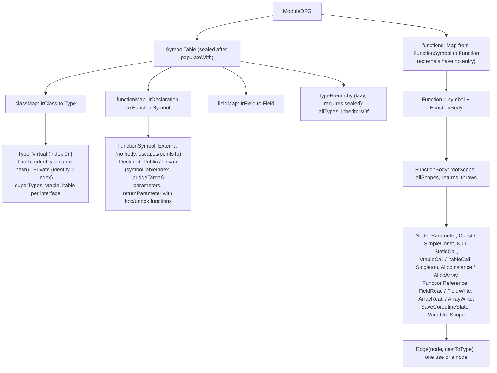
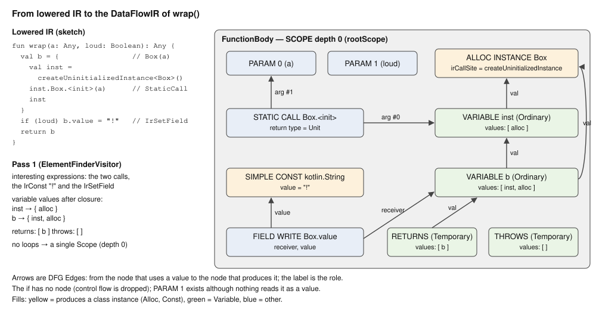
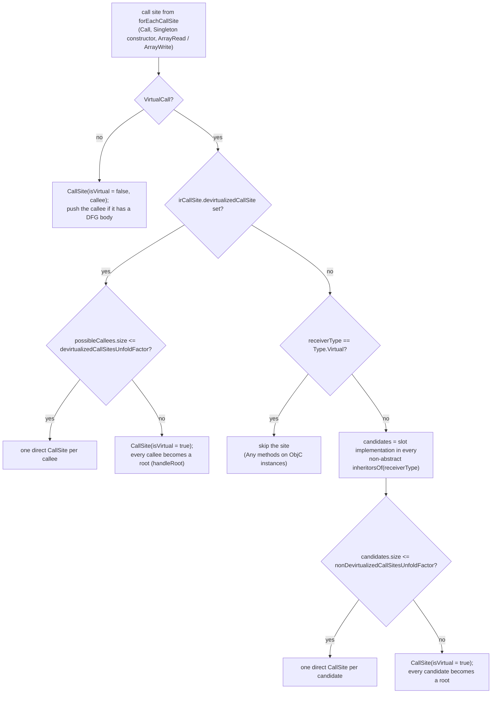

# Kotlin/Native: the DataFlowIR (DFG)

DataFlowIR is the shared substrate of every whole-program analysis in the second stage: devirtualization
([devirtualization.md](devirtualization.md)), DCE ([dce-and-gha.md](dce-and-gha.md)), escape analysis
([escape-analysis.md](escape-analysis.md)), the pre-codegen inliner ([pre-codegen-inliner.md](pre-codegen-inliner.md)) and
static-initializer call removal ([static-initializers.md](static-initializers.md)). It is a per-function "sea of nodes" that keeps
only what those analyses need to reason about *which objects and types can flow where*: calls, allocations, field and array
accesses, variables, parameters, returns and throws. Everything else, control flow in particular, is discarded. This page explains
the model, how it is built from lowered IR, what is deliberately lost, how it is kept in sync with IR rewrites, and the call graph
derived from it. The phase ordering and gating (`runGlobalOptimizations`) is in [optimizations.md](optimizations.md) and is not
repeated here.

All code paths are relative to `kotlin-native/backend.native/compiler/ir/backend.native/src/org/jetbrains/kotlin/backend/konan/`
("BACKEND") unless stated otherwise. The whole model lives in three files:
[DataFlowIR.kt](../../kotlin-native/backend.native/compiler/ir/backend.native/src/org/jetbrains/kotlin/backend/konan/optimizations/DataFlowIR.kt)
(data structures and the `SymbolTable`),
[DFGBuilder.kt](../../kotlin-native/backend.native/compiler/ir/backend.native/src/org/jetbrains/kotlin/backend/konan/optimizations/DFGBuilder.kt)
(IR → DFG) and
[CallGraphBuilder.kt](../../kotlin-native/backend.native/compiler/ir/backend.native/src/org/jetbrains/kotlin/backend/konan/optimizations/CallGraphBuilder.kt).

## Key concepts

| Term                      | Meaning                                                                                                                                                                                      |
|---------------------------|----------------------------------------------------------------------------------------------------------------------------------------------------------------------------------------------|
| `ModuleDFG`               | `functions: MutableMap<FunctionSymbol, Function>` + `symbolTable`. One per compilation, produced by `BuildDFGPhase`, mutated in place afterwards. An empty one is produced when the phase is disabled. |
| `SymbolTable`             | Maps `IrClass → Type`, `IrDeclaration → FunctionSymbol`, `IrField → Field`, primitive binary types → `Type`. Sealed after `populateWith`.                                                 |
| `Type`                    | A class as the analyses see it: `index` (dense id, 0 is `Virtual`), `isFinal`, `isAbstract`, `superTypes`, `vtable`, `itable`, `irClass`. `Public` (identity = name hash) or `Private` (identity = index). |
| `Type.Virtual`            | The single marker type for "unknown receiver": ObjC classes and forward declarations map to it; the analyses also use it for "anything from the outside world".                           |
| `FunctionSymbol`          | A function *or a top-level field initializer*: `Public`/`Private` (both `Declared`, have a `symbolTableIndex`) or `External` (no body). Carries `parameters`/`returnParameter` with box/unbox functions, attribute bits, and for externals `escapes`/`pointsTo`. |
| `Node`                    | One value-producing or side-effecting operation (see the mapping table below). `Edge(node, castToType)` is a use of a node, optionally through a cast.                                      |
| `Variable`                | A node whose `values` is the set of *all* expressions ever assigned to it, including through other variables (transitive closure). Kinds: `Ordinary`, `Temporary` (synthesized for merge points), `CatchParameter`. |
| `Scope`                   | Node grouping that mirrors loop nesting (`depth`); scopes form a tree rooted at `rootScope`. Only EA uses depths.                                                                          |
| `FunctionBody`            | `rootScope`, `allScopes`, plus two `Variable`s: `returns` and `throws`.                                                                                                                      |
| `TypeHierarchy`           | Lazily built from the sealed table: `allTypes` by index, `inheritorsOf(type)` as a cached `CustomBitSet` (reflexive).                                                                         |
| `CallGraph`               | `directEdges: Map<Declared, CallGraphNode>` (each with `callSites`), `reversedEdges`, `rootSet`, `rootExternalFunctions`. Built per client by `CallGraphBuilder` with two unfold factors. |

How these pieces nest, from the class declarations in `DataFlowIR.kt` and `ModuleDFG` in `DFGBuilder.kt`:



## Where it is built and who rebuilds it

`BuildDFGPhase` ([LTO.kt](../../kotlin-native/backend.native/compiler/ir/backend.native/src/org/jetbrains/kotlin/backend/konan/driver/phases/LTO.kt))
runs `ModuleDFGBuilder.build()` once, right after `PropertyAccessorInlineLowering`/`InlineClassPropertyAccessorsLowering` in
`runCodegen` ([TopLevelPhases.kt](../../kotlin-native/backend.native/compiler/ir/backend.native/src/org/jetbrains/kotlin/backend/konan/driver/phases/TopLevelPhases.kt)).
After that the IR keeps changing, and each rewriting phase re-runs `FunctionDFGBuilder(...).build(declaration)` for the functions it
touched and stores the result into `moduleDFG.functions`:

| Phase                                           | Rebuilds the DFG of…                                                                                | Where                                                                                                                                                              |
|-------------------------------------------------|-----------------------------------------------------------------------------------------------------|--------------------------------------------------------------------------------------------------------------------------------------------------------------------|
| `RemoveRedundantCallsToStaticInitializersPhase` | every declaration from which an initializer call was deleted                                        | `removeRedundantCalls` tail, [StaticInitializersOptimization.kt](../../kotlin-native/backend.native/compiler/ir/backend.native/src/org/jetbrains/kotlin/backend/konan/optimizations/StaticInitializersOptimization.kt) |
| `PreCodegenInliner` (both runs)                 | every caller that received inlined bodies; first re-runs `LivenessAnalysis` for suspension points   | [PreCodegenInliner.kt](../../kotlin-native/backend.native/compiler/ir/backend.native/src/org/jetbrains/kotlin/backend/konan/optimizations/PreCodegenInliner.kt) |
| `Devirtualization`                              | every declaration containing a rewritten call site (`changedDeclarations`)                          | `devirtualize` tail, [DevirtualizationAnalysis.kt](../../kotlin-native/backend.native/compiler/ir/backend.native/src/org/jetbrains/kotlin/backend/konan/optimizations/DevirtualizationAnalysis.kt) |
| `DCEPhase`                                      | nothing: it deletes functions from IR but leaves their `Function`s in the map                       | [DCE.kt](../../kotlin-native/backend.native/compiler/ir/backend.native/src/org/jetbrains/kotlin/backend/konan/optimizations/DCE.kt) |
| `RedundantCoercionsCleaner`, `UnboxInlineLowering`, `CoroutinesVarSpillingLowering` | nothing (lowerings run between the DFG phases without touching the DFG) | `runCodegen`                                                                                                                                                       |

The `SymbolTable` is never rebuilt. A rebuild of a function body may *add* function symbols for callees not seen before (externals,
or functions that were only reachable through the rewritten call) because `mapFunction` is lazy, but it cannot add a class:
`mapClassReferenceType` on an unknown class fails with "The symbol table has been sealed".

## The SymbolTable

`SymbolTable.populateWith(irModule)` visits the module once and maps (a) every `IrSimpleFunction` with a body, (b) every top-level
`IrField` with an initializer and (c) every class (children first, then the class), then sets `sealed = true`. `typeHierarchy` is
`lazy` and `require`s the table to be sealed, so no consumer can observe a half-built hierarchy.

**Types.** `mapClassReferenceType(irClass)` returns `Type.Virtual` for classes of the forward-declarations module and for
`isObjCClass()` classes ([ObjCInterop.kt](../../compiler/ir/ir.objcinterop/src/org/jetbrains/kotlin/ir/objcinterop/ObjCInterop.kt),
which searches the hierarchy for the `ObjCClass` marker, so Kotlin subclasses of ObjC classes are `Virtual` too). Otherwise it
creates `Type.Public` (if `irClass.isExported`, [BinaryInterface.kt](../../kotlin-native/backend.native/compiler/ir/backend.native/src/org/jetbrains/kotlin/backend/konan/llvm/BinaryInterface.kt),
identity = `localHash(fqName)`) or `Type.Private` (identity = `index`), records `superTypes` recursively, and for non-abstract
classes fills `vtable` and `itable` from `ClassLayoutBuilder`
([ClassLayoutBuilder.kt](../../kotlin-native/backend.native/compiler/ir/backend.native/src/org/jetbrains/kotlin/backend/konan/ir/ClassLayoutBuilder.kt)):
`vtable[i] = mapFunction(vtableEntries[i].getImplementation())`, `itable[iface.classId] = interfaceVTableEntries.map { overridingOf(it) }`.
A missing implementation is a hard compilation error ("no implementation found for … when building vtable"). For interfaces it only
"warms up" `interfaceVTableEntries` so that the layout is computed before DCE removes methods.

Note on the itable key: `classId` for an interface is the GHA id only when `context.ghaEnabled()`, otherwise a hash of the fq name.
`GHAPhase` runs *after* `BuildDFG`, `Devirtualization` and `DCE`, so the DFG's `interfaceId`s are always the hash variant; they are
used only to match `ItableCall.interfaceId` against `Type.itable` keys inside the analyses, never emitted.

`mapType(irType)` goes through `computeBinaryType()`: primitives (`Int`, unboxed inline classes over primitives, pointers) become
one `Type.Public` per `PrimitiveBinaryType` (final, non-abstract, no `irClass`); references become the class of the erasure. For a
type parameter with several bounds `choosePrimary` picks the single class bound, else `Any`.

**Functions.** `mapFunction(IrSimpleFunction)` first resolves `function.target` (fake overrides → real declaration,
[IrFakeOverrideUtils.kt](../../compiler/ir/ir.tree/src/org/jetbrains/kotlin/ir/util/IrFakeOverrideUtils.kt)), then:

| Kind                          | When                                                      | Identity                      | Notes                                                                                                                       |
|-------------------------------|-----------------------------------------------------------|-------------------------------|-----------------------------------------------------------------------------------------------------------------------------|
| `FunctionSymbol.External`     | `isExternal` or `isBuiltInOperator`                       | `localHash("kfun:" + name)`   | Gets `escapes`/`pointsTo` from `@Escapes`/`@PointsTo`; `isExported` = `KonanBinaryInterface.isExported`. Never in `moduleDFG.functions`. |
| `FunctionSymbol.Public`       | declared and `isExported`                                 | name hash                     | `symbolTableIndex >= 0` iff `placeToFunctionsTable`                                                                          |
| `FunctionSymbol.Private`      | declared, not exported                                    | running `privateFunIndex`     | same                                                                                                                        |
| `Private` with `IS_STATIC_FIELD_INITIALIZER` | top-level `IrField` with initializer      | running index                 | `parameters = []`, returns Unit; `irDeclaration` is the `IrField`                                                           |

`placeToFunctionsTable` is true for non-abstract members that are overridable/overriding, bridges, inline-class special functions
or members of non-final classes; `symbolTableIndex < 0` therefore means "cannot be reached through a vtable/itable slot", and
devirtualization asserts on it. Attribute bits (`FunctionAttributes`): `RETURNS_UNIT`, `RETURNS_NOTHING`, `IS_EAGER_STATIC_INITIALIZER`
(`isEagerStaticInitializer`, [StaticInitializersLowering.kt](../../kotlin-native/backend.native/compiler/ir/backend.native/src/org/jetbrains/kotlin/backend/konan/lower/StaticInitializersLowering.kt))
and `EXPLICITLY_EXPORTED` for `@ExportForCppRuntime`, `@ExportedBridge`, `@BindReverseBridgeToMethod`, external ObjC methods
(`getExternalObjCMethodInfo() != null`, comment `TODO-DCE-OBJC-INIT`) and `@ObjCMethodImp`. `bridgeTarget` links a bridge to the
method it forwards to, except for "special bridges" with a default value for an overridden builtin.

Every symbol gets `parameters: Array<FunctionParameter>` and `returnParameter`, where `FunctionParameter(type, boxFunction,
unboxFunction)` records the inline-class box/unbox functions when the IR type is an inline class. This is what lets the analyses
reason about boxing without seeing the box calls, and what devirtualization uses to re-derive coercions when it bypasses a bridge.

`TAKE_NAMES = true` keeps `name` on every type, function and field "for debug purposes". It is not only debug: escape analysis
decides whether an external may use `@Escapes`/`@PointsTo` by `callee.name?.startsWith("kfun:kotlin.")`
([EscapeAnalysis.kt](../../kotlin-native/backend.native/compiler/ir/backend.native/src/org/jetbrains/kotlin/backend/konan/optimizations/EscapeAnalysis.kt),
`getExternalFunctionEAResult`), so flipping the flag would silently make every stdlib external pessimistic.

## Building a function body

`FunctionDFGBuilder.build(declaration)` accepts an `IrFunction` or an `IrField` (whose initializer is wrapped into a synthetic
`IrSetField`) and runs two passes.

**Pass 1 – `ElementFinderVisitor`.** A single IR walk that collects:

- `expressions: Map<IrExpression, IrLoop?>` — the "interesting" expressions (member accesses, raw function references, field
  reads/writes, object accesses, varargs, constants, type operators, class references, constant objects/arrays) with the innermost
  enclosing loop; `parentLoops` records loop nesting.
- `variableValues` — for each `IrVariable`, the set of expressions assigned to it (initializer and every `IrSetValue`), flattened
  by `ExpressionValuesExtractor.forEachValue`: blocks yield their last statement, `IrWhen` yields every branch result, `IrTry`
  yields the try result and every catch result, returnable blocks yield every `return` value, suspendable expressions yield every
  suspension point's result plus the expression result, and a *cast* is pushed down to each sub-value (so `(if (c) a else b) as T`
  becomes `{a as T, b as T}`). `VariableValues.computeClosure()` then replaces "variable `x` has value `y`" by `y`'s values,
  transitively, with cycle protection.
- `returnValues` (non-Unit non-local returns), `thrownValues`, `catchParameters`, and `liveVariables` for every
  `saveCoroutineState` call, taken from the `IrSuspensionPoint.liveVariablesAtSuspensionPoint` attribute set by
  `CoroutinesLivenessAnalysis` (fallback `visibleVariablesAtSuspensionPoint`,
  [CoroutinesLivenessAnalysis.kt](../../kotlin-native/backend.native/compiler/ir/backend.native/src/org/jetbrains/kotlin/backend/konan/lower/CoroutinesLivenessAnalysis.kt)).

The same pass also *synthesizes* IR that is not in the tree, so that the analyses see effects the lowered IR hides:

| Trigger                                                                   | Synthesized expression(s)                                                                                       | Why                                                                                                      |
|---------------------------------------------------------------------------|-----------------------------------------------------------------------------------------------------------------|----------------------------------------------------------------------------------------------------------|
| call to `executeImpl` (the `Worker.execute` primitive)                    | `producer.invoke()` (`PRODUCER_INVOCATION`) and `job(producerResult)` (`JOB_INVOCATION`)                        | "Producer and job of executeImpl are called externally, we need to reflect this somehow"                 |
| `COMPARE_AND_SET`/`COMPARE_AND_EXCHANGE`/`GET_AND_SET` intrinsics         | an `IrSetField` of the `volatileField` with the new value                                                       | atomics are field writes for the analyses                                                                |
| `is`/`as` with an ObjC type operand                                       | a call to `interopObjCObjectRawValueGetter(argument)`                                                            | "See ObjC instanceOf code generation for details" (the check reads the raw pointer)                      |
| `IrConstantArray` element `i`                                             | `arraySet(array, i, value)`                                                                                      | constant arrays are otherwise opaque to EA/devirtualization                                              |
| `initInstance` call                                                       | error "Should've been lowered"                                                                                  | the builder requires constructor lowering to have happened                                               |

**Pass 2 – node emission.** Scopes are created first (one per loop, nested as in IR, `depth = parent + 1`), then one `Variable` node
per IR variable in the scope of its declaring loop, then `getNode(expression)` for every collected expression, then the `returns`
and `throws` variables, and finally all variables get their value edges. `getNode` memoizes per expression and applies the same
`forEachValue` flattening: a single-value expression becomes the node of that value (through an `Edge` with `castToType` when the
value was a cast); a multi-value expression becomes a `Temporary` `Variable` whose scope is the *highest* (shallowest) scope among
its values. `toNode` does the IR → DFG mapping:

| IR                                                                            | DFG node                                                                                                                         |
|-------------------------------------------------------------------------------|----------------------------------------------------------------------------------------------------------------------------------|
| `IrGetValue` of a parameter / variable                                        | the shared `Parameter(index)` / `Variable` node                                                                                  |
| `IrConst` (non-null) / `IrConstantPrimitive`                                  | `SimpleConst(type, value)`; `null` → the singleton `Node.Null`                                                                   |
| `IrVararg`, `IrClassReference`, non-cast `IrTypeOperatorCall` (`is`, `!is`, …) | `Const(type)` ("all operators except casts are basically constants"); the cast operand still gets its own node                 |
| `IrRawFunctionReference`                                                      | `FunctionReference(symbol, type, returnType)`                                                                                    |
| `IrCall` to `createUninitializedInstance<T>()` / `createUninitializedArray<T>(n)` / `createEmptyString()` | `AllocInstance(T)` / `AllocArray(T, size)` / `AllocInstance(String)`; `irCallSite` kept so EA can key lifetimes by it |
| `IrCall` to an `arrayGet`/`arraySet` intrinsic                                | `ArrayRead(callee, array, index)` / `ArrayWrite(callee, array, index, value)`; `callee` is kept so the call graph can treat them as calls with `@PointsTo` summaries |
| `IrCall` to `saveCoroutineState` / `restoreCoroutineState`                    | `SaveCoroutineState(liveVariables)` / a no-op `StaticCall` to `theUnitInstance`                                                   |
| `IrCall` with `IDENTITY` intrinsic                                            | the argument's node (transparent)                                                                                                |
| other `IrCall`, `isVirtualCall` (no super qualifier, overridable callee)      | `VtableCall(callee.target, receiverType, vtableIndex, …)` or `ItableCall(callee.target, receiverType, interfaceId, itableIndex, …)` |
| other `IrCall`                                                                | `StaticCall(actualCallee, arguments, returnType, irCallSite)`; `actualCallee` resolves super calls and fake overrides ([NewIrUtils.kt](../../kotlin-native/backend.native/compiler/ir/backend.native/src/org/jetbrains/kotlin/backend/konan/ir/NewIrUtils.kt)) |
| `IrGetField` / `IrSetField`                                                   | `FieldRead(receiver?, field, type, ir)` / `FieldWrite(receiver?, field, value)`; receiver is `null` for statics                   |
| `IrConstantObject` / `IrConstantArray`                                        | `Singleton(type, loweredConstructorFunction?, arguments)` / `Singleton(type, null, null)`                                        |
| `IrConstructorCall`, `IrDelegatingConstructorCall`, `IrGetObjectValue`        | error "Should've been lowered"                                                                                                   |

Details of virtual calls worth knowing: `toString`/`equals`/`hashCode` invoked on an interface are re-resolved to `Any`'s methods
and dispatched through `Any`'s vtable ("Keep on par with the codegen"); the `receiverType` is the static type of the receiver
argument when it is a class that is a subclass of the callee's owner, otherwise the owner class (type parameters, bridges), and an
inline-class receiver is mapped to its boxed class ("Box if inline class"). Return types are mapped with `mapWrappedType` so that a
call returning an inline class through a generic signature is typed as the boxed class.

### A worked example

The following function exercises an allocation, a static call, a field write, a constant, an unused parameter and a return:

```kotlin
class Box(var value: Any)

fun wrap(a: Any, loud: Boolean): Any {
    val b = Box(a)
    if (loud) b.value = "!"
    return b
}
```

The picture shows the lowered IR the builder sees (`ConstructorsLowering` has split `Box(a)` into `createUninitializedInstance`
plus a call to the lowered constructor, `PropertyAccessorInlineLowering` has turned the setter call into an `IrSetField`) and the
`FunctionBody` that `FunctionDFGBuilder.build` produces for it; node kinds and edges were checked against the
`-Xverbose-phases=BuildDFG` dump of this exact function compiled with `-opt`:



The dump itself (`Function.debugString()`, abbreviated) is what the picture was drawn from. Note that `b` keeps both the
intermediate variable and the closed-over allocation as values, because `computeClosure` adds to the variable's values
rather than replacing them, and that the parameter `loud` is a node even though no node refers to it:

```
NODE #1  Ordinary            VAL #2  VAL #3          // b
NODE #2  Ordinary            VAL #3                  // inst
NODE #3  ALLOC INSTANCE Box
NODE #4  STATIC CALL kfun:Box.<init>(kotlin.Any){}   ARG #2  ARG #7
NODE #5  CONST kotlin.String
NODE #6  FIELD WRITE Field(name=value)               RECEIVER #1  VALUE #5
NODE #7  PARAM 0
NODE #8  PARAM 1
NODE #9  Temporary            VAL #1                 // returns
NODE #10 Temporary                                   // throws
```

## What is deliberately dropped

- **Control flow and order.** There are no basic blocks, no successor edges, no statement order. `if`/`when`/`try` collapse into
  value unions; loop bodies only survive as `Scope` nesting. Consequently every analysis on the DFG is flow-insensitive within a
  function; path-sensitive facts (e.g. "this branch is only taken when `x is Foo`") are expressed only through `Edge.castToType`
  on the values that flow out of a cast.
- **Conditions.** `is` checks become `Const(Boolean)`; the fact that a branch is guarded is lost. `CastsOptimization`
  ([casts-optimization.md](casts-optimization.md)) works on IR precisely because the DFG cannot carry predicates.
- **Receivers of fields are kept, but consumers may ignore them.** `FieldRead`/`FieldWrite` carry a receiver edge; devirtualization
  merges all receivers into one node per field (`fields` map, "Do not distinguish receivers") while EA is object-sensitive.
- **Unit/Nothing-typed expressions** are not values (`forEachValue` requires `isUnit() || isNothing()` for anything it does not
  understand), so statements like `IrSetValue` or `IrWhile` have no node of their own.
- **Exceptions flow only through `throws`.** Every `IrThrow` value is a value of the function's `throws` variable; catch parameters
  are `CatchParameter` variables. How a catch parameter gets its values is left to the consumer (devirtualization adds a cast edge
  from `throws` filtered by the catch type).

## Coroutines, inline classes, try/catch, loops

**Coroutines.** By the time the DFG is built, `NativeSuspendFunctionsLowering` has turned suspend functions into state machines with
`IrSuspendableExpression`/`IrSuspensionPoint`, and `CoroutinesLivenessAnalysis` has annotated every suspension point with its live
variables ([NativeLoweringPhases.kt](../../kotlin-native/backend.native/compiler/ir/backend.native/src/org/jetbrains/kotlin/backend/konan/driver/phases/NativeLoweringPhases.kt)).
`SaveCoroutineState(liveVariables)` (how the lowering produces it: [coroutines.md](coroutines.md#step-5--liveness-and-spilling))
tells the analyses which locals are spilled into the coroutine object at that point; EA makes them
flow into the coroutine's "intestines" (its `this`), i.e. they escape to the heap exactly as `CoroutinesVarSpillingLowering` will
later spill them. The actual spilling lowering runs *after* DCE (see `runCodegen`), so the DFG models an effect that does not yet
exist in IR. This is why the pre-codegen inliner must re-run `LivenessAnalysis` before rebuilding the DFG of a function it inlined into
(comment KT-72336 there). `restoreCoroutineState` is a no-op for all analyses so far (comment in `toNode`).

**Inline classes and boxing.** Box/unbox calls are ordinary `StaticCall`s to the `<box>`/`<unbox>` functions in the DFG; the
`FunctionParameter.boxFunction/unboxFunction` metadata is what lets devirtualization drop a bridge and insert the right coercions
(`getTypeConversion`), and the inliner never inlines box/unbox (`isBoxOrUnbox`).

**try/catch.** Try and catch results are unioned (`forEachValue(IrTry)`); catch parameters are `VariableKind.CatchParameter`.

**Loops.** A loop is a `Scope`; expressions and variables inside it belong to that scope. EA uses `Scope.depth` to decide that an
object allocated in a loop and stored into a variable outside the loop cannot be stack-allocated as a per-iteration object.

## External functions, cinterop and platform libraries

Anything without a body is `FunctionSymbol.External`: Kotlin `external fun`s (stdlib intrinsics and runtime entry points; which ones
the builder special-cases — `IDENTITY`, the atomics, `arrayGet`/`arraySet`, `createUninitializedInstance` — is cross-referenced in
[intrinsics.md](intrinsics.md#part-2--typedintrinsic-kinds-by-family)), builtin
operators, and all cinterop stubs (`@CCall` functions, ObjC method stubs; the C bridges themselves are compiled by clang, see
[cinterop.md](cinterop.md)). Externals have no `Function` in `moduleDFG.functions`, so:

- `CallGraphBuilder.staticCall` records the call site but pushes nothing (`function == null`); an external in the root set goes to
  `rootExternalFunctions`.
- Devirtualization models an external call by its return type only: a final return type is treated as an instantiation of that
  class, anything else yields `Virtual` ("unknown function can return anything").
- EA uses `@Escapes`/`@PointsTo` only for `kfun:kotlin.*` names outside `kotlin.concurrent`/`kotlin.native.concurrent`; every other
  external, including every platform-library and user cinterop function, is pessimistic (all reference arguments escape).
- The inliner never inlines functions from a cinterop klib (`isCInteropLibrary()` check).

Together with `Type.Virtual` for ObjC classes this is the whole treatment of the native world: it is opaque, and the analyses stay
sound by assuming the worst at every boundary. The flip side is a precision cliff — an object that is ever passed to a C function
is heap-allocated, and a value coming back from one is `Virtual`.

## The call graph

`CallGraphBuilder(context, irModule, moduleDFG, devirtualizedCallSitesUnfoldFactor, nonDevirtualizedCallSitesUnfoldFactor).build()`
is run separately by each client with its own factors (there is no shared cached call graph):

| Client                                          | devirtualized / non-devirtualized factor                | Rationale in code                                                                                   |
|-------------------------------------------------|---------------------------------------------------------|-----------------------------------------------------------------------------------------------------|
| `DCEPhase`                                      | `-1` / `-1`                                             | "Do not devirtualize anything to keep the graph smaller (albeit less precise which is fine for DCE)" |
| `PreCodegenInlinerPhase`                        | `-1` / `-1`                                             | only direct call sites are inlining candidates                                                      |
| `RemoveRedundantCallsToStaticInitializersPhase` | `DFG_DEVIRTUALIZED_CALL = 5` / `DFG_NON_DEVIRTUALIZED_CALL = 5` | —                                                                                              |
| `EscapeAnalysisPhase`                           | `5` / `5` for a program, `5` / `-1` for a library       | "Can't tolerate any non-devirtualized call site for a library" (unknown subclasses may exist)        |

Algorithm (`build`, `FunctionStack`, `handleFunction`):

1. `rootSet = DevirtualizationAnalysis.computeRootSet(...)` (see [devirtualization.md](devirtualization.md)). Each root with a
   body is added to `rootSet` and pushed with `caller = null`; externals go to `rootExternalFunctions`.
2. An explicit stack of `(caller, callee)` pairs is processed iteratively (no recursion). A callee is given a `CallGraphNode` on
   first visit; a reversed edge `callee ← caller` is recorded for every pair. Commit `38fead7226ba` (KT-88383) added the eager
   "already a node and no caller → do not push" check because the stack grew too large on big programs.
3. `forEachCallSite` enumerates `Call` nodes and also synthesizes `Call`s for `Singleton` (its constructor, with the singleton node
   as `this`), `ArrayRead` and `ArrayWrite` (their intrinsic callee), so arrays and object initializers look like calls.
4. A `StaticCall` becomes a `CallSite(isVirtual = false, actualCallee)` plus a push. A `VirtualCall` is resolved in three ways:
   - `irCallSite.devirtualizedCallSite` is set and has `≤ devirtualizedCallSitesUnfoldFactor` callees → one direct call site per
     callee;
   - otherwise, if the receiver is not `Type.Virtual`, all non-abstract `inheritorsOf(receiverType)` resolve the slot through their
     `vtable`/`itable`; `≤ nonDevirtualizedCallSitesUnfoldFactor` → direct call sites;
   - otherwise one `CallSite(isVirtual = true)` and *every* candidate becomes a root (`handleRoot`), so it is still reachable;
   - `Type.Virtual` receivers are skipped entirely ("can only be for invocations of Any's methods on instances of ObjC classes").

The per-call-site decision of step 4, as implemented in `CallGraphBuilder.handleFunction`:



The result implements `DirectedGraph`, so `DirectedGraphCondensationBuilder`
([GraphAlgorithms.kt](../../kotlin-native/backend.native/compiler/ir/backend.native/src/org/jetbrains/kotlin/backend/konan/GraphAlgorithms.kt))
can produce the SCC condensation and its topological order; EA and static-initializer removal both do that (each on its own graph),
the inliner does a tricolor DFS directly. `CallGraphNode.directEdges` is the de-duplicated list of non-virtual declared callees that
have a node, i.e. externals and virtual sites are not edges of the condensed graph.

## Size, time and memory

Construction is a constant number of IR walks per function; `VariableValues.computeClosure` is a DFS per variable over the
assignment graph. The only recorded performance work on this layer is the call-graph stack fix above (KT-88383); the heavy data
structures live in the consumers (devirtualization's constraint graph, see its page). Two consumers use DFG size as a metric:
the inliner's threshold is `body.allScopes.sumOf { it.nodes.size } <= preCodegenInlineThreshold`, and EA reports `totalDFGSize` in
its statistics. Note that each rebuild allocates a fresh `Function`; the old one is dropped from the map, nothing is patched
incrementally.

## Dumps and how to read them

Every `context.logMultiple { }` in the builder is active only while `inVerbosePhase` is set, which `-Xverbose-phases=<name>` does
for the duration of that phase ([CompilerPhase.kt](../../compiler/config/src/org/jetbrains/kotlin/config/phaser/CompilerPhase.kt),
[NativeBackendContext.kt](../../kotlin-native/backend.native/compiler/ir/backend.native/src/org/jetbrains/kotlin/backend/konan/NativeBackendContext.kt)
`logMultiple`). `-Xverbose-phases=BuildDFG` therefore prints, per function: `Analysing function …` with the IR, `FIRST PHASE`
(variables with their raw values and loops, interesting expressions), `SECOND PHASE` (values after closure), `Converting expression`
lines, and finally `Function.debugString()`; at the end the whole `SYMBOL TABLE:` with super types, vtables and itables per class.
Rebuilt functions are dumped again under the verbosity of the phase that rebuilt them (`-Xverbose-phases=Devirtualization` etc.).

A `debugString()` looks like:

```
FUNCTION PrivateFunction(index=12, symbolTableIndex='-1', name='kfun:foo#bar(Foo){}kotlin.Int', ...)
Params: [...]
    NODE #0
       SCOPE 0
            SUBNODE #1 ...
    NODE #3
        VIRTUAL CALL PublicFunction(... name='kfun:Foo#baz(){}kotlin.Any' ...). Return type = PublicType(...)
            RECEIVER: PrivateType(index=7, ..., name='Foo')
            VTABLE INDEX: 5
            ARG #1 CASTED TO PrivateType(index=9, ..., name='Bar')
    RETURNS
       Temporary
            VAL #3
```

Node numbers are positions in `rootScope + allScopes.flatMap { nodes }`; `#0` is always the root scope. `CASTED TO` is an
`Edge.castToType`. A `Temporary` with several `VAL`s is a merge point (an `if`, a `when`, a loop-carried variable); `Ordinary`
variables list every assigned value after closure.

## Tests and how to run them

There are no unit tests for `optimizations/`; the DFG is exercised through every `-opt` test without static caches. Useful entry
points (details and class names in [optimizations.md](optimizations.md#tests)):

- FileCheck tests that depend on DFG-driven decisions: `native/native.tests/testData/codegen/fileCheck/escape_analysis.kt`,
  `bridges.kt` (`-Xdisable-phases=DCEPhase`), `kt49847_simple_function_reference.kt`;
  `./gradlew :native:native.tests:test --tests "org.jetbrains.kotlin.konan.test.blackbox.FirNativeCodegenLocalTestGenerated\$FileCheck*" -Pkn.optimizationMode=OPT -Pkn.cacheMode=NO`.
- Runtime checks of stack allocation in `native/native.tests/testData/codegen/escapeAnalysis/` (same test class, `\$EscapeAnalysis*`).
- The whole box suite in release mode: `./gradlew :native:native.tests:codegen-box:test --tests "…FirNativeCodegenBoxTestGenerated\$Box\$*" -Pkn.optimizationMode=OPT`.
- A builder crash ("Unexpected expression", "Should've been lowered", "The symbol table has been sealed") reproduces with any
  `-opt` build of the offending code; add `-Xverbose-phases=BuildDFG` to see the last function analysed.

## Trade-offs and known limitations

- Flow-insensitivity is the price for linear construction and small graphs; everything path-dependent must be encoded as casts or
  handled in IR (`CastsOptimization`, `ComputeTypesPass`).
- `Type.Virtual` is a single bucket: two unrelated ObjC classes are indistinguishable, and anything that touches them is pessimized.
- The builder trusts lowering invariants (`initInstance`, constructors, `IrGetObjectValue` gone; liveness attribute present) and
  fails hard otherwise; it cannot be run earlier in the pipeline.
- The DFG is not serialized and not cached: it lives for one compilation and is rebuilt from scratch each time
  ([caches.md](caches.md), [incremental-compilation.md](incremental-compilation.md)). Static caches turn the whole layer off.

## Implied contracts

- **Declaration-creating lowerings run before `BuildDFG`.** The table is sealed in `populateWith`; `mapClassReferenceType` on a new
  class fails. The lowerings placed after `BuildDFG` in `runCodegen` (`RedundantCoercionsCleaner`, `UnboxInlineLowering`,
  `CoroutinesVarSpillingLowering`) only rewrite bodies. Hypothesis: there is no automated check of this; the `require(!sealed)` is
  the enforcement.
- **Every IR rewrite between `BuildDFG` and `EscapeAnalysis` must rebuild the DFG of changed functions**, including re-running
  liveness for suspension points if it changed them. EA keys lifetimes by `irCallSite`/`ir` identity, so a stale DFG points at
  dead IR nodes and the allocation silently gets `GLOBAL` — or, worse, a new allocation inherits a `STACK` verdict computed for
  different code.
- **`devirtualizedCallSite` is an attribute on the `IrCall`** (`irAttribute(copyByDefault = true)`): a `VirtualCall` node reaches
  it through `irCallSite`, so DFG rebuilds keep working after the attribute is set, and copying IR copies the verdict.
- **`TAKE_NAMES` must stay `true` in `SymbolTable`** (see above).
- **Externals are opaque by construction.** Platform libraries and cinterop klibs cannot carry `@Escapes`/`@PointsTo`, and the name
  prefix check would ignore them anyway; nothing in a platform library build depends on the DFG.
- **`computeRootSet` is the single definition of "reachable from outside"** for the call graph of every client; a new way to
  expose a function (export mechanism, reflection) must be added there or via `EXPLICITLY_EXPORTED` in `mapFunction`.

## Open questions

- Whether the lowerings that run after `BuildDFG` are guaranteed never to create a class or a function with a body is only implied
  by their placement and the `require(!sealed)`; no test asserts it.
- `TypeHierarchy.inheritorsOf` returns the cached bitset for `Type.Virtual` even when empty; whether any consumer relies on
  `inheritorsOf(Virtual)` being empty (rather than reflexive like every other type) was not traced.
- `restoreCoroutineState` is mapped to a no-op call to `theUnitInstance`; if some analysis ever needs the restored values to flow
  back into variables this will need a real node. No KT issue found.
- The `choosePrimary` rule for multi-bound type parameters (single class bound, else `Any`) can make a receiver type too general
  and thus a virtual call less precise; whether this is observable in practice was not measured.
- Unverified: the exact set of IR node kinds that can still appear after all lowerings and are not in the `toNode` mapping; the
  `TODO("Unknown expression")` fallback would be the symptom.
