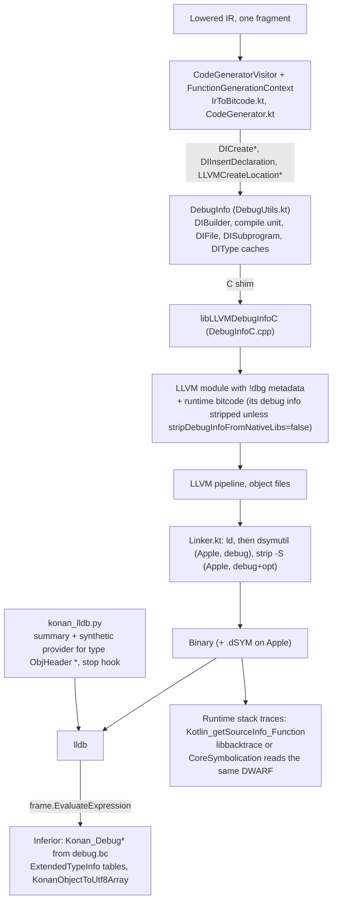
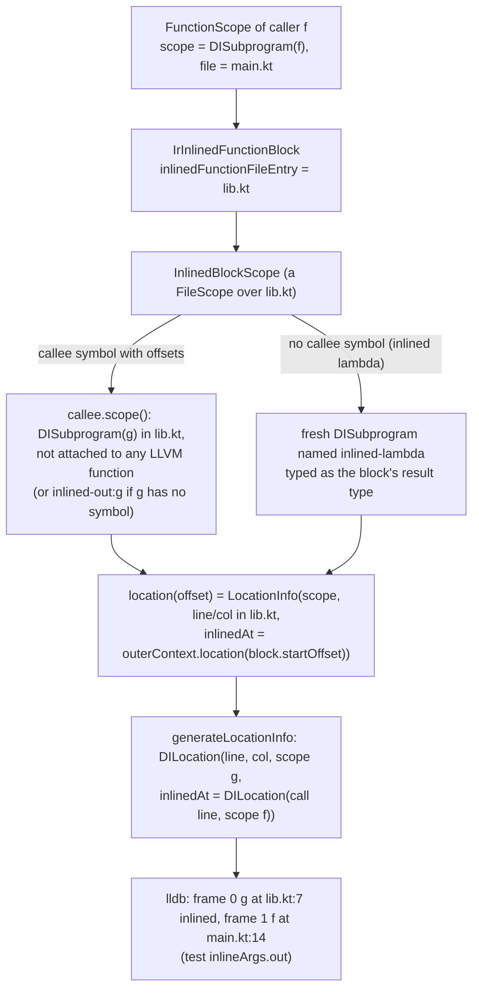
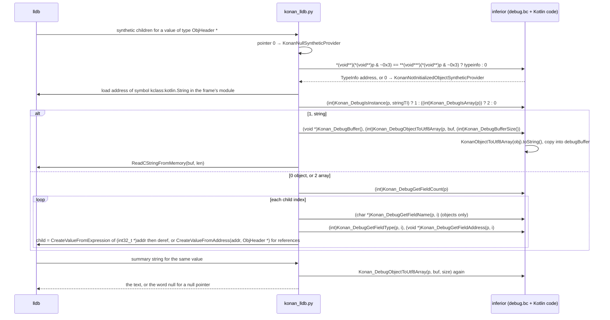
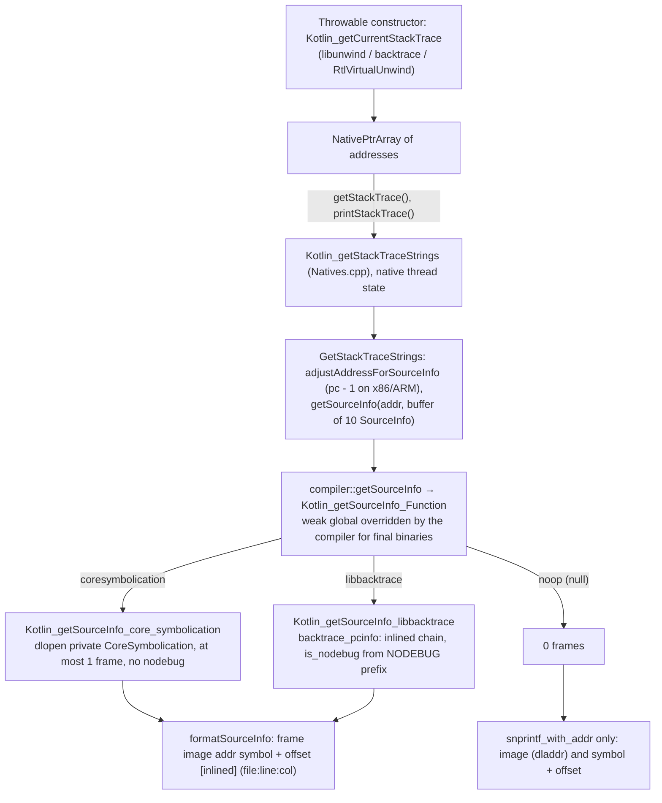

# Kotlin/Native: debug information and the debugger experience

Debug information in Kotlin/Native is three cooperating pieces: the compiler emits DWARF through LLVM's `DIBuilder` (compile
units, files, subprograms, locations with `inlinedAt` chains, local variables and a handful of base types); the runtime ships a
small *debug* module whose exported `Konan_Debug*` functions let a debugger inspect any Kotlin object through `TypeInfo`; and an
LLDB Python script, `konan_lldb.py`, turns an `ObjHeader *` into a readable value by calling those functions in the inferior. The
same DWARF is what the runtime's own stack-trace symbolication (libbacktrace or CoreSymbolication) reads to give `Throwable`
frames a `file:line:column`. This page follows the data from IR to the debugger and back, and lists what each piece silently
assumes about the others.

Read this when: breakpoints resolve to the wrong line, a variable is missing or shows garbage in LLDB, stepping jumps into
`<compiler-generated>` code, a stack trace has no file names, a `-g` binary behaves differently from `-opt`, or you touch
`TypeInfo`/`ExtendedTypeInfo`, the function naming scheme, bridges or trampolines (all of which the debugger depends on).

Related pages: [llvm-codegen.md](llvm-codegen.md) (the short "Debug info" section there is superseded by this page),
[compiler-runtime-contract.md](compiler-runtime-contract.md) (TypeInfo, object layout), [runtime.md](runtime.md) (stack traces,
crash handler), [caches.md](caches.md), [pre-codegen-inliner.md](pre-codegen-inliner.md) (how IR inlining shows up in debug info),
[export.md](export.md) (ObjC bridges), [tooling-integration.md](tooling-integration.md) (KGP flags),
[exceptions.md](exceptions.md) (how `Throwable` stack traces are captured and symbolicated), [coroutines.md](coroutines.md) (what a
suspend function becomes, which is what the debugger shows), [debugging.md](debugging.md).

Path shorthands used below: BACKEND = `kotlin-native/backend.native/compiler/ir/backend.native/src/org/jetbrains/kotlin/backend/konan/`,
RUNTIME = `kotlin-native/runtime/src/`.

## Key concepts

| Term | Meaning | Source |
|------|---------|--------|
| `-g` / `debug` | Full debug info: locations, variables, types, plus the runtime `debug.bc` module and `ExtendedTypeInfo`. Mutually exclusive with `-opt` (`KONAN_ARGUMENT_ERROR`). | [SetupConfiguration.kt](../../kotlin-native/backend.native/compiler/ir/backend.native/src/org/jetbrains/kotlin/backend/konan/SetupConfiguration.kt) `DEBUG`, [ConfigChecks.kt](../../kotlin-native/backend.native/compiler/ir/backend.native/src/org/jetbrains/kotlin/backend/konan/ConfigChecks.kt) |
| light debug | Locations only (`!dbg` on instructions, subprograms, files), no variables or types. `-Xadd-light-debug=enable|disable`; default *on* for Apple targets, so every `-opt` Apple binary has a line table and a dSYM. | [NativeSecondStageCompilationConfig.kt](../../kotlin-native/backend.native/compiler/ir/backend.native/src/org/jetbrains/kotlin/backend/konan/NativeSecondStageCompilationConfig.kt) `lightDebug` |
| `shouldContainDebugInfo()` / `shouldContainLocationDebugInfo()` | The two gates used throughout codegen: the first is `-g`, the second is `-g || lightDebug`. | `ConfigChecks.kt` |
| `DebugInfo` | Per-fragment owner of the `DIBuilder`, compile unit, `files`, `subprograms`, `inlinedSubprograms`, `types` caches. Created lazily; `DIFinalize` runs at the end of `CodegenPhase` only if it was created. | [DebugUtils.kt](../../kotlin-native/backend.native/compiler/ir/backend.native/src/org/jetbrains/kotlin/backend/konan/llvm/DebugUtils.kt), [BitcodeGeneration.kt](../../kotlin-native/backend.native/compiler/ir/backend.native/src/org/jetbrains/kotlin/backend/konan/driver/phases/BitcodeGeneration.kt) |
| `LocationInfo` | `(scope, line, column, inlinedAt?)`; the compiler-side mirror of a `DILocation`. `inlinedAt` is itself a `LocationInfo`, so inline chains nest. | [IrToBitcode.kt](../../kotlin-native/backend.native/compiler/ir/backend.native/src/org/jetbrains/kotlin/backend/konan/llvm/IrToBitcode.kt) |
| `CodeContext.scope()` / `location(offset)` | Every code scope (function, file, inlined block) answers which `DIScope` it is and how an IR offset maps to a location. This is the whole scoping model. | `IrToBitcode.kt` `FunctionScope`, `FileScope`, `InlinedBlockScope` |
| `libLLVMDebugInfoC` | A C shim over `llvm::DIBuilder` because the LLVM C API (as wrapped by `llvmInterop`) lacks what the compiler needs (`inlinedAt` locations, transparent stepping, `insertDeclare` with an expression). | [DebugInfoC.cpp](../../kotlin-native/llvmDebugInfoC/src/main/cpp/DebugInfoC.cpp) |
| transparent stepping | `DISubprogram` flag `SPFlagIsTransparentStepping` (Apple LLVM only): lldb steps *through* the function into its callee. Used for bridges and virtual-call trampolines. | `DebugInfoC.cpp` `DICreateFunctionShared`, `-Xbinary=enableDebugTransparentStepping` |
| debug trampoline | An extra basic block with its own location in front of a `when` or an inlined block, so a breakpoint on that line has an address. `-Xg-generate-debug-trampoline=enable`, off by default. | `IrToBitcode.kt` `generateDebugTrambolineIf` |
| `<NODEBUG>` | Name prefix on the subprograms of lowered `Throwable` constructors; the patched libbacktrace turns it into `is_nodebug`, and stack traces hide those frames. | `DebugUtils.kt` `diFunctionScope`, [dwarf.c](../../kotlin-native/runtime/src/libbacktrace/c/dwarf.c) `KN_nodebug_prefix` |
| `ExtendedTypeInfo` | Second field of `TypeInfo`: field count/offsets/types/names plus the table of debug operations. Null in `-opt`. | [TypeInfo.h](../../kotlin-native/runtime/src/main/cpp/TypeInfo.h), [RTTIGenerator.kt](../../kotlin-native/backend.native/compiler/ir/backend.native/src/org/jetbrains/kotlin/backend/konan/llvm/RTTIGenerator.kt) `makeExtendedInfo` |
| `Konan_Debug*` | Weak exported C functions of the `debug` runtime module; each dispatches through `ExtendedTypeInfo.debugOperations_` so that the debugger works across runtime versions. | [KDebug.cpp](../../kotlin-native/runtime/src/debug/cpp/KDebug.cpp) |
| `konan_lldb.py` | The LLDB plugin: a summary and a synthetic-children provider for the type `ObjHeader *`, three commands, a stop hook. Shipped as `<dist>/tools/konan_lldb.py`. | [konan_lldb.py](../../kotlin-native/llvmDebugInfoC/src/scripts/konan_lldb.py), [build.gradle](../../kotlin-native/build.gradle) `distTools` |
| `sourceInfoType` | Which symbolicator the runtime uses for `Throwable` stack traces: `coresymbolication` (default with `-g` on Apple), `libbacktrace`, `noop` (default otherwise). | `NativeSecondStageCompilationConfig.kt` `sourceInfoType`, [SourceInfoType.kt](../../native/binary-options/src/main/kotlin/org/jetbrains/kotlin/config/nativeBinaryOptions/SourceInfoType.kt) |

## Design in one paragraph

Debug info is generated inline with code generation, not by a separate pass: `CodeGeneratorVisitor` asks the current
`CodeContext` for a `LocationInfo` before emitting each expression and sets it on the IR builder, declares locals when it
allocates their slots, and creates a `DISubprogram` the first time a function's scope is needed. Everything the debugger needs
*about values* is deliberately **not** in DWARF: every Kotlin reference is typed as an opaque `ObjHeader *` (a forward-declared
struct), there are no `DICompositeType`s for classes, and the LLDB script instead asks the running process, through
`TypeInfo`/`ExtendedTypeInfo` and the `Konan_Debug*` functions, what an object is and what its fields are. The trade-off is a
small, layout-independent DWARF and a debugger that cannot inspect core dumps or non-running processes, and that depends on
expression evaluation in the inferior for every value it prints.

How debug information flows from IR to the debugger and the runtime, as implemented in `IrToBitcode.kt`, `DebugUtils.kt`,
`DebugInfoC.cpp`, `Linker.kt`, `konan_lldb.py` and `KDebug.cpp`:



## Step 1 — modes and gating

Three booleans, all in `NativeSecondStageCompilationConfig` and `ConfigChecks`, decide what is emitted:

| Mode | How it is set | What is emitted |
|------|---------------|-----------------|
| `debug` | `-g` (KGP: `debuggable = true` adds `-g -ea`, [KotlinNativeCompilerArgBuilder.kt](../../libraries/tools/kotlin-gradle-plugin/src/common/kotlin/org/jetbrains/kotlin/gradle/targets/native/tasks/KotlinNativeCompilerArgBuilder.kt)) | locations, `DILocalVariable`s for parameters and locals, base types, `ExtendedTypeInfo`, the `debug.bc` runtime module, `Kotlin_needDebugInfo = 1`, CoreSymbolication source info on Apple, debug trampolines if requested |
| `lightDebug` | `-Xadd-light-debug=enable|disable`; default `target.family.isAppleFamily` | locations and subprograms only; the linker still runs `dsymutil` |
| neither | `-opt` (or no flag) on non-Apple | no `DebugInfo` object is created; `-S` is passed to the linker (`linkerNoDebugFlags` in [konan.properties](../../kotlin-native/konan/konan.properties)) |

`-opt -g` is rejected ("Unsupported combination of flags: -opt and -g. Please pick one.", `SetupConfiguration.kt`), so there is
no "optimized with full debug info" mode; the closest thing is `-opt` on Apple with light debug. `smallBinary` is ignored with a
warning under `-g`. Every codegen site checks one of the two gates; the asymmetry to remember is that `needDebugInfo` in
[VariableManager.kt](../../kotlin-native/backend.native/compiler/ir/backend.native/src/org/jetbrains/kotlin/backend/konan/llvm/VariableManager.kt)
is `shouldContainDebugInfo() || (this is IrVariable && this.isVar)`, so under light debug *mutable* locals still get a
`DILocalVariable` while `val`s do not. The rationale is undocumented (no comment, no issue reference).

## Step 2 — compile unit, files and DWARF constants

`DebugInfo.init` ([DebugUtils.kt](../../kotlin-native/backend.native/compiler/ir/backend.native/src/org/jetbrains/kotlin/backend/konan/llvm/DebugUtils.kt))
creates one compile unit per LLVM module (so one per cache fragment or per output binary), whose "file" is the *output* path
(`generationState.outputFile`; the comment explains that this keeps `dsymutil` from clashing symbols when several libraries were
produced from overlapping sources) and whose directory is `-Xbinary=debugCompilationDir` or `""`. Producer is
`kotlin-compiler: <KotlinVersion>`, `isOptimized = 0` always. A `DIModule` is created too but nothing reads it.

The DWARF constants are chosen by `-Xdebug-info-version` (`DEBUG_INFO_VERSION`, default `1`):

| `-Xdebug-info-version` | `Dwarf Version` module flag | `DW_AT_language` | `runtimeVersion` |
|------------------------|-----------------------------|------------------|------------------|
| `1` (default) | 2 | `DW_LANG_C89` (0x1) | 2 ("legacy") |
| `2` | 4 ("modern linker fails to link DWARF other than [2;4]", comment) | `DW_LANG_Kotlin` (0x26 in the generated [Dwarf.kt](../../kotlin-native/backend.native/compiler/ir/backend.native/src/org/jetbrains/kotlin/backend/konan/llvm/Dwarf.kt)) | 0 |

The `Debug Info Version` module flag is the constant `3` (LLVM's metadata version), unrelated to the option. `Dwarf.kt` is
generated from LLVM's `Dwarf.def` via [dwarf_util.kt.pp](../../kotlin-native/llvmDebugInfoC/src/dwarf/include/dwarf_util.kt.pp);
that template still says `DW_LANG_Kotlin(0x0001)` (the C89 value) while the checked-in `Dwarf.kt` has `0x0026`, so the template
is stale (see Open questions).

**Files.** `IrFileEntry.diFileScope()` caches a `DIFile` per file-entry *name*. `toFileAndFolder` splits the name into file and
parent directory, applies `-Xdebug-prefix-map` (`old=new`, prefix match on the parent) and uses `"."` when the path has one segment
("a valid DWARF relative path"; an empty string is not). File entries of deserialized klibs keep whatever path was serialized,
so stdlib frames show relative paths and the synthetic `[K][Suspend]Functions` file becomes `./[K][Suspend]Functions`
(test `stdlibRelativePaths`, KT-83757). A separate `<compiler-generated>` `DIFile` (directory `""`) is used for bridges and is what
the LLDB stop hook and `step-in-avoid-nodebug` logic key on.

**Lines and columns.** `IrFileEntry.location(offset)`: `UNDEFINED_OFFSET` → 0 ("lldb uses 1-based unsigned integers, so 0 is
no-info"), `SYNTHETIC_OFFSET` or an empty / `"no source file"` name → 1 (flagged in a comment as "an awful hack"), otherwise
the 0-based IR line/column plus one.

## Step 3 — subprograms: which IR function becomes which `DISubprogram`

`IrSimpleFunction.scope()` in `IrToBitcode.kt` is the single mapping from an IR function to its `DIScope`, cached in
`DebugInfo.subprograms` (keyed by LLVM function) and `DebugInfo.inlinedSubprograms` (keyed by IR function). It is only computed when
`shouldContainLocationDebugInfo()` and the function has a real `startOffset`.

| IR function | LLVM function used as key | Subprogram | Attached to the LLVM function? |
|-------------|---------------------------|------------|--------------------------------|
| ordinary function with a body | its `LlvmFunction` | `DICreateFunction(scope = compile unit, name = simple name, linkageName = LLVM symbol, file, line, subroutine type)` | yes (`addDebugInfoSubprogram`) if it is a `Definition` and not `isInline` |
| `inline` function (still present after inlining) | its `LlvmFunction` | same | **no**: the subprogram only serves as the scope of inlined copies (an inline body that is also compiled out-of-line has no debug info of its own) |
| `suspend` function | the LLVM function of its *continuation stub* (`getOrCreateFunctionWithContinuationStub`) | same, i.e. the user-visible name is attached to the stub that the state machine was split from | yes |
| reified inline function, or external non-exported function | none | `<inlined-out:NAME>` in `inlinedSubprograms` ("inlined on all call sites and body eliminated by DCE") | n/a |
| lowered constructor of a `Throwable` subclass (`originalConstructor != null && isSubclassOf(Throwable)`) | its `LlvmFunction` | name prefixed `<NODEBUG>` (commit `20e80401b222`, "Hide throwable constructor frames from stack traces") | yes |
| function annotated `@TransparentForDebugger` ([Annotations.kt](../../kotlin-native/runtime/src/main/kotlin/kotlin/native/internal/Annotations.kt); the stdlib's `checkNotNull`/`downcast`, and every bridge built by [BridgesBuilding.kt](../../kotlin-native/backend.native/compiler/ir/backend.native/src/org/jetbrains/kotlin/backend/konan/lower/BridgesBuilding.kt)) | its `LlvmFunction` | same, with `SPFlagIsTransparentStepping` when `enableDebugTransparentStepping` | yes |
| virtual-call trampoline (`CodeGenerator.getVirtualFunctionTrampoline`) | the trampoline | own subprogram at the function's (or class's) start line, transparent stepping when enabled (commit `7a841f75651d`) | yes |
| ObjC→Kotlin bridge `objc2kotlin_*` ([ObjCExportCodeGenerator.kt](../../kotlin-native/backend.native/compiler/ir/backend.native/src/org/jetbrains/kotlin/backend/konan/llvm/objcexport/ObjCExportCodeGenerator.kt) `setupBridgeDebugInfo`) | the bridge | `DICreateBridgeFunction` in `<compiler-generated>`, line 1, empty subroutine type, **not** transparent (KT-87872: since Xcode 27 lldb skips the whole call when the ObjC side dispatches through an `_objc_msgSend$<selector>` stub; the stop hook in `konan_lldb.py` steps through instead) | yes (`fn->setSubprogram` inside the shim) |

Details that matter for the debugger:

- The subprogram's *scope* is the compile unit, not the `DIFile`; the file is given separately. `scopeLine = 0`, `isLocal = 0`.
- `DICreateFunctionShared` calls `finalizeSubprogram` immediately; `DIFunctionAddSubprogram` prints `error!!! f:… sp:…` to stderr
  if `DISubprogram::describes(fn)` fails (a linkage-name mismatch), which is the only consistency check in the pipeline.
- `SPFlagIsTransparentStepping` is only compiled in under `__APPLE__` (`assert(false)` elsewhere), and the compiler side only enables it
  for Apple families (`enableDebugTransparentStepping = isAppleFamily && (option ?: true)`), so the flag never reaches the shim on
  other hosts. The shim's `assert` is still the only guard.
- Subroutine types list the return type first (null when the return type is Unit/Nothing-as-void) and then the parameters.

## Step 4 — locations

Each `FunctionGenerationContext` keeps `basicBlockToLastLocation: Map<BasicBlock, LocationInfoRange(start, end)>`
([CodeGenerator.kt](../../kotlin-native/backend.native/compiler/ir/backend.native/src/org/jetbrains/kotlin/backend/konan/llvm/CodeGenerator.kt)).
`basicBlock(name, start, end)` records the range; `positionAtEnd(block)` re-applies it to the builder so code appended later to an
old block keeps that block's location. `CodeGeneratorVisitor.evaluateExpression` calls `updateBuilderDebugLocation(element)` before
generating each expression and each statement, which resolves `currentCodeContext.location(startOffset/endOffset)` and calls
`debugLocation(start, end)`: the block range is updated, and the builder location is set, only when the line is non-zero or the
block/builder has no location yet, so synthetic IR (line 0) inherits the surrounding location instead of producing line-0 entries.
`generateLocationInfo` converts a `LocationInfo` into a `DILocation`, recursing on `inlinedAt`.

Two deliberate holes: the function **prologue** (slot allocation, `memset` of the slots array, `EnterFrame`) has no location
except around the runtime-init calls in `stackLocalsInitBb`, because "function calls need to have `!dbg`, otherwise llvm rejects
full module debug information" while "we don't want prologue to have debug info, because it can lead to debugger stops in places
with inconsistent stack layout" (`epilogue()` comment). And static-initializer checks move their `label_init`/`label_continue`
blocks right after the entry block (`moveBlockAfterEntry`) "to avoid last debug info being too strange, because it will break
heuristics in CoreSymbolication" (see the symbolication section).

**Debug trampolines.** With `-g -Xg-generate-debug-trampoline=enable`, `evaluateWhen` and `evaluateInlinedBlock` first branch into
a fresh block named `when`/`inline` located at the expression start. Without it, a `when` whose first condition starts in the
middle of a line, or an inlined block whose first instruction belongs to the callee, has no address on the caller's line and a
breakpoint there silently moves. The option is parsed in `SetupConfiguration.kt` (whose error message misspells it
`-Xg-generate-debug-tramboline`), is `false` by default and is ignored without `-g` (`generateDebugTrampoline = debug && …`).
No commit or issue explaining why it is not the default was found.

## Step 5 — inline functions and lambdas: the `inlinedAt` model

After inlining (klib-level or the pre-codegen inliner), an inlined call is an `IrInlinedFunctionBlock` carrying
`inlinedFunctionSymbol`, `inlinedFunctionStartOffset` and `inlinedFunctionFileEntry` (the callee's file, possibly from another
library). `evaluateInlinedBlock` wraps the body in an `InlinedBlockScope`, a `FileScope` over the callee's file entry:

How an inlined block's locations are built, as implemented by `InlinedBlockScope` in `IrToBitcode.kt`:



Consequences:

- The callee's own `DISubprogram` is reused as the inlined scope, which is why `scope()` refuses to attach a subprogram to an
  `isInline` LLVM function: LLVM requires that a subprogram attached to a function is not also used as an inlined scope with a
  different `inlinedAt`. Reified or DCE-eliminated callees get the `<inlined-out:NAME>` subprogram instead.
- Variables declared inside the inlined body are declared with `functionScope = locationInfo.scope`, i.e. the callee's
  subprogram, and `file` = the *current file entry* (`fileEntry().diFileScope()`), so they appear under the inlined frame
  (`p x`, `p y`, `p z` in `inlineArgs.in` print the callee's parameters, including the default `z = 5`).
- An extension receiver temporary of an inlined call is renamed `__this` and `<this>` becomes `_this` (`debugNameConversion`;
  "HACK: workaround for GH-2316": libclang, which lldb uses to compile expressions, rejects `<this>` and reserves `this`).
- Nested inlining nests `inlinedAt`; `scope()` is null when the block has `UNDEFINED_OFFSET`, which makes locations inside fall
  back to the enclosing scope.
- Cross-klib inlining (`-Xklib-ir-inliner=full`) and caches are covered by the `kt42208*WithInlinedFunInKlib*` and `*WithCache`
  LLDB tests: frames inside an inlined lambda from another file/klib are reported at the callee's file and line. The callee is also
  recorded as a dependency (`dependenciesTracker.add`) so that caches are invalidated when it changes
  ([incremental-compilation.md](incremental-compilation.md)).

The pre-codegen inliner produces the same `IrInlinedFunctionBlock`s; [pre-codegen-inliner.md](pre-codegen-inliner.md) notes that
turning it on changes stack traces (every inlined frame becomes an `[inlined]` line).

## Step 6 — variables, parameters and types

**Where a variable lives decides how it is described.** `VariableManager.createVariable` → `FunctionGenerationContext.alloca`:

| Kind | Storage | Debug declaration |
|------|---------|-------------------|
| reference-typed local or parameter | a slot in the frame's **slots array** (`slotsPhi`, zero-initialised, registered with `EnterFrame` for the GC) | recorded in `slotToVariableLocation`; in `epilogue()` one `DIInsertDeclaration(slots, var, expr = [DW_OP_plus_uconst, pointerSize * slot])` per slot, inserted into the prologue block |
| primitive local or parameter | an `alloca` in `prologueBb` | `DIInsertDeclaration(alloca, var)` with an empty expression, immediately |
| parameters under `-g` | copied onto the stack (`createParameterOnStack` + `mapParameterForDebug` stores the incoming value in `localsInitBb`) so they have an address | `DICreateParameterVariable(argNo = index + 1)` |
| parameters without `-g` | kept as SSA values (`createParameter`) | none |

`debugInfoIfNeeded` skips variables whose origin is `FOR_LOOP_IMPLICIT_VARIABLE`, `FOR_LOOP_ITERATOR` or `IR_TEMPORARY_VARIABLE`,
and anything without a start location or outside a function scope. Variable names are the IR names except for `<this>`
(above). Because a reference slot is zeroed in the prologue, a not-yet-assigned object variable reads as a null `ObjHeader *`,
and the LLDB provider shows it through `KonanNotInitializedObjectSyntheticProvider` when the pointer is non-null but has no
valid `TypeInfo`.

**Types** (`IrType.diType`, cached in `DebugInfo.types`):

| Kotlin type | DWARF |
|-------------|-------|
| `Boolean`, `Byte`, `Char`, `Short`, `Int`, `Long`, `Float`, `Double`, unsigned and other inline classes over primitives (`computePrimitiveBinaryTypeOrNull() != null`) | `DIBasicType(name = IrType.render(), size/align from LLVM target data, encoding DW_ATE_boolean / float / address / signed / unsigned)`. The alignment argument is ignored by the shim (`DICreateBasicType` drops it). `Boolean` is sized from `int8` while its LLVM type is `i1`. |
| any class type or type parameter | `objHeaderPointerType`: `DW_TAG_pointer_type` to a forward-declared (`DIFlags.FlagFwdDecl`, `DICreateStructType` only supports this case and asserts otherwise) struct named `ObjHeader`. **This name is the contract with `konan_lldb.py`**, which registers its formatters for the type string `"ObjHeader *"`. |
| anything else | `TODO("…Does this case really exist?")` |

`ClassScope`/`debugFieldDeclaration` compute `DIDerivedType` members for exported classes under `-g` and collect them in
`ClassScope.members`, but nothing consumes that list, so no composite type is ever emitted; the member offset arithmetic there
(add size, then align) is also suspicious but unreachable in effect. Field layout reaches the debugger through
`ExtendedTypeInfo` instead (Step 7).

**Coroutines.** Codegen never sees a `suspend` function body (`require(!isSuspend) { "Suspend functions should be lowered out" }`).
`NativeSuspendFunctionsLowering` turns it into a state machine on a generated class; `CoroutinesVarSpillingLowering`
([CoroutinesVarSpillingLowering.kt](../../kotlin-native/backend.native/compiler/ir/backend.native/src/org/jetbrains/kotlin/backend/konan/lower/CoroutinesVarSpillingLowering.kt))
makes every local that is live across a suspension point (`liveVariablesAtSuspensionPoint`, computed by
`CoroutinesLivenessAnalysis`) a `var` and spills it into a field of the coroutine class *with the same name* around
`saveCoroutineState`/`restoreCoroutineState`. For the debugger this means: inside the state machine the locals are ordinary
`IrVariable`s and get `DILocalVariable`s; after a resume they are restored from the fields before use, so a stop *before* the
restore shows stale slot contents; and when stopped outside Kotlin code the values are reachable only as fields of the
continuation object (`_this`), which the formatter lists by name. The user-visible function name is attached to the continuation
stub's subprogram (Step 3). **Unverified:** whether lldb shows the state-machine function or the stub in backtraces for a
suspended coroutine was not checked against a test.

## Step 7 — what the runtime contributes: `ExtendedTypeInfo` and `debug.bc`

With `-g` the binary links `debug.bc` (`RuntimeModule.DEBUG`, added first in `runtimeBitcodeFiles` when
`containsDebuggingRuntime = config.debug`,
[CompilerOutput.kt](../../kotlin-native/backend.native/compiler/ir/backend.native/src/org/jetbrains/kotlin/backend/konan/CompilerOutput.kt)).
`RTTIGenerator.makeExtendedInfo` emits, per class unless `shouldOptimize()` ("TODO: shall we actually do that?"), an
`ExtendedTypeInfo` referenced from the second field of `TypeInfo` ("to retain cross-version debuggability, since ABI version 5
shall always be at the second position", [TypeInfo.h](../../kotlin-native/runtime/src/main/cpp/TypeInfo.h)):

```
ExtendedTypeInfo                       class            array
  int32_t      fieldsCount_            #fields          -Konan_RuntimeType(element)
  const int32* fieldOffsets_           kextoff:<fq>     null
  const uint8* fieldTypes_             kexttype:<fq>    null      (Konan_RuntimeType per field)
  const char** fieldNames_             kextname:<fq>    null
  int32_t      debugOperationsCount_   length of Konan_debugOperationsList in debug.bc (0 without -g)
  void**       debugOperations_        &Konan_debugOperationsList (null without -g)
```

The last two fields are filled by parsing `debug.bc` at compile time (`debugRuntimeOrNull`, `debugOperationsSize`) so the
*compiler* knows how many operations the linked runtime supports. At run time `KDebug.cpp` exports the operations twice: the
`*Impl` functions in `Konan_debugOperationsList` (indexed by `Konan_DebugOperation`, "Never ever change numbering in this enum,
as it will break debugging of older binaries"), and weak `RUNTIME_EXPORT` wrappers `Konan_DebugBuffer`, `Konan_DebugBufferSize`,
`Konan_DebugObjectToUtf8Array`, `Konan_DebugPrint`, `Konan_DebugIsArray`, `Konan_DebugGetFieldCount`, `Konan_DebugGetFieldType`,
`Konan_DebugGetFieldAddress`, `Konan_DebugGetFieldName`, `Konan_DebugGetTypeName` that look the implementation up through the
*object's own* `extendedInfo_->debugOperations_` (`getImpl`), returning null/0 when the object has no `ExtendedTypeInfo` or the
index is beyond `debugOperationsCount_`. The point is that an object allocated by a different Kotlin runtime in the same process
(two frameworks) is inspected with its own runtime's code. `Konan_DebugIsInstance` bypasses the table and calls
`IsInstanceInternal` directly. `Konan_DebugGetOperation` is declared in `KDebug.h` but has no definition.

`Konan_DebugObjectToUtf8ArrayImpl` is the one operation that runs Kotlin code: under a reentrant `CalledFromNativeGuard`
("the current thread can be in any state when this function is called by the debugger") it calls
`KonanObjectToUtf8Array` ([RuntimeUtils.kt](../../kotlin-native/runtime/src/main/kotlin/kotlin/native/internal/RuntimeUtils.kt),
`@ExportForCppRuntime`, "Called by the debugger"), which is `toString()` or `contentToString()` for primitive arrays, catching any
`Throwable` into `<Thrown … when converting to string>`, and copies the UTF-8 bytes into the static 4096-byte `debugBuffer`.
`Konan_DebugGetTypeNameImpl` allocates a C string from `TypeInfo.relativeName_` with `CreateCStringFromString` and never frees it.

## The LLDB side: `konan_lldb.py`

`__lldb_init_module` registers, in category `Kotlin`: a summary (`type summary add --no-value --python-function
konan_lldb.kotlin_object_type_summary "ObjHeader *"`), a synthetic-children provider (`type synthetic add --python-class
konan_lldb.KonanProxyTypeProvider "ObjHeader *"`), the commands `field_type`, `type_by_address` and `symbol_by_name`, the setting
`target.process.thread.step-avoid-regexp ^::Kotlin_` (never stop inside runtime functions) and the stop hook `KonanStopHook`.
(`konan_globals_command` exists in the file but is not registered.) Logging goes to `$GLOG_log_dir/konan_lldb.log` when that
variable is set, which the test runner does.

How the formatter prints a Kotlin object, as implemented by `KonanProxyTypeProvider`, `_select_provider`, the three providers
and `kotlin_object_type_summary`; every arrow into the inferior is an `SBFrame.EvaluateExpression` of C-syntax text, compiled by
lldb's embedded clang against the DWARF types of the stopped frame:



What the script assumes, in code:

- The static type string of every Kotlin reference is exactly `"ObjHeader *"` (`kotlin_object_type_summary` returns the raw value
  for anything else); the type-info word is the first word of the object with the two low bits "reserved for memory management
  needs" (`_type_info`, mask `~0x3`); a valid `TypeInfo` points to itself in its first field (`typeInfo_`).
- The `TypeInfo` of `kotlin.String` is a symbol named `kclass:kotlin.String` (`MANGLE_CLASS_PREFIX = "kclass"` in
  [BinaryInterface.kt](../../kotlin-native/backend.native/compiler/ir/backend.native/src/org/jetbrains/kotlin/backend/konan/llvm/BinaryInterface.kt))
  present in *the selected frame's module* (`frame.module.symbol[name]`); if the frame is in another image (a second framework,
  the runtime) the lookup returns 0 and every object is classified as a non-string.
- `Konan_RuntimeType` numbering (`_TYPE_CONVERSION`/`_TYPES` index 1..10: OBJECT, INT8 … BOOLEAN, VECTOR128) matches
  `runtimeTypeSize`/`runtimeTypeAlignment` in `KDebug.cpp` and `mapRuntimeType` in `RTTIGenerator.kt`; a VECTOR128 child
  renders as `None`.
- Field addresses for arrays are computed by the runtime (`alignUp(sizeof(ArrayHeader), align) + index * size`), so the script
  has no knowledge of object layout beyond the type-info word.
- Expression evaluation needs a live, stopped process with a selected frame (`_evaluate` picks the first thread/frame if none and
  restores the frame afterwards), which rules out core dumps; each printed child costs several inferior calls (`_bench` exists to
  measure this), and `target.max-children-count` is honoured.
- Global variables are reachable through their getter symbols `kfun:<get-NAME>()…` (regexes in the unregistered
  `konan_globals_command`), and the `kvar:NAME#internal` naming of backing fields.

**Stepping.** `KonanStopHook.handle_stop` fires on every stop; if the frame is an `objc2kotlin_*` function located in
`<compiler-generated>` and the stop reason is `step in`/`step out`/`step over`, it queues a scripted thread plan
(`KonanStepIn/Over/Out`) that keeps stepping while the frame has no file or is in `<compiler-generated>` and
`step-in-avoid-nodebug` is true. This replaces transparent stepping for the ObjC bridges (KT-87872); setting the environment
variable `KONAN_LLDB_DONT_SKIP_BRIDGING_FUNCTIONS` in the target disables it (used by `ObjCToKotlinSteppingInLLDBTest`).
`_MAX_SIZE_FOR_STOP_REASON = 20` truncates the stop description so the hook does not react to its own plans.

## Stack traces: symbolication at run time

`Throwable` captures return addresses at construction (`Kotlin_getCurrentStackTrace`, [Throwable.kt](../../kotlin-native/runtime/src/main/kotlin/kotlin/Throwable.kt))
and converts them to strings lazily. The flow, as implemented in [StackTrace.cpp](../../kotlin-native/runtime/src/main/cpp/StackTrace.cpp),
[CompilerConstants.cpp](../../kotlin-native/runtime/src/main/cpp/CompilerConstants.cpp) and the two `SourceInfo.cpp` files:



Selection happens in `overrideRuntimeGlobals` (`IrToBitcode.kt`): for a final binary the compiler points the weak
`Kotlin_getSourceInfo_Function` at `Kotlin_getSourceInfo_libbacktrace` or `Kotlin_getSourceInfo_core_symbolication` according to
`config.sourceInfoType`, and sets `Kotlin_CoreSymbolication_useOnlyKotlinImage`. Both source-info modules are linked whenever the
target supports them (`supportsCoreSymbolication()`, `supportsLibBacktrace()` in `CompilerOutput.kt`); only the pointer decides.
The default is `CORESYMBOLICATION` when `debug && target.supportsCoreSymbolication()` and `NOOP` otherwise, so an `-opt` Apple
binary (which *has* a line table thanks to light debug) and every `-g` Linux/Windows binary print addresses without file:line
unless `-Xbinary=sourceInfoType=libbacktrace` is passed. Non-final outputs (caches, static libraries) leave the pointer alone, so
the final link decides for all of them. `DisallowSourceInfo()` (thread-local) turns symbolication off, e.g. inside the crash path.

The two implementations differ in what they can say:

| | libbacktrace ([SourceInfo.cpp](../../kotlin-native/runtime/src/source_info/libbacktrace/cpp/SourceInfo.cpp), [libbacktrace](../../kotlin-native/runtime/src/libbacktrace)) | CoreSymbolication ([SourceInfo.cpp](../../kotlin-native/runtime/src/source_info/core_symbolication/cpp/SourceInfo.cpp)) |
|---|---|---|
| Reads | the binary's own DWARF (`backtrace_create_state(nullptr, threaded)`), i.e. the sections the linker kept | the dSYM / in-process symbol owner via the private `CoreSymbolication.framework` (`dlopen` at first use) |
| Inlined frames | the whole `inlinedAt` chain, outermost first, non-inlined frame last; capped at the buffer (10) with a `[some inlined frames skipped]` line; stops if more than `10 * size` callbacks ("debug info is corrupted") | exactly one `SourceInfo`: iterates the symbol's source infos, assumes "the first and the last source infos should belong to the real function", picks the line within that range that covers the address |
| `nodebug` | set from the DWARF `DW_AT_name` prefix `<NODEBUG>` (K/N patch in `dwarf.c`: `KN_nodebug_prefix`); such frames are skipped in `GetStackTraceStrings` | never set, so `Throwable` constructor frames are visible |
| Failure | returns 0 frames | returns -1 when the framework or symbolicator is unavailable; the first such frame carries the note pointing to KT-85559 |
| Image list | n/a | `CSSymbolicatorCreateWithPid`, or with `-Xbinary=coreSymbolicationImageListType=onlyKotlin` a hand-built list containing only the Kotlin image (`createSymbolicatorWithCurrentImage`, workaround for KT-75992 on Xcode 16.3 simulators, at the cost of Swift frames, KT-76511) |

`adjustAddressForSourceInfo` subtracts one from every address on x86/ARM (not Windows) because the unwinder returns return
addresses while the line table must be queried at the call instruction ("hack for better traces"). Frame lines are formatted as
`%-4zd%-35s %-18p %s + %td ` (frame, image basename from `dladdr`, address, symbol, offset) followed by `[inlined] ` and
`(file:line:column)`, `(file:line)` or `(file:<unknown>)`.

## Linking, dSYM and runtime debug info

[Linker.kt](../../kotlin-native/backend.native/compiler/ir/backend.native/src/org/jetbrains/kotlin/backend/konan/Linker.kt) passes
`debug = config.debug || config.lightDebug` to the target linker ([Linker.kt](../../native/utils/src/org/jetbrains/kotlin/konan/target/Linker.kt)
in `native/utils`). Every linker flavour adds `linkerNoDebugFlags` (`-S` for Apple and Linux targets in `konan.properties`) when
`debug` is false. `MacOSBasedLinker` additionally runs `dsymutil <binary> -o <binary>.dSYM` (`OutputFiles.symbolicInfoFile`,
filtering the warning `could not find object file symbol for symbol _main`) and, when `optimize && debug` (i.e. `-opt` with light
debug), `strip -S <binary>` afterwards, so a release Apple binary ships with a dSYM but without DWARF in the binary itself.
"TODO: revise debug information handling" sits above that block.

Runtime bitcode (`runtime.bc`, GC modules, …) is compiled with `-gdwarf-2` only when the build property
`kotlin.native.isNativeRuntimeDebugInfoEnabled` is set ([runtime/build.gradle.kts](../../kotlin-native/runtime/build.gradle.kts)),
and `parseBitcodeFiles` strips whatever debug info it has (`LLVMStripModuleDebugInfo`) unless `shouldUseDebugInfoFromNativeLibs()`:
`-Xbinary=stripDebugInfoFromNativeLibs=false` *and* some debug mode (commit `98e4d679009b`, "Add opt-in flag to use debug info from
native libs"; [HACKING.md](../../kotlin-native/HACKING.md#kotlinnative-runtime-specifics) warns it "might work unstable"). The
option is part of the *system* cache flavor (`-runtime_debug`), so it forces a separate set of stdlib/platform caches.

## Connections to other subsystems

- **Lowerings.** `BridgesBuilding` annotates bridges `@TransparentForDebugger`; `NativeSuspendFunctionsLowering` and
  `CoroutinesVarSpillingLowering` decide what a coroutine's locals look like (Step 6); `PropertyAccessorInlineLowering` runs only in
  optimized builds "due to separate compilation and possibility to get broken debug information"
  ([lowerings.md](lowerings.md)). Lowerings that synthesize IR with `UNDEFINED_OFFSET`/`SYNTHETIC_OFFSET` produce line 0/1
  entries (Step 2); use the enclosing element's offsets when the code should be attributable.
- **Optimizations.** `shouldOptimize()` removes `ExtendedTypeInfo` entirely, so an `-opt` binary cannot be inspected with
  `konan_lldb.py` even if it has light debug locations. DCE deletes inlined-only bodies; their scopes survive as
  `<inlined-out:…>` subprograms. The pre-codegen inliner adds `[inlined]` frames ([pre-codegen-inliner.md](pre-codegen-inliner.md)).
- **Codegen naming.** The debugger and the tests depend on the symbol scheme `kfun:…`, `kclass:…`, `kvar:…#internal`,
  `objc2kotlin_*` ([llvm-codegen.md](llvm-codegen.md)); the LLDB goldens contain mangled names verbatim.
- **Runtime.** `TypeInfo.extendedInfo_` position, `Konan_RuntimeType` numbering, `Konan_DebugOperation` numbering, the
  `Konan_Debug*` symbol names and `Kotlin_needDebugInfo` (`Konan_Platform_isDebugBinary`, extra console-read diagnostics on
  Windows in `Porting.cpp`) are part of [compiler-runtime-contract.md](compiler-runtime-contract.md). The libbacktrace copy under
  `runtime/src/libbacktrace` is patched (`KN_nodebug_prefix`).
- **Caches and IC.** A cache fragment is its own compile unit; the debug stdlib cache is per-file by default
  (`perFileCacheForStdlib`, `CacheBuilder.kt`), `DEBUG_PREFIX_MAP` is forwarded to cache builds but is not part of the IC flavor
  (KT-89892, [incremental-compilation.md](incremental-compilation.md)); `-g` vs `-opt` and `stripDebugInfoFromNativeLibs` are in
  the flavor ([caches.md](caches.md)). The `*WithCache` LLDB tests run only in `cacheMode=STATIC_PER_FILE_EVERYWHERE`.
- **Klibs.** File entries and offsets come from the klib; the klib inliner carries the callee's `IrFileEntry` into
  `IrInlinedFunctionBlock`, which is all codegen needs for cross-library inline frames ([klib-linking.md](klib-linking.md),
  [docs/inlining/klib-inining.md](../inlining/klib-inining.md)).
- **ObjC export / interop.** `objc2kotlin_*` bridges get `<compiler-generated>` locations and are stepped through by the stop
  hook; Kotlin→ObjC direction has no special handling found. Frameworks get a `.dSYM` next to the binary like any output.
- **KGP / IDE.** KGP maps `debuggable` to `-g -ea` and warns on `debuggable && optimized` (`KotlinNativeLink.hasIncompatibleConfiguration`);
  platform-library caches for debuggable builds are built with `-cache-arg -g` into a `<target>-g…` directory
  ([PlatformLibrariesGenerator.kt](../../libraries/tools/kotlin-gradle-plugin/src/common/kotlin/org/jetbrains/kotlin/gradle/targets/native/internal/PlatformLibrariesGenerator.kt)).
  Binary options reach the compiler as `-Xbinary=` ([tooling-integration.md](tooling-integration.md)). **Unverified:** how
  Fleet/AppCode/Xcode load `konan_lldb.py`; no consumer other than the tests exists in this repository, and the only
  IDE-facing contract visible in code is "import `<dist>/tools/konan_lldb.py` into lldb".

## Flags and options

| Flag | Default | Where read | Effect |
|------|---------|------------|--------|
| `-g` | off | `NativeConfigurationKeys.DEBUG`, `ConfigChecks.shouldContainDebugInfo` | full debug info, `debug.bc`, `ExtendedTypeInfo`, CoreSymbolication default on Apple, `-ea` is separate |
| `-Xadd-light-debug={enable\|disable}` | enable on Apple families | `config.lightDebug` | locations/subprograms only; dSYM is produced |
| `-Xdebug-info-version={1\|2}` | `1` | `DWARF.dwarfVersion/language/runtimeVersion` | DWARF 2 + `DW_LANG_C89` vs DWARF 4 + `DW_LANG_Kotlin` |
| `-Xdebug-prefix-map=old=new,…` | none | `toFileAndFolder` | rewrites `DIFile` directories; forwarded to cache builds |
| `-Xg-generate-debug-trampoline={enable\|disable}` | disable; ignored without `-g` | `config.generateDebugTrampoline` | extra located blocks before `when` and inlined blocks |
| `-Xbinary=enableDebugTransparentStepping={true\|false}` | true on Apple, forced false elsewhere | `config.enableDebugTransparentStepping` | `SPFlagIsTransparentStepping` on `@TransparentForDebugger` functions and virtual trampolines |
| `-Xbinary=debugCompilationDir=<dir>` | `""` | `DebugInfo.init` | compile-unit directory |
| `-Xbinary=stripDebugInfoFromNativeLibs={true\|false}` | true | `useDebugInfoInNativeLibs`, `parseBitcodeFiles` | keep runtime bitcode DWARF; adds `-runtime_debug` to the system cache flavor |
| `-Xbinary=sourceInfoType={coresymbolication\|libbacktrace\|noop}` | coresymbolication with `-g` on Apple, else noop | `config.sourceInfoType`, `overrideRuntimeGlobals` | which symbolicator `Throwable` uses |
| `-Xbinary=coreSymbolicationImageListType={allLoaded\|onlyKotlin}` | allLoaded | `coreSymbolicationUseOnlyKotlinImage` | KT-75992 workaround |
| `KONAN_LLDB_DONT_SKIP_BRIDGING_FUNCTIONS` (target env) | unset | `KonanStopHook` | stop at `objc2kotlin_*` bridges instead of stepping through |
| `GLOG_log_dir` (lldb env) | unset | `_init_logger` | write `konan_lldb.log` |
| `kotlin.native.isNativeRuntimeDebugInfoEnabled` (build property) | false | `runtime/build.gradle.kts` | compile the runtime with `-gdwarf-2` |

There is no `-Xg-no-inline-info`; `-Xg0` was removed (deprecated 1.5.20, removed 2.4.20, see
[compatibility-and-migration.md](compatibility-and-migration.md)). Of the `-Xg*` family only `-Xg-generate-debug-trampoline` exists
in [K2NativeCompilerArguments.kt](../../compiler/cli/cli-base/gen/org/jetbrains/kotlin/cli/common/arguments/K2NativeCompilerArguments.kt).

## Tests and how to run them

| What | Where | Run |
|------|-------|-----|
| LLDB session goldens: `// KIND: STANDALONE_LLDB`, `INPUT_DATA_FILE` (lldb commands) / `OUTPUT_DATA_FILE` (expected transcript with `[..]` wildcards; `replaceUnstableIds` normalises paths, pids, addresses, breakpoint offsets) | [native/native.tests/testData/lldb](../../native/native.tests/testData/lldb) → `NativeLldbTestGenerated` (tag `debugger`, `forceDebugMode`, `forceHostTarget`) | `./gradlew :native:native.tests:debuggerTest` or `--tests "*NativeLldbTestGenerated*"` |
| Stepping goldens shared with JVM/JS: `step_through_current_frame` from [konan_lldb_test_helper.py](../../native/native.tests/testData/scripts/konan_lldb_test_helper.py) step-ins through `box()` and the result is compared with `checkSteppingTestResult` | [compiler/testData/debug/stepping](../../compiler/testData/debug/stepping) → `NativeSteppingTestGenerated` (`KIND: STANDALONE_STEPPING`) | same task |
| ObjC→Kotlin stepping with and without transparent stepping (Apple only) | [ObjCToKotlinSteppingInLLDBTest.kt](../../native/native.tests/tests/org/jetbrains/kotlin/konan/test/blackbox/ObjCToKotlinSteppingInLLDBTest.kt) | `--tests "*ObjCToKotlinSteppingInLLDBTest*"` |

Infrastructure ([LLDBSessionSpec.kt](../../native/native.tests/testFixtures/org/jetbrains/kotlin/konan/test/blackbox/support/util/LLDBSessionSpec.kt),
[TestProcessSettings.kt](../../native/native.tests/testFixtures/org/jetbrains/kotlin/konan/test/blackbox/support/settings/TestProcessSettings.kt)):
lldb is invoked as `lldb --no-lldbinit -b -o "command script import <dist>/tools/konan_lldb.py" -o "command script import
…/konan_lldb_test_helper.py" -o <cmd>…`; tests are skipped when `lldb -version` fails; any `warning:` or Python traceback in the
output fails the test (KT-86532), except the ObjC class-data warning; KT-84923 (attach failure) and KT-87414 (stuck step-into with a
deleted breakpoint, detected by the helper's 60 s / 300 s / 10000-step watchdogs) are muted. Relevant modes: tests force
`-Pkn.optimizationMode=DEBUG`; cache variants use `// IGNORE_NATIVE: cacheMode=…` so that they run only under
`-Pkn.cacheMode=STATIC_PER_FILE_EVERYWHERE`; `-Xklib-ir-inliner=full` variants exercise cross-klib inline frames.

There is **no FileCheck test over the debug metadata itself**: `CHECK-DEBUG` prefixes in
[testData/codegen/fileCheck](../../native/native.tests/testData/codegen/fileCheck) select the debug *optimization mode*, and no test
greps `!dbg`, `DILocation` or `DISubprogram`. The runtime symbolication path has unit coverage in
[StackTraceTest.cpp](../../kotlin-native/runtime/src/main/cpp/StackTraceTest.cpp) (`:kotlin-native:runtime:hostRuntimeTests`).

## Typical bugs and how to investigate

| Symptom | First thing to try | Where to look |
|---------|--------------------|---------------|
| Breakpoint on a `when` or on an inlined call resolves to another line | retry with `-Xg-generate-debug-trampoline=enable`; dump LLVM IR (`-Xsave-llvm-ir-after=Codegen`, see [llvm-codegen.md](llvm-codegen.md)) and inspect `!dbg` on the first instruction of the `when_case`/`inline` blocks | `evaluateWhen`, `generateDebugTrambolineIf`, `basicBlockToLastLocation` |
| Frames of an inlined function show the caller's file, or `inlinedAt` is missing | check that the `IrInlinedFunctionBlock` has non-`UNDEFINED_OFFSET` offsets and a callee symbol with offsets; the `[inlined]` tag in `bt` only appears with a proper chain | `InlinedBlockScope.scope()`/`location()`, the producing inliner |
| `p x` says no variable, or shows a stale value | `-g` present? `val` locals need `-g` (`needDebugInfo`); loop variables and temporaries are filtered; in coroutines the value may not be restored yet | `debugInfoIfNeeded`, `shouldGenerateDebugInfo`, `CoroutinesVarSpillingLowering` |
| An object prints as a bare pointer or `null`, children missing | type must be literally `ObjHeader *`; `ExtendedTypeInfo` is null in `-opt`; the selected frame's module must contain `kclass:kotlin.String`; `GLOG_log_dir=… lldb …` logs every expression and error | `kotlin_object_type_summary`, `_type_info`, `_is_string_or_array`, `makeExtendedInfo` |
| `Konan_Debug*` returns 0/null for one object but works for others | that object's `TypeInfo.extendedInfo_` is null (class from an `-opt` cache or a different runtime) or `debugOperationsCount_` is smaller than the operation index | `getImpl` in `KDebug.cpp`, `debugOperationsSize` |
| Stepping into Kotlin from ObjC skips the call or stops in `objc2kotlin_*` | Xcode version (KT-87872); confirm the stop hook is installed (`target stop-hook list`); `KONAN_LLDB_DONT_SKIP_BRIDGING_FUNCTIONS` reverses the behaviour; `-Xbinary=enableDebugTransparentStepping=false` for the trampolines | `KonanStopHook`, `setupBridgeDebugInfo`, `ObjCToKotlinSteppingInLLDBTest` |
| Stack trace has addresses but no `(file:line)` | `sourceInfoType` resolves to `noop` (any `-opt` build, any non-Apple build without the option); on Apple, a `<NOTE: … KT-85559>` line means CoreSymbolication failed | `overrideRuntimeGlobals`, `GetStackTraceStrings` |
| Stack trace line is off by one or on the next statement | `adjustAddressForSourceInfo` only subtracts 1 on x86/ARM non-Windows; CoreSymbolication's range heuristic | `StackTrace.cpp`, `SourceInfo.cpp` |
| `error!!! f:… sp:…` on stderr during compilation | a subprogram's linkage name does not match the function it was attached to | `DIFunctionAddSubprogram`, `scope()` key choice |
| `dsymutil` warnings or missing dSYM | only Apple, only when `debug || lightDebug`; filtered warning about `_main` | `MacOSBasedLinker.link` |
| Runtime frames have no debug info in the IDE | runtime DWARF is stripped unless `-Xbinary=stripDebugInfoFromNativeLibs=false` *and* the runtime was built with `isNativeRuntimeDebugInfoEnabled` | `parseBitcodeFiles`, `runtime/build.gradle.kts` |

## Trade-offs and known limitations

- Opaque `ObjHeader *` everywhere means the DWARF never has to track class layout, inline classes or generics, and stays valid
  across caches built separately; the cost is that any inspection requires a live process and inferior calls, and tools that only
  read DWARF (core-dump analysers, non-LLDB debuggers) see untyped pointers.
- Full debug info is tied to `-g` and therefore to unoptimized code; there is no optimized build with variables.
- Default DWARF is version 2 with `DW_LANG_C89` ("legacy"), and `-Xdebug-info-version=2` is opt-in; the reason the default was never
  flipped is not documented.
- No class composite types are emitted (the member computation is dead code), so `frame variable` relies entirely on
  `ExtendedTypeInfo`, which is absent in `-opt`.
- CoreSymbolication gives one frame per address and cannot hide `<NODEBUG>` frames; libbacktrace gives the inline chain but is
  opt-in on Apple and reads only the DWARF the linker kept.
- Transparent stepping is Apple-only, and for ObjC bridges has been replaced by a Python stop hook that depends on lldb's stop
  description strings.
- `-opt` + `smallBinary`/`-g` interplay: `smallBinary` is ignored with `-g`.

## Implied contracts

- `konan_lldb.py` assumes every Kotlin reference has the DWARF type string `ObjHeader *`; enforced by: the LLDB goldens only
  (`canInspect*`), no compiler-side check that `objHeaderPointerType` is the only reference type.
- `konan_lldb.py` assumes the `TypeInfo` self-pointer is the first word of `TypeInfo`, the object header's first word is the
  type-info pointer with two low tag bits, `kotlin.String`'s `TypeInfo` symbol is `kclass:kotlin.String` and lives in the frame's
  module, and `Konan_RuntimeType` numbering is 1 = OBJECT … 10 = VECTOR128; enforced by: nothing on the compiler/runtime side
  (the LLDB tests catch host-target regressions only).
- `KDebug.cpp` assumes `Konan_DebugOperation` numbering is append-only ("Never ever change numbering") and that
  `ExtendedTypeInfo` stays the second `TypeInfo` field; enforced by: comments only.
- The compiler assumes `debug.bc` exports `Konan_debugOperationsList` as an array whose length it can read at compile time;
  enforced by: a `!!` crash in `RTTIGenerator` if the symbol disappears.
- Stack-trace hiding of `Throwable` constructors assumes libbacktrace is patched to read the `<NODEBUG>` name prefix and that the
  name prefix survives (`diFunctionScope` is the only writer); enforced by: nothing (CoreSymbolication ignores it).
- The LLDB stop hook assumes bridges are named `objc2kotlin_*` and located in a file literally named `<compiler-generated>`, and
  that lldb's stop descriptions are exactly `step in`/`step out`/`step over`; enforced by: `ObjCToKotlinSteppingInLLDBTest` on Apple.
- Symbolication assumes the final binary (not caches) decides `Kotlin_getSourceInfo_Function`, and on Apple that the dSYM or
  in-binary DWARF is where CoreSymbolication can find it; enforced by: nothing (an `-opt` Apple binary silently gets `noop`).
- `IrInlinedFunctionBlock.inlinedFunctionFileEntry`/`inlinedFunctionStartOffset` are assumed correct for every inliner (klib
  inliner, pre-codegen inliner); enforced by: LLDB goldens for a few shapes (`kt42208*`, `kt82065`, `inlineArgs`).
- The debugger assumes the symbol scheme `kfun:`/`kclass:`/`kvar:`/`objc2kotlin_` is stable; enforced by: the LLDB goldens contain
  mangled names, so a renaming breaks them, but nothing else.

## Open questions

- Why is `-Xdebug-info-version=1` (DWARF 2, `DW_LANG_C89`) still the default, and does anything consume `runtimeVersion = 2`?
- `dwarf_util.kt.pp` has `DW_LANG_Kotlin(0x0001)` while the generated `Dwarf.kt` has `0x0026`: was the generator run by hand and
  the template left behind, or is the template unused?
- `needDebugInfo` gives `var` locals debug info under light debug (`-opt` on Apple) but not `val`s; intended?
- `ClassScope.members`/`debugFieldDeclaration` build member types that are never emitted; dead code to delete, or an unfinished
  feature (composite types for exported classes)?
- `Konan_DebugGetOperation` is declared in `KDebug.h` with no definition; `konan_globals_command` is defined but not registered;
  `DebugInfo.module` is created but never used. Dead, or waiting for a consumer?
- Why is `-Xg-generate-debug-trampoline` off by default (cost? breakpoint behaviour on other debuggers?), and should the typo in
  its error message be fixed?
- Should `sourceInfoType` default to `libbacktrace` where CoreSymbolication is unavailable, given that `-g` Linux/Windows binaries
  print no file:line today? Was `noop` chosen for binary size or start-up cost?
- `Konan_DebugGetTypeNameImpl` leaks the returned C string on every call; acceptable for a debugger helper?
- How exactly do Fleet/AppCode/Xcode locate and import `konan_lldb.py`, and do they depend on anything beyond the `ObjHeader *`
  formatters (for example the `field_type` command)?
