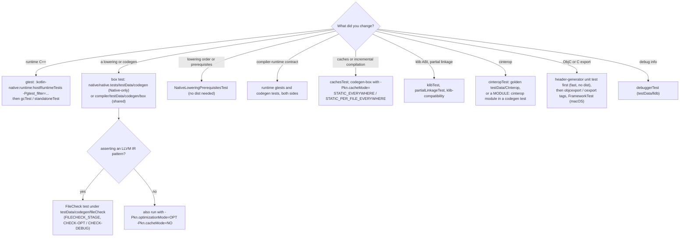

# Investigating Kotlin/Native bugs: from symptom to subsystem

A routing guide. Each row sends you to the subsystem page whose "Investigating" section has the detailed steps, and names the
flags and tests that usually settle the question fastest. Test mechanics (properties, tags, directives) are canonical in
[HACKING.md](../../kotlin-native/HACKING.md#testing) for usage and in [test-infrastructure.md](test-infrastructure.md) for how
the infrastructure works inside; flags are only listed here when they are the first thing to reach for.

Where to start, condensed from the two symptom tables below (each leaf names the page and the first flag to try):

```mermaid
flowchart TD
    start{"What do you see?"} -->|"the compiler fails"| cf{"Where does it fail?"}
    start -->|"the compiled program misbehaves"| pf{"How does it misbehave?"}
    cf -->|"lowering name in the stack trace, IR validation error"| low["lowerings.md:<br/>-Xphases-to-dump-before/after, -Xverify-ir=error"]
    cf -->|"unbound symbol, IrLinker error, klib rejected"| kl["klib-linking.md:<br/>klib info, deserialization strategy"]
    cf -->|"crash in optimizations/ or only with -opt"| opt["optimizations.md:<br/>-Xdisable-phases one at a time"]
    cf -->|"LLVM verifier, IrToBitcode, linker undefined symbol"| llvm["llvm-codegen.md: -Xsave-llvm-ir-after=Codegen<br/>(caches.md or cinterop.md if only with caches or linkerOpts)"]
    cf -->|"only with caches or after an incremental build"| cache["caches.md, incremental-compilation.md"]
    cf -->|"after a compiler, Xcode, LLVM or KGP upgrade"| compat["compatibility-and-migration.md,<br/>platform-libraries.md"]
    cf -->|"export header wrong, unresolved C or ObjC symbol"| xp["export.md / cinterop.md:<br/>-Xomit-framework-binary, run cinterop by hand"]
    pf -->|"wrong result in debug and -opt"| wr["lowerings.md, llvm-codegen.md:<br/>minimize to a box test, dump IR"]
    pf -->|"wrong result or crash only with -opt"| optr["optimizations.md, devirtualization.md,<br/>dce-and-gha.md, casts-optimization.md"]
    pf -->|"RuntimeAssert, wrong thread state, TypeInfo mismatch"| contract["compiler-runtime-contract.md:<br/>-Xbinary=runtimeAssertionsMode=panic, checkStateAtExternalCalls"]
    pf -->|"GC crash, heap corruption, hang, object never collected"| gc["runtime.md, gc.md, allocator.md:<br/>-Xbinary=gc=stwms, -Xruntime-logs=gc=debug"]
    pf -->|"at the C or ObjC/Swift boundary"| interop["cinterop.md (-verbose, cCallMode),<br/>export.md (@Throws, retain/release)"]
    pf -->|"IrLinkageError, static-init order, debugger info"| misc["klib-linking.md, static-initializers.md,<br/>debug-info.md"]
```

## Step 0: reproduce outside Gradle

Every failing test in `native/native.tests` logs the exact compiler invocation it made
(`COMPILER ARGUMENTS:` followed by `kotlin-native/dist/bin/kotlinc-native …`, from
[LoggedData.kt](../../native/native.tests/testFixtures/org/jetbrains/kotlin/konan/test/blackbox/support/LoggedData.kt)), and
likewise `CINTEROP INVOCATION ARGUMENTS:` and `SWIFTC INVOCATION ARGUMENTS:`. Copy it; add the flags below. The test infrastructure
compiles with `-Xverify-ir=error -Xphases-to-validate-after=all`, so an IR validation failure in a test may not reproduce without
those flags.

Other things to know before you start:
- Tests run the compiler from `kotlin-native/dist`, not the IDE classpath. A compiler change means a dist rebuild (minutes).
  `-Pkn.nativeHome=<dist>` skips the rebuild when you only changed tests.
- The default test mode is `optimizationMode=DEBUG` with `cacheMode=STATIC_ONLY_DIST` on cacheable targets (`NO` elsewhere and
  in `OPT` runs). With a stdlib cache in the way, whole-program optimizations are disabled, so `-Pkn.optimizationMode=OPT` needs
  `-Pkn.cacheMode=NO` to cover them ([optimizations.md](optimizations.md),
  [test-infrastructure.md](test-infrastructure.md#cache-modes)).
- `IGNORE_NATIVE` (and `IGNORE_BACKEND: NATIVE`) means "expected to fail": a test that starts passing fails the run with
  "Test did not fail as expected". See [HACKING.md](../../kotlin-native/HACKING.md#compiler-blackbox-tests) and
  [test-infrastructure.md](test-infrastructure.md#step-6--checks-and-the-expected-failure-protocol).
- Every compilation and run leaves an `<artifact>.log` next to the artifact (under `build/t/bb.out/<target>_<class>/`): the
  exact command, environment, raw compiler output and `TEST RUN ARGUMENTS:` ([test-infrastructure.md](test-infrastructure.md)).

## Symptom → where to look

### The compiler fails

| Symptom | First suspects | First moves |
|---------|----------------|-------------|
| Exception with a lowering class name in the stack trace, "Internal error in file lowering" | that lowering ([lowerings.md](lowerings.md)) | `-Xphases-to-dump-before=<ClassSimpleName> -Xdump-directory=<dir>`; compare with `-after`. Check `@PhasePrerequisites` and the position in `NativeLoweringPhases.kt`. |
| IR validation error (visibility, types, unbound symbols) at a `IrValidation*` phase | the lowering just before the synchronization point; inlining ([lowerings.md](lowerings.md)) | `-Xphases-to-validate-after=all -Xverify-ir=error` to find the first offending phase; `-Xlist-phases` for names. |
| "unbound symbol", `IrLinker` error, "symbol not found" | IR deserialization, deserialization strategy, klib ABI ([klib-linking.md](klib-linking.md)) | Check which klib and strategy (`ALL` / `EXPLICITLY_EXPORTED` / headers only); check whether a stage-1 lowering changed the klib ABI. |
| Klib rejected: ABI / compiler version, unknown `ir_provider` | `KlibLoader`, `KonanLibrarySpecialCompatibilityChecker` ([klib-linking.md](klib-linking.md)) | `klib` tool (`dist/bin/klib info`) to read the manifest. |
| Crash in `optimizations/` (DFG, devirtualization, EA, DCE) or only with `-opt` | [optimizations.md](optimizations.md) | Bisect with `-Xdisable-phases=EscapeAnalysis`, `Devirtualization`, `DevirtualizationAnalysis`, `DCEPhase`, `GHAPhase`, `PreCodegenInliner`; `-Xverbose-phases` dumps the DFG. |
| LLVM verifier failure, crash inside `IrToBitcode` / `CodeGenerator` | [llvm-codegen.md](llvm-codegen.md) | `-Xverify-bitcode`, `-Xsave-llvm-ir-after=Codegen -Xsave-llvm-ir-directory=<dir>`, `-Xprint-bitcode`; `-Xtemporary-files-dir` keeps the `.bc`/`.o`. |
| Linker error: undefined symbol | which module should define it: runtime (`Kotlin_*`: a `@GCUnsafeCall` callee misspelled, not `extern "C"`, or its runtime module not linked for this target), generated code (`kfun:`), a cache, a cinterop klib's `linkerOpts` | [llvm-codegen.md](llvm-codegen.md) (symbol naming, linker flag sources), [intrinsics.md](intrinsics.md) for `Kotlin_*` (`nm` the runtime bitcode, check `RuntimeModule.kt`), [caches.md](caches.md) if only with caches, [cinterop.md](cinterop.md) for `.def` `staticLibraries` / `linkerOpts`. |
| Undefined `kfun:` at link time although the symbol exists as `<name>-impl` | the caller expected a virtual trampoline that was not emitted ([llvm-codegen.md](llvm-codegen.md)) | `needsVirtualTrampoline` and `computeSymbolName(forImplementation)` must agree on both sides of the cache boundary. |
| "undefined hidden symbol" at link, or the linker keeps dead cache symbols | `kotlin-hide-symbols` hid something another cache references, or `llvm.used` is missing ([llvm-passes.md](llvm-passes.md), [caches.md](caches.md)) | `HideSymbols.cpp`, `retainAnnotation` in codegen; dump after `LinkBitcodeDependencies` and look at the symbol's visibility. |
| `LLVMKotlinRunPasses` fails with "unknown pass name" or a pipeline parse error | the bundled LLVM renamed a pass, or a typo in `-Xllvm-module-passes` / `-Xllvm-lto-passes` ([llvm-passes.md](llvm-passes.md)) | The strings in `OptimizationPipeline.kt`; LLVM's `PassRegistry.def` for the bundled version. |
| A platform library is loaded but its `-framework` / `-l` never reaches the linker | `filterOutUnusedPlatformLibraryModules` drops implicitly loaded cinterop modules with no linked declaration ([klib-linking.md](klib-linking.md), [cinterop.md](cinterop.md)) | Reference a declaration of the library, or pass it explicitly; linker flags of unused platform libs are skipped by design. |
| `-Xbinary=foo=bar` is silently ignored | `parseBinaryOptions` only warns on an unknown name or value; under Gradle the DSL `binaryOptions` win over `freeCompilerArgs` ([tooling-integration.md](tooling-integration.md)) | Look for the warning in the compiler output; compare the task's merged arguments (`--info`) with the property names in `BinaryOptions.kt`. |
| The IR dump of one file is overwritten by another file's dump | per-file `runPhase` calls share one dump directory and the `NN_` prefix comes from `PhaserState.phaseCount` ([second-stage-pipeline.md](second-stage-pipeline.md), [lowerings.md](lowerings.md)) | `-Xdump-fqname` with a fresh `-Xdump-directory`; dump one phase at a time. |
| Two flavor directories under the IC cache dir and a full rebuild on every build | an option that is part of the cache flavor changed between builds (`appendCommonCacheFlavor`), so the incremental state lives in another directory ([incremental-compilation.md](incremental-compilation.md), [caches.md](caches.md)) | Compare the two directory names (`<target>-g…-user-pl`), pin the option; read the `IC analysis results` log. |
| A file calling a changed function through a virtual call is not rebuilt | that edge is a *weak* bitcode dependency (`FileDependency.weak`, virtual trampolines), which propagates dirtiness only from removed files ([incremental-compilation.md](incremental-compilation.md)) | Inspect `bitcode_deps` of the stale file's cache; the trampoline keeps the call site valid by design. |
| "Target X is not available for output kind 'Y' on the Z host" | `HostManager.enabledByHost` ([targets-and-toolchains.md](targets-and-toolchains.md)) | A klib (`-produce library`) is always allowed, only binaries are host-restricted; KGP cross-compilation covers klibs only. |
| "quadruple for X is not set", "Undefined LLVM home!", NPE on `targetSysRoot!!` | a key missing from `konan.properties` for an *enabled* target; `PlatformManager` loads every enabled target, not just the requested one ([targets-and-toolchains.md](targets-and-toolchains.md)) | Find the key with the right suffix (`key.<target>` beats the suffix-less key); `-Xoverride-konan-properties=k=v` to test a fix. |
| "Cannot find a dependency locally", or a dependency is re-downloaded on every run | `airplaneMode`; `dependencies/.extracted` out of sync with the directory; the `.lock` under `dependencies/cache`; `KONAN_USE_INTERNAL_SERVER` selecting `remote:internal` off-site ([targets-and-toolchains.md](targets-and-toolchains.md)) | `-Xcheck-dependencies` alone to pre-populate; delete the directory *and* its line in `.extracted`. |
| "Unsupported Xcode version" / "An error occurred during an xcrun execution" | Xcode floor and selection ([targets-and-toolchains.md](targets-and-toolchains.md)) | `xcode-select -p`; `minimalXcodeVersion`, `ignoreXcodeVersionCheck`; with `useProvisionedXcode`, the `xcode_<ver>_<build>` symlink. |
| Wrong SDK or deployment target in the produced binary | `osVersionMin` / `sdkVersion` are data in `konan.properties`, not probed ([targets-and-toolchains.md](targets-and-toolchains.md), [compatibility-and-migration.md](compatibility-and-migration.md)) | Check `-platform_version` in the logged `ld` command; `InfoPListBuilder` uses the same values. |
| cinterop: libclang cannot find builtin headers (`stddef.h`) | `llvmVersion.<host>` disagrees with the `lib/clang/<version>` directory of the LLVM archive ([targets-and-toolchains.md](targets-and-toolchains.md), [cinterop.md](cinterop.md)) | Compare the property with the archive; after an LLVM bump both must change together. |
| `-Xoverride-konan-properties` seems ignored | precedence file < `macabi` < `-Xoverride-konan-properties` < `-Xllvm-variant`; a suffix-less key is only a fallback ([targets-and-toolchains.md](targets-and-toolchains.md)) | Override `key.<target>` (or `key.<host>`), not the bare key. |
| "Intrinsic of type X should be handled by previous lowering phase" | the lowering owning kind `X` did not run on this call shape: new call form, inlined after the lowering, wrong phase order ([intrinsics.md](intrinsics.md)) | `-Xphases-to-dump-after=<OwningLowering>` and look for the surviving call; check `@PhasePrerequisites`. |
| "X should be handled by tryEvaluateSpecialCall" | a special intrinsic's argument was not a constant after lowering ([intrinsics.md](intrinsics.md)) | `IMMUTABLE_BLOB`: check `PostInlineLowering`; `OBJC_GET_SELECTOR`: the selector literal. |
| "external function … must have @TypedIntrinsic, @SymbolName, @GCUnsafeCall, @ImportedBridge or @ObjCMethod annotation" | an unannotated `external fun` reached the second stage; there is no frontend diagnostic ([intrinsics.md](intrinsics.md)) | Find the declaration named in the message. |
| `IllegalArgumentException: No enum constant …IntrinsicType.X` | the stdlib klib is newer than the compiler (a new kind), or a typo in a `kind` string ([intrinsics.md](intrinsics.md)) | Compare the stdlib `IntrinsicType.kt` with the `native/base` enum; check bootstrap/dist versions. |
| "Only compile-time known IrProperties supported for COMPARE_AND_SET_FIELD" / "Only volatile properties …" | an atomic field intrinsic called through a non-literal property reference or on a non-`@Volatile` field; by design (`VolatileFieldsLowering.unsupported`) ([intrinsics.md](intrinsics.md)) | Use the public `AtomicInt` / `AtomicReference` classes. |
| `IllegalArgumentException: Continuation parameter only exists in lowered suspend functions`; `No live variables for … at suspensionPointId<N>` | a suspend call moved into a non-suspend container; an `invokeSuspend` body rebuilt after `CoroutinesLivenessAnalysis` without re-running it (copied suspension points drop the attribute) ([coroutines.md](coroutines.md)) | Dump IR before `NativeAddContinuationToFunctionCallsLowering` / after `NativeSuspendFunctionsLowering`; find the lowering that copies the body. |
| `reportNonLoweredIntrinsic` / "Should've been lowered" for `GET_CONTINUATION`, `SAVE_COROUTINE_STATE` | the intrinsic sits in a body that does not override `invokeSuspend`, the only bodies `CoroutinesVarSpillingLowering` visits ([coroutines.md](coroutines.md)) | Dump IR after `NativeSuspendFunctionsLowering`; check the function's `overriddenSymbols`. |
| `error!!! f:… sp:…` on stderr during compilation | a `DISubprogram` linkage name does not match the function it was attached to ([debug-info.md](debug-info.md)) | `DIFunctionAddSubprogram`, the `scope()` key choice in `IrToBitcode.kt`. |
| EA log (`-Xverbose-phases=EscapeAnalysis`) full of `WARNING: There is no node N` | `Null` arguments have no DFG node; harmless ([escape-analysis.md](escape-analysis.md)) | Ignore; search the log for `Forcing node … to escape` instead. |
| In the devirtualization dump a call to an `open` method is emitted as a direct call; "Types of multi-node" lists the receiver under a constructor's `Param#0` | expected: `irDevirtualizedCall` sets `superQualifier` to the callee's class; multi-node members are printed under an arbitrary root ([devirtualization.md](devirtualization.md)) | Nothing to fix; read the `superQualifier=` in the dump. |
| Error only with caches, or different behaviour between `cacheMode=NO` and `STATIC_EVERYWHERE` | cache ABI, additional cache info, stale cache ([caches.md](caches.md)) | Reproduce with `-p static_cache` manually; delete the auto-cache directory; compare `-Pkn.cacheMode=NO`. |
| Stale binary after an incremental Gradle build; link error after IC; "Incremental cache for … rebuilding it" | dirty-file analysis, missing `dependenciesTracker.add`, option outside the cache flavor ([incremental-compilation.md](incremental-compilation.md)) | Read the `IC analysis results` log (Gradle `--info`); delete `build/kotlin-native-ic-cache`; reproduce with `-Xic-cache-dir` on the CLI; remember `-opt` silently disables IC. |
| Build fails or misbehaves after a compiler, Xcode, LLVM or KGP upgrade | a compatibility surface ([compatibility-and-migration.md](compatibility-and-migration.md)); platform libs ([platform-libraries.md](platform-libraries.md)) | Check the klib ABI window, `compiler.fingerprint`, the cache flavor, `minimalXcodeVersion`; the page has a "before changing X, check Y" checklist. |
| Gradle passes a flag the compiler ignores, or the IDE sees a different API than the compiler | KGP argument builders, klib metadata contract ([tooling-integration.md](tooling-integration.md)) | Compare the task's compiler arguments (`--info`) with `-Xprint-configuration`; toggle `kotlin.native.disableCompilerDaemon=true` to rule out in-process classloader issues. |
| Export header missing a declaration, wrong ObjC/Swift name, C header missing a symbol | `ObjCExportMapper.shouldBeExposed`, namer, C export model ([export.md](export.md)) | Header generator tests; `-Xomit-framework-binary` to iterate on the header only. |
| Unresolved reference to a C/ObjC symbol | indexing or `headerFilter` in the `.def`, stub generation ([cinterop.md](cinterop.md)) | Run `dist/bin/cinterop` manually with the logged `CINTEROP INVOCATION ARGUMENTS:`; inspect the klib with `dist/bin/klib`; remember ObjC forward declarations are always "included". |
| Slow compilation | phase timing; in `-opt` LLVM usually dominates ([llvm-passes.md](llvm-passes.md)) | `-Xprofile-phases` (also per LLVM pass), `-Xreport-perf`; `-Xdisable-phases=LTOBitcodeOptimization` as a quick check; `-Xbackend-threads` for cache builds. |

### The program misbehaves or crashes

| Symptom | First suspects | First moves |
|---------|----------------|-------------|
| Wrong result in debug *and* `-opt` | a lowering ([lowerings.md](lowerings.md)) or codegen ([llvm-codegen.md](llvm-codegen.md)) | Minimize to a box test under `native/native.tests/testData/codegen`; dump IR after the suspected lowering; read the LLVM IR with `-Xsave-llvm-ir-after=Codegen`. |
| Wrong result or crash only with `-opt` | devirtualization, DCE, escape analysis ([optimizations.md](optimizations.md)) | `-Xdisable-phases=…` one at a time. Stack-allocated object escaping → memory corruption; `-Xsave-llvm-ir-after=Codegen` shows `alloca %"kclassbody:…"`. |
| Segfault on object access, "TypeInfo" mismatch, wrong `is` / cast result | object layout / TypeInfo contract ([compiler-runtime-contract.md](compiler-runtime-contract.md)); GHA ids ([optimizations.md](optimizations.md)) | `-Xbinary=runtimeAssertionsMode=panic` with the debug runtime; `-Xdisable-phases=GHAPhase`. |
| Runtime assertion (`RuntimeAssert`, `KAssert`) or "wrong thread state" | compiler–runtime contract, thread state switching ([compiler-runtime-contract.md](compiler-runtime-contract.md)) | Build the runtime with asserts: `-Xbinary=runtimeAssertionsMode=panic`; `-Xbinary=checkStateAtExternalCalls=true` (debug, no caches; test property `-Pkn.useThreadStateChecker=true`). |
| GC crash, heap corruption, hang in stop-the-world | GC / scheduler / allocator ([runtime.md](runtime.md); algorithms in [gc.md](gc.md), [allocator.md](allocator.md)) | Bisect with `-Xbinary=gc=stwms` (then `pmcs`, `noop`), `-Xbinary=gcSchedulerType=aggressive` (stress), `-Xbinary=pagedAllocator=false` plus `-Xbinary=sanitizer=thread`; `-Xruntime-logs=gc=debug` (tags in `RuntimeLogging.kt`); `Debugging.dumpMemory` + kdumputil. Test knobs: `-Pkn.gcType`, `-Pkn.gcScheduler`, `-Pkn.alloc`, `gcTest`, gc-fuzzing-tests, litmus-tests. |
| Object never collected / finalizer or Cleaner not run | roots: ExternalRCRef, globals, ExtraObjectData ([runtime.md](runtime.md)); ObjC wrappers ([export.md](export.md)) | `-Xruntime-logs=gc=debug`; memory dump. There is no leak checker binary option (`GC.detectCycles` is a stub). |
| Crash calling a C function; wrong value across the boundary | bridge ABI, C stubs, `.def` type mapping, call mode ([cinterop.md](cinterop.md)) | `-verbose` keeps the generated `cstubs.c`; `-Xphases-to-dump-after=InteropLowering`; switch `-Xbinary=cCallMode=indirect` vs `direct`; FileCheck tests with `FILECHECK_STAGE: CStubs`. |
| Crash calling an exported method from ObjC/Swift; leak or over-release across the boundary; no `NSError` for a thrown exception | ObjC export bridges and the ObjC runtime side ([export.md](export.md)) | `objcexport` / `framework` tests (macOS); `-Xruntime-logs`; check `@Throws` on the Kotlin declaration. |
| `IrLinkageError` thrown at run time | partial linkage replaced a declaration with a stub ([klib-linking.md](klib-linking.md)) | `-Xpartial-linkage-loglevel=warning` (default is silent); if caches are involved, the issue is replayed from the cache. |
| Static initializer not run / run in the wrong order / deadlock during initialization | the initialization state machine, `RemoveRedundantCallsToStaticInitializersPhase`, file order ([static-initializers.md](static-initializers.md)) | `-Xdisable-phases=RemoveRedundantCallsToStaticInitializersPhase` (`-Xverbose-phases=…` prints its call graph); check `_Konan_init_<lib>` in LLVM IR; a cross-thread initialization cycle deadlocks undetected. |
| Null function pointer call in `-opt`; `is`/itable result wrong only in `-opt` | DCE root-set gap; GHA ids ([dce-and-gha.md](dce-and-gha.md)) | `-Xdisable-phases=DCEPhase` / `GHAPhase`; check whether the function reaches the outside through a path not in `computeRootSet`. |
| Call target wrong only in `-opt`, "Unexpected receiver type" exception | devirtualization ([devirtualization.md](devirtualization.md)) | `-Xdisable-phases=Devirtualization`; `-Xverbose-phases=DevirtualizationAnalysis`; check for `Type.Virtual` (ObjC) or an unrooted entry point. |
| `ClassCastException` only in debug, or memory read through the wrong type only in `-opt` | generic safe casts ([casts-optimization.md](casts-optimization.md)) | Debug is usually right: `-Xbinary=genericSafeCasts=true` in `-opt` to confirm; `-Xdisable-phases=CastsOptimization`. |
| Breakpoint on a `when` branch or on an inlined call resolves to another line | debug locations ([debug-info.md](debug-info.md)) | Retry with `-Xg-generate-debug-trampoline=enable`; inspect `!dbg` on the first instruction of the `when_case` / inline blocks in `-Xsave-llvm-ir-after=Codegen`; `debuggerTest` (`testData/lldb`). |
| `p x` says there is no such variable, or shows a stale value | variable debug info needs `-g` (`val` locals get none under light debug); loop variables and temporaries are filtered; in coroutines the value may not be restored yet ([debug-info.md](debug-info.md), [coroutines.md](coroutines.md)) | Confirm `-g` (KGP `debuggable = true`); `-Xadd-light-debug` does not help with variables; `needDebugInfo`, `CoroutinesVarSpillingLowering`. |
| An object prints as a bare `ObjHeader *` or `null`, children missing | `ExtendedTypeInfo` is null in `-opt`; the selected frame's module must contain `kclass:kotlin.String` ([debug-info.md](debug-info.md)) | `GLOG_log_dir=<dir> lldb …` logs every expression `konan_lldb.py` ran; `kotlin_object_type_summary`, `makeExtendedInfo`. |
| Stepping from ObjC/Swift into Kotlin skips the call or stops in `objc2kotlin_*` | the lldb stop hook and transparent stepping; Xcode version (KT-87872) ([debug-info.md](debug-info.md)) | `target stop-hook list`; `KONAN_LLDB_DONT_SKIP_BRIDGING_FUNCTIONS` reverses the behaviour; `-Xbinary=enableDebugTransparentStepping=false` for the trampolines. |
| Stack trace has addresses but no `(file:line)`, or a `<NOTE: … KT-85559>` line | `sourceInfoType` resolved to `noop` (every `-opt` build and every non-Apple build without the option); on Apple CoreSymbolication failed ([exceptions.md](exceptions.md), [debug-info.md](debug-info.md)) | `-Xbinary=sourceInfoType=libbacktrace` with `-g`; `-Xbinary=coreSymbolicationImageListType=only_kotlin` for simulators. |
| Stack trace line is off by one or on the next statement | `adjustAddressForSourceInfo` subtracts 1 from the return address only on x86/ARM non-Windows; CoreSymbolication's range heuristic ([debug-info.md](debug-info.md)) | `StackTrace.cpp`, `SourceInfo.cpp`. |
| Crash inside the C++ runtime with no symbols; runtime frames have no debug info in the IDE | runtime DWARF is stripped ([debug-info.md](debug-info.md)) | Build the runtime with `kotlin.native.isNativeRuntimeDebugInfoEnabled=true` *and* compile with `-Xbinary=stripDebugInfoFromNativeLibs=false` ([HACKING.md](../../kotlin-native/HACKING.md#kotlinnative-runtime-specifics)). |
| `catch (e: Throwable)` around an interop call does not catch; the process prints a foreign exception and aborts | a foreign (C++/ObjC) exception at a filtering landing pad in `terminate` mode ([exceptions.md](exceptions.md), [cinterop.md](cinterop.md)) | Check the callee klib's manifest `foreignExceptionMode`; on Apple try `objc-wrap`; C++ exceptions can never be caught, wrap the C++ side. |
| `Frame is expected to be X, but current frame is Y` (`CheckCurrentFrame`) | a landing pad that did not call `SetCurrentFrame`, or runtime code calling Kotlin without `CurrentFrameGuard` ([exceptions.md](exceptions.md)) | `-Xbinary=runtimeAssertionsMode=panic`; every `landingpad` in `-Xsave-llvm-ir-after=Codegen` must be followed by `SetCurrentFrame`. |
| Exported method terminates with "Function doesn't have or inherit @Throws annotation …" / "Exception doesn't match @Throws-specified class list …" | `effectiveThrowsClasses` takes the list from the topmost override ([exceptions.md](exceptions.md), [export.md](export.md)) | Add `@Throws` on the topmost declaration; `suspend` needs `CancellationException` in the list. |
| "Uncaught Kotlin exception" reported from a thread that never entered Kotlin before, with `Runnable state: false`, or a `wrong thread state` assert on an exception path | the exception left Kotlin code through a frame without a filtering handler (`kotlinHandler`, `CalledFromNativeGuard`), or a landing pad without `switchThreadState` ([exceptions.md](exceptions.md)) | `-Xbinary=checkStateAtExternalCalls=true` (`-Pkn.useThreadStateChecker=true`); look at `invoke … to label %filteringExceptionHandler` in the LLVM IR. |
| Exception thrown in a `Worker.execute` job disappears | by design: only `ReportUnhandledException` (print) and a failed future; nothing at all with `errorReporting = false` ([exceptions.md](exceptions.md)) | `Future.consume` / `result`; use `executeAfter` when hook/termination semantics are needed. |
| Crash reporter records `ExceptionObjHolder` instead of the Kotlin exception | terminate-handler order (KT-86576) ([exceptions.md](exceptions.md)) | Call `setUnhandledExceptionHook` after the reporter initialised; the call reinstalls the Kotlin handler on top. |
| Wrong value or crash right after a resume; fine without suspension | a variable live across the suspension point was not spilled: liveness bug, or a lowering/inliner changed the body after `CoroutinesLivenessAnalysis` ([coroutines.md](coroutines.md)) | Compare with `-Xdisable-phases=CoroutinesLivenessAnalysis` (fallback spills everything); dump IR after `NativeSuspendFunctionsLowering`, check the `saveCoroutineState` blocks. |
| GC crash / use-after-free involving an object created inside a suspend function, `-opt` only | a stack-allocated object outlived its frame across a suspension because it was not in the live set ([coroutines.md](coroutines.md), [escape-analysis.md](escape-analysis.md)) | `-Xdisable-phases=CoroutinesLivenessAnalysis`; `-Xverbose-phases=EscapeAnalysis` for the allocation's lifetime. |
| Exception from an exported `suspend` function lost or delivered twice | throwing before vs after the first suspension takes different paths; for ObjC export the "callee haven't suspended" branch of `MethodBridge.ReturnValue.Suspend` ([coroutines.md](coroutines.md), [export.md](export.md)) | Reproduce with an `EmptyContinuation` whose `resumeWith` calls `getOrThrow()`. |
| `NSGenericException: Calling Kotlin suspend functions from Swift/Objective-C is currently supported only on main thread` | `-Xbinary=objcExportSuspendFunctionLaunchThreadRestriction=main` ([coroutines.md](coroutines.md)) | Set it to `none`, or call from the main thread. |
| Deadlock, GC never finishes, only under load | a `@GCUnsafeCall` callee blocks while in Runnable state ([intrinsics.md](intrinsics.md), [runtime.md](runtime.md)) | `-Xbinary=checkStateAtExternalCalls=true`; look for the missing `ThreadStateGuard`; stopgap `@ForceNativeThreadState` / `forceNativeThreadStateForFunctions`. |
| `Unexpected receiver type` / wrong override only in `-opt` after adding a Kotlin function the runtime calls | the new function is not a root: missing `@ExportForCppRuntime` / `@ExportForCompiler`, so DCE or devirtualization removed or specialized what it calls ([intrinsics.md](intrinsics.md), [devirtualization.md](devirtualization.md)) | Add the annotation. |
| Hang with two threads inside `CallInitGlobalPossiblyLock` / `CallInitGlobalAwaitInitialized` | a cyclic cross-thread static initialization, undetected by design ([static-initializers.md](static-initializers.md)) | Dump both stacks; break the cycle between the two containers. |
| An object survives exactly one GC more than expected | `TF_HAS_FINALIZER` objects (Cleaners, weak refs, ObjC counterparts) take the finalizer-queue path of `trySweepElement` ([allocator.md](allocator.md)) | `-Xruntime-logs=gc=debug`; check the class's flags and `ExtraObjectData`. |
| A weak reference reads `null` while the referent is reachable (CMS only) | `weakRefReadBarrier` during `kWeakProcessing` ([gc.md](gc.md)) | Reproduce with `-Xbinary=gc=stwms`; check the barrier phase in the log. |
| Thread creation stalls while a GC is running | the registry lock is held by the GC thread from `setupBeforeSTW` to the end of marking, so `RegisterCurrentThread` blocks ([gc.md](gc.md)) | By design for CMS; confirm with `-Xruntime-logs=gc=debug` timestamps. |
| Fewer stack allocations after refactoring a helper to return a fresh object | exile-on-fold: an allocation flowing only into a parameter field or the return value becomes an escape origin (`Escapes: D0`) ([escape-analysis.md](escape-analysis.md)) | `-Xverbose-phases=EscapeAnalysis`, look for `Forcing node … to escape`; compare `-Xbinary=escapeAnalysisPropagateExiledToHeapObjects=false` (diagnosis only, unsafe with CMS). |
| Wrong behaviour only with `-opt` while Kotlin IR dumps look right | the LLVM pipeline, usually acting on a lie in its input: a raw object pointer live across a call, a `nounwind` runtime function that throws, a wrong `@Escapes` ([llvm-passes.md](llvm-passes.md)) | `-Xdisable-phases=LTOBitcodeOptimization`, then `ModuleBitcodeOptimization`; bisect with `-Xllvm-module-passes=default<O1>`; diff `-Xsave-llvm-ir-after=LinkBitcodeDependencies,LTOBitcodeOptimization`. |
| Need to reproduce an LLVM miscompile outside the compiler | [llvm-passes.md](llvm-passes.md) | `-Xllvm-variant=dev`, dump after `LinkBitcodeDependencies`, then `opt -passes='default<O3>' -inline-threshold=100` with the target's `-mcpu`/`-mattr`; `opt -opt-bisect-limit=N` works there. |
| A runtime function is called instead of inlined in `-opt` | `PERFORMANCE_INLINE` missing, a stdlib static cache in the way, `smallBinary` on, or incompatible `target-features` ([llvm-passes.md](llvm-passes.md)) | `-Xsave-llvm-ir-after=LinkBitcodeDependencies` and search for `alwaysinline`; `runtime_attributes_compatible.kt`. |
| Two prologue safepoints in one function, or none | `kotlin-remove-sp` matches the callee by name (`Kotlin_mm_safePointFunctionPrologue`, `NO_INLINE` in `Memory.cpp`) ([llvm-passes.md](llvm-passes.md)) | Dump after `LTOBitcodeOptimization` vs after `RemoveRedundantSafepoints`; `redundant_safepoints.kt`. |
| Debug binary unexpectedly slow, or fast, in runtime code | `RuntimeLinkageStrategy` (`Optimize` only with `-g`) ([llvm-passes.md](llvm-passes.md)) | `-Xbinary=linkRuntime=Raw` to compare; `-Xprofile-phases` shows `llvm-default.*` on the runtime module. |
| Kotlin subclass of an ObjC class crashes in `retain`/`release`/`dealloc`, or the `KotlinObjCClassData` lookup fails | the class must be created by `CreateKotlinObjCClass` before `instancesRespondToSelector:` and friends touch it (KT-82669) ([cinterop.md](cinterop.md)) | `-Xbinary=runtimeAssertionsMode=panic`; check the `ObjCBackRef` in `kotlinBody`. |
| ObjC wrapper never deallocated although Swift released it | the wrapper lives until the Kotlin object is swept and `releaseAsAssociatedObject` is sent ([export.md](export.md)) | `-Xruntime-logs=gc=debug`; trigger a GC and watch `dealloc`. |
| Behaviour differs between `-Xbinary=cCallMode=direct` and the default | `collectLlvmModules` skips the cinterop klib's bitcode only when the mode is exactly `Direct` ([cinterop.md](cinterop.md), [llvm-codegen.md](llvm-codegen.md)) | Compare the linked modules with `-Xtemporary-files-dir`. |

### Tests and tooling misbehave

| Symptom | First suspects | First moves |
|---------|----------------|-------------|
| "Test did not fail as expected" | an `IGNORE_NATIVE` / `IGNORE_BACKEND` test now passes in this configuration ([test-infrastructure.md](test-infrastructure.md#step-6--checks-and-the-expected-failure-protocol)) | Remove or narrow the directive; the message prints kind, id, exit code and the TC report. |
| "No tests have been found. Test report is empty" | the binary registered no suite: `@Test` functions in a module compiled with `-l` instead of `-Xinclude`, or the package filter does not match after patching ([test-infrastructure.md](test-infrastructure.md)) | Look at `<exe>.dump`; run `<exe> --ktest_list_tests`. |
| "Failed to parse TC test output" / "Unexpected TC test message" | the program printed something that looks like a service message, or crashed mid-test ([test-infrastructure.md](test-infrastructure.md)) | Read the raw stdout in the failure message; a `.dmp` next to the binary means a crash. |
| "NOTE: this compilation includes multiple test data files!" in a failing compilation | a sibling in the same group broke the shared executable ([test-infrastructure.md](test-infrastructure.md#step-3--grouping-and-compilation-caching)) | Rerun with `-Pkn.forceStandalone=true`; paste `COMPILER ARGUMENTS:` from `<artifact>.log` into a shell. |
| "FileCheck … does not exist" | the LLVM home resolved to the `user` variant ([test-infrastructure.md](test-infrastructure.md#filecheck-tests), [targets-and-toolchains.md](targets-and-toolchains.md)) | Check `~/.konan/dependencies` for the `-dev` LLVM and `llvmHome.<host>` in `konan.properties`. |
| "Running tests for X on Y is not supported yet" | no executor for the target/host pair ([test-infrastructure.md](test-infrastructure.md#step-5--running)) | `-Pkn.compileOnly=true`, or XCTest for device targets. |
| Test hangs, then "Timeout exceeded during test execution" | 10-minute default per run, doubled for `AGGRESSIVE` ([test-infrastructure.md](test-infrastructure.md)) | `-Pkn.executionTimeout=…`; the SIGTERM also writes a minidump on macOS. |
| Tests pass with `-Pkn.nativeHome` but not with a fresh dist (or vice versa) | the external dist and the test classpath disagree: compiler jar, `konan.properties`, stdlib cache flavor ([test-infrastructure.md](test-infrastructure.md)) | Compare `<home>/konan/lib/kotlin-native-compiler-embeddable.jar` and `klib/cache/<target>-gSTATIC-system`. |
| A FileCheck `CHECK-NOT: COROUTINE$` test fails for a function that only forwards | the call is not recognised as a tail suspend call: inside `try`, result used, or a cast other than the two allowed operators (KT-85589) ([coroutines.md](coroutines.md)) | Dump IR before `NativeSuspendFunctionsLowering`; compare with `suspend_tailcalls_functions.kt`. |
| "Couldn't find daemon entry point" from KGP | `KotlinNativeToolRunner.runInProcess` looks `daemonMain` up with `singleOrNull`; an overload breaks every in-process K/N task ([tooling-integration.md](tooling-integration.md)) | Keep exactly one `daemonMain`; `kotlin.native.disableCompilerDaemon=true` forks instead. |
| A declaration exists in every platform klib but is missing from the shared source set | some component did not commonize: a classifier absent on one target, nullability, a default value, `lateinit`, mixed visibilities, a top-level `@Deprecated` function ([commonizer.md](commonizer.md)) | Run the CLI by hand with `-log-level info -log-stats raw`; `klib dump-metadata` the leaf klibs for that declaration. |
| `error: Unresolved classifier: …` from the commonizer | an input depends on a klib that was not passed as `-dependency-libraries` ([commonizer.md](commonizer.md)) | Check the cinterop's `depends`; in KGP the `<sourceSet>CInterop` configuration. |
| "Rewriting class node …" / "Duplicated libraries: <name>" | the same `CirEntityId` declared by two modules of one target / two inputs with the same `unique_name` ([commonizer.md](commonizer.md)) | `klib dump-metadata` both modules; check cinterop `name`s and `-Xshort-module-name`. |
| `@UnsafeNumber` warnings in user code | optimistic number commonization chose the narrow type ([commonizer.md](commonizer.md)) | Read `actualPlatformTypes`; `kotlin.mpp.enableOptimisticNumberCommonization=false` to see the declaration disappear instead. |
| Shared source set still sees the old platform API after a distribution change | the `.success` marker of a previous run under the same KGP version ([commonizer.md](commonizer.md)) | `./gradlew cleanNativeDistributionCommonization` or delete `<konanHome>/klib/commonized/<version>/<identity>`; `kotlin.mpp.enableNativeDistributionCommonizationCache=false`. |
| A shared native source set with one target has no `expect`s / sees the full platform API | the target was inferred as a leaf; `LeafCommonizerTarget`s are never commonized, by design ([commonizer.md](commonizer.md)) | Check the inputs of `inferCommonizerTarget`. |
| `OutOfMemoryError` / very slow `commonizeNativeDistribution` | all Apple platform libs for many targets in one JVM ([commonizer.md](commonizer.md)) | `kotlin.mpp.commonizerJvmArgs=-Xmx…`; `-log-level info` prints per-phase timings. |

## Choosing the test to run

Which test to run or write, condensed from the table below and the test kinds in
[HACKING.md](../../kotlin-native/HACKING.md#testing):

| What you changed | Run |
|------------------|-----|
| A lowering or codegen | `./gradlew :native:native.tests:codegen-box:test --tests "*FirNativeCodegenBoxTestGenerated*"` (shared box tests) and `./gradlew :native:native.tests:test --tests "*FirNativeCodegenLocalTestGenerated*"` (Native test data). Add `-Pkn.optimizationMode=OPT -Pkn.cacheMode=NO` to cover optimizations. |
| Lowering order / prerequisites | `./gradlew :kotlin-native:backend.native:test --tests "*NativeLoweringPrerequisitesTest"` (no dist needed) |
| First-stage lowerings, klib IR | `./gradlew :native:native.tests:klib-ir-inliner:test`, `:native:native.tests:klibTest` |
| Runtime C++ | `./gradlew :kotlin-native:runtime:hostRuntimeTests -Pgtest_filter='*Name*'`, then `:native:native.tests:gcTest` and `:native:native.tests:standaloneTest` |
| Compiler–runtime contract (layout, entry points) | runtime gtests **and** codegen tests; both sides must stay in sync |
| Caches | `./gradlew :native:native.tests:cachesTest`; codegen-box with `-Pkn.cacheMode=STATIC_EVERYWHERE` / `STATIC_PER_FILE_EVERYWHERE` |
| Partial linkage, klib resolution | `:native:native.tests:partialLinkageTest`, `:native:native.tests:klibTest`, `:native:native.tests:klib-compatibility:test` |
| cinterop | `./gradlew :native:native.tests:cinteropTest` |
| ObjC/C export (macOS) | `objcexport` and `cexport` tags; header generator tests in `native/objcexport-header-generator` |
| Debug info | `./gradlew :native:native.tests:debuggerTest` (`STANDALONE_LLDB` / `STANDALONE_STEPPING` kinds, `testData/lldb`; [debug-info.md](debug-info.md)) |
| LLVM-level codegen patterns | FileCheck tests in `native/native.tests/testData/codegen/fileCheck` (`// FILECHECK_STAGE:`, `CHECK-OPT` / `CHECK-DEBUG`); the LLVM pipeline itself: `:kotlin-native:libllvmext:test` and the local codegen tests with `-Pkn.optimizationMode=OPT` ([llvm-passes.md](llvm-passes.md)) |
| Exceptions, stack traces | `:kotlin-native:runtime:hostRuntimeTests -Pgtest_filter='Exception*:StackTrace*'`, `FirNativeCodegenLocalTestGenerated$Exceptions*`, `codegen-box` `Box$Exceptions*` ([exceptions.md](exceptions.md)) |
| Coroutines | `codegen-box` suspend tests and `FirNativeCodegenLocalTestGenerated` coroutine tests, also with `-Pkn.optimizationMode=OPT -Pkn.cacheMode=NO`; `*ObjCExport*` for the export side ([coroutines.md](coroutines.md)) |
| Intrinsics, runtime-facing annotations | `FirNativeCodegenLocalTestGenerated$Intrinsics*`, `:native:native.tests:stdlibTest`, runtime gtests ([intrinsics.md](intrinsics.md)) |
| Commonizer | `./gradlew :native:kotlin-klib-commonizer:test`, `:native:kotlin-klib-commonizer-api:test` (real distribution); `CommonizerIT` in the KGP integration tests ([commonizer.md](commonizer.md)) |
| `konan.properties`, targets, toolchains | `./gradlew :native:utils:test`, then a `:kotlin-native:dist` rebuild and one codegen test per affected target ([targets-and-toolchains.md](targets-and-toolchains.md)) |
| The test infrastructure itself | `./gradlew :native:native.tests:infrastructureTest` (`testData/infrastructure`; [test-infrastructure.md](test-infrastructure.md)) |

Tags, per-tag tasks, test properties and directives (`IGNORE_NATIVE`, `DISABLE_NATIVE`, `FREE_COMPILER_ARGS`,
`FILECHECK_STAGE`, …) are documented in [HACKING.md](../../kotlin-native/HACKING.md#testing) and defined in
[TestDirectives.kt](../../native/native.tests/testFixtures/org/jetbrains/kotlin/konan/test/blackbox/support/TestDirectives.kt);
how a directive is evaluated (`IGNORE_NATIVE: a=b && c=d`), how test cases are grouped into one executable and how `-Pkn.*`
properties become compiler flags is in [test-infrastructure.md](test-infrastructure.md#directives).

## Flags worth memorizing

| Flag | Effect | Page |
|------|--------|------|
| `-Xlist-phases`, `-Xdisable-phases=A,B` | see / skip phases by name | [second-stage-pipeline.md](second-stage-pipeline.md) |
| `-Xphases-to-dump-before/after=X -Xdump-directory=D` | IR dumps (`-Xdump-fqname`; system property `org.jetbrains.kotlin.compiler.ir.dump.strategy=KotlinLike`) | [lowerings.md](lowerings.md) |
| `-Xverify-ir=error -Xphases-to-validate-after=all` | IR validation after every phase (what the tests do) | [lowerings.md](lowerings.md) |
| `-Xsave-llvm-ir-after=Codegen -Xsave-llvm-ir-directory=D`, `-Xprint-bitcode`, `-Xverify-bitcode` | LLVM IR | [llvm-codegen.md](llvm-codegen.md) |
| `-Xtemporary-files-dir=D` | keep `.bc`, `.o`, generated C stubs and adapters | [second-stage-pipeline.md](second-stage-pipeline.md) |
| `-Xbinary=runtimeAssertionsMode=panic` | runtime asserts (`ignore` default, `log`, `panic`) | [compiler-runtime-contract.md](compiler-runtime-contract.md) |
| `-Xbinary=checkStateAtExternalCalls=true` | thread-state checker around external calls | [compiler-runtime-contract.md](compiler-runtime-contract.md) |
| `-Xruntime-logs=tag=level,…` | runtime logging | [runtime.md](runtime.md) |
| `-Xbinary=gc=…`, `gcSchedulerType=…`, `pagedAllocator=…`, `sanitizer=thread` | runtime variant selection for bisecting | [runtime.md](runtime.md) |
| `-Xprofile-phases`, `-Xreport-perf` | timing (`-Xprofile-phases` also lists every LLVM pass) | [second-stage-pipeline.md](second-stage-pipeline.md), [llvm-passes.md](llvm-passes.md) |
| `-Xpartial-linkage-loglevel=warning` | surface partial-linkage stubs | [klib-linking.md](klib-linking.md) |
| `-Xverbose-phases=EscapeAnalysis` / `DevirtualizationAnalysis` / `<phase>` | analysis logs: PTGs and "Forcing node … to escape", constraint graph and devirtualization statistics | [escape-analysis.md](escape-analysis.md), [devirtualization.md](devirtualization.md) |
| `-Xsave-llvm-ir-after=<Phase>:<pass>` | LLVM IR after one pass inside a phase (`<dir>/<Phase>/…-after.ll`); CLI only, not with `-Xbackend-threads` > 1 | [llvm-passes.md](llvm-passes.md) |
| `-Xllvm-module-passes=<str>`, `-Xllvm-lto-passes=<str>` | replace a pipeline string verbatim (e.g. `default<O1>` to bisect LLVM) | [llvm-passes.md](llvm-passes.md) |
| `-Xllvm-variant=dev` | the LLVM distribution with `opt`, `llc`, `FileCheck` | [targets-and-toolchains.md](targets-and-toolchains.md), [llvm-passes.md](llvm-passes.md) |
| `-Xoverride-konan-properties=k=v;…`, `-Xcheck-dependencies` | override any `konan.properties` key for one invocation; force the dependency download alone | [targets-and-toolchains.md](targets-and-toolchains.md) |
| `-Xg-generate-debug-trampoline=enable`, `-Xadd-light-debug=disable`, `-Xdebug-info-version=2` | breakpoint addresses for `when`/inlined blocks; turn off the Apple line-table default; DWARF 4 | [debug-info.md](debug-info.md) |
| `-Xbinary=sourceInfoType=libbacktrace`, `-Xbinary=coreSymbolicationImageListType=only_kotlin` | `(file:line)` in stack traces; the simulator workaround | [exceptions.md](exceptions.md), [debug-info.md](debug-info.md) |
| `-Xbinary=stripDebugInfoFromNativeLibs=false`, `-Xbinary=enableDebugTransparentStepping=false` | keep runtime DWARF (runtime built with `isNativeRuntimeDebugInfoEnabled`); stop in bridges and trampolines | [debug-info.md](debug-info.md) |
| `-Xbinary=linkRuntime=Raw` | link runtime bitcode without the pre-optimization pass | [llvm-passes.md](llvm-passes.md) |
| `-Xbinary=objcExportSuspendFunctionLaunchThreadRestriction=none` | allow exported `suspend` functions off the main thread | [coroutines.md](coroutines.md) |
| `-Xbinary=escapeAnalysisPropagateExiledToHeapObjects=false` | diagnosis of exile-on-fold only; unsafe with CMS | [escape-analysis.md](escape-analysis.md) |
| `-Xbinary=forceNativeThreadStateForFunctions=a;b` | treat the named `@SymbolName`/`@GCUnsafeCall` callees as blocking (Native state) | [intrinsics.md](intrinsics.md) |
| `-Xdump-tests-to=<file>` | the test listing (`pkg.Suite:function` lines) the infrastructure reads | [test-infrastructure.md](test-infrastructure.md) |
| `-Pkn.forceStandalone=true`, `-Pkn.compileOnly=true`, `-Pkn.executionTimeout=…`, `-Pkn.nativeHome=<dist>`, `-Pkn.optimizationMode=OPT -Pkn.cacheMode=NO` | isolate one test file; compile without running; longer run timeout; reuse a dist; cover optimizations | [test-infrastructure.md](test-infrastructure.md#from-gradle-property-to-compiler-flag) |
| `KONAN_LLDB_DONT_SKIP_BRIDGING_FUNCTIONS=1`, `GLOG_log_dir=<dir>` (lldb environment) | stop at `objc2kotlin_*` bridges; log everything `konan_lldb.py` does | [debug-info.md](debug-info.md) |
| commonizer `-log-level info -log-stats raw` (Gradle `kotlin.mpp.commonizerLogLevel`) | per-target progress with timings and statistics files | [commonizer.md](commonizer.md) |

Binary option names are the property names in
[BinaryOptions.kt](../../native/binary-options/src/main/kotlin/org/jetbrains/kotlin/config/nativeBinaryOptions/BinaryOptions.kt);
defaults are in `NativeSecondStageCompilationConfig.kt`.
