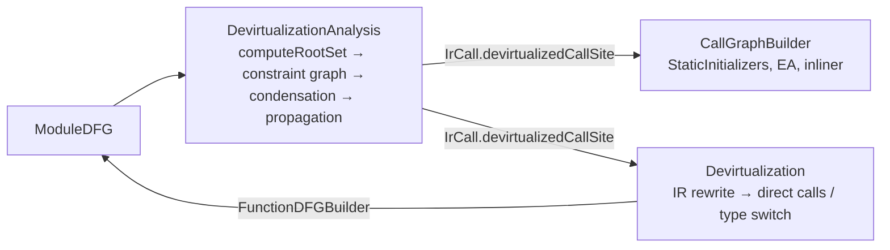
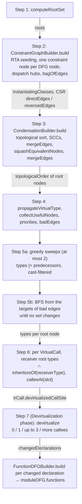
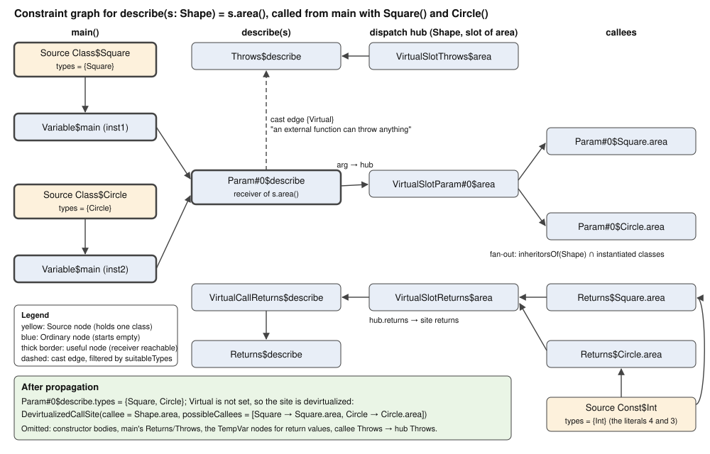
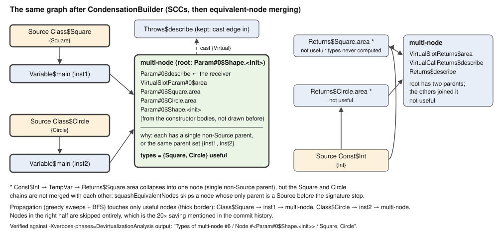
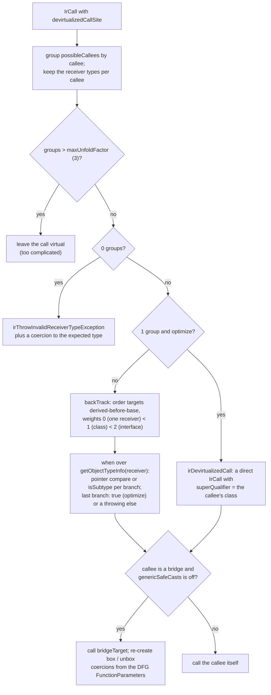
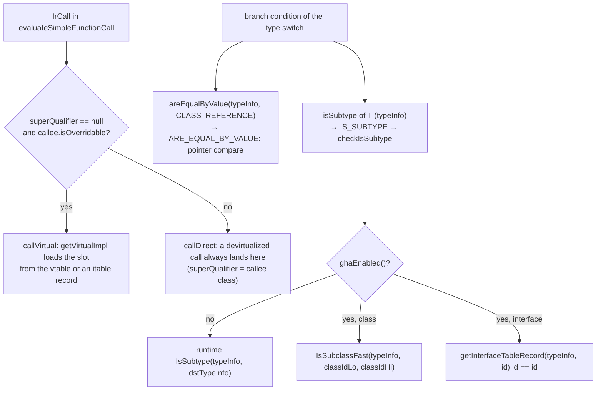

# Kotlin/Native: devirtualization

Devirtualization replaces virtual (vtable/itable) calls with direct calls or small type switches when the whole-program analysis
proves that only a few receiver classes can reach a call site. It is the first consumer of the DataFlowIR
([dataflow-ir.md](dataflow-ir.md)) and the one that makes the others precise: the call graph, escape analysis, the pre-codegen
inliner and static-initializer removal all read its verdicts. This page covers the algorithm end to end — root set, constraint graph,
condensation, type propagation, result and IR rewrite — plus how codegen emits the rewritten IR, how to debug it and what other
subsystems silently depend on it. Phase ordering and gating are in [optimizations.md](optimizations.md).

The entire implementation is one file,
[DevirtualizationAnalysis.kt](../../kotlin-native/backend.native/compiler/ir/backend.native/src/org/jetbrains/kotlin/backend/konan/optimizations/DevirtualizationAnalysis.kt)
(BACKEND = `kotlin-native/backend.native/compiler/ir/backend.native/src/org/jetbrains/kotlin/backend/konan/`); the two phases are
declared in [LTO.kt](../../kotlin-native/backend.native/compiler/ir/backend.native/src/org/jetbrains/kotlin/backend/konan/driver/phases/LTO.kt).

## Key concepts

| Term                         | Meaning                                                                                                                                                                   |
|------------------------------|---------------------------------------------------------------------------------------------------------------------------------------------------------------------------|
| VTA                          | Variable Type Analysis (Sundaresan et al., OOPSLA'00, cited in the file header): a flow-insensitive set-constraint analysis where each value-holding entity has a set of possible runtime classes and edges propagate sets. |
| RTA                          | Rapid Type Analysis: the set of classes that are instantiated somewhere reachable (`instantiatingClasses`). VTA here is bootstrapped by RTA and filters every type set with it. |
| Constraint graph             | Nodes = `Node.Source` (a class literal: allocation, constant, external result) or `Node.Ordinary` (parameter, variable, field, return, …). Edges = "types flow from A to B". `CastEdge(node, suitableTypes)` = flow filtered by a type bitset. |
| `types: CustomBitSet`        | The per-node set of possible class indices ([CustomBitSet.kt](../../kotlin-native/backend.native/compiler/ir/backend.native/src/org/jetbrains/kotlin/backend/konan/util/CustomBitSet.kt), lazy/sparse for small sets). Index 0 is `Type.Virtual`. |
| Virtual dispatch hub         | A shared fan-out node group per `(receiver type, interface id, slot)`; every call site of that slot connects to it instead of to all callees. |
| Condensation                 | SCCs of the constraint graph over regular edges merged with union-find, then "equivalent" nodes merged, giving a DAG processed in topological order. |
| `DevirtualizedCallSite`      | The result for one `IrCall`: `callee` (the IR callee) and `possibleCallees: List<DevirtualizedCallee(receiverType, callee)>`. Stored as `IrCall.devirtualizedCallSite` (`irAttribute(copyByDefault = true)`). |
| Unfold factor                | Max number of candidates for which a site is rewritten (IR: `IR_DEVIRTUALIZED_{VTABLE,ITABLE}_CALL = 3`) or expanded into direct call-graph edges (DFG: `DFG_DEVIRTUALIZED_CALL = 5`, `DFG_NON_DEVIRTUALIZED_CALL = 5`). |

## Two phases



`DevirtualizationAnalysisPhase` only annotates IR; `DevirtualizationPhase` rewrites it. They were split in commit `9c6943b8c4f4`
("Split Devirtualization onto phases: the analysis itself and applying its results to the IR"), which is what allows
`RemoveRedundantCallsToStaticInitializersPhase` to read the verdicts between them and lets `-Xdisable-phases=Devirtualization` keep
the analysis results for the other consumers while leaving the IR virtual.

Inside the two phases, the steps described below and the data each passes on, as sequenced in
`DevirtualizationAnalysisImpl.analyze()` and `DevirtualizationAnalysis.devirtualize()`:



## Step 1 — the root set

`DevirtualizationAnalysis.computeRootSet(context, irModule, moduleDFG)` is shared by every DFG client via `CallGraphBuilder`.
It returns the functions assumed callable from outside the analysed code:

| Output                                                                 | Roots                                                                                                                                                             |
|------------------------------------------------------------------------|-------------------------------------------------------------------------------------------------------------------------------------------------------------------|
| Program (`symbols.entryPoint != null`, only for `-produce program`, [Ir.kt](../../compiler/ir/backend.native/src/org/jetbrains/kotlin/backend/konan/ir/Ir.kt)) | the entry point only                                                                                                                      |
| Everything else (framework, static/dynamic library, cache, test bundle) | every `FunctionSymbol.Public`, every `External` with `isExported`, and every declared function that occupies some class's vtable or itable slot and has a body |
| Always                                                                 | static field initializers and eager static initializers; `EXPLICITLY_EXPORTED` functions; the instance getter of every associated object (`findAssociatedObject` reflection: "Conservatively assume each associated object could be called"); the target of every `IrRawFunctionReference` ("leaking to the native world", e.g. `staticCFunction`, C bridges) |

"Public" is `KonanBinaryInterface.isExported` — the mangler's visibility rule plus the annotations that force export (details in
[optimizations.md](optimizations.md#root-set-and-call-graph-shared-by-all-analyses)). This is the whole bridge to ObjC/C/Swift export
([export.md](export.md)): an exported binary has no entry point, so every public function is a root and there is no export-specific
code in the analysis.

## Step 2 — building the constraint graph

`DevirtualizationAnalysisImpl.analyze()` calls `buildConstraintGraph(functions, rootSet)`, whose worker is `ConstraintGraphBuilder`.
It is a worklist over functions (`stack`), seeded with the root set, and it interleaves RTA and VTA edge generation:

**Seeding (`build`).** Final-typed parameters of roots are instantiated (an outside caller can pass them). For a *library*
(`entryPoint == null`) every public non-abstract class is instantiated ("some user of our library might …"). For a *program*
`String` is instantiated and flows into the array-item field (the `args` of `main`). Then `createFunctionConstraintGraph(root, isRoot = true)`
gives each root `Param#i` nodes fed from `concreteClass(type)` if the parameter type is final, else from the global `virtualNode`
(comment `TODO: OBJC-INTEROP-GENERATED-CLASSES`), plus `Returns`/`Throws` nodes.

**Per function (`dfgNodeToConstraintNode`).** Each DFG node gets a constraint node; the mapping is the core of the analysis:

| DFG node                                  | Constraint graph effect                                                                                                                                                     |
|-------------------------------------------|-----------------------------------------------------------------------------------------------------------------------------------------------------------------------------|
| `Const(type)`, `Alloc(type)`, `Singleton` | `addInstantiatingClass(type)`; a shared `Source` node per class (`Class$T` / `Const$T`); a singleton also calls its constructor with the instance as `this`                 |
| `Null`                                    | `voidNode` (an ordinary node that never receives types)                                                                                                                      |
| `Parameter(i)`                            | the function's `Param#i` node                                                                                                                                                |
| `Variable` (non-temporary)                | one `Variable$f` node; its value edges are added separately (`generateVariableEdges`) "otherwise recursion can be too deep". A `CatchParameter` additionally gets a cast edge from the function's `Throws` filtered by the catch type |
| `Variable` (temporary)                    | `TempVar$f` node with edges from all values                                                                                                                                  |
| `Edge.castToType = T`                     | `doCast`: a fresh `Cast$f` node reached through `CastEdge(suitableTypes = inheritorsOf(T))`                                                                                 |
| `StaticCall(callee)`                      | `doCall`: argument → `Param#i` edges, `callee.Throws → caller.Throws`, result = callee `Returns` (cast if the declared and actual return types differ). An **external** callee has no graph: it gets a per-`(callee, returnType)` fictitious node that is a `Source` of the return class if final (also instantiating it), else fed from `virtualNode` — "an unknown function can return anything" |
| `FieldRead/FieldWrite(field)`             | one global node per `Field` ("Do not distinguish receivers"); in a library the node is also fed by `concreteClass(fieldType)` (final) or `virtualNode` ("Some user of our library might place some value into the field"), and final field types are instantiated |
| `ArrayRead/ArrayWrite`                    | the same, with a single synthetic `Array$Item` field for *all* arrays                                                                                                        |
| `FunctionReference(type)`                 | `concreteClass(type)` — the function class is a source, no instantiation call                                                                                                |
| `SaveCoroutineState`                      | `voidNode` (spilled locals carry no type information for devirtualization; see [coroutines.md](coroutines.md#devirtualization-and-dce))                                       |
| `VirtualCall`                             | see below                                                                                                                                                                    |

**Virtual calls.** A site with a `Type.Virtual` receiver gets `virtualNode → receiver` and no callees. Otherwise it is attached to the
*virtual dispatch hub* for its `VirtualDispatchKey(receiverType, interfaceId, slot)`: arguments flow into the hub's parameters, the
hub's returns into the site's `VirtualCallReturns` node. On first creation the hub fans out to `calleeAt(slot)` of every class in
`inheritorsOf(receiverType) ∩ instantiatingClasses`, and registers itself in `typesVirtualCallSites[receiverType]`. Whenever a new
class is instantiated later, `addInstantiatingClass → checkSupertypes` walks its supertypes and, for every hub registered there,
adds the new callee (`processVirtualCall`). This incremental RTA keeps the graph closed under "instantiated class × reachable
slot" without ever enumerating non-instantiated classes. The hub was introduced in commit `606f465d6b42`: previously each site
fanned out to all callees, which was `|call sites| × |types|` edges — "removing the quadratic memory consumption". Receivers
are recorded in `virtualCallSiteReceivers` for the result step, and every virtual site adds `receiver —cast{Virtual}→ Throws`
("An external function can throw anything").

Library mode adds two conservative rules for virtual calls: a non-final return type gets `receiver —cast{Virtual}→ returns` (if the
receiver came from outside, so did the result), and a final return type is instantiated and remembered in `externalVirtualCalls`,
resolved after the condensation (fix for KT-57791, commit `b6030b3517e3`).

**Edge storage.** Edges are appended to `bagOfEdges: LongArrayList` as `from | (to << 32)`, de-duplicated only within one function
through a `LongHashSet` ("covers up to 98% of duplicates in practice", commit `b22fa032c25f`). The bag is then counted into CSR
arrays `directEdges`/`reversedEdges` (`edges[edges[v] until edges[v+1]]`) in two passes to hold at most two of the three structures
at once (comment above `buildConstraintGraph`). Cast edges stay as small per-node lists. Finally every cached `suitableTypes` bitset
is intersected with `instantiatingClasses` and gets `Virtual` set, so casts never let a non-instantiated class through but always let
"unknown" through.

**A worked example.** One virtual call site with two instantiated receiver classes:

```kotlin
abstract class Shape { abstract fun area(): Int }
class Square : Shape() { override fun area() = 4 }
class Circle : Shape() { override fun area() = 3 }

fun describe(s: Shape) = s.area()

fun main() {
    describe(Square())
    describe(Circle())
}
```

The constraint graph that `ConstraintGraphBuilder` builds for it, following the node mapping table above (sources for the two
allocations and the `Int` literals, `Variable$main` nodes for the lowered constructor temporaries, `Param#0$describe` as the
receiver, the dispatch hub for the `area` slot fanning out to both implementations, and the cast edge to `Throws`); node
identities and the final verdict were checked against the `-Xverbose-phases=DevirtualizationAnalysis` dump of this program:



## Step 3 — condensation

`CondensationBuilder.build()` runs five passes on the CSR graph:

1. `calculateTopologicalSort` — iterative DFS over regular edges, finishing order into `order`.
2. `squashStronglyConnectedComponents` — reverse-order BFS over reversed edges (Kosaraju); members `join` their SCC root in a
   path-compressing union-find living in `Node.parent`.
3. `mergeEdges` — rebuilds `directEdges`/`reversedEdges` between SCC roots without duplicates, using counting sort so that extra
   memory is O(nodes), not O(edges) (documented in the method's KDoc). Cast edges are re-attached to roots, their `suitableTypes`
   bitsets merged, and a cast edge is dropped if a regular edge between the same roots exists ("Regular edge make a cast edge
   obsolete"). Reversed cast edges are discarded here and recomputed via `addCastEdge`.
4. `squashEquivalentNodes` — two merges on `Ordinary` nodes that are not sources and not potential external-virtual-call returns:
   a node whose only predecessor root is a single non-source node joins it (it will always have exactly that node's types); and nodes
   with identical predecessor sets (regular predecessors plus `(predecessor, suitableTypes)` for casts) are merged by a 64-bit XOR
   signature over random per-node ids (`Random(234239874)` for reproducibility, `mixHash` so that mask position matters) followed by
   an exact comparison.
5. `mergeEdges` again, then `topologicalOrder()` lists the surviving roots.

Rationale from commit `57c22ff29211` (Dec 2025): "All the stages except the analysis are linear in time and space. The analysis
itself is quadratic both in time and space, albeit with a good constant", so shrinking the graph is the lever. On kotlinconfapp
merging equivalent nodes cut the node count 5×, and dropping nodes that do not affect any query (next step) cut the remainder 20×,
to "60ms and a few MB". KT-80167 (commit `b6d4b37645d5`) is the original node/edge merging.

Important: SCCs are computed over *regular* edges only. Cast edges may therefore point against the topological order; they are
collected as `badEdges` and handled specially in the propagation.

On the example above, the condensation has no non-trivial SCC (the graph is acyclic), so all the shrinking comes from
`squashEquivalentNodes`: every parameter node downstream of `Param#0$describe` has it as its only non-`Source` parent and
joins it, and `Param#0$Shape.<init>` (reached from the constructor bodies through `Param#0$Square.<init>` and
`Param#0$Circle.<init>`, which were themselves joined into `inst1` and `inst2`) has the same parent set `{inst1, inst2}` and is
merged by signature. The result, as printed under `CONDENSATION` and `Types of multi-node` by `-Xverbose-phases=DevirtualizationAnalysis`:



## Step 4 — preparation

- `propagateVirtualType` marks `Virtual` on everything reachable from a `Virtual`-typed node through regular edges and through
  cast edges that admit `Virtual` (they all do, see the end of step 2). A node that can hold "unknown" can never be devirtualized,
  so this is done eagerly and the comment admits it is "pessimistic handling of [Type.Virtual]".
- `collectUsefulNodes` marks every node from which the receiver of some non-`Virtual` virtual call is reachable (backwards BFS over
  regular and cast edges). Propagation skips the rest — the 20× saving above.
- Library mode: for each `externalVirtualCalls` entry whose receiver is `Virtual`, the final return class is added to the returns node
  ("instance of this class could have been created by the call").
- Nodes get `priority = position in topological order`; a `checkOrder` pass asserts that no regular edge violates it.

## Step 5 — propagating type sets

Sources start with their one class; all other nodes start empty. The propagation is two-phase:

1. **Greedy phase** (at most `maxNumberOfIterations = 2` sweeps). Walk nodes in topological order; for each useful non-source node,
   `types |= pred.types` over regular predecessors and `types |= pred.types & suitableTypes` over forward-directed cast
   predecessors (`orWithFilterHasChanged`). After the first sweep apply all `badEdges` (backward cast edges, sorted by target
   priority, "Heuristic."); if any changed a set, sweep again.
2. **BFS phase.** Re-apply the bad edges; every target that changed seeds a worklist. Pop nodes, push their types along regular and
   cast edges to useful successors, enqueue successors that changed, until the worklist empties. This is the usual fixpoint, run only
   on what the greedy phase did not already settle.

Because sets only grow and are bounded by `instantiatingClasses`, this terminates; the worst case is the quadratic one quoted above
(every node may receive every type), the common case is one or two sweeps.

## Step 6 — the result

For every `VirtualCall` in every reachable function (`constraintGraph.functions` keys) the receiver's root node is inspected:

- `types[Virtual]` set → not devirtualized; with `-Xverbose-phases` the dump prints "Unable to devirtualize callsite … receiver is
  Virtual" and `logPathToType` shows a BFS path back to the source that introduced `Virtual`.
- otherwise `possibleReceivers = types ∩ inheritorsOf(receiverType)` minus `Nothing`; each must be in `instantiatingClasses`
  (assert "Non-instantiating class"). For each receiver `calleeAt(slot)` resolves the callee through the receiver's `vtable`/`itable`;
  a callee with `symbolTableIndex < 0` is an internal error ("cannot be called virtually, but actually is at call site").
- `DevirtualizedCallSite(virtualCall.callee, callees)` is stored into `irCallSite.devirtualizedCallSite`.

The list may be empty (the site is unreachable with any instantiated receiver), a singleton, or long. Nothing is filtered by unfold
factors here: that is the consumers' decision.

## Step 7 — the IR rewrite (`devirtualize`)

`DevirtualizationAnalysis.devirtualize(irModule, moduleDFG, generationState, maxVTable = 3, maxITable = 3)` transforms every
`IrCall` with a `devirtualizedCallSite`. Candidates are grouped by callee (`possibleCallees.groupBy { it.callee }`), so a method not
overridden in three subclasses counts once, with three receiver types.

| Candidates after grouping     | Rewrite                                                                                                                                                                                                                     |
|-------------------------------|-----------------------------------------------------------------------------------------------------------------------------------------------------------------------------------------------------------------------------|
| 0                             | `irThrowInvalidReceiverTypeException` — allocate a `KClassImpl` for `getObjectTypeInfo(receiver)` and call `ThrowInvalidReceiverTypeException` ([RuntimeUtils.kt](../../kotlin-native/runtime/src/main/kotlin/kotlin/native/internal/RuntimeUtils.kt)); unreachable by construction, followed by a coercion to the expected type |
| 1 and `optimize`              | a direct `IrCall` to the implementation (`irDevirtualizedCall`), see bridges below                                                                                                                                          |
| ≤ 3 (interface or class)      | `when` over the receiver's type info: `receiver` and `getObjectTypeInfo(receiver)` go to temporaries; each branch tests either pointer equality with the class's `TypeInfo` (`IrClassReference` of `nativePtrType`, when exactly one receiver type maps to that callee) or `isSubtype<DeclClass>(typeInfo)`; in `optimize` the last branch's condition is `true`; without `optimize` an extra `else` throws `InvalidReceiverTypeException` "for debug purposes" |
| > 3                           | left virtual ("Callsite too complicated to devirtualize")                                                                                                                                                                   |

Branch order matters: a check for a derived class must precede a check for its base. `backTrack` enumerates orders in which no target
is a subclass of an earlier one and minimizes a lexicographic weight (`0` = single receiver, pointer compare; `1` = class
`isSubtype`; `2` = interface `isSubtype`, "the slowest"), excluding the last branch since it becomes `else`. The number of targets
is ≤ 3, so brute force is fine (comment in code).

The decisions `devirtualize` makes per annotated call site, in the order of the `when` in its `visitCall`:



The shape of the rewritten IR for the two-callee example above, taken from `-Xphases-to-dump-after=Devirtualization` (the
`Square` branch has a single receiver type, so it gets the pointer compare; the last target becomes the unconditional branch):

```
// describe(s) after Devirtualization
BLOCK type=Int
  VAR arg0 = s                                   // irSplitCoercion: one temporary per argument
  VAR tmp0 = arg0                                // the receiver
  VAR tmp1 = getObjectTypeInfo(tmp0)             // created lazily, only if some branch tests it
  WHEN
    areEqualByValue(tmp1, CLASS_REFERENCE Square)   // weight 0: exactly one receiver type → pointer compare
      -> CALL Square.area(arg0) superQualifier=Square
    true                                            // optimize: the last target is not checked
      -> CALL Circle.area(arg0) superQualifier=Circle
  // only without optimize: an extra branch  true -> ThrowInvalidReceiverTypeException(KClassImpl(tmp1))
```

**Bridges and coercions.** If the chosen callee is a bridge (`bridgeTarget != null`) and `genericSafeCasts` is off, the call goes
straight to the bridge target and the box/unbox coercions the bridge would have performed are re-created from the DFG
`FunctionParameter`s (`getTypeConversion`): this is what makes a devirtualized `ref(it)` on a `(Int) -> Int` reference run without
`Int-box`/`Int-unbox` (FileCheck test `kt49847_simple_function_reference.kt`). With `genericSafeCasts` the bridge itself is called
("Can't easily inline bridges with casts"). `irSplitCoercion` peels an argument's box/unbox call off into a temporary so each branch
can coerce independently.

After the transform every changed declaration is rebuilt with `FunctionDFGBuilder` and the log prints `Devirtualized: X%` (sites that
got a verdict / overridable call sites) and `Actually devirtualized: Y%` (sites rewritten).

## How codegen emits it

There is no devirtualization-specific code in `llvm/`: `IrToBitcode.evaluateSimpleFunctionCall`
([IrToBitcode.kt](../../kotlin-native/backend.native/compiler/ir/backend.native/src/org/jetbrains/kotlin/backend/konan/llvm/IrToBitcode.kt))
calls `callVirtual` (through the virtual trampoline, [llvm-codegen.md](llvm-codegen.md)) only when `superClass == null &&
function.isOverridable`; `irDevirtualizedCall` creates every rewritten call with `superQualifierSymbol` set to the callee's
class (visible as `superQualifier='CLASS Square'` in the IR dump above), so even a call to an `open` override takes the
`callDirect` path. The type switch compiles to: `IrClassReference` → `codegen.typeInfoValue(class)` (`evaluateClassReference`), pointer equality →
`ARE_EQUAL_BY_VALUE`, and `isSubtype<T>` → `IS_SUBTYPE` in
[IntrinsicGenerator.kt](../../kotlin-native/backend.native/compiler/ir/backend.native/src/org/jetbrains/kotlin/backend/konan/llvm/IntrinsicGenerator.kt)
(both are `@TypedIntrinsic` kinds, see [intrinsics.md](intrinsics.md#part-2--typedintrinsic-kinds-by-family)),
which is `CodeGenerator.checkIsSubtype`
([CodeGenerator.kt](../../kotlin-native/backend.native/compiler/ir/backend.native/src/org/jetbrains/kotlin/backend/konan/llvm/CodeGenerator.kt)):
with GHA enabled an `IsSubclassFast(typeInfo, lo, hi)` interval check for classes or an itable-id compare for interfaces, otherwise
the runtime `IsSubtype`. So devirtualization does **not** consume GHA ids itself (GHA runs after it and after DCE; the DFG's
`interfaceId`s are name hashes, see [dataflow-ir.md](dataflow-ir.md#the-symboltable)); only the emitted type checks benefit from GHA
([dce-and-gha.md](dce-and-gha.md)).

How the two halves of a rewritten site reach machine code, from `evaluateSimpleFunctionCall` in `IrToBitcode.kt`,
`IntrinsicGenerator.kt` and `VirtualTablesLookup.checkIsSubtype` in `CodeGenerator.kt`:



## Downstream consumers

| Consumer                                        | What it reads                                                                                                                                                      |
|-------------------------------------------------|--------------------------------------------------------------------------------------------------------------------------------------------------------------------|
| `CallGraphBuilder` (all clients)                | `irCallSite.devirtualizedCallSite`: ≤ `devirtualizedCallSitesUnfoldFactor` callees → direct edges, else a virtual site whose candidates become roots ([CallGraphBuilder.kt](../../kotlin-native/backend.native/compiler/ir/backend.native/src/org/jetbrains/kotlin/backend/konan/optimizations/CallGraphBuilder.kt)) |
| `RemoveRedundantCallsToStaticInitializersPhase` | the per-`IrCall` list of unfolded call sites (`virtualCallSites`); a site that is still virtual stops the "definitely initialized" propagation ([StaticInitializersOptimization.kt](../../kotlin-native/backend.native/compiler/ir/backend.native/src/org/jetbrains/kotlin/backend/konan/optimizations/StaticInitializersOptimization.kt)) |
| `EscapeAnalysis`                                | through the call graph: an unfolded site uses callee summaries, a virtual one is pessimistic                                                                       |
| `PreCodegenInliner` (second run)                | direct calls created by the rewrite are now inlining candidates; that is why it runs again after `Devirtualization`                                                |
| `DCEPhase`                                      | uses factor `-1`, so it ignores verdicts on still-virtual sites, but benefits from the rewritten direct calls and from the roots promoted by the call graph builder |
| `RedundantCoercionsCleaner`, `UnboxInlineLowering` | clean up the box/unbox calls the rewrite introduced                                                                                                             |

## Complexity and memory

- Graph construction: linear in DFG size plus hub fan-out (`Σ_slots |instantiated inheritors|`), no longer per call site.
- Condensation and merging: linear in nodes + edges, O(nodes) extra memory (`mergeEdges` KDoc).
- Propagation: worst case O(nodes × types) bit operations and memory, mitigated by `usefulNodes`, lazy bitsets and the merges.
- `TypeHierarchy.inheritorsOf` caches one bitset per type; `suitableTypes` one bitset per cast target type.

Measured numbers exist only in commit messages (above); there is no benchmark in the tree that tracks devirtualization time.

## Flags and binary options

| Flag                                                             | Effect                                                                                                             |
|------------------------------------------------------------------|--------------------------------------------------------------------------------------------------------------------|
| `-opt`                                                           | `optimizationsEnabled`; both phases run only when `runGlobalOptimizations = optimize && !hasStaticCaches`           |
| `-Xdisable-phases=DevirtualizationAnalysis`                      | no verdicts: `Devirtualization` becomes a no-op, call graphs fall back to hierarchy-based unfolding                 |
| `-Xdisable-phases=Devirtualization`                              | verdicts stay for the call-graph clients, IR stays virtual — the first bisection step for "wrong override called"  |
| `-Xverbose-phases=DevirtualizationAnalysis`                      | dumps `FULL CONSTRAINT GRAPH`, `CONSTRAINT GRAPH: N nodes, M edges`, `CONDENSATION`, `Types of multi-node`, per-site `Devirtualized callsite`/`Unable to devirtualize` with `Path to type` |
| `-Xverbose-phases=Devirtualization`                              | rebuilt DFGs and the `Devirtualized: X%` / `Actually devirtualized: Y%` statistics                                 |
| `-Xphases-to-dump-after=Devirtualization`                        | IR after the rewrite (look for `when` over `getObjectTypeInfo`)                                                     |
| `-g` (no `-opt`) with the phases force-enabled                   | not possible from the command line; the debug `else` branch only appears when `devirtualize` runs with `optimize == false`, which `runCodegen` never does today |
| `-Xbinary=genericSafeCasts=true`                                 | keeps bridge calls instead of calling bridge targets directly                                                       |
| `-Xbinary=enableReleaseBinaryCache=true`                         | uses caches in `-opt` and therefore disables both phases                                                            |

The unfold factors are constants in `DevirtualizationUnfoldFactors` with a `TODO: Think how to evaluate different unfold factors`;
there is no option for them. Node names in the constraint graph dumps are `null` unless `TAKE_NAMES` in `DevirtualizationAnalysis`
is flipped to `true` (it is `false` by default to save memory; the DFG symbol names are still printed).

## Tests and how to run them

| What                                                                                     | Where / how                                                                                                                                                                                   |
|------------------------------------------------------------------------------------------|-----------------------------------------------------------------------------------------------------------------------------------------------------------------------------------------------|
| Devirtualized function reference without boxing (FileCheck `CHECK-OPT-NOT: Int-box`)    | `native/native.tests/testData/codegen/fileCheck/kt49847_simple_function_reference.kt` (ignored for `OPT && STATIC_*` cache modes because global optimizations are off there)                   |
| Bridges survive with DCE off (`-Xdisable-phases=DCEPhase`)                                | `native/native.tests/testData/codegen/fileCheck/bridges.kt`                                                                                                                                   |
| `Any` methods on interface receivers ("Try to trick devirtualizer")                      | `native/native.tests/testData/codegen/classes/vtable_any.kt`                                                                                                                                  |
| Shared box tests that *avoid* devirtualization on purpose                                | `compiler/testData/codegen/box/coroutines/multiModule/inheritFromAnotherModule.kt` uses `if (true) ImplementA() else A()`                                                                     |
| Run                                                                                      | `./gradlew :native:native.tests:test --tests "org.jetbrains.kotlin.konan.test.blackbox.FirNativeCodegenLocalTestGenerated\$FileCheck*" -Pkn.optimizationMode=OPT -Pkn.cacheMode=NO` and `./gradlew :native:native.tests:codegen-box:test --tests "org.jetbrains.kotlin.konan.test.blackbox.FirNativeCodegenBoxTestGenerated\$Box\$*" -Pkn.optimizationMode=OPT -Pkn.cacheMode=NO` |

There is no dedicated devirtualization test directory and no unit test of the analysis; coverage comes from running the suites in
`OPT` mode. `-Pkn.cacheMode=NO` matters: the default `STATIC_ONLY_DIST` links a static stdlib cache, which turns the phases off.

## Typical bugs and how to bisect

| Symptom                                                        | Likely cause                                                                                                                                          | Check                                                                                                                                 |
|----------------------------------------------------------------|-------------------------------------------------------------------------------------------------------------------------------------------------------|---------------------------------------------------------------------------------------------------------------------------------------|
| `RuntimeException: Unexpected receiver type: X` in release only | a receiver class reached the site that the analysis did not see: instantiated via reflection, a runtime/C++ path (`@ExportForCppRuntime` without the attribute), an ObjC/Swift subclass, a raw function reference not in the root set | `-Xdisable-phases=Devirtualization` fixes it → confirm; then `-Xverbose-phases=DevirtualizationAnalysis` and read the `Path to type` for the site |
| Wrong override called, no exception                            | same cause, but the type set had ≥ 1 wrong-but-plausible class so the `else`/`true` branch swallowed it                                               | same; compare `-g` vs `-opt`                                                                                                           |
| "cannot be called virtually, but actually is at call site"      | `placeToFunctionsTable` disagrees with the IR (a non-overridable member reached through a slot), usually a lowering producing odd overrides            | DFG symbol table dump                                                                                                                 |
| "Non-instantiating class" assertion                             | a type reached a node without going through `addInstantiatingClass` — a missing rule in `dfgNodeToConstraintNode`                                      | constraint graph dump                                                                                                                 |
| Top-level `val` uninitialized only in release                   | static-initializer removal trusted a wrong verdict                                                                                                     | disable `RemoveRedundantCallsToStaticInitializersPhase`, then `DevirtualizationAnalysis`                                               |
| Library/framework behaves differently from the program          | library mode roots and conservative rules differ (see contracts); a verdict valid for the program may not hold once a consumer subclasses             | compile a tiny program vs framework with the same code and diff the dumps                                                             |

Bisection order used in practice (from [optimizations.md](optimizations.md#symptoms--where-to-look)): `EscapeAnalysis` →
`Devirtualization` → `DevirtualizationAnalysis` → `DCEPhase` → `RemoveRedundantCallsToStaticInitializersPhase`.

## Trade-offs and known limitations

- Flow-insensitive and (for fields) receiver-insensitive: one node per field and one `Array$Item` for all arrays means a class
  stored into *any* `List<Any>` is a candidate at *every* `list[i].foo()` site.
- Abstract classes are never instantiated (`concreteType` maps them to `Virtual` if they ever reach a source), and `Nothing` is
  filtered from results.
- ObjC classes, forward declarations and anything that flows through them are `Virtual`; a call on an `NSObject` subclass written
  in Kotlin is never devirtualized even if there is one implementation.
- The IR unfold factor 3 and the DFG factor 5 are unmeasured constants (code TODO).
- Library mode is deliberately weaker: public classes are all instantiated, fields and virtual returns may carry outside values.
- Debug-mode type switches with a throwing `else` exist in the code but cannot be produced today because the phase is gated on
  `optimize`.

## Implied contracts

- **Closed world.** Verdicts are only valid if the compiled unit sees every class that can be instantiated and every call that can
  happen. That is why `runGlobalOptimizations` requires `!hasStaticCaches` ([caches.md](caches.md)): a static cache has fixed
  vtables and bodies compiled without this program's verdicts. Per-file/incremental caches are not supported with these phases at
  all ([incremental-compilation.md](incremental-compilation.md)).
- **Exported API is the root set for frameworks and libraries**, so ObjC/Swift export and C export keep working without any
  export-specific logic here; conversely a *new* way to call Kotlin from outside (a new export mechanism, a new reflection
  primitive) must extend `computeRootSet` or set `EXPLICITLY_EXPORTED` in `SymbolTable.mapFunction`, or release builds will throw
  `Unexpected receiver type`/call the wrong method.
- **ObjC classes are never devirtualized** (`Type.Virtual` in `SymbolTable.mapClassReferenceType`, "Do not try to devirtualize
  ObjC classes"); an ObjC/Swift subclass of an exported Kotlin class is covered by library-mode roots plus `Virtual` parameters of
  non-final type. Platform-library functions are externals: their return values are `Virtual` unless the type is final, and they
  never appear as callees (platform libraries carry no bodies, [platform-libraries.md](platform-libraries.md)).
- **`isSubtype` emission depends on GHA for speed only**, not correctness; with GHA off the runtime `IsSubtype` is used. Changing the
  type-switch shape therefore does not touch the runtime contract, but changing `IsSubclassFast`/itable layout does
  ([compiler-runtime-contract.md](compiler-runtime-contract.md)).
- **The analysis is self-consistent within one compilation only.** Nothing is serialized into klibs or caches; klib ABI and
  compatibility ([compatibility-and-migration.md](compatibility-and-migration.md)) are unaffected by this subsystem.
- **KGP and the IDE do not depend on it.** Verified by the absence of any reference to `devirtualizedCallSite`, the phase names or
  `DevirtualizationUnfoldFactors` outside `kotlin-native/backend.native` (`LTO.kt`, `optimizations/`). KGP only controls `-opt`
  via build types ([tooling-integration.md](tooling-integration.md)).

## Open questions

- The log section "Devirtualized from external modules" prints sites with `irCallSite == null`; the DFG builder always sets
  `irCallSite` for `VirtualCall`s, so it is presumably always empty. Hypothesis: a leftover from a time when DFGs of dependencies
  were deserialized; no history found in this tree.
- `maxNumberOfIterations = 2` for the greedy phase and the `badEdges` sort "Heuristic." have no recorded evaluation.
- Why `IR_DEVIRTUALIZED_*_CALL = 3` and `DFG_*_CALL = 5`: only the TODO in the code; no benchmark data in the tree.
- Whether `instantiatingClasses` could legally be used to prune the hierarchy-based unfolding in `CallGraphBuilder` (the commented-out
  "Unconservative way - when we can use it?") — the verdicts' `instantiatingClasses` are not exported from the analysis today.
- Library mode: private classes are not pre-instantiated, but a public function returning a private class's instance makes it
  instantiated on reach; whether a private class only ever created from an inline function body (`isConstructedFromExportedInlineFunctions`
  in [NativeIrAttributes.kt](../../kotlin-native/backend.native/compiler/ir/backend.native/src/org/jetbrains/kotlin/backend/konan/NativeIrAttributes.kt))
  is handled was not traced.
- The debug `else` branch (`!optimize`) is dead code under the current gating; whether it is intended to be reachable through a
  future "optimize but keep checks" mode is not documented.
