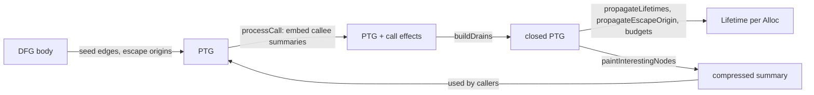
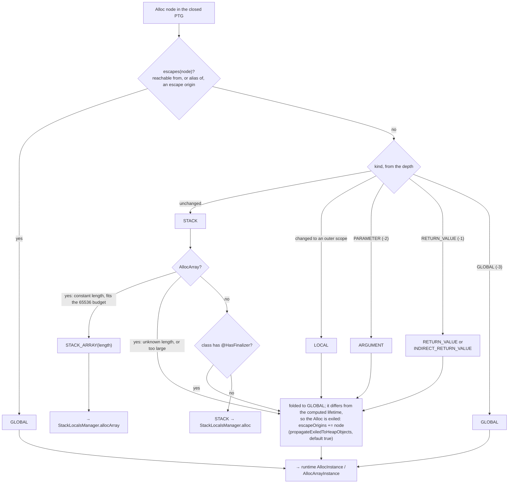
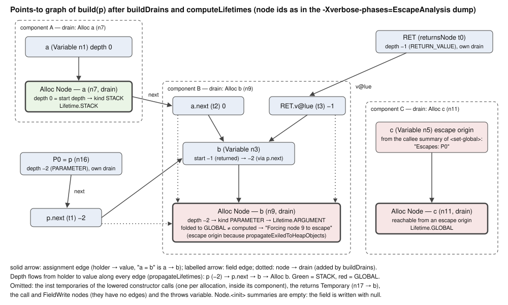
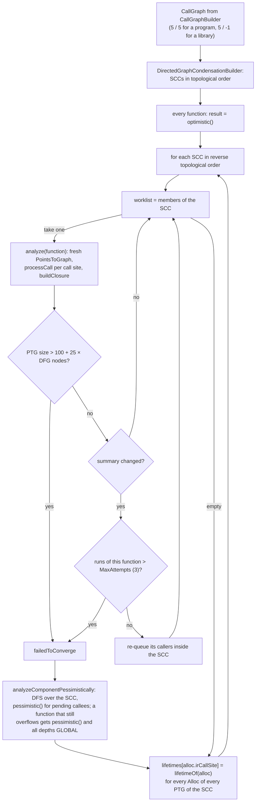

# Kotlin/Native: escape analysis

Escape analysis (EA) decides, for every allocation in the whole program, whether the object can live in the current stack frame
instead of the heap. It is the last analysis before LLVM codegen in `-opt` builds and the one whose mistakes are hardest to debug:
a wrong verdict silently produces a heap object (or a GC root) pointing into a dead stack frame. This page explains the algorithm
from the core idea down to the heuristics, how its verdicts are consumed by codegen and the runtime, which hand-written summaries
it depends on, and how to investigate a suspected EA bug. The surrounding pipeline (phase order, DataFlowIR, root set, call graph,
unfold factors) is in [optimizations.md](optimizations.md); the DataFlowIR model in [dataflow-ir.md](dataflow-ir.md); the
object header and shadow stack in [compiler-runtime-contract.md](compiler-runtime-contract.md).

Paths below are relative to `kotlin-native/backend.native/compiler/ir/backend.native/src/org/jetbrains/kotlin/backend/konan/`
("BACKEND") unless stated otherwise; the algorithm lives in
[EscapeAnalysis.kt](../../kotlin-native/backend.native/compiler/ir/backend.native/src/org/jetbrains/kotlin/backend/konan/optimizations/EscapeAnalysis.kt),
whose header comment is the primary source.

## Key concepts

| Term | Meaning |
|------|---------|
| Points-to graph (PTG) | Per-function graph over DFG nodes: *assignment* edges `a → b` for `a = b` (receiver to value) and *field* edges `a –f→ a.f`. Invariant maintained in one direction only: if object A may reference B then there is a path A ⇝ B (extra paths are allowed). `PointsToGraph` |
| Escape origin | A PTG node whose object is known to leave the function's control: written to a static field, read from one, a singleton, a thrown value, or marked escaping by a callee summary. `escapeOrigins` |
| Depth | Integer per PTG node encoding the innermost scope the object may be visible in; smaller = wider. `Depths`: `INFINITY` (fresh), `ROOT_SCOPE = 0`, loop bodies `1, 2, …`, `RETURN_VALUE = -1`, `PARAMETER = -2`, `GLOBAL = -3` |
| Drain | A representative node per connected component of assignment edges; all field edges of the component are moved to it so that "any field access applies to any alias" holds by construction. `buildDrains` |
| Intestines | Pseudo-field `inte$tines` standing for "the elements of" an array (or the saved state of a coroutine). `intestinesField` |
| Function summary | `FunctionEscapeAnalysisResult`: compressed PTG over `P0..Pn`, `RET` and numbered drains `D0..Dk` as `v.f0…fk → w.g0…gl` edges, plus the set of escaping nodes. Embedded at each call site in callers |
| `Lifetime` | Codegen-facing verdict per allocation: `STACK`, `STACK_ARRAY(len)`, otherwise `GLOBAL`. [ContextUtils.kt](../../kotlin-native/backend.native/compiler/ir/backend.native/src/org/jetbrains/kotlin/backend/konan/llvm/ContextUtils.kt) |
| Exiled object | Any `Alloc` whose computed lifetime is not `STACK` (i.e. `ARGUMENT`, `RETURN_VALUE`, `INDIRECT_RETURN_VALUE` or `LOCAL`; "local" in the header comment's terminology), plus stack candidates that are too large arrays or have a finalizer. `computeLifetimes` folds all of these to `GLOBAL` and, with `escapeAnalysisPropagateExiledToHeapObjects=true` (default), turns the node into an escape origin ("Forcing node … to escape") so that everything it points to escapes too |
| `@Escapes` / `@PointsTo` | Hand-written summaries on stdlib `external fun`s. [Annotations.kt](../../kotlin-native/runtime/src/main/kotlin/kotlin/native/internal/escapeAnalysis/Annotations.kt) |

## How it works

### Where it runs

`EscapeAnalysisPhase` in [LTO.kt](../../kotlin-native/backend.native/compiler/ir/backend.native/src/org/jetbrains/kotlin/backend/konan/driver/phases/LTO.kt)
takes the IR module plus the `ModuleDFG`, builds its own call graph with `CallGraphBuilder` and returns `Map<IrElement, Lifetime>`;
`outputIfNotEnabled` is the empty map. `runCodegen` in
[TopLevelPhases.kt](../../kotlin-native/backend.native/compiler/ir/backend.native/src/org/jetbrains/kotlin/backend/konan/driver/phases/TopLevelPhases.kt)
runs it with `disable = !runGlobalOptimizations`, i.e. only with `-opt` and no static caches, after `RTTI` and right before
`Codegen`. The call graph is built with `DFG_DEVIRTUALIZED_CALL = 5` for devirtualized sites and, for non-devirtualized sites,
`DFG_NON_DEVIRTUALIZED_CALL = 5` when there is an entry point (program) but `-1` for every other output kind: "Can't tolerate any
non-devirtualized call site for a library" — unknown subclasses may be provided by users of the library, and `0` would be wrong too
because it means "no inheritors in this source set" (comment in `LTO.kt`). Sites that are not unfolded stay `isVirtual` call sites
and all candidates become roots ([CallGraphBuilder.kt](../../kotlin-native/backend.native/compiler/ir/backend.native/src/org/jetbrains/kotlin/backend/konan/optimizations/CallGraphBuilder.kt)).

The header comment lists five lifetimes (Stack, Local, Return value, Parameter, Global); only Stack and Global are supported by codegen,
so everything else is "pulled up to Global".

### The idea in one paragraph

Treat the body as a sea of nodes (no control flow; see [dataflow-ir.md](dataflow-ir.md)), draw assignment and field edges between
them, embed callee summaries at call sites, and ask two questions per allocation: (1) is it reachable from, or an alias of, an
escape origin? then it is heap; (2) otherwise, does its value flow to a node declared in an outer scope (function root or an
enclosing loop), to a parameter or to the return value? then its depth drops below the depth where it was allocated and it is heap
too (the codegen has no arenas). Only an allocation whose depth never changes is `STACK`. Functions are processed bottom-up over
the call graph condensation so that callee summaries exist when callers need them; SCCs iterate to a fixpoint with guards.



### Step 1: seeding the points-to graph (`PointsToGraph.init`)

Every non-scope DFG node gets a `PointsToGraphNode` with a start depth: `Parameter` → `PARAMETER`, nodes listed in `body.returns`
→ `RETURN_VALUE`, anything else → the depth of its enclosing `Scope` (root scope = 0, each nested loop +1; DFG scopes are created
only for `IrLoop`s, [DFGBuilder.kt](../../kotlin-native/backend.native/compiler/ir/backend.native/src/org/jetbrains/kotlin/backend/konan/optimizations/DFGBuilder.kt)
`transformLoop`). A synthetic `returnsNode` at `RETURN_VALUE` stands for the return parameter; `return x` is modelled as
`ret.v@lue = x` (`returnsValueField`) so the return value needs no special casing later. Then, per DFG node:

| DFG node | PTG effect |
|----------|-----------|
| `FieldWrite(recv, f, v)` | `recv.f → v`; a null receiver is a static field, so `v` becomes an escape origin |
| `FieldRead(recv, f)` | `result → recv.f`; null receiver: `result` is an escape origin (it may be anything) |
| `ArrayWrite(arr, v)` / `ArrayRead(arr)` | same with the `intestines` pseudo-field |
| `SaveCoroutineState(liveVars)` | `this.intestines → each live variable` (spilled locals live in the coroutine object; this single edge is what keeps stack objects from dangling across a suspension, see [coroutines.md](coroutines.md#what-the-gc-sees-during-a-suspension)) |
| `Variable(values)` | `var → each value` |
| `Singleton` (object access) | escape origin, unless its type is `Nothing` |
| `body.throws` | each thrown value is an escape origin (exceptions always heap-allocate) |
| `Alloc`, `Call`, `Const`, `FunctionReference`, `Null` | no edges of their own (calls contribute via summaries) |

Null values and null receivers (unreachable code, e.g. after inlining) are skipped. If the function symbol itself carries
`@Escapes` (only `External` symbols do, see below), the marked parameters are escape origins.

### Step 2: embedding callee summaries (`processCall`)

For each call site the callee summary is chosen in `analyze(callSites, …)`:

| Call site | Summary |
|-----------|---------|
| Direct call to a function with a DFG body | its current `escapeAnalysisResults` entry (optimistic until analysed, see Step 5) |
| `isVirtual` (not unfolded) | `pessimistic(n)`: every parameter and the return value escape |
| External, name starts with `kfun:kotlin.` and not `kfun:kotlin.native.concurrent`/`kfun:kotlin.concurrent` | `fromAnnotations(escapes, pointsTo)`; with no annotations this is **optimistic**, guarded by a `require` that every parameter and the return type are non-reference (otherwise the message says it "must have been handled by SpecialBackendChecksTraversal"). Built-in operators (`origin == BUILTIN_OPERATOR`) skip the `require` |
| Any other external (cinterop, `kotlinx.cinterop`, user `external fun`) | `pessimistic(n)` |

`processCall` creates fresh PTG nodes for the callee's drains, maps `P<i>` to the i-th argument node, `RET` to the call node and
`D<k>` to the new drain nodes (`mapNode`), follows the field path of each compressed node with `getFieldNode` (skipping `v@lue`), then
adds each summary edge as an assignment edge and adds each summary escape as an escape origin. Arguments are the DFG call's
`arguments` plus the call node itself as the last "parameter" (`CallSite.arguments`). After each call the graph size is checked
against `maxPointsToGraphSizeOf(function)`; exceeding it aborts this attempt (Step 5).

### Step 3: closure (`buildDrains`)

Because the DFG has no order, `a = b` followed somewhere by a use of `a.f` must be read as "`b.f` is used as well" (and vice
versa). The implementation: treat assignment edges as undirected, build connected components (`buildComponent`), pick a drain per
component — a node with no outgoing assignment edges from which the whole component is reachable backwards (`trySelectDrain`), or
a fresh node that every member points to — and move all field edges of the component onto the drain. Moving field edges creates
multi-edges (two `f` edges from one drain into different components); those target components are merged by flipping one drain
into another or creating a new drain ("in order to not create false constraints"), repeated until no multi-edges remain, then
validated (`"Drains have not been built correctly"`). Finally every node gets an assignment edge to its drain. The comment admits
this is conservative (it merges forward- and backward-reachable sets instead of just two sets) as a trade-off against graph size.

### Step 4: lifetimes (`computeLifetimes`)

1. `propagateLifetimes`: visit nodes in ascending depth; along every edge, lower the successor's depth to the current one if it is
   not already smaller. So an allocation in a loop body (depth 1) assigned to a root-scope variable (depth 0) becomes 0, one
   stored into a parameter's field becomes `PARAMETER`, one returned becomes `RETURN_VALUE`. Note the edge direction: edges go
   from container/alias to contained value, so depth flows from what holds an object to the object.
2. `propagateEscapeOrigin` for each origin: everything reachable along *any* edge (`reachableFromEscapeOrigins` — objects an
   escaping object may reference) and everything reaching it along *assignment* edges only (`referencingEscapeOrigins` — aliases)
   escapes. Field-reverse edges are deliberately not followed: if `v = a` and `v = b` and `a` escapes, `v` escapes but `b` does
   not ("[v] is not an escape origin", comment above `escapeOrigins`).
3. `lifetimeOf(node)`: escaping → `GLOBAL`; else by `kind`, which is derived from the depth: `GLOBAL`/`PARAMETER`
   (`ARGUMENT`)/`RETURN_VALUE` (`RETURN_VALUE` or `INDIRECT_RETURN_VALUE`); depth changed otherwise → `LOCAL`; depth unchanged →
   `STACK`. Then anything that is not `STACK` is folded to `GLOBAL` ("Support other lifetimes - requires arenas").
4. Forced demotions (the engineering limits), each of which may *exile* an object:
   - **Arrays**: `AllocArray` with an element size known from the class (`Array` = pointer size, `IntArray` = 4, … — `String` is
     not in the table and stays `STACK`) is a stack candidate only if its length is a single non-negative `Int` constant reachable
     through `Variable` nodes (`arrayLengthOf`; a negative constant yields `GLOBAL`, see `negativeArraySize.kt`) and
     `pointerSize + 4 + itemSize * length ≤ 65536`. Candidates are sorted by size and granted from a per-function budget
     `allowedToAlloc = 65536` bytes ("TODO: To a setting?"); the first candidate that does not fit zeroes the remaining budget.
     Granted arrays become `STACK_ARRAY(length)`.
   - **Finalizers**: an `Alloc` of a class with `@HasFinalizer` (`IrClass.hasFinalizer`,
     [IrUtils.kt](../../kotlin-native/backend.native/compiler/ir/backend.native/src/org/jetbrains/kotlin/backend/konan/ir/IrUtils.kt);
     `CleanerImpl`, `RegularWeakReferenceImpl`) is forced to `GLOBAL` and always exiled: the GC has to run its finalizer even
     when nothing references it (commit `81cc85f62c54`, KT-70995).
   - **Exiling**: when the forced lifetime differs from the computed one and `propagateExiledToHeapObjects` is on (or the class is
     finalized), the node is added to `escapeOrigins` and propagated, so everything it references is demoted too. Over-budget
     primitive arrays are never exiled ("they ain't reference no object"); over-budget `Array<T>` is. With the option off the node
     just gets `forcedLifetime = GLOBAL` and keeps referencing stack objects — the "local object" case discussed under
     [Runtime contract](#the-runtime-contract).

The resulting lifetime is recorded in the output map **only for `Alloc` nodes** (`if (node is DataFlowIR.Node.Alloc) lifetimes[it]
= lifetime` in `analyze(callGraph, multiNode)`), keyed by the IR allocation call. Call results therefore never carry a lifetime;
codegen defaults them to `GLOBAL`. Static-field initializers, enum/object constructors and `Throwable` subclasses are excluded from
the *statistics* only (`isFilteredOut`), not from the verdict.

The whole verdict path for one allocation, from `lifetimeOf` and `computeLifetimes` in `EscapeAnalysis.kt` down to
`allocInstance`/`allocArray` in `CodeGenerator.kt`. Note the fold step: *any* computed lifetime other than `STACK` and `GLOBAL`
differs from the folded `GLOBAL`, so with the default option an allocation that merely flows into a parameter field or the
return value is exiled, i.e. becomes an escape origin in its own function:



**A worked example.** Three allocations with three different fates: one stays in the frame, one is stored into a parameter's
field and returned, one is stored into a global:

```kotlin
class Node { var next: Node? = null }
var global: Node? = null

fun build(p: Node): Node {
    val a = Node()
    val b = Node()
    val c = Node()
    p.next = b
    a.next = b
    global = c
    return b
}
```

The points-to graph of `build` after `buildDrains` and `computeLifetimes`, drawn from the `After closure building` digraph that
`-Xverbose-phases=EscapeAnalysis` prints for this program (node numbers are the DFG node ids from that dump). `global = c` is a
call to the top-level setter `<set-global>`, whose own summary is `Escapes: P0`, so `c` becomes an escape origin through
`processCall` rather than through a static `FieldWrite`; the `Node.<init>` summaries are empty because the constructor writes
`null`:



### Step 5: the summary (`paintInterestingNodes`) and the interprocedural driver

The summary must stay small because it is re-embedded at every call site up the call graph. `findInterestingDrains` keeps the drains
reachable from the parameters and the return node, then trims "cactus" leaves (a drain with one incoming edge adds no relation
between parameters unless it escapes while its predecessor does not). `paintNodes` names parameters `P<i>`/`RET` and reachable
nodes by field path (`P0.f.g`), allocating `D<k>` ids for drains that are not reachable by a unique path.
`buildComponentsClosures` adds direct edges between painted nodes that were connected through unpainted ones;
`handleNotTakenEscapeOrigins` adds synthetic escaping drains for escape origins that were dropped but still reach painted nodes;
`restoreOptimizedAwayDrainsIfNeeded` brings back a drain when two painted nodes both reference it without referencing each other
(the comment cites `codegen/escapeAnalysis/test10.kt`, now
[compiler/testData/codegen/box/escapeAnalysis/test10.kt](../../compiler/testData/codegen/box/escapeAnalysis/test10.kt), whose
comments show the expected summaries for an aggressive and a passive variant). The result is a sorted, deduplicated edge array so
summaries compare by value.

For the `build` example of Step 4 the summary that callers embed is small: `b`'s drain was exiled (an escape origin that is
not reachable from a parameter by a painted path), so `handleNotTakenEscapeOrigins` adds one synthetic escaping drain `D0`
that both `p.next` and the return value point to, and nothing about `a` or `c` survives. This is the `Escape analysis was
refined:` block of the verbose log (compare the "Passive" variant in `test10.kt`):

```
FunctionEscapeAnalysisResult of build(p)       numberOfDrains = 1
PointsTo:
    P0.next   -> D0        // p.next may reference D0 after the call …
    RET.v@lue -> D0        // … and so may the result: the caller learns that p.next and the result may alias
Escapes: D0                // D0 escapes, so whatever the caller stores into p.next or gets back is heap-bound
```

`InterproceduralAnalysis.analyze()`:
1. Build the condensation of the call graph (`DirectedGraphCondensationBuilder`) and initialise every function with
   `optimistic()` (nothing escapes, no relations).
2. Walk SCCs in reverse topological order. Within an SCC, keep a worklist: analyse a function, compare the new summary with the
   old one; if it changed, re-queue its callers that are inside the SCC. A function may be refined at most
   `DivergenceResolutionParams.MaxAttempts = 3` times, and its PTG may not exceed `NegligibleSize + nodes × SwellingFactor =
   100 + 25 × |DFG nodes|` ("the majority of functions have their points-to graph size linear in number of IR nodes … The trick
   with [NegligibleSize] handles functions that basically delegate their work"). Breaking either guard marks the SCC as diverging.
3. Fallback `analyzeComponentPessimistically`: a DFS over the SCC that analyses each function exactly once, breaking cycles by
   assuming `pessimistic` for the pending callee; a function that still overflows gets `pessimistic` and all its nodes set to
   `Depths.GLOBAL`. The strategy dates from commit `e057e5ffac75` (2021).

The same driver as a flow, from `InterproceduralAnalysis.analyze()`, `analyze(callGraph, multiNode)` and
`analyzeComponentPessimistically`:



Any exception escaping `analyze()` is converted by `computeLifetimes` into a compilation error whose text tells the user to add
`-Xdisable-phases=EscapeAnalysis` (with the Gradle snippet) and file an issue.

### Complexity and heuristics

| Knob | Value | Why (evidence) |
|------|-------|----------------|
| Starting assumption per function | optimistic | lets SCC iteration converge from below; divergence is detected by change count |
| `MaxAttempts` | 3 | divergence guard (`e057e5ffac75`) |
| PTG size cap | `100 + 25 × DFG nodes` | comment in `maxPointsToGraphSizeOf`; trade-off against rare super-linear functions |
| Unfold factors | 5 / 5 (program), 5 / −1 (library) | comments in `LTO.kt`; optimizations.md notes there is no recorded tuning |
| Stack array budget | 65536 bytes per function, smallest first | `allowedToAlloc`; no rationale recorded beyond "TODO: To a setting?" |
| Drain construction | conservative merge of forward and backward reach | comment in `buildDrains`: finer merging would need a drain per field access |
| Statistics | `-Xverbose-phases=EscapeAnalysis` prints "Managed to alloc on stack … interesting (without globals)" and total sizes | `Stats` |

## The annotation language for externals

An `external fun` has no body, so the stdlib author writes its summary. The definitions and the normative semantics are in
[Annotations.kt](../../kotlin-native/runtime/src/main/kotlin/kotlin/native/internal/escapeAnalysis/Annotations.kt) (runtime
sources, package `kotlin.native.internal.escapeAnalysis`, `BINARY` retention); the compiler decodes them in
[Escapes.kt](../../compiler/ir/backend.native/src/org/jetbrains/kotlin/backend/konan/ir/annotations/Escapes.kt) and
[PointsTo.kt](../../compiler/ir/backend.native/src/org/jetbrains/kotlin/backend/konan/ir/annotations/PointsTo.kt). The *signature*
is, in order: dispatch receiver, extension receiver, parameters, return value (`allParameters.size + 1` elements).

| Annotation | Encoding | Meaning |
|------------|----------|---------|
| `@Escapes(who)` | bit `i` of `who` = signature element `i` | after the call, element `i` may be referenced from somewhere the analysis cannot see (global, heap object, native). A *return value* is non-escaping iff no other reference to it exists — a fresh heap object is fine |
| `@Escapes.Nothing` | = `@Escapes(0)` | nothing escapes |
| `@PointsTo(vararg onWhom)` | `onWhom[i]` holds a nibble per element `j`: `(onWhom[i] shr 4*j) and 15` | element `i` after the call points to element `j` from before the call, with kind: `1` `i → j` (same object; only allowed for the return value), `2` `i → j.intestines` (an element of `j`), `3` `i.intestines → j`, `4` `i.intestines → j.intestines`; `0` no relation |

Examples from [Array.kt](../../kotlin-native/runtime/src/main/kotlin/kotlin/Array.kt): `get` is `@PointsTo(0x000, 0x000, 0x002)`
(`ret → this.intestines`), `set` is `@PointsTo(0x0300, 0x0000, 0x0000, 0x0000)` (`this.intestines → value`).
`fromAnnotations` turns kind `k` into one compressed edge via `PointsToKind.sourceIsDirect` (`k < 3`) and `destinationIsDirect`
(`k` odd), so `intestines` is the only field path annotations can express. The runtime sources carry about 160 `@Escapes.Nothing`,
30 `@Escapes(mask)` and 8 `@PointsTo` today.

The bit and nibble layout, using the `@Escapes` example from the KDoc in `Annotations.kt` and the two `@PointsTo` annotations
from `Array.kt`; element indices follow the signature order (dispatch receiver, extension receiver, parameters, return value)
and `Escapes.escapesAt(i)` / `PointsTo.kind(i, j)` in `Escapes.kt` / `PointsTo.kt` read them:

```
@Escapes(who): bit i of who is set  <=>  signature element i escapes

  class C { @Escapes(0b10101) external fun Array<Any>.f(p0: Any, p1: Any): Any }
  signature element:   4=ret   3=p1   2=p0   1=this@Array   0=this@C
  0b1 0 1 0 1          1       0      1      0              1        -> this@C, p0 and the return value escape

@PointsTo(onWhom): onWhom[i] holds one nibble per element j; (onWhom[i] shr 4*j) and 15 = kind of "i points to j"
  kinds: 1 i -> j (return value only)   2 i -> j.intestines   3 i.intestines -> j   4 i.intestines -> j.intestines

  Array<T>.set(index: Int, value: T): Unit      @PointsTo(0x0300, 0x0000, 0x0000, 0x0000)
  element i = 0 (this), onWhom[0] = 0x0300:    nibble j:   3=ret  2=value  1=index  0=this
                                                            0      3        0        0      -> this.intestines -> value

  Array<T>.get(index: Int): T                   @PointsTo(0x000, 0x000, 0x002)
  element i = 2 (ret), onWhom[2] = 0x002:      nibble j:   2=ret  1=index  0=this
                                                            0      0        2               -> ret -> this.intestines
```

**The checker.** [EscapeAnalysisChecker.kt](../../compiler/ir/backend.native/src/org/jetbrains/kotlin/backend/konan/checkers/EscapeAnalysisChecker.kt)
runs in the first stage for every klib via `SpecialBackendChecksTraversal`
([SpecialBackendChecksTraversal.kt](../../compiler/ir/backend.native/src/org/jetbrains/kotlin/backend/konan/lower/SpecialBackendChecksTraversal.kt),
invoked from [NativeFir2IrPipelinePhase.kt](../../compiler/cli/cli-native-klib/src/main/kotlin/org/jetbrains/kotlin/native/pipeline/NativeFir2IrPipelinePhase.kt)).
It mirrors the `kfun:kotlin.` rule as a package test (`isSupportedPackageByEA`): outside `kotlin.*` (or inside the `concurrent`
packages), on non-external functions, on intrinsics lowered by the compiler (the checker's `mustBeLowered` list, which has drifted
from `IntrinsicGenerator`; see [intrinsics.md](intrinsics.md#escape-analysis-summaries)), or when no signature element can escape, any
annotation only yields an "Unused …" strong warning. Inside, an external with a reference in its signature and no annotation is a
backend error (added by `fdc1f79bcc38`, KT-66316), as are: a `@HasFinalizer`-typed element not marked escaping, a primitive/`Unit`/
`Nothing` element marked escaping or pointing anywhere, kind `1` on a non-return element, invalid masks. The comment "only makes
sense when compiling stdlib" is a statement about where the errors can fire, not a gate.

**How summaries reach the second stage.** `SymbolTable.mapFunction` in
[DataFlowIR.kt](../../kotlin-native/backend.native/compiler/ir/backend.native/src/org/jetbrains/kotlin/backend/konan/optimizations/DataFlowIR.kt)
creates `FunctionSymbol.External` for `isExternal || isBuiltInOperator` and copies `IrFunction.escapes`/`pointsTo` from the IR
annotations. Since the stdlib is a klib, the annotations are read from the stdlib klib's IR at link time: changing an annotation
requires a rebuilt stdlib, and the nibble/bit encoding is part of the stdlib-klib ↔ compiler contract (a compiler must decode what
the klib it links was built with). The `kfun:kotlin.` prefix test is on `FunctionSymbol.name`, so it excludes `kotlinx.cinterop`
([NativeTypes.kt](../../kotlin-native/Interop/Runtime/src/native/kotlin/kotlinx/cinterop/NativeTypes.kt) carries no EA annotations),
every cinterop and platform-library function, and user externals: all pessimistic. The `kotlin.(native.)concurrent` exclusion has
no recorded rationale ("TODO: Is it possible to do it in a more fine-grained fashion?"); Hypothesis: those functions hand objects
to other threads, which per-function summaries cannot express.

## How results are consumed

### Codegen

`CodeGeneratorVisitor` receives the map ([BitcodeGeneration.kt](../../kotlin-native/backend.native/compiler/ir/backend.native/src/org/jetbrains/kotlin/backend/konan/driver/phases/BitcodeGeneration.kt))
and looks lifetimes up per IR element with `resultLifetime(callee) = lifetimes.getOrElse(callee) { GLOBAL }`
([IrToBitcode.kt](../../kotlin-native/backend.native/compiler/ir/backend.native/src/org/jetbrains/kotlin/backend/konan/llvm/IrToBitcode.kt)),
also exposed to intrinsics as `calculateLifetime`. The three allocation intrinsics in
[IntrinsicGenerator.kt](../../kotlin-native/backend.native/compiler/ir/backend.native/src/org/jetbrains/kotlin/backend/konan/llvm/IntrinsicGenerator.kt)
(`CREATE_UNINITIALIZED_INSTANCE`, `CREATE_UNINITIALIZED_ARRAY`, `CREATE_EMPTY_STRING` — constructors were lowered into these) pass
it to `allocInstance`/`allocArray` in
[CodeGenerator.kt](../../kotlin-native/backend.native/compiler/ir/backend.native/src/org/jetbrains/kotlin/backend/konan/llvm/CodeGenerator.kt):

- `STACK` → `StackLocalsManagerImpl.alloc(irClass)`; `STACK_ARRAY(n)` → `allocArray(irClass, n)`; `STACK` on `allocArray` is only
  legal for `String` (`require`) with a constant size (the empty-string header, `stringHeaderExtraSize / 2` chars).
- anything else → runtime `AllocInstance(typeInfo, slot)` / `AllocArrayInstance(typeInfo, n, slot)` where the result slot is picked
  by `Lifetime.slotType` in `call()`: `GLOBAL` and the folded lifetimes map to `SlotType.ANONYMOUS` (a fresh frame slot);
  `SlotType.STACK`/`RETURN` branches exist but, since EA emits only `STACK`/`STACK_ARRAY`/`GLOBAL` and only for allocations,
  are not reached from EA results (Unverified whether anything else reaches them).

`StackLocalsManagerImpl` emits, in the function's `stack_locals_init` block: an `alloca` of the class body type
(`%"kclassbody:<class>"`) or of a per-(class, length) struct `local#<Array><n>#internal = {ArrayHeader, [n x elem]}`, a `memset` to
zero, the `TypeInfo` pointer OR-ed with `3` (`OBJECT_TAG_STACK`, `setTypeInfoForStackObject`), the array `count_`, and a separate
`alloca` used as a GC root slot into which the object pointer is stored with `storeStackRef`. Loops are `StackLocalsScope`s
(`LoopScope` in `IrToBitcode.kt`); when an allocation happens inside one (`!isRootScope()`), the manager re-runs `clean` at the
allocation point: references are nulled through the runtime `ZeroHeapRef`/`ZeroArrayRefs` and the body is re-zeroed, so each
iteration sees a fresh object while the storage is allocated once per frame. This is why EA's `STACK` means "does not leave its
innermost loop scope": the object storage is reused by the next iteration. The whole-manager `clean(refsOnly)` has no caller in
`llvm/` (Unverified whether it is dead).

### The runtime contract

The tag is the only thing the runtime knows about stack objects ([Memory.h](../../kotlin-native/runtime/src/main/cpp/Memory.h)
`OBJECT_TAG_STACK = 3`, `ObjHeader::stack()`), and the generated code promises that a stack object is referenced only from its
own frame (its root slot, locals, other stack objects of the same or an inner scope) and never from the heap, a global, or
outside the frame's lifetime. What relies on that:

| Runtime piece | Behaviour | Source |
|---------------|-----------|--------|
| Mark (all GCs) | A root that is a stack or permanent object is *traversed* but not enqueued ("has own entry in the root set"); fields pointing to non-heap objects are never enqueued. Asserts a non-heap object has no meta-object | `collectRoot`, `processFieldInMark` in [MarkAndSweepUtils.hpp](../../kotlin-native/runtime/src/main/cpp/gc/MarkAndSweepUtils.hpp) |
| Heap → stack references | `RuntimeAssert(!field->stack(), "Heap object %p references stack object %p")` when `!Traits::kAllowHeapToStackRefs`. STMS and PMCS set it `true` ([MarkTraits.hpp](../../kotlin-native/runtime/src/gc/stms/cpp/MarkTraits.hpp), [ParallelMark.hpp](../../kotlin-native/runtime/src/gc/pmcs/cpp/ParallelMark.hpp)); CMS sets it `false` ([ConcurrentMark.hpp](../../kotlin-native/runtime/src/gc/cms/cpp/ConcurrentMark.hpp)) | same |
| `ExternalRCRef` | Asserts the object is not stack-allocated when creating a ref (ObjC/Swift/C `StableRef` to a stack object would outlive the frame) | [ExternalRCRef.cpp](../../kotlin-native/runtime/src/main/cpp/mm/ExternalRCRef.cpp) |
| Shadow stack | Header TODO: "currently incompatible with stack-allocated objects" | [ShadowStack.hpp](../../kotlin-native/runtime/src/main/cpp/mm/ShadowStack.hpp) |
| Debugging | `Kotlin_Debugging_isStack` returns `obj->stack()`; exposed as `kotlin.native.internal.isStack()` | [Runtime.cpp](../../kotlin-native/runtime/src/main/cpp/Runtime.cpp), [Debugging.kt](../../kotlin-native/runtime/src/main/kotlin/kotlin/native/internal/Debugging.kt) |

**Why CMS cares and what `escapeAnalysisPropagateExiledToHeapObjects` does.** With the option off, an exiled object (heap-allocated
but non-escaping) may hold references to real stack objects. Stop-the-world markers only see such an object while its frame is
alive, so the heap→stack reference is harmless. CMS marks concurrently: by the time it scans the exiled object, the frame may be
gone and the stack memory reused, so it follows a pointer into garbage — `kt75317.kt` reproduces exactly that (KT-75317, "segfault
in `kotlin::gc::Mark`"; the test's `left`/`right` recursion alternates allocating and zeroing frames). The option (default `true`)
makes EA treat every exiled object as an escape origin, so its referents go to the heap too. History: a runtime-side fix
("CMS: Supported local objects", `2af545c4e997`, KT-69731) was reverted (`b0ea5362d97f`); EA then hard-coded propagation for
CMS only; commit `f7d3b8074e7c` turned it into the binary option and made it the default for every GC because the memory dumper
walks dead heap objects as well and crashed the same way (KT-85811). Setting it to `false` under CMS produces a strong warning
("CMS GC requires escapeAnalysisPropagateExiledToHeapObjects=true") in
[NativeSecondStageCompilationConfig.kt](../../kotlin-native/backend.native/compiler/ir/backend.native/src/org/jetbrains/kotlin/backend/konan/NativeSecondStageCompilationConfig.kt).
Only two tests set it to `false`, both `DISABLE_NATIVE: gcType=CMS`. Non-default values of a binary option enter the cache flavor
([caches.md](caches.md)); EA itself never runs for cached code, so the option matters only for the main binary.

## Flags and options

| Flag | Effect |
|------|--------|
| `-opt` | `optimizationsEnabled`; EA runs only with it and without static caches (`runGlobalOptimizations`) |
| `-Xdisable-phases=EscapeAnalysis` | empty lifetime map; every allocation goes to the heap. The first bisection step for any `-opt`-only crash |
| `-Xverbose-phases=EscapeAnalysis` | logs the call graph, condensation, per-function DFG, PTG before/after calls and after closure (Graphviz `digraph` blocks), per-call-site summaries, "Forcing node … to escape", divergence warnings and final statistics |
| `-Xbinary=escapeAnalysisPropagateExiledToHeapObjects=true\|false` | see above; `false` is unsafe with CMS and the memory dumper. [BinaryOptions.kt](../../native/binary-options/src/main/kotlin/org/jetbrains/kotlin/config/nativeBinaryOptions/BinaryOptions.kt) |
| `-Xsave-llvm-ir-after=Codegen -Xsave-llvm-ir-directory=<dir>` | inspect `alloca %"kclassbody:…"` / `local#…` vs `call @AllocInstance` |
| `-Xbinary=gc=cms|pmcs|stms` | changes which runtime asserts fire (`kAllowHeapToStackRefs`); combine with `-Xbinary=runtimeAssertionsMode=panic` |

There is no flag to tune the budget, the unfold factors or the divergence parameters; they are constants.

## Invariants and implied contracts

- **A `STACK` object must never be referenced after its frame (or loop iteration) ends, nor from a heap object.** EA guarantees it
  only if the DFG mirrors the IR that codegen sees (every IR rewrite after `BuildDFG` must rebuild the function's DFG,
  [optimizations.md](optimizations.md)) and every callee summary is sound.
- **Every stdlib `external fun` whose signature has a reference type must carry `@Escapes`/`@Escapes.Nothing`/`@PointsTo`**, and the
  annotation must be *correct*: the checker validates shape, not semantics. A missing annotation fails the stdlib build; a wrong
  one (e.g. `@Escapes.Nothing` on a function that stores its argument in a global) is a silent memory-corruption bug in every
  `-opt` user binary. Reviewers of runtime Kotlin sources are the only line of defence.
- **Platform libraries and cinterop are opaque.** Everything named `kfun:kotlinx.cinterop…` or coming from a cinterop klib is
  pessimistic; objects passed to C/ObjC are always heap-allocated. There is no mechanism for a cinterop klib to carry summaries.
- **Library mode is more conservative by construction**: `-1` unfold factor for non-devirtualized sites means any object passed to
  an open method EA could not devirtualize is heap-allocated in frameworks and static/dynamic libraries.
- **Finalized classes are heap-only** (`@HasFinalizer`); adding the annotation to a class silently changes EA's verdicts for it.
- **Exceptions are heap-only** (thrown values are escape origins), so `Throwable` allocation is never optimized.
- **The GC variant is a soundness parameter**: STMS/PMCS tolerate a dead exiled heap object referencing a stack object (they never
  scan dead objects); CMS and the memory dumper do not. Anyone adding a heap walker that visits possibly-dead objects inherits
  the same requirement.
- **Export**: ObjC/Swift/C export never hands a stack object out — a `STACK` verdict requires that the object never flows to a
  parameter or return value, and the `ExternalRCRef` assert backs this up at run time.

## Investigating bugs here

| Symptom | What to do |
|---------|-----------|
| Crash/corruption only with `-opt`, fine with `-g` or with `-opt` plus caches | Rebuild with `-Xdisable-phases=EscapeAnalysis`. If it disappears, EA. Then `-Xsave-llvm-ir-after=Codegen` and look for `alloca %"kclassbody:<Class>"` of the suspicious class in the function; `-Xverbose-phases=EscapeAnalysis` shows why it was `STACK` ("Processing callSite … Callee escape analysis result") |
| `RuntimeAssert … Heap object references stack object` (CMS) or `Creating ExternalRCRefImpl to a stack-allocated object` | A heap object or an external ref got a stack object: a wrong/missing `@Escapes`/`@PointsTo` on a stdlib external used on that path, an IR rewrite that did not rebuild the DFG, or `escapeAnalysisPropagateExiledToHeapObjects=false` |
| Same with `gc=stms` passes, `gc=cms` fails intermittently | Exiled-object pattern (KT-75317); check the option value and whether the object is an over-budget `Array<T>` or finalized class |
| "Escape analysis failure: …" compile error | EA threw (often `require` on a stdlib external lacking annotations, or "Drains have not been built correctly"); reproduce with `-Xverbose-phases=EscapeAnalysis`, workaround with `-Xdisable-phases=EscapeAnalysis` |
| Fewer stack allocations than expected | Check in the verbose log whether the call site was `VIRTUAL`/`EXTERNAL` (pessimistic) or the SCC "seems not to be converging"; in library mode expect virtual calls to pessimize |

### Tests

| What | Where / how |
|------|-------------|
| Runtime assertions on verdicts via `isStack()` | [native/native.tests/testData/codegen/escapeAnalysis/](../../native/native.tests/testData/codegen/escapeAnalysis/) (13 files: `stackAllocated*.kt`, `stackNotAllocated*.kt`, `localAllocatedArray.kt`, `negativeArraySize.kt`, `kt75317*.kt`, `kt75861.kt`, `kt76104*.kt`); all `DISABLE_NATIVE: optimizationMode=DEBUG|NO` and `cacheMode=STATIC_*`, several `ASSERTIONS_MODE: always-enable`. Run: `./gradlew :native:native.tests:test --tests "org.jetbrains.kotlin.konan.test.blackbox.FirNativeCodegenLocalTestGenerated\$EscapeAnalysis*" -Pkn.optimizationMode=OPT -Pkn.cacheMode=NO`; add `-Pkn.gcType=CMS` for the exiled-object tests |
| LLVM IR shape | [fileCheck/escape_analysis.kt](../../native/native.tests/testData/codegen/fileCheck/escape_analysis.kt): `CHECK-OPT: alloca %"kclassbody:A#internal"` vs `CHECK-DEBUG: call ptr @AllocInstance`. Same test class, `…\$FileCheck*`, with and without `-Pkn.optimizationMode=OPT` |
| Behavioural (all backends, all modes) | [compiler/testData/codegen/box/escapeAnalysis/](../../compiler/testData/codegen/box/escapeAnalysis/) (`test1..13`, `recursion.kt`, `stack_array.kt`, `zeroOutObjectOnAlloc.kt`); the expected summaries in `test10.kt` comments are documentation only ("TODO: check mentioned debug output"). `./gradlew :native:native.tests:codegen-box:test --tests "…FirNativeCodegenBoxTestGenerated\$Box\$EscapeAnalysis*" -Pkn.optimizationMode=OPT` |
| Runtime side | gtests under `kotlin-native/runtime/src/main/cpp/gc/TracingGCTest.hpp` build stack-object roots (`StackObjectHolder`); `./gradlew :kotlin-native:runtime:hostRuntimeTests -Pgtest_filter='*GC*'` |

Tests load the compiler from `kotlin-native/dist`; a change to `EscapeAnalysis.kt` costs a dist rebuild, a change to a runtime
annotation a stdlib rebuild ([HACKING.md](../../kotlin-native/HACKING.md#testing)).

## Trade-offs and known limitations

- Only `STACK` is exploited. `LOCAL`, `RETURN_VALUE`, `PARAMETER` lifetimes are computed and discarded; the `SlotType.ARENA`
  machinery in codegen is vestigial. Exiled objects are the visible cost: a non-escaping 10 000-element `Array<Any>` drags every
  object it holds onto the heap.
- Flow-insensitive: a variable holds the union of all its values for the whole function, and the drain construction merges
  aliases both ways. The analysis trades precision for a graph linear in function size.
- Loops are the only scopes; an object allocated in a loop and kept in a variable declared before the loop is heap-allocated even if
  it dies with the frame.
- Virtual calls are either unfolded (≤ 5 targets) or fully pessimistic; there is no "all targets' summaries joined" path for larger
  sets, and libraries unfold nothing that devirtualization did not prove.
- Externals are binary: trusted stdlib annotations or fully pessimistic. Platform libraries cannot be annotated.
- Pessimism on divergence is per SCC: one function that blows the PTG cap makes the whole SCC pessimistic
  ("TODO: suboptimal. May be it is possible somehow handle the entire component at once?").
- No incremental story: EA is whole-program and is skipped whenever static caches are linked ([caches.md](caches.md),
  [incremental-compilation.md](incremental-compilation.md)).

## Open questions

- `SlotType.STACK` in `FunctionGenerationContext.call()` allocates an `alloca` result slot for a `STACK` lifetime on a call; since
  EA records lifetimes only for `Alloc` nodes and `allocInstance`/`allocArray` bypass `call()` for `STACK`, is this branch dead? Likewise
  `StackLocalsManager.clean(refsOnly)` without a specific local appears to have no caller.
- Why `kotlin.concurrent` and `kotlin.native.concurrent` externals are excluded from annotation use (the `TODO` asks for something
  finer-grained but records no reason).
- Whether library-mode EA ever yields `STACK` for an object passed to a virtual call (unfold factor −1, "What about private virtual
  functions?"). Hypothesis: only if devirtualization proved ≤ 5 targets.
- The `allowedToAlloc = 65536` budget: whether it is meant as a bound on frame size (it ignores non-array stack objects and the
  per-object root slots) and whether it should scale with the target's stack size.
- Whether `Depths.GLOBAL` is reachable other than through the pessimistic fallback (`kind == GLOBAL` is otherwise never produced;
  globals are modelled as escape origins instead).
- Whether the `restoreOptimizedAwayDrainsIfNeeded` reference to `codegen/escapeAnalysis/test10.kt` still matches the shared box test
  after the test's move, and whether any test checks the compressed summaries themselves (the `test10.kt` TODO suggests not).
