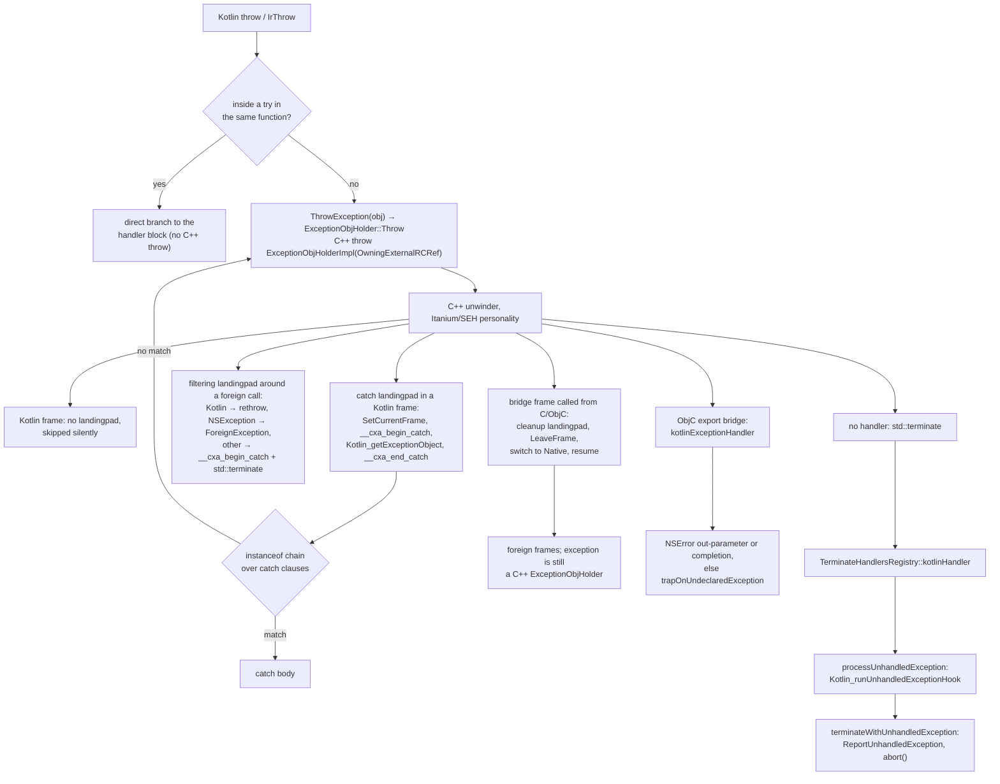
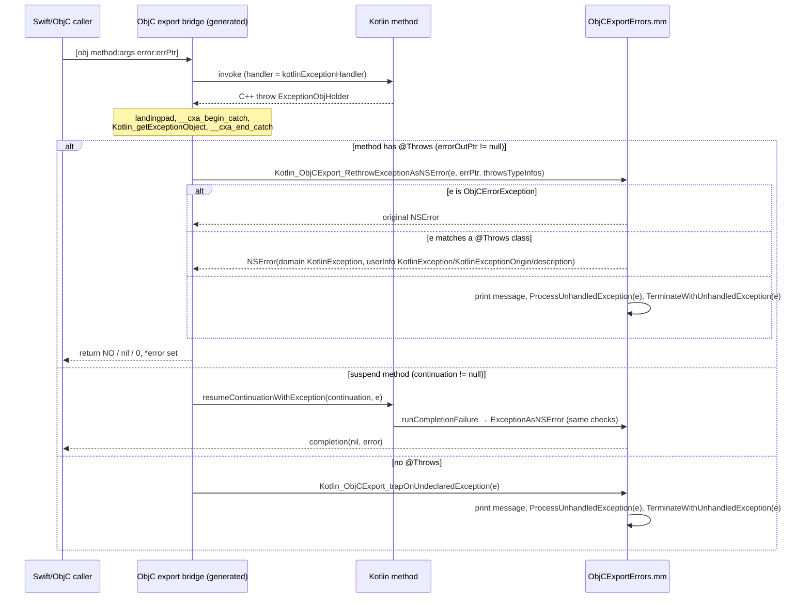

# Kotlin/Native: exceptions, unwinding and stack traces

A Kotlin `throw` in Kotlin/Native is a C++ `throw` of a small holder object that owns the Kotlin `Throwable` as a GC root; the
unwinder is the platform C++ one (Itanium ABI, or the SEH flavour on MinGW), Kotlin `catch` clauses are LLVM `landingpad`s that
extract the Kotlin object and run `instanceof` checks, and `finally` does not exist at codegen time. Everything else — what
happens at an interop boundary, how a Kotlin exception becomes an `NSError` or a Swift `Error`, when the process terminates and
what it prints, and how `Throwable.stackTrace` is captured and symbolicated — is built on top of that one decision. This page
traces the whole path: codegen, runtime, interop and export, termination, stack traces, and the tests that pin each piece down.

**Read this when…** a Kotlin exception crashes instead of being caught, a `try`/`catch` around an interop call does not catch,
the program terminates with `Uncaught Kotlin exception` from an unexpected thread, an exported method traps instead of returning
an `NSError`, a stack trace is empty, wrong or missing frames, or you change anything in `IrToBitcode.kt`/`CodeGenerator.kt`
that emits `invoke`/`landingpad`, or in `Exceptions.cpp`/`StackTrace.cpp`.

Related pages: [llvm-codegen.md](llvm-codegen.md) (function skeleton, calls, `invoke` vs `call`),
[compiler-runtime-contract.md](compiler-runtime-contract.md) (shadow stack, thread states, runtime entry points),
[cinterop.md](cinterop.md) and [export.md](export.md) (bridges), [static-initializers.md](static-initializers.md) (initializer
failure state machine), [runtime.md](runtime.md) (thread registry, `CalledFromNativeGuard`), `debug-info.md` (DWARF, written in
parallel) and `coroutines.md` (suspend lowering, written in parallel).

Paths below: BACKEND = `kotlin-native/backend.native/compiler/ir/backend.native/src/org/jetbrains/kotlin/backend/konan/`,
RUNTIME = `kotlin-native/runtime/src/`.

## Key concepts

| Term | Meaning |
|------|---------|
| `ExceptionObjHolder` | The C++ exception type that carries a Kotlin exception. Abstract base with a virtual destructor ([Memory.h](../../kotlin-native/runtime/src/main/cpp/Memory.h)); the only implementation, `ExceptionObjHolderImpl`, holds an `mm::OwningExternalRCRef` to the `Throwable` ([ExceptionObjHolder.cpp](../../kotlin-native/runtime/src/main/cpp/mm/ExceptionObjHolder.cpp)). Its RTTI symbol `_ZTI18ExceptionObjHolder` is what generated landing pads filter on. |
| Personality | `__gxx_personality_v0`, or `__gxx_personality_seh0` on `MINGW_X64` ([ContextUtils.kt](../../kotlin-native/backend.native/compiler/ir/backend.native/src/org/jetbrains/kotlin/backend/konan/llvm/ContextUtils.kt) `personalityFunctionName`). Every Kotlin function that has a landing pad uses the C++ personality, so Kotlin frames are ordinary C++ frames to the unwinder. |
| `ExceptionHandler` | Codegen's per-call-site answer to "where does an exception go": `None` (callee cannot throw), `Caller` (propagate; use the function's `cleanup_landingpad` if it has one), `Local(unwind)` (a block in this function) ([CodeGenerator.kt](../../kotlin-native/backend.native/compiler/ir/backend.native/src/org/jetbrains/kotlin/backend/konan/llvm/CodeGenerator.kt)). `genThrow` on any handler emits the `ThrowException` runtime call. |
| `CatchScope` | The `CodeContext` for one `IrTry` with catches; lazily creates one `landingpad` block and one handler block per `try` ([IrToBitcode.kt](../../kotlin-native/backend.native/compiler/ir/backend.native/src/org/jetbrains/kotlin/backend/konan/llvm/IrToBitcode.kt)). |
| Cleanup landing pad | A `landingpad … cleanup` block that only pops the shadow-stack frame (and switches the thread state back for bridges) and `resume`s. Emitted only for functions that foreign code may call (`needCleanupLandingpadAndLeaveFrame`). |
| Filtering handler | `filteringExceptionHandler`: the landing pad placed around calls into foreign code. Kotlin exceptions pass, `NSException` may be wrapped, everything else terminates. |
| `ForeignExceptionMode` | `terminate` (default) or `objc-wrap`; a cinterop klib manifest property and the argument of the internal `@FilterExceptions(mode)` annotation ([native/utils Exceptions.kt](../../native/utils/src/org/jetbrains/kotlin/konan/Exceptions.kt), [Annotations.kt](../../kotlin-native/runtime/src/main/kotlin/kotlin/native/internal/Annotations.kt)). |
| `ForeignException` | `kotlinx.cinterop.ForeignException(nativeException)`: the Kotlin wrapper of a caught `NSException` in `objc-wrap` mode ([ForeignException.kt](../../kotlin-native/Interop/Runtime/src/native/kotlin/kotlinx/cinterop/ForeignException.kt)). |
| Unhandled exception hook | `kotlin.native.setUnhandledExceptionHook` ([Runtime.kt](../../kotlin-native/runtime/src/main/kotlin/kotlin/native/Runtime.kt)); stored in `UnhandledExceptionHookHolder.hook`, run by `Kotlin_runUnhandledExceptionHook` ([RuntimeUtils.kt](../../kotlin-native/runtime/src/main/kotlin/kotlin/native/internal/RuntimeUtils.kt)). |
| Terminate handler registry | `TerminateHandlersRegistry` in [Exceptions.cpp](../../kotlin-native/runtime/src/main/cpp/Exceptions.cpp): a LIFO stack of `std::terminate_handler`s; the Kotlin handler unwraps `ExceptionObjHolder` and delegates everything else to the previous handler. |
| Stack trace | `Throwable.stackTrace: NativePtrArray` of return addresses captured in the primary constructor ([Throwable.kt](../../kotlin-native/runtime/src/main/kotlin/kotlin/Throwable.kt)); strings are produced lazily. |
| `SourceInfo` | `{fileName, lineNumber, column, nodebug}` for one (possibly inlined) frame ([SourceInfo.h](../../kotlin-native/runtime/src/main/cpp/SourceInfo.h)); provided by the `sourceInfoType` implementation selected at link time. |
| `@Throws` / `effectiveThrowsClasses` | The exception classes an exported method may propagate as `NSError`; taken from the topmost overridden declaration, `CancellationException` for `suspend` without `@Throws` ([ObjCExportCodeGenerator.kt](../../kotlin-native/backend.native/compiler/ir/backend.native/src/org/jetbrains/kotlin/backend/konan/llvm/objcexport/ObjCExportCodeGenerator.kt)). |

## Design in one paragraph

Kotlin/Native reuses the C++ exception machinery instead of implementing its own unwinder: a throw allocates a C++ exception
object whose payload is a strong reference to the Kotlin `Throwable`, and the libc++abi/libgcc unwinder walks the frames using
the same `.eh_frame`/`.gcc_except_table` data clang emits for C++. Ordinary Kotlin frames have **no** landing pads at all: there
is nothing to destruct, and the GC shadow stack is repaired in bulk by the catching frame (`SetCurrentFrame`) rather than popped
frame by frame. The price is that Kotlin frames cannot run code during unwinding, that every boundary with foreign code must be
guarded explicitly (filtering handler on the way out, cleanup landing pad on the way in), and that foreign C++ exceptions are
never allowed to pass through Kotlin code — they terminate. Stack traces are decoupled from unwinding: they are captured eagerly by
`backtrace`/`_Unwind_Backtrace`/`RtlVirtualUnwind` when the `Throwable` is constructed, and symbolicated lazily by a pluggable
provider. The rationale for the C++-unwinder design is not recorded in comments or commit messages; it is the oldest part of the
backend (the `Exceptions.cpp` header is dated 2010-2017).

The life of a thrown exception, as implemented in `IrToBitcode.kt`, `CodeGenerator.kt`, `Exceptions.cpp`, `ObjCExportErrors.mm`
and `EntryPoint.kt` (the interop branches are detailed in the sections below):



## Step 1 — `throw`: from `IrThrow` to a C++ throw

`evaluateThrow` evaluates the operand and calls `currentCodeContext.exceptionHandler.genThrow(...)`
([IrToBitcode.kt](../../kotlin-native/backend.native/compiler/ir/backend.native/src/org/jetbrains/kotlin/backend/konan/llvm/IrToBitcode.kt)).
Two cases:

- **Inside a `try` of the same function** (`CatchingScope.exceptionHandler.genThrow`): no C++ throw at all — a plain branch to
  the handler block carrying the exception as the block's value ("use local jump instead of wrapping to C++ exception, throwing,
  catching and unwrapping it"). This is why a `throw` directly in a `try` body costs nothing more than a jump.
- **Everywhere else** (`ExceptionHandler.genThrow`, [CodeGenerator.kt](../../kotlin-native/backend.native/compiler/ir/backend.native/src/org/jetbrains/kotlin/backend/konan/llvm/CodeGenerator.kt)):
  `call(llvm.throwExceptionFunction, [obj], exceptionHandler = this)` followed by `unreachable`. The call is an `invoke` whose
  unwind edge is the current handler (`callRaw`), so a throw inside a nested `try` that the *outer* `CatchScope` owns still lands
  in the right place.

The runtime side is three lines ([Exceptions.cpp](../../kotlin-native/runtime/src/main/cpp/Exceptions.cpp),
[ExceptionObjHolder.cpp](../../kotlin-native/runtime/src/main/cpp/mm/ExceptionObjHolder.cpp)): `ThrowException` asserts
(`RuntimeAssert`, so only with `-Xbinary=runtimeAssertionsMode` ≠ ignore) that the object is an instance of
`theThrowableTypeInfo`, then `ExceptionObjHolder::Throw(exception)` executes `throw ExceptionObjHolderImpl(exception)`. The
holder is the C++ exception object; its only field is an `OwningExternalRCRef`, which makes the in-flight `Throwable` a GC root
for as long as the C++ exception object lives (commit `ba4ec13ba811`, KT-67741; before that the holder used a different
reference kind). The layout, as built by `__cxa_allocate_exception` for `ExceptionObjHolderImpl`:

```
 __cxa_exception header (libc++abi private)     ExceptionObjHolderImpl (the thrown value)
 +------------------------------------------+   +----------------------------------+
 | exceptionType = &_ZTI18ExceptionObjHolder |   | vptr -> ExceptionObjHolder vtable|
 | exceptionDestructor, handlerCount, ...    |   | ref_ : mm::OwningExternalRCRef   |--> ExternalRCRef (GC root)
 | unwindHeader (_Unwind_Exception)          |   +----------------------------------+        |
 +------------------------------------------+     GetExceptionObject() = *ref_               v
                                                                                     Kotlin Throwable
 landingpad {ptr, i32}  = {&unwindHeader, typeid selector}                           (stackTrace captured in
 __cxa_begin_catch(&unwindHeader)        -> ExceptionObjHolderImpl*                   its primary constructor)
 Kotlin_getExceptionObject(holder, slot) -> Throwable, stored into a frame slot
 __cxa_end_catch()                       -> ~ExceptionObjHolderImpl, ref_ released
```

Codegen never sees the layout: it only knows the RTTI global `_ZTI18ExceptionObjHolder` (`kotlinExceptionRtti`,
imported with `importNativeRuntimeGlobal`) and the runtime accessor `Kotlin_getExceptionObject(void* holder)` which is
`RUNTIME_NOTHROW` and an `OBJ_GETTER`. The destructor is defined out of line on purpose so that the typeinfo is emitted once with
proper linkage (comment in `ExceptionObjHolder.cpp`; commit `2f8b9377fef5` says hot reload / JITLink needs it). Dynamic caches
additionally link `exceptionsSupport.bc`, whose only content is a function that references `typeid(ExceptionObjHolder)` so DCE
keeps the RTTI ([ExceptionsSupport.cpp](../../kotlin-native/runtime/src/exceptions_support/cpp/ExceptionsSupport.cpp),
[CompilerOutput.kt](../../kotlin-native/backend.native/compiler/ir/backend.native/src/org/jetbrains/kotlin/backend/konan/CompilerOutput.kt)).

**Runtime-originated exceptions.** The runtime never constructs a `Throwable` itself. [Exceptions.h](../../kotlin-native/runtime/src/main/cpp/Exceptions.h)
declares `ThrowNullPointerException`, `ThrowArrayIndexOutOfBoundsException`, `ThrowClassCastException`, `ThrowArithmeticException`,
`ThrowOutOfMemoryError`, `StaticInitializationFailure`, `ThrowRuntimeException`, … as "implemented in Kotlin"; they are
`@ExportForCppRuntime` functions in [RuntimeUtils.kt](../../kotlin-native/runtime/src/main/kotlin/kotlin/native/internal/RuntimeUtils.kt)
that simply `throw`. C++ exceptions raised inside the runtime are converted at a few chosen points with
`kotlin::wrappingCppExceptions { … }` (`std::exception` → `RuntimeException(what())`, anything else → `RuntimeException(null)`).
There is no `kotlin.native.internal.ThrowException` Kotlin entry point and no `Kotlin_terminate` symbol; the task's hints to that
effect do not match the code.

**Call sites.** `callRaw` emits `call` only if the callee is `nounwind`; otherwise it needs an unwind target. With
`ExceptionHandler.Caller` and no cleanup landing pad the result is still a plain `call` (the exception propagates through this
frame without any code running), with a cleanup landing pad it becomes an `invoke` to it, with a `Local` handler an `invoke` to
that block, and `ExceptionHandler.None` for a may-throw callee is an internal error ("No exception handler specified when calling
function X without nounwind attr"). Hence the rule in [llvm-codegen.md](llvm-codegen.md): runtime functions that cannot throw
must be `RUNTIME_NOTHROW` in C++.

## Step 2 — unwinding through Kotlin frames: landing pads and the shadow stack

The unwinder runs in two phases: search for a handler, then unwind to it running cleanups. Kotlin frames participate as
follows (`FunctionGenerationContext`, [CodeGenerator.kt](../../kotlin-native/backend.native/compiler/ir/backend.native/src/org/jetbrains/kotlin/backend/konan/llvm/CodeGenerator.kt)):

- **Plain Kotlin functions have no landing pad.** `cleanupLandingpad` exists only when `needCleanupLandingpadAndLeaveFrame`:
  `forceCleanupLandingpad`, `@ExportForCppRuntime`, or `switchToRunnable` (C-to-Kotlin bridges and `@ExportedBridge`). The
  comment says why: "Functions that can be exported and called not only from Kotlin code should have cleanup_landingpad and
  `LeaveFrame` because there is no guarantee of catching Kotlin exception in Kotlin code." Everyone else relies on the next point.
- **The shadow stack is repaired by the catcher.** Every landing pad is built by `gxxLandingpad(numClauses, switchThreadState)`,
  which, right after the `landingpad` instruction, calls `SetCurrentFrame(slotsPhi)` — the catching function's own frame — and
  records `setCurrentFrameIsCalled`. `mm::ShadowStack::SetCurrentFrame` just assigns `currentFrame_`
  ([ShadowStack.cpp](../../kotlin-native/runtime/src/main/cpp/mm/ShadowStack.cpp)), dropping every frame the unwinder skipped in
  one store. Consequently `epilogue()` forces the slots array to exist whenever a landing pad exists (`check(!setCurrentFrameIsCalled)`
  in the no-slots branch). In non-optimized builds each `catch` body starts with `generateFrameCheck()` →
  `CheckCurrentFrame(slots)`, which `RuntimeAssert`s the invariant.
- **Cleanup landing pads** (`epilogue()`): `gxxLandingpad(0)` marked `cleanup`, then `releaseVars()` → `LeaveFrame(slots, …)`,
  then `handleEpilogueExperimentalMM()` → `switchThreadState(Native)` for bridges, then `resume`. The block is deleted if no call
  in the function used it (`cleanupLangdingpadIsUsed`). `LeaveFrame` asserts that the frame being left *is* the current one
  (`ShadowStack::LeaveFrame`), which holds because the landing pad just called `SetCurrentFrame` on it.
- **Runtime code that calls back into Kotlin** uses `CurrentFrameGuard` (saves `getCurrentFrame()` and restores it in the
  destructor, [Memory.h](../../kotlin-native/runtime/src/main/cpp/Memory.h)) around `init()` in `CallInitGlobalPossiblyLock` /
  `CallInitThreadLocal` ([Runtime.cpp](../../kotlin-native/runtime/src/main/cpp/Runtime.cpp)); the generated C-export adapters do
  the same by hand: `catch (...) { SetCurrentFrame(frame); HandleCurrentExceptionWhenLeavingKotlinCode(); }`
  ([CAdapterApiExporter.kt](../../kotlin-native/backend.native/compiler/ir/backend.native/src/org/jetbrains/kotlin/backend/konan/cexport/CAdapterApiExporter.kt)).
- **Thread state.** A landing pad that may be reached while the thread is in `kNative` (the filtering handler around a call that
  switched to Native) is built with `switchThreadState = true` and switches back to `Runnable` before `SetCurrentFrame`
  (`SetCurrentFrame` asserts `kRunnable`). `call()` in `IrToBitcode.kt` enforces that a Native switch is never emitted without
  such a handler.
- **Locals and the exception object.** Reference-typed locals live in slots inside the frame's `alloca`, so values in skipped
  frames simply stop being roots when `SetCurrentFrame` cuts them off; nothing is released eagerly. The thrown object itself is
  kept alive by the holder's `OwningExternalRCRef` until `__cxa_end_catch` runs the holder's destructor; `extractKotlinException`
  therefore stores the object into a slot (`Lifetime.GLOBAL`) *between* `__cxa_begin_catch` and `__cxa_end_catch`.

What this implies for anyone adding code to a Kotlin frame's unwind path: there is none. A `finally`-like side effect during
unwinding can only be implemented by lowering it into a `catch`+rethrow (which is exactly what `FinallyBlocksLowering` does, see
Step 3) or by giving the function a cleanup landing pad (`forceCleanupLandingpad`).

## Step 3 — catching: `CatchScope`, the catch-all clause and the `instanceof` chain

`evaluateTry` asserts `finallyExpression == null` ("All finally blocks should've been lowered"): `NativeFinallyBlocksLowering`
([NativeFinallyBlocksLowering.kt](../../kotlin-native/backend.native/compiler/ir/backend.native/src/org/jetbrains/kotlin/backend/konan/lower/NativeFinallyBlocksLowering.kt),
a thin subclass of the common `FinallyBlocksLowering` parameterised with `Throwable`) runs in the lowering pipeline right after
`NativeTailrecLowering` ([NativeLoweringPhases.kt](../../kotlin-native/backend.native/compiler/ir/backend.native/src/org/jetbrains/kotlin/backend/konan/driver/phases/NativeLoweringPhases.kt))
and turns `finally` into a `catch (t: Throwable) { finally; throw t }` plus duplicated `finally` code on every normal exit
(`return`, `break`, `continue`, fall-through). A `try` without catches after lowering produces no `CatchScope` at all.

With catches, `CatchScope(catches, continuation)`:

1. **The landing pad** (`genLandingpad` → `catchKotlinException()`): `gxxLandingpad(numClauses = 1)` with the single clause
   `null`, i.e. a *catch-all*, followed by `extractKotlinException` — `__cxa_begin_catch`, `Kotlin_getExceptionObject`,
   `__cxa_end_catch`. No `typeid` check is performed: the comment says the code mirrors `catch (KotlinException& e)` "except that
   our code doesn't check exception `typeid`", with a TODO asking why clang checks it even for a single clause, and another TODO
   admits "currently C++ exception can be thrown out from try-finally bypassing the finally block". The consequence is sharper
   than the TODO suggests: a *foreign* C++ exception that reaches a Kotlin catch landing pad is treated as an `ExceptionObjHolder`
   and `Kotlin_getExceptionObject` reinterprets the foreign object's memory. This cannot happen through interop bridges, which
   filter first (Step 4); it can only happen if a `@SymbolName`/`@GCUnsafeCall` runtime function throws a C++ exception, which
   the runtime must not do (see Implied contracts).
2. **The handler** (`genHandler`): for each `IrCatch`, if the parameter type is exactly `Throwable` the body runs unconditionally
   and the remaining clauses are dropped; otherwise `genInstanceOfImpl(exception, catchClass)` guards a `catch` block, falling
   through to the next `catchCheck`. If no clause matches, `outerContext.exceptionHandler.genThrow(exception)` rethrows: either a
   branch to an enclosing `CatchScope` in the same function, or a *new* `ThrowException` call — a new `ExceptionObjHolderImpl`
   wrapping the same `Throwable` (its stack trace is unchanged, since it was captured at construction).
3. **Catch bodies** run in a fresh `VariableScope`, start with `generateFrameCheck()` and jump to the shared `continuation`
   block with the catch expression's value.

Block ordering follows IR order; the TODO at the top of `evaluateTry` notes that reordering blocks to shrink exception tables was
never investigated.

## Step 4 — the interop boundary: filtering landing pads and foreign exceptions

The private `call(function, llvmCallable, …)` wrapper in [IrToBitcode.kt](../../kotlin-native/backend.native/compiler/ir/backend.native/src/org/jetbrains/kotlin/backend/konan/llvm/IrToBitcode.kt)
decides, per call site, whether to switch the thread state and whether to install a filtering handler:

| Callee | Thread state switch | Filtering handler |
|--------|---------------------|-------------------|
| Annotated `@FilterExceptions(mode)` | per `needsNativeThreadState` | yes, with `mode` |
| `KOTLIN_TO_C_BRIDGE` / `@ImportedBridge` (`needsNativeThreadState`) without the annotation | yes | yes, `TERMINATE` |
| Name in `-Xbinary=forceNativeThreadStateForFunctions` or `@ForceNativeThreadState` (KT-75895, KT-79384) | yes | yes, annotation mode or `TERMINATE` ("quick hack") |
| Anything else (`@SymbolName`, `@GCUnsafeCall`, Kotlin functions) | no | no — `currentCodeContext.exceptionHandler` |

Where the annotation comes from: `CBridgeGenUtils.createKotlinBridge` puts `@FilterExceptions(mode.value)` on every *external*
Kotlin bridge it creates ([CBridgeGenUtils.kt](../../kotlin-native/backend.native/compiler/ir/backend.native/src/org/jetbrains/kotlin/backend/konan/cgen/CBridgeGenUtils.kt)),
and the mode is read from the callee klib's manifest property `foreignExceptionMode` by `InteropLowering` and `generateObjCCall`
([InteropLowering.kt](../../kotlin-native/backend.native/compiler/ir/backend.native/src/org/jetbrains/kotlin/backend/konan/lower/InteropLowering.kt),
[CBridgeGen.kt](../../kotlin-native/backend.native/compiler/ir/backend.native/src/org/jetbrains/kotlin/backend/konan/cgen/CBridgeGen.kt)).
`cCallMode=direct` keeps the Kotlin-side bridge (the direct symbol is aliased inside the C bridge with `__asm`), so filtering is
unaffected. The manifest property is written by the cinterop tool from the `.def` key `foreignExceptionMode` or the
`-Xforeign-exception-mode` option ([main.kt](../../kotlin-native/Interop/StubGenerator/src/org/jetbrains/kotlin/native/interop/gen/jvm/main.kt),
[CommandLine.kt](../../kotlin-native/Interop/StubGenerator/src/org/jetbrains/kotlin/native/interop/gen/jvm/CommandLine.kt));
no platform `.def` sets it ([platform-libraries.md](platform-libraries.md)). A few runtime externals carry the annotation by
hand, e.g. `runCompletionSuccess`/`runCompletionFailure` in
[ObjCExportCoroutines.kt](../../kotlin-native/runtime/src/main/kotlin/kotlin/native/internal/ObjCExportCoroutines.kt).

`filteringExceptionHandler(outer, mode, switchThreadState)` ([CodeGenerator.kt](../../kotlin-native/backend.native/compiler/ir/backend.native/src/org/jetbrains/kotlin/backend/konan/llvm/CodeGenerator.kt))
emits one `filteringExceptionHandler` block per call site:

- `gxxLandingpad(2, switchThreadState)` with clauses `_ZTI18ExceptionObjHolder`, then (Apple targets and `OBJC_WRAP` only)
  `OBJC_EHTYPE_$_NSException`, then `null`. The selector (`extractValue(landingpad, 1)`) is compared with
  `llvm.eh.typeid.for(rtti)`.
- Kotlin exception → `forwardKotlinException`: `extractKotlinException` and `outer.genThrow` (a rethrow into the real handler —
  either a local branch or a fresh C++ throw).
- `NSException` in wrap mode → `forwardNativeException`: `__cxa_begin_catch`, call the Kotlin `CreateForeignException(ptr)`
  ([ForeignException.kt](../../kotlin-native/Interop/Runtime/src/native/kotlin/kotlinx/cinterop/ForeignException.kt)) *inside* the
  catch scope ("This will take care of ARC"), `__cxa_end_catch`, then `outer.genThrow` of the new `ForeignException`. Its
  `message` is `"<name>:: <reason>"` from `Kotlin_ObjCExport_ExceptionDetails`
  ([ObjCExportExceptionDetails.mm](../../kotlin-native/runtime/src/main/cpp/ObjCExportExceptionDetails.mm)).
- Everything else → `fatalForeignException`: `terminateWithCurrentException` = `__cxa_begin_catch(record)` then `std::terminate`
  ("So `std::terminate` is called from C++ catch block" — this is what lets the terminate handler see the foreign exception as
  `std::current_exception()`), followed by an infinite loop instead of `unreachable` for the sake of debug info.

`wrapExceptionMode` is `target.family.isAppleFamily && mode == OBJC_WRAP`, so `objc-wrap` is silently `terminate` elsewhere.
There is no C++-exception wrapping at all: a `std::exception` thrown by a C++ library called through cinterop terminates.

**The other direction: Kotlin exceptions leaving Kotlin.** A Kotlin function called from C (a `staticCFunction` body, a C-export
adapter, an `@ExportForCppRuntime` function) has a cleanup landing pad, so the exception leaves the Kotlin frame with the shadow
stack and thread state restored — and continues as a C++ `ExceptionObjHolder` into the caller's frames. What happens next depends
on the caller:

- C/ObjC frames compiled without unwind tables, or a `noexcept` boundary: `std::terminate` → the Kotlin terminate handler.
- C-export adapters catch it immediately and call `HandleCurrentExceptionWhenLeavingKotlinCode`, which rethrows and
  `std::terminate`s if it is an `ExceptionObjHolder` (a non-Kotlin exception would propagate out of this `RUNTIME_NORETURN`
  function — unreachable in practice because the adapter only called Kotlin code).
- A C++ caller may catch it and rethrow it anywhere, including on a thread never attached to the runtime; the terminate handler is
  written for that case (`CalledFromNativeGuard(reentrant)`, comment in `kotlinHandler`, and the test
  `standalone/termination/unhandledExceptionInForeignThread.kt`, which rethrows through `std::future::get()`).
- cinterop-generated C stubs for Objective-C libraries wrap their own body in `@try { … } @catch (id e) { objc_terminate(); }`
  ([SimpleBridgeGeneratorImpl.kt](../../kotlin-native/Interop/StubGenerator/src/org/jetbrains/kotlin/native/interop/gen/SimpleBridgeGeneratorImpl.kt))
  — an older mechanism for the stubs the tool itself emits (with a TODO to move it into the bitcode generator); ObjC *method*
  calls go through compiler-generated bridges and the filtering handler above.

## Step 5 — the ObjC/Swift export bridge

The exported bridge decides at compile time how a Kotlin exception leaves, from the method's bridge shape
(`bridgeMethodImpl`, [ObjCExportMapper.kt](../../native/objcexport-header-generator/impl/k1/src/org/jetbrains/kotlin/backend/konan/objcexport/ObjCExportMapper.kt)):
`doesThrow(method)` is true iff some *topmost* overridden declaration has `@Throws`, and then the return bridge becomes
`WithError.Success` (Unit/Nothing → `BOOL`) or `WithError.ZeroForError(success, successMayBeZero)`; `suspend` functions get
`ReturnValue.Suspend` with a completion block. The frontend guarantees the shape is consistent
([FirNativeThrowsChecker.kt](../../compiler/fir/checkers/checkers.native/src/org/jetbrains/kotlin/fir/analysis/native/checkers/FirNativeThrowsChecker.kt):
`THROWS_LIST_EMPTY`, `INCOMPATIBLE_THROWS_OVERRIDE`, `INCOMPATIBLE_THROWS_INHERITED`, `MISSING_EXCEPTION_IN_THROWS_ON_SUSPEND` —
a `suspend` `@Throws` list must contain `CancellationException` or a supertype).

The sequence, as generated by `generateObjCImp` in
[ObjCExportCodeGenerator.kt](../../kotlin-native/backend.native/compiler/ir/backend.native/src/org/jetbrains/kotlin/backend/konan/llvm/objcexport/ObjCExportCodeGenerator.kt)
and implemented in [ObjCExportErrors.mm](../../kotlin-native/runtime/src/main/cpp/ObjCExportErrors.mm):



Details worth knowing:

- `kotlinExceptionHandler { … }` is a `Local` handler whose landing pad is `catchKotlinException()` — the same catch-all clause as
  Step 3. Foreign exceptions cannot arrive there because every call out of Kotlin is filtered.
- `generateExceptionTypeInfoArray(baseMethod)` emits a null-terminated `TypeInfo*[]` of `effectiveThrowsClasses`: the `@Throws`
  of the first overridden symbol recursively, `[CancellationException]` for a lowered suspend function without `@Throws`, empty
  if the annotation is missing (tolerated because "linking different versions of libraries" can violate the frontend rule).
- `Kotlin_ObjCExport_ExceptionAsNSError` first checks `Kotlin_ObjCExport_getWrappedError`: an `ObjCErrorException` (a Kotlin
  wrapper of an `NSError` that previously crossed *into* Kotlin, [ObjCExportUtils.kt](../../kotlin-native/runtime/src/main/kotlin/kotlin/native/internal/ObjCExportUtils.kt))
  is unwrapped to the original `NSError` without consulting the `@Throws` list. Otherwise `IsSubtype` against the list; on
  failure it prints "Exception doesn't match @Throws-specified class list …" and terminates through the standard path.
- `Kotlin_ObjCExport_WrapExceptionToNSError` builds `NSError(domain: "KotlinException", code: 0)` with `userInfo`
  `KotlinException` = the Kotlin object as an ObjC reference, `KotlinExceptionOrigin` = the address of a static `char`
  ("Support for different Kotlin runtimes loaded") and `NSLocalizedDescriptionKey` = `message` if non-null. The same function
  backs the exported `Throwable.asError()` method (`createThrowableAsErrorAdapter`, selector `asError`), and an
  `NSError (NSErrorKotlinException)` category adds `-kotlinException`.
- **Reverse direction** (an ObjC/Swift override of a `@Throws` Kotlin method fails): the Kotlin-to-ObjC bridge reads `*error` and
  calls `Kotlin_ObjCExport_NSErrorAsException`, which returns the wrapped Kotlin exception if `KotlinExceptionOrigin` matches
  this runtime, else `ObjCErrorException(localizedDescription, error)`, and rethrows with `ExceptionHandler.Caller.genThrow`.
  The `objc_msgSend` itself is invoked with `terminatingExceptionHandler` (a cleanup landing pad that calls
  `terminateWithCurrentException`), so an *ObjC exception* thrown by Swift/ObjC code called from Kotlin always terminates; blocks
  called from Kotlin behave the same ([BlockPointerSupport.kt](../../kotlin-native/backend.native/compiler/ir/backend.native/src/org/jetbrains/kotlin/backend/konan/llvm/objcexport/BlockPointerSupport.kt)).
- `Kotlin_ObjCExport_createContinuationArgument` builds the continuation for an exported `suspend` function with
  `EmptyCompletion` as its completion; if the continuation is resumed with a failure after the callback already ran,
  `EmptyCompletion.resumeWith` calls `processUnhandledException` and then `terminateWithUnhandledException` unconditionally
  ("throwing the exception from [resumeWith] is not generally expected").
- **Swift export** (the new, non-ObjC path) handles this in generated Kotlin: when the SIR function has an error type
  (`throwsAnnotation != null || isAsync`, [SirFunctionFromKtSymbol.kt](../../native/swift/sir-light-classes/src/org/jetbrains/sir/lightclasses/nodes/SirFunctionFromKtSymbol.kt))
  the Kotlin bridge body is `try { … } catch (error: Throwable) { __error.value = StableRef.create(error).asCPointer(); return
  default }` ([SirBridgeProviderImpl.kt](../../native/swift/sir-providers/src/org/jetbrains/kotlin/sir/providers/impl/BridgeProvider/SirBridgeProviderImpl.kt)),
  and the Swift side `raiseKotlinError` throws the wrapped `KotlinError` (or the original boxed Swift `Error`)
  ([KotlinRuntimeSupport.swift](../../native/swift/swift-export-standalone/resources/swift/KotlinRuntimeSupport.swift)). Without
  `@Throws` there is no `catch`, so the exception leaves the C bridge as a C++ exception into Swift frames — **Unverified:** which
  handler then reports it (expected: the terminate handler, since Swift frames have no C++ cleanups).

## Step 6 — unhandled exceptions and termination

There is no "unhandled Kotlin exception" state in the runtime; there are four places where a Kotlin exception becomes unhandled,
and they converge on two C++ functions in [Exceptions.cpp](../../kotlin-native/runtime/src/main/cpp/Exceptions.cpp):

```
processUnhandledException(e)          // asserts kRunnable
  try   Kotlin_runUnhandledExceptionHook(e)    // hook == null: `throw e` (a fresh C++ throw of the same object)
                                               // hook != null: hook(e); return normally
  catch (ExceptionObjHolder& h) -> terminateWithUnhandledException(h.obj)   // e itself, or the hook's own exception

terminateWithUnhandledException(e)    // asserts kRunnable
  concurrentTerminateWrapper {
    ReportUnhandledException(e)                // "Uncaught Kotlin exception: " + e.printStackTrace()
    konan::consoleFlush(); std::abort()
  }
```

`concurrentTerminateWrapper` is a function object with a `std::recursive_mutex`: the first thread to terminate runs the block
(and `std::abort()`s if the block ever returns); any other thread that reaches termination concurrently sleeps `timeoutSec = 5`
seconds in `kNative` and then `_Exit(EXIT_FAILURE)` ("if the terminate handler hangs for 5 sec it is probably fatally broken").
The public Kotlin API maps onto this: `processUnhandledException` → `Kotlin_processUnhandledException`,
`terminateWithUnhandledException` → `Kotlin_terminateWithUnhandledException` (both require `kRunnable`), and the C++ wrappers
`kotlin::ProcessUnhandledException` / `kotlin::TerminateWithUnhandledException` do a reentrant switch to `kRunnable` first so
they can be called from any state.

| Where the exception becomes unhandled | What runs | Evidence |
|---------------------------------------|-----------|----------|
| `main` (program) | `Konan_start` is a generated Kotlin function `try { main(args); return 0 } catch (e: Throwable) { processUnhandledException(e); terminateWithUnhandledException(e) }` ([EntryPoint.kt](../../kotlin-native/backend.native/compiler/ir/backend.native/src/org/jetbrains/kotlin/backend/konan/EntryPoint.kt)); the launcher's `Konan_main` → `Init_and_run_start` → `Konan_run_start` → `Konan_start` ([launcher.cpp](../../kotlin-native/runtime/src/launcher/cpp/launcher.cpp)). The hook runs, then the process terminates regardless. | `standalone/termination/mainThrow.kt`, `unhandledExceptionHook*.kt` |
| Any thread, no Kotlin handler at all (foreign frames, eager/global initializers that run inside `initRuntime` before `Konan_start`, exceptions rethrown by C++ code) | `std::terminate` → `TerminateHandlersRegistry::kotlinHandler`: rethrows `std::current_exception()`; `ExceptionObjHolder` → `CalledFromNativeGuard(reentrant)` → `processUnhandledException` → `terminateWithUnhandledException`; anything else → `queuedHandler` → pops and calls the previously installed handler (LIFO) under `concurrentTerminateWrapper`; no current exception → previous handler too. | `globalThrow.kt` (`val p: Nothing = throw Error(...)` prints `Uncaught Kotlin exception`), `unhandledExceptionInForeignThread.kt`, gtests `TerminationThreadStateDeathTest.*`, `SetKonanTerminateHandlerDeathTest.ChainedMockHandlers_CalledInLIFOOrder` |
| `Worker.executeAfter` job | `catch (ExceptionObjHolder&)` → `kotlin::ProcessUnhandledException` (hook or terminate) unless the worker was started with `errorReporting = false` (`WorkerExceptionHandling::kIgnore`) ([Worker.cpp](../../kotlin-native/runtime/src/main/cpp/Worker.cpp)) | `unhandledExceptionInWorkerExecuteAfter*.kt` |
| `Worker.execute` job | `ReportUnhandledException` only — prints the trace, does **not** terminate and does **not** run the hook; the future completes with `ok = false` (TODO: "Pass exception object into the future"). `kIgnore` prints nothing. | `unhandledExceptionInWorkerExecute*.kt` |
| Lazy static initializer | caught in `CallInitGlobalPossiblyLock`/`CallInitThreadLocal`, state → `FILE_FAILED_TO_INITIALIZE`, rethrown as `StaticInitializationFailure` ([static-initializers.md](static-initializers.md)) | |
| ObjC export without `@Throws`, `@Throws` mismatch, suspend completion already run | `trapOnUndeclaredException` / `ExceptionAsNSError` / `EmptyCompletion`: message, `ProcessUnhandledException`, `TerminateWithUnhandledException` (Step 5) | `framework/objcexport/throwsEmpty.kt` |
| ObjC exception escaping ObjC code called from Kotlin | `terminatingExceptionHandler` → `std::terminate` → `kotlinHandler` sees a non-Kotlin exception → previous handler (the ObjC runtime's, which calls `NSSetUncaughtExceptionHandler` hooks) | `unhandledObjCAllocationException.kt` expects `Hook` then `*** +[NSJSONSerialization allocWithZone:]` |

**Terminate handler installation.** `SetKonanTerminateHandler()` is called by *every* `initRuntime()`
([Runtime.cpp](../../kotlin-native/runtime/src/main/cpp/Runtime.cpp)) — i.e. once per thread that attaches — and again by
`setUnhandledExceptionHook` through `Kotlin_updateTerminateHandler`. Each call `std::set_terminate`s the Kotlin handler and pushes
the previous handler onto `previousHandlers_`. The second trigger exists for crash reporters (commit `f442c4f01d85`,
KT-86576): if Crashlytics installs its C++ terminate handler after the runtime, it would see a useless `ExceptionObjHolder` first;
reinstalling on hook update puts the Kotlin handler back on top so the hook (e.g. NSExceptionKt) reports the unwrapped
`Throwable`. The stack therefore usually contains the Kotlin handler itself many times; `queuedHandler` pops through them until it
reaches a foreign one (each pop re-enters `kotlinHandler`, which finds no Kotlin exception and pops again).

**What is printed.** `ReportUnhandledException` prints `Uncaught Kotlin exception: ` and then `Throwable.printStackTrace()`
([RuntimeUtils.kt](../../kotlin-native/runtime/src/main/kotlin/kotlin/native/internal/RuntimeUtils.kt)), whose format is in Step 7.
Note the streams: the prefix goes through `kotlin.io.print` → `Kotlin_io_Console_print` → `konan::consoleWriteUtf8` (stdout,
[Console.kt](../../kotlin-native/runtime/src/main/kotlin/kotlin/io/Console.kt), [Console.cpp](../../kotlin-native/runtime/src/main/cpp/Console.cpp)),
while `printStackTrace` writes every line with `printlnToStdErr` (stderr). A consumer that separates the streams sees the
prefix without the trace; the standalone tests match the combined output.
`-Xbinary=runtimeAssertionsMode` is unrelated to this path: it only enables the `RuntimeAssert`s (`ThrowException`'s type check,
`AssertThreadState`, `CheckCurrentFrame`). No binary option changes termination behaviour. The only other reporting channel,
`ReportBacktraceToIosCrashLog` (writes raw addresses into CoreFoundation's `__cf_except_bt` section,
[ObjCExceptions.cpp](../../kotlin-native/runtime/src/main/cpp/ObjCExceptions.cpp)), is compiled under
`KONAN_REPORT_BACKTRACE_TO_IOS_CRASH_LOG`, which no build file defines any more (the definitions were removed from
`konan.properties` in commit `de1dd47ab10a` and from CMake in `2a395ad9c5fe`): it is dead code, together with its only consumer of
`Kotlin_Throwable_getStackTrace`.

## Step 7 — stack traces: capture, symbolication, format

**Capture.** `Throwable`'s primary constructor initialises `private val stackTrace: NativePtrArray = getCurrentStackTrace()`
([Throwable.kt](../../kotlin-native/runtime/src/main/kotlin/kotlin/Throwable.kt)) → `Kotlin_getCurrentStackTrace`
([Natives.cpp](../../kotlin-native/runtime/src/main/cpp/Natives.cpp)): switches to `kNative` with a `ThreadStateGuard` ("Don't
use `kotlin::CallWithThreadState` to avoid messing up callstack"), calls `StackTrace<>::current(2)` ("Skip this function and
primary `Throwable` constructor") and copies the addresses into a `NativePtrArray`. So every `Throwable` construction walks the
whole stack, in debug and release alike, before any `message` is even stored — this is the cost that makes exceptions expensive in
K/N, and it is paid even for exceptions used as control flow. The unwinder used ([StackTrace.cpp](../../kotlin-native/runtime/src/main/cpp/StackTrace.cpp),
defines set in [runtime/build.gradle.kts](../../kotlin-native/runtime/build.gradle.kts) from
[KonanTargetExtenstions.kt](../../native/utils/src/org/jetbrains/kotlin/konan/target/KonanTargetExtenstions.kt)):

| Targets | Mechanism | Depth limit |
|---------|-----------|-------------|
| Linux, Android (`supportsGccUnwind`) | `USE_GCC_UNWIND`: `_Unwind_Backtrace` twice (count, then fill) | none |
| `MINGW_X64` (`supportsWinAPIUnwind`) | `USE_WINAPI_UNWIND`: `RtlCaptureContext` + `RtlLookupFunctionEntry` + `RtlVirtualUnwind` loop; libgcc < 12 is buggy there (KT-49240) | none |
| Apple and anything else | glibc/libSystem `backtrace()` into a fixed buffer | `GetMaxStackTraceDepth`: 128 for the heap-allocated `StackTrace<>`, 32 for the fixed-capacity variant used by the runtime's own diagnostics |

Both `GetCurrentStackTrace` overloads carry the comment "this implementation is just a hack, e.g. the result is inexact; however it
is better to have an inexact stacktrace than not to have any": the captured values are *return* addresses, which is why
`adjustAddressForSourceInfo` subtracts 1 before symbolication on x86/ARM non-Windows targets (and clears the Thumb bit on ARM;
commit `6d3158b275df`), so that a call at the end of a line is attributed to that line and not the next.

**Symbolication** is lazy: `stackTraceStrings by lazy { getStackTraceStrings(stackTrace) }` → `Kotlin_getStackTraceStrings` →
`kotlin::GetStackTraceStrings` in `kNative`. Per address, `getSourceInfo(addr, buffer[10])` asks the provider for up to 10
`SourceInfo`s (the inlining chain, outermost last), then prints one line per frame with `snprintf_with_addr`:

```
%-4zd%-35s %-18p %s + %td [inlined] (file:line:col)
 ^idx ^image (dladdr)  ^addr ^symbol via AddressToSymbol  ^offset   ^from SourceInfo; (file:<unknown>) or (file:line) if missing
```

Frames whose `SourceInfo.nodebug` is set are hidden; if the provider reported more frames than the buffer holds, a
`[some inlined frames skipped]` line is inserted; if nothing could be printed the bare symbol line is emitted, with the note
`<NOTE: unable to find file names and line numbers, see https://youtrack.jetbrains.com/issue/KT-85559>` once per trace when the
provider returned `-1`. Addresses `0` and `1` are dropped. `AddressToSymbol` (ExecFormat) is what yields the `kfun:…` names, so the
`kfun:` prefix in traces is a property of the symbol mangling, not of the stack trace code.

**Providers** are selected per binary, not per klib. `config.sourceInfoType`
([NativeSecondStageCompilationConfig.kt](../../kotlin-native/backend.native/compiler/ir/backend.native/src/org/jetbrains/kotlin/backend/konan/NativeSecondStageCompilationConfig.kt))
is `-Xbinary=sourceInfoType` if given, else `CORESYMBOLICATION` for debug binaries on targets with `supportsCoreSymbolication()`
(macOS and the Apple *simulator* and x64 targets — not device targets), else `NOOP`. Codegen writes the chosen function into the
weak runtime global `Kotlin_getSourceInfo_Function` (`overrideRuntimeGlobal`, [IrToBitcode.kt](../../kotlin-native/backend.native/compiler/ir/backend.native/src/org/jetbrains/kotlin/backend/konan/llvm/IrToBitcode.kt);
read by `compiler::getSourceInfo` in [CompilerConstants.cpp](../../kotlin-native/runtime/src/main/cpp/CompilerConstants.cpp),
`nullptr` means `NOOP`). The provider bitcode is linked whenever the target supports it, independent of the selection
([CompilerOutput.kt](../../kotlin-native/backend.native/compiler/ir/backend.native/src/org/jetbrains/kotlin/backend/konan/CompilerOutput.kt)):

| Provider | Targets linked | How it works | Notes |
|----------|----------------|--------------|-------|
| `coresymbolication` ([SourceInfo.cpp](../../kotlin-native/runtime/src/source_info/core_symbolication/cpp/SourceInfo.cpp)) | `supportsCoreSymbolication()` | `dlopen`s the private `CoreSymbolication.framework`, creates a symbolicator once (`static bool csIsAvailable`), `CSSymbolicatorGetSymbolOwnerWithAddressAtTime` + `CSSymbolForeachSourceInfo`; assumes the first and last source infos belong to the real symbol and the rest to inlined functions | Reads the dSYM/DWARF the OS can find; returns `-1` if unavailable (→ KT-85559 note). `-Xbinary=coreSymbolicationImageListType=only_kotlin` builds the symbolicator from the current image only (`createSymbolicatorWithCurrentImage`), a workaround for Xcode 16.3 simulators (KT-75992) that loses Swift frames' line numbers (KT-76511) |
| `libbacktrace` ([SourceInfo.cpp](../../kotlin-native/runtime/src/source_info/libbacktrace/cpp/SourceInfo.cpp)) | `supportsLibBacktrace()`: Apple, Linux, Android | `backtrace_create_state(nullptr, threaded = 1)` + `backtrace_pcinfo` on the binary's own DWARF (the `libbacktrace.bc` module); keeps the last (non-inlined) frame if the buffer overflows; stops after `result_size * 10` callbacks as corruption insurance | Never the default; `-Xbinary=sourceInfoType=libbacktrace`. Not on MinGW |
| `noop` | all | `Kotlin_getSourceInfo_Function == nullptr` → `0` frames | Default for release binaries and for all targets without a provider |

DWARF emission (`-g`, `enableDebugTransparentStepping`, `debugCompilationDir`) is covered in `debug-info.md`; `[inlined]` lines
require the provider to see inline debug info, and a function removed by the pre-codegen inliner is simply absent
([pre-codegen-inliner.md](pre-codegen-inliner.md), KT-84000 protects only `main`). `-Xbinary=disableMmap` belongs to the
allocator and has nothing to do with stack traces.

**Printing** (`ExceptionTraceBuilder` in `Throwable.kt`): `toString()` (qualified name, `: message`), then `    at <frame>` per
string, `Caused by: ` chains, `Suppressed: ` with extra indentation, `[CIRCULAR REFERENCE, SEE ABOVE: …]` on cycles, and for
causes `... and N more common stack frames skipped` after dropping all but one of the frames shared with the top exception
(`commonStackFrames() - 1`, "leave 1 common frame to ease matching"). `printStackTrace()` writes line by line to stderr;
`stackTraceToString()` builds a string. The KDoc says the format "is not stable", but see Implied contracts. Public API around it:
`Throwable.getStackTrace(): Array<String>` and `Throwable.getStackTraceAddresses(): List<Long>`
([ThrowableExtensions.kt](../../kotlin-native/runtime/src/main/kotlin/kotlin/native/ThrowableExtensions.kt)), both
`@ExperimentalNativeApi` with a note to deprecate in favour of KT-57164.

`kotlin::DisallowSourceInfo()` (thread-local flag that makes `getSourceInfo` return 0, "not always safe to extract SourceInfo
during unhandled exception termination") has no callers; `kotlin::PrintStackTraceStderr()` is the runtime's own diagnostic helper
(signal-safe only by intention: TODO in the code).

## Coroutines

Exceptions do not unwind across suspension points; they are *values* there. `BaseContinuationImpl.resumeWith` wraps every
`invokeSuspend` in `try { … } catch (e: Throwable) { Result.failure(e) }`
([ContinuationImpl.kt](../../kotlin-native/runtime/src/main/kotlin/kotlin/coroutines/ContinuationImpl.kt)), and the Native suspend
lowering ([NativeSuspendFunctionLowering.kt](../../kotlin-native/backend.native/compiler/ir/backend.native/src/org/jetbrains/kotlin/backend/konan/lower/NativeSuspendFunctionLowering.kt),
`@PhasePrerequisites(…, FinallyBlocksLowering::class, …)`) rethrows the stored exception at the resumption point
(`irThrowIfNotNull(exceptionOrNull(result))` at the state-machine entry, `getOrThrow` after each suspension), so a `try`/`catch`
spanning a suspension works through an ordinary C++ throw inside the resumed `invokeSuspend` frame. Because the stack trace was
captured at construction, it shows the frame that *created* the exception, not the resumption chain; the `resumeWith` loop
exists precisely "to make saner and shorter stack traces on resume". The ObjC export completion path is in Step 5. The lowering
itself is in `coroutines.md`.

## Connections to other subsystems

- **Frontend:** `@Throws` consistency ([FirNativeThrowsChecker.kt](../../compiler/fir/checkers/checkers.native/src/org/jetbrains/kotlin/fir/analysis/native/checkers/FirNativeThrowsChecker.kt));
  `KonanFqNames.throws` is read again by the backend (`effectiveThrowsClasses`) and by both header generators
  (`doesThrow` / `hasThrowsAnnotation`).
- **Lowerings:** `NativeFinallyBlocksLowering` (before `NativeSuspendFunctionsLowering`), `KotlinNothingValueExceptionLowering`,
  `EntryPointPhase` (`Konan_start`), `InteropLowering`/`CBridgeGen` (where `@FilterExceptions` is attached)
  ([lowerings.md](lowerings.md)).
- **Whole-program analyses:** DataFlowIR models exceptions as a per-function `throws` variable and catch parameters as its
  consumers ([dataflow-ir.md](dataflow-ir.md)); escape analysis treats every thrown value as escaping, so exceptions are never
  stack-allocated ([escape-analysis.md](escape-analysis.md)); `CastsOptimization` assumes a `try` body may throw before any
  statement ([casts-optimization.md](casts-optimization.md)).
- **Codegen:** Steps 1–4; the function skeleton and `callRaw` are described in [llvm-codegen.md](llvm-codegen.md).
- **Runtime / GC:** the in-flight exception is a root through `OwningExternalRCRef` ([runtime.md](runtime.md),
  [compiler-runtime-contract.md](compiler-runtime-contract.md)); `SetCurrentFrame`/`LeaveFrame`/`CheckCurrentFrame` are the
  shadow-stack half of the contract; thread states must be restored on every unwind path.
- **Static initializers:** failure state machine and `StaticInitializationFailure` ([static-initializers.md](static-initializers.md));
  eager initializers escape `initRuntime` and hit the terminate handler.
- **Caches:** `EXCEPTIONS_SUPPORT` for dynamic caches ([caches.md](caches.md)); per-file caches keep `@ExportForCppRuntime` files
  (which carry cleanup landing pads) out of splitting.
- **cinterop / export:** Steps 4–5; [cinterop.md](cinterop.md), [export.md](export.md).
- **KGP / tooling:** `KotlinNativeStackTraceParser` consumes the printed format ([tooling-integration.md](tooling-integration.md));
  crash reporters consume the terminate-handler ordering (KT-86576).
- **Debug info:** `debug-info.md` for what the providers read.

## Flags and options

| Option | Default | Read in | Effect |
|--------|---------|---------|--------|
| `-Xbinary=sourceInfoType=coresymbolication\|libbacktrace\|noop` | `coresymbolication` for `-g` on `supportsCoreSymbolication()` targets, else `noop` | `NativeSecondStageCompilationConfig.sourceInfoType`; `IrToBitcode.kt` overrides `Kotlin_getSourceInfo_Function` | Which provider symbolicates `Throwable.getStackTrace()` |
| `-Xbinary=coreSymbolicationImageListType=all_loaded\|only_kotlin` | `all_loaded` | `coreSymbolicationUseOnlyKotlinImage` → runtime constant `Kotlin_CoreSymbolication_useOnlyKotlinImage` | Workaround for KT-75992 (loses Swift line numbers, KT-76511) |
| `-Xbinary=forceNativeThreadStateForFunctions=a;b` | empty | `IrToBitcode.kt` `call()` | Treats the named `@SymbolName` callees as blocking: Native state + filtering handler (`TERMINATE`) |
| `-Xbinary=runtimeAssertionsMode=ignore\|log\|panic` | `ignore` | `RuntimeAssert` macro | Enables `ThrowException`'s Throwable check, `CheckCurrentFrame`, thread-state asserts; no effect on exception semantics |
| `-Xbinary=objcExportSuspendFunctionLaunchThreadRestriction=main\|none` | unset, which behaves as `none` (`suspendFunctionsFromAnyThreadFromObjC = option != MAIN` in `NativeSecondStageCompilationConfig.kt`) | `Kotlin_ObjCExport_createContinuationArgument` | Only when set to `main`, calling an exported `suspend` function off the main thread raises an `NSException` (`NSGenericException`), which is an ObjC exception, not a Kotlin one |
| `.def` `foreignExceptionMode = terminate\|objc-wrap`, cinterop `-Xforeign-exception-mode` | `terminate` | klib manifest → `InteropLowering`, `CBridgeGen` → `@FilterExceptions` → `filteringExceptionHandler` | Wrap `NSException` as `ForeignException` (Apple targets only) |
| `@Throws(...)` on an exported declaration | none | mapper (`doesThrow`), codegen (`effectiveThrowsClasses`), Swift export (`errorType`) | `NSError**` / completion error / Swift `throws`; without it any exception traps |
| `kotlin.native.setUnhandledExceptionHook(hook)` | none | `UnhandledExceptionHookHolder`; also reinstalls the terminate handler | Runs before termination on the main thread, in `executeAfter` jobs, in the terminate handler, in export traps |
| `Worker.start(errorReporting = false)` | `true` | `WorkerExceptionHandling::kIgnore` | Silently swallows job exceptions |

Binary options such as `disableMmap`, `appStateTracking`, `minidumpLocation` do not influence exceptions. There is no option to
disable stack-trace *capture*; only symbolication can be turned off (`sourceInfoType=noop`).

## Tests and how to run them

| What | Where | Run |
|------|-------|-----|
| Language semantics of throw/catch/finally (shared with all backends) | `compiler/testData/codegen/box/exceptions/` (10 files), plus `try`/`finally` tests elsewhere in `codegen/box` | `./gradlew :native:native.tests:codegen-box:test --tests "org.jetbrains.kotlin.konan.test.blackbox.FirNativeCodegenBoxTestGenerated\$Box\$Exceptions*"` |
| Native stack trace format, inline frames, completeness per provider | `native/native.tests/testData/codegen/exceptions/` (`check_stacktrace_format_{libbacktrace,coresymbolication}.kt`, `stack_trace_inline_*.kt`, `kt49240_stack_trace_completeness.kt`, `kt37572_*.kt`, `throw_cleanup.kt`, …). They pass `-Xbinary=sourceInfoType=…` via `FREE_COMPILER_ARGS`, are `NATIVE_STANDALONE`, and most are `DISABLE_NATIVE: optimizationMode=NO/OPT` (debug only) and `targetFamily=MINGW` | `./gradlew :native:native.tests:test --tests "org.jetbrains.kotlin.konan.test.blackbox.FirNativeCodegenLocalTestGenerated\$Exceptions*"` |
| Termination: main, globals, hooks, workers, foreign thread, ObjC exception, `@Throws` traps | `native/native.tests/testData/standalone/termination/` (26 files; `EXIT_CODE: !0`, `OUTPUT_REGEX: Uncaught Kotlin exception: …`, `OUTPUT_DATA_FILE`) | `./gradlew :native:native.tests:standaloneTest` or `--tests "…FirNativeStandaloneTestGenerated\$Termination*"` |
| Foreign exceptions (`objc-wrap` vs default) | `native/native.tests/testData/interop/objc/foreignException/` (`objc_wrap.def` with `foreignExceptionMode = objc-wrap`) | `./gradlew :native:native.tests:test --tests "org.jetbrains.kotlin.konan.test.blackbox.ComplexCInteropTest.testForeignException"` (macOS) |
| ObjC export errors and stack traces across bridges | `native/native.tests/testData/framework/objcexport/{throwsEmpty,throwableAsError,coroutines,…}.kt`, `framework/stacktrace*` | `FrameworkTest.testStacktrace`, `testStacktraceBridges`, `testStacktraceByLibbacktrace`; `:native:native.tests:test --tests "…FrameworkTest*"` (macOS) |
| C export unhandled exception | `native/native.tests/testData/CExport/InterfaceV1/unhandledException/` | `FirCExport*TestGenerated` |
| Runtime unit tests | `ExceptionsTest.cpp` (hook / terminate handler / thread-state death tests, LIFO chaining), `ExceptionObjHolderTest.cpp`, `StackTraceTest.cpp` (`DeepStackTrace` checks the 128/32 limits) | `./gradlew :kotlin-native:runtime:hostRuntimeTests -Pgtest_filter='Exception*:StackTrace*:SetKonanTerminateHandler*'` |

Useful test knobs: `-Pkn.optimizationMode=OPT` (most stack-trace tests are skipped), `-Pkn.useThreadStateChecker=true` (catches
a missing state switch on an unwind path), `-Pkn.nativeHome=<dist>` to skip the dist rebuild. Test mechanics are canonical in
[HACKING.md](../../kotlin-native/HACKING.md#testing).

## Typical bugs and how to investigate

| Symptom | Likely cause | First moves |
|---------|--------------|-------------|
| `catch (e: Throwable)` around an interop call does not catch; process prints a foreign exception and aborts | foreign (C++/ObjC) exception at a filtering landing pad in `terminate` mode | Check the callee klib's manifest `foreignExceptionMode`; on Apple try `objc-wrap`; C++ exceptions can never be caught — wrap the C++ side |
| `Uncaught Kotlin exception` with `Runnable state: false`, or a `wrong thread state` assert on an exception path | a Native switch without a filtering handler, or a landing pad without `switchThreadState` | `-Xbinary=checkStateAtExternalCalls=true`, `-Pkn.useThreadStateChecker=true`; look at the `invoke … to label %filteringExceptionHandler` in `-Xsave-llvm-ir-after=Codegen` |
| `Frame is expected to be X, but current frame is Y` (`CheckCurrentFrame`) in debug | a landing pad that did not call `SetCurrentFrame`, or runtime code calling Kotlin without `CurrentFrameGuard` | `-Xbinary=runtimeAssertionsMode=panic`; find the catch in LLVM IR; every `landingpad` must be followed by `SetCurrentFrame` |
| "No exception handler specified when calling function X without nounwind attr" at compile time | runtime function not `RUNTIME_NOTHROW`, or codegen passed `ExceptionHandler.None` | see [llvm-codegen.md](llvm-codegen.md) |
| Exported method terminates with "Function doesn't have or inherit @Throws annotation …" / "Exception doesn't match @Throws-specified class list …" | missing `@Throws`, or thrown class not in the *topmost* override's list | `effectiveThrowsClasses` uses `overriddenSymbols.first()`; `suspend` needs `CancellationException` in the list |
| `NSError` arrives but `userInfo[KotlinException]` is not the Kotlin object | exception originated from ObjC (`ObjCErrorException` unwrapped) or another Kotlin runtime (`KotlinExceptionOrigin` mismatch) | `Kotlin_ObjCExport_NSErrorAsException` / `ExceptionAsNSError` in `ObjCExportErrors.mm` |
| Stack trace lines have no `(file:line)` | `sourceInfoType=noop` (release, MinGW, device targets by default), stripped dSYM, CoreSymbolication unavailable (`KT-85559` note printed) | `-Xbinary=sourceInfoType=libbacktrace` with `-g`; `coreSymbolicationImageListType=only_kotlin` for simulators |
| Stack trace is empty or truncated | `backtrace()` depth limit (128) on Apple; `skipFrames` ≥ depth; frame-pointer-less foreign frames | compare `getStackTraceAddresses()` size; on Linux/Android the GCC unwinder has no limit |
| Missing frames | inlining (`[inlined]` needs inline debug info and a provider), pre-codegen inliner, trampolines | [pre-codegen-inliner.md](pre-codegen-inliner.md); `-Xbinary=preCodegenInlineThreshold=0` |
| Exception in a `Worker.execute` job disappears | by design: only `ReportUnhandledException` (print) and a failed future; with `errorReporting = false` not even that | `Future.consume` / `result`; use `executeAfter` if termination/hook semantics are needed |
| Crash reporter shows `ExceptionObjHolder` instead of the Kotlin exception | handler order (KT-86576) | call `setUnhandledExceptionHook` after the reporter initialised; the call reinstalls the Kotlin handler on top |
| `Caused by:` trace shows `... and N more common stack frames skipped` hiding the interesting frame | expected: frames shared with the top exception are elided except one | read the top exception's trace |

Dumps that help: `-Xsave-llvm-ir-after=Codegen` (look for `landingpad`, `filteringExceptionHandler`, `cleanup_landingpad`,
`SetCurrentFrame`, `invoke … @ThrowException`), `-Xphases-to-dump-after=NativeFinallyBlocksLowering` (what `finally` became),
`lldb`'s `break set -E c++` to stop at every C++ throw (every Kotlin throw is one).

## Trade-offs and known limitations

- **Zero-cost on the happy path, expensive to throw.** No code runs in plain Kotlin frames during unwinding and no landing pads
  are emitted for them; in exchange every throw is a C++ throw (allocation, two-phase unwind) *plus* an eager stack walk in the
  `Throwable` constructor. Exceptions-as-control-flow are therefore much slower than on the JVM, and the cost is independent of
  whether the trace is ever printed.
- **Foreign exceptions terminate.** Only `NSException` on Apple targets can be wrapped; C++ exceptions and Windows SEH cannot be
  caught in Kotlin, and a Kotlin exception that escapes into foreign code is only ever rescued by the terminate handler.
- **Catch-all landing pads.** Kotlin `catch` and `kotlinExceptionHandler` do not check `typeid`; correctness depends entirely on
  the filtering handlers at the boundary and on the runtime never throwing C++ exceptions into generated code.
- **The terminate handler is global process state** shared with every other C++/ObjC component; the registry's LIFO design and
  the reinstall-on-hook workaround are a compromise with third-party crash reporters.
- **Symbolication is platform-bound**: CoreSymbolication is a private framework available on hosts/simulators only, libbacktrace
  needs DWARF in the binary, MinGW has neither; `[inlined]` fidelity differs between providers (the test data has separate
  `_libbacktrace`/`_coresymbolication` variants).
- **`Worker.execute` swallows exceptions** (print only) — a known TODO in `Worker.cpp`.
- **Depth limits** (128 frames on Apple) and return-address imprecision are accepted ("better to have an inexact stacktrace than
  not to have any").

## Implied contracts

- **Generated code assumes the runtime never throws a C++ exception into it.** A `@SymbolName`/`@GCUnsafeCall` callee that throws
  `std::bad_alloc` or any non-`ExceptionObjHolder` exception reaches a catch-all landing pad and `Kotlin_getExceptionObject`
  reinterprets it. Enforced by: nothing (`wrappingCppExceptions` is applied by hand at a few call sites).
- **The unwinder assumes Kotlin frames need no cleanup.** Any future Kotlin-side resource that must be released during unwinding
  (locks, native handles in frames) breaks silently unless the function gets `forceCleanupLandingpad`. Enforced by: nothing.
- **Every landing pad calls `SetCurrentFrame` on its own frame, and every function with a landing pad has a slots array.** The
  GC's root set after a catch depends on it. Enforced by: `check(!setCurrentFrameIsCalled)` in `epilogue()` and
  `CheckCurrentFrame` in debug builds only.
- **Every `switchThreadState(Native)` has a matching switch on the unwind path.** Enforced by: the `check` in `IrToBitcode.call()`
  for codegen'd calls; by convention in handwritten bridges (`terminatingExceptionHandler` comments say the switch back "is not
  required" because they terminate).
- **`_ZTI18ExceptionObjHolder`, `__cxa_begin_catch`, `__cxa_end_catch`, `_ZSt9terminatev`, the personality names and the
  `{ptr, i32}` landing pad type are stable ABI** between generated code (including caches built with another runtime version)
  and the runtime/libc++abi. Enforced by: `ExceptionsSupport.cpp` keeping the RTTI alive; otherwise link errors.
- **`Kotlin_getSourceInfo_Function`, `Kotlin_getSourceInfo_libbacktrace`, `Kotlin_getSourceInfo_core_symbolication`,
  `Kotlin_CoreSymbolication_useOnlyKotlinImage`** are overridable runtime globals whose names are duplicated in
  `NativeRuntimeOverridableConstants.kt` and `CompilerConstants.cpp`. Enforced by: nothing.
- **Crash reporters and the KGP test runner parse the printed format**: `Uncaught Kotlin exception: <toString>` followed by
  `    at N  image 0xaddr kfun:… + off (file:line:col)` lines, `Caused by:`, `Suppressed:`
  ([KotlinNativeStackTraceParser.kt](../../libraries/tools/kotlin-gradle-plugin/src/common/kotlin/org/jetbrains/kotlin/gradle/targets/native/internal/KotlinNativeStackTraceParser.kt)
  requires at least six whitespace-separated components before `(`). The KDoc declares the format unstable. Enforced by:
  `check_stacktrace_format_*.kt` (shape of the location suffix only) and the KGP parser's own unit test.
- **Crash reporters assume the Kotlin terminate handler is the outermost one** so they receive the unwrapped `Throwable` through
  the hook (KT-86576). Enforced by: the reinstall in `setUnhandledExceptionHook`; nothing if the reporter installs later.
- **ObjC export assumes `@Throws` lists are consistent across overrides** (frontend rule) and tolerates missing annotations only
  as an empty list — which then traps on *any* exception. Enforced by: `FirNativeThrowsChecker` at compile time of each module,
  not at link time.
- **`NSError` round-tripping assumes `userInfo["KotlinExceptionOrigin"]` identifies the runtime instance**
  (`&kotlinExceptionOriginChar`), so two Kotlin frameworks in one process never unwrap each other's objects. Enforced by:
  nothing beyond the check itself.
- **kotlinx.coroutines and user code assume the stack trace is captured at `Throwable` construction and never recomputed** (the
  `resumeWith` loop comment relies on it). **Unverified:** kotlinx.coroutines' own expectations are not in this repository.
- **`Kotlin_getCurrentStackTrace` assumes exactly two service frames above it** (`current(2)`: itself and the primary
  constructor); inlining or outlining in `Throwable.kt` or `Natives.cpp` shifts the trace. Enforced by:
  `kt49240_stack_trace_completeness.kt`, which expects `kotlin.Throwable#<init>(kotlin.String?)` as the first `kfun:` frame.
- **Static initializers rely on `CurrentFrameGuard`** around `init()` because the Kotlin initializer function has no cleanup
  landing pad. Enforced by: `CheckCurrentFrame` in debug.

## Open questions

- Why do Kotlin catch landing pads use a catch-all clause without a `typeid` check, and is the "C++ exception can be thrown out from
  try-finally bypassing the finally block" TODO still considered acceptable? (No commit message or issue found.)
- Is `KONAN_REPORT_BACKTRACE_TO_IOS_CRASH_LOG` meant to be revived (its last definition was removed with the deprecated-target
  cleanup), or should `ObjCExceptions.cpp`/`.h` and the `Kotlin_Throwable_getStackTrace` export be deleted?
- `DisallowSourceInfo()` has no callers: is symbolication during termination considered safe now, or was the call lost?
- `SetKonanTerminateHandler` is invoked by every `initRuntime` (per attached thread); the registry grows by one entry per thread
  and `queuedHandler` pops through Kotlin handlers to reach a foreign one. Intended, or should installation be once per process
  plus the hook-update reinstall?
- `Worker.execute` only prints the exception (TODO in `Worker.cpp`); is attaching it to the `Future` still planned?
- Swift export without `@Throws`: which component reports the escaping C++ exception, and is the message the same as the ObjC
  export trap?
- `objc-wrap` silently degrades to `terminate` on non-Apple targets; should the compiler warn?
- Is the `backtrace()` depth limit of 128 (`GetMaxStackTraceDepth`) ever hit in practice on Apple targets, and should libunwind be
  used there as on Linux?
