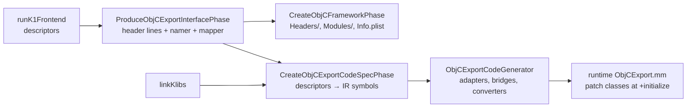

# Kotlin/Native: exporting Kotlin to Objective-C, C and Swift

How a K/N binary exposes Kotlin declarations to the outside world: Objective-C frameworks (`-produce framework`), C libraries with
a generated header (`-produce dynamic|static`), and the compiler-side support for Swift export. The user-visible model and the
reasons behind it (closed world, umbrella frameworks) are in [compilation-model.md][cm-objc]; the module map is in
[architecture.md](architecture.md). This page explains the mechanics: what gets exported, how a header, an IR "code spec" and
LLVM bridges are kept consistent, how the runtime turns Kotlin objects into ObjC objects, and where to look when it breaks.
`BACKEND` below means `kotlin-native/backend.native/compiler/ir/backend.native/src/org/jetbrains/kotlin/backend/konan/`.

## Role and fit

Export is a second-stage concern: it runs inside `NativeCompilerDriver` ([architecture.md](architecture.md#second-stage)) between
the K1 "frontend" (descriptors for all klibs) and IR linking, and again at codegen time. It has three layers that must agree:

1. **Interface**: which declarations are visible and under which names (ObjC header; C header with a symbols struct).
2. **Spec/model**: the same declarations resolved to IR symbols (`ObjCExportCodeSpec`, `CAdapterExportedElements`).
3. **Glue**: LLVM functions and constant tables (ObjC "adapters", C `_konan_function_N` wrappers) plus the C++ runtime that
   patches ObjC classes at startup and manages object identity and lifetime across the boundary.

Swift export is *not* one of these driver paths: it is a separate Analysis-API tool ([docs/swift-export](../swift-export/README.md))
that emits Kotlin bridge code, which the compiler then compiles with a few dedicated hooks (see below).

## Terminology

| Term | Meaning |
|------|---------|
| Exported library | A klib whose *whole* public API goes into the interface: the compiled module plus `-Xexport-library` klibs (`loadedKlibs.exported`) and `-Xinclude` klibs ([FeaturedLibraries.kt][featured]). Other dependencies are only *linked*; their declarations appear only when referenced from the exported API. |
| Top-level name prefix | `abbreviate(fullExportedNamePrefix)` (module name → capital letters when ≥3, e.g. `MySharedLib` → `MSL`), prepended to ObjC class names ([ObjCExportNamer.kt `abbreviate`][namer]). With Swift export the prefix is forced to `Kotlin` ([SetupConfiguration.kt][setupconfig]). |
| Base method | A Kotlin method that overrides nothing exposed; selectors and bridges are computed per base method, overrides reuse them ([ObjCExportMapper.kt `isBaseMethod`][mapper]). |
| `MethodBridge` / `TypeBridge` | Header-generator description of how each parameter/return value crosses the boundary (reference, block pointer, value type, error out-parameter, suspend completion). Shared by the header renderer and by LLVM codegen. |
| Type adapter | `ObjCTypeAdapter` constant: per exported class/protocol, the ObjC name, Kotlin `TypeInfo`, vtable/itable copies, and lists of method adapters ([ObjCTypeAdapter.kt][typeadapter], runtime [TypeInfoObjCExportAddition.hpp][tiaddition]). |
| Direct / virtual / class / reverse adapter | ObjC→Kotlin IMPs for a final or statically resolved method, for a virtual call by selector, for class (static) methods; and Kotlin→ObjC bridges (`kotlin2objc_*`) used when an ObjC/Swift subclass overrides a Kotlin method. |
| `WritableTypeInfo` | Mutable companion of a class's `TypeInfo` holding `convertToRetained`, the ObjC `Class` and the type adapter ([WritableTypeInfo.kt][wti]). |
| Associated object | Pointer slot in `ObjHeader` linking a Kotlin object to its ObjC counterpart (wrapper or wrapped ObjC object) ([ObjCExport.h][objcexport-h]). |
| `ExternalRCRef` | Runtime handle with its own refcount; `rc > 0` keeps the Kotlin object in GC roots ([ExternalRCRef.hpp][rcref]). Backs `KotlinBase` wrappers and Swift export. |
| Symbols struct | C export API: one `<prefix>_ExportedSymbols` struct of function pointers, returned by `<prefix>_symbols()` ([CAdapterApiExporter.kt][capi]). |
| `kref` / `pinned` | C export's opaque handle: a struct with one `pinned` field holding a stable pointer to a Kotlin object. |

## How it works

### Objective-C framework



Driver: `produceObjCFramework` in [NativeCompilerDriver.kt][driver]. Steps and the code behind each:

1. **Interface** ([ObjCExport.kt `produceObjCExportInterface`][objcexport-kt]): collects the module plus its exported dependencies
   in canonical reverse-topological order, builds `ObjCExportMapper` (exposure rules) and `ObjCExportNamerImpl` (names, collision
   handling), then runs the *K1* header generator `ObjCExportHeaderGenerator.translateModule()` and returns `ObjCExportedInterface`
   (header lines + `generatedClasses`, `categoryMembers`, `topLevel`, the namer and the mapper). Warnings/errors go through
   `ObjCExportCompilerProblemCollector` as `OBJC_EXPORT_WARNING` / `NATIVE_BACKEND_ERROR` diagnostics.
2. **Framework directory** ([FrameworkBuilder.kt][fwbuilder]): writes `Headers/<Name>.h`, `Modules/module.modulemap`
   (`framework module`, umbrella header, `use Foundation`; [ModuleMapBuilder.kt][modulemap]) and `Info.plist`
   ([InfoPListBuilder.kt][plist]); on macOS it builds the `Versions/A` layout with symlinks. With `-Xomit-framework-binary`
   the driver returns here, so a header-only framework never links IR.
3. **Code spec** ([ObjCExportCodeSpec.kt `createCodeSpec`][codespec]): runs inside `linkKlibs`, because it needs the real
   `SymbolTable`. It walks the *same* `generatedClasses` / `topLevel` / `categoryMembers` and resolves each descriptor to an
   `IrClassSymbol`/`IrFunctionSymbol`, pairing it with the `MethodBridge` and selector from the namer. The result is lists of
   `ObjCTypeForKotlinType` (class or protocol), `ObjCClassForKotlinFile` (file facade), `ObjCCategoryForKotlinClass`, each with
   `ObjCMethodSpec`s (constructors become `init` adapters, `object`s get instance getters, enums get entry getters and
   `values`/`entries`, `Throwable` gets `asError`).
4. **Codegen** ([ObjCExportCodeGenerator.kt][objccg], invoked from `CodeGeneratorVisitor.visitModuleFragment` in
   [IrToBitcode.kt][irtobitcode] after all files, via `ObjCExport.generate` in [ObjCExport.kt][objcexport-kt]):
   - For each class in the spec it emits an *empty* ObjC class (`emitEmptyClass`, "only to be visible for linker") and an
     `ObjCTypeAdapter` with direct, class, virtual and reverse adapters (`createTypeAdapter`). Methods are **added at runtime**,
     not in the ObjC metadata.
   - Adapters are sorted by ObjC name and placed into the runtime's weak globals `Kotlin_ObjCExport_sortedClassAdapters`,
     `...ProtocolAdapters`, `...CategoryAdapters` (`emitTypeAdapters`); the adapter pointer is also written into the class's
     `WritableTypeInfo` (`bindObjCExportTypeAdapterTo`) unless the binary imports Kotlin from other shared libraries (caches),
     in which case `Kotlin_ObjCExport_initTypeAdapters=true` tells the runtime to fill `WritableTypeInfo` from the sorted arrays.
   - `emitSpecialClassesConvertions` binds `convertToRetained` for `String` (`Kotlin_ObjCExport_CreateRetainedNSStringFromKString`),
     `List/MutableList/Set/MutableSet/Map/MutableMap` (`Kotlin_Interop_CreateRetained*` from the runtime) and the number boxes
     (`emitBoxConverters`: `NSNumber initWithInt:` etc.).
   - A `<prefix>KotlinSelectorsHolder` class defines every selector referenced by reverse bridges (`emitSelectorsHolder`), so
     App Store non-public-API scans don't flag them.
   - `generateWorkaroundForSwiftSR10177` compiles the whole header plus `@protocol(...)` references with clang into an extra
     bitcode file, so protocol metadata exists in the binary.

   Each ObjC→Kotlin IMP (`generateObjCImp`) converts arguments with `objCToKotlin`, calls the Kotlin function (direct, via the
   virtual trampoline, or constructor on an allocated instance), converts the result and `autorelease`s references. Exceptions
   are handled per bridge shape: `@Throws` methods get an `NSError**` out-parameter and call
   `Kotlin_ObjCExport_RethrowExceptionAsNSError` with the array of declared exception `TypeInfo`s (`effectiveThrowsClasses`);
   `suspend` functions get a completion-block parameter turned into a `Continuation` by
   `Kotlin_ObjCExport_createContinuationArgument`, and a non-suspending return resumes it immediately; anything else traps in
   `Kotlin_ObjCExport_trapOnUndeclaredException`. Blocks ↔ Kotlin functions are handled by [BlockPointerSupport.kt][blocks]
   (`Kotlin_ObjCExport_blockToFunctionConverters`; the block pointer is stored as the Kotlin function's associated object).

5. **Runtime** (`kotlin-native/runtime/src/main/cpp/ObjCExport*.mm`, `src/objc/cpp/ObjCExport*.mm`, linked as the `objc.bc`
   module). The ObjC side of every exported Kotlin class is a subclass of `KotlinBase` ([KotlinBase.h][kotlinbase-h],
   [ObjCExportClasses.mm][objcexportclasses]). `+[KotlinBase initialize]` calls `Kotlin_ObjCExport_initialize` once (adds
   `toKotlin:` to `NSBlock`, the boolean `NSNumber` class and Swift root classes) and then `Kotlin_ObjCExport_initializeClass(self)`
   ([ObjCExport.mm][objcexport-mm]): it finds the class's adapter by name, stores the Kotlin `TypeInfo` as the class's associated
   type info, and `class_addMethod`s the direct/class/category adapters and the protocols for implemented interfaces. For an
   ObjC/Swift *subclass* of a Kotlin class (no adapter) `Kotlin_ObjCExport_getOrCreateTypeInfo` synthesizes a `TypeInfo` whose
   vtable/itable entries point at the reverse adapters (`createTypeInfo`, `throwIfCantBeOverridden`). For a Kotlin object whose
   class is *not* exported (e.g. private subclass), `getOrCreateClass` synthesizes an ObjC class `<prefix>_kobjccN` at runtime
   with the virtual adapters of its exported supertypes.

**Lifetime model.** Kotlin→ObjC conversion (`Kotlin_ObjCExport_refToRetainedObjC`) first returns the associated object if any;
otherwise it uses the class's `convertToRetained` (special classes) or, lazily, `convertKotlinObjectToRetained`, which creates a
`KotlinBase` wrapper via `createRetainedWrapper` and CASes it into the associated-object slot (so one Kotlin object has at most one
wrapper; a lost race releases the extra wrapper). `KotlinBase` overrides `retain`/`release`/`_tryRetain` to forward to the
`ExternalRCRef` (`RegularRef`) instead of ObjC refcounting, so the Kotlin object stays a GC root while any ObjC reference exists;
permanent (static) objects use a `PermanentRef` and need no root. ObjC→Kotlin (`Kotlin_ObjCExport_refFromObjC`) sends
`toKotlin:`, which for `KotlinBase` returns the wrapped object and for foreign objects allocates a Kotlin wrapper with the ObjC
object retained as its associated object (`Kotlin_ObjCExport_convertUnmappedObjCObject`); when the GC frees such a wrapper it
sends `releaseAsAssociatedObject` (`Kotlin_ObjCExport_releaseAssociatedObject`). Bridges return autoreleased references
(`autoreleaseAndRet`) and release retained arguments after the call. Thread-state rules (bridges switch to Runnable, ObjC runtime
work happens in Native) are part of the [compiler-runtime contract](compiler-runtime-contract.md); GC roots are in
[runtime.md](runtime.md).

### What is exported, and names

Exposure is decided by the mapper, not by the namer or codegen ([ObjCExportMapper.kt][mapper] `shouldBeExposed`,
`shouldBeVisible`): effectively public, not `expect`, not hidden by `@Deprecated(HIDDEN)` (transitively through containing and
super classes), not `@HiddenFromObjC` (any annotation meta-annotated `@HidesFromObjC`; overrides inherit the decision of the first
overridden), not a data-class `componentN`, no context receivers, not an inline class, not a class already mapped to a Foundation
type (`isSpecialMapped`), and allowed by the optional entry-point list (`-Xbinary=objcExportEntryPointsPath=`,
[ObjCEntryPoints.kt][entrypoints]; `objcExportExpandEntryPoints` adds the downward closure). Unexposed-but-visible classes are
still emitted as `unavailable` stubs so types remain nameable. The ObjC-side annotations live in
[NativeAnnotations.kt](../../libraries/stdlib/src/kotlin/annotations/NativeAnnotations.kt) (`@ObjCName`, `@ObjCEnum`,
`@HidesFromObjC`/`@HiddenFromObjC`, `@RefinesInSwift`/`@ShouldRefineInSwift` → `swift_private`, [ObjCExportTranslator.kt][translator])
and `@Throws` in [Throws.kt](../../libraries/stdlib/src/kotlin/annotations/Throws.kt); the frontend checks their applicability in
`compiler/fir/checkers/checkers.native/.../FirNativeObjC*Checker.kt`.

Names: `ObjCExportNamerImpl` builds class names as `<prefix><Outer><Inner>` (Swift names use nesting) and selectors from the
mangled method name plus parameter labels; collisions are resolved by appending `_` (`mangledBySuffixUnderscores`,
`mangledSequence`), and `objcExportReportNameCollisions` / `objcExportErrorOnNameCollisions` make them visible. Because the
underscore depends on *which* declaration was named first, header stability depends on translation order: see
[TranslationOrder.md](../../native/objcexport-header-generator/TranslationOrder.md) and the mangling test data under
`native/objcexport-header-generator/testData/headers/*Mangl*`. `-Xexport-kdoc` (`ExportKDocDocumentationToKlib` feature,
[ConfigChecks.kt][configchecks]) renders KDoc into the header. `-Xbinary=dumpObjcSelectorToSignatureMapping=<file>` writes
selector → IR signature pairs (`dumpSelectorToSignatureMapping` in [ObjCExportCodeSpec.kt][codespec]).

**Two header generators.** `native/objcexport-header-generator` has a shared stub/renderer core and two front ends:
`impl/k1` (descriptors; the compiler depends only on this one, see `kotlin-native/backend.native/.../build.gradle.kts`) and
`impl/analysis-api` (Analysis API). The analysis-api one is packaged for the IDE together with k1
(`prepare/ide-plugin-dependencies/kotlin-objcexport-header-generator-for-ide`) and is **not** used by the compiler. Swift export
does not use either; it depends on `:native:analysis-api-based-export-common`. Details: [ReadMe.md][hg-readme].

### C library (`-produce dynamic|static`)

Driver: `produceCLibrary` in [NativeCompilerDriver.kt][driver]. `cInterfaceGenerationMode`
([NativeSecondStageCompilationConfig.kt][config], `-Xbinary=cInterfaceMode=V1|NONE`) defaults to `V1` for these output kinds;
`NONE` builds a plain library without a C API.

1. **Model.** Either [BuildCExports][cexport-phases] (default; K1 descriptors, inside `linkKlibs`,
   [CAdapterGenerator.kt][cgen]) or, with `-Xbinary=cExportUseIrDiscovery=true`, `BuildCExportsFromIr` (after linking, over the
   exported modules in reverse-topological order, [CAdapterIrGenerator.kt][cirgen]). Both produce the same
   [CExportModel.kt][cmodel]: a tree of `ExportedElementScope`s (TOP `kotlin` → packages → classes) with `ExportedElement`s for
   functions, constructors, property accessors, classes, objects and enum entries. Exposure is "effectively public, not expect";
   `@CName` overrides the C name. Name clashes within a scope get a `_` suffix (`scopeUniqueName`), C keywords too.
2. **Header and adapter source** ([CAdapterApiExporter.kt `makeGlobalStruct`][capi], phase `CExportGenerateApiPhase`, run from
   `runBackendCodegen` in [TopLevelPhases.kt][toplevel]): writes `<name>_api.h` with typedefs (`<prefix>_KInt`, …), one
   `typedef struct { <prefix>_KNativePtr pinned; } <prefix>_kref_<fq_name>` per used reference type, and the
   `<prefix>_ExportedSymbols` struct: service functions `DisposeStablePointer`, `DisposeString`, `IsInstance`,
   `createNullable<T>`/`getNonNullValueOf<T>` for primitives and `Unit`, then nested anonymous structs mirroring packages and
   classes (`kotlin.root.pkg.Class.method`, `Class.Class()` constructors, `_type` getters, `_instance` for objects). A C++ adapter
   file is then generated: for every element a `static` wrapper that calls `Kotlin_initRuntimeIfNeeded()`, enters
   `ScopedRunnableState`, converts arguments (`DerefStablePointer` / `CreateStringFromCString`), calls the LLVM-level entry
   `_konan_function_N`, wraps results in a fresh stable pointer (`CreateStablePointer`) or a C string, and routes exceptions to
   `HandleCurrentExceptionWhenLeavingKotlinCode`. On MinGW a `.def` file is also written.
3. **Compile adapter**: `CExportCompileAdapterPhase` runs clang (`-std=c++17 -emit-llvm`) on the adapter
   ([CAdapterCompile.kt][ccompile]); the bitcode joins `generatedBitcodeFiles` and is linked into the module in
   `linkBitcodeDependencies` ([CompilerOutput.kt][compileroutput]).
4. **LLVM glue** ([CAdapterCodegen.kt][ccodegen], called from `visitModuleFragment` in [IrToBitcode.kt][irtobitcode]): defines
   `_konan_function_N` with external linkage for every element: a thin wrapper around the Kotlin function (through the virtual
   trampoline for overridable members; a wrapper rather than an alias because of KT-45468), a `_type` function returning the
   `TypeInfo` pointer, and `_instance`/enum-entry getters.

API shape from the client side (see `native/native.tests/testData/CExport/InterfaceV1/simple/main.c`):
`simple_symbols()->kotlin.root.foo(...)` returns `simple_kref_X { .pinned }` handles that the client must free with
`DisposeStablePointer`; strings come back as `const char*` to be freed with `DisposeString`. There is no reverse bridging (C
cannot subclass Kotlin) and no ObjC-style identity: each returned handle is a new stable pointer.

### Swift export (pointer)

Swift export lives in `native/swift` and generates Swift sources plus Kotlin bridge functions annotated
`@ExportedBridge(bridgeName, nonVirtualTargetMethod)` ([Annotations.kt][internal-annotations]); see
[compiler-bridges.md](../swift-export/compiler-bridges.md). The compiler's support consists of:
- `@ExportedBridge` functions get the given C symbol name ([BinaryInterface.kt `funSymbolNameImpl`][binaryinterface]), are
  `EXPLICITLY_EXPORTED` roots for DCE/devirtualization ([DataFlowIR.kt][dfg]), are kept via `llvm.used`
  ([RetainAnnotation.kt][retain]) and are generated as C→Kotlin bridges that switch to the Runnable state
  ([CodeGenerator.kt][codegenerator]).
- [NativeExportedBridgeCallDispatchLowering][bridge-lowering] rewrites the target call in a bridge with
  `nonVirtualTargetMethod` into a super-qualified call (or a delegating constructor call for abstract classes), so Swift
  subclass overrides don't re-enter themselves.
- `-Xbinary=swiftExport=true` sets the runtime constant `Kotlin_swiftExport` ([IrToBitcode.kt][irtobitcode]
  `overrideRuntimeGlobals`), which switches the runtime to `ExternalRCRef`-based wrappers
  (`_createClassWrapperForExternalRCRef`, `Kotlin_SwiftExport_*` in [ObjCExport.mm][objcexport-mm]) and disables the
  adapter-based class patching; it also adds `-swift_export` to the cache flavor and embeds Apple linker options for static
  libraries ([CompilerOutput.kt][compileroutput]).
- `@BindClassToObjCName` file annotations ([BindClassToObjCName.kt][bindclass]) let a Kotlin class be bound to a Swift/ObjC
  class name; their adapters are merged into the sorted adapter arrays (`bindClassToObjCNameClassAdapters` in
  `emitTypeAdapters`).

## Invariants and ordering constraints

- **Closed world.** A framework contains the whole dependency closure, and ObjC class names are global in the process, so two
  frameworks built from overlapping klibs define different classes with the same Kotlin origin and, with the same prefix, may
  clash at load time. Rationale and the umbrella-framework recommendation: [compilation-model.md][cm-closed].
- **Header ≡ code spec by construction.** `createCodeSpec` is a method on the `ObjCExportedInterface` produced by the header
  generator and reuses its `namer` and `mapper`; there is no separate consistency check. Anything that computes names or
  exposure differently in the two places (e.g. the "partially duplicated" logic noted in `ObjCExportMapper`/`ObjCExportLazy`)
  produces a header that advertises methods the runtime cannot find (`unrecognized selector`).
- **Interface before linking, spec after.** `ProduceObjCExportInterfacePhase` runs on descriptors before `linkKlibs`;
  `CreateObjCExportCodeSpecPhase` must run inside `linkKlibs` because it needs the `SymbolTable`. With `-Xomit-framework-binary`
  the selector dump uses an isolated `SymbolTable` for this reason ([driver/phases/ObjCExport.kt][objcexport-phases]).
- **Adapter tables are emitted last.** `visitModuleFragment` runs `emitBindClassToObjCNameAdaptersFromCaches`, then
  `objCExport.generate`, then `appendCAdapters`, after all files, so bindings of the current binary win and all `TypeInfo`s exist.
- **`WritableTypeInfo` is replaced at most once.** Only `isExported` classes get an `OverridableWritableTypeInfo` (common linkage, so
  a cache or a later module may replace it); a second binding throws `WritableTypeInfoOverrideError` ([WritableTypeInfo.kt][wti]).
- **Rooting for DCE/devirtualization.** Frameworks and libraries have no `entryPoint`, so `computeRootSet` in
  [DevirtualizationAnalysis.kt][devirt] treats every `Public` function (public ABI, `isExported`) and every vtable/itable entry as a
  root, plus `EXPLICITLY_EXPORTED` ones (`@ExportForCppRuntime`, `@ExportedBridge`, ObjC method IMPs). There is no export-specific
  root list; ObjC/C export relies on this library-wide rule. `Hypothesis:` a `private` class only reachable from an exported
  method is kept alive through the method's data flow, not by export code.
- **One wrapper per Kotlin object; the ObjC refcount is the Kotlin root.** `KotlinBase.retain/release` act on the
  `ExternalRCRef`, not on `NSObject`; code that bypasses this (e.g. `[super retain]`) or stores an unretained `id` past the
  autorelease pool breaks the lifetime model. `releaseAsAssociatedObject` is the only path that drops the NSObject refcount.
- **Exposed overrides.** The mapper assumes overrides of exposed methods are exposed and members of unexposed classes are not
  (comments in `isHiddenByDeprecation`); `@HiddenFromObjC`/`@ShouldRefineInSwift` must be consistent across an override chain
  (checked by the FIR checkers).
- **Thread state.** `Kotlin_ObjCExport_initializeClass` and class synthesis must run in the Native state (ObjC runtime locks);
  `Kotlin_ObjCExport_refFromObjC` asserts Runnable.

## Extension points and typical changes

| Change | Where | Also touch |
|--------|-------|------------|
| New exposure rule or annotation | `ObjCExportMapper.shouldBeExposed`, `ObjCExportTranslator` (k1); FIR checker in `checkers.native` | analysis-api impl, header tests, `ObjCExportLazy` duplicate logic |
| New naming/mangling rule | `ObjCExportNamerImpl` | `TranslationOrder.md`, `testData/headers`, IDE K1/K2 integration test |
| New bridge shape (parameter/return kind) | `MethodBridge`/`TypeBridge` in the header generator, `generateObjCImp` + `generateKotlinToObjCBridge` in codegen, `getEncoding` | runtime `ObjCExport*.mm` helpers, `ObjCExportCoroutines.kt`/`.mm` for suspend |
| Change to `ObjCTypeAdapter`/`WritableTypeInfo` layout | `ObjCTypeAdapter.kt`, `WritableTypeInfo.kt`, `llvm/Runtime.kt` struct lookup | `TypeInfoObjCExportAddition.hpp`, `ObjCExport.mm` readers; caches store adapters (`SerializedObjCAdapter`) |
| New special-cased stdlib type (collection, number) | `emitSpecialClassesConvertions`, `ObjCExportMapper.isSpecialMapped`, header `CustomTypeMapper` | runtime `src/objc/cpp/ObjCExportCollections.mm` / `ObjCExportNumbers.mm` |
| C API surface | `CAdapterApiExporter` (header + adapter text), `CAdapterCAbi` | both `CAdapterGenerator` and `CAdapterIrGenerator`, `CExport/InterfaceV1HeaderTests` goldens (K1 and IR must be byte-identical) |
| Framework bundle contents | `FrameworkBuilder`, `InfoPListBuilder`, `ModuleMapBuilder` | `-Xbinary=bundleId=`, `testData/framework/bundle_id` |

Cross-subsystem impact: adapter and bridge code is emitted per *binary*, not per klib, so [caches](caches.md) must either skip it
(`isFinalBinary` check in `ObjCExport.generate`) or serialize it (`objCAdapters` in `NativeGenerationState`); changing
`TypeInfo`/`WritableTypeInfo` is a [compiler-runtime contract](compiler-runtime-contract.md) change; changing what counts as
`isExported` changes symbol names and therefore [klib linking](klib-linking.md) and caches.

## Investigating bugs

| Symptom | Where to look |
|---------|---------------|
| Declaration missing from the header | `ObjCExportMapper.shouldBeExposed/shouldBeVisible` (deprecation, `@HiddenFromObjC`, expect, inline class, entry points); whether its klib is exported or only linked (`-Xexport-library`); `ObjCExportHeaderGenerator.translateClass` emits `unavailable` stubs for visible-but-unexposed classes. |
| Wrong ObjC/Swift name, unexpected `_` suffix | `ObjCExportNamerImpl.getSelector/getSwiftName/getClassOrProtocolName`, `@ObjCName(exact=)` handling; translation order ([TranslationOrder.md](../../native/objcexport-header-generator/TranslationOrder.md)); `objcExportReportNameCollisions`. Reproduce with a header-generator unit test (fast, no dist). |
| `unrecognized selector` / crash when calling an exported method | Header and spec disagree (see invariants); `Kotlin_ObjCExport_initializeClass` not run (`+initialize` order, KT-50982); with caches, `Kotlin_ObjCExport_initTypeAdapters` path. Dump LLVM IR after `CStubs`/`Codegen` and grep `objc2kotlin_`/`kotlin2objc_`. |
| Override in Swift subclass not called from Kotlin | Reverse adapters: `createReverseAdapters` (selector ambiguity marks `-2`, non-overridable `-1`), runtime `createTypeInfo`/`throwIfCantBeOverridden`. |
| Leak or over-release across the boundary | `Kotlin_ObjCExport_refToObjCImpl<retain>`, `autoreleaseAndRet`, `objCReferenceArgsToRelease` in `generateKotlinToObjCBridge`; `KotlinBase retain/release/releaseAsAssociatedObject`; `ExternalRCRef` refcount; `-Xbinary=objcDisposeWithRunLoop`. |
| Exception not turned into `NSError` | Method needs `@Throws` (or is `suspend`); `effectiveThrowsClasses`; `Kotlin_ObjCExport_RethrowExceptionAsNSError`/`ExceptionAsNSError` in `ObjCExportErrors.mm` (undeclared types trap). |
| `suspend` completion never called / called twice | `MethodBridge.ReturnValue.Suspend` handling in `generateObjCImp`, `ObjCExportCoroutines.kt/.mm`, `objcExportSuspendFunctionLaunchThreadRestriction`. |
| C export symbol missing or renamed | `isExportedFunction/Class` in `CAdapterGenerator`/`CAdapterIrGenerator`, `scopeUniqueName` mangling, `@CName`; compare `-Xbinary=cExportUseIrDiscovery=true`; check `<name>_api.h` and the generated `.cpp` adapter. |
| Duplicate symbols linking two static frameworks | KT-42254 hint symbol (`emitKt42254Hint`); caches + static framework. |

Useful flags: `-Xomit-framework-binary` (header only, fast), `-Xexport-kdoc`, `-Xemit-lazy-objc-header=<file>` (header from
the lazy K1 translator in [K1Frontend.kt][k1frontend]), `-Xbinary=dumpObjcSelectorToSignatureMapping=`,
`-Xbinary=objcExportReportNameCollisions|objcExportErrorOnNameCollisions=true`, `-Xbinary=cInterfaceMode=`,
`-Xbinary=cExportUseIrDiscovery=`, `-Xsave-llvm-ir-after=Codegen` ([debugging.md](debugging.md)).

Tests (ObjC and framework tests need a macOS host; see [kotlin-native/AGENTS.md](../../kotlin-native/AGENTS.md)):

```bash
# Header generator unit tests (no dist needed): contract of Kotlin → header, both implementations
./gradlew :native:objcexport-header-generator:testK1 :native:objcexport-header-generator:testAnalysisApi --continue
# Compiler-level ObjC export: testData/ObjCExport (gold-filtered headers; HeaderTests pin multi-module order), tag "objcexport"
./gradlew :native:native.tests:test --tests "org.jetbrains.kotlin.konan.test.blackbox.FirObjCExportTestGenerated"
./gradlew :native:native.tests:test --tests "org.jetbrains.kotlin.konan.test.blackbox.ObjCExportHeaderTestGenerated"
./gradlew :native:native.tests:test -Pkotlin.native.tests.tags=objcexport
# Framework end-to-end (Swift clients): testData/framework, class FrameworkTest
./gradlew :native:native.tests:test --tests "org.jetbrains.kotlin.konan.test.blackbox.FrameworkTest"
# C export: testData/CExport (C/C++ clients), tag "cexport"; InterfaceV1HeaderTests are header goldens for K1 and IR discovery
./gradlew :native:native.tests:test --tests "org.jetbrains.kotlin.konan.test.blackbox.FirCExportDynamicInterfaceV1TestGenerated"
./gradlew :native:native.tests:test --tests "org.jetbrains.kotlin.konan.test.blackbox.CExportInterfaceV1Header*TestGenerated"
# Swift export
./gradlew :native:swift:swift-export-standalone-integration-tests:simple:test
```

Test generators: `GenerateNativeTests.kt` (`testGroup` for `ObjCExport` and `CExport`); fixtures `AbstractNativeObjCExportTest`,
`AbstractNativeObjCExportHeaderTest`, `AbstractNativeCExportTest` in `native/native.tests/testFixtures/.../blackbox/`.

## Open questions

- `Unverified:` whether any current consumer of the analysis-api header generator exists besides the IDE packaging (Fleet per
  the ReadMe); the compiler and Swift export do not use it.
- `Unverified:` the exact set of ObjC names the runtime treats as reserved when two frameworks with the same prefix are loaded;
  the clash is a consequence of ObjC class registration, not something the compiler detects.
- `Hypothesis:` the "partially duplicated" exposure logic in `ObjCExportLazy` (used for `-Xemit-lazy-objc-header`) can diverge
  from `ObjCExportMapper`; no test was found that compares the two outputs.
- `Unverified:` how `SerializedObjCAdapter` / `objCAdapters` in `NativeGenerationState` are consumed when building caches for
  a framework (`isFinalBinary == false`); this page only traces the final-binary path.
- `Unverified:` whether `BuildCExportsFromIr` is planned to replace the K1 path; the header goldens require byte-identical output
  today, which suggests a migration, but no design note was found.
- `Unverified:` the current status of the TODO in `produceObjCExportInterface` about emitting RTTI per module instead of for the
  whole "world" (blocked by global name-collision resolution).

[driver]: ../../kotlin-native/backend.native/compiler/ir/backend.native/src/org/jetbrains/kotlin/backend/konan/driver/NativeCompilerDriver.kt
[objcexport-phases]: ../../kotlin-native/backend.native/compiler/ir/backend.native/src/org/jetbrains/kotlin/backend/konan/driver/phases/ObjCExport.kt
[cexport-phases]: ../../kotlin-native/backend.native/compiler/ir/backend.native/src/org/jetbrains/kotlin/backend/konan/driver/phases/CExport.kt
[toplevel]: ../../kotlin-native/backend.native/compiler/ir/backend.native/src/org/jetbrains/kotlin/backend/konan/driver/phases/TopLevelPhases.kt
[k1frontend]: ../../kotlin-native/backend.native/compiler/ir/backend.native/src/org/jetbrains/kotlin/backend/konan/driver/phases/K1Frontend.kt
[objcexport-kt]: ../../kotlin-native/backend.native/compiler/ir/backend.native/src/org/jetbrains/kotlin/backend/konan/objcexport/ObjCExport.kt
[codespec]: ../../kotlin-native/backend.native/compiler/ir/backend.native/src/org/jetbrains/kotlin/backend/konan/objcexport/ObjCExportCodeSpec.kt
[fwbuilder]: ../../kotlin-native/backend.native/compiler/ir/backend.native/src/org/jetbrains/kotlin/backend/konan/objcexport/FrameworkBuilder.kt
[plist]: ../../kotlin-native/backend.native/compiler/ir/backend.native/src/org/jetbrains/kotlin/backend/konan/objcexport/InfoPListBuilder.kt
[modulemap]: ../../native/objcexport-header-generator/src/org/jetbrains/kotlin/backend/konan/objcexport/ModuleMapBuilder.kt
[objccg]: ../../kotlin-native/backend.native/compiler/ir/backend.native/src/org/jetbrains/kotlin/backend/konan/llvm/objcexport/ObjCExportCodeGenerator.kt
[typeadapter]: ../../kotlin-native/backend.native/compiler/ir/backend.native/src/org/jetbrains/kotlin/backend/konan/llvm/objcexport/ObjCTypeAdapter.kt
[wti]: ../../kotlin-native/backend.native/compiler/ir/backend.native/src/org/jetbrains/kotlin/backend/konan/llvm/objcexport/WritableTypeInfo.kt
[blocks]: ../../kotlin-native/backend.native/compiler/ir/backend.native/src/org/jetbrains/kotlin/backend/konan/llvm/objcexport/BlockPointerSupport.kt
[irtobitcode]: ../../kotlin-native/backend.native/compiler/ir/backend.native/src/org/jetbrains/kotlin/backend/konan/llvm/IrToBitcode.kt
[binaryinterface]: ../../kotlin-native/backend.native/compiler/ir/backend.native/src/org/jetbrains/kotlin/backend/konan/llvm/BinaryInterface.kt
[retain]: ../../kotlin-native/backend.native/compiler/ir/backend.native/src/org/jetbrains/kotlin/backend/konan/llvm/RetainAnnotation.kt
[codegenerator]: ../../kotlin-native/backend.native/compiler/ir/backend.native/src/org/jetbrains/kotlin/backend/konan/llvm/CodeGenerator.kt
[dfg]: ../../kotlin-native/backend.native/compiler/ir/backend.native/src/org/jetbrains/kotlin/backend/konan/optimizations/DataFlowIR.kt
[devirt]: ../../kotlin-native/backend.native/compiler/ir/backend.native/src/org/jetbrains/kotlin/backend/konan/optimizations/DevirtualizationAnalysis.kt
[capi]: ../../kotlin-native/backend.native/compiler/ir/backend.native/src/org/jetbrains/kotlin/backend/konan/cexport/CAdapterApiExporter.kt
[cgen]: ../../kotlin-native/backend.native/compiler/ir/backend.native/src/org/jetbrains/kotlin/backend/konan/cexport/CAdapterGenerator.kt
[cirgen]: ../../kotlin-native/backend.native/compiler/ir/backend.native/src/org/jetbrains/kotlin/backend/konan/cexport/CAdapterIrGenerator.kt
[cmodel]: ../../kotlin-native/backend.native/compiler/ir/backend.native/src/org/jetbrains/kotlin/backend/konan/cexport/CExportModel.kt
[ccodegen]: ../../kotlin-native/backend.native/compiler/ir/backend.native/src/org/jetbrains/kotlin/backend/konan/cexport/CAdapterCodegen.kt
[ccompile]: ../../kotlin-native/backend.native/compiler/ir/backend.native/src/org/jetbrains/kotlin/backend/konan/cexport/CAdapterCompile.kt
[compileroutput]: ../../kotlin-native/backend.native/compiler/ir/backend.native/src/org/jetbrains/kotlin/backend/konan/CompilerOutput.kt
[config]: ../../kotlin-native/backend.native/compiler/ir/backend.native/src/org/jetbrains/kotlin/backend/konan/NativeSecondStageCompilationConfig.kt
[setupconfig]: ../../kotlin-native/backend.native/compiler/ir/backend.native/src/org/jetbrains/kotlin/backend/konan/SetupConfiguration.kt
[configchecks]: ../../kotlin-native/backend.native/compiler/ir/backend.native/src/org/jetbrains/kotlin/backend/konan/ConfigChecks.kt
[featured]: ../../kotlin-native/backend.native/compiler/ir/backend.native/src/org/jetbrains/kotlin/backend/konan/FeaturedLibraries.kt
[mapper]: ../../native/objcexport-header-generator/impl/k1/src/org/jetbrains/kotlin/backend/konan/objcexport/ObjCExportMapper.kt
[namer]: ../../native/objcexport-header-generator/impl/k1/src/org/jetbrains/kotlin/backend/konan/objcexport/ObjCExportNamer.kt
[translator]: ../../native/objcexport-header-generator/impl/k1/src/org/jetbrains/kotlin/backend/konan/objcexport/ObjCExportTranslator.kt
[entrypoints]: ../../native/objcexport-header-generator/impl/k1/src/org/jetbrains/kotlin/backend/konan/objcexport/ObjCEntryPoints.kt
[objcexport-mm]: ../../kotlin-native/runtime/src/main/cpp/ObjCExport.mm
[objcexport-h]: ../../kotlin-native/runtime/src/main/cpp/ObjCExport.h
[tiaddition]: ../../kotlin-native/runtime/src/main/cpp/TypeInfoObjCExportAddition.hpp
[rcref]: ../../kotlin-native/runtime/src/main/cpp/ExternalRCRef.hpp
[kotlinbase-h]: ../../kotlin-native/runtime/src/objcExport/cpp/KotlinBase.h
[objcexportclasses]: ../../kotlin-native/runtime/src/objc/cpp/ObjCExportClasses.mm
[internal-annotations]: ../../kotlin-native/runtime/src/main/kotlin/kotlin/native/internal/Annotations.kt
[bindclass]: ../../kotlin-native/runtime/src/main/kotlin/kotlin/native/internal/objc/BindClassToObjCName.kt
[bridge-lowering]: ../../compiler/ir/backend.native/src/org/jetbrains/kotlin/backend/konan/lower/NativeExportedBridgeCallDispatchLowering.kt
[hg-readme]: ../../native/objcexport-header-generator/ReadMe.md
[cm-objc]: compilation-model.md#consuming-kotlin-libraries-in-objective-c-or-swift
[cm-closed]: compilation-model.md#closed-world-strikes-back
