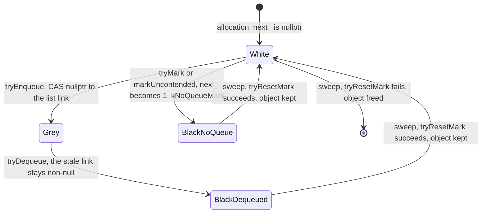
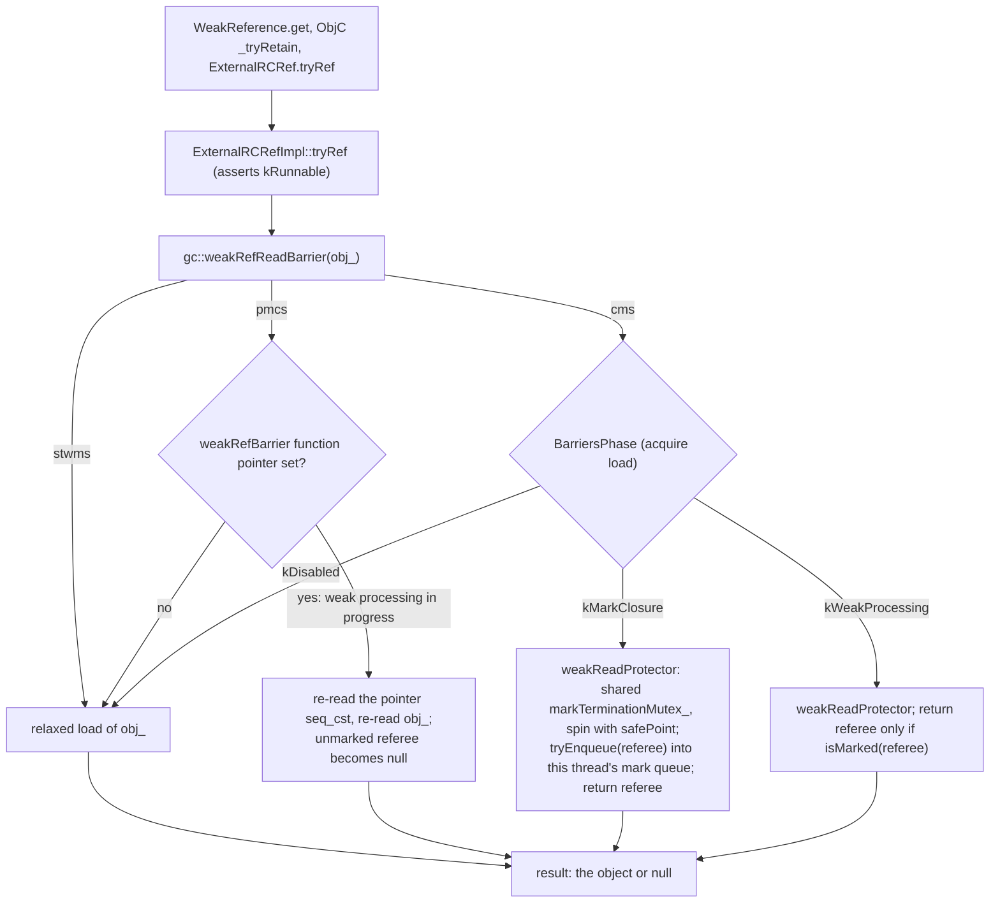
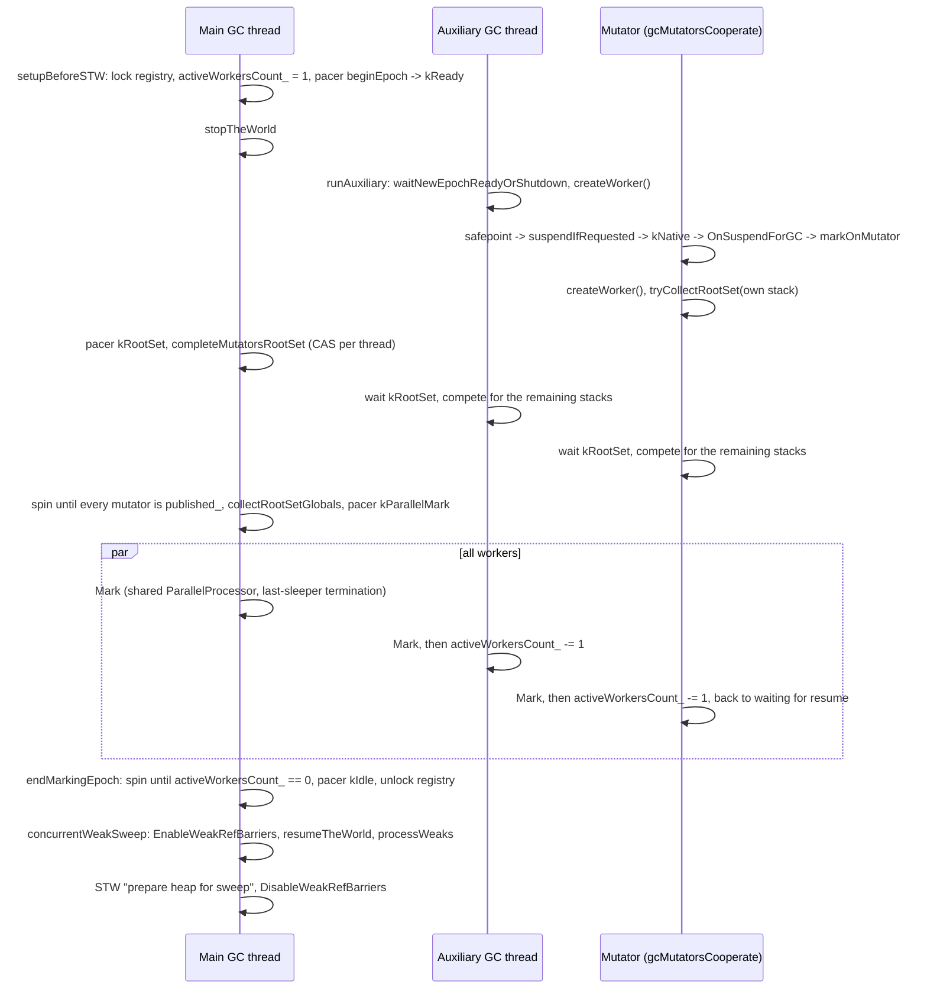
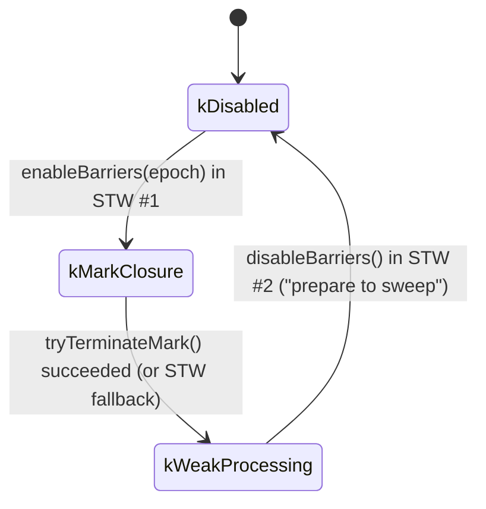
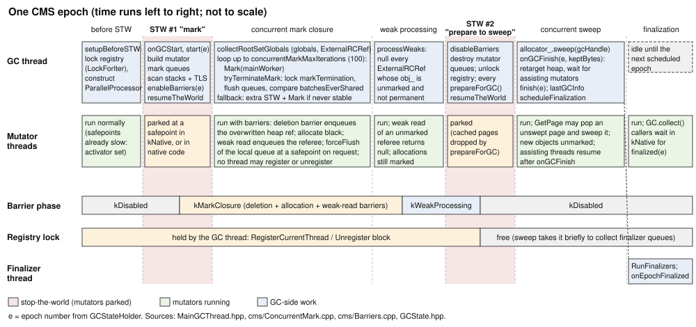
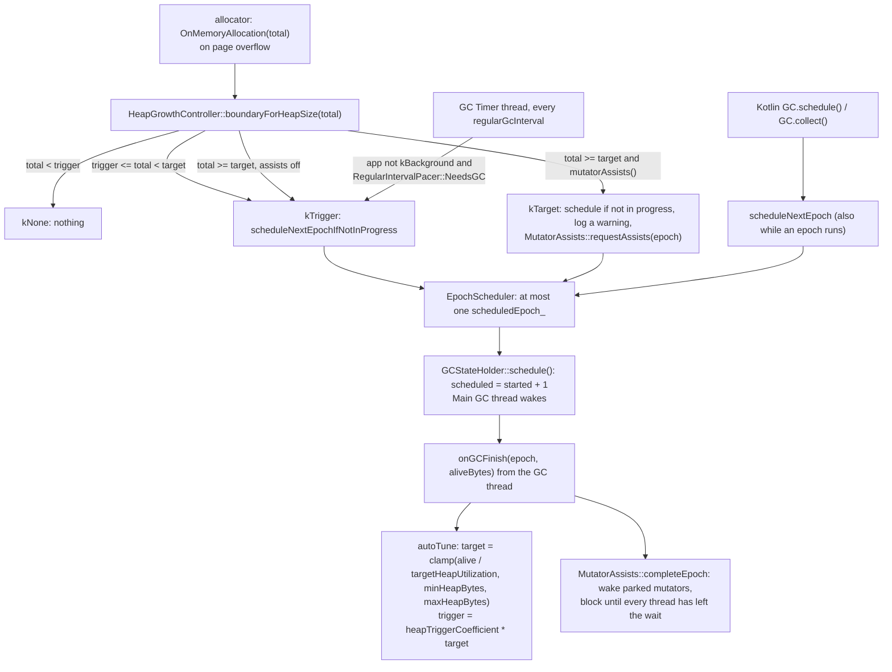

# Kotlin/Native garbage collectors and GC scheduler

This page is the algorithm-level description of the K/N tracing collectors (`stwms`, `pmcs`, `cms`, `noop`) and of the GC
scheduler that decides when an epoch starts. It assumes the runtime overview in [runtime.md](runtime.md): thread states, the
STW protocol, the root set, the cycle skeleton in `MainGCThread::PerformFullGC` and the per-GC summary table are *not* repeated
here; they are the vocabulary. The object header, `TypeInfo`, `UpdateHeapRef` and safepoint emission are in
[compiler-runtime-contract.md](compiler-runtime-contract.md). The sweep itself, page layout and the finalizer queue belong to
[allocator.md](allocator.md); here we only describe what the GC asks the allocator to do.

Source layout (`RUNTIME` = `kotlin-native/runtime/src`): the GC-agnostic framework is `RUNTIME/main/cpp/gc`, each collector is
`RUNTIME/gc/<name>/cpp`, the scheduler framework is `RUNTIME/main/cpp/gcScheduler` and each policy is
`RUNTIME/gcScheduler/<name>/cpp`. Exactly one GC module and one scheduler module are linked into a binary
([CompilerOutput.kt][co], names in [RuntimeModule.kt][rm]).

[co]: ../../kotlin-native/backend.native/compiler/ir/backend.native/src/org/jetbrains/kotlin/backend/konan/CompilerOutput.kt
[rm]: ../../kotlin-native/backend.native/compiler/ir/backend.native/src/org/jetbrains/kotlin/backend/konan/llvm/runtime/RuntimeModule.kt

## Design in one paragraph

All three tracing collectors are non-moving, non-generational mark & sweep collectors over one shared framework: the mark bit
and the mark-queue link are the same word in a per-object `GC::ObjectData` header, marking is "enqueue once", object traversal
is delegated to compiler-emitted `processObjectInMark`, and the sweep is owned by the allocator. They differ only in *where the
mark closure is built*: on the GC thread with the world stopped (`stwms`), on several threads with the world stopped (`pmcs`),
or concurrently with mutators under a snapshot-at-the-beginning deletion barrier (`cms`, the default). Weak reference
processing and the sweep are concurrent in `pmcs` and `cms`. The scheduler is heap-size driven (`targetHeapBytes`, retargeted
after every epoch), with a timer for idle programs and "mutator assists" as the back-pressure mechanism.

## The common framework

### Mark state: `GC::ObjectData`

Each GC defines `GC::ObjectData` ([stms](../../kotlin-native/runtime/src/gc/stms/cpp/ObjectData.hpp),
[pmcs](../../kotlin-native/runtime/src/gc/pmcs/cpp/ObjectData.hpp),
[cms](../../kotlin-native/runtime/src/gc/cms/cpp/ObjectData.hpp)): one pointer `next_`. `marked()` is `next_ != nullptr`;
`tryMark()` CASes `nullptr → 1` (`kNoQueueMark`); `markUncontended()` is a plain store used for freshly allocated objects;
`tryResetMark()` is what the sweep calls. The same field is the link of an `intrusive_forward_list<ObjectData>`
([IntrusiveList.hpp](../../kotlin-native/runtime/src/main/cpp/IntrusiveList.hpp)): insertion sets
`next_` to a non-null value and removal never nulls it, so **"was ever enqueued" ⇔ "marked"**, and `try_push_front` fails on an
already-marked object. `stms` uses non-atomic accesses; `pmcs`/`cms` use relaxed atomics with a `compare_exchange_strong` for
`trySetNext`. The allocator places this header before every heap object (`alloc::objectDataForObject`,
[AllocatorImpl.cpp](../../kotlin-native/runtime/src/alloc/custom/cpp/AllocatorImpl.cpp); the byte layout is drawn in
[compiler-runtime-contract.md](compiler-runtime-contract.md#object-layout)); `noop` makes it zero-sized. `GC.hpp`
requires it to be trivially destructible because it is never deinitialized.

The values `next_` can take over one epoch, as implemented in `cms/ObjectData.hpp` (`stms` is the same without atomics) and
`IntrusiveList.hpp` (`try_push_front` is `trySetNext` from `nullptr`; `pop_front` never writes the popped node):



"Grey" and both "Black" states are indistinguishable to `marked()`; only the queue knows whether an object still has to be
traversed, which is why there is no cheap way to skip the deletion barrier for already-black objects (TODO in `cms/Barriers.cpp`).

### Mark traits and the mark loop

Marking is generic over `Traits` ([MarkAndSweepUtils.hpp](../../kotlin-native/runtime/src/main/cpp/gc/MarkAndSweepUtils.hpp)):

| Traits member | Meaning | stms ([MarkTraits.hpp](../../kotlin-native/runtime/src/gc/stms/cpp/MarkTraits.hpp)) | pmcs / cms |
|---|---|---|---|
| `MarkQueue` | What `processObjectInMark` receives as `state` | the intrusive list itself | `ParallelProcessor::Worker` |
| `tryEnqueue` | mark + push | `try_push_front` | `Worker::tryPush` (or `tryPushLocal` under `gcMarkSingleThreaded` in pmcs) |
| `tryDequeue` | pop next grey object | `try_pop_front` | `Worker::tryPop` (may steal / wait) |
| `tryMark` | mark without enqueueing | `ObjectData::tryMark` | same |
| `kAllowHeapToStackRefs` | may a heap object point to a stack object | `true` | pmcs `true`, **cms `false`** (asserted per field) |

`gc::Mark` pops until `tryDequeue` returns null; for each object it calls `Traits::processInMark`, i.e. the per-type function
pointer `TypeInfo::processObjectInMark` emitted by codegen, which calls back `Kotlin_processObjectInMark` /
`Kotlin_processArrayInMark` → `GC::processObjectInMark` → `internal::processFieldInMark`: enqueue the field if `field->heap()`;
permanent and stack objects are never enqueued. Then, if the object has an `ExtraObjectData`, `processExtraObjectData` marks
the attached `RegularWeakReferenceImpl` directly with `tryMark` (it is a heap object with no fields, so it skips the queue).
Roots go through `collectRoot`: heap roots are enqueued; permanent/stack roots are traversed in place (`processInMark`) because
each has its own root entry and, as asserted there, non-heap objects never carry a meta object.

### Work distribution: `ParallelProcessor`

`pmcs` and `cms` instantiate `ParallelProcessor<intrusive_forward_list<ObjectData>, 512, 4096>`
([ParallelProcessor.hpp](../../kotlin-native/runtime/src/main/cpp/concurrent/ParallelProcessor.hpp); the header says the
parameters "were chosen pretty arbitrary"). A `WorkSource` owns a local `Batch` of up to 512 objects plus an overflow list;
`tryPush` fills the batch and, when it is full, `releaseBatch` publishes it to the shared `BoundedQueue` of 4096 batches (on pool
overflow the batch is moved to the thread-local overflow list instead). `forceFlush` pushes everything local into the shared pool.
A `Worker` is a `WorkSource` that can also `tryPop`: local batch first, then `acquireBatch` from the shared pool, then its own
overflow list, then `waitForMoreWork`. This is sharing rather than stealing: nobody reads another worker's local batch.
Termination inside one processor is "the last worker to go to sleep": `waitingWorkers_` is incremented `seq_cst` and paired with a
`seq_cst` load in `releaseBatch` (the comment calls it an "SC pivot"), the predicate is rechecked under `waitMutex_`, and when
`nowWaiting == registeredWorkers_` the worker sets `allDone_` and wakes everybody. `batchesEverShared()` (cumulative throughput of
the shared queue) is the monotone counter CMS uses for its own termination (below). The destructor asserts the shared queue is
empty: a stranded batch would be live objects swept as garbage.

### Epochs and the GC thread

`GCStateHolder` ([GCState.hpp](../../kotlin-native/runtime/src/main/cpp/gc/GCState.hpp)) holds four counters under one mutex, each
with its own condvar (KT-50948, winpthreads): `scheduledEpoch`, `startedEpoch`, `finishedEpoch`, `finalizedEpoch`. `schedule()`
sets `scheduled = started + 1` only if nothing newer is pending and returns it, so any number of requests during a running epoch
collapse into exactly one follow-up epoch. The "Main GC thread" loops in `waitScheduled()` (`scheduled > finished`) and runs
`PerformFullGC` ([MainGCThread.hpp](../../kotlin-native/runtime/src/main/cpp/gc/MainGCThread.hpp)); `finish(epoch)` is set after the
sweep, `finalized(epoch)` by `GC::onEpochFinalized` when the finalizer processor reports the epoch done. `GC::gcLock_` is a
`ThreadStateAware<std::mutex>` held for the whole epoch and also taken by the memory dump
([Memory.cpp](../../kotlin-native/runtime/src/main/cpp/mm/Memory.cpp) `Kotlin_native_runtime_Debugging_dumpMemoryWithOptions`),
so a dump and a collection never overlap.

### Roots

`collectRootSet<Traits>` ([MarkAndSweepUtils.hpp](../../kotlin-native/runtime/src/main/cpp/gc/MarkAndSweepUtils.hpp)) iterates the
locked thread registry, calls `thread.Publish()` (moves the thread's globals queue and `ExternalRCRef` queue into the global
lists, [ThreadData.hpp](../../kotlin-native/runtime/src/main/cpp/mm/ThreadData.hpp)) and walks `ThreadRootSet` (shadow stack, then
TLS), then `GlobalRootSet` (globals, then `ExternalRCRefRegistry::roots()`). A suspended coroutine is not a root of its own: its
locals survive only because they were spilled into the heap-allocated coroutine object ([coroutines.md](coroutines.md#what-the-gc-sees-during-a-suspension))
([RootSet.hpp](../../kotlin-native/runtime/src/main/cpp/mm/RootSet.hpp)). Who walks a thread's stack: always a GC worker, never the owner, in `stms`/`cms`; in `pmcs` a cooperating mutator may walk its
own or another stopped mutator's stack. In every case the owner is in `kNative` (suspended at a safepoint, or genuinely in
native code), which is what makes the lock-free walk of `FrameOverlay` frames safe; a thread in `kNative` cannot push or pop
frames. `tryLockRootSet` (an acq_rel CAS on a per-thread flag) makes workers compete for threads so each stack is scanned once.

The `ExternalRCRef` roots list ([ExternalRCRefRegistry.cpp](../../kotlin-native/runtime/src/main/cpp/mm/ExternalRCRefRegistry.cpp))
is a lock-free intrusive list with head insertion only (`insertIntoRootsHead`, done by `retainRef` on the `0 → 1` transition,
from any thread in any state) and GC-only removal: `nextRoot` skips refs with `rc_ <= 0`, erasing them with a CAS; if `rc_` became
`> 0` again in the meantime the ref is re-inserted at the head. The header's invariant "during roots list traversal all refs to
the left are either marked or inserted into the mark queue" is what lets `retain` race with concurrent root scanning in CMS.
`RootsIterator::operator*` deliberately ignores `rc_` ("okay to be conservative").

### Weak references

Weak processing is `processWeaks` over `ExternalRCRefRegistry::lockForIter()`: for every undisposed ref whose `obj_` is neither
permanent nor marked, store `nullptr` (relaxed). The same loop lazily erases disposed entries (`nextAlive`). This covers all three
users of `rc == 0` refs: `kotlin.native.ref.WeakReference` (whose `RegularWeakReferenceImpl` object holds a raw `ExternalRCRef`,
[Weak.cpp](../../kotlin-native/runtime/src/main/cpp/mm/Weak.cpp)), ObjC back references with no live ObjC retains
([ObjCBackRef.hpp](../../kotlin-native/runtime/src/main/cpp/ObjCBackRef.hpp)) and the stdlib's `ExternalRCRef` after `release`.
Reads of a weak target go through `ExternalRCRefImpl::tryRef` → `gc::weakRefReadBarrier`
([ExternalRCRef.cpp](../../kotlin-native/runtime/src/main/cpp/mm/ExternalRCRef.cpp)), which is where `pmcs` and `cms` hook
their read barriers. `concurrentWeakSweep` (default `true`) only matters for `pmcs`.

What a weak read does under each collector, from `ExternalRCRefImpl::tryRef` and the three `weakRefReadBarrier`
implementations (`stms/GCImpl.cpp`, `pmcs/Barriers.cpp` `WeakRefRead`, `cms/Barriers.cpp`):



### Statistics and signposts

`GCHandle` ([GCStatistics.hpp](../../kotlin-native/runtime/src/main/cpp/gc/GCStatistics.hpp)) is a per-epoch handle whose scopes
(`mark()`, `collectThreadRoots()`, `sweep()`, `processWeaks()`, …) time each stage and count objects; it supports at most two
pauses per epoch and asserts `marked == kept` after the sweep. `finished()` publishes `GC.lastGCInfo`
([GCInfo.kt](../../kotlin-native/runtime/src/main/kotlin/kotlin/native/runtime/GCInfo.kt); sweep and memory maps are keyed
`"heap"` and `"extra"`). The only `os_signpost` emitter is the safepoint slow path in
[SafePoint.cpp](../../kotlin-native/runtime/src/main/cpp/mm/SafePoint.cpp), enabled by `enableSafepointSignposts` on Apple
targets (subsystem `org.kotlinlang.native.runtime`, category `safepoint`); there are no GC-phase signposts.

## `stwms`: stop-the-world mark & sweep

`SingleThreadMark::markInSTW` ([SingleThreadMark.hpp](../../kotlin-native/runtime/src/gc/stms/cpp/SingleThreadMark.hpp)) is three
calls: `collectRootSet`, `Mark`, `processWeaks`. `StwmsGCTraits::kConcurrentSweep = false`, so the world stays stopped through the
sweep too; there are no barriers, `beforeHeapRefUpdate` is empty and `weakRefReadBarrier` is a relaxed load
([GCImpl.cpp](../../kotlin-native/runtime/src/gc/stms/cpp/GCImpl.cpp)). It is the reference implementation: if a bug disappears
under `stwms`, suspect barriers, termination or concurrent sweep.

## `pmcs`: parallel mark, concurrent sweep

`ParallelMark` ([ParallelMark.cpp](../../kotlin-native/runtime/src/gc/pmcs/cpp/ParallelMark.cpp)) marks with the world stopped but
on several threads. The `MarkPacer` sequences them with a phase `kIdle → kReady → kRootSet → kParallelMark → kIdle` under a
mutex/condvar:

1. `setupBeforeSTW` (before the pause): lock the thread registry for the whole mark, construct the `ParallelProcessor`, set
   `activeWorkersCount_ = 1` (the main worker is pre-accounted so helpers cannot exhaust `maxParallelism_`) and `beginEpoch` →
   `kReady`. From now on helpers may `createWorker()`; it fails if the pacer is not accepting, if `activeWorkersCount_ >=
   maxParallelism_` (`hardware_concurrency()`), or if the count is already `0` (mark finished).
2. Helpers: `auxGCThreads` permanent "Auxiliary GC thread"s
   ([AuxiliaryGCThreads.cpp](../../kotlin-native/runtime/src/gc/pmcs/cpp/AuxiliaryGCThreads.cpp)) wake in `runAuxiliary`; with
   `gcMutatorsCooperate` every mutator that parks in `suspendIfRequested`
   ([ThreadSuspension.cpp](../../kotlin-native/runtime/src/main/cpp/mm/ThreadSuspension.cpp)) calls `gc().OnSuspendForGC()` →
   `markOnMutator` *after* `pauseMutationInScope` switched it to `kNative`. A cooperating mutator first scans its own root set
   (`tryCollectRootSet`), then joins `completeRootSetAndMark`: wait for `kRootSet`, compete for the remaining stacks, wait for
   `kParallelMark`, run `Mark`. Threads already in `kNative` never participate; their stacks are scanned by whoever wins the CAS.
3. Main thread in `markInSTW`: `kRootSet`; scan stacks; spin until every mutator's `published_` flag is set (so globals are
   complete); scan globals and `ExternalRCRef` roots; `kParallelMark`; `Mark`; decrement `activeWorkersCount_`.
4. `endMarkingEpoch`: spin until `activeWorkersCount_ == 0`, `kIdle`, destroy the processor, clear per-thread flags, unlock the
   registry. Termination of the closure itself is the `ParallelProcessor`'s last-sleeper rule.

The same sequence from the point of view of the three kinds of participant, as written in `ParallelMark.cpp`
(`setupBeforeSTW`, `markInSTW`, `markOnMutator`, `runAuxiliary`, `completeRootSetAndMark`) and `ThreadSuspension.cpp`:



`gcMarkSingleThreaded` bypasses all of this: `markInSTW` degenerates to `collectRootSet` + `Mark` on one worker whose
`tryEnqueue`/`tryDequeue` use the local list only, the pacer is never started and helpers return immediately.

Weak processing with `concurrentWeakSweep` (default): still inside STW, `EnableWeakRefBarriers(epoch)`
([pmcs/Barriers.cpp](../../kotlin-native/runtime/src/gc/pmcs/cpp/Barriers.cpp)) stores the function pointer `weakRefBarrierImpl` into
the global `weakRefBarrier` with `seq_cst` and tells every mutator's `BarriersThreadData` to start marking new objects; the world
is resumed; `processWeaks` runs; a second STW ("prepare heap for sweep") disables the barriers. The barrier is only a *read*
barrier: `WeakRefRead` loads `weakRefBarrier` (relaxed fast path, `seq_cst` re-read in the slow path, then re-read the referee —
the long comment there explains the race with concurrent disablement that the re-read would fix if disablement ever left STW)
and returns `nullptr` for an unmarked referee. Allocation during this window marks the new object (`onAllocation` →
`markUncontended`), which is correct because marking is complete and the mark bit now only means "survives this sweep". With
`concurrentWeakSweep=false` weak processing runs in STW and `onAllocation` does nothing.

## `cms`: concurrent mark & sweep (default)

`ConcurrentMark` ([ConcurrentMark.cpp](../../kotlin-native/runtime/src/gc/cms/cpp/ConcurrentMark.cpp); the header comment is the
best short spec) is snapshot-at-the-beginning: the live set is everything reachable at the moment roots were taken plus
everything allocated since. The barriers live in [cms/Barriers.cpp](../../kotlin-native/runtime/src/gc/cms/cpp/Barriers.cpp) and
are keyed by one global `std::atomic<BarriersPhase>`:



The whole epoch on a time axis — what the GC thread does, what mutators may do meanwhile, which barrier phase is active and
how long the registry lock is held — as sequenced in `MainGCThread::PerformFullGC`, `ConcurrentMark::markInSTW` and
`cms/Barriers.cpp` (the numbered steps below are the same events in prose):



1. **STW #1.** `setupBeforeSTW` locks the thread registry (held until the end of marking) and constructs the processor.
   `markInSTW` takes `markMutex_` exclusively, builds a mutator mark queue (`ParallelProcessor::WorkSource`) for every registered
   thread, scans all stacks and TLS on the GC thread (`completeMutatorsRootSet`), then `enableBarriers(epoch)`: phase →
   `kMarkClosure` (`exchange`, release) and every thread's `BarriersThreadData::startMarkingNewObjects`. `resumeTheWorld`.
2. **Concurrent.** Globals and `ExternalRCRef` roots are scanned *after* the resume (safe because of the registry invariant above
   and because globals were published in STW). Mutators now run with three barriers, all inlined fast paths on one acquire load
   of the phase:
   - *Deletion barrier.* `gc::beforeHeapRefUpdate(ref, value, loadAtomic)` is called by `RefAccessor<false>::beforeStore`
     ([ReferenceOps.hpp](../../kotlin-native/runtime/src/main/cpp/ReferenceOps.hpp)), i.e. by every `UpdateHeapRef`,
     `UpdateVolatileHeapRef`, CAS/exchange on heap fields and array copies — never by stack or return slot stores. In
     `kMarkClosure` the slow path loads the *old* value (atomically if the field is volatile) and `tryEnqueue`s it into the
     current thread's mutator queue if it is a heap object. The barrier and the store are not atomic together; the header
     explains that SATB only needs references that existed at the snapshot, so a lost race just over-approximates.
   - *Allocation.* `BarriersThreadData::onAllocation` → `markUncontended` whenever the thread has a mark handle (allocate black).
   - *Weak read.* `weakRefReadBarrier` takes `weakReadProtector()` — a shared `markTerminationMutex_` acquired by spinning with
     `mm::safePoint()` in between — then in `kMarkClosure` enqueues the referee (a weak read may otherwise create a strong edge to
     a white object behind the wavefront); in `kWeakProcessing` it returns `nullptr` for unmarked referees.
   - *External release.* `ExternalRCRefImpl::releaseRef` wraps a `1 → 0` decrement in `ExternalRCRefReleaseGuard`, which on a
     registered thread switches to `kRunnable` and runs the deletion barrier on the ref's `obj_` (the object may be leaving the
     root set behind the wavefront); on an unregistered thread (TLS destructors, ObjC `dealloc`) it instead takes `markMutex_`
     shared, blocking until no mark is in progress. CMS is the only GC where `isNoop()` is `false`.
3. **Closure and termination.** Up to `concurrentMarkMaxIterations` (default 100) rounds of: `Mark` on the main worker, then
   `tryTerminateMark`: take `markTerminationMutex_` exclusively (so no weak read can resurrect during the check),
   `flushMutatorQueues` — install a `FlushActionActivator` (an `ExtraSafePointActionActivator`, which also activates safepoints),
   have each mutator run `forceFlush` at its next safepoint (`ConcurrentMark::ThreadData::onSafePoint`), or run it on the GC
   thread for mutators that are `suspendedOrNative()` (their queues cannot change while they are in `kNative`), and spin until
   every `OnceExecutable` reports executed — then compare `batchesEverShared()` with the previous round. Unchanged means the
   mutator queues were empty, were empty before the flush request and the last `Mark` found nothing new, so the closure is
   complete; the phase switches to `kWeakProcessing` under the same lock. Otherwise `resetForNewWork` and loop. If the loop
   never stabilizes, a fallback STW flushes and finishes the mark with a `GCLogWarning`. The default 100 came in with
   KT-58865 (`git log -S"concurrentMarkMaxIterations = 100"`); no further rationale was found.

   The termination loop as a decision tree, from `ConcurrentMark::markInSTW`, `tryTerminateMark` and `flushMutatorQueues`:

   ```mermaid
   flowchart TD
       S["after STW #1: everShared = batchesEverShared()"] --> M["Mark(mainWorker): drain the shared pool"]
       M --> L["take markTerminationMutex_ exclusively<br/>(weak reads now spin at safepoints)"]
       L --> F["flushMutatorQueues: FlushActionActivator;<br/>each mutator runs forceFlush at its next safepoint,<br/>the GC thread flushes threads that are suspendedOrNative"]
       F --> C{"batchesEverShared() == everShared?"}
       C -->|"no: new batches were published"| R["everShared = now; resetForNewWork; iter += 1"]
       R --> I{"iter < concurrentMarkMaxIterations (100)?"}
       I -->|"yes"| M
       I -->|"no"| W["GCLogWarning; stopTheWorld;<br/>flushMutatorQueues; Mark; switchToWeakProcessingBarriers"]
       C -->|"yes: closure complete"| D["switchToWeakProcessingBarriers under the lock<br/>(kMarkClosure to kWeakProcessing)"]
       D --> P["processWeaks concurrently, then STW #2"]
       W --> P2["processWeaks inside the fallback STW"]
   ```
4. **Weak processing** runs concurrently (phase `kWeakProcessing`), then **STW #2** ("prepare to sweep"): `disableBarriers`,
   destroy the mutator queues (only now, because a thread may still enqueue before it observes the phase change), unlock the
   registry, `prepareForGC` in `MainGCThread`, resume, concurrent sweep.

Threads joining or leaving: the registry lock is a `std::recursive_mutex` held by the GC thread from `setupBeforeSTW` to the
end of marking, so **no thread can register or unregister while CMS marks** — `RegisterCurrentThread` blocks. This is why
`BarriersThreadData::onThreadRegistration` (pick up a mark handle if the phase is not `kDisabled`) can only fire during the
concurrent weak-processing/sweep tail, when a new thread's allocations must be marked but it has no mark queue. `pmcs`
has the same shape with its weak barriers. CMS asserts `gcMutatorsCooperate == false` and `auxGCThreads == 0`
([cms/GCImpl.hpp](../../kotlin-native/runtime/src/gc/cms/cpp/GCImpl.hpp)); the compiler downgrades them with a warning.

Stack objects: `kAllowHeapToStackRefs = false`. A heap object pointing at a stack-allocated object is fatal for CMS because the
frame can die while the marker is still following the edge. The compiler therefore exiles any escape-analysis "local but not on
stack" allocation to `GLOBAL` lifetime (`escapeAnalysisPropagateExiledToHeapObjects`, default `true`, warning if disabled with
CMS; comment cites KT-75317, KT-85811, KT-69731 in
[NativeSecondStageCompilationConfig.kt](../../kotlin-native/backend.native/compiler/ir/backend.native/src/org/jetbrains/kotlin/backend/konan/NativeSecondStageCompilationConfig.kt);
mechanism in [EscapeAnalysis.kt](../../kotlin-native/backend.native/compiler/ir/backend.native/src/org/jetbrains/kotlin/backend/konan/optimizations/EscapeAnalysis.kt)
`propagateExiledToHeapObjects`). An attempt to support local objects in CMS was reverted (`git log -S"kAllowHeapToStackRefs"`:
commits "CMS: Supported local objects" and its revert).

## Sweep: the GC/allocator boundary

After marking, `MainGCThread` calls every thread's `allocator().prepareForGC()` and the global `allocator_.prepareForGC()`
(custom allocator: drop the per-thread current pages so nothing is allocated into a page being swept,
[CustomAllocator.cpp](../../kotlin-native/runtime/src/alloc/custom/cpp/CustomAllocator.cpp), [Heap.cpp](../../kotlin-native/runtime/src/alloc/custom/cpp/Heap.cpp)),
resumes the world if `kConcurrentSweep`, and calls `allocator_.sweep(gcHandle)`. The allocator walks its pages and, per object,
calls `gc::tryResetMark` ([GCApi.cpp](../../kotlin-native/runtime/src/alloc/custom/cpp/GCApi.cpp)
`ObjectSweepTraits::trySweepElement`): marked → unmark and keep (counted into `keptSizeBytes`); unmarked with an `ExtraObjectData` → queue the extra object for
finalization (and keep the object itself one more cycle iff `TF_HAS_FINALIZER`); otherwise free. `sweepExtraObjects` is the
second pass over extra-object pages freeing the ones flagged `FLAGS_SWEEPABLE`. The GC then reads `gcHandle.getKeptSizeBytes()`
for the scheduler and calls `allocator_.scheduleFinalization`, which hands the queue to the finalizer threads
([SegregatedFinalizerProcessor.hpp](../../kotlin-native/runtime/src/main/cpp/alloc/SegregatedFinalizerProcessor.hpp)). The GC's
contract with the sweep is only: every live object is marked when `sweep` starts, new allocations during a concurrent sweep are
in pages the sweep does not touch (allocator's responsibility), and `tryResetMark` leaves the heap all-white for the next epoch.

## The GC scheduler

The scheduler decides *when* an epoch starts; the GC decides nothing. `GCScheduler`
([GCScheduler.hpp](../../kotlin-native/runtime/src/main/cpp/gcScheduler/GCScheduler.hpp)) has three inputs —
`setAllocatedBytes` from the allocator, `safePoint` from mutators, `schedule*` from Kotlin — and two callbacks from the GC
thread, `onGCStart`/`onGCFinish(epoch, aliveBytes)`. All policies funnel into `EpochScheduler`
([EpochScheduler.cpp](../../kotlin-native/runtime/src/main/cpp/gcScheduler/EpochScheduler.cpp)), which remembers the one scheduled
epoch and distinguishes `scheduleNextEpoch` (manual: schedule the *next* epoch even while one runs) from
`scheduleNextEpochIfNotInProgress` (heap/timer: do nothing if an epoch is already scheduled or running); both end in
`GCStateHolder::schedule`. Every `ScheduleReason` is logged at `gcScheduler=info`.

**Adaptive** ([adaptive/GCSchedulerImpl.hpp](../../kotlin-native/runtime/src/gcScheduler/adaptive/cpp/GCSchedulerImpl.hpp)) with the
constants from [GCSchedulerConfig.hpp](../../kotlin-native/runtime/src/main/cpp/gcScheduler/GCSchedulerConfig.hpp):

| Input | Condition (`HeapGrowthController`, [HeapGrowthController.hpp](../../kotlin-native/runtime/src/main/cpp/gcScheduler/HeapGrowthController.hpp)) | Action |
|---|---|---|
| allocation (`setAllocatedBytes`) | `allocated >= 0.9 * target` (`heapTriggerCoefficient`) | schedule if not in progress |
| allocation | `allocated >= target` and `mutatorAssists()` | schedule if not in progress, log a warning, `MutatorAssists::requestAssists(epoch)` |
| timer ("GC Timer thread", `RepeatedTimer`) | `now >= lastGC + regularGcInterval` (10 s), app not in background | schedule if not in progress |
| `onGCFinish(alive)` | `autoTune` (default on) | `target = clamp(alive / 0.5, [5 MiB, maxHeapBytes])`, `trigger = 0.9 * target`; then wait for assisting mutators |

How the three inputs reach `GCStateHolder::schedule` and how an epoch's end feeds back into the thresholds, from
`adaptive/GCSchedulerImpl.hpp` (`setAllocatedBytes`, the timer lambda, `onGCFinish`), `HeapGrowthController.hpp` and
`EpochScheduler.cpp`:



Initial `targetHeapBytes` is 10 MiB; the comment on `minHeapBytes = 5 MiB` explains it as "20 pages" of the custom allocator.
`maxHeapBytes` defaults to `INT64_MAX`. With `autoTune=false` the target is whatever `GC.targetHeapBytes` was set to. The
allocation input is coarse: the custom allocator calls `OnMemoryAllocation(total)` only when a page overflows
([AllocatedSizeTracker.cpp](../../kotlin-native/runtime/src/alloc/custom/cpp/AllocatedSizeTracker.cpp)), so a program allocating
below one page between GCs is scheduled by the timer alone. **Mutator assists**
([MutatorAssists.cpp](../../kotlin-native/runtime/src/main/cpp/gcScheduler/MutatorAssists.cpp)): `requestAssists` installs a
`SafePointActivator` so every safepoint takes the slow path; `ThreadData::safePoint` parks the thread in `kNative`
(`pauseMutationInScope("assisting GC")`) until `completedEpoch_ >= epoch`; `onGCFinish` calls `completeEpoch`, which marks the
epoch done and *blocks the GC thread* until every registered thread's `startedWaiting_` word says it has left the wait (so a
thread cannot still be parked for an old epoch when the next assists are requested). `mutatorAssists()` defaults to "on only if
`autoTune` and `maxHeapBytes` is unlimited" — the comment explains that with a bounded target a live set above the bound would
schedule back-to-back epochs and park mutators forever, "which will look like the program has hanged". Kotlin exposes it as
`GC.pauseOnTargetHeapOverflow`. On Windows the assists use a spinning condvar (`ConditionVariableSpin`; the header blames
winpthreads). `AppStateTracking` ([AppStateTracking.hpp](../../kotlin-native/runtime/src/main/cpp/mm/AppStateTracking.hpp),
[AppStateTrackingUIKit.mm](../../kotlin-native/runtime/src/main/cpp/mm/AppStateTrackingUIKit.mm)) is consulted only by the timer
callback; it does not affect allocation-triggered epochs or assists.

**Aggressive** ([aggressive/GCSchedulerImpl.hpp](../../kotlin-native/runtime/src/gcScheduler/aggressive/cpp/GCSchedulerImpl.hpp)):
holds a `SafePointActivator` for the life of the process, and at every safepoint hashes the current stack trace (16 frames,
`SafePointTracker`, set cleared at 100 000 entries) and schedules an epoch the first time a trace is seen; it keeps the heap
triggers and assists because "with a long running loop all safepoints might be met". No timer.

**Manual** ([manual/GCSchedulerImpl.cpp](../../kotlin-native/runtime/src/gcScheduler/manual/cpp/GCSchedulerImpl.cpp)): no heap or
timer input, no assists; only the Kotlin API schedules.

**Kotlin API** (`kotlin.native.runtime.GC`, [GC.kt](../../kotlin-native/runtime/src/main/kotlin/kotlin/native/runtime/GC.kt), bridged in
[Memory.cpp](../../kotlin-native/runtime/src/main/cpp/mm/Memory.cpp)): `collect()` = `scheduleAndWaitFinalized` (waits in `kNative`
for the *finalized* epoch, i.e. after finalizers ran); `schedule()` = `schedule`. `autotune`, `regularGCInterval`,
`targetHeapBytes`, `targetHeapUtilization`, `minHeapBytes`, `maxHeapBytes`, `heapTriggerCoefficient`, `pauseOnTargetHeapOverflow`
read/write `GCSchedulerConfig` atomics directly (the header asks to keep `GC.kt` docs in sync). Under `manual` they are stored but
never read; under `aggressive` only the heap-related ones matter. Under `gc=noop`, `GC::Schedule()` returns 0 and the waits are
empty ([noop/GCImpl.cpp](../../kotlin-native/runtime/src/gc/noop/cpp/GCImpl.cpp)), so `GC.collect()` returns immediately; the
compiler pairs `noop` with the `manual` scheduler by default. `collectCyclic`, `suspend/resume/stop/start`, `threshold*`,
`cyclicCollectorEnabled`, `detectCycles`, `findCycle` are documented no-ops kept from the legacy memory manager.

## What the compiler must emit, per GC

| Codegen artefact | Why the GC needs it | GCs that use it |
|---|---|---|
| Heap stores via `UpdateHeapRef` & co. ([Memory.cpp](../../kotlin-native/runtime/src/main/cpp/mm/Memory.cpp)), never raw stores | `RefAccessor<false>::beforeStore` is the deletion barrier | cms (others: empty inline) |
| Stack/return stores via `UpdateStackRef`/`UpdateReturnRef` (no barrier) | roots are re-scanned from the shadow stack, so stack edges need no barrier | all |
| Safepoint polls in prologues and loop bodies | suspension, CMS mark-queue flush, assists, aggressive scheduler | all |
| `EnterFrame`/`LeaveFrame`, every live reference in a slot | the stack scan sees only slots | all |
| `TypeInfo::processObjectInMark` and `objOffsets_` | the marker never interprets layouts itself | all tracing GCs |
| Thread-state switches around external calls | a thread in `kRunnable` that blocks stalls every STW | all |
| `OBJECT_TAG_PERMANENT` on constants; never registered as `ExternalRCRef` | skipped by `processFieldInMark`, `processWeaks` treats them as alive | all |
| `OBJECT_TAG_STACK` on stack objects; exile heap-allocated locals to `GLOBAL` | heap → stack edges are asserted away; fatal for cms | cms assert, all under `-opt` |
| `Kotlin_*` constants (`Kotlin_gcMarkSingleThreaded`, `Kotlin_concurrentWeakSweep`, `Kotlin_auxGCThreads`, …) | branch on them at run time ([CompilerConstants.hpp](../../kotlin-native/runtime/src/main/cpp/CompilerConstants.hpp)) | pmcs/cms |

The allocation hook `gc().onAllocation(object)` is called by `mm::AllocateObject` before the release fence that publishes the
header ([ObjectOps.cpp](../../kotlin-native/runtime/src/main/cpp/mm/ObjectOps.cpp)).

## Interop and export

- **ObjC/Swift export.** Every `KotlinBase` wrapper owns an `ObjCBackRef`, an `ExternalRCRef` created with `rc = 1`; ObjC
  `retain`/`release` forward to `retainRef`/`releaseRef`, `_tryRetain` to `tryRetain` (which goes through the weak read barrier)
  ([ObjCBackRef.hpp](../../kotlin-native/runtime/src/main/cpp/ObjCBackRef.hpp); lifetime model in [export.md](export.md)). So an
  object is a root exactly while some ObjC/Swift reference exists, becomes weak at `rc == 0`, and the wrapper is torn down when
  the Kotlin object is finalized. Swift export uses the same handles (`createRetainedExternalRCRef` in
  [ObjCExport.mm](../../kotlin-native/runtime/src/main/cpp/ObjCExport.mm)).
- **Associated objects** (the ObjC side of a Kotlin object, or an imported ObjC object wrapped by Kotlin) are released from
  `alloc::destroyExtraObjectData` → `ReleaseAssociatedObject` → `Kotlin_ObjCExport_releaseAssociatedObject`, in `kNative`,
  on the finalizer thread — unless the association was made on the main thread (`SetAssociatedObject` checks
  `pthread_main_np()` and sets `FLAGS_RELEASE_ON_MAIN_QUEUE`) and `objcDisposeOnMain` (default `true`, KT-56402) is on and the
  main run loop is spinning; then the sweep routes the cell to `MainThreadFinalizerProcessor`
  ([MainThreadFinalizerProcessor.hpp](../../kotlin-native/runtime/src/main/cpp/alloc/MainThreadFinalizerProcessor.hpp)), which runs
  batches of 100 inside an autoreleasepool, at most 300 ms per task, 1 ms apart (`RunLoopFinalizerProcessorConfig`, tunable via
  `GC.MainThreadFinalizerProcessor`). If the main run loop never processes the attach block, `available()` stays `false` and
  everything is merged into the regular queue. `objcDisposeWithRunLoop` (default `true`) is a compiler constant with no reader
  found in the current runtime sources — Unverified whether it still has an effect.
- **Threads created by foreign code** register lazily through `CalledFromNativeGuard`/`Kotlin_initRuntimeIfNeeded` in `kNative`
  and are left in `kNative` on return (see runtime.md); for the GC they are ordinary mutators whose stacks are empty while they
  are outside Kotlin. Registration blocks while CMS marks (registry lock), which is an observable latency on thread creation.
- **cinterop `autoreleasepool`** is plain ObjC runtime calls (`Kotlin_objc_autoreleasePoolPush`,
  [ObjCInterop.mm](../../kotlin-native/runtime/src/main/cpp/ObjCInterop.mm)); the GC does not interact with autorelease pools
  except that the main-thread finalizer wraps its batches in one.

## Options, defaults and how they reach the runtime

| Option (`-Xbinary=`) | Default ([NativeSecondStageCompilationConfig.kt](../../kotlin-native/backend.native/compiler/ir/backend.native/src/org/jetbrains/kotlin/backend/konan/NativeSecondStageCompilationConfig.kt)) | Mechanism | Effect |
|---|---|---|---|
| `gc` | `cms` (default since 2.3.20, commit `0851ea86878b`, KT-82635; before that `pmcs`. CMS had first been made the default of the then-experimental new MM in 2022, commit `1e78036a1b98`) | module selection | which `*_gc.bc` is linked; part of the cache flavor |
| `gcSchedulerType` | `adaptive`; `manual` for `gc=noop` | module selection | which `*_gcScheduler.bc`; cache flavor |
| `gcMarkSingleThreaded` | `true` only for MinGW + `pmcs` | constant `Kotlin_gcMarkSingleThreaded` | pmcs: local-only queues, no pacer, no helpers; cms: ignored |
| `concurrentWeakSweep` | `true` | constant `Kotlin_concurrentWeakSweep` | pmcs: weak processing outside STW with read barriers; cms/stms: ignored |
| `concurrentMarkMaxIterations` | 100 | constant | cms: rounds before the STW fallback |
| `gcMutatorsCooperate` | `true` for pmcs; forced `false` (warning) for cms or single-threaded mark | constant | pmcs: suspended mutators mark |
| `auxGCThreads` | 0; forced 0 under single-threaded mark | constant | pmcs: extra permanent mark threads |
| `enableSafepointSignposts` | `false`; warning on non-Apple | constant | signpost interval per safepoint slow path |
| `appStateTracking` | `disabled` | constant | adaptive timer skips epochs in background (UIKit only) |
| `objcDisposeOnMain` / `objcDisposeWithRunLoop` | `true` / `true` | constants | main-thread finalizer routing (see above) |
| `escapeAnalysisPropagateExiledToHeapObjects` | `true`; warning if `false` with cms | compiler only | exile heap-allocated locals |
| `memoryModel`, `freezing` | — | [SetupConfiguration.kt](../../kotlin-native/backend.native/compiler/ir/backend.native/src/org/jetbrains/kotlin/backend/konan/SetupConfiguration.kt) | strong warning "deprecated and will be removed"; `freezing` other than `disabled` is an error with the new MM |

Migration note: `gcSchedulerType=disabled|with_timer|on_safe_points` still parse; the compiler warns and substitutes
`manual`, `adaptive`, `adaptive` respectively ([GCSchedulerType.kt](../../native/binary-options/src/main/kotlin/org/jetbrains/kotlin/config/nativeBinaryOptions/GCSchedulerType.kt)).
Values of `gc` accept the enum name or the shortcut (`-Xbinary=gc=stwms`). From Gradle, any `kotlin.native.binary.<name>=<value>`
property becomes `-Xbinary=<name>=<value>` ([PropertiesProvider.kt](../../libraries/tools/kotlin-gradle-plugin/src/common/kotlin/org/jetbrains/kotlin/gradle/plugin/PropertiesProvider.kt)
`nativeBinaryOptions`); KGP has no typed GC DSL. The constants arrive as weak globals overridden by the compiler
([CompilerConstants.cpp](../../kotlin-native/runtime/src/main/cpp/CompilerConstants.cpp) holds the runtime-side fallbacks, which
are what gtests see).

## Tests

- **gtests** next to the code: `MarkAndSweepUtilsMarkTest.cpp`, `TracingGCTest.hpp` (23 `TYPED_TEST_P`s instantiated by each
  GC's `GCImplTest.cpp`), `cms/BarriersTest.cpp`, the scheduler tests (`HeapGrowthControllerTest`, `MutatorAssistsTest`,
  `EpochSchedulerTest`, `SafePointTrackerTest`, `GCSchedulerImplTest`). Groups in
  [runtime/build.gradle.kts](../../kotlin-native/runtime/build.gradle.kts): `stms_gc_test`, `pmcs_gc_test`, `cms_gc_test` (legacy
  allocator) and `*_gc_custom_test` (custom allocator), all with `manual_gcScheduler`; `adaptive_gcScheduler_test` /
  `aggressive_gcScheduler_test` run with `noop_gc`. Run: `./gradlew :kotlin-native:runtime:hostRuntimeTests
  -Pgtest_filter='ConcurrentMark*:Barriers*'`. The gtests use the fallback constants, so `gcMarkSingleThreaded`, `auxGCThreads`
  and `gcMutatorsCooperate` are exercised only where a test sets them explicitly.
- **Integration**: `./gradlew :native:native.tests:gcTest` runs [testData/gc](../../native/native.tests/testData/gc) (22 files:
  weak references, cleaners, workers, escape analysis, memory dump, `gcStats`). Any native test task takes
  `-Pkn.gcType=CMS|PMCS|STWMS|NOOP` and `-Pkn.gcScheduler=ADAPTIVE|AGGRESSIVE|MANUAL`
  ([NativeTestSupport.kt](../../native/native.tests/testFixtures/org/jetbrains/kotlin/konan/test/blackbox/support/NativeTestSupport.kt)
  `computeGCType`; table in [HACKING.md](../../kotlin-native/HACKING.md#testing); note the default is `CMS`, and the infrastructure always
  passes an explicit `-Xbinary=gc=`, see [test-infrastructure.md](test-infrastructure.md#from-gradle-property-to-compiler-flag)),
  plus `-Pkn.binaryOptions=concurrentWeakSweep=false,…`
  for the rest. To run one test under all GCs, loop over `-Pkn.gcType`; tests opt out per GC with `// IGNORE_NATIVE: gcType=NOOP`
  ([IgnoreDisableHelper.kt](../../native/native.tests/testFixtures/org/jetbrains/kotlin/konan/test/blackbox/support/group/IgnoreDisableHelper.kt)).
- **Stress and fuzzing**: [native.tests/stress/testData](../../native/native.tests/stress/testData) (`stress_gc_allocations.kt`,
  `kt63423_dispose_on_main_stress.kt`, …); [gc-fuzzing-tests/README.md](../../native/native.tests/gc-fuzzing-tests/README.md)
  generates Kotlin+ObjC programs whose only failure mode is a crash; [litmus-tests/guide.md](../../native/native.tests/litmus-tests/guide.md)
  checks the memory model, not the GC, but runs on the same runtime.

## Investigating

| Symptom | First checks |
|---|---|
| Crash in `Mark`/`processObjectInMark`/sweep | Reproduce with `-Pkn.gcScheduler=AGGRESSIVE`; compare `STWMS` vs `CMS`. If only CMS: a store bypassing `UpdateHeapRef` (`DirectRefAccessor`), a heap → stack edge (`escapeAnalysisPropagateExiledToHeapObjects=false`?), a `releaseRef` without the guard. If all GCs: missing root (slot, `RegisterGlobal`, `ExternalRCRef` released at `rc == 0`). `-Xbinary=runtimeAssertionsMode=panic` turns on the phase and thread-state asserts. |
| Hang in STW | A thread blocked in `kRunnable`; `-Xruntime-logs=pause=debug` names the requester, the calls checker names the culprit. CMS-specific: `flushMutatorQueues` spinning on a thread that never reaches a safepoint while `kRunnable`. |
| Premature collection / nulled weak | `GLOBAL_ROOT` source 2 in a memory dump means an `rc > 0` `ExternalRCRef`; check the ObjC side `retain` count. Under CMS, check the object was not read through a weak ref without the barrier. |
| Finalizer / Cleaner never runs | `GC.lastGCInfo.epoch` advancing? Object kept one extra cycle by design. `FLAGS_RELEASE_ON_MAIN_QUEUE` + `objcDisposeOnMain` means it waits for the main run loop (`GC.MainThreadFinalizerProcessor.available`). |
| Memory grows | `-Xruntime-logs=gcScheduler=info,gc=info` shows "Updated heap boundaries: alive … target … trigger …" and schedule reasons; compare with `GC.targetHeapBytes`. "Pausing the mutators until epoch" means assists are firing. |
| Long pauses | `GCInfo.firstPause*`/`secondPause*` timings; `-Xruntime-logs=pause=info`; for CMS the "Finishing mark closure in STW after N attempts" warning means termination fell back to STW. |
| Mark-level tracing | `-Xruntime-logs=gcMark=debug,barriers=debug,balancing=debug` (very verbose: per object / per store / per batch). |

Dumps: `kotlin.native.runtime.Debugging.dumpMemory(fd)` ([MemoryDump.cpp](../../kotlin-native/runtime/src/main/cpp/mm/MemoryDump.cpp));
Breakpad minidumps when `minidumpLocation` is set (macOS). Both are described in runtime.md.

## Trade-offs and when each collector is used

| | stwms | pmcs | cms |
|---|---|---|---|
| Pauses | roots + mark + weak + sweep | roots + mark (parallel), two short pauses around weak processing | two short pauses: roots, prepare-to-sweep (plus a fallback if termination fails) |
| Mutator overhead | none | weak-read barrier during weak processing; allocate-black | deletion barrier on every heap store, weak-read barrier, allocate-black, flush at safepoints, `ExternalRCRef` release guard |
| Extra threads | GC thread | GC thread + `auxGCThreads` + cooperating mutators | GC thread only (parallel marking not supported) |
| Stack objects | allowed | allowed | heap → stack edges forbidden; compiler exiles |
| Thread registration during mark | blocked (STW) | blocked (STW) | blocked (registry lock) although mutators run |
| Chosen when | debugging / bisecting; single-core | MinGW defaults to single-threaded mark but cms is still the default there (Unverified why) | default everywhere |

CMS was the default of the experimental new memory manager in 2022 (`1e78036a1b98`), PMCS was the shipped default from at
least the 2023 GC-switch rework (`7815eec7c10e`) until 2.3.20, CMS became
opt-in in 2.0.20 with its concurrent phase expanded (KT-58865), the Swift-export default in 2025 (`dcc255caf100`), and the
general default in 2.3.20 (`0851ea86878b`, KT-82635; `defaultGC` in `NativeSecondStageCompilationConfig.kt` switched from
`PARALLEL_MARK_CONCURRENT_SWEEP` to `CONCURRENT_MARK_AND_SWEEP`). PMCS remains the alternative when pause time matters less
than mutator throughput, or when parallel marking is needed. See [compatibility-and-migration.md](compatibility-and-migration.md).

## Implied contracts

Things that silently depend on GC behaviour:

- Generated code: every heap store goes through `UpdateHeapRef`-family calls; a raw store is correct under `stwms`/`pmcs` and a
  heisenbug under `cms`. Platform libraries and cinterop stubs are compiled by the same backend and inherit this.
- `ExternalRCRef` users (ObjC export, Swift export, C export stable pointers, Cleaners): `rc` changes may happen in any thread
  state, but `ref()` is only valid at `rc > 0` or while the object is otherwise rooted, and `releaseRef` from an unregistered
  thread may block until a CMS mark finishes.
- ObjC lifetime: an ObjC object associated with a Kotlin object dies on the finalizer thread, one GC cycle *after* the Kotlin
  object became unreachable, or on the main thread later still; UIKit code that assumes main-thread `dealloc` relies on
  `objcDisposeOnMain` staying `true`.
- Finalizers see an object whose reference fields may already be freed
  ([FinalizerHooks.hpp](../../kotlin-native/runtime/src/main/cpp/FinalizerHooks.hpp)).
- `GC.collect()` is a full STW-root + finalize barrier under the tracing GCs and a no-op under `noop`; tests that rely on it must
  not run with `-Pkn.gcType=NOOP`.
- Scheduler tuning through `kotlin.native.runtime.GC` is a contract with the adaptive scheduler only; changing defaults in
  `GCSchedulerConfig.hpp` requires updating `GC.kt` documentation.
- Caches: GC-affecting options are part of the cache flavor (`-gc<shortcut>`, `-gc_scheduler…`, `-gc_mark_single_threaded…`,
  `-concurrent_weak_sweep…` in `NativeSecondStageCompilationConfig`), so a binary and its caches always agree on the barrier
  code; nothing else in [caches.md](caches.md) depends on the GC.
- Deprecated option names (`gcSchedulerType=disabled|with_timer|on_safe_points`, `memoryModel`, `freezing`) are accepted with
  warnings; the compiler, not the runtime, performs the mapping.

## Open questions

- `objcDisposeWithRunLoop` is emitted as a constant but no runtime reader was found; is it dead?
- Why does MinGW default `gcMarkSingleThreaded` only for `pmcs` while `cms` stays the default there — is CMS known to work
  with winpthreads, or is the MinGW default effectively untested?
- Does the registry lock held across the CMS mark cause measurable thread-start latency in practice, and is lifting it planned
  (the `onThreadRegistration` hook suggests the design anticipates registration during marking)?
- `ParallelProcessor` batch sizes (512/4096) and `SafePointTracker` limits (16 frames, 100 000 entries) are documented as arbitrary;
  no benchmark history was found.
- `GCStatistics` asserts at most two pauses per epoch; CMS's STW fallback plus the prepare-to-sweep pause stays at two, but a
  future third pause would trip it.
- Whether `concurrentWeakSweep=false` is still a supported configuration for `pmcs` or only a test knob.
