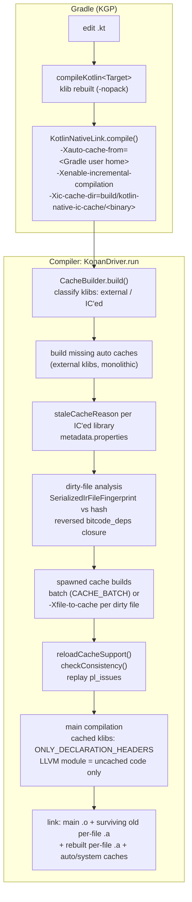
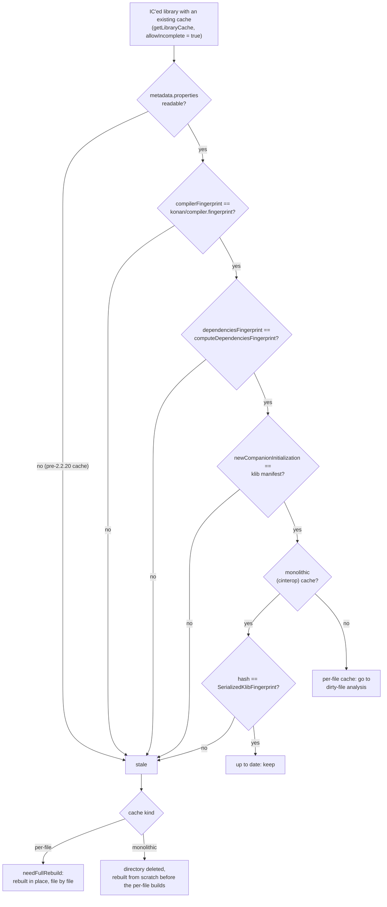
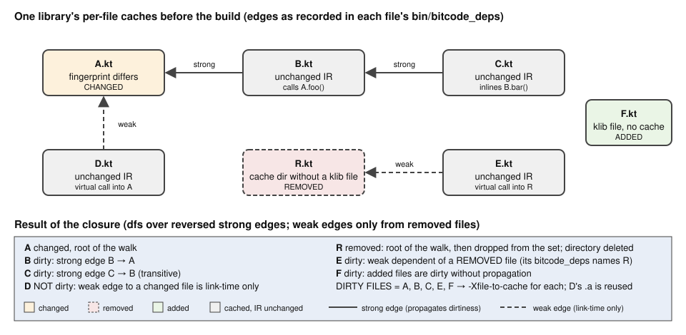
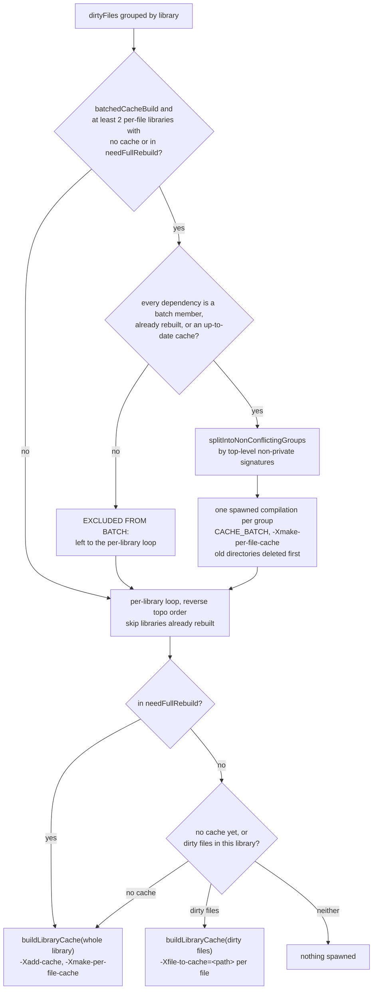

# Kotlin/Native: incremental compilation of the second stage (IC)

How a source change in a Gradle project ends up as a relinked binary in which only the affected klib *files* were
recompiled. This page follows the whole path: the flags KGP passes, the staleness and dirty-file analysis in the compiler,
the rebuild of per-file caches, and the final link that mixes old and new object files. It builds on
[caches.md](caches.md), which describes the per-file cache machinery itself (cache layout, additional cache info,
`DependenciesTracker`, cache ABI, flavors) and is not repeated here; the user-visible model is in
[compilation-model.md](compilation-model.md) ("Incremental second compilation stage"). Paths below are relative to
`kotlin-native/backend.native/compiler/ir/backend.native/src/org/jetbrains/kotlin/backend/konan/` unless they start with a
repository directory.

## Role and fit

The second stage is a whole-program compilation of klibs to a binary ([architecture.md](architecture.md)). Compiler caches
make it cheaper by linking prebuilt machine code for *dependencies*; IC extends the same idea to the *project's own* klibs,
which change on every build. The core idea, all implemented in `CacheBuilder`
([CacheBuilder.kt](../../kotlin-native/backend.native/compiler/ir/backend.native/src/org/jetbrains/kotlin/backend/konan/CacheBuilder.kt)):

1. every project klib is compiled as a **per-file static cache**: one `.a` per klib file, plus a per-file record of which
   other files' code it references (`bitcode_deps`) and a hash of the file's serialized IR (`metadata.properties`);
2. on the next build, a file is **changed** if its IR hash differs from the recorded one; the set of **dirty** files is the
   closure of changed/added/removed files over the reversed `bitcode_deps` graph;
3. only dirty files are recompiled (`-Xfile-to-cache`), in dependency order; the final binary links the surviving old
   objects with the new ones.

There is no separate IC state besides the cache directory: the previous build *is* the state. KGP does not know which
files changed; it only hands the compiler a directory and a flag.

The whole path from an edited source file to the relinked binary, as wired in `KotlinNativeLink.compile()`,
`KonanDriver.run` and `CacheBuilder.build` (sections 1–6 below follow the same order):



## Terminology

| Term | Meaning | Where |
|------|---------|-------|
| IC'ed library | a klib given on the CLI (`-library`/`-Xinclude`) that is neither under a `-Xauto-cache-from` root nor the stdlib; cinterop klibs among them get a monolithic cache, Kotlin klibs a per-file one | `isSubjectOfIC`, `isCachedPerFile` in `CacheBuilder.kt` |
| File id | directory name of a file's cache: `<package or ROOT>.<hash36(absolute source path)>`; the file's identity across builds | `CacheSupport.cacheFileId`, [CacheSupport.kt](../../kotlin-native/backend.native/compiler/ir/backend.native/src/org/jetbrains/kotlin/backend/konan/CacheSupport.kt) |
| File fingerprint | 128-bit CityHash over a klib file's serialized IR parts (file data, types, signatures, strings, bodies, file entries, declarations) | `SerializedIrFileFingerprint`, [FileFingerprints.kt](../../compiler/ir/serialization.common/src/org/jetbrains/kotlin/backend/common/serialization/FileFingerprints.kt) |
| Changed / added / removed / dirty file | fingerprint mismatch (or a recorded dependency on a vanished library) / id without cache / cache without id / transitive closure to be rebuilt | `CacheBuilder.build` |
| Stale cache | a whole IC cache that cannot be reused regardless of file hashes (compiler, dependency, companion-init or klib-hash mismatch) | `staleCacheReason` |
| Full rebuild | a per-file cache rebuilt in place for every file | `needFullRebuild` |
| Strong / weak dependency | file edge that propagates dirtiness / edge used only at link time; weak edges propagate only from removed files | `DependenciesTracker.FileDependency.weak`, [DependenciesTracker.kt](../../kotlin-native/backend.native/compiler/ir/backend.native/src/org/jetbrains/kotlin/backend/konan/DependenciesTracker.kt) |
| Batch | several libraries needing a full rebuild compiled in one spawned compilation | `tryBuildCacheBatch`, `CACHE_BATCH` |

## How it works

### 1. Gradle: enabling and driving IC

[KotlinNativeLink.kt](../../libraries/tools/kotlin-gradle-plugin/src/common/kotlin/org/jetbrains/kotlin/gradle/targets/native/tasks/KotlinNativeLink.kt)
`compile()` builds the cache-related options after the serialized `K2NativeCompilerArguments`: when the cache kind is not
`NONE`, the binary is not optimized (or `kotlin.internal.native.enableReleaseBinaryCache` is set) and the target is cacheable,
it adds `-Xauto-cache-from=<Gradle user home>` and `-Xbackend-threads=<kotlin.native.parallelThreads, default 4>`; when
additionally `cacheSettings.icEnabled && !optimized`, it creates `<build>/kotlin-native-ic-cache/<binary name>` and adds
`-Xenable-incremental-compilation -Xic-cache-dir=<that dir>`. `icEnabled` is `Project.isKonanIncrementalCompilationEnabled(target)`
([nativeCacheKindProperties.kt](../../libraries/tools/kotlin-gradle-plugin/src/common/kotlin/org/jetbrains/kotlin/compilerRunner/nativeCacheKindProperties.kt)):
`kotlin.incremental.native` if set, else **on for every family except Linux** (off there "because of clashing declarations",
KT-81760; the Linux system linker rejects duplicate symbols that macOS tolerates, commit `6f4c8ef22464`). IC became
default-on in commit `63521170ba28` (KT-58983).

What Gradle sees:
- Inputs are the klibs (`libraries`, `@Classpath`), the project's own klib (`sources`, passed as `-Xinclude`, line
  `args.includes = sourceFiles...`), and `binaryName`/`optimized`/`debuggable`; the output is the binary. The IC directory is
  **not** a declared task output or local state: it lives under `build/` and is managed entirely by the compiler. `clean`
  removes it; nothing else does.
- The directory is keyed by binary name, so each binary (`debugExecutable`, `debugFramework`, test binaries) has its own IC
  state, and inside it the compiler adds a flavor level (section 2).
- KGP does not decide between full and incremental: every link task run with the flags is "incremental"; the compiler finds
  nothing to reuse on the first run.
- cinterop klibs and platform libraries need no KGP support: they arrive as ordinary `-library` arguments or implicitly from
  the distribution and are classified by the compiler.

The `KotlinNativeLink` task itself is not incremental in the Gradle sense: any input change reruns the whole compiler
invocation, which is where IC starts.

### 2. Compiler entry: from flags to `CacheBuilder`

`-Xic-cache-dir` (`incrementalCacheDir`) must be an existing directory; `NativeSecondStageCompilationConfig`
([NativeSecondStageCompilationConfig.kt](../../kotlin-native/backend.native/compiler/ir/backend.native/src/org/jetbrains/kotlin/backend/konan/NativeSecondStageCompilationConfig.kt))
resolves `incrementalCacheDirectory = <dir>/<user cache flavor>`, e.g. `.../debugExecutable/macos_arm64-gSTATIC-user-pl`
(`userCacheFlavorString` = `appendCommonCacheFlavor()` + `-user` + `-pl` [+ `-swift_export`]), so a change of any
flavor-relevant option (`appendCommonCacheFlavor`) starts a fresh, empty IC state next to the old one.

What the IC directory contains after a build, with the names taken from `CachedLibraries` (companion constants),
`CacheSupport.cacheFileId`, `OutputFiles` and `CacheStorage.saveAdditionalCacheInfo`:

```
build/kotlin-native-ic-cache/debugExecutable/      -Xic-cache-dir: created by KGP, one per binary name
└── macos_arm64-gSTATIC-user-pl/                    userCacheFlavorString, added by the compiler
    ├── <uniqueName>-per-file-cache/                one per IC'ed Kotlin klib (getPerFileCachedLibraryName)
    │   ├── <package>.<hash36(absolute path)>/      cacheFileId: one directory per klib file; ROOT.<hash> for the root package
    │   │   ├── metadata.properties                 CacheMetadata: file fingerprint, compiler/dependencies fingerprint, ...
    │   │   ├── bin/
    │   │   │   ├── lib<fileId>.a                   this file's machine code (STATIC_CACHE prefix/suffix)
    │   │   │   └── bitcode_deps                    immediateBitcodeDependencies: strong and weak edges to other files
    │   │   └── ir/
    │   │       ├── inline_bodies  class_fields  eager_init  trivial_getters  objc_adapters
    │   │       └── pl_issues                       present only when partial-linkage issues were recorded
    │   └── ...                                     one such directory per file; a missing one = incomplete cache
    └── <cinteropName>-cache/                       IC'ed cinterop klib: monolithic (getCachedLibraryName)
        ├── metadata.properties                     hash = SerializedKlibFingerprint of the whole klib
        ├── bin/  lib<cinteropName>-cache.a  bitcode_deps
        └── ir/   same side files
```

A spawned build writes each cache into `<output><random>` (`OutputFiles.tempCacheDirectory`) and `FinalizeCachePhase`
renames it over the final directory, so a half-written cache never has the final name.
`-Xenable-incremental-compilation` is the common `CommonConfigurationKeys.INCREMENTAL_COMPILATION` flag; `CacheBuilder.icEnabled`
reads it. `needToBuild()` requires `ignoreCacheReason == null`, so under `-opt` without `enableReleaseBinaryCache` the flags are
silently inert (release builds are never incremental; see "Consequences for optimizations" in [caches.md](caches.md)).

`build()` walks `klibDag.librariesReverseTopoSorted` ([klib-linking.md](klib-linking.md)) and sorts libraries into
external (auto-cached) and IC'ed; IC'ed libraries are looked up with `allowIncomplete = true` so that a half-built per-file
cache from an interrupted run is still found and completed. On MinGW everything but the stdlib is skipped, so IC does nothing
there (the test `ungrouped/unsupportedTargetsIgnored` only checks that it does not break anything; KT-74972).

### 3. Library-level staleness

Before looking at files, `staleCacheReason` decides whether an existing IC cache can be trusted at all, from the
`metadata.properties` of any one file (all files of a per-file cache are produced together, so one file's metadata speaks for
the library):

| Check | Why file hashes cannot catch it | Issue |
|-------|---------------------------------|-------|
| no metadata | cache produced by a compiler older than 2.2.20 | KT-87202 |
| `compilerFingerprint` ≠ `<dist>/konan/compiler.fingerprint` | file IR unchanged but a different compiler emitted the bitcode | KT-86798 |
| `dependenciesFingerprint` ≠ fingerprint of monolithically cached non-distribution dependencies (auto-cached klibs, IC'ed cinterop klibs) | a dependency rolled back to a version whose auto cache still exists; dependents' IR did not change | KT-87194 |
| `newCompanionInitialization` ≠ klib manifest | `-Xcompanion-blocks` is recorded only in the manifest yet changes code of every file | KT-89390 |
| monolithic (cinterop) cache: `hash` ≠ `SerializedKlibFingerprint` | cinterop caches are looked up by name, not by content | KT-87273 |

The order of these checks and what each outcome leads to, as written in `staleCacheReason` and the beginning of
`CacheBuilder.build` (the first matching condition wins; the log line is "Incremental cache for … <reason>; rebuilding it"):



A stale per-file cache goes into `needFullRebuild` (rebuilt in place); a stale monolithic cache is deleted first. Per-file
cached dependencies are deliberately excluded from `dependenciesFingerprint` (`computeDependenciesFingerprint`): their changes
are what the dirty-file analysis tracks. Distribution libraries are excluded because they change only with the compiler.
Libraries depending on an external library whose auto cache was *just built* (`findAllDependable(externalLibrariesToCache)`)
are also fully rebuilt.

### 4. Dirty-file analysis

For every IC'ed Kotlin library that is cached and not in `needFullRebuild`, `build()` computes:

```
cachedFiles   = directory names under <lib>-per-file-cache/
actualFiles   = { cacheFileId(fqName, path) → file index }  for every IR file of the klib (getFilesWithFqNames)
for cachedFile in cachedFiles:
    if cachedFile ∉ actualFiles                         → removedFiles
    else:
        actualHash   = SerializedIrFileFingerprint(klib, index)
        previousHash = metadata.properties of the cached file (null → changed)
        deps         = bitcode_deps of the cached file, split into known / removedDependencies (library no longer resolved)
        if actualHash ≠ previousHash or removedDependencies ≠ ∅ → changedFiles
        for each known dep: add reverse edge dep → cachedFile into
            reversedPerFileDependencies (strong), reversedWeakPerFileDependencies (weak), or
            reversedWholeLibraryDependencies (dependency on a whole cinterop module)
addedFiles = actualFiles not seen
```

Then `dirtyFiles` is a DFS closure over the **strong** reversed edges starting from every removed and changed file; weak
dependents of *removed* files are added as roots too (a weak edge is link-time only, but the dependents' `bitcode_deps`
still names the vanished file, so they must be rebuilt to drop it; KT-89876, commit `999a4f508c7d`); added files are dirty
without propagation. Removed files are then taken out of the set and their cache directories deleted. The result is logged
under "IC analysis results" (`CACHED`, `CLEAN BUILD`, `FULL REBUILD`, `ADDED/REMOVED/CHANGED FILES`, `DIRTY FILES`).

A worked example of that closure over one library's `bitcode_deps` graph, following the `dfs` in `CacheBuilder.build`
(arrows point from a dependent file to the file it references, i.e. the direction recorded in `bitcode_deps`; the
analysis walks them backwards):



Three properties make this sound-by-construction rather than heuristic:

- **Identity by path, content by IR.** File ids hash the absolute source path recorded in the klib, so renaming a file or
  moving it to another package is "removed + added" (`basic/renamedFile`, `renamedPackage`), while reordering files in the
  klib changes nothing (`basic/changedFileIndex`, `swapFiles`). Moving the project directory therefore invalidates everything.
- **Any IR change counts.** The fingerprint covers bodies, so a body-only edit of a public function marks the file changed
  and, through strong edges, every file whose bitcode references it. IC does not try to distinguish ABI-affecting from
  non-ABI changes; it over-approximates and relies on edges being complete (next section).
- **Edges are recorded where code is generated, not inferred from IR.** `bitcode_deps` of a per-file cache is
  `Dependencies.immediateBitcodeDependencies` of that fragment's `DependenciesTrackerImpl`: every library file (including
  other files of the *same* library, only the self-loop is skipped) whose declaration the fragment's LLVM module referenced.

`reversedWholeLibraryDependencies` is built but, as of this code, not consulted by the DFS. A changed cinterop library is
handled one level up instead: its monolithic cache is stale by klib hash, and every per-file cache built against it is
stale by `dependenciesFingerprint` (IC'ed cinterop klibs are part of that fingerprint), so dependents get a **full**
rebuild rather than a file-level one (`dependencies/changedCInteropDependency`: `file1.kt` of the user library is
`modified cache` although its source is untouched).

### 5. What is rebuilt, and how

Rebuild order follows the reverse topological order of `icedLibraries`, dependencies first, since a cache build needs every
dependency's cache (`-Xcached-library=<lib>,<dir>`; a missing one logs `SKIPPING`). How the second half of
`CacheBuilder.build` decides what to spawn for each IC'ed library (`tryBuildCacheBatch`, then the per-library loop):



Per library:

| Situation | Build | Deserialization strategy in the spawned compilation |
|-----------|-------|------------------------------------------------------|
| no cache yet, or `needFullRebuild` | whole library, per-file output (`-Xmake-per-file-cache`), previous directory overwritten file by file (`FinalizeCache`, overwrite only for per-file) | `WholeModule`; `splitIntoFragments` in [TopLevelPhases.kt](../../kotlin-native/backend.native/compiler/ir/backend.native/src/org/jetbrains/kotlin/backend/konan/driver/phases/TopLevelPhases.kt) makes one fragment per file |
| some dirty files | `-Xfile-to-cache=<path>` for each dirty file | `MultipleFiles` (`CacheSupport.librariesToCache`): only those files are fully deserialized and get fragments; the rest of the library is `ON_DEMAND` |
| cinterop klib without cache | monolithic static cache in the IC directory | `WholeModule` |

With `batchedCacheBuild` (binary option, default on, commit `ca0f9242a466`) all libraries needing a full rebuild whose
dependencies are either batch members or up-to-date caches are compiled in **one** spawned compilation, so the stdlib and
other shared dependencies are deserialized once (`tryBuildCacheBatch`, commit `a26910116b10`). Because the IR linker binds
one declaration per signature, members whose loaded closures share a top-level non-private signature (`internal` functions
with the same name in the same package are the typical case, `getTopLevelNonPrivateSignatures`) are split into separate
groups built one after another (`splitIntoNonConflictingGroups`, logged as `SPLITTING BATCH`/`SEALING BATCH`). Libraries
that get a generated test runner are excluded from batching because the runner is generated per included library.

Each spawned build stamps every produced file with `CacheMetadata` (`generateCacheMetadata` in
[CacheStorage.kt](../../kotlin-native/backend.native/compiler/ir/backend.native/src/org/jetbrains/kotlin/backend/konan/CacheStorage.kt)):
the file fingerprint as `hash` (`CacheInfoBuilder` sets `klibHash` per file in per-file builds), compiler fingerprint,
dependencies fingerprint (from `CACHE_BATCH` or `cachedLibraryDependenciesFingerprint`), companion-initialization mode.
`DEBUG_PREFIX_MAP` is forwarded to IC builds but is not part of the flavor, so changing it needs a clean build (KT-89892); what
the mapping does to DWARF paths is in [debug-info.md](debug-info.md).

### 6. Main compilation and link

After `build()`, `KonanDriver.run` ([KonanDriver.kt](../../kotlin-native/backend.native/compiler/ir/backend.native/src/org/jetbrains/kotlin/backend/konan/KonanDriver.kt))
calls `config.reloadCacheSupport()` so the fresh caches are visible, `checkConsistency()`, and
`replayPartialLinkageIssuesFromCaches(config, cacheBuilder::wasRebuiltInThisRun)`. From there the main compilation is the
ordinary consumer path of [caches.md](caches.md) §4 with every project klib cached:

- `scheduleDependenciesForDeserialization` in [linkKlibs.kt](../../kotlin-native/backend.native/compiler/ir/backend.native/src/org/jetbrains/kotlin/backend/konan/linkKlibs.kt)
  deserializes a fully cached library (`isLibraryCached` and not being cached now) with `ONLY_DECLARATION_HEADERS`;
  bodies of inline functions come lazily from `inline_bodies`, field layouts from `class_fields`.
- `DefaultLlvmModuleSpecification.containsLibrary = !isLibraryCached`: the main LLVM module contains only what no cache
  owns. Unverified: in a fully IC'ed project this is essentially the generated entry point and export glue.
- `CachedBitcodeDependenciesComputer` (`DependenciesTracker.kt`) resolves which objects to link: the `-Xinclude`d klib is a
  whole-module dependency (every file's `.a`), other libraries contribute only referenced files plus their transitive
  `bitcode_deps` closure and `eager_init` files, in reverse topological order so that the global initializer chain is
  right ([static-initializers.md](static-initializers.md)). Old and new `.a` files are indistinguishable at this point;
  no prelink by default.
- Partial-linkage issues recorded in reused caches are replayed, skipping files rebuilt in this run (they already reported
  theirs), so warnings stay consistent across incremental builds and `-Xpartial-linkage-loglevel=error` fails the build even
  when nothing was recompiled (KT-78253; test `dependencies/consistentPartialLinkageWarnings`).

### Where dependency edges come from

The analysis is only as complete as the set of `dependenciesTracker.add(...)` calls. The ones that matter for IC:

| Site | Edge | Note |
|------|------|------|
| `ContextUtils` (`isExternal` declarations, `llvmFunction` protos) | strong, to the file of every referenced function/class/global | the bulk of edges |
| `IrToBitcode.evaluateInlinedBlock` | strong, to the file of the inlined function | "even though the function was inlined, the edge still needs to be recorded" |
| `NativeEnumWhenLowering.mapConstEnumEntry` ([EnumClassLowering.kt](../../kotlin-native/backend.native/compiler/ir/backend.native/src/org/jetbrains/kotlin/backend/konan/lower/EnumClassLowering.kt)) | strong, to the enum's file | the ordinal is baked into the caller as a constant; after lowering the IR no longer references the entry |
| `CodeGenerator.getVirtualFunctionTrampolineImpl` ([CodeGenerator.kt](../../kotlin-native/backend.native/compiler/ir/backend.native/src/org/jetbrains/kotlin/backend/konan/llvm/CodeGenerator.kt)) | **weak**, to the class's file | a virtual call needs only the trampoline symbol at link time; the implementation may change freely |
| `ImportCachesAbiTransformer` ([CachesAbiLowering.kt](../../kotlin-native/backend.native/compiler/ir/backend.native/src/org/jetbrains/kotlin/backend/konan/lower/CachesAbiLowering.kt)) | strong, to the owner of a private field/outer-this accessor | cache ABI |
| `BindClassToObjCNameCodeGenerator.markCachedFileAsUsed` | bitcode-only, to files with `objc_adapters` | ObjC export glue in frameworks |
| `KotlinStaticData`, `KotlinObjCClassInfoGenerator`, `LlvmUtils.replaceExternalWeakOrCommonGlobal` | strong | constants, ObjC class infos, globals |

A new way for generated code to depend on another file without an `add` call is an IC bug: the dependent file is not
rebuilt and links against stale assumptions. This is the same invariant as the cache ABI one in [caches.md](caches.md), seen
from the IC side.

## Flags and options

| Flag | Owner | Meaning |
|------|-------|---------|
| `-Xenable-incremental-compilation` | common | turns `CacheBuilder` IC branch on |
| `-Xic-cache-dir=<dir>` | K/N | IC root; `<dir>/<user flavor>` holds `<lib>-per-file-cache/` and `<cinterop>-cache/` |
| `-Xauto-cache-from=<root>`, `-Xauto-cache-dir=<dir>` | K/N | which klibs are "external" (not IC'ed) and where their monolithic caches go |
| `-Xfile-to-cache=<path>`, `-Xmake-per-file-cache`, `-Xadd-cache`, `-Xcache-directory`, `-Xcached-library` | K/N | what `CacheBuilder` passes to spawned builds; usable manually (below) |
| `-Xdump-built-caches-to=<file>` | K/N | list of archives rebuilt in this run; used by the IC tests |
| `-Xbackend-threads=N` | K/N | parallel fragments inside a cache build |
| `-Xbinary=batchedCacheBuild=false` | binary option | one spawned compilation per library instead of batches |
| `-Xbinary=perFileCacheForStdlib`, `-Xbinary=enableReleaseBinaryCache` | binary option | stdlib cache layout (system cache, not IC); allow caches with `-opt` |
| `kotlin.incremental.native`, `kotlin.native.parallelThreads` | KGP | IC on/off; `-Xbackend-threads` |

## Correctness arguments and limits

| Change | Detected? | Mechanism |
|--------|-----------|-----------|
| any edit inside a file (bodies, signatures, annotations, default arguments, const initializers, enum entries, class kind, supertypes) | yes | file fingerprint; propagated to all strong dependents (tests under `members/`, `classKind/`, `constants/`, `inline/`, `generics/`) |
| inline function body change in another file/library | yes | caller recorded a strong edge when the inlined block was generated (`inline/transitiveInlineFun`, `reifiedInlineBodyChange`) |
| `when` over an enum whose entries changed | yes | `NativeEnumWhenLowering` edge (`constants/enumAddEntryWithElse`, `inline/enumsInInlineFunctions`) |
| change of a method implementation reached only through a virtual call | not propagated, by design | weak edge; the trampoline symbol is stable (`basic/renamedFileWithWeakDependency`) |
| file/package rename, file reorder | yes (remove+add / no-op) | file id |
| module removed from the project | yes | cache referencing an unresolved library is treated as changed (KT-61644) |
| external dependency version change / rollback | yes | new auto-cache directory → `findAllDependable`; same directory → `dependenciesFingerprint` |
| cinterop `.def` change | yes, coarse | klib hash rebuilds the monolithic cache; `dependenciesFingerprint` forces a full rebuild of every per-file cache that was built against it (KT-87273) |
| compiler upgrade without `clean` | yes | compiler fingerprint |
| option not in the flavor (`-Xdebug-prefix-map`) | no | documented trade-off (KT-89892) |
| two sibling libraries declaring the same `internal` top-level symbol | link-time duplicate symbol on Linux | KT-75928, KT-81760; mitigated by batch splitting, not by IC itself |

Whole-program optimizations are impossible under IC for the reasons in [caches.md](caches.md) ("Consequences for
optimizations"): devirtualization, DCE, escape analysis and GHA ([optimizations.md](optimizations.md),
[dce-and-gha.md](dce-and-gha.md)) need the whole call graph and class hierarchy; with per-file objects most of the program
is opaque machine code and interface/class ids would have to agree across independently built objects. Hence IC is a debug
build feature. Header-only deserialization of cached libraries is what makes IC fast, and also why the consumer depends on
`class_fields`/`inline_bodies` being complete: a declaration reached only through a header cannot be lowered or
deserialized on demand without them.

## Performance trade-offs

- **Granularity is one file**, chosen for a simple identity (path) and a simple content check (one hash per file). A small
  change in a widely used file recompiles all its strong dependents; splitting hot files helps.
- **Link time** grows with the number of objects: a fully IC'ed app links one `.a` per klib file plus caches; prelink
  (`-Xpre-link-caches`) is Apple-only and off by default. The IR linker and stdlib deserialization are paid once per spawned
  compilation, which is what batching (commit `a26910116b10`) attacks for clean and full-rebuild cases.
- **Disk**: one `bin/` + `ir/` directory per file, per binary, per flavor, under `build/`. Removed files are deleted; the
  directory of a library that left the project is not (nothing enumerates directories that no longer correspond to a loaded
  klib); switching flavors leaves the previous flavor directory in place.
- No IC benchmarks exist in the repository (`kotlin-native/performance` measures runtime, not build time).

## Tests

**Compiler tests.** [native/native.tests/testData/caches/ic](../../native/native.tests/testData/caches/ic) holds one
scenario per directory in eight groups (`basic`, `classKind`, `constants`, `dependencies`, `generics`, `inline`, `members`,
`ungrouped`), generated into `NativeIncrementalCompilationTestGenerated` by
[GenerateNativeTests.kt](../../native/native.tests/testFixtures/org/jetbrains/kotlin/generators/tests/GenerateNativeTests.kt)
(host target, debug mode) and run by
[AbstractNativeIncrementalCompilationTest.kt](../../native/native.tests/testFixtures/org/jetbrains/kotlin/konan/test/blackbox/AbstractNativeIncrementalCompilationTest.kt).
A scenario is a script:

```
project.info                        module.info (per module)
MODULES: lib, main                  STEP 0:
STEP 0:                                 dependencies: lib            # other modules this klib depends on
    libs: lib, main                     modifications:
STEP 1:                                     U : file1.1.kt -> file1.kt   # copy test-data file into the source dir
    libs: lib, main                         D : file2.kt                 # delete from the source dir
                                        added cache: file1.kt        # expectations, checked against the IC dir
                                        modified cache | unchanged cache | removed cache: ...
                                        arguments: -Xpartial-linkage-loglevel=error   # main module only
                                        expected output | forbidden output | expected compilation failure: <file>
```

Per step the runner applies modifications, recompiles the listed klibs (`libs:`), compiles `main` in one stage with
`-Xauto-cache-from=<external libs dir> -Xauto-cache-dir -Xic-cache-dir -Xdump-built-caches-to -Xenable-incremental-compilation
-verbose`, then compares a snapshot (size, mtime, sha256 of every file under each expected cache directory) with the
previous step's and with the dumped list of rebuilt archives, and runs the executable. Modules named `external*` are placed
under the auto-cache root (so they exercise the external path), `.def` files become cinterop klibs with monolithic caches.
The suite is skipped under `-Pkn.cacheMode=NO` and with the thread-state checker.

```bash
./gradlew :native:native.tests:test --tests "org.jetbrains.kotlin.konan.test.blackbox.NativeIncrementalCompilationTestGenerated*"
./gradlew :native:native.tests:test --tests "*NativeIncrementalCompilationTestGenerated\$Inline*"
./gradlew :native:native.tests:cachesTest                                              # all @Tag("caches") suites
./gradlew :native:native.tests:codegen-box:test -Pkn.cacheMode=STATIC_PER_FILE_EVERYWHERE \
    --tests "org.jetbrains.kotlin.konan.test.blackbox.FirNativeCodegenBoxTestGenerated\$Box\$*"   # per-file caches, no IC analysis
```

`STATIC_PER_FILE_EVERYWHERE` builds every test klib as a per-file cache (the codegen side of IC) but runs no dirty-file
analysis; only the `caches/ic` suite exercises `CacheBuilder`'s IC branch.

**KGP integration tests.**
[NativeIncrementalCompilationIT.kt](../../libraries/tools/kotlin-gradle-plugin-integration-tests/src/test/kotlin/org/jetbrains/kotlin/gradle/native/NativeIncrementalCompilationIT.kt)
checks the exact arguments (`KT-63742`), that the per-file directory appears under `build/kotlin-native-ic-cache/debugExecutable/<flavor>/`
(`getFileCache` in [nativeTestHelpers.kt](../../libraries/tools/kotlin-gradle-plugin-integration-tests/src/test/kotlin/org/jetbrains/kotlin/gradle/testbase/nativeTestHelpers.kt)
recomputes the flavor and file id), recovery after a compilation error, and the compiler-fingerprint invalidation (KT-86798,
by patching `metadata.properties`). The helper duplicates `cacheFileId` and the flavor string, so both are de facto public.

```bash
./gradlew :kotlin-gradle-plugin-integration-tests:kgpNativeTests --tests "org.jetbrains.kotlin.gradle.native.NativeIncrementalCompilationIT"
```

## Investigating

| Symptom | Where to look |
|---------|---------------|
| Stale behaviour after a change | run with `--info`/`-verbose` and read "IC analysis results": is the file in `CHANGED FILES`? If not, the klib file's IR is identical (e.g. the change was in a file that is not part of this klib, or constant-folded away); if yes but a dependent did not rebuild, the edge is missing: check the dependent's `bin/bitcode_deps` and the table of `add` sites above |
| Undefined or duplicate symbol only with IC | missing edge after a removal (compare with a clean IC dir), private declaration crossing a file boundary (`linkageOf`, cache ABI), or two libraries with the same `internal` top-level signature (`SPLITTING BATCH` in the log, KT-75928) |
| Everything rebuilds every time | `Incremental cache for ... rebuilding it` names the reason (compiler fingerprint, dependencies fingerprint, companion init); a changing flavor shows as a new directory under the IC dir; a changing absolute source path changes every file id |
| IC slower than a clean build | check whether `batchedCacheBuild` kicked in (`CACHING BATCH`) or was excluded (`EXCLUDED FROM BATCH`, `SEALING BATCH`); many small libraries each needing a full rebuild pay the IR-linker cost repeatedly |
| Partial-linkage warning appears or disappears between builds | `pl_issues` replay (`wasRebuiltInThisRun`); the issue is attributed to the caches that were built when it was detected |
| Works on macOS, fails to link on Linux | KT-81760; set `kotlin.incremental.native=false` or deduplicate the clashing declarations |

Reset: delete `build/kotlin-native-ic-cache` (or `./gradlew clean`). Manual reproduction of one IC round without Gradle,
mirroring what `CacheBuilder` logs before each spawned build:

```bash
konanc lib.kt -p library -o lib.klib
konanc main.kt -l lib.klib -g -Xenable-incremental-compilation -Xic-cache-dir=./ic -Xauto-cache-from=<dist>/klib -o main -verbose
# edit lib.kt, rebuild lib.klib, rerun the second line: only dirty files are rebuilt.
# Equivalent of a single spawned per-file build of two files:
konanc -g -p static_cache -Xadd-cache=lib.klib -Xmake-per-file-cache -Xfile-to-cache=/abs/a.kt -Xfile-to-cache=/abs/b.kt \
       -Xcache-directory=./ic/<flavor> -Xcached-library=<dep>,<depCacheDir>
```

## Implied contracts

- **Cache directory layout is the IC state.** `<ic dir>/<user flavor>/<uniqueName>-per-file-cache/<fileId>/{bin,ir,metadata.properties}`
  is read back by name: `uniqueName` (klib manifest) and `fileId` (package + absolute path) are the keys. Renaming a Gradle
  module or moving the checkout invalidates everything; the KGP IT helper and the compiler test both hardcode the id formula.
- **Klib IR format.** The fingerprint hashes the raw serialized parts of a file; `inline_bodies` indices point into the same
  bytes. An unchanged fingerprint therefore guarantees stable indices, which is what lets a consumer keep using an old
  `inline_bodies` file against a re-serialized klib. Any change to how the klib IR component is laid out
  ([klib-linking.md](klib-linking.md)) must change the compiler fingerprint, which it does because the fingerprint comes from
  the distribution.
- **Compiler version coupling.** IC caches are never reused across compiler versions (`compiler.fingerprint`); the target
  is part of the flavor directory name; `CacheMetadata.host` is recorded but not checked by `staleCacheReason`. Caches
  produced before 2.2.20 carry no metadata and are rebuilt, not rejected.
- **Platform libraries and stdlib are never IC'ed.** They are external by construction (distribution, system cache,
  `isNativeStdlib`); their changes are covered by the compiler fingerprint only. A platform library rebuilt in place inside
  the same distribution without a fingerprint change would go unnoticed ([platform-libraries.md](platform-libraries.md)).
- **What KGP assumes.** That the compiler manages the IC directory entirely (creation of the flavor level, invalidation,
  cleanup), that passing the flags is harmless when nothing can be reused, and that the IC directory can be dropped at any
  time. KGP never reads it. `KotlinNativeDisableCacheIT` and `disableCacheSettings` exist because KGP can only turn caching
  off per compiler version, not repair it ([tooling-integration.md](tooling-integration.md)).
- **Migration history.** IC and `-Xic-cache-dir` arrived together in March 2023 (`e4f30589a43e`, `c129e91bd6c0`); metadata
  with fingerprints in 2.2.20 (KT-87202/KT-86798/KT-87194/KT-87273); weak-edge propagation fix (KT-89876), companion-init
  check (KT-89390), batched builds and the `batchedCacheBuild` option in October 2026; default-on in KGP in June 2026
  (KT-58983), then off by default on Linux (KT-81760). See [compatibility-and-migration.md](compatibility-and-migration.md).

## Open questions

- `reversedWholeLibraryDependencies` is computed but never traversed; since a changed cinterop library already forces a
  full rebuild of its dependents through `dependenciesFingerprint`, it is unclear whether the map is dead code or a
  planned finer-grained path.
- Hypothesis: the `reportLog` output ("IC analysis results") is LOGGING severity shown with `-verbose`; through Gradle it
  needs `--info` or higher. Not verified against the Gradle message collector.
- Whether the main LLVM module of a fully IC'ed binary contains anything beyond the entry point and export glue
  (`DefaultLlvmModuleSpecification`) was not traced.
- No cleanup of IC directories of libraries removed from the project or of superseded flavor directories was found; whether
  this is intended or an omission is unknown.
- Whether KGP should declare the IC directory as `@LocalState` (so Gradle's build cache does not restore a binary without
  its IC state) has no trace in the code or history.
- The Linux duplicate-symbol problem (KT-81760) is worked around in KGP; the compiler-side fix ("better and more general
  solution" in commit `6f4c8ef22464`) is not described anywhere in the repository.
