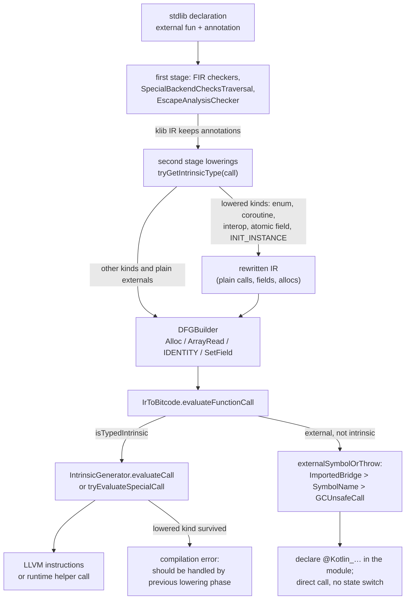
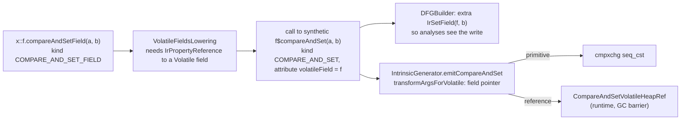
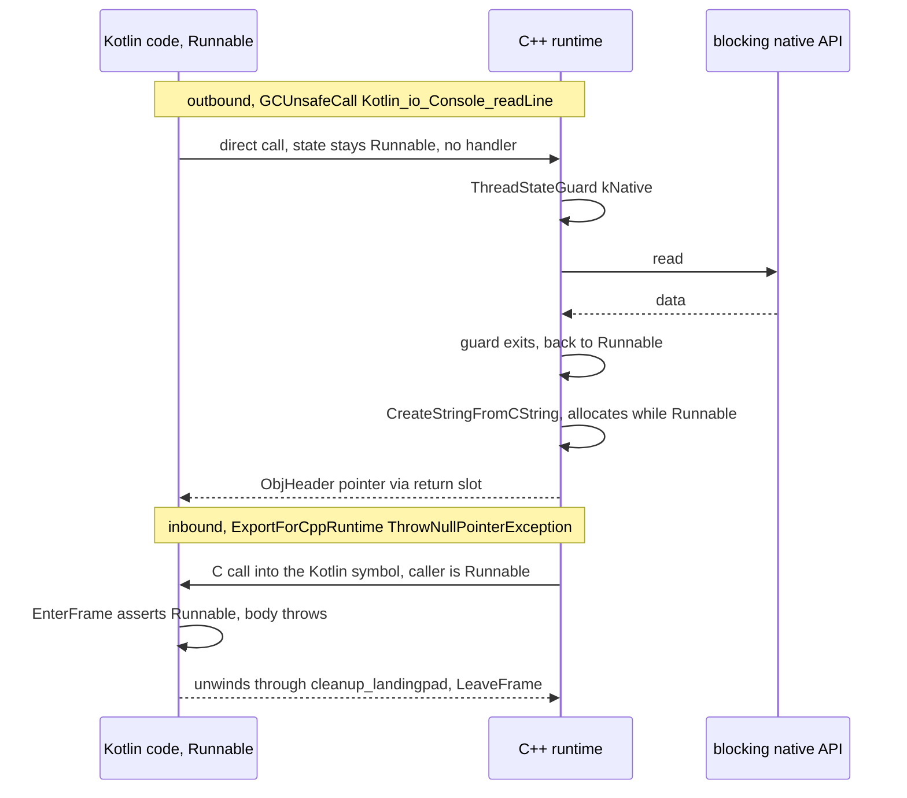

# Kotlin/Native: intrinsics and compiler-facing annotations

The K/N stdlib is not self-contained Kotlin: a few hundred of its declarations are promises to the compiler or to the C++ runtime.
`external fun`s carry an annotation that tells codegen what to emit instead of a call (`@TypedIntrinsic`), which C symbol to call
(`@GCUnsafeCall`, `@SymbolName`), or which C symbol the function itself must be reachable under (`@ExportForCppRuntime`);
other annotations fix class layout, type-info export, finalization, or escape-analysis summaries; and a set of ordinary functions is
looked up by name through `BackendNativeSymbols` because lowerings emit calls to them. This page catalogues that whole set: every
annotation and every `IntrinsicType` kind, who reads it (frontend checker, lowering, DataFlowIR builder, `IntrinsicGenerator`,
RTTI generator, runtime), what it changes, and what breaks when it is misused. The ABI the two sides share (object layout,
`TypeInfo`, thread states, how the compiler imports runtime functions) is in
[compiler-runtime-contract.md](compiler-runtime-contract.md) and is not repeated here.

Read this when: a stdlib change needs a new runtime entry point or intrinsic; codegen fails with "should be handled by previous
lowering phase" or "external function … must have @TypedIntrinsic, …"; a release-only crash points at a `Kotlin_*` function; you
need to know whether an annotation is read by anything at all.

Related pages: [compiler-runtime-contract.md](compiler-runtime-contract.md) (ABI, `importRtFunction`, thread states),
[llvm-codegen.md](llvm-codegen.md) (the `call` wrapper, exception handlers), [lowerings.md](lowerings.md) (where each lowering runs),
[dataflow-ir.md](dataflow-ir.md) and [escape-analysis.md](escape-analysis.md) (`@Escapes`/`@PointsTo`),
[cinterop.md](cinterop.md) (the `kotlinx.cinterop` annotations), [export.md](export.md) (`@ExportedBridge`, ObjC/Swift export),
[compatibility-and-migration.md](compatibility-and-migration.md) (stdlib ↔ compiler versioning).

Path abbreviations: `BACKEND` = `kotlin-native/backend.native/compiler/ir/backend.native/src/org/jetbrains/kotlin/backend/konan`,
`IRNATIVE` = `compiler/ir/backend.native/src/org/jetbrains/kotlin/backend/konan` (first-stage, LLVM-free),
`KT` = `kotlin-native/runtime/src/main/kotlin`, `INTEROP` = `kotlin-native/Interop/Runtime/src/native/kotlin/kotlinx/cinterop`,
`RT` = `kotlin-native/runtime/src/main/cpp`.

## Key concepts

| Term                               | Meaning                                                                                                                                                                     |
|------------------------------------|-----------------------------------------------------------------------------------------------------------------------------------------------------------------------------|
| Typed intrinsic                    | An `external fun` annotated `@TypedIntrinsic(kind)` ([KT Annotations.kt]). Codegen never emits a call to it; the `kind` string selects a case in [IntrinsicGenerator.kt] or in a lowering. |
| Intrinsic kind                     | The `kind` string. Declared twice: as `const val`s in the stdlib ([KT IntrinsicType.kt]) and as the compiler enum `IntrinsicType` in [native/base IntrinsicType.kt]; matched by `IntrinsicType.valueOf(kind)` in [Intrinsics.kt]. |
| Lowered intrinsic                  | A kind that a lowering must rewrite before codegen; `IntrinsicGenerator` reports a compilation error if one survives ("should be handled by previous lowering phase"). |
| Special intrinsic                  | A kind evaluated *before* its arguments (`tryEvaluateSpecialCall`), because the argument must be a compile-time constant: `IMMUTABLE_BLOB`, `OBJC_GET_SELECTOR`. |
| Constant-constructor intrinsic     | A constructor annotated `@ConstantConstructorIntrinsic(kind)` used only inside `IrConstantObject`; [IntrinsicGenerator.kt] `evaluateConstantConstructorFields` fills the fields (`KCLASS_IMPL`, `OBJC_KCLASS_IMPL`). |
| Runtime entry point (`Kotlin_*`)   | An `extern "C"` function in `RT` called from Kotlin through `@GCUnsafeCall("Kotlin_…")`. About 400 distinct `Kotlin_*` names exist in the runtime sources; 372 `@GCUnsafeCall` sites in the stdlib and interop runtime. |
| Export for the C++ runtime         | A Kotlin function the runtime calls by a fixed C name: `@ExportForCppRuntime` (115 sites in the stdlib). The reverse direction of `@GCUnsafeCall`. |
| Symbol-recognized function         | A plain stdlib function that lowerings or codegen find by `CallableId` through `BackendNativeSymbols` ([Ir.kt]) and either *emit calls to* (`ThrowNullPointerException`, `initInstance`) or *pattern-match on* (`executeImpl`, `saveCoroutineState`). |
| `NativeRuntimeNames` / `KonanFqNames` / `RuntimeNames` | The three name tables: `ClassId`s shared with the frontend ([NativeRuntimeNames.kt], `core/compiler.common.native`), FQ names used by both stages ([KonanFqNames.kt], `native/base`), and FQ names for the second stage ([RuntimeNames.kt]). The split is historical; `TypedIntrinsic` is spelled in two of them. |

## The resolution path of one call

A call to a `kotlin.native.internal` function passes through up to five decision points, in this order. The picture below is
derived from [Intrinsics.kt] (`tryGetIntrinsicType`), [SpecialBackendChecksTraversal.kt], the lowerings named in the
tables below, [DFGBuilder.kt], [IrToBitcode.kt] `evaluateFunctionCall` / `call`, [IrUtils.kt] `externalSymbolOrThrow`
and [IntrinsicGenerator.kt]:

Two facts follow from the picture and are easy to miss:

- The *same* `IrCall` can be seen by several consumers. `createUninitializedInstance<T>()` is emitted by `ConstructorsLowering`,
  modelled as `Node.AllocInstance` by the DFG builder, and finally emitted by `emitCreateUninitializedInstance` with the lifetime
  escape analysis computed. A new kind therefore usually needs three entries, not one (see the checklist).
- Nothing in the frontend validates that an `external fun` in *user* code carries one of the binding annotations. The FIR checker
  [FirNativeExternalDeclarationChecker.kt] only rejects the `external` modifier on non-functions; an unannotated external function
  compiles into a klib and the second stage fails with `Error("external function … must have @TypedIntrinsic, @SymbolName,
  @GCUnsafeCall, @ImportedBridge or @ObjCMethod annotation")` from `externalSymbolOrThrow` — an internal error, not a diagnostic.

## Part 1 — the annotations

All annotations below are `internal` or opt-in gated (`@InternalForKotlinNative`, `@SymbolNameIsInternal`) and `BINARY`-retained,
except where noted. "Reader" is the code that looks the annotation up; "misuse" is what happens when the declaration does not
honour the annotation's contract. The user-visible ObjC/Swift export refinement annotations (`@ObjCName`, `@HiddenFromObjC`,
`@ShouldRefineInSwift`, `@ObjCEnum`, …) and the `kotlinx.cinterop` ones are only listed in the last group; their semantics
belong to [export.md](export.md) and [cinterop.md](cinterop.md).

### Binding a call to code the compiler does not see

| Annotation (declared in)                             | Target     | Readers                                                                                                                                                                                                                                                     | Effect / misuse                                                                                                                                                                                                                                                                                      |
|------------------------------------------------------|------------|-------------------------------------------------------------------------------------------------------------------------------------------------------------------------------------------------------------------------------------------------------------|------------------------------------------------------------------------------------------------------------------------------------------------------------------------------------------------------------------------------------------------------------------------------------------------------|
| `@TypedIntrinsic(kind)` ([KT Annotations.kt])        | function   | `tryGetIntrinsicType` ([Intrinsics.kt]) from lowerings and [DFGBuilder.kt]; [IrToBitcode.kt] `evaluateFunctionCall`; [LlvmDeclarations.kt] (no LLVM declaration is created for it); `externalSymbolOrThrow` (returns `null`: no symbol); [EscapeAnalysisChecker.kt] (EA annotations are "unused" on lowered kinds) | The call is replaced by LLVM instructions or by lowered IR; the body/symbol never exists. Misuse: a `kind` not in the compiler's enum throws `IllegalArgumentException` from `Enum.valueOf` in the second stage (the first-stage checkers tolerate it, see below); a lowered kind that reaches codegen is a compilation error. Must be called directly: a virtual or reflective call has no intrinsic to dispatch to (`IrToBitcode.call` has `check(!function.isTypedIntrinsic)`). |
| `@ConstantConstructorIntrinsic(kind)` ([KT Annotations.kt]) | constructor | `isConstantConstructorIntrinsic` ([IrUtils.kt]) in `IrToBitcode.evaluateConstantValue`; `evaluateConstantConstructorFields` ([IntrinsicGenerator.kt])                                                                                                      | Inside an `IrConstantObject` the fields come from the generator: `KCLASS_IMPL` → the `TypeInfo*` of the type argument, `OBJC_KCLASS_IMPL` → the ObjC class ref. [NativeReflectionIrBuilder.kt] builds `T::class` constants with these constructors. The Kotlin body (`TODO(...)`) is unreachable; calling the constructor outside a constant throws it. |
| `@GCUnsafeCall(callee)` ([KT Annotations.kt], public, opt-in `@InternalForKotlinNative`) | function | `externalSymbolOrThrow` ([IrUtils.kt]); `ANNOTATIONS_TO_TREAT_AS_EXPORTED` ([KonanMangler.kt]); `IrToBitcode.needsNativeThreadState` (asserts it is *not* on a C bridge); [FunctionsWithoutBoundCheckGenerator.kt] (copies it with a `_without_BoundCheck` suffix) | The LLVM declaration is named `callee` and called directly in the Runnable state with no exception filtering (Part 4). Misuse: the callee blocks → GC deadlock (the callee must switch state itself); the callee throws a C++ exception → undefined behaviour; a typo in `callee` → linker error `undefined symbol`, not a compiler error. |
| `@SymbolName(name)` ([KT native Annotations.kt], opt-in `@SymbolNameIsInternal`, KT-46649) | function | same `externalSymbolOrThrow` branch, checked *before* `@GCUnsafeCall`                                                                                                                                                                                       | Identical binding to `@GCUnsafeCall`; the difference is only the opt-in gate. Made internal in `5020d5f2f9c2` (2021-11); `@GCUnsafeCall` was introduced with the new MM in `4d346d373588` (2021-01, "Support thread state switching") as the explicitly-dangerous spelling for runtime calls. The stdlib has no `@SymbolName` left; cinterop stubs and user code with the opt-in still use it. |
| `@ForceNativeThreadState` ([KT native Annotations.kt], `@SinceKotlin("2.4")`, `2be4f738449d`) | function | `IrToBitcode.call` (`RuntimeNames.forceNativeThreadStateAnnotation`), together with `-Xbinary=forceNativeThreadStateForFunctions`                                                                                                                             | Wraps the direct call in `switchThreadState(Native)`/`(Runnable)` and forces a filtering exception handler ("quick hack for functions that break the contract of `SymbolName` by being blocking", KT-75895, KT-79384). For `@SymbolName`/cinterop callees that block. |
| `@FilterExceptions(mode)` ([KT Annotations.kt])      | function   | `IrToBitcode.call`; [CBridgeGenUtils.kt] adds it to generated Kotlin-to-C bridges                                                                                                                                                                           | Installs `filteringExceptionHandler`: foreign exceptions terminate (`terminate`) or are wrapped (`objc_wrap`). The KDoc notes it describes the *call site*, not the function ("it doesn't have any effect when calling the function virtually. TODO: rework"). Three stdlib uses, all ObjC-export related. |
| `@Independent` ([KT Annotations.kt])                 | function   | `LlvmFunctionProto` ([LlvmFunctionPrototype.kt]) → `dependenciesTracker.add(origin, onlyBitcode = true)` ([ContextUtils.kt])                                                                                                                                 | "Implemented in library-stored bitcode and doesn't have native dependencies": the owning klib's bitcode is linked, but its `linkerOpts`/static libraries are not pulled in. Zero uses in the stdlib; produced by the cinterop stub generator ([KotlinCodeModel.kt] `independent`). |
| `@ImportedBridge(bridgeName)` ([KT Annotations.kt])   | function   | `externalSymbolOrThrow` (highest priority); `needsNativeThreadState`                                                                                                                                                                                        | Swift-export inbound bridge: direct call to `bridgeName` with a Native/Runnable switch and a terminating handler. See [export.md](export.md). |

### Making a Kotlin declaration reachable from outside

| Annotation                                           | Target            | Readers                                                                                                                                                                                                                                                                 | Effect / misuse                                                                                                                                                                                                                                                                        |
|------------------------------------------------------|-------------------|-------------------------------------------------------------------------------------------------------------------------------------------------------------------------------------------------------------------------------------------------------------------------|----------------------------------------------------------------------------------------------------------------------------------------------------------------------------------------------------------------------------------------------------------------------------------------|
| `@ExportForCppRuntime(name = "")`                    | function, constructor, accessor | `funSymbolNameImpl` ([BinaryInterface.kt]): symbol = `name`, or the unqualified Kotlin name if empty; `ANNOTATIONS_TO_TREAT_AS_EXPORTED` (so `isExported`, hence a DCE/devirtualization root); `EXPLICITLY_EXPORTED` attribute ([DataFlowIR.kt]); `needCleanupLandingpadAndLeaveFrame` ([CodeGenerator.kt]); `isReferencedByNativeRuntime` ([TopLevelPhases.kt]); [EntryPoint.kt] synthesizes it on `Konan_start` | The function gets a C-callable symbol with a cleanup landing pad that calls `LeaveFrame` (a Kotlin exception may unwind into C++ frames). Its file is always part of the stdlib cache's runtime slice. Misuse: two functions with the same name → duplicate LLVM symbol; renaming breaks the runtime (`Exceptions.h`, launchers) and every prebuilt cache ([llvm-codegen.md](llvm-codegen.md)). |
| `@ExportTypeInfo(name)`                              | class             | `exportTypeInfoIfRequired` ([RTTIGenerator.kt]); `isReferencedByNativeRuntime`                                                                                                                                                                                          | Emits an exported global `name` holding the `TypeInfo*` (`theStringTypeInfo`, `theArrayTypeInfo`, …, 19 classes). The runtime declares them `extern` ([RT TypeInfo.h] users, `Kotlin_ObjCExport`). Misuse: field reordering of such a class is invisible to C++ (see `@NoReorderFields`). |
| `@ExportForCompiler`                                 | function, constructor, class | `ANNOTATIONS_TO_TREAT_AS_EXPORTED` ([KonanMangler.kt]) — this is the consumer the compiler-runtime-contract page could not find; `hasExportForCompilerAnnotation` in the Analysis-API ObjC export ([hasExportForCompilerAnnotation.kt]) hides such constructors from headers | Makes the declaration count as exported for the mangler: a stable `kfun:` symbol and a root for DCE and devirtualization, which is what the stdlib comments mean by "Mark as data flow root" ([KT ObjCExportCoroutines.kt]). It does *not* make the compiler look the declaration up; lookups go through `BackendNativeSymbols` regardless. Misuse: forgetting it on a function that only compiler-generated code calls lets DCE drop it in `-opt` library builds. |
| `@ExportedBridge(bridgeName, nonVirtualTargetMethod)` (public, `@ExperimentalNativeApi`) | function | `findManglingAnnotation` ([BinaryInterface.kt]); `EXPLICITLY_EXPORTED`; `retainAnnotation` ([RetainAnnotation.kt]) → `llvm.used`                                                                                                                                      | Swift-export outbound bridge; see [export.md](export.md).                                                                                                                                                                                                                              |
| `@Retain`, `@RetainForTarget(target)` ([KT native Annotations.kt]) | function, class | `retainAnnotation` ([RetainAnnotation.kt])                                                                                                                                                                                                                 | Adds the function to `llvm.used` so LLVM keeps it without references. Zero uses in the stdlib today; the same path is taken by `@ExportedBridge` and `@BindReverseBridgeToMethod`. |
| `@CName(externName, shortName)` (public, `@ExperimentalNativeApi`) | function | `ANNOTATIONS_TO_TREAT_AS_EXPORTED`; C export header generation ([export.md](export.md))                                                                                                                                                                       | Exported and named in the C header; a root like the others.                                                                                                                                                                                                                             |

### Fixing the shape of a class

| Annotation                                           | Target | Readers                                                                                                                                                   | Effect / misuse                                                                                                                                                                                                                                   |
|------------------------------------------------------|--------|-----------------------------------------------------------------------------------------------------------------------------------------------------------|---------------------------------------------------------------------------------------------------------------------------------------------------------------------------------------------------------------------------------------------------|
| `@NoReorderFields`                                   | class  | `ClassLayoutBuilder.getFieldsInternal` ([ClassLayoutBuilder.kt]) and `packFields` ([LlvmDeclarations.kt])                                                   | Declared fields keep source order instead of being sorted by size and packed. Used on the three classes whose fields C++ reads positionally: `RegularWeakReferenceImpl` ([KT WeakPrivate.kt]), `CleanerImpl` ([KT Cleaner.kt]), `MutableData`. The comment in `packFields` states the precondition: "only occurs on final classes with no inherited fields" — not checked. |
| `@HasFinalizer`                                      | class  | `hasFinalizer` ([IrUtils.kt]) → `TF_HAS_FINALIZER` in [RTTIGenerator.kt]; [EscapeAnalysis.kt] forces `Lifetime.GLOBAL` on allocations of such classes; [EscapeAnalysisChecker.kt] requires such types to be marked escaping | Runtime: `FinalizerHooks.cpp` runs the finalizer hook for objects whose `TypeInfo.flags_` has the bit ([RT TypeInfo.h] `1 << 6`). Misuse: a stack-allocated or non-escaping finalizable object would never be finalized; both the EA pass and the checker close that hole. Two users: `CleanerImpl`, `RegularWeakReferenceImpl`. |
| `@CanBePrecreated` (`SOURCE` retention; `expect` in `libraries/stdlib/native-wasm`, `actual` in [KT Annotations.kt]) | class (object) | `ObjectClassLowering.hasConstStateAndNoSideEffects` ([ObjectClassLowering.kt])                                                                              | The singleton is treated as creatable at compile time: no init barrier on member access. Used on the four `Companion` objects of `Int`/`Long`/… in [KT Primitives.kt]. SOURCE retention means it is only visible while compiling the stdlib itself — which is where `ObjectClassLowering` runs on those objects, since the stdlib is lowered in the same binary ([lowerings.md](lowerings.md)). Hypothesis: SOURCE was chosen because the annotation must not leak into the klib ABI; no rationale is recorded. |
| `@LeakDetectorCandidate`                             | class  | none                                                                                                                                                      | Dead: no reader in the compiler, no user in the stdlib. Introduced with the cyclic garbage detector (`cae31c7853e2`, 2019); the matching `TF_LEAK_DETECTOR_CANDIDATE = 16` constant still sits in [RTTIGenerator.kt] without a runtime counterpart (see the open question in [compiler-runtime-contract.md](compiler-runtime-contract.md)). |

### Escape analysis summaries

`@Escapes(who)`, `@Escapes.Nothing` and `@PointsTo(vararg onWhom)` ([KT escapeAnalysis/Annotations.kt]) are read by
[DataFlowIR.kt] `SymbolTable.mapFunction` (`FunctionSymbol.External.escapes/pointsTo`) and checked in the first stage by
[EscapeAnalysisChecker.kt]. Encoding, checker rules and consumers are canonical in
[escape-analysis.md](escape-analysis.md#the-annotation-language-for-externals). What matters here: every `@GCUnsafeCall` function in
`kotlin.*` (outside the `concurrent` packages) with a reference in its signature **must** carry one, or the first stage reports a
backend error; and the checker's notion of "lowered intrinsic" (`mustBeLowered`) is a hand-maintained copy of the generator's list,
see Findings.

### Initialization, threads, debugger

| Annotation                                                        | Readers                                                                                                                                                  | Effect                                                                                                                                      |
|-------------------------------------------------------------------|----------------------------------------------------------------------------------------------------------------------------------------------------------|---------------------------------------------------------------------------------------------------------------------------------------------|
| `@ThreadLocal` (`kotlin.native.concurrent`, public)               | FIR `FirNativeThreadLocalChecker`; `symbols.threadLocal` in [ObjectClassLowering.kt], [InteropLowering.kt], `TestsInitializer`, [IrToBitcode.kt] | Per-thread storage for the object or property; see [static-initializers.md](static-initializers.md).                                        |
| `@SharedImmutable` (deprecated `ERROR` since 2.1)                 | FIR `FirNativeSharedImmutableChecker` only                                                                                                               | No backend effect ("redundant and has no effect").                                                                                          |
| `@EagerInitialization` (`kotlin.native`, deprecated, `@ExperimentalStdlibApi`) | FIR `FirNativeEagerInitializationChecker`; [StaticInitializersLowering.kt], `CacheInfoBuilder`, `TestsInitializer`, [InteropLowering.kt]                | Top-level property initialized at program start; see [static-initializers.md](static-initializers.md).                                      |
| `@TransparentForDebugger`                                         | `IrSimpleFunction.scope` in [IrToBitcode.kt] (gated by `enableDebugTransparentStepping`, Apple only, default on); `BridgesBuilding` copies it to bridges | The debugger steps over the function (`checkNotNull`, `downcast` in [KT KClassImpl.kt]).                                                   |
| `@NoInline` (`kotlin.native`, `@ExperimentalNativeApi`)           | `symbols.noInline` in `PreCodegenInliner` ([pre-codegen-inliner.md](pre-codegen-inliner.md))                                                           | Excludes the function from pre-codegen IR inlining.                                                                                         |
| `@InternalForKotlinNative`                                        | the frontend's opt-in machinery only                                                                                                                     | `RequiresOptIn(ERROR)` marker that gates `@GCUnsafeCall`, `@ImportedBridge`, `createUninitializedInstance`, `initInstance`, … Tests opt in with `-opt-in=kotlin.native.internal.InternalForKotlinNative` ([StdlibTest.kt]). |
| `@UsedFromCompilerGeneratedCode` (`kotlin.internal`, common)      | `StandardClassIds.Annotations.UsedFromCompilerGeneratedCode` ([StandardClassIds.kt])                                                                     | Documents that a `private`/`internal` declaration is referenced by generated IR; the backend does not read it on Native. Unverified: whether any common checker reports unused declarations based on it. |
| `@Intrinsic`                                                      | none                                                                                                                                                     | Dead: declared in [KT Annotations.kt] ("usages require special handling in compiler"), zero readers, zero users.                            |

### Interop and export annotations (listed only)

Declared in [INTEROP ObjectiveCImpl.kt], [INTEROP internal/Annotations.kt], [INTEROP ObjectiveCUtils.kt] and
[KT native Annotations.kt]; `ClassId`s in [NativeStandardInteropNames.kt] and [NativeRuntimeNames.kt]:

- ObjC classes and methods: `@ExternalObjCClass`, `@ObjCMethod`, `@ObjCConstructor`, `@ObjCFactory`, `@ObjCDirect`,
  `@ObjCMethodImp`, `@ObjCUnavailable`, `@OverrideInit`, `@ExportObjCClass`, `@ObjCAction`, `@ObjCOutlet`, `@ObjCSignatureOverride`
  → [cinterop.md](cinterop.md). `externalSymbolOrThrow` returns `null` for `@ObjCMethod` (the messenger intrinsic replaces the call).
- C declarations: `@CCall`, `@CCall.Direct`, `@CCall.CString`/`WCString`/`ReturnsRetained`/`ConsumesReceiver`/`Consumed`,
  `@CStruct`, `@CStruct.MemberAt`/`ArrayMemberAt`/`BitField`/`VarType`, `@CGlobalAccess`, `@CGlobalAccess.Pointer`,
  `@CEnumEntryAlias`, `@CEnumVarTypeSize`, `@CToKotlinBridge`, `@KotlinToCBridge` → [cinterop.md](cinterop.md).
  `isCFunctionOrGlobalAccessor()` short-circuits `externalSymbolOrThrow` for these: the stub is generated, not bound by name.
- ObjC/Swift export: `@ObjCName`, `@ObjCEnum`, `@HidesFromObjC`/`@HiddenFromObjC`, `@RefinesInSwift`/`@ShouldRefineInSwift`,
  `@BindClassToObjCName`, `@BindReverseBridgeToMethod`, `@Throws` → [export.md](export.md).

## Part 2 — `@TypedIntrinsic` kinds by family

The compiler enum has 90 kinds ([native/base IntrinsicType.kt]); the stdlib and interop runtime use every one of them at least once
(counts below are declaration sites, from a grep of `@TypedIntrinsic(` over `KT` and `INTEROP`). "Handled where" names the code
that consumes the kind; a kind in the "lowered" column of [IntrinsicGenerator.kt] (`reportNonLoweredIntrinsic`) must not reach
codegen.

| Family                   | Kinds                                                                                                                                                                                                                                    | Declared in (sites)                                                                                                                                                      | Handled where                                                                                                                                                                                                                                                                                                                                                         | Notes                                                                                                                                                                                                                                                                                                                                                                                                       |
|--------------------------|------------------------------------------------------------------------------------------------------------------------------------------------------------------------------------------------------------------------------------------|---------------------------------------------------------------------------------------------------------------------------------------------------------------------------|-----------------------------------------------------------------------------------------------------------------------------------------------------------------------------------------------------------------------------------------------------------------------------------------------------------------------------------------------------------------------|-------------------------------------------------------------------------------------------------------------------------------------------------------------------------------------------------------------------------------------------------------------------------------------------------------------------------------------------------------------------------------------------------------------|
| Arithmetic and bit ops   | `PLUS`, `MINUS`, `TIMES`, `SIGNED_DIV`, `SIGNED_REM`, `INC`, `DEC`, `UNARY_PLUS`, `UNARY_MINUS`, `SHL`, `SHR`, `USHR`, `AND`, `OR`, `XOR`, `INV`, `NOT`                                                                                       | [KT Primitives.kt] (85 intrinsics in the file), [KT Boolean.kt], [KT Char.kt]                                                                                              | `IntrinsicGenerator` only (`emitPlus`, …)                                                                                                                                                                                                                                                                                                                             | Integer vs float chosen from the LLVM type (`fadd`/`add`). `SIGNED_DIV`/`SIGNED_REM`: `emitThrowIfZero` calls `ThrowArithmeticException`, then `MIN_VALUE / -1` is special-cased (`emitSignedDivisionWithOverflow`: result `MIN_VALUE` for div, `0` for rem; only 32/64-bit widths). Shifts mask the count with `31`/`63` (`emitShift`). `INV` is `xor -1`.          |
| Conversions              | `SIGN_EXTEND`, `ZERO_EXTEND`, `INT_TRUNCATE`, `FLOAT_TRUNCATE`, `FLOAT_EXTEND`, `SIGNED_TO_FLOAT`, `UNSIGNED_TO_FLOAT`, `REINTERPRET`, `EXTRACT_ELEMENT`                                                                                   | [KT Primitives.kt], [KT Numbers.kt], [KT Char.kt], [INTEROP Vector128.kt]                                                                                                 | `IntrinsicGenerator`                                                                                                                                                                                                                                                                                                                                                  | Target type is the call's LLVM return type. `EXTRACT_ELEMENT` bounds-checks the lane index (`emitThrowIfOOB`). `REINTERPRET` is a `bitcast` (e.g. `Float.toRawBits`).                                                                                                                                                                                                 |
| Equality                 | `ARE_EQUAL_BY_VALUE` (9), `IEEE_754_EQUALS` (2)                                                                                                                                                                                             | [KT Intrinsics.kt] `areEqualByValue(first, second)` per primitive, `NativePtr`, `Vector128`; `ieee754Equals`                                                             | `IntrinsicGenerator`; emitted by [BuiltinOperatorLowering.kt] via `symbols.areEqualByValue[PrimitiveBinaryType]`                                                                                                                                                                                                                                                      | `ARE_EQUAL_BY_VALUE` on floats/vectors compares the bit pattern (`bitcast` to an integer, `icmp eq`), so `-0.0 != 0.0` and `NaN == NaN`; `IEEE_754_EQUALS` is `fcmp oeq`. Devirtualization's type switch uses `ARE_EQUAL_BY_VALUE` on `TypeInfo*` ([devirtualization.md](devirtualization.md)).                                                                     |
| Allocation and instances | `CREATE_UNINITIALIZED_INSTANCE`, `CREATE_UNINITIALIZED_ARRAY`, `CREATE_EMPTY_STRING`, `INIT_INSTANCE`                                                                                                                                       | [KT RuntimeUtils.kt] (`createUninitializedInstance`, `initInstance`, `createUninitializedArray` are `public` behind `@InternalForKotlinNative`)                            | Emitted by [ConstructorsLowering.kt] (constructor call → alloc + lowered constructor function); `INIT_INSTANCE` is consumed there and by [ObjectClassLowering.kt], [EnumClassLowering.kt], [InteropLowering.kt], [Autoboxing.kt]; [DFGBuilder.kt] → `Node.AllocInstance`/`AllocArray` (empty string "treat it like a fixed-size object"), `initInstance` → `error("Should've been lowered")`; `IntrinsicGenerator` → `allocInstance`/`allocArray` with `calculateLifetime` | The only three allocation points in generated code; stack allocation ([escape-analysis.md](escape-analysis.md)) hangs off them. `CREATE_EMPTY_STRING` allocates `stringHeaderExtraSize / 2` chars. The `IntrinsicGenerator` list marks `INIT_INSTANCE` as lowered; the EA checker additionally lists the three `CREATE_*` as lowered (they are not — see Findings). |
| Identity and constants   | `IDENTITY` (9), `THE_UNIT_INSTANCE`, `IS_SUBTYPE`, `IMMUTABLE_BLOB` (2)                                                                                                                                                                      | [KT Intrinsics.kt] `reinterpret` (`IDENTITY`), `theUnitInstance`; [KT RuntimeUtils.kt] `isSubtype`; [KT Blob.kt] `immutableBlobOfImpl`; `IDENTITY` also on `NativePtr`/`CPointer` accessors in interop | `IDENTITY`: [DFGBuilder.kt] returns the argument's node (transparent); `emitIdentity` returns the argument. `IS_SUBTYPE`: `VirtualTablesLookup.checkIsSubtype` ([casts-optimization.md](casts-optimization.md)). `IMMUTABLE_BLOB`: special — [PostInlineLowering.kt] rewrites `immutableBlobOf(vararg)` to `immutableBlobOfImpl(IrConst)`, then `tryEvaluateSpecialCall` → `staticData.createImmutableBlob`; `SpecialBackendChecksTraversal` rejects spreads and non-constants in the first stage | `reinterpret` is the compiler's "trust me" cast: emitted by [Autoboxing.kt], [BuiltinOperatorLowering.kt], `GenericCallsReturnTypeEraser`, `NativeDefaultParameterInjector`, `InlineClassPropertyAccessorsLowering`. It is a `bitcast`-free no-op at LLVM level, so a wrong use corrupts memory silently. `theUnitInstance()` is also the DFG's stand-in for "no value" (`restoreCoroutineState`). |
| Enums                    | `ENUM_VALUES`, `ENUM_VALUE_OF`, `ENUM_ENTRIES`                                                                                                                                                                                                | [KT Enums.kt] `enumValuesIntrinsic`/`enumValueOfIntrinsic`, [KT EnumEntriesNative.kt]                                                                                      | [EnumClassLowering.kt] `visitCall`: resolves the reified type argument to the enum class and calls its static `values`/`valueOf`/`entries` (fallback `createEnumEntries(values())` "for enums from old klibs"); a type parameter erased to `Enum` becomes `ThrowIllegalStateException` | Lowered.                                                                                                                                                                                                                                                                                                                                                                                                    |
| Coroutines               | `GET_CONTINUATION`, `RETURN_IF_SUSPENDED`, `SAVE_COROUTINE_STATE`, `RESTORE_COROUTINE_STATE`                                                                                                                                                 | [KT Coroutines.kt]; `suspendCoroutineUninterceptedOrReturn` and `getCoroutineContext` are `InlineOnly` wrappers over `getContinuation()`                                   | `GET_CONTINUATION`: common `AddContinuationToFunctionCallsLowering` replaces it by the function's continuation parameter; `RETURN_IF_SUSPENDED`: [NativeSuspendFunctionLowering.kt] (tail-call simplification) and the state machine; `SAVE/RESTORE_COROUTINE_STATE`: inserted by [CoroutinesVarSpillingLowering.kt], consumed by [DFGBuilder.kt] (`Node.SaveCoroutineState(liveVariables)`, restore = no-op call to `theUnitInstance`) | Lowered. `getContinuation` is also a `BackendSymbols` override shared with the other backends.                                                                                                                                                                                                                                                                       |
| Interop: raw memory      | `INTEROP_READ_PRIMITIVE` (8), `INTEROP_WRITE_PRIMITIVE` (8), `INTEROP_READ_BITS`, `INTEROP_WRITE_BITS`, `INTEROP_GET_POINTER_SIZE`, `INTEROP_NATIVE_PTR_TO_LONG`, `INTEROP_NATIVE_PTR_PLUS_LONG`, `INTEROP_GET_NATIVE_NULL_PTR`                | [INTEROP NativeMem.kt] (`nativeMemUtils`), [INTEROP internal/Internal.kt] `readBits`/`writeBits`, [KT NativePtr.kt]                                                        | `IntrinsicGenerator` (`load`/`store`, `gep`, `ptrtoint`, `kNull`); [InteropCallConvertors.kt] emits `READ/WRITE_PRIMITIVE` for struct member access; [InteropLowering.kt] replaces `NativePointed.rawPtr`/`CPointer.rawValue` getters by the intrinsic getters | `READ_BITS`/`WRITE_BITS` require constant `offset`, `size`, `signed` (`extractConstUnsignedInt`) and read/write an unaligned padded integer ("LLVM allows to read without padding tail up to byte boundary, but the result seems to be incorrect"). |
| Interop: conversions and functions | `INTEROP_CONVERT` (8), `INTEROP_BITS_TO_FLOAT`, `INTEROP_BITS_TO_DOUBLE`, `INTEROP_SIGN_EXTEND`, `INTEROP_NARROW`, `INTEROP_STATIC_C_FUNCTION` (23), `INTEROP_FUNPTR_INVOKE` (23), `BLOCK_PTR_TO_FUNCTION_OBJECT`                    | [INTEROP NativeTypes.kt], [INTEROP FunctionPointers.kt] (one overload per arity), [INTEROP NativeUtils.kt], [INTEROP ObjectiveCImpl.kt]                                     | First stage: [SpecialBackendChecksTraversal.kt] validates signatures (bound references, integer widths, "C function signature element mismatch"). Second stage: [InteropLowering.kt] `visitCall` (`lowerStaticCFunction`, `BLOCK_PTR_TO_FUNCTION_OBJECT` via `CBridgeGenState`, constant folding of `bitsToFloat`, integer conversion) | Lowered. `STATIC_C_FUNCTION` and `WORKER_EXECUTE` are handled *before* `transformChildrenVoid` because their argument is a raw function reference that must not be transformed. |
| ObjC                     | `OBJC_GET_MESSENGER`, `OBJC_GET_MESSENGER_STRET`, `OBJC_GET_OBJC_CLASS`, `OBJC_CREATE_SUPER_STRUCT`, `OBJC_INIT_BY`, `OBJC_GET_SELECTOR`                                                                                                     | [INTEROP ObjectiveCImpl.kt] `getMessenger`, `getMessengerStret`, `getObjCClass`, `createObjCSuperStruct`, `initBy`, `getSelector`                                            | `IntrinsicGenerator`: messenger = `select(superClass == null, objc_msgSend, objc_msgSendSuper)` (`_stret` variants), super struct = `alloca {ptr, ptr}`; `OBJC_GET_SELECTOR` is special (constant string → `genObjCSelector`); `OBJC_INIT_BY` is lowered by [InteropLowering.kt] `lowerObjCInitBy` | The generator lists `OBJC_INIT_BY` under `reportSpecialIntrinsic` although it is lowered, not special — a mislabel only visible in the error message. |
| Worker                   | `WORKER_EXECUTE`                                                                                                                                                                                                                             | [KT Worker.kt]                                                                                                                                                              | First stage: `SpecialBackendChecksTraversal` requires an unbound function reference; [InteropLowering.kt] `lowerWorkerExecute` → call to `executeImpl` ([KT Internal.kt], `@ExportForCompiler`); [DFGBuilder.kt] adds synthetic `producer.invoke()` and `job(...)` calls "called externally, we need to reflect this somehow" | Lowered.                                                                                                                                                                                                                                                                                                                                                                                                    |
| Atomics on volatile fields | source kinds `ATOMIC_GET_FIELD`, `ATOMIC_SET_FIELD`, `COMPARE_AND_SET_FIELD`, `COMPARE_AND_EXCHANGE_FIELD`, `GET_AND_SET_FIELD`, `GET_AND_ADD_FIELD`; synthesized kinds `COMPARE_AND_SET`, `COMPARE_AND_EXCHANGE`, `GET_AND_SET`, `GET_AND_ADD` | [KT concurrent/Atomics.kt] (`KMutableProperty0<T>.compareAndSetField(...)` etc.)                                                                                        | [VolatileFieldsLowering.kt]: the `*_FIELD` call must have a compile-time property reference to a `@Volatile` backing field; it is replaced by a call to a per-field synthetic function annotated with the second-group kind and tagged `volatileField` (`irField.atomicFunction` cache); `ATOMIC_GET/SET_FIELD` become plain getter/setter calls. [DFGBuilder.kt] models `COMPARE_AND_SET`/`_EXCHANGE`/`GET_AND_SET` as an `IrSetField` of the volatile field. `IntrinsicGenerator`: `cmpxchg`/`atomicrmw` seq_cst, or the runtime helpers `CompareAndSetVolatileHeapRef`/`CompareAndSwapVolatileHeapRef`/`GetAndSetVolatileHeapRef` when the field holds a reference (GC barrier) | The `*_FIELD` kinds are lowered; the synthesized kinds are generated. `Boolean` fields go through `irBoolToByte`/`irByteToBool`. `GET_AND_ADD` on references is rejected (`require(op == Xchg)`). Tests: [volatile/intrinsics.kt], [fileCheck/atomics.kt]. |
| Atomic arrays            | `ATOMIC_GET_ARRAY_ELEMENT`, `ATOMIC_SET_ARRAY_ELEMENT`, `COMPARE_AND_EXCHANGE_ARRAY_ELEMENT`, `COMPARE_AND_SET_ARRAY_ELEMENT`, `GET_AND_SET_ARRAY_ELEMENT`, `GET_AND_ADD_ARRAY_ELEMENT`                                                       | [KT concurrent/AtomicArrays.kt] (17 sites: `IntArray`, `LongArray`, `Array<T>`)                                                                                            | `IntrinsicGenerator` only: `arrayGetElementAddress` calls `Kotlin_intArrayGetElementAddress`/`Kotlin_longArrayGetElementAddress`/`Kotlin_arrayGetElementAddress` (bounds-checked runtime helpers imported via `importRtFunction`), then the same `cmpxchg`/`atomicrmw`/volatile `loadSlot`/`storeAny` as above | Only `IntArray`, `LongArray`, `Array<T>` are supported (`error(...)` otherwise).                                                                                                                                                                                                                                                                                      |

The lowering chain for an atomic field operation, as implemented in [VolatileFieldsLowering.kt], [DFGBuilder.kt] and
[IntrinsicGenerator.kt]:

### Tolerating an unknown kind in the first stage

[SpecialBackendChecksTraversal.kt] and [EscapeAnalysisChecker.kt] both use a private `tryGetIntrinsicTypeIgnoringUnknown` that
maps `Enum.valueOf` failures to `null`. The KDoc states the reason: the stdlib is compiled by a *pinned bootstrap* distribution
whose `IntrinsicType` enum may lag behind the sources, so adding a kind to the runtime would otherwise require a bootstrap bump
first. The second stage has no such tolerance: `getIntrinsicType` throws, which is correct because a backend that does not know a
kind cannot compile the klib.

## Part 3 — functions recognized by symbol

`BackendNativeSymbols` ([Ir.kt]) resolves about 150 `ClassId`/`CallableId`s lazily (`functionSymbol()`, `classSymbol()`) the first
time a lowering touches them; a missing or ambiguous declaration fails at that point with messages such as
`No single conversion found from X to Y` or `Several areEqualByValue functions found for type …`. The first-stage subset lives in
`PreSerializationNativeSymbols` ([PreSerializationSymbols.kt]): `immutableBlobOf`, `createCleaner`, the integer classes, the
interop base classes, `suspendCoroutineUninterceptedOrReturn`, `getCoroutineContext`, test-runner classes. The table groups the
second-stage ones by what the compiler does with them.

| Family                  | Symbols (stdlib declaration)                                                                                                                                                                                       | Used by                                                                                                                                                                                                                                                                        | Direction                                                                                                     |
|-------------------------|--------------------------------------------------------------------------------------------------------------------------------------------------------------------------------------------------------------------|--------------------------------------------------------------------------------------------------------------------------------------------------------------------------------------------------------------------------------------------------------------------------------|---------------------------------------------------------------------------------------------------------------|
| Throw helpers           | `ThrowNullPointerException`, `ThrowTypeCastException`, `ThrowClassCastException`, `ThrowKotlinNothingValueException`, `ThrowNoWhenBranchMatchedException`, `ThrowInvalidReceiverTypeException`, `ThrowIllegalStateException[WithMessage]`, `ThrowIllegalArgumentExceptionWithMessage`, `ThrowArithmeticException`, `ThrowIndexOutOfBoundsException`, `throwIrLinkageError` ([KT RuntimeUtils.kt], most also `@ExportForCppRuntime`) | [BuiltinOperatorLowering.kt] (NPE, `NoWhenBranchMatched`, `throwIrLinkageError`), [InteropLowering.kt], [PostInlineLowering.kt], [IrToBitcode.kt] (null/cast checks), `CastsOptimization`, [EnumClassLowering.kt], [VolatileFieldsLowering.kt], `ObjCExportCodeGenerator`, [DevirtualizationAnalysis.kt] (0-candidate sites), `IntrinsicGenerator` (`emitThrowIfZero`/`emitThrowIfOOB`), common `KotlinNothingValueExceptionLowering` | compiler **emits calls**; the runtime calls the `@ExportForCppRuntime` ones too (`Exceptions.h`)               |
| Allocation protocol     | `createUninitializedInstance`, `createUninitializedArray`, `createEmptyString`, `initInstance`                                                                                                                       | [ConstructorsLowering.kt] (emits), [DFGBuilder.kt] (models), [Autoboxing.kt] (`initInstance` argument coercion), `IntrinsicGenerator`                                                                                                                                         | emits + matches                                                                                               |
| Coercions and equality  | `reinterpret`, `areEqualByValue` (map by `PrimitiveBinaryType`), `ieee754Equals`, `integerConversions` (`toInt`/`toUByte`/… for every pair of integer classes, asserted complete), `unsignedToSignedOfSameBitWidth`, `boxCachePredicates`/`boxCacheGetters` (`inIntBoxCache`, `getCachedIntBox`, … — `@GCUnsafeCall` to [RT Boxing.cpp]) | [Autoboxing.kt], [BuiltinOperatorLowering.kt], `GenericCallsReturnTypeEraser`, `NativeDefaultParameterInjector`, `InlineClassPropertyAccessorsLowering`, [InteropLowering.kt]                                                                                                 | emits                                                                                                         |
| Type checks, reflection | `isSubtype`, `getObjectTypeInfo` (`@GCUnsafeCall("Kotlin_Any_getTypeInfo")`), `checkNotNull`, `downcast`, `KClassImpl` + its two constructors, `KClassUnsupportedImpl`, `KFunctionImpl`, `KProperty*Impl`, `KTypeImpl`, `typeOf`, `getWithoutBoundCheck`/`setWithoutBoundCheck` names | [CastsLowering.kt] (`checkNotNull`, `downcast`), [DevirtualizationAnalysis.kt] (`isSubtype`, `getObjectTypeInfo`), [NativeReflectionIrBuilder.kt], [FunctionsWithoutBoundCheckGenerator.kt] (creates `<getWithoutBoundCheck>` externals whose `@GCUnsafeCall` callee is `<original>_without_BoundCheck`, e.g. `Kotlin_Array_get_without_BoundCheck` in [RT Arrays.cpp]) | emits                                                                                                         |
| Coroutines              | `getContinuation`, `returnIfSuspended`, `saveCoroutineState`, `restoreCoroutineState`, `invokeSuspend`, `coroutineSuspended` getter, `BaseContinuationImpl`/`ContinuationImpl`/`RestrictedContinuationImpl`, `getCoroutineSuspended`, `interceptedContinuation`, `resumeContinuation[WithException]`, `trapOnUndeclaredException` | common suspend lowerings, [NativeSuspendFunctionLowering.kt], [CoroutinesVarSpillingLowering.kt], [DFGBuilder.kt], [StaticInitializersOptimization.kt] (`getContinuation`, `executeImpl` are treated as opaque), ObjC export bridges | emits + matches                                                                                               |
| Workers and cleaners    | `executeImpl` ([KT concurrent/Internal.kt]), `createCleaner` ([KT Cleaner.kt])                                                                                                                                      | [InteropLowering.kt] `lowerWorkerExecute`, [DFGBuilder.kt], `BridgesBuilding`, `SpecialBackendChecksTraversal` (unbound reference checks)                                                                                                                                    | emits + matches                                                                                               |
| Enums, arrays, blobs    | `valuesForEnum`, `valueOfForEnum`, `enumEntries`, `EnumEntries`, `arrayGet`/`arraySet`/`arraySize` per array class, `copyInto`, `copyOf`, `contentToString`, `contentHashCode`, `immutableBlobOfImpl`, `ImmutableBlob`                   | [EnumClassLowering.kt], [DFGBuilder.kt] (`ArrayRead`/`ArrayWrite` nodes keep the callee), `PostInlineLowering`, array lowerings                                                                                                                                              | emits + matches                                                                                               |
| Entry point and errors  | `entryPoint` (resolved from `-entry`/test runner kind, shape-checked: `Unit`-returning, public, non-suspend), `processUnhandledException`, `terminateWithUnhandledException`, `println`                                                | [EntryPoint.kt] (wraps `main` in `Konan_start` with a `try`), DCE/devirtualization root set                                                                                                                                                                                   | emits                                                                                                         |
| Interop                 | `interopNativePointedGetRawPointer`, `interopCPointerGetRawValue`, `interopGetMessenger[Stret]`, `interopGetObjCClass`, `interopObjCObjectInitBy`, `interopAllocObjCObject`, `interopCValueRead/Write`, `interopTypeOf`, `readBits`/`writeBits`, `interopCallMarker`, `CToKotlinBridge`/`KotlinToCBridge`, the ObjC base classes ("referenced explicitly to force their deserialization") | [InteropLowering.kt], `SpecialInteropIntrinsicsLowering`, [InteropCallConvertors.kt], `CBridgeGen`, `InteropBridgesNameInventor`                                                                                                                                              | emits + matches; see [cinterop.md](cinterop.md)                                                              |

## Part 4 — the two call directions between Kotlin and the runtime

### Outbound: `@GCUnsafeCall` (and `@SymbolName`)

Binding happens in three places, none of which consults the runtime's bitcode:

1. **Declaration.** `LlvmDeclarations.visitSimpleFunction` ([LlvmDeclarations.kt]) skips externals that are typed intrinsics, ObjC
   bridges, cinterop accessors or C functions, and for the rest builds `LlvmFunctionProto(declaration, symbolName, …)`. The symbol
   comes from `computeSymbolName` → `funSymbolNameImpl` → `externalSymbolOrThrow` ([IrUtils.kt]): `@ImportedBridge.bridgeName`,
   else `@SymbolName.name`, else `@GCUnsafeCall.callee`. The LLVM *signature* is derived from the Kotlin signature
   (`LlvmFunctionSignature(irFunction, contextUtils)`), with the trailing `ObjHeader**` return slot for object-returning functions
   (`OBJ_GETTER` in [RT Memory.h]). Unlike `importRtFunction` ([compiler-runtime-contract.md](compiler-runtime-contract.md)), nothing
   compares this signature with the C++ definition: a mismatch is undefined behaviour at run time, not a compile error.
   `llvm.externalFunction` does check consistency *within* the module ("Inconsistent function type of …") if two Kotlin
   declarations bind the same symbol.
2. **Call site.** `IrToBitcode.call(function, llvmCallable, …)`: `needsNativeThreadState` is true only for `KOTLIN_TO_C_BRIDGE`
   externals (which `check(!gcUnsafeCall)`) and `@ImportedBridge`; so a `@GCUnsafeCall` call is a plain `call`/`invoke` in the
   **Runnable** state with the caller's exception handler, unless `@ForceNativeThreadState` or the
   `forceNativeThreadStateForFunctions` binary option names it. The result lifetime/slot handling is the generic one.
3. **Callee.** The C++ function runs Runnable: it may touch Kotlin objects and allocate
   (`RETURN_RESULT_OF(CreateStringFromCString, …)`), and it must not block without switching state itself — the pattern is a scoped
   `kotlin::ThreadStateGuard guard(ThreadState::kNative)` around the blocking section, as in `Kotlin_io_Console_readLine`
   ([RT Console.cpp]). Functions that cannot throw are marked
   `RUNTIME_NOTHROW` ([RT Common.h]); a C++ exception escaping into Kotlin frames is not handled. Naming is a convention, not a rule:
   `Kotlin_<Class>_<method>` for most, `Konan_Platform_*`, `Konan_ObjCInterop_*`, and the unprefixed box-cache functions
   (`inIntBoxCache`, `getCachedIntBox` in [RT Boxing.cpp], "Keep naming of these in sync with codegen part").

The external-calls checker (`-Xbinary=checkStateAtExternalCalls=true`, [externalCallsChecker README]) instruments *calls from Kotlin
into native code* and reports any made in the Runnable state, except for an allow-list; it is how "callee forgot to switch" bugs are
found in tests (`-Pkn.useThreadStateChecker=true`).

### Inbound: `@ExportForCppRuntime`

The runtime declares the Kotlin functions it needs as plain C prototypes (`Exceptions.h`: `ThrowNullPointerException`, …;
`Konan_start` in [launcher.cpp]) and the compiler gives the Kotlin function that symbol ([BinaryInterface.kt] `funSymbolNameImpl`:
the `name` argument, or the Kotlin unqualified name). Because such a function can be entered from C++ frames,
`FunctionGenerationContext` gives it a `cleanup_landingpad` that calls `LeaveFrame` ([CodeGenerator.kt]
`needCleanupLandingpadAndLeaveFrame`), and because nothing in the IR references it, it is a root for DCE and devirtualization
(`isExported` through `ANNOTATIONS_TO_TREAT_AS_EXPORTED`; `EXPLICITLY_EXPORTED` in the DFG). The thread state is the caller's: the
runtime calls these from code that is itself running on a Kotlin thread in the Runnable state — exception throwing from a runtime
entry point, or the launcher, which does `Kotlin_initRuntimeIfNeeded(); Kotlin_mm_switchThreadStateRunnable();` and only then
`Konan_run_start` → `Konan_start` ([launcher.cpp]) — and the callee's prologue `EnterFrame` asserts Runnable
([compiler-runtime-contract.md](compiler-runtime-contract.md), "Thread states and safepoints"). **Unverified:** that every other
C++ call site of an `@ExportForCppRuntime` function is in Runnable state; there is no static check, only the runtime assertion in
asserts-enabled builds.

Both directions with their thread states, as implemented in `IrToBitcode.call`, `CodeGenerator.switchThreadState`
(`Kotlin_mm_switchThreadStateNative`/`Runnable`), `needCleanupLandingpadAndLeaveFrame`, and [RT Console.cpp]:

Contrast with the two mechanisms that *do* switch state at the call site: Kotlin-to-C bridges generated by cinterop
(`KOTLIN_TO_C_BRIDGE`, `@FilterExceptions`, switch to Native around the call, [cinterop.md](cinterop.md)) and C-to-Kotlin bridges
(`switchToRunnable` in [CodeGenerator.kt], runtime init, [export.md](export.md)). `@GCUnsafeCall` deliberately skips both because the
runtime is trusted to manage its own state and is cheaper to call without the switch — the KDoc puts the responsibility on the
callee.

## How tightly the compiler is coupled to the stdlib klib

Every table above is a lookup by name into the stdlib klib the second stage links. This makes the compiler and the stdlib a single
versioned unit, which [compatibility-and-migration.md](compatibility-and-migration.md#2-stdlib-and-platform-libraries-vs-the-compiler)
enforces by a version check and the build does by shipping both in one distribution. Concretely:

- `BackendNativeSymbols` failures are *lazy*: a missing `kotlin.native.internal.foo` is reported only when a lowering first touches
  `symbols.foo`, with a message from `functionSymbol()` rather than from a startup check. There is no test that enumerates the symbols.
- `IntrinsicType` strings must match in both repositories' halves ([KT IntrinsicType.kt] vs [native/base IntrinsicType.kt]); only the
  stdlib build's bootstrap tolerance (above) relaxes this, and only for checkers.
- `@Escapes`/`@PointsTo` bit encodings are read from the klib ([escape-analysis.md](escape-analysis.md)).
- `@GCUnsafeCall` callee names and `@ExportForCppRuntime` symbols must match the runtime *bitcode* of the same distribution; caches
  built from an older stdlib carry the old names ([caches.md](caches.md)).

## Extension points

**Adding a `@TypedIntrinsic` kind.**
1. Add the `const val` to [KT IntrinsicType.kt] and the enum entry to [native/base IntrinsicType.kt] (same spelling).
2. Declare the `external fun` in `KT` with `@TypedIntrinsic(IntrinsicType.X)`; add `@UsedFromCompilerGeneratedCode` if lowerings
   will emit calls to it, `@InternalForKotlinNative` if it must be public for tests, and a `CallableId`/property in [Ir.kt] if any
   lowering needs the symbol.
3. Decide the handler: a lowering (then add the kind to `reportNonLoweredIntrinsic` in [IntrinsicGenerator.kt] *and* to
   `mustBeLowered` in [EscapeAnalysisChecker.kt]) or an `emit*` case in `IntrinsicGenerator.evaluateCall` (the `when` is exhaustive,
   so the compiler forces a decision). A constant-argument kind goes into `tryEvaluateSpecialCall`.
4. If the result is a reference or the arguments can escape: model it in [DFGBuilder.kt] (`getNode`'s `IrCall` branch) — otherwise
   it is an opaque external call and escape analysis is pessimistic; an `external fun` with a reference in its signature also needs
   `@Escapes`/`@PointsTo` or the first stage fails.
5. If the first stage must validate arguments (constants, unbound references), add a case in [SpecialBackendChecksTraversal.kt].
6. Tests: a box test in `native/native.tests/testData/codegen/intrinsics/` ([uninitializedInstance.kt] is the template) and, if the
   emitted LLVM matters, a FileCheck test in `native/native.tests/testData/codegen/fileCheck/`.
7. The stdlib is compiled by the bootstrap compiler, so the first build after step 1 relies on `tryGetIntrinsicTypeIgnoringUnknown`;
   the kind becomes usable in the stdlib only once the bootstrap is bumped.

**Adding a runtime entry point called from Kotlin.** Declare `@GCUnsafeCall("Kotlin_<Class>_<name>") @Escapes… external fun`;
define `extern "C"` in `RT` with `OBJ_GETTER` if it returns an object and `RUNTIME_NOTHROW` if it cannot throw; add a
`ThreadStateGuard(kNative)` around anything that may block; a stub in [CompilerGenerated.cpp] if gtests link it. No `touchFunction`
is needed (that is for functions *codegen* calls, [compiler-runtime-contract.md](compiler-runtime-contract.md)).

**Adding a Kotlin function called from the runtime.** `@ExportForCppRuntime("Name")` (+ `@UsedFromCompilerGeneratedCode` if the
compiler also references it); a C prototype on the C++ side; a mock in [CompilerGenerated.cpp] for gtests; remember it is now a
root in every binary that contains the stdlib.

## Flags and options

| Flag / option                                              | Default                    | Where read                                                                 | Effect                                                                                                       |
|------------------------------------------------------------|----------------------------|----------------------------------------------------------------------------|--------------------------------------------------------------------------------------------------------------|
| `-Xbinary=forceNativeThreadStateForFunctions=<names>`      | empty list                 | `IrToBitcode.call` via `config.forceNativeThreadStateForFunctions`         | Treat the named symbols as blocking: Native switch + terminating handler (same as `@ForceNativeThreadState`) |
| `-Xbinary=checkStateAtExternalCalls=true`                  | false                      | LLVM pass `CallsChecker` ([externalCallsChecker README])                   | Report native calls made in Runnable state; debug builds, no caches                                          |
| `-Xbinary=runtimeAssertionsMode=panic`                     | ignore                     | runtime `RuntimeAssert`                                                    | Makes `AssertThreadState`/`EnterFrame` assertions fatal — the way a wrong-state `@ExportForCppRuntime` entry shows up |
| `-Xbinary=enableDebugTransparentStepping=false`            | true on Apple targets      | `NativeSecondStageCompilationConfig.enableDebugTransparentStepping`        | Disables `@TransparentForDebugger`                                                                           |
| `-opt-in=kotlin.native.internal.InternalForKotlinNative`   | —                          | frontend                                                                   | Lets test code call `createUninitializedInstance`, `@GCUnsafeCall` declarations, …                           |
| `-Xsave-llvm-ir-after=Codegen`, `-Xphases-to-dump-after=<Lowering>` | —                  | driver                                                                     | See what an intrinsic became (search for `kfun:` of the caller and for `@Kotlin_` declarations)              |

## Tests and how to run them

| What                                                                                                    | Where / how                                                                                                                                                                                                                                                                                 |
|---------------------------------------------------------------------------------------------------------|---------------------------------------------------------------------------------------------------------------------------------------------------------------------------------------------------------------------------------------------------------------------------------------------|
| Allocation protocol intrinsics, interop conversions                                                     | `native/native.tests/testData/codegen/intrinsics/` (`uninitializedInstance.kt`, `initInstanceInlineClass.kt`, `interop_convert*.kt`); `./gradlew :native:native.tests:test --tests "org.jetbrains.kotlin.konan.test.blackbox.FirNativeCodegenLocalTestGenerated\$Intrinsics*"`                 |
| Volatile-field atomics (all six source kinds, globals and members)                                      | [volatile/intrinsics.kt], `volatile/intrinsicsOnGlobal.kt` via `:native:native.tests:codegen-box:test --tests "...FirNativeCodegenBoxTestGenerated\$Box\$Volatile*"`; emitted LLVM in [fileCheck/atomics.kt]                                                                                   |
| Runtime entry point selection in release (`Kotlin_String_get` vs `CharSequence.get`)                    | `native/native.tests/testData/codegen/fileCheck/kt68034.kt` (`CHECK-OPT: call … @Kotlin_String_get`)                                                                                                                                                                                       |
| `@ForceNativeThreadState`                                                                               | `native/native.tests/testData/codegen/cinterop/threadStates/forceNativeThreadStateAnnotation*.kt` (`:native:native.tests:cinteropTest`)                                                                                                                                                      |
| Thread-state discipline of `@GCUnsafeCall` callees                                                      | any suite with `-Pkn.useThreadStateChecker=true` (debug, `-Pkn.cacheMode=NO`); `:native:native.tests:gcTest` with `-Pkn.gcScheduler=AGGRESSIVE`                                                                                                                                             |
| The stdlib itself (exercises every intrinsic and entry point)                                           | `./gradlew :native:native.tests:stdlibTest` — [StdlibTest.kt] compiles `libraries/stdlib/test`, `libraries/stdlib/native-wasm/test` and `kotlin-native/runtime/test` with `-friend-modules=…/stdlib` and the opt-ins; two-stage multi-module mode only                                       |
| EA annotation presence/shape on `@GCUnsafeCall` functions                                               | fails the stdlib *build* (first-stage backend errors from [EscapeAnalysisChecker.kt]); no separate test                                                                                                                                                                                      |
| Runtime side of entry points                                                                            | `./gradlew :kotlin-native:runtime:hostRuntimeTests` links [CompilerGenerated.cpp] mocks for `@ExportForCppRuntime` functions (`Kotlin_runUnhandledExceptionHook`, `TheEmptyString`, …) and compile-time constants                                                                           |
| Lowering prerequisites (a new intrinsic lowering is placed correctly)                                   | `NativeLoweringPrerequisitesTest` ([lowerings.md](lowerings.md))                                                                                                                                                                                                                             |

There is no test that enumerates `IntrinsicType` against the stdlib's `const val`s, none that checks `@GCUnsafeCall` callees
against the runtime's symbol table, and none that checks `BackendNativeSymbols` resolvability; all three surface as failures of the
first compilation that needs them.

## Typical bugs and how to investigate

| Symptom                                                                                                   | Likely cause                                                                                                                                         | First move                                                                                                                                                                                 |
|-----------------------------------------------------------------------------------------------------------|------------------------------------------------------------------------------------------------------------------------------------------------------|--------------------------------------------------------------------------------------------------------------------------------------------------------------------------------------------|
| `Intrinsic of type X should be handled by previous lowering phase`                                        | the lowering that owns `X` did not run on this call (new call shape, inlined after the lowering, wrong phase order)                                  | `-Xphases-to-dump-after=<OwningLowering>` and look for the surviving call; check `@PhasePrerequisites` ([lowerings.md](lowerings.md))                                                       |
| `X should be handled by tryEvaluateSpecialCall`                                                           | a special kind reached `evaluateCall`, i.e. its argument was not a constant after lowering                                                            | for `IMMUTABLE_BLOB` check `PostInlineLowering`; for `OBJC_GET_SELECTOR` the selector literal                                                                                               |
| `external function … must have @TypedIntrinsic, @SymbolName, @GCUnsafeCall, @ImportedBridge or @ObjCMethod annotation` | an unannotated `external fun` (user code, or a stdlib declaration whose annotation was lost)                                               | this is a second-stage `Error`, not a diagnostic; find the declaration named in the message                                                                                                 |
| `IllegalArgumentException: No enum constant …IntrinsicType.X` in the second stage                         | the stdlib klib is newer than the compiler (new kind), or a typo in a `kind` string                                                                  | compare [KT IntrinsicType.kt] with [native/base IntrinsicType.kt]; check the bootstrap/dist versions                                                                                        |
| Linker: `undefined symbol: Kotlin_…`                                                                      | `@GCUnsafeCall` callee misspelled, C++ definition missing or not `extern "C"`, or the runtime module that defines it is not linked for this target  | `nm` on the runtime bitcode/`.a`; check `RuntimeModule.kt` selection ([llvm-codegen.md](llvm-codegen.md))                                                                                  |
| Deadlock, GC never finishes, only under load                                                              | a `@GCUnsafeCall` callee blocks in Runnable                                                                                                           | `-Xbinary=checkStateAtExternalCalls=true` build; look for the missing `ThreadStateGuard`; as a stopgap `@ForceNativeThreadState`/`forceNativeThreadStateForFunctions`                      |
| `runtime assert: Unexpected thread state` inside a `Kotlin_*` function                                    | a runtime function expecting Runnable called in Native (or vice versa), e.g. a `@GCUnsafeCall` function invoked from a C bridge callback              | run with `-Xbinary=runtimeAssertionsMode=panic` and read the stack ([compiler-runtime-contract.md](compiler-runtime-contract.md))                                                          |
| Release-only memory corruption after an `external fun` call                                               | wrong or missing `@Escapes`/`@PointsTo` on a `@GCUnsafeCall` declaration: EA stack-allocated an object the C++ side retained                         | `-Xdisable-phases=EscapeAnalysis` to confirm; then audit the annotation ([escape-analysis.md](escape-analysis.md))                                                                           |
| `Unexpected receiver type` / wrong override only in `-opt` after adding a runtime-called Kotlin function  | the new function was not `@ExportForCppRuntime`/`@ExportForCompiler`, so it was not a root; DCE or devirtualization removed/specialized what it calls | add the annotation; see [devirtualization.md](devirtualization.md) "Implied contracts"                                                                                                       |
| C++ reads garbage from a Kotlin object's field                                                            | the class the runtime reads positionally lost `@NoReorderFields`, or gained an inherited field                                                       | compare the `kclassbody:` struct in the LLVM dump with the C++ struct                                                                                                                       |
| `Only compile-time known IrProperties supported for COMPARE_AND_SET_FIELD` / `Only volatile properties …` | an atomic field intrinsic was called through a non-literal property reference or on a non-`@Volatile` field                                          | by design (`VolatileFieldsLowering.unsupported`); the public `AtomicInt`/`AtomicReference` classes are the supported surface                                                                |

## Trade-offs and known limitations

- **Name-based coupling instead of a shared header.** Both the intrinsic kinds and the entry-point names are strings matched at
  compile or link time. This keeps the first stage LLVM-free and the stdlib an ordinary klib, at the price of no signature check for
  `@GCUnsafeCall` and lazy, late failures for `BackendNativeSymbols`.
- **`@GCUnsafeCall` is fast because it trusts the callee.** No state switch, no exception filter. The external-calls checker and the
  runtime assertions find violations only in instrumented builds.
- **The lowered/generated split is encoded twice** (`IntrinsicGenerator` and `EscapeAnalysisChecker.mustBeLowered`) and the two
  lists already disagree (Findings).
- **Intrinsics are not first-class in the IR.** They are `IrCall`s to `external fun`s, so every pass that pattern-matches calls
  (DFG builder, `StaticInitializersOptimization`, inliner) needs its own knowledge of which callees are special.
- **Atomic field intrinsics are compile-time only** (property reference must be a literal); the dynamic API is the atomic classes.
- Four annotations are dead weight today: `@Intrinsic`, `@LeakDetectorCandidate` (no readers), `@Retain`/`@RetainForTarget`
  (readers, no users), `@Independent` (readers, no stdlib users — produced only by cinterop).

## Implied contracts

- **Intrinsic functions are called directly, never virtually or by reference.** Every `@TypedIntrinsic` is a top-level or final
  member `external fun`; `IrToBitcode.call` has `check(!function.isTypedIntrinsic)` on the non-intrinsic path, but a function
  reference to one would be lowered to a `KFunctionImpl` invoking the external symbol that does not exist. Enforced by: nothing in
  the frontend; the second stage fails at `externalSymbolOrThrow` (returns `null` → no declaration) or links against a missing
  symbol.
- **The `kind` strings in [KT IntrinsicType.kt] equal the enum names in [native/base IntrinsicType.kt].** Enforced by: nothing (only
  by the first compilation that evaluates `Enum.valueOf`).
- **`@GCUnsafeCall` callees stay Runnable, switch to Native around anything blocking, and never let a C++ exception escape.** Enforced
  by: the external-calls checker when enabled; runtime assertions in asserts-enabled builds; otherwise nothing.
- **The C++ signature of a `@GCUnsafeCall` callee matches the Kotlin signature plus the return slot.** Enforced by: nothing.
- **Every `@ExportForCppRuntime` function is called by the runtime in the Runnable state** with a live `ThreadData`. Enforced by:
  `EnterFrame`'s assertion in asserts-enabled builds only.
- **The DFG models every intrinsic that produces or stores references** (`AllocInstance`, `AllocArray`, `ArrayRead/Write`,
  `IDENTITY`, the volatile `IrSetField`s, `executeImpl`'s synthetic calls). A new kind that is not modelled is treated as an opaque
  external call, which is *conservative* for escape analysis only if its declaration also carries `@Escapes`/`@PointsTo`; a kind
  emitted by codegen with no stdlib annotation and no DFG case is assumed to leak nothing (`FunctionSymbol.External` with
  `escapes == null` is handled by EA's "no summary" path, see [escape-analysis.md](escape-analysis.md)). Enforced by: the
  first-stage checker for `kotlin.*` externals only.
- **`@NoReorderFields` classes are final and have no inherited fields** (comment in `packFields`). Enforced by: nothing.
- **Classes with `@ExportTypeInfo` have the layout the runtime expects** (`IsLayoutCompatible` for arrays,
  [compiler-runtime-contract.md](compiler-runtime-contract.md)). Enforced by: gtests for the array/string headers only.
- **`@CanBePrecreated` objects really have constant state and side-effect-free constructors.** The annotation bypasses the
  `hasConstStateAndNoSideEffects` computation. Enforced by: nothing; four `Companion` objects of primitive types.
- **Compiler-generated code may call `internal` stdlib functions** marked `@UsedFromCompilerGeneratedCode`; making one `private`
  or renaming it breaks the lookup in [Ir.kt]. Enforced by: the lazy symbol lookup at the first use.

## Open questions

- Why does [EscapeAnalysisChecker.kt] `mustBeLowered` list `CREATE_UNINITIALIZED_INSTANCE`, `CREATE_UNINITIALIZED_ARRAY`,
  `CREATE_EMPTY_STRING` and `IDENTITY` (which the generator emits) and omit `BLOCK_PTR_TO_FUNCTION_OBJECT` (which the generator
  rejects)? The comment says "From IntrinsicGenerator.kt", so this looks like drift; the practical effect is that EA annotations on
  those declarations are reported "unused" rather than validated, and `blockPtrToFunctionObject`'s annotation is validated although
  the call never reaches the DFG as an external call.
- `@ExportForCppRuntime` on constructors and property accessors is allowed by the `@Target` but no stdlib use was found; whether
  `funSymbolNameImpl` produces a sensible symbol for a constructor (it uses `this.name`, i.e. `<init>`) is untested.
- `OBJC_INIT_BY` is classified as a "special" intrinsic by the generator's error path although it is lowered in `InteropLowering`;
  harmless, but the classification should probably move to `reportNonLoweredIntrinsic`.
- Whether anything still produces `@Independent` for shipped klibs (the stub generator has the classifier) and whether its
  `onlyBitcode` dependency semantics are exercised by any test was not traced.
- The `SOURCE` retention of `@CanBePrecreated` works because the stdlib is lowered in the same compilation that reads the annotation;
  if the stdlib were ever consumed from a klib compiled by another compiler the annotation would be invisible. Is that intended?
- `@UsedFromCompilerGeneratedCode` has a `ClassId` in `StandardClassIds` but no Native reader was found; what consumes it?

[KT Annotations.kt]: ../../kotlin-native/runtime/src/main/kotlin/kotlin/native/internal/Annotations.kt
[KT native Annotations.kt]: ../../kotlin-native/runtime/src/main/kotlin/kotlin/native/Annotations.kt
[KT escapeAnalysis/Annotations.kt]: ../../kotlin-native/runtime/src/main/kotlin/kotlin/native/internal/escapeAnalysis/Annotations.kt
[KT IntrinsicType.kt]: ../../kotlin-native/runtime/src/main/kotlin/kotlin/native/internal/IntrinsicType.kt
[KT Intrinsics.kt]: ../../kotlin-native/runtime/src/main/kotlin/kotlin/native/internal/Intrinsics.kt
[KT RuntimeUtils.kt]: ../../kotlin-native/runtime/src/main/kotlin/kotlin/native/internal/RuntimeUtils.kt
[KT Coroutines.kt]: ../../kotlin-native/runtime/src/main/kotlin/kotlin/native/internal/Coroutines.kt
[KT Enums.kt]: ../../kotlin-native/runtime/src/main/kotlin/kotlin/native/internal/Enums.kt
[KT EnumEntriesNative.kt]: ../../kotlin-native/runtime/src/main/kotlin/kotlin/enums/EnumEntriesNative.kt
[KT NativePtr.kt]: ../../kotlin-native/runtime/src/main/kotlin/kotlin/native/internal/NativePtr.kt
[KT KClassImpl.kt]: ../../kotlin-native/runtime/src/main/kotlin/kotlin/native/internal/KClassImpl.kt
[KT Blob.kt]: ../../kotlin-native/runtime/src/main/kotlin/kotlin/native/Blob.kt
[KT Worker.kt]: ../../kotlin-native/runtime/src/main/kotlin/kotlin/native/concurrent/Worker.kt
[KT Internal.kt]: ../../kotlin-native/runtime/src/main/kotlin/kotlin/native/concurrent/Internal.kt
[KT concurrent/Internal.kt]: ../../kotlin-native/runtime/src/main/kotlin/kotlin/native/concurrent/Internal.kt
[KT concurrent/Atomics.kt]: ../../kotlin-native/runtime/src/main/kotlin/kotlin/concurrent/Atomics.kt
[KT concurrent/AtomicArrays.kt]: ../../kotlin-native/runtime/src/main/kotlin/kotlin/concurrent/AtomicArrays.kt
[KT Primitives.kt]: ../../kotlin-native/runtime/src/main/kotlin/kotlin/Primitives.kt
[KT Boolean.kt]: ../../kotlin-native/runtime/src/main/kotlin/kotlin/Boolean.kt
[KT Char.kt]: ../../kotlin-native/runtime/src/main/kotlin/kotlin/Char.kt
[KT Numbers.kt]: ../../kotlin-native/runtime/src/main/kotlin/kotlin/Numbers.kt
[KT WeakPrivate.kt]: ../../kotlin-native/runtime/src/main/kotlin/kotlin/native/ref/WeakPrivate.kt
[KT Cleaner.kt]: ../../kotlin-native/runtime/src/main/kotlin/kotlin/native/ref/Cleaner.kt
[KT ObjCExportCoroutines.kt]: ../../kotlin-native/runtime/src/main/kotlin/kotlin/native/internal/ObjCExportCoroutines.kt
[INTEROP ObjectiveCImpl.kt]: ../../kotlin-native/Interop/Runtime/src/native/kotlin/kotlinx/cinterop/ObjectiveCImpl.kt
[INTEROP ObjectiveCUtils.kt]: ../../kotlin-native/Interop/Runtime/src/native/kotlin/kotlinx/cinterop/ObjectiveCUtils.kt
[INTEROP internal/Annotations.kt]: ../../kotlin-native/Interop/Runtime/src/native/kotlin/kotlinx/cinterop/internal/Annotations.kt
[INTEROP internal/Internal.kt]: ../../kotlin-native/Interop/Runtime/src/native/kotlin/kotlinx/cinterop/internal/Internal.kt
[INTEROP NativeMem.kt]: ../../kotlin-native/Interop/Runtime/src/native/kotlin/kotlinx/cinterop/NativeMem.kt
[INTEROP NativeTypes.kt]: ../../kotlin-native/Interop/Runtime/src/native/kotlin/kotlinx/cinterop/NativeTypes.kt
[INTEROP NativeUtils.kt]: ../../kotlin-native/Interop/Runtime/src/native/kotlin/kotlinx/cinterop/NativeUtils.kt
[INTEROP FunctionPointers.kt]: ../../kotlin-native/Interop/Runtime/src/native/kotlin/kotlinx/cinterop/FunctionPointers.kt
[INTEROP Vector128.kt]: ../../kotlin-native/Interop/Runtime/src/native/kotlin/kotlinx/cinterop/Vector128.kt
[native/base IntrinsicType.kt]: ../../native/base/src/main/kotlin/org/jetbrains/kotlin/backend/konan/IntrinsicType.kt
[KonanFqNames.kt]: ../../native/base/src/main/kotlin/org/jetbrains/kotlin/backend/konan/KonanFqNames.kt
[NativeRuntimeNames.kt]: ../../core/compiler.common.native/src/org/jetbrains/kotlin/name/NativeRuntimeNames.kt
[NativeStandardInteropNames.kt]: ../../core/compiler.common.native/src/org/jetbrains/kotlin/name/NativeStandardInteropNames.kt
[StandardClassIds.kt]: ../../core/names/src/org/jetbrains/kotlin/name/StandardClassIds.kt
[RuntimeNames.kt]: ../../compiler/ir/backend.native/src/org/jetbrains/kotlin/backend/konan/RuntimeNames.kt
[Intrinsics.kt]: ../../compiler/ir/backend.native/src/org/jetbrains/kotlin/backend/konan/ir/Intrinsics.kt
[Ir.kt]: ../../compiler/ir/backend.native/src/org/jetbrains/kotlin/backend/konan/ir/Ir.kt
[EscapeAnalysisChecker.kt]: ../../compiler/ir/backend.native/src/org/jetbrains/kotlin/backend/konan/checkers/EscapeAnalysisChecker.kt
[SpecialBackendChecksTraversal.kt]: ../../compiler/ir/backend.native/src/org/jetbrains/kotlin/backend/konan/lower/SpecialBackendChecksTraversal.kt
[PreSerializationSymbols.kt]: ../../compiler/ir/backend.common/src/org/jetbrains/kotlin/backend/common/ir/PreSerializationSymbols.kt
[KonanMangler.kt]: ../../compiler/ir/serialization.native/src/org/jetbrains/kotlin/backend/konan/serialization/KonanMangler.kt
[FirNativeExternalDeclarationChecker.kt]: ../../compiler/fir/checkers/checkers.native/src/org/jetbrains/kotlin/fir/analysis/native/checkers/FirNativeExternalDeclarationChecker.kt
[hasExportForCompilerAnnotation.kt]: ../../native/analysis-api-based-export-common/src/org/jetbrains/kotlin/analysis/api/export/utilities/hasExportForCompilerAnnotation.kt
[KotlinCodeModel.kt]: ../../kotlin-native/Interop/StubGenerator/src/org/jetbrains/kotlin/native/interop/gen/KotlinCodeModel.kt
[IntrinsicGenerator.kt]: ../../kotlin-native/backend.native/compiler/ir/backend.native/src/org/jetbrains/kotlin/backend/konan/llvm/IntrinsicGenerator.kt
[IrToBitcode.kt]: ../../kotlin-native/backend.native/compiler/ir/backend.native/src/org/jetbrains/kotlin/backend/konan/llvm/IrToBitcode.kt
[CodeGenerator.kt]: ../../kotlin-native/backend.native/compiler/ir/backend.native/src/org/jetbrains/kotlin/backend/konan/llvm/CodeGenerator.kt
[LlvmDeclarations.kt]: ../../kotlin-native/backend.native/compiler/ir/backend.native/src/org/jetbrains/kotlin/backend/konan/llvm/LlvmDeclarations.kt
[LlvmFunctionPrototype.kt]: ../../kotlin-native/backend.native/compiler/ir/backend.native/src/org/jetbrains/kotlin/backend/konan/llvm/LlvmFunctionPrototype.kt
[ContextUtils.kt]: ../../kotlin-native/backend.native/compiler/ir/backend.native/src/org/jetbrains/kotlin/backend/konan/llvm/ContextUtils.kt
[BinaryInterface.kt]: ../../kotlin-native/backend.native/compiler/ir/backend.native/src/org/jetbrains/kotlin/backend/konan/llvm/BinaryInterface.kt
[RTTIGenerator.kt]: ../../kotlin-native/backend.native/compiler/ir/backend.native/src/org/jetbrains/kotlin/backend/konan/llvm/RTTIGenerator.kt
[RetainAnnotation.kt]: ../../kotlin-native/backend.native/compiler/ir/backend.native/src/org/jetbrains/kotlin/backend/konan/llvm/RetainAnnotation.kt
[IrUtils.kt]: ../../kotlin-native/backend.native/compiler/ir/backend.native/src/org/jetbrains/kotlin/backend/konan/ir/IrUtils.kt
[ClassLayoutBuilder.kt]: ../../kotlin-native/backend.native/compiler/ir/backend.native/src/org/jetbrains/kotlin/backend/konan/ir/ClassLayoutBuilder.kt
[FunctionsWithoutBoundCheckGenerator.kt]: ../../kotlin-native/backend.native/compiler/ir/backend.native/src/org/jetbrains/kotlin/backend/konan/ir/FunctionsWithoutBoundCheckGenerator.kt
[EntryPoint.kt]: ../../kotlin-native/backend.native/compiler/ir/backend.native/src/org/jetbrains/kotlin/backend/konan/EntryPoint.kt
[TopLevelPhases.kt]: ../../kotlin-native/backend.native/compiler/ir/backend.native/src/org/jetbrains/kotlin/backend/konan/driver/phases/TopLevelPhases.kt
[DFGBuilder.kt]: ../../kotlin-native/backend.native/compiler/ir/backend.native/src/org/jetbrains/kotlin/backend/konan/optimizations/DFGBuilder.kt
[DataFlowIR.kt]: ../../kotlin-native/backend.native/compiler/ir/backend.native/src/org/jetbrains/kotlin/backend/konan/optimizations/DataFlowIR.kt
[EscapeAnalysis.kt]: ../../kotlin-native/backend.native/compiler/ir/backend.native/src/org/jetbrains/kotlin/backend/konan/optimizations/EscapeAnalysis.kt
[DevirtualizationAnalysis.kt]: ../../kotlin-native/backend.native/compiler/ir/backend.native/src/org/jetbrains/kotlin/backend/konan/optimizations/DevirtualizationAnalysis.kt
[StaticInitializersOptimization.kt]: ../../kotlin-native/backend.native/compiler/ir/backend.native/src/org/jetbrains/kotlin/backend/konan/optimizations/StaticInitializersOptimization.kt
[ConstructorsLowering.kt]: ../../kotlin-native/backend.native/compiler/ir/backend.native/src/org/jetbrains/kotlin/backend/konan/lower/ConstructorsLowering.kt
[ObjectClassLowering.kt]: ../../kotlin-native/backend.native/compiler/ir/backend.native/src/org/jetbrains/kotlin/backend/konan/lower/ObjectClassLowering.kt
[EnumClassLowering.kt]: ../../kotlin-native/backend.native/compiler/ir/backend.native/src/org/jetbrains/kotlin/backend/konan/lower/EnumClassLowering.kt
[InteropLowering.kt]: ../../kotlin-native/backend.native/compiler/ir/backend.native/src/org/jetbrains/kotlin/backend/konan/lower/InteropLowering.kt
[InteropCallConvertors.kt]: ../../kotlin-native/backend.native/compiler/ir/backend.native/src/org/jetbrains/kotlin/backend/konan/lower/InteropCallConvertors.kt
[Autoboxing.kt]: ../../kotlin-native/backend.native/compiler/ir/backend.native/src/org/jetbrains/kotlin/backend/konan/lower/Autoboxing.kt
[BuiltinOperatorLowering.kt]: ../../kotlin-native/backend.native/compiler/ir/backend.native/src/org/jetbrains/kotlin/backend/konan/lower/BuiltinOperatorLowering.kt
[CastsLowering.kt]: ../../kotlin-native/backend.native/compiler/ir/backend.native/src/org/jetbrains/kotlin/backend/konan/lower/CastsLowering.kt
[VolatileFieldsLowering.kt]: ../../kotlin-native/backend.native/compiler/ir/backend.native/src/org/jetbrains/kotlin/backend/konan/lower/VolatileFieldsLowering.kt
[NativeSuspendFunctionLowering.kt]: ../../kotlin-native/backend.native/compiler/ir/backend.native/src/org/jetbrains/kotlin/backend/konan/lower/NativeSuspendFunctionLowering.kt
[CoroutinesVarSpillingLowering.kt]: ../../kotlin-native/backend.native/compiler/ir/backend.native/src/org/jetbrains/kotlin/backend/konan/lower/CoroutinesVarSpillingLowering.kt
[PostInlineLowering.kt]: ../../kotlin-native/backend.native/compiler/ir/backend.native/src/org/jetbrains/kotlin/backend/konan/lower/PostInlineLowering.kt
[NativeReflectionIrBuilder.kt]: ../../kotlin-native/backend.native/compiler/ir/backend.native/src/org/jetbrains/kotlin/backend/konan/lower/NativeReflectionIrBuilder.kt
[StaticInitializersLowering.kt]: ../../kotlin-native/backend.native/compiler/ir/backend.native/src/org/jetbrains/kotlin/backend/konan/lower/StaticInitializersLowering.kt
[CBridgeGenUtils.kt]: ../../kotlin-native/backend.native/compiler/ir/backend.native/src/org/jetbrains/kotlin/backend/konan/cgen/CBridgeGenUtils.kt
[RT Memory.h]: ../../kotlin-native/runtime/src/main/cpp/Memory.h
[RT Common.h]: ../../kotlin-native/runtime/src/main/cpp/Common.h
[RT TypeInfo.h]: ../../kotlin-native/runtime/src/main/cpp/TypeInfo.h
[RT Console.cpp]: ../../kotlin-native/runtime/src/main/cpp/Console.cpp
[RT Boxing.cpp]: ../../kotlin-native/runtime/src/main/cpp/Boxing.cpp
[RT Arrays.cpp]: ../../kotlin-native/runtime/src/main/cpp/Arrays.cpp
[launcher.cpp]: ../../kotlin-native/runtime/src/launcher/cpp/launcher.cpp
[CompilerGenerated.cpp]: ../../kotlin-native/runtime/src/test_support/cpp/CompilerGenerated.cpp
[externalCallsChecker README]: ../../kotlin-native/runtime/src/externalCallsChecker/README.md
[StdlibTest.kt]: ../../native/native.tests/tests/org/jetbrains/kotlin/konan/test/blackbox/StdlibTest.kt
[uninitializedInstance.kt]: ../../native/native.tests/testData/codegen/intrinsics/uninitializedInstance.kt
[volatile/intrinsics.kt]: ../../compiler/testData/codegen/box/volatile/intrinsics.kt
[fileCheck/atomics.kt]: ../../native/native.tests/testData/codegen/fileCheck/atomics.kt
