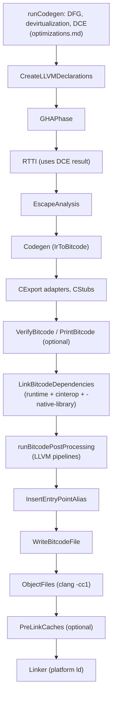
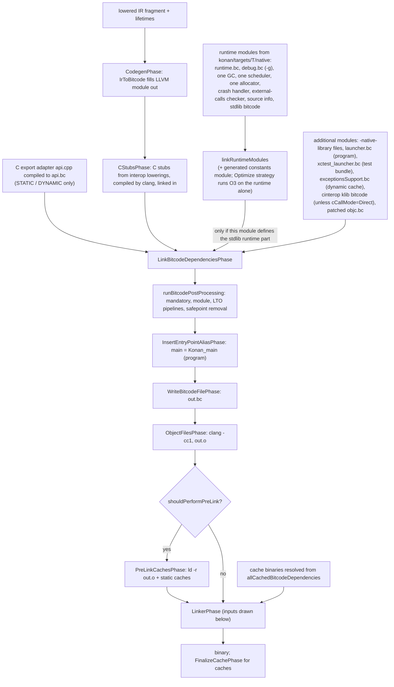
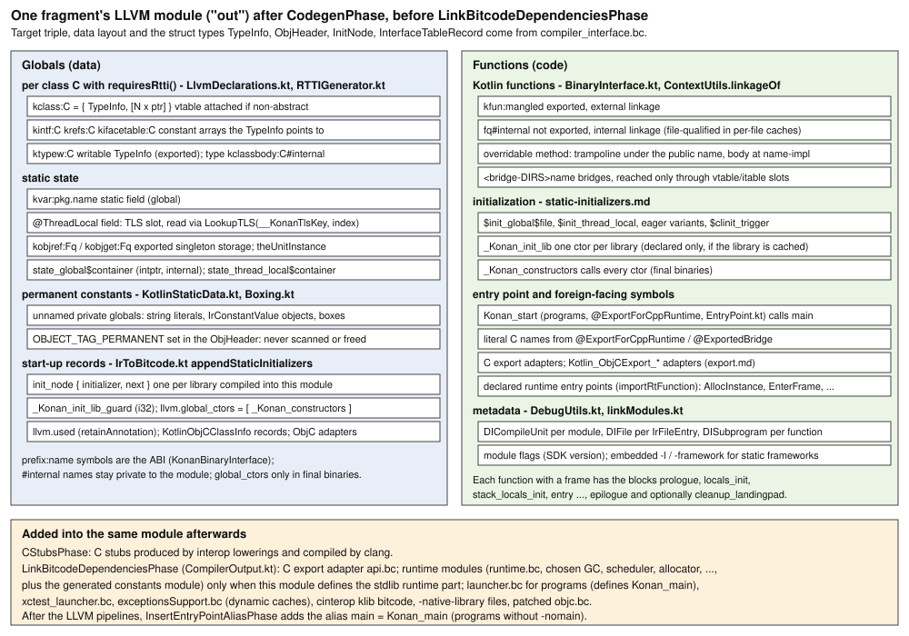
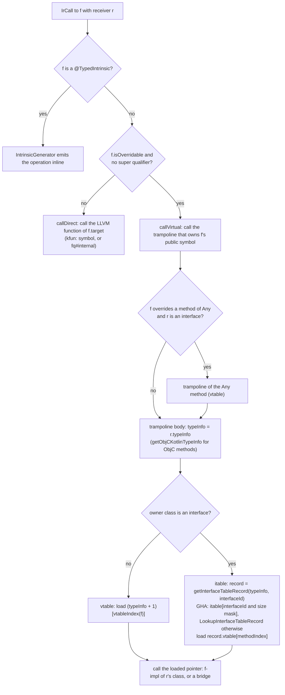
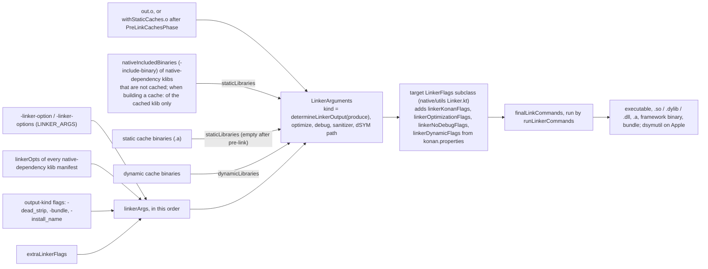

# Kotlin/Native: LLVM codegen and binary production

How the second stage turns lowered, optimized IR into LLVM IR, links the runtime bitcode into it, runs the LLVM pipeline, emits
object files and invokes the platform linker. Where this sits in the whole pipeline is in [architecture.md](architecture.md)
("Second stage", `runCodegen` → `compileModule` → `compileAndLink`); the dataflow-IR optimizations that feed this stage
(devirtualization, DCE, escape analysis) are in [optimizations.md](optimizations.md); the object layout, `TypeInfo` fields and
runtime entry points that codegen must match are canonical in [compiler-runtime-contract.md](compiler-runtime-contract.md).
Unless noted, paths are relative to `kotlin-native/backend.native/compiler/ir/backend.native/src/org/jetbrains/kotlin/backend/konan/`
(**BACKEND** below).

## Key concepts

| Term | Meaning | Where |
|------|---------|-------|
| `NativeGenerationState` | Per-fragment state: the LLVM module (always named `out`), `llvm` helpers, declarations, debug info, dependency tracker | `NativeGenerationState.kt` |
| `LlvmModuleSpecification` | Which libraries/declarations are *defined* in this LLVM module vs imported from caches | [LlvmModuleSpecification.kt](../../kotlin-native/backend.native/compiler/ir/backend.native/src/org/jetbrains/kotlin/backend/konan/LlvmModuleSpecification.kt) |
| `compiler_interface.bc` | A runtime bitcode module parsed at startup only to read struct layouts (`TypeInfo`, `ObjHeader`, `FrameOverlay`, …) and the data layout | [Runtime.kt](../../kotlin-native/backend.native/compiler/ir/backend.native/src/org/jetbrains/kotlin/backend/konan/llvm/Runtime.kt) `Runtime` |
| Slot / frame | An array of object-pointer slots `alloca`'d per function and registered with the GC via `EnterFrame`/`LeaveFrame`; every local object reference lives in one | `CodeGenerator.kt` `FunctionGenerationContext` |
| `Lifetime` / `SlotType` | Escape-analysis result per allocation/call: where its result slot comes from (stack object, anonymous slot, return slot) | [ContextUtils.kt](../../kotlin-native/backend.native/compiler/ir/backend.native/src/org/jetbrains/kotlin/backend/konan/llvm/ContextUtils.kt) |
| Virtual trampoline | A function under a method's public symbol that does the vtable/itable lookup; the body is at `<name>-impl` | `CodeGenerator.kt` `getVirtualFunctionTrampoline` |
| Thread state | `Runnable` (may touch Kotlin heap) vs `Native` (may block); switched around interop calls and in bridges | `CodeGenerator.kt` `ThreadState` |
| Runtime modules | Per-feature `.bc` files from `dist/konan/targets/<target>/native/` linked into the program module | [RuntimeModule.kt](../../kotlin-native/backend.native/compiler/ir/backend.native/src/org/jetbrains/kotlin/backend/konan/llvm/runtime/RuntimeModule.kt) |
| Mandatory / Module / LTO pipelines | The three LLVM pass pipelines run on the final module (plus sanitizer, SSP, safepoint passes); pass-by-pass in [llvm-passes.md](llvm-passes.md) | [OptimizationPipeline.kt](../../kotlin-native/backend.native/compiler/ir/backend.native/src/org/jetbrains/kotlin/backend/konan/OptimizationPipeline.kt) |
| `libllvmext` | C++ extension of the LLVM C API, plus custom passes (`kotlin-*`) | [kotlin-native/libllvmext](../../kotlin-native/libllvmext/README.md) |
| `DependenciesTracker` | Records which libraries/files the generated code references; drives what bitcode and native libraries get linked | `DependenciesTracker.kt` |

## How it works

### Phase order

Everything below runs per fragment (whole program, or one per library/file for caches) inside `runAfterLowerings` in
[TopLevelPhases.kt](../../kotlin-native/backend.native/compiler/ir/backend.native/src/org/jetbrains/kotlin/backend/konan/driver/phases/TopLevelPhases.kt).
Fragments after lowerings run in parallel when `-Xbackend-threads` > 1.



The exact phase sequence is `runCodegen` → `runBackendCodegen` → `compileModule` → `compileAndLink` in `TopLevelPhases.kt`; phase
objects live in [BitcodeGeneration.kt](../../kotlin-native/backend.native/compiler/ir/backend.native/src/org/jetbrains/kotlin/backend/konan/driver/phases/BitcodeGeneration.kt),
[Bitcode.kt](../../kotlin-native/backend.native/compiler/ir/backend.native/src/org/jetbrains/kotlin/backend/konan/driver/phases/Bitcode.kt),
[ObjectFiles.kt](../../kotlin-native/backend.native/compiler/ir/backend.native/src/org/jetbrains/kotlin/backend/konan/driver/phases/ObjectFiles.kt) and
[Linker.kt](../../kotlin-native/backend.native/compiler/ir/backend.native/src/org/jetbrains/kotlin/backend/konan/driver/phases/Linker.kt).
`-Xcompile-from-bitcode=<file>` enters the same tail at `runBitcodeBackend` (post-processing onwards) from
`NativeCompilerDriver.produceBinaryFromBitcode`.

The same tail seen as data flow: what goes into one fragment's LLVM module and what comes out, from `runBackendCodegen` /
`compileModule` / `compileAndLink` in `TopLevelPhases.kt` and `collectLlvmModules` in `CompilerOutput.kt` (the driver-level view of
the phases is in [second-stage-pipeline.md](second-stage-pipeline.md)):



### Declarations and symbol names (`CreateLLVMDeclarationsPhase`)

[LlvmDeclarations.kt](../../kotlin-native/backend.native/compiler/ir/backend.native/src/org/jetbrains/kotlin/backend/konan/llvm/LlvmDeclarations.kt)
`DeclarationsGeneratorVisitor` walks the module once and attaches `KonanMetadata.{Class,Function,InstanceField,StaticField}` to IR
declarations (`declaration.metadata`). Codegen later reads them through `LlvmDeclarations.forClass/forFunctionOrNull/...`.

- **Classes** that `requiresRtti()` get a named LLVM struct `kclassbody:<fq>#internal` = `ObjHeader` + fields (fields are reordered
  by `packFields` for density unless `@NoReorderFields`; the body is `packed` when `-Xbinary=packFields` or a field is under-aligned)
  and a `TypeInfo` global. For non-abstract classes the global is `{TypeInfo, [N x ptr]}` with the vtable inline
  (`typeInfoHasVtableAttached`); the comment there documents the invariant that `TypeInfo` must be at offset 0 because other modules
  import the global as a plain `TypeInfo`.
- **Symbol names** come from [BinaryInterface.kt](../../kotlin-native/backend.native/compiler/ir/backend.native/src/org/jetbrains/kotlin/backend/konan/llvm/BinaryInterface.kt)
  `KonanBinaryInterface`: exported functions are `kfun:<mangle>`, type infos `kclass:<fq>`, static fields `kvar:...`, writable type
  info `ktypew:`, singletons `kobjref:`/`kobjget:`; `@ExportForCppRuntime`/`@ExportedBridge` give a literal C name; `@` is replaced by
  `__at__`. Non-exported declarations get `<fq>#internal` names (or file-qualified names with per-file caches). "Exported" is decided
  by the IR mangler's export checker (`isExported`), not by Kotlin visibility alone.
- **Linkage**: `ContextUtils.linkageOf` gives external linkage to exported or external functions, internal otherwise, with a
  per-file-cache exception for functions called from exported inline functions (KT-69666).
- Overridable methods get their body under `<name>-impl` (`computeSymbolName(forImplementation = true)`); see trampolines below.

The resulting shape of one fragment's module, collected from the naming in `BinaryInterface.kt`, the globals created in
`LlvmDeclarations.kt`, `RTTIGenerator.kt`, `KotlinStaticData.kt` and `IrToBitcode.kt`, and the modules linked in by
`CompilerOutput.kt`:



### RTTI (`RTTIPhase`)

[RTTIGenerator.kt](../../kotlin-native/backend.native/compiler/ir/backend.native/src/org/jetbrains/kotlin/backend/konan/llvm/RTTIGenerator.kt)
`RTTIGenerator.generate` fills the `TypeInfo` global created above: super type, interface list (`kintf:`), object-field offsets
(`krefs:`) used by the GC, interface table (`kifacetable:`), reflection names, flags (`TF_*`), class id, extended type info (field
names/types for the debugger), associated objects, and the vtable. The field order is a struct literal that must match the C++
`TypeInfo`; the layout itself is described in [compiler-runtime-contract.md](compiler-runtime-contract.md). vtable/itable
*indices* come from `ClassLayoutBuilder` in [ClassLayoutBuilder.kt](../../kotlin-native/backend.native/compiler/ir/backend.native/src/org/jetbrains/kotlin/backend/konan/ir/ClassLayoutBuilder.kt).

Two whole-program results shape RTTI:

- **DCE**: `RTTIInput.referencedFunctions` is the `DCEPhase` output (null when global optimizations are off). `vtable()` and
  `interfaceTableRecords()` emit a null pointer for any implementation not in that set, so a DCE'd method has no code and no vtable
  entry. Calling it through a stale vtable means a null call: if you see one, suspect the DCE call-graph.
- **GHA** (`GHAPhase`, only in optimized non-cache builds): assigns class ids and interface ids/"colors". With it on,
  `VirtualTablesLookup.checkIsSubtype` compiles `is` checks to id range comparisons (`IsSubclassFast`) and itable lookups to a single
  `and` + `gep` (`getInterfaceTableRecord` fast path); without it, `IsSubtype` and `LookupInterfaceTableRecord` runtime calls are used.
  The slow path is kept when colors overflow or when producing a framework (`CodeGenerator.kt` `getInterfaceTableRecord`).

`exportTypeInfoIfRequired` handles `@ExportTypeInfo`: the runtime refers to such type infos by a fixed C name.

### IR → LLVM IR (`CodegenPhase`)

[IrToBitcode.kt](../../kotlin-native/backend.native/compiler/ir/backend.native/src/org/jetbrains/kotlin/backend/konan/llvm/IrToBitcode.kt)
`CodeGeneratorVisitor` is an `IrVisitorVoid` over the fragment. It expects fully lowered IR: `visitElement` is `TODO`,
`evaluateExpression` errors on any node it does not list (no `IrFunctionReference`, `IrStringConcatenation`, `finally`, suspend
functions, constructors with bodies, etc.). Control-flow state is a stack of `CodeContext`s (`FunctionScope`, `ParameterScope`,
`VariableScope`, `LoopScope`, `CatchScope`, `ReturnableBlockScope`, `InlinedBlockScope`, `SuspendableExpressionScope`, …) entered with
`using {}`; each scope answers `genReturn`/`genBreak`/`exceptionHandler`/`location` or delegates outward.

**Functions.** `visitSimpleFunction` builds the trampoline if needed, registers static initializers, then calls
`generateFunction` ([CodeGenerator.kt](../../kotlin-native/backend.native/compiler/ir/backend.native/src/org/jetbrains/kotlin/backend/konan/llvm/CodeGenerator.kt)),
which creates a `FunctionGenerationContext` with the fixed block skeleton `prologue → locals_init → stack_locals_init → entry … →
epilogue [→ cleanup_landingpad]`. `epilogue()` is where the frame is finalized, because only then is the slot count known:

- `alloca(type, isObjectType)` for an object reference returns a GEP into the slots array (`slotsPhi`), not a real `alloca`; the
  array itself is created in `prologue`, zeroed with `memset`, and registered with `EnterFrame(slots, skipSlots, slotCount)` in
  `stack_locals_init`; `LeaveFrame` runs on every return and in `cleanup_landingpad` (`releaseVars`). Small frames that fit in the
  `FrameOverlay` header are elided (`needSlots`). `vars.skipSlots` counts parameter slots that the GC must not scan twice.
- Every function that may call the runtime gets `Kotlin_mm_safePointFunctionPrologue` after `EnterFrame`; trampolines pass
  `needSafePoint = false`. Redundant safepoints are removed later by `kotlin-remove-sp`.
- Functions callable from C/ObjC (`switchToRunnable`: `C_TO_KOTLIN_BRIDGE` origin or `@ExportedBridge`) additionally call
  `Kotlin_initRuntimeIfNeeded`, switch to `Runnable` on entry and back to `Native` on exit, and always get a `cleanup_landingpad`
  because a Kotlin exception may escape to foreign frames (`needCleanupLandingpadAndLeaveFrame`).
- `generateFunctionNoRuntime` (`forbidRuntime = true`) is for module constructors and similar code that must not touch the runtime;
  it asserts no frame/safepoint/state switch is emitted.
- Local values: [VariableManager.kt](../../kotlin-native/backend.native/compiler/ir/backend.native/src/org/jetbrains/kotlin/backend/konan/llvm/VariableManager.kt)
  keeps immutable non-object `val`s as SSA values and gives every `var`, every object reference and (with `-g`) every variable a slot,
  because the debugger needs an address.

The block skeleton that `FunctionGenerationContext` (`prologue()`, `epilogue()` in `CodeGenerator.kt`) gives every generated function;
bracketed items are emitted only under the stated condition:

```
prologue:           slots = alloca [slotCount x ptr]; memset(slots, 0)      (only if slots are needed)
                    llvm.dbg.declare for every slot-backed variable (-g)
locals_init:        slotsPhi = phi(slots)
stack_locals_init:  [Kotlin_initRuntimeIfNeeded]  [switchThreadState(Runnable)]   (C-to-Kotlin bridges, @ExportedBridge)
                    EnterFrame(slots, skipSlots, slotCount)                        (if slots or cleanup landingpad)
                    Kotlin_mm_safePointFunctionPrologue                             (needSafePoint; not for trampolines)
entry:              ... function body; returns branch to epilogue ...
epilogue:           LeaveFrame (releaseVars)  [switchThreadState(Native)]  ret
cleanup_landingpad: landingpad cleanup; LeaveFrame; resume          (exported / bridge functions only, deleted if unused)
```

**Calls.** `evaluateCall` first offers the call to
[IntrinsicGenerator.kt](../../kotlin-native/backend.native/compiler/ir/backend.native/src/org/jetbrains/kotlin/backend/konan/llvm/IntrinsicGenerator.kt)
(`@TypedIntrinsic`, kinds in [IntrinsicType.kt](../../native/base/src/main/kotlin/org/jetbrains/kotlin/backend/konan/IntrinsicType.kt):
arithmetic, atomics, interop pointer ops, `ObjC` helpers, `IDENTITY`, `GET_OBJC_CLASS`, …; the full catalogue and which kinds
must already have been lowered away is in [intrinsics.md](intrinsics.md)). Otherwise
`evaluateSimpleFunctionCall` goes to `callVirtual` when the callee `isOverridable` and no super-qualifier is given, else `callDirect`
on `function.target`. The private `call(function, llvmCallable, ...)` wrapper decides two things per call site:

- *Thread state*: Kotlin-to-C bridges (`KOTLIN_TO_C_BRIDGE` origin), `@ImportedBridge` functions, and names listed in
  `config.forceNativeThreadStateForFunctions` (KT-75895) are wrapped in `switchThreadState(Native)` / `switchThreadState(Runnable)`.
  Such calls *must* have a filtering exception handler, otherwise nothing would switch the state back on unwind (`check` in the code).
- *Exception handler*: `ExceptionHandler.Caller` (propagate; uses `cleanup_landingpad` if present), a `CatchScope`'s local landingpad,
  or `filteringExceptionHandler` for `@FilterExceptions` (foreign exceptions terminate, or on Apple are wrapped as `ForeignException`
  in `OBJC_WRAP` mode). `callRaw` emits `invoke` unless the callee is `nounwind`; calling a may-throw function with
  `ExceptionHandler.None` is an internal error, so runtime functions that cannot throw must be declared `RUNTIME_NOTHROW` in C++.
- *Result slots*: if the callee returns an object, `FunctionGenerationContext.call` appends a hidden last parameter, the slot the
  callee stores its result into (`SlotType.STACK` → fresh stack slot, `RETURN` → own return slot, `ANONYMOUS` → new anonymous slot).
  This is the K/N calling convention for object-returning functions; `returnSlot = param(numParams - 1)` in `prologue`.

**Virtual dispatch.** `callVirtual` calls the method's *trampoline* (`getVirtualFunctionTrampoline`), a function under the public
symbol name that loads `TypeInfo` from the receiver, indexes `vtable` (`typeInfo + 1`, index from `ClassLayoutBuilder.vtableIndex`)
or the itable record (`itablePlace`), and tail-calls the implementation. The commit that introduced this shape
(`4dc2efcc75c7`, KT-85925) explains why: callers stay decoupled from vtable layout (important for caches and incremental compilation),
stack traces do not show trampoline frames, and a method becoming final needs no alias. `Any` methods invoked on an interface
receiver dispatch through `Any`'s vtable (`findOverriddenMethodOfAny`). Final fake overrides still get a trampoline in cache builds so
that old cached callers link (KT-87777, `needsCacheEntryPointForFinalFakeOverride`).

How one `IrCall` is dispatched, from `evaluateCall` / `evaluateSimpleFunctionCall` / `callDirect` / `callVirtual` in `IrToBitcode.kt`
and `getVirtualFunctionTrampoline` / `getVirtualImpl` in `CodeGenerator.kt`:



The call site itself therefore always contains a plain `call`; the indices from `ClassLayoutBuilder` live only inside the trampoline,
which is what keeps cached callers valid when a vtable changes.

**Allocation and lifetimes.** `allocInstance(irClass, lifetime, resultSlot)` calls the runtime `AllocInstance(typeInfo, slot)` unless
the escape analysis gave `Lifetime.STACK`, in which case `StackLocalsManagerImpl.alloc` emits an `alloca` of the class body in
`stack_locals_init`, zeroes it, writes the type info with the stack tag, and registers it in a GC root slot. `STACK_ARRAY(size)` does
the same for arrays with a constant size (and constant-size strings). Stack locals are cleaned (`clean`) when their `StackLocalsScope`
exits, which is why loops are `StackLocalsScope`s: an object allocated in a loop body must be reset each iteration. All other lifetimes
only choose the *result slot* (see `SlotType`). Lifetimes come from `EscapeAnalysisPhase`
([LTO.kt](../../kotlin-native/backend.native/compiler/ir/backend.native/src/org/jetbrains/kotlin/backend/konan/driver/phases/LTO.kt)),
which only runs with `-opt` and without static caches; missing entries default to `Lifetime.GLOBAL`.

**Fields, constants, strings.** Instance fields are `structGep` on the class body (`fieldPtrOfClass`); stores of references never
use a plain `store`: `storeHeapRef` / `storeStackRef` / `storeAny(isObjectRef = true)` call the runtime's `UpdateHeapRef`,
`UpdateVolatileHeapRef` or `UpdateStackRef` (`updateRef` in `CodeGenerator.kt`), which is where the memory manager's barriers live. Static fields are
`kvar:` globals or thread-locals (`addKotlinThreadLocal`, registered with `AddTLSRecord` by the file initializer). String literals and
`IrConstantValue` objects become permanent constants with the `OBJECT_TAG_PERMANENT` bit set in the header
([KotlinStaticData.kt](../../kotlin-native/backend.native/compiler/ir/backend.native/src/org/jetbrains/kotlin/backend/konan/llvm/KotlinStaticData.kt);
Latin-1 or UTF-16 encoding chosen per literal when `-Xbinary=latin1Strings`). Boxes for small primitive ranges are pre-built
constant arrays (`initializeCachedBoxes` in [Boxing.kt](../../kotlin-native/backend.native/compiler/ir/backend.native/src/org/jetbrains/kotlin/backend/konan/Boxing.kt));
the box/unbox functions themselves are IR created earlier.

**Control flow.** `when` becomes a chain of conditional branches with a phi (`WhenEmittingContext`); loops get `loop_check` /
`loop_exit` blocks; `IrReturnableBlock` and `IrInlinedFunctionBlock` (inlined bodies) get their own scopes so `return` jumps to a
continuation. Coroutines are already state machines: `IrSuspendableExpression` dispatches with `indirectbr` on a block address stored
in the continuation, `IrSuspensionPoint` registers a resume block (`evaluateSuspendableExpression`); the state-machine construction
and the `scope()` mapping of `invokeSuspend` are in [coroutines.md](coroutines.md#step-6--codegen).

**try/catch.** `evaluateTry` assumes `finally` is lowered away. A `CatchScope` lazily creates one `landingpad` block that catches
the C++ `ExceptionObjHolder` (`_ZTI18ExceptionObjHolder`), extracts the Kotlin object (`catchKotlinException`) and jumps to the handler,
which runs `instanceof` checks per `catch` clause and rethrows via the outer handler. Throws inside a `try` body are a local branch,
not a C++ throw (`ExceptionHandler.Local.genThrow`). The personality is the C++ one, so exceptions interoperate with ObjC/C++ frames.
The landing-pad shapes (`callRaw` vs `call` with an `ExceptionHandler`, cleanup vs filtering pads) and the unwinding contract with
the shadow stack are in [exceptions.md](exceptions.md).

**Static initializers and program start.** Per file, the lowered static initializer functions are registered (`handleStaticInitializer`)
and, after the module is visited, merged into `InitNode` records appended to the runtime list (`AppendToInitializersTail`) by a
`_Konan_init_<library>` constructor; for the final binary `_Konan_constructors` calls them all from `llvm.global_ctors`
(`appendStaticInitializers`). Order follows the topologically sorted library list. For programs `EntryPointPhase` builds a
`Konan_start` IR function ([EntryPoint.kt](../../kotlin-native/backend.native/compiler/ir/backend.native/src/org/jetbrains/kotlin/backend/konan/EntryPoint.kt))
that calls the user `main` under a `try` with `processUnhandledException`; the launcher bitcode defines `Konan_main`, and
`InsertEntryPointAliasPhase` adds the `main` alias to it *after* optimizations, so that passes cannot touch the entry point.

**Runtime configuration from codegen.** Final binaries overwrite weak runtime globals (`overrideRuntimeGlobals`: GC threads, source
info provider, `-Xruntime-logs`, …; names in `NativeRuntimeOverridableConstants.kt`), and a tiny `constants` module
(`generateRuntimeConstantsModule`: `NEED_DEBUG_INFO`, assert mode, allocator page size, …) is linked next to the runtime so its
`const` globals can be folded by LTO.

**ObjC.** `KotlinObjCClassInfoGenerator` ([KotlinObjCClassInfoGenerator.kt](../../kotlin-native/backend.native/compiler/ir/backend.native/src/org/jetbrains/kotlin/backend/konan/llvm/KotlinObjCClassInfoGenerator.kt))
emits a `KotlinObjCClassInfo` record per Kotlin subclass of an ObjC class (method descriptors, superclass and protocol names, body
offset) that the runtime uses to create the ObjC class lazily. ObjC export adapters are emitted at the end of `visitModuleFragment`
(`objCExport.generate`) and are covered in [export.md](export.md).

### Debug info

`-g` sets `config.debug`; `-Xadd-light-debug` sets `lightDebug` (locations only). `shouldContainLocationDebugInfo()` gates
`!dbg` locations; `shouldContainDebugInfo()` gates variables and types (`ConfigChecks.kt`).
[DebugUtils.kt](../../kotlin-native/backend.native/compiler/ir/backend.native/src/org/jetbrains/kotlin/backend/konan/llvm/DebugUtils.kt)
`DebugInfo` owns the `DIBuilder`, one compile unit per LLVM module, `DIFile`s per `IrFileEntry` and `DISubprogram`s per LLVM
function; `IrSimpleFunction.scope()` in `IrToBitcode.kt` maps an IR function to its subprogram (suspend functions map to their
continuation stub; functions with no LLVM symbol, such as reified inline functions, get an `<inlined-out:name>` scope). Every basic
block records a `LocationInfoRange`; `updateBuilderDebugLocation` sets the builder location from the IR offsets via the file entry's
line table. Inlined code is handled by `InlinedBlockScope`, which switches the file scope to the callee's file and produces
`LocationInfo.inlinedAt`, which `CodeGenerator.generateLocationInfo` turns into a `DILocation` with an `inlinedAt` chain. Variables get
`DIInsertDeclaration` with a `DW_OP_plus_uconst` expression pointing into the slots array (`epilogue`). The prologue deliberately has
no location so breakpoints never stop on an inconsistent frame (comment in `epilogue`). `-Xdebug-info-version` selects DWARF
version/language constants (`DWARF.dwarfVersion`); `-Xdebug-prefix-map` remaps paths; `-Xg-generate-debug-trampoline=enable`
(off by default, ignored without `-g`: `generateDebugTrampoline = debug && …` in `NativeSecondStageCompilationConfig.kt`) inserts
an extra basic block with its own location in front of `when` branches and inlined blocks (`generateDebugTrambolineIf`), not a
call, so that a breakpoint on that line has an address. Runtime bitcode debug info is stripped unless
`-Xbinary=stripDebugInfoFromNativeLibs=false` (`LLVMStripModuleDebugInfo` in `CompilerOutput.kt`). The LLDB side (`konan_lldb.py`,
`libLLVMDebugInfoC`) is in `kotlin-native/llvmDebugInfoC`; the runtime side (`Konan_Debug*`, `ExtendedTypeInfo`) is
`kotlin-native/runtime/src/debug/cpp/KDebug.cpp`. All of it is described in [debug-info.md](debug-info.md).

### Linking in the runtime (`LinkBitcodeDependenciesPhase`)

[CompilerOutput.kt](../../kotlin-native/backend.native/compiler/ir/backend.native/src/org/jetbrains/kotlin/backend/konan/CompilerOutput.kt)
`collectLlvmModules` classifies bitcode into two sets:

- **Runtime modules**, selected from binary options: always `runtime.bc`; `debug.bc` when `-g`; one GC (`-Xgc`/`-Xbinary=gc`), one GC
  scheduler, one allocator (`-Xallocator`), external-calls checker impl or noop, crash handler (Breakpad on macOS with
  `minidumpLocation`), source-info providers the target supports, plus the stdlib's own bitcode. They are linked only when the module
  defines the stdlib runtime part (`shouldLinkRuntimeNativeLibraries`), i.e. in a program or in the stdlib cache.
- **Additional modules**: `-native-library` files, `launcher.bc` for programs, `xctest_launcher.bc` for test bundles,
  `exceptionsSupport.bc` for dynamic caches, C-export adapter bitcode, cinterop klib bitcode (unless `cCallMode = Direct`), and the
  patched `objc.bc`.

`RuntimeModule` is the single enum of file names, with `COMPILER_INTERFACE` overridable through `-Xruntime`
([RuntimeModulesConfig.kt](../../kotlin-native/backend.native/compiler/ir/backend.native/src/org/jetbrains/kotlin/backend/konan/llvm/runtime/RuntimeModulesConfig.kt)).
The same module names are declared as `module("...")` blocks in
[runtime/build.gradle.kts](../../kotlin-native/runtime/build.gradle.kts); adding a module means touching both.

[RuntimeLinkage.kt](../../kotlin-native/backend.native/compiler/ir/backend.native/src/org/jetbrains/kotlin/backend/konan/llvm/runtime/RuntimeLinkage.kt)
`linkRuntimeModules` first marks runtime functions annotated `performance_inline` as `alwaysinline` when `inlineForPerformance`
holds (`handlePerformanceInlineAnnotation`), then, with
`RuntimeLinkageStrategy.Optimize` (default for `-g`; `Raw` otherwise, option `-Xbinary=linkRuntime`), links all runtime modules into
one and runs the mandatory + module pipelines at `O3` on it (`createLTOPipelineConfigForRuntime`), so debug builds get a fast runtime
without optimizing user code. Auxiliary modules are linked together first and then into the main module (a comment notes this is
much faster for large modules); `llvmLinkModules2` ([linkModules.kt](../../kotlin-native/backend.native/compiler/ir/backend.native/src/org/jetbrains/kotlin/backend/konan/llvm/linkModules.kt))
suppresses the harmless "SDK Version" module-flag conflict (KT-35001). Static frameworks and Swift-export static libraries embed
`-l`/`-framework` options into the bitcode (`embedAppleLinkerOptionsToBitcode`) because there is no final link step to pass them to.

### Bitcode post-processing (`runBitcodePostProcessing`)

Order, in `Bitcode.kt`: optional `CallsChecker` instrumentation (must run before the call graph is disturbed) → stack protector →
`MandatoryBitcodeLLVMPostprocessingPhase` → `ModuleBitcodeOptimization` → `LTOBitcodeOptimization` → optional `ThreadSanitizerPhase` →
`RemoveRedundantSafepoints` → optional `ModuleCallsChecker` (after DCE so the known-function list is final). The pass strings, the
custom `kotlin-*` passes and the `-g`/`-opt`/small-binary differences are in [llvm-passes.md](llvm-passes.md); the config comes from
`createLTOFinalPipelineConfig` in `OptimizationPipeline.kt`:

| Input | Effect |
|-------|--------|
| `-opt` | `O3` for module and LTO pipelines, `LLVMCodeGenLevelAggressive`, inline threshold from `llvmInlineThreshold` in `konan.properties` |
| `-g` (no `-opt`) | `O0`, `LLVMCodeGenLevelNone` |
| neither | `O1`, default codegen level |
| `-Xbinary=smallBinary` | `Oz` instead |
| final binary (`isFinalBinary`) | `internalize` before `globaldce` in the LTO pipeline (closed world) |
| `-produce static_cache` | `kotlin-hide-symbols` (or the in-compiler equivalent in `visibility.kt`) so symbols dead-strip at final link |
| Apple targets | `objc-arc-contract`, for ARC intrinsics coming from cinterop glue |
| `-Xllvm-module-passes` / `-Xllvm-lto-passes` | replace the module / LTO pass strings verbatim |
| `-Xbinary=stackProtector`, `sanitizer=thread`, `checkStateAtExternalCalls` | extra pipelines (`kotlin-ssp`, `kotlin-tsan` + `tsan`, `kotlin-calls-checker*`) |
| `-Xbinary=runLLVMPassesInCompiler` | run the Kotlin-side implementations of SSP / hide-symbols / remove-safepoints instead of the C++ passes (introduced to gate the C++ passes, commit `a14577efde47`) |

Pipelines are run through `LLVMKotlinRunPasses` from `libllvmext`, which parses a pass-pipeline string (`default<O3>`, `lto<O3>`,
`function(kotlin-remove-sp<inline>)`, …) with the new pass manager and registers the custom passes
([KotlinPlugin.cpp](../../kotlin-native/libllvmext/src/main/cpp/KotlinPlugin.cpp)). The custom passes and their purpose are listed in
the [libllvmext README](../../kotlin-native/libllvmext/README.md); `kotlin-remove-sp` deletes prologue safepoints made redundant by
LLVM inlining and can inline the remaining ones (`shouldInlineSafepoints()` = `inlineForPerformance` = not `-g` and not
`smallBinary`). `LLVMKotlinRunPasses` writes global
LLVM state when dumping IR, which is why `-Xsave-llvm-ir-after=<Phase>:<pass>` is CLI-only
([HACKING.md](../../kotlin-native/HACKING.md#dumping-llvm-ir)). Pass timings go to `-Xprofile-phases` through
[LlvmPassesProfile.kt](../../kotlin-native/backend.native/compiler/ir/backend.native/src/org/jetbrains/kotlin/backend/konan/llvm/LlvmPassesProfile.kt).

### Object files and the platform linker

[BitcodeCompiler.kt](../../kotlin-native/backend.native/compiler/ir/backend.native/src/org/jetbrains/kotlin/backend/konan/BitcodeCompiler.kt)
runs the bundled `clang++` from the LLVM distribution (`-Xllvm-variant`; or Xcode's with `-Xbinary=compileBitcodeWithXcodeLlvm`) in
`-cc1` mode on the written `.bc`: flags are `clangFlags.<target>` + `-triple` + one of `clangOptFlags` / `clangDebugFlags` /
`clangNooptFlags` + relocation model, all from [konan.properties](../../kotlin-native/konan/konan.properties) (per-target
toolchain and linker resolution: [targets-and-toolchains.md](targets-and-toolchains.md#toolchains)) through
`Configurables` ([Configurables.kt](../../native/utils/src/org/jetbrains/kotlin/konan/target/Configurables.kt)); `-Xoverride-clang-options`
replaces the whole list. Because `clangFlags` contain `-disable-llvm-passes`/`-disable-llvm-optzns`, clang only does instruction
selection; all middle-end optimization happened in the previous step.

[Linker.kt](../../kotlin-native/backend.native/compiler/ir/backend.native/src/org/jetbrains/kotlin/backend/konan/Linker.kt) (BACKEND)
assembles `LinkerArguments` and delegates to the target's `LinkerFlags` subclass in
[native/utils Linker.kt](../../native/utils/src/org/jetbrains/kotlin/konan/target/Linker.kt) (`MacOSBasedLinker`, `GccBasedLinker`,
`MingwLinker`, `AndroidLinker`), which builds the real command and, on Apple, runs `dsymutil`. Linker flags are concatenated from:

1. `-linker-option` / `-linker-options` (`NativeConfigurationKeys.LINKER_ARGS`), with `-Wl,` unwrapped for direct `ld` invocations;
2. `linkerOpts` from every native-dependency klib manifest (cinterop `linkerOpts`);
3. output-kind flags (`-dead_strip`, `-bundle`, `-install_name`, framework paths) from `resolveExecutableTarget`;
4. target flags `linkerKonanFlags`, `linkerOptimizationFlags` (`-opt`), `linkerNoDebugFlags` (no `-g`), `linkerDynamicFlags`, added
   by the `LinkerFlags` subclass from `konan.properties`.

Inputs are the object file, `-include-binary` / klib `nativeIncludedBinaries` as static libraries, and cache binaries resolved by
`resolveCacheBinaries`. When `shouldPerformPreLink` holds (`-Xpre-link-caches`), static caches are first combined with the object file
by `ld -r` (`PreLinkCachesPhase`) so the final link sees one object. `determineLinkerOutput` maps `-produce` to
executable / static / dynamic; `OutputFiles` ([OutputFiles.kt](../../kotlin-native/backend.native/compiler/ir/backend.native/src/org/jetbrains/kotlin/backend/konan/OutputFiles.kt))
computes the prefixed/suffixed main file, the `.dSYM` path, and the temporary cache directory layout. Linker failures are reported with
hints to disable caches and with `userSetupHint` from cinterop klibs (`runLinkerCommands`).

What reaches the linker and in which role, from `Linker.linkCommands` / `runLinker` (BACKEND `Linker.kt`), `compileAndLink`
(`TopLevelPhases.kt`) and `resolveCacheBinaries` (`CacheBinariesResolver.kt`):



## Invariants and ordering constraints

- **IR must be fully lowered.** Codegen has no fallback for unlowered nodes; a new IR node kind needs either a lowering or an
  `evaluateExpression` branch. Suspend functions, constructors, `finally`, string templates, function references must be gone.
- **Declarations before bodies.** `CreateLLVMDeclarationsPhase` must see every class/function that codegen will reference; anything
  created afterwards (e.g. by an intrinsic) must create its own LLVM declaration.
- **RTTI after DCE and GHA, Codegen after RTTI and EscapeAnalysis** (`runCodegen` order). `RTTIInput.referencedFunctions == null`
  means "keep everything".
- **Slot discipline.** Any value of object type that lives across a call must be in a slot (anonymous or variable); raw SSA object
  pointers across a safepoint are a GC bug that only shows under GC stress. `alloca(isObjectType = true)` is the only sanctioned way.
- **Thread state symmetry.** Every `switchThreadState(Native)` needs a `Runnable` switch on all paths, including unwinding; the code
  enforces this by requiring a filtering landingpad (which switches back in `gxxLandingpad(switchThreadState = true)`).
- **Runtime functions must declare throwing behaviour.** A C++ entry point called by codegen without a handler must be
  `RUNTIME_NOTHROW` ([Common.h](../../kotlin-native/runtime/src/main/cpp/Common.h)); otherwise `callRaw` throws
  "No exception handler specified".
- **Struct layouts are read from `compiler_interface.bc`, field indices are hard-coded.** Indices such as `typeInfoType` element 9/10
  (`interfaceTableSize_`, `interfaceTable_`) in `getInterfaceTableRecord`, the `TypeInfo` struct literal in `RTTIGenerator`, and
  `INIT_GLOBALS` constants ("Must be synchronized with Runtime.cpp") must change together with the C++ side.
- **Symbol names are ABI.** `kfun:`/`kclass:` names, `theUnitInstance`, `_Konan_init_<lib>`, `Konan_start`/`Konan_main` and
  `@ExportForCppRuntime` names are referenced across caches, by the runtime, and by ObjC/C export; renaming breaks binary compatibility
  with existing caches (`UniqueKind` comment: "part of the ABI").
- **`main` alias is inserted after all LLVM passes**, and `_Konan_constructors` is only generated for final binaries.
- **Runtime module list is duplicated** in `RuntimeModule.kt` and `runtime/build.gradle.kts`.
- **Per-fragment LLVM contexts are independent but all modules are named `out`** (TODO in `runBackend`); do not rely on module names.

## Extension points and typical changes

| Change | Touch | Also |
|--------|-------|------|
| New `@TypedIntrinsic` | `IntrinsicType.kt` (native/base), `IntrinsicGenerator.kt` | stdlib declaration in `kotlin-native/runtime/src/main/kotlin`; the first stage must not need LLVM to see it |
| New runtime entry point called from codegen | `ContextUtils.kt` `importRtFunction(...)`, C++ definition with `RUNTIME_NOTHROW` if it cannot throw | [compiler-runtime-contract.md](compiler-runtime-contract.md); `RuntimeNames.kt` if referenced by annotation name |
| New `TypeInfo` field or flag | `RTTIGenerator.kt` (`TypeInfo` struct literal, `TF_*`), `TypeInfo.h` in the runtime | caches must be rebuilt (layout is ABI); check `LlvmDeclarations.kt` if the global shape changes |
| New runtime module (GC, allocator, …) | `RuntimeModule.kt`, `CompilerOutput.kt` `collectLlvmModules`, `runtime/build.gradle.kts`, binary option in `BinaryOptions.kt` | [runtime.md](runtime.md); test mode in `native.tests` settings |
| New LLVM pass | `libllvmext/src/main/cpp/Passes`, register in `KotlinPlugin.cpp`, FileCheck test in `libllvmext/testData/fileCheck`, pipeline class in `OptimizationPipeline.kt`, phase in `Bitcode.kt` | consider gating with `runLLVMPassesInCompiler` like existing passes |
| New compiler/linker flag per target | `konan.properties`, `Configurables.kt` accessor, use in `BitcodeCompiler.kt` / `native/utils Linker.kt` | `-Xoverride-konan-properties` lets you test without rebuilding the dist |
| New symbol visible to C/ObjC | `@ExportForCppRuntime(name)` on the Kotlin side or `KonanBinaryInterface` naming | `llvm.used` via `retainAnnotation` if nothing references it ([RetainAnnotation.kt](../../kotlin-native/backend.native/compiler/ir/backend.native/src/org/jetbrains/kotlin/backend/konan/llvm/RetainAnnotation.kt)) |
| Change in object/frame layout | `CodeGenerator.kt` prologue/epilogue, `StackLocalsManagerImpl`, runtime `Memory.h`/`FrameOverlay` | GC root scanning, debugger (`llvmDebugInfoC`), [caches.md](caches.md) (all caches invalid) |

## Investigating bugs here

### Flags and dumps

| Flag | What it does |
|------|--------------|
| `-Xsave-llvm-ir-after=<Phase>[,...]` + `-Xsave-llvm-ir-directory=<dir>` | Dumps `out.<Phase>.ll` after any LLVM-holding phase (`Codegen`, `LinkBitcodeDependencies`, `MandatoryBitcodeLLVMPostprocessingPhase`, `ModuleBitcodeOptimization`, `LTOBitcodeOptimization`, `WriteBitcodeFile`, …); `<Phase>:<llvm-pass>` dumps inside a pipeline (CLI only; see [llvm-passes.md](llvm-passes.md#flags-and-options)) |
| `-Xprint-bitcode` | Dumps the module to stderr right after codegen (`PrintBitcodePhase`) |
| `-Xverify-bitcode` | Runs the LLVM verifier after every generated function and after every LLVM phase; `-Xverify-compiler` verifies once after codegen |
| `-Xdisable-phases=LTOBitcodeOptimization,...`, `-Xprofile-phases` | Skip or time phases by name ([HACKING.md](../../kotlin-native/HACKING.md#playing-with-compilation-pipeline)) |
| `-Xllvm-module-passes=` / `-Xllvm-lto-passes=` | Replace the pass pipelines (e.g. bisect a miscompile to one pass) |
| `-Xoverride-konan-properties=k=v;...`, `-Xoverride-clang-options=` | Change clang/linker flags without rebuilding the dist |
| `-Xllvm-variant=dev` | Large LLVM distribution with `opt`, `llc`, `llvm-nm`, `FileCheck` |
| `-Xtemporary-files-dir=<dir>` | Keep `out.bc`, `.o` and prelink results |
| `-linker-option -v`, `-Xbinary=stripDebugInfoFromNativeLibs=false`, `-Xruntime-logs=` | Linker verbosity, runtime debug info, runtime logging |
| `-Xcompile-from-bitcode=out.bc` | Re-run only post-processing + object + link on a saved module |
| `-Xbackend-threads=1` | Remove parallelism when a failure is flaky |

### Symptoms

| Symptom | Where to look |
|---------|---------------|
| "Invalid LLVM module" with a dump path | `verifyModule` ([VerifyModule.kt](../../kotlin-native/backend.native/compiler/ir/backend.native/src/org/jetbrains/kotlin/backend/konan/llvm/VerifyModule.kt)) writes the module to a temp `.ll`; rerun with `-Xverify-bitcode` to get the first bad function name (`NativeCodeGeneratorException` wraps the IR declaration) |
| "No exception handler specified when calling function X without nounwind attr" | the runtime function is not `RUNTIME_NOTHROW`, or codegen passed `ExceptionHandler.None` for a may-throw callee |
| Linker "undefined symbol kfun:..." / "kclass:..." | `DependenciesTracker` did not record the library (missing `dependenciesTracker.add`), DCE removed a vtable target, a stale cache (`-Xbinary=...`, disable caches to confirm), or name mismatch between `computeSymbolName(forImplementation=…)` and the caller |
| Undefined C symbol from a cinterop klib | `linkerOpts` in the klib manifest and `userSetupHint`; `-Xbinary=stripDebugInfoFromNativeLibs`; check `nativeDependenciesToLink` filtering in `DependenciesTracker` |
| Crash only with `-opt` | Dump after `Codegen` vs after `LTOBitcodeOptimization`; bisect with `-Xdisable-phases` and `-Xllvm-*-passes`; check lifetimes (`escapeAnalysis` test data) and missing slots; also devirtualization/DCE ([optimizations.md](optimizations.md)); if the IR after `Codegen` is right, follow [llvm-passes.md](llvm-passes.md#typical-bugs-and-how-to-investigate) |
| Crash only in debug / with GC stress | missing slot or `storeHeapRef`; `-Xbinary=gcSchedulerType=aggressive`, `-Xcheck-state-at-external-calls` for thread-state mistakes |
| Wrong line numbers / stepping in the debugger | `updateBuilderDebugLocation`, `InlinedBlockScope` `inlinedAt`, `-Xg-generate-debug-trampoline`; compare `.ll` `!dbg` metadata; `testData/lldb` |
| "linking module flags ... conflicting values" or "Failed to link <module>" | `llvmLinkModules2`; usually a runtime `.bc` built against a different LLVM/target than the compiler expects, or a mismatched `-Xruntime` |
| Entry point missing (`Module doesn't contain Konan_main`) | `launcher.bc` not linked (not a `PROGRAM`), or `-nomain` |

### Tests

| What | Command |
|------|---------|
| Codegen tests incl. FileCheck on LLVM IR (`// FILECHECK_STAGE: <Phase>` + `CHECK:` lines, [testData/codegen/fileCheck](../../native/native.tests/testData/codegen/fileCheck)) | `./gradlew :native:native.tests:test --tests "org.jetbrains.kotlin.konan.test.blackbox.FirNativeCodegenLocalTestGenerated*"` (`-Pkn.optimizationMode=OPT` for escape analysis/devirtualization checks) |
| Shared box tests | `./gradlew :native:native.tests:codegen-box:test --tests "...FirNativeCodegenBoxTestGenerated\$Box\$*"` |
| LLDB tests ([testData/lldb](../../native/native.tests/testData/lldb), `NativeLldbTestGenerated`, tag `debugger`, host only, forced debug mode) | `./gradlew :native:native.tests:debuggerTest` |
| Compiler output / diagnostics ([testData/compilerOutput](../../native/native.tests/testData/compilerOutput)) | `./gradlew :native:native.tests:test --tests "org.jetbrains.kotlin.konan.test.blackbox.CompilerOutputTest"` |
| Custom LLVM passes (FileCheck `.ll` files) | `./gradlew :kotlin-native:libllvmext:test` |
| Backend unit tests | `./gradlew :kotlin-native:backend.native:check` |
| GC / runtime interaction | `./gradlew :native:native.tests:gcTest`, `:kotlin-native:runtime:hostRuntimeTests` |

Test modes (`-Pkn.gcType`, `-Pkn.alloc`, `-Pkn.cacheMode`, `-Pkn.useThreadStateChecker`) are listed in
[HACKING.md#testing](../../kotlin-native/HACKING.md#testing). Remember that tests load the compiler from `kotlin-native/dist`, so a
codegen change costs a dist rebuild.

## Open questions

- Unverified: whether `Lifetime.LOCAL` / `SlotType.ARENA` is still produced by the escape analysis; `FunctionGenerationContext.call`
  throws on `ARENA` ("Incorrect slot type") and the arena code is commented out, so it looks like a dead remnant.
- Unverified: the full list of phases that carry `getDefaultLlvmModuleActions()` and therefore accept `-Xsave-llvm-ir-after`;
  HACKING.md says the list changes, this page lists only those seen in `Bitcode.kt` and `BitcodeGeneration.kt`.
- Unverified: how `cCallMode = Direct` changes the calls emitted for cinterop functions (it only shows up here as the filter that
  skips cinterop bitcode); belongs to [cinterop.md](cinterop.md).
- (Resolved: the `BinaryOptions.kt` KDoc says `runLLVMPassesInCompiler` "exists as a workaround, if new passes introduce
  regressions", i.e. the Kotlin-side code paths (`visibility.kt`, `RemoveRedundantSafepointsPass`) are the fallback for the C++
  passes `kotlin-hide-symbols` / `kotlin-remove-sp` and must stay equivalent until the option is removed; see
  [llvm-passes.md](llvm-passes.md#the-custom-passes).)
- Unverified: exact per-target behaviour of `linkerNoDebugFlags` (`-S` on macOS strips debug symbols) when `-g` is combined with
  `-opt`; `Linker` treats `debug = config.debug || config.lightDebug` while `BitcodeCompiler` uses `optimize` first.
- Not covered: the ObjC/Swift export codegen in `llvm/objcexport` and `objcexport/`, C export adapter generation (`cexport/`), and
  the per-file cache naming rules; see [export.md](export.md) and [caches.md](caches.md).
