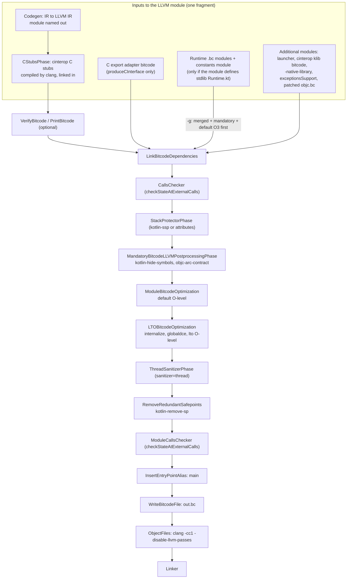
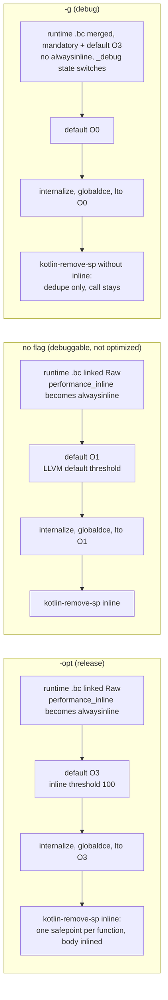

# Kotlin/Native: the LLVM pass pipeline

What happens to the LLVM module between "codegen is done" and "clang emits an object file": which pass pipelines run, in which
order, with which `-passes=` strings per optimization mode, which custom `kotlin-*` passes exist and what they assume about the
code that codegen and the runtime produce. The shape of the whole backend (codegen, runtime bitcode linking, object files,
linker) is in [llvm-codegen.md](llvm-codegen.md) and is not repeated here; this page zooms into the box labelled
`runBitcodePostProcessing` there, plus the pieces that feed it (function attributes, `alwaysinline` runtime functions, the
pre-optimized runtime in debug builds) and the pieces that consume its output (`clang -cc1`, FileCheck tests).

Read this when: a bug appears only with `-opt` (or only without it) and the Kotlin IR looks right; a runtime function that
should be inlined is not; safepoints are missing or doubled; you upgrade LLVM; you add an LLVM pass; you need to run `opt` by
hand on the compiler's module.

Related pages: [llvm-codegen.md](llvm-codegen.md) (codegen, linking, object files), [optimizations.md](optimizations.md) and
[dce-and-gha.md](dce-and-gha.md) (the Kotlin-level whole-program optimizations that run *before* LLVM),
[compiler-runtime-contract.md](compiler-runtime-contract.md) (safepoints, thread states, entry points),
[caches.md](caches.md) (why caches change what LLVM sees), [second-stage-pipeline.md](second-stage-pipeline.md) (phase
engine, `-Xdisable-phases`), [HACKING.md](../../kotlin-native/HACKING.md#llvm) (LLVM distributions, dumping IR).

Unless noted, paths are relative to `kotlin-native/backend.native/compiler/ir/backend.native/src/org/jetbrains/kotlin/backend/konan/`
(**BACKEND** below), and `libllvmext` is `kotlin-native/libllvmext/`.

## Key concepts

| Term | Meaning | Where |
|------|---------|-------|
| Pipeline | One `LlvmOptimizationPipeline` subclass: a *name* (used in profiles and logs) and a list of pass-pipeline strings joined with `,` and handed to the new pass manager | [OptimizationPipeline.kt](../../kotlin-native/backend.native/compiler/ir/backend.native/src/org/jetbrains/kotlin/backend/konan/OptimizationPipeline.kt) |
| `LlvmPipelineConfig` | The immutable tuning record for all pipelines of one module: triple, CPU, features, O-level, size level, codegen level, reloc/code model, `internalize`/`globalDce`/`makeDeclarationsHidden`/`objCPasses`, inline threshold, override strings, SSP mode, IR-dump settings | same file |
| Pass-pipeline string | LLVM's textual pipeline syntax (`default<O3>`, `lto<O1>`, `function(kotlin-remove-sp<inline>)`, …), parsed by `PassBuilder::parsePassPipeline`; the same syntax `opt -passes=` takes | [CAPIExtensions.cpp](../../kotlin-native/libllvmext/src/main/cpp/CAPIExtensions.cpp) `LLVMKotlinRunPasses` |
| New pass manager | The only pass manager used for middle-end passes since LLVM 16 (commit `0af9b7ea1d7b`, KT-49279); codegen in `clang -cc1` still uses the legacy codegen pipeline, which is outside this page | same |
| `LLVMKotlinRunPasses` | libllvmext's replacement for `LLVMRunPasses`: builds a `PassBuilder` with Kotlin tuning (`InlinerThreshold`, `MaxDevirtIterations = 0`), registers the `kotlin-*` passes, collects per-pass timings, and plumbs `-print-after`/`-ir-dump-directory` | same |
| `libllvmext` / `LLVMKotlin` plugin | C++ static library linked into the compiler's LLVM JNI stubs; the same objects also build `libLLVMKotlin.{dylib,so}`, a standard LLVM pass plugin used only by the FileCheck tests (`opt --load-pass-plugin`) | [libllvmext/build.gradle.kts](../../kotlin-native/libllvmext/build.gradle.kts), [KotlinPlugin.cpp](../../kotlin-native/libllvmext/src/main/cpp/KotlinPlugin.cpp) |
| Mandatory / Module / LTO pipelines | The three always-on pipelines: `kotlin-hide-symbols` + `objc-arc-contract`; `default<O?>`; `internalize,globaldce,lto<O?>` | `MandatoryOptimizationPipeline`, `ModuleOptimizationPipeline`, `LTOOptimizationPipeline` |
| `inlineForPerformance` | `!debug && !smallBinary`; gates `performance_inline → alwaysinline` on runtime functions and `kotlin-remove-sp<inline>` | [NativeSecondStageCompilationConfig.kt](../../kotlin-native/backend.native/compiler/ir/backend.native/src/org/jetbrains/kotlin/backend/konan/NativeSecondStageCompilationConfig.kt) |
| `smallBinary` | `-Xbinary=smallBinary`, default `needSmallBinary()` = watchOS targets and Apple arm32; ignored with `-g`. Turns every `O<n>` into `Oz` | same; [KonanTargetExtenstions.kt](../../native/utils/src/org/jetbrains/kotlin/konan/target/KonanTargetExtenstions.kt) |
| Closed world / `isFinalBinary` | `PROGRAM`, `DYNAMIC`, `STATIC`, `TEST_BUNDLE`, and `FRAMEWORK` unless `omitFrameworkBinary`; enables `internalize` | [CompilerOutput.kt](../../kotlin-native/backend.native/compiler/ir/backend.native/src/org/jetbrains/kotlin/backend/konan/CompilerOutput.kt) `isFinalBinary` |
| `RuntimeLinkageStrategy` | `Raw` (link runtime `.bc` files as they are) or `Optimize` (merge them and run mandatory + `default<O3>` first); default `Optimize` only with `-g` | [RuntimeLinkageStrategy.kt](../../native/binary-options/src/main/kotlin/org/jetbrains/kotlin/config/nativeBinaryOptions/RuntimeLinkageStrategy.kt), [RuntimeLinkage.kt](../../kotlin-native/backend.native/compiler/ir/backend.native/src/org/jetbrains/kotlin/backend/konan/llvm/runtime/RuntimeLinkage.kt) |
| `runLLVMPassesInCompiler` | `-Xbinary=runLLVMPassesInCompiler=true` switches SSP, hide-symbols, tsan-attributes and remove-safepoints to Kotlin-side implementations that bypass the pass manager; introduced as a rollback switch for the C++ passes (`a14577efde47`) | [BinaryOptions.kt](../../native/binary-options/src/main/kotlin/org/jetbrains/kotlin/config/nativeBinaryOptions/BinaryOptions.kt) |
| `dev` / `user` LLVM distribution | Two builds of the same LLVM version: `user` ("essentials": clang, lld, libLLVM) and `dev` (adds `opt`, `llc`, `llvm-nm`, `FileCheck`, …). `-Xllvm-variant` selects one | [LlvmVariant.kt](../../native/utils/src/org/jetbrains/kotlin/backend/konan/LlvmVariant.kt), [HACKING.md](../../kotlin-native/HACKING.md#using-different-llvm-distributions-as-part-of-kotlinnative-compilation-pipeline) |

## Design in one paragraph

Kotlin/Native does its own whole-program optimizations on IR (devirtualization, DCE, escape analysis) and then hands LLVM one
module per fragment that already contains the runtime bitcode, so that LLVM's job is local optimization plus cross-module
inlining of the runtime into generated code. The pipeline is therefore built from LLVM's stock `default<O>` and `lto<O>`
pipelines, with the O-level derived from the compilation mode (`-opt` → `O3`, `-g` → `O0`, neither → `O1`, `smallBinary` →
`Oz`), bracketed by a handful of small Kotlin-specific passes: symbol hiding for static caches, ARC lowering on Apple, an
`internalize` + `globaldce` prefix for closed-world binaries, stack-protector / TSan attribute passes that must also reach the
runtime bitcode (which is why they cannot be done in codegen), and `kotlin-remove-sp`, which deletes prologue safepoints that
LLVM inlining duplicated and, in performance builds, inlines the surviving one. LLVM's own devirtualization is switched off
(`MaxDevirtIterations = 0`, KT-69210) because the Kotlin-level analysis already did it. There is no LTO at the final link:
`clang -cc1` is invoked with `-disable-llvm-passes` and only does instruction selection, and the platform linker gets
`-dead_strip`-style flags, not `-flto`.

## Where the pipeline sits (per fragment)

Everything on this page runs once per fragment inside `runAfterLowerings` → `compileModule`
([TopLevelPhases.kt](../../kotlin-native/backend.native/compiler/ir/backend.native/src/org/jetbrains/kotlin/backend/konan/driver/phases/TopLevelPhases.kt)):
`runBackendCodegen` (codegen, C export adapter, `CStubsPhase`, optional `VerifyBitcode`/`PrintBitcode`, `LinkBitcodeDependencies`),
then `runPostCodegen` → `runBitcodePostProcessing`
([Bitcode.kt](../../kotlin-native/backend.native/compiler/ir/backend.native/src/org/jetbrains/kotlin/backend/konan/driver/phases/Bitcode.kt)),
then `InsertEntryPointAlias` and `WriteBitcodeFile`. `-Xcompile-from-bitcode` enters at `runBitcodeBackend`, i.e. at the
post-processing step, on a module read from disk. With `-Xbackend-threads=N > 1` and more than one fragment (cache builds), the
fragments run this whole tail concurrently, each in its own `LLVMContext`.

The inputs of the pipeline and the phase order, as sequenced in `TopLevelPhases.kt` (`runBackendCodegen`, `compileModule`),
`CompilerOutput.kt` (`linkAllDependencies`) and `Bitcode.kt` (`runBitcodePostProcessing`):



Two things are easy to get wrong about this picture:

- **The C stubs are linked before `LinkBitcodeDependencies`**, not with it: `produceCStubs`
  ([CompilerOutput.kt](../../kotlin-native/backend.native/compiler/ir/backend.native/src/org/jetbrains/kotlin/backend/konan/CompilerOutput.kt))
  compiles them with clang and links each result straight into the codegen module. `FILECHECK_STAGE: CStubs` is therefore the
  stage most FileCheck tests use for "the module right after codegen" (76 of 83 test files at the time of writing).
- **The runtime is only linked in when the fragment defines the stdlib's `Runtime.kt`** (`shouldLinkRuntimeNativeLibraries` =
  `producedLlvmModuleContainsStdlib && cacheDeserializationStrategy.containsRuntime`). In a program without caches that is the
  one and only module; with a stdlib static cache it is the *cache's* module, and user code sees runtime functions as external
  declarations. Everything below about inlining runtime functions into Kotlin code applies only to the module that holds the
  runtime.

## The configuration: `createLTOFinalPipelineConfig`

`runBitcodePostProcessing` builds one `LlvmPipelineConfig` with `createLTOFinalPipelineConfig(context, triple, closedWorld =
config.isFinalBinary, timePasses = phaseConfig.needProfiling)` and shares it across all phases through an
`OptimizationState` context. Values, all from `OptimizationPipeline.kt`:

| Field | `-opt` | neither | `-g` | Notes |
|-------|--------|---------|------|-------|
| `optimizationLevel` | `AGGRESSIVE` (3) | `DEFAULT` (1) | `NONE` (0) | `shouldOptimize()` wins over `shouldContainDebugInfo()`, so `-opt -g` behaves as `-opt` here |
| `sizeLevel` | `NONE`, or `AGGRESSIVE` when `smallBinary` | same | `NONE` (`smallBinary` is forced off with `-g`) | `optimizationFlag` becomes `Oz` whenever size level is `AGGRESSIVE`; `Os` (`DEFAULT`) is never produced by the config (commit `178e8392bdbc`) |
| `codegenOptimizationLevel` | `LLVMCodeGenLevelAggressive` | `LLVMCodeGenLevelDefault` | `LLVMCodeGenLevelNone` | Only affects the `TargetMachine` handed to the `PassBuilder` (cost models); real ISel happens later in clang |
| `inlineThreshold` | `llvmInlineThreshold` from `konan.properties` (global default `100`, `50` for `watchos_arm32`); `-1`/null if unparsable | null (LLVM default) | null | Comment in [konan.properties](../../kotlin-native/konan/konan.properties): LLVM's `O3` default is 250 and "leads to unreasonably bloated runtime code without any measurable performance benefits"; `-1` means "unset" (`a68b4e1b1482`) |
| `relocMode` | `currentRelocationMode(context)`: `{dynamicLibrary,staticLibrary,executable}RelocationMode.<target>` by `determineLinkerOutput`; `DEFAULT` when the key is absent, `pic` for Linux libraries | same | same | [Configurables.kt](../../native/utils/src/org/jetbrains/kotlin/konan/target/Configurables.kt) `RelocationModeFlags`; the same value becomes `-mrelocation-model` for clang |
| `codeModel` | `LLVMCodeModelDefault` | same | same | never configurable |
| `cpuModel`, `cpuFeatures` | `targetCpu.<target>` / `targetCpuFeatures.<target>`; warning and `generic` if `targetCpu` is missing | same | same | the same strings are stamped on every generated function as `"target-cpu"` / `"target-features"` attributes (`addTargetCpuAndFeaturesAttributes`, [LlvmAttributes.kt](../../kotlin-native/backend.native/compiler/ir/backend.native/src/org/jetbrains/kotlin/backend/konan/llvm/LlvmAttributes.kt)) |
| `globalDce` | `true` | `true` | `true` | hard-coded |
| `internalize` | `isFinalBinary` | same | same | "closed world" comment in the source |
| `makeDeclarationsHidden` | `produce == STATIC_CACHE` | same | same | so that the final `-dead_strip` can drop unused cache symbols; the comment also says it "workarounds references to undefined symbols from interop libraries" |
| `objCPasses` | `configurables is AppleConfigurables` | same | same | adds `objc-arc-contract` |
| `modulePasses` / `ltoPasses` | `-Xllvm-module-passes` / `-Xllvm-lto-passes` verbatim | same | same | replace the *whole* string of that pipeline, including `internalize,globaldce` |
| `sspMode` | `-Xbinary=stackProtector` (`NO` default; error on MinGW) | same | same | |
| `shouldInlineSafepoints` | `inlineForPerformance` (true unless `smallBinary`) | true | false | |
| `runLLVMPassesInCompiler` | `-Xbinary=runLLVMPassesInCompiler` (default false) | same | same | |

Target-specific values (`targetCpu`, `targetCpuFeatures`, `llvmInlineThreshold`, relocation modes, `clang*Flags`) are read
through `Configurables` from `konan.properties`; `-Xoverride-konan-properties=llvmInlineThreshold.macos_arm64=200` changes them
without rebuilding the distribution. How those properties are organized per target is the subject of
targets-and-toolchains.md (written in parallel with this page).

## The phases of `runBitcodePostProcessing`, pass by pass

Each phase is an `optimizationPipelinePass(name, ::Pipeline)` wrapping `pipeline.execute(module)`; all of them carry
`getDefaultLlvmModuleActions()`, so `-Xsave-llvm-ir-after=<PhaseName>` dumps after any of them and `-Xverify-bitcode` runs the
LLVM verifier after each. The phase names (for `-Xdisable-phases`, `-Xsave-llvm-ir-after`, `FILECHECK_STAGE`) are the strings
in `Bitcode.kt`, repeated here because they do not all match the class names:

| # | Phase name | Pipeline name (profiles) | Passes (`-passes=` syntax) | Runs when |
|---|------------|--------------------------|----------------------------|-----------|
| 1 | `CallsChecker` | `llvm-calls-checker` | `function(kotlin-calls-checker)` | `-Xbinary=checkStateAtExternalCalls=true`. First, "before running any lowerings and optimizations, that could complicate the callgraph" (comment in `Bitcode.kt`) |
| 2 | `StackProtectorPhase` | `llvm-ssp` | `function(kotlin-ssp)`, `function(kotlin-ssp<strong>)` or `function(kotlin-ssp<req>)` | `stackProtector` ≠ `NO`; with `runLLVMPassesInCompiler` the attribute is set from Kotlin instead (`StackProtectorPhaseInCompiler`, same name) |
| 3 | `MandatoryBitcodeLLVMPostprocessingPhase` | `llvm-mandatory` | `kotlin-hide-symbols` (static cache, unless in-compiler), `objc-arc-contract` (Apple) | always; may be empty, in which case `execute` returns without calling LLVM (`2c865fb0ff23`) |
| 4 | `ModuleBitcodeOptimization` | `llvm-default` | `default<O3>` / `default<O1>` / `default<O0>` / `default<Oz>`, or `-Xllvm-module-passes` | always |
| 5 | `LTOBitcodeOptimization` | `llvm-lto` | `internalize` (final binary), `globaldce`, `lto<O…>`, or `-Xllvm-lto-passes` | always |
| 6 | `ThreadSanitizerPhase` | `llvm-tsan` | `function(kotlin-tsan)` (unless in-compiler), `tsan-module`, `function(tsan)` | `-Xbinary=sanitizer=thread`; `address` is rejected with "Address sanitizer is not supported yet" |
| 7 | `RemoveRedundantSafepoints` | `llvm-remove-sp` | `function(kotlin-remove-sp)` or `function(kotlin-remove-sp<inline>)` | always; with `runLLVMPassesInCompiler` the Kotlin phase of the same name calls `LLVMKotlinRemoveRedundantSafepoints` directly, *after* the `OptimizationState` block |
| 8 | `ModuleCallsChecker` | `llvm-calls-checker-module` | `kotlin-calls-checker-module` | `checkStateAtExternalCalls`; last, because "the list of known functions has to be created after all optimizations (notably, DCE)" |

Why module *then* LTO: commit `120ca0874059` ("Rework LLVM pipeline", KT-55868) explains that running only the LTO pipeline on
the merged module made some compilations "unacceptably long", and that splitting it lets `-Xdisable-phases=LTOBitcodeOptimization`
trade code quality for compile time. HACKING.md describes `ModuleBitcodeOptimization` as "something close to clang -O3" and
`LTOBitcodeOptimization` as "slower, but better optimizations, assuming whole program knowledge".

### How a pipeline string is executed

`LlvmOptimizationPipeline.execute` (`OptimizationPipeline.kt`) calls `LLVMKotlinInitializeTargets()` (AArch64, ARM, X86 only,
guarded by `std::call_once`), runs the subclass's `executeCustomPreprocessing` (the Kotlin-side alternatives), joins `passes`
with `,`, creates a `TargetMachine` lazily from the config, and calls `LLVMKotlinRunPasses`
([CAPIExtensions.cpp](../../kotlin-native/libllvmext/src/main/cpp/CAPIExtensions.cpp)), which:

1. Writes `SaveIRAfterPasses` / `SaveIRDirectory` into LLVM's global `cl::opt`s `print-after` and `ir-dump-directory` (restored
   to defaults on exit). This is the only global state the compiler touches in LLVM and the reason the header documents the
   function as not thread-safe; it is also why `-Xsave-llvm-ir-after=<Phase>:<pass>` is for the CLI compiler only
   ([HACKING.md](../../kotlin-native/HACKING.md#dumping-llvm-ir)).
2. Builds `PipelineTuningOptions` with `InlinerThreshold` (−1 = LLVM default) and `MaxDevirtIterations = 0` ("K/N has its own
   devirtualization phase and the LLVM's one is of no use", commit `c8f11d24aa23`, KT-69210).
3. Creates a `PassBuilder(TM, PTO)` and registers the Kotlin passes through the same `getKotlinPluginInfo()` callback that the
   `LLVMKotlin` plugin exports (`KotlinPlugin.cpp`), so the compiler and `opt --load-pass-plugin` parse identical names.
4. Registers `StandardInstrumentations` (which implement `print-after`) and a `PassesProfileHandler` that records wall time per
   pass when profiling is on; the profile is parsed by
   [LlvmPassesProfile.kt](../../kotlin-native/backend.native/compiler/ir/backend.native/src/org/jetbrains/kotlin/backend/konan/llvm/LlvmPassesProfile.kt)
   and shows up in `-Xprofile-phases` output as `<pipelineName>.<PassName>: N msec` (user/CPU time deliberately not measured).
5. `parsePassPipeline` + `MPM.run`. A parse error (typo in `-Xllvm-module-passes`, a pass name that does not exist in this
   LLVM version) comes back as an `LLVMErrorRef`, turned into a `require` failure with LLVM's message.

The `TargetMachine` only parameterizes analyses (TTI, data layout checks); machine code is generated afterwards by
`clang -cc1` ([BitcodeCompiler.kt](../../kotlin-native/backend.native/compiler/ir/backend.native/src/org/jetbrains/kotlin/backend/konan/BitcodeCompiler.kt))
with `clangFlags.<target>` (`-cc1 -emit-obj -disable-llvm-passes -x ir`; `-disable-llvm-optzns` on `linux_x64`) plus
`clangOptFlags` (`-O3`) / `clangDebugFlags` (`-O0`, on Apple arm64 also `-mllvm -fast-isel=false -mllvm -global-isel=false`) /
`clangNooptFlags` (`-O1`). So "`-O3`" appears twice in a release build, once as `default<O3>`/`lto<O3>` and once as the
clang codegen level, and they are independent knobs.

### The actual strings

Derived from `MandatoryOptimizationPipeline`, `ModuleOptimizationPipeline`, `LTOOptimizationPipeline`,
`RemoveRedundantSafepointsPipeline` in `OptimizationPipeline.kt`, for a program (`isFinalBinary`), no sanitizer, no SSP:

```
                 -opt (macOS/iOS)                   neither flag (macOS/iOS)        -g (macOS/iOS)
mandatory        objc-arc-contract                  objc-arc-contract               objc-arc-contract
module           default<O3>                        default<O1>                     default<O0>
lto              internalize,globaldce,lto<O3>      internalize,globaldce,lto<O1>   internalize,globaldce,lto<O0>
remove-sp        function(kotlin-remove-sp<inline>) function(kotlin-remove-sp<inline>) function(kotlin-remove-sp)
inline threshold 100 (50 on watchos_arm32)          LLVM default                    LLVM default

Variations:  non-Apple target  -> mandatory pipeline is empty (not run)
             smallBinary       -> default<Oz>, lto<Oz>, kotlin-remove-sp without <inline>
             -produce static_cache -> mandatory starts with kotlin-hide-symbols; lto has no internalize
             any cache / klib / bitcode output     -> lto is globaldce,lto<O…> (no internalize)
             -Xbinary=stackProtector=STRONG         -> function(kotlin-ssp<strong>) runs before mandatory
             -Xbinary=sanitizer=thread              -> function(kotlin-tsan),tsan-module,function(tsan) after lto
             -Xbinary=checkStateAtExternalCalls     -> function(kotlin-calls-checker) first, kotlin-calls-checker-module last
```

Note that `-g` still runs `internalize,globaldce,lto<O0>`: whatever LLVM's LTO pipeline does at `O0` (**Unverified** here;
in upstream LLVM it is close to the always-inliner only), `internalize` + `globaldce` still remove unreferenced runtime code
from debug binaries.

## The three modes side by side

The same information as a picture, including what happens to the runtime bitcode before the pipeline
(`RuntimeLinkage.kt` `linkRuntimeModules`, `createLTOPipelineConfigForRuntime`) and the `performance_inline` handling
(`PerformanceInline.kt`):



What differs, and why (sources in parentheses):

- **Runtime handling.** In `-g`, `RuntimeLinkageStrategy.Optimize` links all runtime modules into one `runtime` module and
  runs `MandatoryOptimizationPipeline` + `ModuleOptimizationPipeline` on it at `O3` (`createLTOPipelineConfigForRuntime`: no
  DCE, no internalize, because it will be linked again). Commit `3723e2af5274`: the runtime is split into modules so that
  there is no cross-module optimization between e.g. the GC and the allocator; in release the whole-module `O3` makes that
  irrelevant, in debug the user module gets almost no optimization, so the runtime is optimized separately first. The runtime
  `.bc` files themselves are compiled with `-O2` by [runtime/build.gradle.kts](../../kotlin-native/runtime/build.gradle.kts).
- **`alwaysinline`.** `handlePerformanceInlineAnnotation` reads the `llvm.global.annotations` entry `performance_inline`
  (the `PERFORMANCE_INLINE` macro in [Common.h](../../kotlin-native/runtime/src/main/cpp/Common.h)) and sets `alwaysinline` on
  every *defined* annotated function when `inlineForPerformance`. This is how `Kotlin_mm_safePointWhileLoopBody`,
  `Kotlin_mm_switchThreadStateNative/Runnable`, `Kotlin_initRuntimeIfNeeded`, the `ReferenceOps.hpp` accessors behind
  `UpdateHeapRef`, the GC write barriers (`gc/cms/cpp/Barriers.cpp`, `gc/pmcs/cpp/Barriers.cpp`), `Kotlin_Array_get/set`,
  `Kotlin_getExceptionObject`, the float-to-int conversions in `Operator.cpp`, the ObjC bridging functions in `ObjCExport.mm`
  and the finalizer-hook checks end up inlined into Kotlin code. `ALWAYS_INLINE` (plain `__attribute__((always_inline))`) is
  the unconditional variant used inside the runtime. `AllocInstance` is *not* in either list: allocation stays a call.
- **Safepoints.** `Kotlin_mm_safePointFunctionPrologue` is declared `RUNTIME_NOTHROW NO_INLINE` in
  [mm/Memory.cpp](../../kotlin-native/runtime/src/main/cpp/mm/Memory.cpp) with the comment "it would be inlined manually in
  RemoveRedundantSafepointsPass", so that LLVM's inliner cannot touch it before deduplication; `kotlin-remove-sp<inline>` then
  calls `InlineFunction` on the survivor. In `-g` and `smallBinary` builds the call remains (`CHECK-SMALLBINARY` in
  [redundant_safepoints.kt](../../native/native.tests/testData/codegen/fileCheck/redundant_safepoints.kt)).
- **Thread-state switches.** Non-optimized builds call the `_debug` `NO_INLINE` variants of the switch functions so that they
  stay visible in stack traces (KT-67567, [compiler-runtime-contract.md](compiler-runtime-contract.md#thread-states-and-safepoints)).
- **Verification.** `needCompilerVerification` defaults to `optimizationsEnabled || !isRelease()`, so `-opt` builds and any
  non-release compiler run `VerifyBitcodePhase` after codegen even without `-Xverify-bitcode`.

## The custom passes

All live in [libllvmext/src/main/cpp/Passes](../../kotlin-native/libllvmext/src/main/cpp/Passes) and are registered by name
in `KotlinPlugin.cpp`; module passes go into the module pipeline-parsing callback, function passes into the function one,
which is why the strings wrap them as `function(kotlin-…)`. The README in
[libllvmext](../../kotlin-native/libllvmext/README.md) lists them; this is what they actually do and assume.

**`kotlin-remove-sp[<inline>]`** ([RemoveRedundantSafepoints.cpp](../../kotlin-native/libllvmext/src/main/cpp/Passes/RemoveRedundantSafepoints.cpp)).
Per function: in the entry block, keep the first call to `Kotlin_mm_safePointFunctionPrologue` (matched by callee *name*) and
erase the others; in every other block erase all such calls if the entry block had one, otherwise keep the first per block.
With `<inline>`, the kept calls are inlined with `InlineFunction`. The rationale is that after LLVM inlining a function body
contains the prologue safepoints of every inlinee; one poll per function entry is enough because the loop-body safepoint
(`Kotlin_mm_safePointWhileLoopBody`) is a different function and is untouched. Running it *after* the LTO pipeline is essential:
earlier, the inliner would re-introduce duplicates. The Kotlin-side phase (`RemoveRedundantSafepointsPass.kt`) calls the same
C++ loop through `LLVMKotlinRemoveRedundantSafepoints`, so the two modes differ only in how the code is invoked (history:
Kotlin → C for JNI overhead, `d87ed38cbf7a`, "11.8 s to 1.4 s on a large project"; then a proper pass, `0e01376ddcf5`,
KT-87592). Its kdoc still says inlining is skipped "except arm32 apple targets"; the actual gate is `inlineForPerformance`,
i.e. `smallBinary`, whose default covers all watchOS targets and Apple arm32.

**`kotlin-hide-symbols`** ([HideSymbols.cpp](../../kotlin-native/libllvmext/src/main/cpp/Passes/HideSymbols.cpp)). Follows
`InternalizePass::internalizeModule` but sets *hidden visibility* instead of internal linkage on every defined global, function
and alias that is not local and not in `llvm.used`. A static cache is linked into a final binary by `ld`, so `internalize`
would break cross-cache references; hidden visibility keeps the symbols linkable while letting `-dead_strip` remove the unused
ones. The source has a TODO about `__stack_chk_*`, which `InternalizePass` preserves and this pass does not. The Kotlin twin is
`makeVisibilityHiddenLikeLlvmInternalizePass` ([visibility.kt](../../kotlin-native/backend.native/compiler/ir/backend.native/src/org/jetbrains/kotlin/backend/konan/llvm/visibility.kt)).

**`kotlin-ssp[<strong>|<req>]`** and **`kotlin-tsan`** ([PrepareStackProtector.cpp](../../kotlin-native/libllvmext/src/main/cpp/Passes/PrepareStackProtector.cpp),
[PrepareThreadSanitizer.cpp](../../kotlin-native/libllvmext/src/main/cpp/Passes/PrepareThreadSanitizer.cpp)). Add `ssp` /
`sspstrong` / `sspreq`, respectively `sanitize_thread`, to every defined function; `kotlin-ssp` skips
`__clang_call_terminate`. They exist as passes rather than codegen logic because the attributes must also land on the runtime
bitcode, which arrives pre-compiled (README). `tsan-module` and `function(tsan)` are LLVM's own instrumentation passes; the
sanitizer option is dropped with a strong warning for `-produce static`, static frameworks and targets whose
`supportedSanitizers()` does not include it (`sanitizer` in `NativeSecondStageCompilationConfig.kt`).

**`kotlin-calls-checker`** / **`kotlin-calls-checker-module`** ([CallsChecker.cpp](../../kotlin-native/libllvmext/src/main/cpp/Passes/CallsChecker.cpp),
[externalCallsChecker README](../../kotlin-native/runtime/src/externalCallsChecker/README.md)). Instrument every `call`/`invoke`
whose target is not defined in the module and not in the `GoodFunctionNames` allowlist with a `Kotlin_callsChecker_check*`
call, so the runtime can assert that the thread is in the Native state; the module pass creates the constructor that registers
the set of known functions. Both passes bracket the optimization pipeline because instrumentation must see the original call
graph while the known-function list must reflect the final one.

**`objc-arc-contract`** is LLVM's pass; it is in the mandatory pipeline because cinterop glue bitcode may contain
`@llvm.objc.clang.arc.use` and the ARC marker intrinsics that must be lowered before codegen (comment in
`MandatoryOptimizationPipeline`; commit `690d0689a14e`). Codegen itself emits `llvm.objc.retainAutoreleasedReturnValue` with
the Clang marker and marks the call `notail` on targets where `markARCOptimizedReturnCallsAsNoTail()` holds
(`LLVMKotlinSetNoTailCall`, [ObjCExportCodeGenerator.kt](../../kotlin-native/backend.native/compiler/ir/backend.native/src/org/jetbrains/kotlin/backend/konan/llvm/objcexport/ObjCExportCodeGenerator.kt)).

A pass that no longer exists: `OptimizeTLSDataLoads` (added `3442631d4233`, KT-50075, removed `8e66e161fc89`) merged repeated
thread-local loads; the removal commit measured that with `llvm.threadlocal.address` and current codegen it matched nothing.
[single_tls_load.kt](../../native/native.tests/testData/codegen/fileCheck/single_tls_load.kt) now checks that the stock `-opt`
pipeline achieves the same. LLVM coverage (`-Xcoverage`) was removed in `4f77434ea57f`.

## What codegen emits to steer LLVM

LLVM only knows what the attributes and declarations tell it, so these are the levers codegen pulls (all in BACKEND `llvm/`):

| Emitted | Where | Effect on the pipeline |
|---------|-------|------------------------|
| `"target-cpu"`, `"target-features"` on every generated function | `LlvmFunctionProto.createLlvmFunction` → `addTargetCpuAndFeaturesAttributes` | Lets the inliner merge Kotlin and runtime functions: LLVM refuses to inline a callee whose features are not a subset of the caller's. [runtime_attributes_compatible.kt](../../native/native.tests/testData/codegen/fileCheck/runtime_attributes_compatible.kt) checks `EnterFrame` and `kfun:#box` agree, and is disabled for Android arm64/x86 and Linux arm64 where the runtime is built with a `generic` CPU |
| `"frame-pointer"="all"` / `"non-leaf"` (arm64) | `addDefaultLlvmFunctionAttributes` → `enforceFramePointer`, when not `-opt`, or on Apple with location debug info | Matches clang defaults; keeps backtraces walkable |
| `noreturn` on `Nothing`-returning functions, `noinline` on the entry point and (with locations) on primary constructors of `Throwable` subclasses | `inferFunctionAttributes`, `mustNotInline` in [LlvmFunctionPrototype.kt](../../kotlin-native/backend.native/compiler/ir/backend.native/src/org/jetbrains/kotlin/backend/konan/llvm/LlvmFunctionPrototype.kt) | `noinline` on `Throwable` constructors keeps `Kotlin_getCurrentStackTrace` able to skip them |
| `nounwind` on runtime declarations | Copied from the declarations in `compiler_interface.bc` by `importFunction` (`LlvmFunctionAttributeProvider.copyFromExternal`); the C++ side writes it through `RUNTIME_NOTHROW` | Decides `call` vs `invoke` in `callRaw`; a wrong `nounwind` in C++ is a silently unreachable landing pad |
| `cold noreturn nounwind` on `llvm.trap`, `nounwind` on `__cxa_*`, personality and `std::terminate` declarations | `CodegenLlvmHelpers` in [ContextUtils.kt](../../kotlin-native/backend.native/compiler/ir/backend.native/src/org/jetbrains/kotlin/backend/konan/llvm/ContextUtils.kt) | Standard EH shape; lets LLVM treat trap blocks as cold |
| `noinline` on ObjC export thunks, `notail` on ARC return-value calls | `ObjCExportCodeGenerator.kt` | ARC autorelease-return optimization needs the call to stay in place |
| `alwaysinline` | *never* on generated functions; only on runtime functions via `performance_inline` | — |
| `ssp*`, `sanitize_thread` | only by the passes/phases above | — |

The `LlvmFunctionAttribute` sealed class ([LlvmAttributes.kt](../../kotlin-native/backend.native/compiler/ir/backend.native/src/org/jetbrains/kotlin/backend/konan/llvm/LlvmAttributes.kt))
lists the complete vocabulary codegen can emit: `nounwind`, `noreturn`, `noinline`, `alwaysinline`, `sanitize_thread`,
`ssp`, `sspstrong`, `sspreq`; parameter attributes are `signext`/`zeroext` only. **Unverified:** a search of `llvm/` for TBAA,
`!invariant.load`, `dereferenceable`, `nonnull` and `noalias` emission found nothing, so LLVM gets no aliasing or nullability
hints about Kotlin objects and slots; the only metadata codegen attaches is debug info. Treat "LLVM could prove X about a
Kotlin field" with suspicion.

## LTO, linking and what the pipeline can and cannot see

- **Cross-module inlining is achieved by linking, not by LTO.** `LinkBitcodeDependencies` merges the runtime and auxiliary
  bitcode into the codegen module *before* the pipeline, so `default<O3>` and `lto<O3>` see one module. The auxiliary modules
  are merged with each other first and then into the main module because that is "much faster" for large modules (comment in
  `linkAllDependencies`). The `constants` module (`generateRuntimeConstantsModule` in `IrToBitcode.kt`) contributes
  `const` globals (`NEED_DEBUG_INFO`, `RUNTIME_ASSERTS_MODE`, `DISABLE_MMAP`, `PAGED_ALLOCATOR`, …) so that the runtime's
  `if (kotlin::compiler::…())` checks fold at this step.
- **The final link does no LTO.** `linkerOptimizationFlags` are `-dead_strip` on Apple targets, there is no `-flto`, and the
  object file is produced by `clang -cc1 -emit-obj -disable-llvm-passes` from the already-optimized `out.bc`. Static caches are
  linked as machine code (`ld -r` prelink or directly), so nothing is inlined across a cache boundary: user code calling
  `UpdateHeapRef` with a stdlib static cache makes a real call. This is why FileCheck tests that look for inlined runtime
  functions carry `IGNORE_NATIVE: optimizationMode=OPT && cacheMode=STATIC_*` (commit `260e8dfd39d8`, KT-80373).
- **`internalize` only in final binaries.** For caches, klibs with bitcode and `-produce bitcode`, `globaldce` runs but exported
  symbols stay; a static cache additionally gets hidden visibility (`kotlin-hide-symbols`).
- **Per-fragment parallelism.** With `-Xbackend-threads` each fragment owns an `LLVMContext` and a module literally named
  `out`, and the pipelines run concurrently; LLVM is thread-safe per context except for the `cl::opt` globals above.
- **Debug info.** Runtime debug info is stripped on parse (`LLVMStripModuleDebugInfo`) unless
  `-Xbinary=stripDebugInfoFromNativeLibs=false` and some debug flag is set; the pipeline therefore never sees runtime `!dbg`
  by default, which keeps `default<O0>` fast and debug binaries smaller.

## Connections to other subsystems

| Subsystem | Interaction |
|-----------|-------------|
| Kotlin-level optimizations ([optimizations.md](optimizations.md), [devirtualization.md](devirtualization.md), [dce-and-gha.md](dce-and-gha.md), [escape-analysis.md](escape-analysis.md)) | Run before codegen on IR; LLVM's devirtualization is disabled (`MaxDevirtIterations = 0`). Escape analysis decides stack allocation; LLVM's `globaldce` removes what Kotlin DCE left as unreferenced LLVM functions (vtable entries nulled by DCE make methods unreferenced). The pre-codegen inliner ([pre-codegen-inliner.md](pre-codegen-inliner.md)) and LLVM's inliner both inline; the IR-level one knows Kotlin semantics, the LLVM one knows cost |
| Codegen ([llvm-codegen.md](llvm-codegen.md)) | Emits the attributes above, the prologue/loop safepoints that `kotlin-remove-sp` relies on by name, `llvm.used` via `@Retain`/`retainAnnotation` which both `internalize` and `kotlin-hide-symbols` honour, and `main` only *after* the pipeline (`InsertEntryPointAlias`) |
| Runtime ([runtime.md](runtime.md), [compiler-runtime-contract.md](compiler-runtime-contract.md)) | Marks `PERFORMANCE_INLINE`, `ALWAYS_INLINE`, `NO_INLINE`, `RUNTIME_NOTHROW` in C++; ships bitcode built with the same LLVM (`-O2`); `compiler_interface.bc` is the source of runtime declarations' attributes |
| Caches ([caches.md](caches.md), [incremental-compilation.md](incremental-compilation.md)) | Change `isFinalBinary`, `makeDeclarationsHidden`, whether the runtime is in the module, and make the pipeline run per fragment and in parallel. Caches are built without `-opt` unless `enableReleaseBinaryCache` |
| cinterop / export ([cinterop.md](cinterop.md), [export.md](export.md)) | C stubs and cinterop klib bitcode are inputs to the pipeline; `objc-arc-contract` exists for their ARC intrinsics; static frameworks embed linker options in the module before optimization |
| Tooling ([tooling-integration.md](tooling-integration.md)) | KGP passes `-opt`/`-g`, `-Xbinary=…` and `-Xbackend-threads`; `-Xsave-llvm-ir-after=<Phase>:<pass>` must not be used inside a Gradle daemon |
| Distribution / targets (targets-and-toolchains.md) | `targetCpu`, `targetCpuFeatures`, `llvmInlineThreshold`, `clang*Flags`, relocation modes and `llvmHome`/`llvmVersion` come from `konan.properties`; the LLVM archives are pinned in the root `gradle.properties` (`kotlin.native.llvm.default.<host>.{dev,essentials,version}`, LLVM 21 at the time of writing) and turned into `llvm.<host>.dev` / `llvm.<host>.user` properties by [LLVMDistributionSource.kt](../../kotlin-native/build-tools/src/main/kotlin/org/jetbrains/kotlin/nativeDistribution/LLVMDistributionSource.kt) |

## Flags and options

| Flag | Default | Where read | Effect |
|------|---------|------------|--------|
| `-opt` / `-g` | neither | `config.optimizationsEnabled`, `config.debug` | O-level, codegen level, inline threshold, runtime linkage strategy, safepoint inlining (table above) |
| `-Xbinary=smallBinary=true` | `needSmallBinary()` (watchOS, Apple arm32); forced off with `-g` | `config.smallBinary` | `Oz` for module, LTO and runtime pipelines; disables `inlineForPerformance` |
| `-Xbinary=linkRuntime=Raw\|Optimize` | `Optimize` iff `-g` | `config.runtimeLinkageStrategy` | Whether runtime modules are merged and `O3`-optimized before linking |
| `-Xbinary=stackProtector=NO\|YES\|STRONG\|ALL` | `NO`; error on MinGW | `config.stackProtectorMode` | `kotlin-ssp[<strong>\|<req>]` or in-compiler attributes |
| `-Xbinary=sanitizer=thread` | none | `config.sanitizer` | `ThreadSanitizerPhase`; dropped with a strong warning for `-produce static`, static frameworks and targets whose `supportedSanitizers()` lacks it; `address` is rejected |
| `-Xbinary=checkStateAtExternalCalls=true` | false | `config.checkStateAtExternalCalls` | `CallsChecker` + `ModuleCallsChecker` phases and `impl_externalCallsChecker.bc` |
| `-Xbinary=runLLVMPassesInCompiler=true` | false | `config.runLLVMPassesInCompiler` | Kotlin-side SSP / hide-symbols / tsan attributes / remove-safepoints instead of the C++ passes |
| `-Xbinary=stripDebugInfoFromNativeLibs=false` | strip | `useDebugInfoInNativeLibs` | Keep runtime `!dbg` through the pipeline (needs `-g` or light debug) |
| `-Xllvm-module-passes=<str>` / `-Xllvm-lto-passes=<str>` | none | `config.llvmModulePasses` / `llvmLTOPasses` | Replace the module / LTO pipeline strings verbatim (the LTO replacement drops `internalize,globaldce` too) |
| `-Xdisable-phases=ModuleBitcodeOptimization,LTOBitcodeOptimization,…` | — | phase config | Skip whole phases; `MandatoryBitcodeLLVMPostprocessingPhase` "can break generated code" if skipped (HACKING.md) |
| `-Xsave-llvm-ir-after=<Phase>[,<Phase>:<pass>]` + `-Xsave-llvm-ir-directory=<dir>` | none; a temp dir with a warning if the directory is omitted | `saveLlvmIr`, `saveLlvmIrDirectory` | `<dir>/out.<Phase>.ll` after a phase; `<dir>/<Phase>/…-after.ll` after an LLVM pass inside it (CLI only) |
| `-Xverify-bitcode` | off (`-Xverify-compiler` default is `-opt || !release`) | `verifyBitcode`, `needCompilerVerification` | Verifier after every generated function (`IrToBitcode.kt`) and after every LLVM-holding phase |
| `-Xprint-bitcode` | off | `konanPrintBitcode` | `LLVMDumpModule` to stderr after codegen (before linking the runtime) |
| `-Xprofile-phases` | off | `phaseConfig.needProfiling` → `timePasses` | Per-pass timings `llvm-default.InlinerPass: N msec` etc. |
| `-Xllvm-variant=user\|dev\|dev-with-asserts\|<abs path>` | property `llvmHome.<host>` in `konan.properties` | `LlvmVariant.getKonanPropertiesEntry` overrides `llvmHome.<host>` | Which LLVM distribution supplies `clang++`, `libLLVM` and tools |
| `-Xoverride-konan-properties=llvmInlineThreshold.<t>=N;targetCpu.<t>=…` | — | `Distribution` | Change CPU, features, threshold, clang flags without a dist rebuild |
| `-Xoverride-clang-options=…` | — | `BitcodeCompiler` | Replace all `clang -cc1` flags for the object-file step |
| `-Xcompile-from-bitcode=out.bc` | — | `produceBinaryFromBitcode` | Enter at `runBitcodePostProcessing` on a saved module |
| `-Xbackend-threads=N` | 1 | `threadsCount` | Fragments after lowerings, including their pipelines, run on N threads |
| `-Xruntime=<file>` | dist `compiler_interface.bc` | `RuntimeModulesConfig` | Alternate `compiler_interface.bc` (runtime declarations and their attributes) |

## Tests and how to run them

| What | Where / command |
|------|-----------------|
| FileCheck on the compiler's module at a given phase: `// FILECHECK_STAGE: <Phase>` + `CHECK` lines. Prefixes available: `CHECK`, `CHECK-<ABI>` (`DEFAULTABI`, `AAPCS`, `WINDOWSX64`), `CHECK-<TARGET>`, `CHECK-APPLE`, `CHECK-SMALLBINARY`/`CHECK-BIGBINARY`, each also suffixed with `-OPT`/`-DEBUG` and `-CACHE_<mode>` (`FileCheckHandler.getPrefixes`) | [native/native.tests/testData/codegen/fileCheck](../../native/native.tests/testData/codegen/fileCheck); `./gradlew :native:native.tests:test --tests "org.jetbrains.kotlin.konan.test.blackbox.FirNativeCodegenLocalTestGenerated*" -Pkn.optimizationMode=OPT` (`DEBUG`/`NO` map to the `-DEBUG` prefix). The test passes `-Xsave-llvm-ir-after=<stage> -Xsave-llvm-ir-directory=<dir>` and runs the distribution's `FileCheck` on `out.<stage>.ll` ([NativeCompilerSecondStageFacade.kt](../../native/native.tests/klib-ir-inliner/testFixtures/org/jetbrains/kotlin/konan/test/blackbox/NativeCompilerSecondStageFacade.kt), [FileCheckHandler.kt](../../native/native.tests/klib-ir-inliner/testFixtures/org/jetbrains/kotlin/konan/test/handlers/FileCheckHandler.kt)); such tests must be standalone (one module) |
| Stages used today: `CStubs` (post-codegen, most tests), `LinkBitcodeDependencies` (runtime attributes), `StackProtectorPhase`, `RemoveRedundantSafepoints`, `WriteBitcodeFile` (fully optimized) | e.g. `redundant_safepoints.kt`, `stackProtector_*.kt`, `single_tls_load.kt`, `runtime_attributes_compatible.kt` |
| The custom passes in isolation: `.ll` files with `; OPT: --passes=kotlin-…` and `; FILECHECK:` lines, run with the dev LLVM's `opt --load-pass-plugin=libLLVMKotlin.*` | [libllvmext/testData/fileCheck](../../kotlin-native/libllvmext/testData/fileCheck); `./gradlew :kotlin-native:libllvmext:test` (disabled on Windows hosts, where the plugin is not built); `opt` output lands in `kotlin-native/libllvmext/build/fileCheck/` |
| Pipeline configuration itself | No unit test found for `createLTOFinalPipelineConfig` or the pass strings; behaviour is covered indirectly by the FileCheck tests and the box-test matrix (`-Pkn.optimizationMode`) |
| Runtime gtests | Irrelevant here: they compile the runtime natively, not through the compiler's pipeline |

The test infrastructure (settings, `-Pkn.*`, `IGNORE_NATIVE` syntax) is described in test-infrastructure.md (written in
parallel) and [HACKING.md#testing](../../kotlin-native/HACKING.md#testing).

## Typical bugs and how to investigate

| Symptom | First thing to try | Then look at |
|---------|--------------------|--------------|
| Wrong behaviour only with `-opt`, Kotlin IR dumps look right | `-Xdisable-phases=LTOBitcodeOptimization`, then `ModuleBitcodeOptimization`; if it goes away, bisect inside with `-Xllvm-module-passes=default<O1>` / `default<O2>` or a hand-written pass list; also disable the Kotlin-level analyses one at a time ([optimizations.md](optimizations.md#flags)) | Dump `-Xsave-llvm-ir-after=LinkBitcodeDependencies,LTOBitcodeOptimization` and diff the function. A miscompile that LLVM is *entitled* to usually means a lie in the input: a missing GC slot (raw object pointer live across a call), a `nounwind` runtime function that throws, a `noreturn`/`Nothing` mismatch, or an incorrect `@Escapes`/`@PointsTo` annotation ([escape-analysis.md](escape-analysis.md)) |
| Reproducing outside the compiler | Build with `-Xllvm-variant=dev`, dump after `LinkBitcodeDependencies`, then `~/.konan/dependencies/<llvm-dev>/bin/opt -passes='default<O3>' -inline-threshold=100 -o out.opt.bc out.LinkBitcodeDependencies.ll` with the same `-mcpu`/`-mattr` as `targetCpu`/`targetCpuFeatures`. `opt -opt-bisect-limit=N` works here (the compiler does not plumb that option). For `kotlin-*` passes add `--load-pass-plugin=` with the plugin from `./gradlew :kotlin-native:libllvmext:<LLVMKotlin task>` (it is not shipped in the distribution) | [HACKING.md](../../kotlin-native/HACKING.md#llvm); `$dist/bin/run_konan llvm opt …` runs the bundled tool |
| "Invalid LLVM module" after an LLVM phase | `-Xverify-bitcode` to find whether codegen or a pass produced it (the verifier runs after each phase; the dump path is in the message) | [VerifyModule.kt](../../kotlin-native/backend.native/compiler/ir/backend.native/src/org/jetbrains/kotlin/backend/konan/llvm/VerifyModule.kt); a failure only after `ModuleBitcodeOptimization` with a clean `Codegen` dump points at invalid-but-unverifiable input (e.g. wrong `nounwind`) |
| `LLVMKotlinRunPasses` fails with "unknown pass name" or a parse error | The LLVM version changed the pass name, or a typo in `-Xllvm-*-passes` | The strings in `OptimizationPipeline.kt`; LLVM's `PassRegistry.def` for the bundled version |
| A runtime function is called instead of inlined in `-opt` | Check it carries `PERFORMANCE_INLINE` (not just `inline`), that the module actually contains the runtime (no stdlib cache; `shouldLinkRuntimeNativeLibraries`), that `smallBinary` is off, and that `target-features` of caller and callee are compatible | `handlePerformanceInlineAnnotation`; `runtime_attributes_compatible.kt`; `-Xsave-llvm-ir-after=LinkBitcodeDependencies` and search for `alwaysinline` |
| Two prologue safepoints in one function, or none | Dump after `LTOBitcodeOptimization` vs after `RemoveRedundantSafepoints`; check the callee is literally `Kotlin_mm_safePointFunctionPrologue` (the pass matches by name) and `NO_INLINE` in `Memory.cpp` | `RemoveRedundantSafepoints.cpp`; `redundant_safepoints.kt` |
| Debug binary unexpectedly slow / fast runtime in `-g` | `-Xbinary=linkRuntime=Raw` to compare; `-Xprofile-phases` to see `llvm-default.*` on the runtime module | `RuntimeLinkage.kt`, `createLTOPipelineConfigForRuntime` |
| Compile time dominated by LLVM | `-Xprofile-phases` (per pass), `-Xdisable-phases=LTOBitcodeOptimization` as a quick check, `-Xbackend-threads` for cache builds | `LlvmPassesProfile.kt`; KT-55868 history |
| Linker keeps dead cache symbols / "undefined hidden symbol" | `kotlin-hide-symbols` hid something another cache references, or `llvm.used` is missing | `HideSymbols.cpp`, `retainAnnotation` in codegen, [caches.md](caches.md) |
| Crash under `-Xbinary=sanitizer=thread` only inside runtime code | TSan attributes are added by a pass over the whole module; check `kotlin-tsan` ran (not skipped by `runLLVMPassesInCompiler`) | `ThreadSanitizerPipeline` |

To compare `-opt` and non-`opt` output of the same source, dump `WriteBitcodeFile` (the final module) in both modes into
different directories and diff per function; symbol names are identical across modes.

## Trade-offs and known limitations

- **Stock pipelines, few knobs.** Only the O-level, inline threshold and `MaxDevirtIterations` are tuned; there is no
  Kotlin-aware alias analysis, no TBAA, no `dereferenceable` on object references, so LLVM cannot reorder loads around
  `UpdateHeapRef`-style calls that it cannot see through. More precise metadata is possible but would have to be kept correct
  under the GC's barriers.
- **Mode coupling.** `-g` means `O0` *and* `Optimize` runtime linkage *and* no `alwaysinline` *and* `_debug` thread-state
  switches; `-opt -g` behaves as `-opt` in the pipeline but as `-g` in codegen decisions that check `shouldContainDebugInfo()`.
  Investigating "only in debug" bugs therefore changes several things at once.
- **Safepoint dedup is name-based and position-based.** `kotlin-remove-sp` recognizes exactly one callee name and assumes that
  a safepoint in the entry block dominates the function; a future change that moves the prologue safepoint after a branch, or
  renames the runtime function, silently disables the pass.
- **Global LLVM state for dumps.** `print-after`/`ir-dump-directory` are process globals; the feature is unusable with
  `-Xbackend-threads > 1` or inside a daemon.
- **No LTO across caches.** Cache boundaries are hard inlining barriers; the stdlib cache in particular turns every barrier,
  allocation and safepoint into a call for user code (KT-80373 is the tracking issue behind the disabled tests).
- **Two implementations of four passes.** `runLLVMPassesInCompiler` keeps the Kotlin versions alive; they must stay
  equivalent to the C++ ones but only the C++ ones have `.ll` tests.
- **The plugin is test-only.** `libLLVMKotlin` is not in the distribution, so reproducing a `kotlin-*` pass with `opt` needs a
  source build; it is also not built on Windows.

## Implied contracts

- **Codegen assumes `performance_inline` functions are inlined in performance builds; the runtime assumes they are not inlined
  in `-g`.** Enforced by: `redundant_safepoints.kt` for the safepoint case; nothing for barriers, state switches or array
  accessors (a missing `PERFORMANCE_INLINE` is a silent slowdown).
- **`kotlin-remove-sp` assumes codegen emits the prologue safepoint as a direct call named `Kotlin_mm_safePointFunctionPrologue`
  in the entry block, that no other pass removes or moves it, and that the runtime keeps it `NO_INLINE`.** Enforced by:
  `redundant_safepoints.kt` (one target, OPT and DEBUG), `removeRedundantSafepoints*.ll`.
- **`nounwind` on runtime declarations is accurate**, because `callRaw` emits `call` instead of `invoke` for them and LLVM
  may delete landing pads accordingly. Enforced by: nothing (an `RUNTIME_NOTHROW` function that throws terminates at runtime).
- **Runtime bitcode, `compiler_interface.bc`, `libllvmext` and the compiler's `libLLVM` are built from the same LLVM
  version**, otherwise bitcode parsing, attribute kinds (`getLlvmAttributeKindId` by name) and pass names diverge. Enforced
  by: the single `kotlin.native.llvm.*` pin in `gradle.properties` and `llvmVersion.<host>` in `konan.properties`; no runtime
  check in the compiler.
- **`dev` and `user` distributions are the same LLVM build**, so that `-Xllvm-variant=dev` reproduces `user` behaviour.
  Enforced by: the paired properties in `gradle.properties` only.
- **`targetCpu`/`targetCpuFeatures` in `konan.properties` are compatible with how the runtime bitcode was compiled**, or the
  inliner refuses to merge Kotlin and runtime code. Enforced by: `runtime_attributes_compatible.kt`, except on the three
  targets where it is disabled because the runtime uses `generic`.
- **The pass-pipeline strings and the `cl::opt` names `print-after`, `ir-dump-directory` stay valid across LLVM upgrades.**
  Enforced by: a parse error at compile time for pass names; nothing for the option names (the holder would dereference a
  null `cl::Option`).
- **`llvm.used` is the only way to survive `internalize`, `globaldce` and `kotlin-hide-symbols`.** Everything exported for
  C/ObjC by name but not referenced must go through `retainAnnotation`. Enforced by: linker errors in export tests, nothing
  generic.
- **`InsertEntryPointAlias` runs after all passes**, so `main` is never a candidate for internalization; `Konan_main` in
  `launcher.bc` must stay externally visible through `internalize`. Enforced by: every program test.
- **KGP and the test infrastructure assume `-Xsave-llvm-ir-after=<Phase>` (without `:<pass>`) is safe in a daemon.** True
  today because the per-phase dump uses `LLVMPrintModuleToFile`, not `cl::opt`; enforced by nothing.

## Open questions

- **Unverified:** the default LLVM variant. The source `konan.properties` sets `llvmHome.<host> = $llvm.<host>.dev` while
  HACKING.md states `user` is the default; no dist-time rewrite was found in `build-tools`. Either HACKING.md is stale or the
  substitution happens elsewhere (`KonanProperties.getPredefinedDependencyOrNull`).
- **Unverified / suspected defect:** `-Xllvm-variant=dev-with-asserts` (added `fe27034597ea`) maps to the property
  `llvm.<host>.dev-with-asserts`, but `LLVMDistributionKind` has only `DEV` and `ESSENTIALS`, so `LLVMDistributionSource`
  never writes that key into `konan.properties`; `-Xllvm-variant`'s help text and HACKING.md also omit the value. In the root
  `gradle.properties` the `dev-with-asserts` URLs currently point at the plain `dev` archives.
- **Stale build file:** `libllvmext/CMakeLists.txt` lists `CoverageMappingC.cpp`, deleted with LLVM coverage (`4f77434ea57f`);
  the Gradle build does not use CMake, so this only affects IDE setups that do.
- `HideSymbolsPass` does not preserve `__stack_chk_*` (TODO in the source); whether `-Xbinary=stackProtector` together with
  `-produce static_cache` links correctly is not covered by a test.
- Whether `lto<O0>` + `internalize,globaldce` in `-g` is intentional or an artefact of deriving everything from one O-level is
  undocumented; `createLTOFinalPipelineConfig` only comments the release case.
- No test pins the exact `-passes` strings; an LLVM upgrade that changes what `default<O3>` contains is only observed through
  FileCheck tests on generated code.
