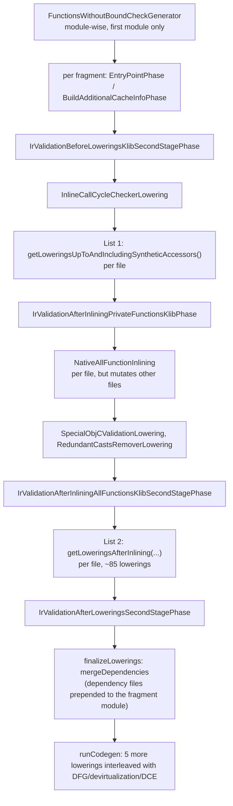

# Kotlin/Native: IR lowerings

How the K/N backend turns deserialized Kotlin IR into the restricted IR that [LLVM codegen](llvm-codegen.md) accepts. This page
covers the second-stage lowering pipeline and the few lowerings that run in the first stage before klib serialization. For the
module map and the surrounding driver see [architecture.md](architecture.md); for the phases that follow lowerings see
[second-stage-pipeline.md](second-stage-pipeline.md), [optimizations.md](optimizations.md) and [llvm-codegen.md](llvm-codegen.md).

All paths below marked `BACKEND/` are relative to
`kotlin-native/backend.native/compiler/ir/backend.native/src/org/jetbrains/kotlin/backend/konan/`.

## Role and fit

Lowerings are the middle of the second stage: `runBackend` in
[TopLevelPhases.kt](../../kotlin-native/backend.native/compiler/ir/backend.native/src/org/jetbrains/kotlin/backend/konan/driver/phases/TopLevelPhases.kt)
splits the linked IR into fragments, runs **all lowerings for all fragments sequentially** (`runAllLowerings`), and only then compiles
fragments (possibly in parallel) through the whole-program optimizations and LLVM codegen. The lowering lists themselves live in
[NativeLoweringPhases.kt](../../kotlin-native/backend.native/compiler/ir/backend.native/src/org/jetbrains/kotlin/backend/konan/driver/phases/NativeLoweringPhases.kt);
Native-specific lowering classes live in `BACKEND/lower/`, shared ones in `compiler/ir/backend.common/.../lower/`. A smaller set of
lowerings runs in the first stage (`.kt` → `.klib`) from `compiler/ir/backend.native` and is therefore baked into every klib.

## Key concepts

| Term | Meaning |
|------|---------|
| **Lowering / phase** | A `FileLoweringPass`/`ModuleLoweringPass` wrapped into a `NamedCompilerPhase` by `createFilePhases`/`createModulePhases` ([PhaseFactories.kt](../../compiler/ir/backend.common/src/org/jetbrains/kotlin/backend/common/phaser/PhaseFactories.kt)). The phase **name is the class's simple name** (`LoweringPhase(loweringClass.simpleName, …)`), which is what `-Xdisable-phases` and friends match, case-insensitively (`PhaseSet.Enum` in [PhaseSet.kt](../../compiler/config/src/org/jetbrains/kotlin/config/phaser/PhaseSet.kt)). |
| **Lowering list** | One of the Kotlin lists in `NativeLoweringPhases.kt`: `getLoweringsUpToAndIncludingSyntheticAccessors()` (before inlining) and `getLoweringsAfterInlining(...)`. The inliner itself is a one-element list created in `TopLevelPhases.kt`. |
| **Synchronization point** | A moment where *all* files of *all* fragments have been lowered to the same list boundary. Only there can a module-wise phase (validation, `InlineCallCycleCheckerLowering`, the inliner) rely on the state of other files. |
| **Fragment** (`BackendJobFragment`) | The unit that gets its own `NativeGenerationState` and LLVM module: the whole program, or one file when building per-file caches (`splitIntoFragments`). |
| **`NativeLoweringContext`** | The context type lowerings should take ([NativeLoweringContext.kt](../../kotlin-native/backend.native/compiler/ir/backend.native/src/org/jetbrains/kotlin/backend/konan/NativeLoweringContext.kt)): `CommonBackendContext` plus `symbols: BackendNativeSymbols`, `bridgesSupport`, `enumsSupport`, `cachesAbiSupport`. Implemented by `NativeBackendContext` and, by delegation, by `NativeGenerationState`. Lowerings that need per-fragment state (`fileLowerState`, `dependenciesTracker`, `llvmModuleSpecification`) take `NativeGenerationState` instead. |
| **`FileLowerState`** | Per-file counters for synthesized names (coroutine classes, function-reference classes, C stubs), reset by `runLowerings` before each file ([NativeGenerationState.kt](../../kotlin-native/backend.native/compiler/ir/backend.native/src/org/jetbrains/kotlin/backend/konan/NativeGenerationState.kt)). |
| **`@PhasePrerequisites`** | Annotation on a lowering class listing lowerings that must have run before it ([PhasePrerequisites.kt](../../compiler/ir/backend.common/src/org/jetbrains/kotlin/backend/common/phaser/PhasePrerequisites.kt)); checked by a unit test, not at runtime. |
| **Pre-serialization lowering** | A first-stage lowering run by `NativePreSerializationPipelinePhase` before IR is written to the klib. |
| **`PhaseConfig`** | Which phases are disabled, dumped or validated; built from CLI arguments by `createPhaseConfig` ([createPhaseConfig.kt](../../compiler/cli/src/org/jetbrains/kotlin/cli/common/createPhaseConfig.kt)) in `K2Native`. |

## How it works

### Stage 1: pre-serialization lowerings

`NativeKlibCliPipeline` runs `NativePreSerializationPipelinePhase` between fir2ir and IR serialization
([NativeFir2IrPipelinePhase.kt](../../compiler/cli/cli-native-klib/src/main/kotlin/org/jetbrains/kotlin/native/pipeline/NativeFir2IrPipelinePhase.kt)).
It calls `runPreSerializationLowerings` in
[PreSerializingLowerings.kt](../../compiler/cli/cli-native-klib/src/main/kotlin/org/jetbrains/kotlin/native/PreSerializingLowerings.kt),
which builds a `NativePreSerializationLoweringContext`
([NativePreSerializationLoweringContext.kt](../../compiler/ir/backend.native/src/org/jetbrains/kotlin/backend/konan/NativePreSerializationLoweringContext.kt);
it supplies `PreSerializationNativeSymbols`, `KlibSharedVariablesManager` and `KonanManglerIr`) and runs, module-wise:

1. `TestProcessor` (only if `LanguageFeature.NativeTestProcessorBeforeSerialization`) – generates `kotlin.test` suite classes
   ([TestProcessor.kt](../../compiler/ir/backend.native/src/org/jetbrains/kotlin/backend/konan/lower/TestProcessor.kt)).
2. `nativeLoweringsOfTheFirstPhase`
   ([NativeFirstPhaseLoweringPhases.kt](../../compiler/ir/ir.inline/src/org/jetbrains/kotlin/ir/inline/konan/NativeFirstPhaseLoweringPhases.kt)):
   `UpgradeCallableReferences` (if `IrRichCallableReferencesInKlibs`), `NativeAssertionWrapperLowering` (if
   `IrIntraModuleInlinerBeforeKlibSerialization`), `NativeExportedBridgeCallDispatchLowering` (always; rewrites calls inside
   Swift-export `@ExportedBridge` bridges to non-virtual/delegating calls, see its KDoc in
   [NativeExportedBridgeCallDispatchLowering.kt](../../compiler/ir/backend.native/src/org/jetbrains/kotlin/backend/konan/lower/NativeExportedBridgeCallDispatchLowering.kt)),
   then the shared `loweringsOfTheFirstPhase` (the pre-serialization inliner and its validation,
   [CommonLoweringPhases.kt](../../compiler/ir/ir.inline/src/org/jetbrains/kotlin/ir/inline/CommonLoweringPhases.kt)) and
   `TailrecCheckerLowering`.

Why this matters: whatever runs here is serialized into the klib IR, so it becomes part of the klib's content that every consumer
(and every compiler version that reads the klib) sees. That is why the list is small, gated by `LanguageFeature`s, and must stay
LLVM-free (`compiler/ir/backend.native` must not depend on `:kotlin-native:backend.native`, see [architecture.md](architecture.md)).
Note that the second-stage list starts with `TestProcessor`, `UpgradeCallableReferences` and `NativeAssertionWrapperLowering` again.
`TestProcessor` skips files annotated with `symbols.testsProcessed` (`shouldSkipFile`), so it is idempotent. Hypothesis: the
duplication exists so that klibs produced without those language features are still lowered in the second stage; the other two are
expected to be no-ops on already-lowered IR (not verified).

### Stage 2: the pipeline in `runAllLowerings`

Each box is applied to **every fragment** before the next box starts (`fragmentWithState.runSpecifiedLowerings(...)`), which is what
makes box boundaries synchronization points. The reasons are stated in code comments in `runAllLowerings`:

- *Validation needs synchronized IR.* "In Kotlin/Native, lowerings are run not over modules, but over individual files … in order to
  validate IR after inlining, we have to make sure that all the modules being compiled are lowered to the same stage, because
  otherwise we may be actually validating a partially lowered IR" (hence the 'lowering synchronization point' term).
- *The inliner breaks the per-file model.* "All lowerings up to but excluding `InlineAllFunctions` are supposed to modify only the
  lowered file. By contrast, `InlineAllFunctions` may mutate multiple files at the same time … `InlineAllFunctions` expects that for
  an inlined function all preceding lowerings (including generation of synthetic accessors) have been already applied." So list 1
  ends with `SyntheticAccessorLowering` and a synchronization point sits right before the inliner. This was introduced in commit
  `13048de6c732` ("IR Inliner, Native: Run InlineAllFunctions after a synchronization point", 2024-06).

### Per-file execution

`runLowerings` in `NativeLoweringPhases.kt` is the inner loop: for each module, for each file, reset `context.fileLowerState`, then
fold the file through the list, measuring each phase (`PhaseType.IrLowering`) and wrapping any non-`CompilationException` failure
into `"Internal error in file lowering"` with file details attached. Module-wise phases go through `runModuleWisePhase`.

`partiallyLowerModuleWithDependencies` (`TopLevelPhases.kt`) decides *which* modules a fragment lowers: the fragment's own module
plus `findDependenciesToCompile()` = `context.irModules` filtered by `llvmModuleSpecification.containsModule`, i.e. the dependency
klibs that are **not** covered by a cache and therefore are compiled into this LLVM module. They are lowered in the order
`listOf(module) + dependenciesToCompile.reversed()`. Two TODOs sit on that line: `KonanLibraryResolver.TopologicalLibraryOrder`
"actually returns libraries in the reverse topological order", and "Does the order of files really matter with the new MM? (and
with lazy top-levels initialization?)". Finally `mergeDependencies` prepends all dependency files to the fragment module
(`targetModule.files.addAll(0, …)`), with the comment "Save all files for codegen in reverse topological order. This guarantees that
libraries initializers are emitted in correct order." Codegen therefore sees one module containing stdlib and other dependency files
first and the user's files last.

Before the lists, `runBackend` runs `FunctionsWithoutBoundCheckGenerator` module-wise on the first module only, because it "adds
declarations to the shared built-ins, independently of the input module"
([FunctionsWithoutBoundCheckGenerator.kt](../../kotlin-native/backend.native/compiler/ir/backend.native/src/org/jetbrains/kotlin/backend/konan/ir/FunctionsWithoutBoundCheckGenerator.kt));
`NativeForLoopsLowering` and `VarargInjectionLowering` carry `// TODO: depends on FunctionsWithoutBoundCheckGenerator`.

### Inlining

`NativePrivateFunctionInlining` (in list 1) and `NativeAllFunctionInlining` (between the lists) are both the shared
`FunctionInlining` with a `NativeInlineFunctionResolver`
([NativeIrInliner.kt](../../kotlin-native/backend.native/compiler/ir/backend.native/src/org/jetbrains/kotlin/backend/konan/lower/NativeIrInliner.kt),
[NativeInlineFunctionResolver.kt](../../kotlin-native/backend.native/compiler/ir/backend.native/src/org/jetbrains/kotlin/backend/konan/lower/NativeInlineFunctionResolver.kt)).
The resolver is where the per-file model is bent: when it meets a callee whose body is not yet lowered (tracked by an `irAttribute`
`wasLowered`), it deserializes the body if needed (`getInlineFunctionDeserializer(...).deserializeInlineFunction`) and runs **a copy
of list 1 on that single function** (`UpgradeCallableReferences`, `NativeAssertionWrapperLowering`, `LateinitLowering`,
`SharedVariablesLowering`, `LocalClassesInInlineLambdasLowering`, `ArrayConstructorLowering`, `NativePrivateFunctionInlining`, then
the two accessor lowerings via `lowerWithoutAddingAccessorsToParents`). This is why list 1 and `lower()` in the resolver must be
kept in sync by hand (a `// TODO … KT-72441` sits on the `wasLowered` check). After inlining, `PostInlineLowering` folds expanded
`typeOf`, `immutableBlobOf` and `::class` ([PostInlineLowering.kt](../../kotlin-native/backend.native/compiler/ir/backend.native/src/org/jetbrains/kotlin/backend/konan/lower/PostInlineLowering.kt)).
Cross-module inlining in general is described in [klib-inining.md](../inlining/klib-inining.md).

### Gated lowerings

`NativeSecondStageCompilationConfig.getLoweringsAfterInlining()` passes four flags; `takeIf`/`takeUnless` drop entries from the list
(`createFilePhases` filters nulls).

| Flag | Source | Lowerings affected |
|------|--------|--------------------|
| `generateTestDumper` | `GENERATE_TEST_RUNNER != NONE` (`-generate-test-runner`/`-tr`, `-generate-no-exit-test-runner`, `-generate-worker-test-runner`) | `TestsDumper` (writes test names to `-Xdump-tests-to`) |
| `optimizationsEnabled` | `-opt` ([NativeSecondStageCompilationConfig.kt](../../kotlin-native/backend.native/compiler/ir/backend.native/src/org/jetbrains/kotlin/backend/konan/NativeSecondStageCompilationConfig.kt)) | `StringConcatenationTypeNarrowing` only with `-opt`; `CastsLowering` only **without** `-opt` (with `-opt` casts stay as `IrTypeOperatorCall`s for the optimizer, see [optimizations.md](optimizations.md)); in `runCodegen`: `PropertyAccessorInlineLowering`, `InlineClassPropertyAccessorsLowering`, `UnboxInlineLowering` |
| `genericSafeCasts` | `-Xbinary=genericSafeCasts=`; default `!optimizationsEnabled` "due to performance penalty" | `CastsOptimization`; also selects `BridgesPolicy.BOX_UNBOX_CASTS` used by `BridgesBuilding` |
| `isCache` | `produce.isCache` | `ExportCachesAbiVisitor` (adds accessors for private entities so a cache can be linked against); `ImportCachesAbiTransformer` always runs and redirects accesses to declarations outside the current LLVM module to those accessors, registering dependencies in `dependenciesTracker` ([CachesAbiLowering.kt](../../kotlin-native/backend.native/compiler/ir/backend.native/src/org/jetbrains/kotlin/backend/konan/lower/CachesAbiLowering.kt)); see [caches.md](caches.md) |

`CoroutinesLivenessAnalysis` and `CoroutinesLivenessAnalysisFallback` both run; the comment says "Either of these could be turned
off without losing correctness", and the fallback checks `coroutinesLivenessAnalysisPhasePerformed` to skip itself.

### Validation phases

All four are `IrValidationPhase` subclasses from
[IrValidationPhase.kt](../../compiler/ir/backend.common/src/org/jetbrains/kotlin/backend/common/phaser/IrValidationPhase.kt). They
read the mode from `CommonConfigurationKeys.VERIFY_IR` (`-Xverify-ir={none|warning|error}`, default `none`), so **by default they
are no-ops**; the test infrastructure passes `-Xverify-ir=error -Xphases-to-validate-after=all`
([TestCompilation.kt](../../native/native.tests/testFixtures/org/jetbrains/kotlin/konan/test/blackbox/support/compilation/TestCompilation.kt)).

| Phase | Checks |
|-------|--------|
| `IrValidationBeforeLoweringsKlibSecondStagePhase` | tree consistency, unbound symbols, visibility (relaxed), cross-file field usage, value/type-parameter scopes, varargs |
| `IrValidationAfterInliningPrivateFunctionsKlibPhase` | basic checks plus "call sites of only non-private functions are allowed at this stage" |
| `IrValidationAfterInliningAllFunctionsKlibSecondStagePhase` | everything above plus `IrTypeOperatorRedundancyChecker` and "no inline function call sites should remain" (except `typeOf`) |
| `IrValidationAfterLoweringsSecondStagePhase` | basic checks only (lowered IR violates visibility and scoping rules on purpose) |

`SpecialObjCValidationLowering` is a check disguised as a lowering: it reports suspend calls inside inlined `autoreleasepool {}`
blocks (KT-50786), which "can't easily [be checked] in frontend" because of indirect inline wrappers. Frontend-like interop checks
(`SpecialBackendChecksTraversal`) run earlier, in `linkKlibs`, not in the lowering pipeline.

### Lowerings inside `runCodegen`

After `finalizeLowerings`, `runCodegen` in `TopLevelPhases.kt` runs five more file lowerings interleaved with the whole-program
passes ([optimizations.md](optimizations.md)): `PropertyAccessorInlineLowering` and `InlineClassPropertyAccessorsLowering`
(`-opt` only; comment: must run "after link dependencies phase, because fields from dependencies can be changed during lowerings",
and only in optimized builds "due to separate compilation and possibility to get broken debug information"), then after
devirtualization `RedundantCoercionsCleaner` (removes matching box/unbox pairs,
[RedundantCoercionsCleaner.kt](../../kotlin-native/backend.native/compiler/ir/backend.native/src/org/jetbrains/kotlin/backend/konan/lower/RedundantCoercionsCleaner.kt))
and `UnboxInlineLowering` (`-opt`), and after DCE `CoroutinesVarSpillingLowering`, which materializes the fields that save and
restore live locals around suspension points. These see the merged module, so they may freely cross file boundaries.

## Invariants and ordering constraints

- **Modify only the lowered file** up to and including `SyntheticAccessorLowering`. Lowerings in list 1 must not touch other files;
  the inliner relies on this to find callee bodies in a known state. After inlining the rule is relaxed in practice (synthetic
  classes are added to the current file; `ExportCachesAbiVisitor` adds accessors to the file being lowered), but there is still no
  guarantee about the state of *other* files until the next synchronization point ([AGENTS.md](../../kotlin-native/AGENTS.md)).
- **Per-fragment state is per file.** `fileLowerState` is reset per file; anything that must be unique across files has to derive
  names from the file (`InteropBridgesNameInventor` hex-encodes module+file name into a prefix precisely because bridges generated
  inside inline lambdas get copied by the inliner, see its header comment in
  [InteropBridgesNameInventor.kt](../../kotlin-native/backend.native/compiler/ir/backend.native/src/org/jetbrains/kotlin/backend/konan/lower/InteropBridgesNameInventor.kt)).
- **Cross-lowering state lives in `irAttribute`s**, not in context maps: `enumValueGetter`, `objectClassInstanceFunction`,
  `outerThisField`, `clinitTriggerFunction`, `volatileField`, `wasLowered`, `hasSyntheticNameToBeHiddenInReflection`,
  `liveVariablesAtSuspensionPoint`. Whether an attribute survives `deepCopy` is set per attribute (`copyByDefault`).
- **Declared prerequisites.** Many classes carry `@PhasePrerequisites(...)`; `NativeLoweringPrerequisitesTest` checks, for all 16
  flag combinations, that each prerequisite appears earlier in the flattened lists
  ([NativeLoweringPrerequisitesTest.kt](../../kotlin-native/backend.native/compiler/ir/backend.native/test/org/jetbrains/kotlin/backend/konan/lowering/NativeLoweringPrerequisitesTest.kt)).
  Examples: `Autoboxing` after `BridgesBuilding`, `NativeSuspendFunctionsLowering`, `GenericCallsReturnTypeEraser`;
  `ReturnsInsertionLowering` after `Autoboxing`; `StaticInitializersLowering` after `ExpressionBodyTransformer`;
  `NativeLocalDeclarationsLowering` after `InteropBridgesNameInventor`.
- **Ordering that is only in comments.** `ComputeTypesPass` runs twice: after `NativeFinallyBlocksLowering` because "Inliner erases
  generics", and again before `CastsOptimization` because it "corrects some lowerings' inaccuracies in IR types".
  `GenericCallsReturnTypeEraser` states the end-of-pipeline contract: "by the end of the pipeline all the types are considered erased
  and a function call is just a pure and simple function call with no conversions/coercions"
  ([GenericCallsReturnTypeEraser.kt](../../kotlin-native/backend.native/compiler/ir/backend.native/src/org/jetbrains/kotlin/backend/konan/lower/GenericCallsReturnTypeEraser.kt)).
- **Lowerings run single-threaded.** Parallelism (`threadsCount`) starts only after `runAllLowerings`; the comment explains that
  lowerings "need cross-file access all the time".
- **Dependencies for caches are recorded during lowerings.** When a lowering bakes a fact about another file into the current one
  (e.g. `NativeEnumWhenLowering` turns an enum entry into an ordinal constant) it must call `dependenciesTracker.add(...)` so
  incremental compilation invalidates the caller ([EnumClassLowering.kt](../../kotlin-native/backend.native/compiler/ir/backend.native/src/org/jetbrains/kotlin/backend/konan/lower/EnumClassLowering.kt)).

## Extension points and typical changes

**Adding or moving a second-stage lowering.** Write a `FileLoweringPass`/`BodyLoweringPass`/`ClassLoweringPass` taking
`NativeLoweringContext` (or `NativeGenerationState` if you need `fileLowerState`, `dependenciesTracker` or
`llvmModuleSpecification`), insert its constructor reference in the right list in `NativeLoweringPhases.kt`, and add
`@PhasePrerequisites`. Placement rules: before the inliner only if it must see pre-inlining IR *and* can obey "modify only this
file" (and then mirror it in `NativeInlineFunctionResolver.lower`); otherwise in list 2. Then run
`NativeLoweringPrerequisitesTest`. Runtime symbols come from `BackendNativeSymbols` (`BACKEND/ir/`); a new intrinsic usually needs a
stdlib declaration in `kotlin-native/runtime/src/main/kotlin` and, if codegen must recognise it, an entry on the LLVM side
([compiler-runtime-contract.md](compiler-runtime-contract.md)).

**Changing what the lowered IR looks like** (new declaration origin, new synthetic field, different call shape) is a contract change
with [llvm-codegen.md](llvm-codegen.md) (`IrToBitcode.kt` pattern-matches on origins such as `DECLARATION_ORIGIN_BRIDGE_METHOD`,
`StaticInitializersOrigins`, `DECLARATION_ORIGIN_COROUTINE_IMPL`), with the dataflow IR builders in `optimizations/`, and, for
anything visible across a cache boundary, with [caches.md](caches.md) (`CachesAbiSupport`, `SerializedClassFields`,
`SerializedInlineFunctionReference`).

**Adding a first-stage lowering** means changing klib content: put it in `compiler/ir/backend.native` (LLVM-free), add it to
`nativeLoweringsOfTheFirstPhase` behind a `LanguageFeature`, keep the second stage able to consume klibs without it, and expect
`irText`, klib dump and ABI tests to change ([klib-linking.md](klib-linking.md)).

**Gating by configuration** goes through `NativeSecondStageCompilationConfig` and a new parameter of
`getLoweringsAfterInlining`; add the flag to `getNativeLoweringPhaseListsForTests` and the loops in `NativeLoweringPrerequisitesTest`.

## Native-specific lowerings worth knowing

Two groups have their own pages: initialization (`InitializersLowering`, `StaticInitializersLowering`, `ObjectClassLowering`,
enum entries, `@EagerInitialization`/`@ThreadLocal`) in [static-initializers.md](static-initializers.md), and casts
(`ComputeTypesPass`, `CastsOptimization`, `TypeOperatorLowering`, `CastsLowering`, `Autoboxing`'s checked casts, the bridges
policy) in [casts-optimization.md](casts-optimization.md).

Descriptions below come from each class's KDoc or body. Shared lowerings (`LateinitLowering`, `SharedVariablesLowering`,
`InnerClassLowering`-style helpers, `EnumWhenLowering`, `DefaultArgumentStubGenerator`, …) come from `compiler/ir/backend.common`;
a `Native*` subclass exists only where the Native runtime needs different symbols or policy.

| Topic | Lowering (file in `BACKEND/lower/`) | What it does / why Native-specific |
|-------|-------------------------------------|------------------------------------|
| Interop | `InteropLowering` ([InteropLowering.kt](../../kotlin-native/backend.native/compiler/ir/backend.native/src/org/jetbrains/kotlin/backend/konan/lower/InteropLowering.kt)) | Two parts: ObjC class/method/`@ObjCAction` handling and eager top-level initializers for ObjC classes, then C/ObjC call intrinsics into Kotlin and C bridges (C stubs are emitted via `CStubsManager`, `-Xtemporary-files-dir` keeps them). Bridge names use `NAME_PLACEHOLDER_QUOTE` placeholders. |
| Interop | `InteropBridgesNameInventor` | Second naming pass: replaces placeholders with a file-unique prefix after inlining has copied bridges. |
| Interop | `SpecialInteropIntrinsicsLowering` | Intrinsics that "must be lowered separately from the interop lowering as their proper handling requires inlining phase to have been applied". |
| Interop | `SpecialObjCValidationLowering` | Rejects suspend calls in inlined `autoreleasepool {}` (KT-50786). |
| Boxing / value classes | `Autoboxing` ([Autoboxing.kt](../../kotlin-native/backend.native/compiler/ir/backend.native/src/org/jetbrains/kotlin/backend/konan/lower/Autoboxing.kt)) | "Boxes and unboxes values of value types when necessary"; K/N's calling convention passes primitives and inline classes unboxed, so coercions become explicit `box`/`unbox` calls. |
| Boxing / value classes | `GenericCallsReturnTypeEraser`, `RedundantCoercionsCleaner`, `UnboxInlineLowering`, `InlineClassPropertyAccessorsLowering` | Erase generic return types, then remove box/unbox pairs and inline trivial `<T-unbox>` and accessor bodies left after devirtualization. |
| Boxing / value classes | `NativeSharedVariablesPrimitiveBoxSpecializationLowering` | Shared-variable boxes specialised per primitive, using `context.symbols`. |
| Coroutines | `NativeSuspendFunctionsLowering` ([NativeSuspendFunctionLowering.kt](../../kotlin-native/backend.native/compiler/ir/backend.native/src/org/jetbrains/kotlin/backend/konan/lower/NativeSuspendFunctionLowering.kt)) | Builds the `invokeSuspend` state-machine class only when a function has non-tail suspend calls; tail suspend calls are simplified into returns. Uses `saveCoroutineState`/`restoreCoroutineState` runtime symbols. |
| Coroutines | `NativeAddContinuationToFunctionCallsLowering`, `CoroutinesLivenessAnalysis(+Fallback)`, `CoroutinesVarSpillingLowering` | Pass the continuation (the state-machine object itself overrides `invokeSuspend`); compute live or visible variables at suspension points; spill them to fields (in `runCodegen`). |
| Enums, objects, initializers | `EnumConstructorsLowering`, `EnumClassLowering`, `EnumUsageLowering`, `NativeEnumWhenLowering` | Enum entries become `VALUES`/`ENTRIES` static fields plus a `getEnumAt` getter; `IrGetEnumValue` and `values/valueOf/entries` intrinsics become loads; `when` over enums records a strong per-file dependency for caches. |
| Enums, objects, initializers | `ObjectClassLowering` ([ObjectClassLowering.kt](../../kotlin-native/backend.native/compiler/ir/backend.native/src/org/jetbrains/kotlin/backend/konan/lower/ObjectClassLowering.kt)) | Replaces `IrGetObjectValue` by a call to a synthesized `instance`/`companion` getter; companion placement follows `newCompanionInitializationEnabled` of the klib (initialization order is a klib-level property). ObjC companions use `interopInterpretObjCPointer`. |
| Enums, objects, initializers | `InitializersLowering`, `StaticInitializersLowering` ([StaticInitializersLowering.kt](../../kotlin-native/backend.native/compiler/ir/backend.native/src/org/jetbrains/kotlin/backend/konan/lower/StaticInitializersLowering.kt)), `VolatileFieldsLowering` | Instance initializers into an `<init>` method; global/thread-local/eager static initializers per file and class with a `$clinit_trigger` function, lazy per file unless `-Xir-property-lazy-initialization=disable` or `@EagerInitialization`; `@Volatile` fields get atomic intrinsic functions (`Boolean` stored as `Byte`). |
| Bridges | `BridgesBuilding`, `WorkersBridgesBuilding` ([BridgesBuilding.kt](../../kotlin-native/backend.native/compiler/ir/backend.native/src/org/jetbrains/kotlin/backend/konan/lower/BridgesBuilding.kt)) | Box/unbox (and, with `genericSafeCasts`, cast) bridges for overrides whose erased signatures differ, following `config.bridgesPolicy`; also bridges needed for cache entry points. Bridges are `@TransparentForDebugger`. |
| Casts / type operators | `TypeOperatorLowering`, `CastsLowering` ([CastsLowering.kt](../../kotlin-native/backend.native/compiler/ir/backend.native/src/org/jetbrains/kotlin/backend/konan/lower/CastsLowering.kt)), `RemoveCastsFromNothingLowering`, `BuiltinOperatorLowering` | Erase type parameters in checks (ObjC forward declarations check against `Any`); turn `CAST` into `checkNotNull`/`downcast` runtime calls (not with `-opt`, where `CastsOptimization` handles them); lower `IrBuiltinOperator` calls. |
| Strings | `StringConcatenationTypeNarrowing` | With `-opt`, call `toString()` explicitly so `append`/`plus` take `String`, which "can be later devirtualized, improving escape analysis". |
| Test runner | `TestProcessor` (stage 1 and 2), `TestsInitializer`, `TestsDumper` | Suite classes for `kotlin.test` annotations; `@TestInitializer` functions become eager thread-local fields; dump of test names for the test infrastructure. |
| Reflection / `typeOf` | `TypeOfProcessingLowering`, `ReifiedFunctionLowering`, `PostInlineLowering`, `NativeFunctionReferenceLowering`, `StaticCallableReferenceOptimization` | `typeOf<T>()` becomes constant `KType` IR after inlining; bodies of reified inline functions that survive inlining are replaced by a throw; function references become `KFunctionImpl` subclasses (with linkage-error variants) and are constant-folded when they capture nothing. |
| Default arguments | `NativeDefaultArgumentStubGenerator`, `NativeDefaultParameterCleaner`, `NativeDefaultParameterInjector` | Shared scheme with `skipInlineMethods = false`; `nullConst` produces a typed zero per `PrimitiveBinaryType` wrapped in `reinterpret`, including `getNativeNullPtr` for pointers. |
| Local declarations | `NativeLocalDeclarationsLowering`, `NativeInventNamesForLocalClasses`, `NativeKlibInventNamesForLocalFunctions`, `LocalDeclarationPopupLowering` | Shared lowerings with Native naming (`$`-joined, anonymous objects named after the package part and flagged `hasSyntheticNameToBeHiddenInReflection`). |
| Caches ABI | `ExportCachesAbiVisitor`, `ImportCachesAbiTransformer` | See "Gated lowerings" above and [caches.md](caches.md). |
| Constructors / returns | `ConstructorsLowering`, `ReturnsInsertionLowering` | "Replaces constructor calls by (alloc + static call)" using `createUninitializedInstance`/`createUninitializedArray`; explicit `IrReturn`s for `Unit` functions. Both are the last steps before codegen. |
| Interop (first stage) | `NativeExportedBridgeCallDispatchLowering` | Swift-export bridge dispatch, see "Stage 1" above. |

## Investigating bugs here

**Symptoms → where to look**

| Symptom | Start at |
|---------|----------|
| `Internal error in file lowering` with a file attached | `runLowerings`; the attachment names the file and the phase is in the stack trace. Reproduce with `-Xverify-ir=error -Xphases-to-validate-after=all` to catch the first phase that produced bad IR. |
| IR validation error after inlining | The checker named in the message; compare `IrValidationAfterInliningAllFunctionsKlibSecondStagePhase` config. Visibility errors usually mean a missing synthetic accessor (`SyntheticAccessorLowering`) or a lowering that ran before the synchronization point and touched another file. |
| Wrong behaviour only with `-opt` or only without | Check the `takeIf`/`takeUnless` gates (`CastsLowering`, `StringConcatenationTypeNarrowing`, `runCodegen` lowerings) and `genericSafeCasts`. |
| Wrong behaviour only with caches / per-file caches | `ImportCachesAbiTransformer`, `BridgesBuilding.needsBridgeForCacheEntryPoint`, missing `dependenciesTracker.add`; run tests with `-Pkn.cacheMode=STATIC_EVERYWHERE` or `STATIC_PER_FILE_EVERYWHERE`. |
| Crash in LLVM codegen on a lowering's output | The origin constants listed in "Extension points"; dump IR after the last lowering (`-Xphases-to-dump-after=ReturnsInsertionLowering` or `CastsLowering`). |
| Interop bridge name clashes, "duplicate symbol" from C stubs | `InteropBridgesNameInventor`, `NAME_PLACEHOLDER_QUOTE` (KT-81538). |
| Test suite not found / `@Test` not run | `TestProcessor` in both stages and `symbols.testsProcessed`; `-Xdump-tests-to` plus `TestsDumper`. |

**Flags** (common ones are defined in
[CommonCompilerArguments.kt](../../compiler/cli/cli-base/gen/org/jetbrains/kotlin/cli/common/arguments/CommonCompilerArguments.kt),
Native ones in [K2NativeCompilerArguments.kt](../../native/cli-native/src/org/jetbrains/kotlin/cli/bc/K2NativeCompilerArguments.kt)):

| Flag | Effect |
|------|--------|
| `-Xlist-phases` | Prints phase names (`PhaseConfig.list`); handled in `K2Native` together with `-list-targets`. |
| `-Xdisable-phases=A,B` | `PhaseConfig.isEnabled` false → `outputIfNotEnabled` returns the input unchanged. Names are class simple names, case-insensitive, `all` allowed. |
| `-Xphases-to-dump-before=`, `-Xphases-to-dump-after=`, `-Xphases-to-dump=` | IR dump via `getIrDumper` ([DumperVerifier.kt](../../compiler/ir/backend.common/src/org/jetbrains/kotlin/backend/common/phaser/DumperVerifier.kt)); to stdout, or with `-Xdump-directory=<dir>` to `<dir>/NN_BEFORE|AFTER.<Phase>.ir`. `-Xdump-fqname=<fq>` restricts the dump to one declaration; the JVM system property `org.jetbrains.kotlin.compiler.ir.dump.strategy=KotlinLike` switches to Kotlin-like dumps. Because lowerings run per file, a file-level dump overwrites the previous file's dump with the same name (noted in a TODO in the dumper). |
| `-Xphases-to-validate-after=all` (also `-before`, `-Xphases-to-validate`) | Runs `getIrValidator(checkTypes = true)` around each phase (`DEFAULT_IR_ACTIONS`), independent of `-Xverify-ir`. |
| `-Xverify-ir={none,warning,error}`, `-Xenable-additional-ir-checkers=`, `-Xdisable-ir-checkers=` | Mode and checker set (by checker class simple name) for the four named validation phases. |
| `-Xprofile-phases`, `-Xverbose-phases=` | Timing per phase; verbose logging for named phases. |
| `-Xverify-compiler`, `-Xverify-bitcode`, `-Xprint-bitcode` | LLVM-level: `VerifyBitcodePhase` runs when `needCompilerVerification` (default: `-opt` or a non-release compiler) or `-Xverify-bitcode`; `PrintBitcodePhase` prints the module. |
| `-opt`, `-Xbinary=genericSafeCasts=`, `-Xir-property-lazy-initialization=`, `-generate-test-runner`, `-Xdump-tests-to` | Change which lowerings run or what they emit (see "Gated lowerings"). |

**Tests**

| What | Where | Run |
|------|-------|-----|
| Prerequisite order of the lists | `NativeLoweringPrerequisitesTest` (unit test, no distribution needed) | `./gradlew :kotlin-native:backend.native:test --tests "org.jetbrains.kotlin.backend.konan.lowering.NativeLoweringPrerequisitesTest"` |
| Behavioural tests, Native-only | `native/native.tests/testData/codegen` → `FirNativeCodegenLocalTestGenerated` ([GenerateNativeTests.kt](../../native/native.tests/testFixtures/org/jetbrains/kotlin/generators/tests/GenerateNativeTests.kt)) | `./gradlew :native:native.tests:test --tests "org.jetbrains.kotlin.konan.test.blackbox.FirNativeCodegenLocalTestGenerated*"` |
| Shared box tests | `compiler/testData/codegen/box`, `boxInline` → `FirNativeCodegenBoxTestGenerated` ([GenerateNativeCodegenBoxTests.kt](../../native/native.tests/codegen-box/testFixtures/org/jetbrains/kotlin/generators/tests/GenerateNativeCodegenBoxTests.kt)); ignore with `// IGNORE_NATIVE: optimizationMode=OPT` etc. | `./gradlew :native:native.tests:codegen-box:test --tests "org.jetbrains.kotlin.konan.test.blackbox.FirNativeCodegenBoxTestGenerated\$Box\$*"` |
| First-stage IR text dumps | `compiler/testData/ir/irText` with `AbstractLightTreeNativeIrTextTest`/`AbstractPsiNativeIrTextTest` ([GenerateKlibNativeTests.kt](../../native/native.tests/klib-ir-inliner/testFixtures/org/jetbrains/kotlin/generators/tests/GenerateKlibNativeTests.kt)); the test runs frontend → fir2ir → `NativePreSerializationLoweringCliFacade` → klib serialize/deserialize, so it covers stage-1 lowerings only. Native-specific expectations use `.ir.native.patch` files. | `./gradlew :native:native.tests:klib-ir-inliner:test --tests "*NativeIrTextTestGenerated*"` |
| Synthetic accessors / inliner | `compiler/testData/klib/syntheticAccessors` (`AbstractNativeKlibSyntheticAccessorTest`, plus box runs) | same Gradle project as above |
| Test modes that flip the gates | `-Pkn.optimizationMode=OPT`, `-Pkn.cacheMode=NO|STATIC_EVERYWHERE|STATIC_PER_FILE_EVERYWHERE`, `-Pkn.mode=ONE_STAGE_MULTI_MODULE` ([HACKING.md](../../kotlin-native/HACKING.md#testing)) | append to any command above |

Generated test classes live in `<project>/build/tests-gen/` and are produced by the test task itself; the integration tests load the
compiler from `kotlin-native/dist`, so a lowering change implies a dist rebuild ([AGENTS.md](../../kotlin-native/AGENTS.md)).
There is no test that dumps second-stage IR after a chosen lowering; use `-Xphases-to-dump-after` on a manual `konanc` run instead.

## Open questions

- Why `TestProcessor`, `UpgradeCallableReferences` and `NativeAssertionWrapperLowering` appear in both the first-stage and the
  second-stage lists: backward compatibility with older klibs is a guess; `UpgradeCallableReferences` idempotence was not verified.
- Whether the "reverse topological order" TODO in `partiallyLowerModuleWithDependencies` describes a real bug (wrong initializer
  order) or is harmless under lazy file initialization; the comment itself asks this.
- The exact semantics of `-Xprint-ir` and `-Xprint-files` (Native flags) were not traced.
- `getCornerPhasesToDump` in `createPhaseConfig` special-cases `-Xphases-to-dump=IrLowering`, but `K2Native` calls
  `createPhaseConfig(arguments)` without `phasesToExecute`, so that shortcut probably does nothing for Native (unverified).
- How `PhaserState.phaseCount` (the `NN_` prefix in dump file names) advances across per-file `runPhase` calls, i.e. whether dumps of
  different files of the same phase collide, was not verified beyond the TODO in `DumperVerifier.kt`.
- Whether `IrValidationBeforeLoweringsKlibSecondStagePhase` with `checkUnboundSymbols = true` is compatible with partial linkage
  stubs in all cache modes (no evidence either way).
