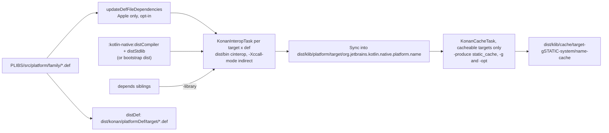

# Kotlin/Native: platform libraries

The prebuilt cinterop klibs for each target's system API (`platform.posix`, `platform.Foundation`, `platform.UIKit`, …): what they
are, how the K/N build produces and caches them, how the compiler, the cinterop tool, KGP, the commonizer and the IDE find and
consume them, and the implied contracts that make them a compatibility surface of their own. The cinterop tool itself, the klib
format and the interop lowerings are in [cinterop.md](cinterop.md); library resolution in [klib-linking.md](klib-linking.md);
system caches in [caches.md](caches.md); the distribution layout in [architecture.md](architecture.md#distribution).

Path shorthands: `PLIBS` = `kotlin-native/platformLibs/`, `BUILD_TOOLS` = `kotlin-native/build-tools/src/main/kotlin/org/jetbrains/kotlin/`,
`KGP_NATIVE` = `libraries/tools/kotlin-gradle-plugin/src/common/kotlin/org/jetbrains/kotlin/gradle/targets/native/`,
`BACKEND` = `kotlin-native/backend.native/compiler/ir/backend.native/src/org/jetbrains/kotlin/backend/konan/`.

## Role and fit

A platform library is an ordinary cinterop klib with three special properties: it is **built by the K/N build itself** from a `.def`
checked into the repository, it is **shipped inside the distribution** under `klib/platform/<target>/`, and it is **loaded
implicitly** by every compilation for that target. Nothing in the compiler treats the contents differently from a user cinterop
klib; what is special is where it comes from and that it is found by directory scan, not by command line. That makes the set of
platform libraries, their packages, their generated API shape and their caches part of the distribution's contract with user code,
with KGP and with the commonizer.

## Key concepts

| Term | Meaning |
|------|---------|
| Platform `.def` | `PLIBS/src/platform/<family>/<name>.def`; `<name>` is the library's short name and the default package suffix (`platform.<name>`). `*.def.disabled` files are kept for Apple frameworks that do not build (e.g. `#Disabled: Unavailable`). |
| Library name | `org.jetbrains.kotlin.native.platform.<name>` (`KONAN_PLATFORM_LIBS_NAME_PREFIX` in [NativeLibraryConstants.kt](../../native/utils/src/org/jetbrains/kotlin/konan/library/NativeLibraryConstants.kt), duplicated as `PlatformLibsInfo.namePrefix` in [PlatformLibsInfo.kt](../../native/utils/src/org/jetbrains/kotlin/konan/util/PlatformLibsInfo.kt)). The compiler recognizes platform libs by this prefix. |
| `depends =` | The `.def` line listing other platform libs whose headers this one imports; drives build order and the `-library` arguments. Generated for Apple families by `defFileDependencies`. |
| `platformDef/` | `dist/konan/platformDef/<target>/*.def`: the `.def` sources shipped with the distribution (`distDef` task), consumed by the "light" distribution generator. |
| Prebuilt vs light distribution | KGP's `kotlin.native.distribution.type`: `prebuilt` (default) ships `klib/platform/*`; `light` ships only `platformDef/` and KGP generates the klibs on the developer's machine ([NativeDistributionType.kt](../../libraries/tools/kotlin-gradle-plugin/src/common/kotlin/org/jetbrains/kotlin/gradle/targets/native/internal/NativeDistributionType.kt)). |
| Implicit loading | `KlibNativeDistributionLibraryProvider.withPlatformLibs(target)` adds every `org.jetbrains.kotlin.native.platform.*` directory under `klib/platform/<target>` to the klib loader unless `-no-default-libs`. |
| Cacheable target | A target listed in `cacheableTargets.<host>` of `konan.properties`; only those get prebuilt system caches for stdlib and platform libs. |

## What they are

Families and sizes (count of enabled `.def` files at the time of writing; `.def.disabled` in parentheses):

| Family dir | Enabled (disabled) | Representative libraries | Style |
|------------|--------------------|--------------------------|-------|
| `osx` | 180 (194) | `posix`, `darwin`, `osx`, `Foundation`, `AppKit`, `CoreFoundation`, `Security`, `Metal`, `zlib`, `iconv`, `CommonCrypto` | 158 use `modules =`, 21 use `headers =` |
| `ios` | 182 (164) | `posix`, `darwin`, `Foundation`, `UIKit`, `CoreGraphics`, `AVFoundation`, `WebKit` | mostly `modules =` |
| `tvos` | 115 (98) | subset of `ios` | |
| `watchos` | 81 (83) | subset of `ios` | |
| `linux` | 5 | `posix`, `linux`, `zlib`, `iconv`, `builtin` | all `headers =` |
| `mingw` | 8 | `posix`, `windows`, `zlib`, `iconv`, `gdiplus`, `opengl32`, `winhttp`, `builtin` | all `headers =` |
| `android` | 14 | `posix`, `linux`, `android`, `egl`, `gles*`, `media`, `sles`, `zlib`, `builtin` | all `headers =` |

One directory serves a whole `Family` (`familyDefFiles(family)` in
[updateDefFileDependencies.kt](../../kotlin-native/build-tools/src/main/kotlin/org/jetbrains/kotlin/platformLibs/updateDefFileDependencies.kt)):
`ios` covers `ios_arm64`, `ios_x64` and `ios_simulator_arm64`; `linux` covers `linux_x64`, `linux_arm64`, `linux_arm32_hfp`.
Per-target differences are expressed inside the `.def` with property suffixes (`compilerOpts.macos_arm64`, `excludedFunctions.ios_x64`,
`headers.macos_x64`, `modules.ios_arm64`, …), which `DefFile` appends to the base value for the target being built (see the `.def`
row in [cinterop.md](cinterop.md#key-concepts)); the substitutable properties are those flagged `isSubstitutable` in
[DefFileProperty.kt](../../native/utils/src/org/jetbrains/kotlin/konan/util/DefFileProperty.kt) (`headers`, `modules`, `compilerOpts`,
`linkerOpts`, `excludedFunctions`, `staticLibraries`, `libraryPaths`).

Conventions you will see in almost every platform `.def` (counts over all 585 files):

- `package = platform.<name>` (585), `depends =` (582), `language = Objective-C` (548), `compilerOpts`/`linkerOpts = -framework X` (≈540).
- Apple frameworks are described by `modules = <Framework>` plus `apiNotesSwiftName = true` (242 files; API notes change Kotlin names,
  see `apiNotesSwiftName` in cinterop.md), and no `headerFilter` (the module filter is `Predefined`). `headers`-based libs
  (`posix`, `darwin`, `osx`, `zlib`, …) use `headerFilter = **` or an explicit glob to limit the public API to their own headers.
- `excludedFunctions`/`excludedMacros` remove declarations that do not link or do not compile for a target
  ([osx/darwin.def](../../kotlin-native/platformLibs/src/platform/osx/darwin.def)); the `---` preamble adds wrapper functions
  for things the indexer cannot express (`posix_errno`, `FD_ZERO`, zlib's versioned `deflateInit` macros in
  [linux/zlib.def](../../kotlin-native/platformLibs/src/platform/linux/zlib.def), [linux/posix.def](../../kotlin-native/platformLibs/src/platform/linux/posix.def)).
- `strictEnums`/`nonStrictEnums` pin the enum mapping where the heuristic would flip between SDK versions; `objcClassesIncludingCategories`
  plus `allowIncludingObjCCategoriesFromDefFile` with categories in the preamble "derelocate" methods Apple moved into categories so
  that they stay members of the class (commits `70165878cbca`, `84070d0012bb`, [ios/UIKit.def](../../kotlin-native/platformLibs/src/platform/ios/UIKit.def)).
- Exactly one `.def` uses `exportForwardDeclarations` ([osx/osx.def](../../kotlin-native/platformLibs/src/platform/osx/osx.def):
  `objcnames.classes.NSObject objcnames.protocols.NSObjectProtocol`). `foreignExceptionMode` is not used by any platform `.def`.

**The `depends` graph.** `Foundation.def` depends on `CFCGTypes CFNetwork CoreFoundation CoreFoundationBase CoreGraphics CoreServices
DiskArbitration IOKit Security darwin libkern osx posix` ([osx/Foundation.def](../../kotlin-native/platformLibs/src/platform/osx/Foundation.def)).
At build time each dependency becomes `-library <already built sibling>`; the cinterop tool reads the dependency's `includedHeaders`
manifest entry and *excludes* those headers from stub generation (`Imports`, cinterop.md step 1–2), so every C declaration is
generated exactly once, in the lowest library that owns its header. The klib's own `depends` manifest entry ends up listing only
the libraries whose headers were actually imported. For Apple families the lines are not hand-written: `defFileDependencies`
([defFileDependencies.kt](../../kotlin-native/Interop/StubGenerator/src/org/jetbrains/kotlin/native/interop/gen/defFileDependencies.kt),
dispatched from [cli-runner main.kt](../../kotlin-native/utilities/cli-runner/src/org/jetbrains/kotlin/cli/utilities/main.kt))
indexes every `.def` of the family for every target, assigns each imported header to the `.def` that owns it, expands transitively,
and rewrites the `depends =` line sorted; `CompositeDependencyAssigner` intersects the per-target results, so a `depends` line must be
valid for all targets of the family. The Gradle task `:kotlin-native:platformLibs:updateDefFileDependencies` runs it only with
`-Pkotlin.native.platformLibs.updateDefFileDependencies=true` and fails the build if any `.def` changed ("Def files changed, please
commit the changes"); `distDef` depends on it, so an outdated `depends` line fails `:kotlin-native:dist` when the flag is set.

## How they are built

**Tasks.** [PLIBS/build.gradle.kts](../../kotlin-native/platformLibs/build.gradle.kts) registers, for every enabled target
(`enabledTargets` in [EnabledTargets.kt](../../kotlin-native/build-tools/src/main/kotlin/org/jetbrains/kotlin/konan/target/EnabledTargets.kt):
host-buildable, not unsupported, deprecated only if tolerated) and every `.def` of its family:

| Task | Type | Does |
|------|------|------|
| `compileKonan<target>-<name><Target>` | `KonanInteropTask` | runs the distribution's `cinterop` into `build/konan/libs/<target>/org.jetbrains.kotlin.native.platform.<name>` |
| `<target>-<name>` | `Sync` | copies it into `dist/klib/platform/<target>/…` (`NativeDistribution.platformLib`) |
| `<target>-<name>Cache`, `…CacheOpt` | `KonanCacheTask` | static cache into `dist/klib/cache/<target>-gSTATIC-system` / `<target>-optSTATIC-system` (`cacheFlavor` in `BUILD_TOOLS/Utils.kt`) |
| `<target>Install`, `<target>Cache`, `hostInstall`, `hostCache`, `cache` | aggregates | |
| `:kotlin-native:<target>PlatformLibs` | aggregate in [kotlin-native/build.gradle](../../kotlin-native/build.gradle) | `<target>Install` + `<target>Cache` (cacheable targets) |
| `:kotlin-native:distPlatformLibs` / `crossDistPlatformLibs` | aggregates | host target only / all enabled targets; `bundlePrebuilt` depends on the latter |
| `:kotlin-native:<target>CrossDist` | aggregate | compiler + runtime bitcode + stdlib (+ stdlib caches) for one target; the cache tasks depend on it |

`:kotlin-native:dist` does **not** build platform libs; `build` depends on `dist` and `distPlatformLibs`. The cinterop invocation
([KonanInteropTask.kt](../../kotlin-native/build-tools/src/main/kotlin/org/jetbrains/kotlin/gradle/plugin/konan/tasks/KonanInteropTask.kt))
is `cinterop -nopack -o <dir> -target <t> -def <def> [-library <dep>]* -Xshort-module-name <name> -Xdisable-experimental-annotation
-no-default-libs -Xccall-mode indirect [-compiler-option -ffile-prefix-map=…]* [-compiler-option -fmodules-cache-path=…] -Xproject-dir …`,
run out of process by default (`kotlin.native.allowRunningCinteropInProcess` switches to the isolated-classloader path used by the
other K/N build tasks). What each flag means:

- `-no-default-libs`: the tool must not implicitly load the half-built `dist/klib/platform/<target>` (comment in the build script).
- `-Xshort-module-name <name>`: the manifest's `shortName` is the bare framework name; `-Xmodule-name` is not passed, so `unique_name`
  comes from the output directory name `org.jetbrains.kotlin.native.platform.<name>`.
- `-Xdisable-experimental-annotation`: no `@ExperimentalForeignApi` on generated declarations (`StubIrBuilder.addExperimentalAnnotations`
  returns early, [StubIrBuilder.kt](../../kotlin-native/Interop/StubGenerator/src/org/jetbrains/kotlin/native/interop/gen/StubIrBuilder.kt));
  user code can call `platform.*` without opt-in. New dual overloads are annotated unconditionally anyway
  ([StubIrElementBuilders.kt](../../kotlin-native/Interop/StubGenerator/src/org/jetbrains/kotlin/native/interop/gen/StubIrElementBuilders.kt), comment on
  "platform libraries, which are built with `-Xdisable-experimental-annotation`").
- `-Xccall-mode indirect`: the tool emits only `@CCall(id)` and compiles the bridge pointers into the klib's bitcode. The build
  script cites KT-82062; the tool's default became `both` in commit `d0763373d5da` (2025-10-27), which left platform libs on
  `indirect` explicitly.
- `-ffile-prefix-map` and `-fmodules-cache-path` (Apple) exist for reproducible output and Gradle build-cache hits.

**Which compiler builds them.** By default the snapshot compiler from `dist/` (`distCompiler` + `distStdlib`); with
`kotlin.native.platformLibs.bootstrap=true` the bootstrap distribution is used instead to improve cache hits
([PLIBS/README.md](../../kotlin-native/platformLibs/README.md), `buildPlatformLibsByBootstrapCompiler` in
[BuildPropertiesExt.kt](../../repo/gradle-build-conventions/utilities/src/main/kotlin/BuildPropertiesExt.kt)). Caches are always built by
the snapshot compiler. `kotlin.native.platformLibs.parallel` / `.parallelCaches` serialize the tasks through a shared build service.

**Sysroot and SDK.** The tool and the cache compiler take the target's clang flags, sysroot and SDK version from `konan.properties`
([konan.properties](../../kotlin-native/konan/konan.properties)): `targetSysRoot.<target>` names a downloadable dependency
(`target-sysroot-xcode_<ver>_<build>-<platform>` for Apple, `$gccToolchain…/sysroot` for Linux), `targetToolchain.<host>-<target>`
the toolchain, `dependencies.*` the extra downloads, all fetched into `~/.konan/dependencies` by `DependencyProcessor`.
`sdkVersion.<family>`/`minVersion.<family>` are what `-platform_version` gets at link time
([native/utils Linker.kt](../../native/utils/src/org/jetbrains/kotlin/konan/target/Linker.kt)). For Apple targets
[Apple.kt](../../native/utils/src/org/jetbrains/kotlin/konan/target/Apple.kt) picks the SDK source: the internal-server
sysroot/toolchain dependencies when `InternalServer.isAvailable` (CI), a *provisioned whole Xcode* when
`useProvisionedXcode=true` (`xcodeVersion`/`xcodeBuild`/`xcodeArtifactUrl` → `~/.konan/dependencies/xcode_<ver>_<build>`,
[XcodeProvisioner.kt](../../native/utils/src/org/jetbrains/kotlin/konan/util/XcodeProvisioner.kt); the build passes
`-Xoverride-konan-properties=useProvisionedXcode=true` when `kotlin.native.internalServer.wholeXcode=true`,
[ProvisionedXcodeSdk.kt](../../kotlin-native/build-tools/src/main/kotlin/org/jetbrains/kotlin/ProvisionedXcodeSdk.kt)), otherwise the
locally selected Xcode, checked against `minimalXcodeVersion` unless `ignoreXcodeVersionCheck=true`. The repository build additionally
enforces the *major* version with `-PcheckXcodeVersion=true -PxcodeMajorVersion=<n>` (`PlatformInfo.checkXcodeVersion`,
[PlatformInfo.kt](../../kotlin-native/build-tools/src/main/kotlin/org/jetbrains/kotlin/PlatformInfo.kt)). So the platform klibs you get
locally reflect *your* Xcode SDK unless you use the internal server or provisioning; the shipped ones reflect `xcodeVersion`.

**Caches.** `KonanCacheTask` ([KonanCacheTask.kt](../../kotlin-native/build-tools/src/main/kotlin/org/jetbrains/kotlin/gradle/plugin/konan/tasks/KonanCacheTask.kt))
runs `konanc -produce static_cache -nostdlib -no-default-libs -library <stdlib> [-library <dep>]* -Xadd-cache=<klib>
-Xcache-directory=<dist>/klib/cache/<flavor> [additionalCacheFlags.<target>] -Xdebug-prefix-map=…` with `-g -ea` or
`-opt -Xbinary=enableReleaseBinaryCache=true`; dependencies are passed explicitly, and the stdlib cache plus the dependencies' caches
are declared inputs. Both kinds are deleted before building (KT-86726). Only `cacheableTargets.<host>` get caches:
`macos_x64 → macos_x64, ios_x64, ios_arm64`; `macos_arm64 → macos_arm64, ios_simulator_arm64, ios_arm64`; `linux_x64 → linux_x64`;
`mingw_x64 → none` (`Configurables.cacheableTargets`, [Configurables.kt](../../native/utils/src/org/jetbrains/kotlin/konan/target/Configurables.kt)).
Platform-lib caches are monolithic (no `-Xmake-per-file-cache`), unlike the per-file stdlib debug cache.

**Cross distribution.** Linux and Windows hosts cannot build Apple platform libs. `bundlePrebuilt` on those hosts merges a
Darwin-built dist's `klib/platform/<apple targets>` into the host dist (`setupMergeCrossBundleTask`,
[nativeFullCrossDist.kt](../../kotlin-native/build-tools/src/main/kotlin/org/jetbrains/kotlin/nativeFullCrossDist.kt)); the comment
notes it is "expected (but not checked in the code)" that both come from the same source revision.

## How they are consumed

**Compiler.** `loadNativeKlibs` ([loadNativeKlibs.kt](../../compiler/ir/serialization.native/src/org/jetbrains/kotlin/backend/konan/serialization/loadNativeKlibs.kt))
configures [KlibNativeDistributionLibraryProvider](../../native/utils/src/org/jetbrains/kotlin/konan/library/KlibNativeDistributionLibraryProvider.kt)
with `withPlatformLibs(target)` unless `konanNoDefaultLibs` (`-no-default-libs`, deprecated `-nodefaultlibs`); the provider lists
`klib/platform/<target>` directories starting with the name prefix, sorted by name, and marks each loaded klib
`isImplicitlyLoadedFromKotlinNativeDistribution`. That flag has three consumers:

- `filterOutUnusedPlatformLibraryModules` in [linkKlibs.kt](../../kotlin-native/backend.native/compiler/ir/backend.native/src/org/jetbrains/kotlin/backend/konan/linkKlibs.kt)
  drops implicitly loaded cinterop modules with no linked IR declaration after IR linkage, so loading hundreds of Apple libs costs
  only metadata reads and K1 descriptor modules ([klib-linking.md](klib-linking.md)).
- `CacheBuilder` ([CacheBuilder.kt](../../kotlin-native/backend.native/compiler/ir/backend.native/src/org/jetbrains/kotlin/backend/konan/CacheBuilder.kt))
  places their caches in `systemCacheDirectory`, excludes them from auto/IC caching, and `DependenciesTracker` resolves cache
  bitcode dependencies against `loadedKlibs.all` because a platform lib unused by IR can still be required by a cache
  ([caches.md](caches.md)).
- `selectLibrariesEligibleToBeIncludedOrExported` refuses any `isFromKotlinNativeDistribution` library (and any cinterop library) in
  `-Xinclude`/`-Xexport-library`: platform libs can be depended on, never included or exported as a whole.

Passing a platform klib explicitly with `-library` is allowed (the `KlibLoader` deduplicates by path) and makes it
`isExplicitlySpecifiedByUserInCLIArgument`, which forces its bitcode and `linkerOpts` into the link even if unused.
Linker flags come from `allNativeDependencies` = used libraries + libraries referenced by used caches
([DependenciesTracker.kt](../../kotlin-native/backend.native/compiler/ir/backend.native/src/org/jetbrains/kotlin/backend/konan/DependenciesTracker.kt),
read through `KotlinLibrary.linkerOpts` in [BACKEND/Linker.kt](../../kotlin-native/backend.native/compiler/ir/backend.native/src/org/jetbrains/kotlin/backend/konan/Linker.kt)).
So `-framework UIKit` or `-lz` reaches the linker only if something from that library (or from a cache that uses it) is linked,
and `linkerOpts.<target>` is substituted for the current target by `KlibNativeManifestTransformer` at load time.

**Forward declarations.** Each platform klib's manifest carries `includedForwardDeclarations`; the frontend synthesizes
`cnames.structs.X`/`objcnames.classes.X` for ids listed by *any* loaded dependency (cinterop.md), so with platform libs loaded a user
`.def` that forward-declares `NSObject` resolves to the same `objcnames.classes.NSObject` as `osx.def`'s exported one. Since ObjC
forward declarations are always "included" by the indexer (KT-71435), two platform libs can both list the same class; which real
class wins is decided by deserializer order (`preferLinkingToTheCurrentModule = false`, KT-89825, cinterop.md). The test
[forwardDeclarationsTwoLibs.kt](../../native/native.tests/testData/codegen/cinterop/forwardDeclarationsTwoLibs.kt) exercises this with
`WITH_PLATFORM_LIBS`.

**The cinterop tool.** `loadLibraries` in [StubGenerator main.kt](../../kotlin-native/Interop/StubGenerator/src/org/jetbrains/kotlin/native/interop/gen/jvm/main.kt)
uses the same provider, so a user `.def` whose headers include `<zlib.h>` or `<Foundation/Foundation.h>` does not regenerate those
declarations but depends on the platform klib; the resulting manifest `depends` lists e.g.
`org.jetbrains.kotlin.native.platform.CommonCrypto org.jetbrains.kotlin.native.platform.posix stdlib`
([platformUser.depends.txt](../../native/native.tests/testData/CInterop/klibDependencies/platformLibs/platformUser.depends.txt)).

## KGP, the commonizer and the IDE

**Where KGP gets them.** With the default `prebuilt` distribution KGP downloads `kotlin-native-prebuilt-<host>-<version>` and the
libs are already in `klib/platform/`. With `kotlin.native.distribution.type=light` (`mustGeneratePlatformLibs`), `NativeCompilerDownloader`
and `KotlinNativeBundleBuildService.setupKotlinNativePlatformLibraries` run
[PlatformLibrariesGenerator](../../libraries/tools/kotlin-gradle-plugin/src/common/kotlin/org/jetbrains/kotlin/gradle/targets/native/internal/PlatformLibrariesGenerator.kt),
which checks that every `platformDef/<target>/*.def` has a klib (and, if `cacheWorksFor(target)` and the cache kind is not `NONE`,
a cache under `klib/cache/<target>-g<kind>/<name>-cache`) and otherwise runs the distribution's `generatePlatformLibraries` tool
([GeneratePlatformLibraries.kt](../../kotlin-native/utilities/cli-runner/src/org/jetbrains/kotlin/cli/utilities/GeneratePlatformLibraries.kt))
under an inter-process directory lock. That tool orders `.def`s by `depends`, runs cinterop with
`-no-default-libs -nopack -Xdisable-experimental-annotation -Xshort-module-name <name> [-l <dep>]*` and builds caches with
`-cache-kind`/`-cache-arg`. **It does not pass `-Xccall-mode indirect`**, so light-distribution platform libs are built in the tool's
default `both` mode and differ from the shipped ones (verified against the argument list; consequences are an open question below).

**How KGP passes them to the compiler.** `SetupKotlinNativePlatformDependenciesAndStdlib`
([SetupKotlinNativePlatformDependenciesAndStdlib.kt](../../libraries/tools/kotlin-gradle-plugin/src/common/kotlin/org/jetbrains/kotlin/gradle/targets/native/internal/SetupKotlinNativePlatformDependenciesAndStdlib.kt))
adds the stdlib and, per compilation, the target's `klib/platform/<target>/*` (leaf targets) or the commonized klibs (shared targets)
to `compileDependencyFiles`, so Gradle sees them as inputs and the IDE can import them. `KotlinNativeCompile.dependencyClasspath`
then **removes** `originalPlatformLibraries()` from `-library` again because the compiler loads them implicitly (KT-65232 comment in
[KotlinNativeTasks.kt](../../libraries/tools/kotlin-gradle-plugin/src/common/kotlin/org/jetbrains/kotlin/gradle/targets/native/tasks/KotlinNativeTasks.kt)).
Consequence: a KGP compilation never has `isExplicitlySpecifiedByUserInCLIArgument` platform libs, so unused ones are always
pruned; metadata compilations keep them on the classpath.

**Commonizer.** `commonizeNativeDistribution` ([CommonizerTasks.kt](../../libraries/tools/kotlin-gradle-plugin/src/common/kotlin/org/jetbrains/kotlin/gradle/targets/native/internal/CommonizerTasks.kt),
[NativeDistributionCommonizerTask.kt](../../libraries/tools/kotlin-gradle-plugin/src/common/kotlin/org/jetbrains/kotlin/gradle/targets/native/internal/NativeDistributionCommonizerTask.kt))
commonizes the platform libs of every `SharedCommonizerTarget` in the project into
`<konanHome>/klib/commonized/<url-encoded KGP version>/<target-dir>` (`KONAN_DISTRIBUTION_COMMONIZED_LIBS_DIR`), guarded by
`.success` markers and an inter-process lock ([NativeDistributionCommonizerCache.kt](../../libraries/tools/kotlin-gradle-plugin/src/common/kotlin/org/jetbrains/kotlin/gradle/targets/native/internal/NativeDistributionCommonizerCache.kt);
`kotlin.mpp.enableNativeDistributionCommonizationCache` turns the cache off). The commonizer loads them with the same provider
(`KonanDistributionRepository`, [KonanDistributionRepository.kt](../../native/commonizer/src/org/jetbrains/kotlin/commonizer/repository/KonanDistributionRepository.kt))
and requires a `metadataVersion` in every manifest. Note that this is unconditional for platform libs; the
`kotlin.mpp.enableCInteropCommonization` property gates only *user* cinterop commonization (`CInteropCommonizerTask`). Targets whose
`klib/platform/<target>` is missing on the host are skipped with a warning ([commonizer README](../../native/commonizer/README.md)).

**IDE.** The IDE does not scan the distribution; KGP's IDE import resolvers hand it the files:
[IdeNativePlatformDependencyResolver.kt](../../libraries/tools/kotlin-gradle-plugin/src/common/kotlin/org/jetbrains/kotlin/gradle/plugin/ide/dependencyResolvers/IdeNativePlatformDependencyResolver.kt)
lists `klib/platform/<target>` through [IdeKonanDistributionLibsService.kt](../../libraries/tools/kotlin-gradle-plugin/src/common/kotlin/org/jetbrains/kotlin/gradle/plugin/ide/dependencyResolvers/IdeKonanDistributionLibsService.kt)
(keyed by the K/N version), and `IdeCommonizedNativePlatformDependencyResolver` does the same for commonized klibs
(`isCommonized = true`). The Analysis API then reads them as ordinary metadata-only klibs; no code under `analysis/` references the
distribution provider (grep: only `native/utils`, the commonizer, the cinterop tool, `loadNativeKlibs` and test configurators).

## Tests

- `// WITH_PLATFORM_LIBS` ([TestDirectives.kt](../../native/native.tests/testFixtures/org/jetbrains/kotlin/konan/test/blackbox/support/TestDirectives.kt))
  — the test infrastructure otherwise passes `-no-default-libs` to every compilation (`ExtTestCaseGroupProvider`, `TestCompilation`
  `noDefaultLibs = true`); the `PlatformLibs` setting (`-Pkn.…`, [TestProcessSettings.kt](../../native/native.tests/testFixtures/org/jetbrains/kotlin/konan/test/blackbox/support/settings/TestProcessSettings.kt))
  and the XCTest runner force them on globally (`Settings.withPlatformLibs` in [SettingsContainers.kt](../../native/native.tests/testFixtures/org/jetbrains/kotlin/konan/test/blackbox/support/settings/SettingsContainers.kt)).
  The shared compiler test infrastructure has its own directive with the same name
  ([NativeEnvironmentConfigurator.kt](../../compiler/tests-common-new/testFixtures/org/jetbrains/kotlin/test/services/configuration/NativeEnvironmentConfigurator.kt)).
  About 50 test data files use it, e.g. [platform_zlib.kt](../../native/native.tests/testData/codegen/interop/platform_zlib.kt).
- `native/native.tests/build.gradle.kts` passes `requirePlatformLibs = true` for the test tasks that need `distPlatformLibs`.
- `CInteropKlibDependenciesTest.testPlatformLibsInDepends` ([CInteropKlibDependenciesTest.kt](../../native/native.tests/tests/org/jetbrains/kotlin/konan/test/blackbox/CInteropKlibDependenciesTest.kt))
  checks the `depends` manifest of a `.def` built on top of platform libs (macOS only).
- `KlibCliSanityTest` ([KlibCliSanityTest.kt](../../native/native.tests/klib-ir-inliner/tests/org/jetbrains/kotlin/konan/test/klib/KlibCliSanityTest.kt))
  checks that `-no-default-libs -l <platform.posix>` works, that distribution libs are rejected for `-Xinclude`/`-Xexport-library`,
  and that distribution klibs carry a signature index.
- Commonizer tests (`native/commonizer/tests`) commonize sources and small metadata klibs; none builds or loads real platform libs.
- CI: the per-host `bundlePrebuilt` builds `crossDistPlatformLibs`; the test tasks that `requirePlatformLibs` build `distPlatformLibs`.

## Implied contracts and migration

1. **Same compiler version as the distribution.** Nothing checks a platform klib's version explicitly:
   `KonanLibrarySpecialCompatibilityChecker` ([KonanLibrarySpecialCompatibilityChecker.kt](../../compiler/ir/serialization.native/src/org/jetbrains/kotlin/backend/konan/serialization/KonanLibrarySpecialCompatibilityChecker.kt))
   covers only the stdlib. Compatibility rests on (a) the klib ABI window checked by `KlibLoader` (klib-linking.md), (b) the stub
   shape contract between `StubIrBuilder` and the backend readers (cinterop.md "Invariants"), (c) the bitcode's LLVM version
   (indirect mode links the klib's `.bc`), and (d) the system caches being built from exactly these klibs. All four are satisfied
   only because the libs are built by the compiler they ship with; copying `klib/platform` between distributions is unsupported.
2. **System caches match the klibs and the flavor.** Caches are keyed by `<target>-g|optSTATIC-system[...]`
   (`systemCacheFlavorString` in `BACKEND/NativeSecondStageCompilationConfig.kt`); a non-default runtime option changes the flavor
   and silently disables the prebuilt caches (caches.md). A platform klib rebuilt locally without rebuilding its cache gives a
   stale cache that `distInvalidateStaleCaches` catches only through the compiler/runtime fingerprints, not the klib contents.
3. **SDK and Xcode version are baked in.** Generated API, nullability, availability and enum shapes come from the SDK headers at
   build time (`xcodeVersion = 27.0`, `sdkVersion.* = 27.0`); the user's Xcode only has to pass `minimalXcodeVersion = 15.4`.
   Linking against an older Xcode than the SDK the klibs describe can fail with undefined symbols for APIs absent in that SDK;
   `git log -- kotlin-native/platformLibs` shows the per-Xcode update commits (`99fbf3330b02` Xcode 27, `0942a97af9da` 26.4,
   `6e27496d7120` 26.0, …) that add `excludedFunctions` for exactly such symbols.
4. **`headers`/`headerFilter`/`modules` define the public API.** Adding a header to `darwin.def`, enabling a `.def.disabled`,
   or moving a header between libraries (e.g. `ff526e6c284c` moved `ptrauth.h` from `CoreFoundation` to `posix`,
   `ad9de1f8c4f0` split `CoreFoundationBase`/`CFCGTypes` out of `CoreFoundation`) changes which `platform.*` package a declaration
   lives in. Since Kotlin code imports `platform.<name>.X`, this is a source-compatibility event even if the C API did not change.
5. **`depends` must be acyclic and complete, and valid for all targets of the family.** The build uses it for task dependencies,
   `defFileDependencies` regenerates it from header ownership; a missing dependency makes the tool regenerate declarations that
   already exist elsewhere, producing duplicate C declarations across platform libs (cinterop.md, KT-89825).
6. **Call mode.** Shipped platform libs are `indirect`-only, so `-Xbinary=cCallMode=Direct` fails on any platform call; light
   distributions produce `both`-mode libs. A move to `both`/`direct` would drop the bitcode (smaller klibs, no LLVM-version
   coupling) but would change what `entryPoint`/`-Xcompile-source` users and `cCallMode` consumers can rely on (KT-79747/KT-79749).
7. **No `@ExperimentalForeignApi`.** Platform APIs are usable without opt-in; this is a property of the build flag, not of the
   tool, so a user rebuilding the same `.def` gets an annotated klib.
8. **Per-target availability.** A library exists for a target only if its family directory has the `.def` and it is not
   `.disabled`; the commonizer turns target-specific declarations into `expect`s or drops them. Target removals
   (`4a29b1b5566c` watchos_arm32, `fe22ac910470` removed-target suffixes) delete `.def` suffixes rather than libraries.
9. **Deterministic `includedHeaders`.** Platform libs reference only sysroot headers, so `HeaderId`s are sysroot-relative paths and
   stable across machines (cinterop.md); the `depends` of user klibs and the commonizer's expect/actual matching rely on this.
10. **Naming.** `KONAN_PLATFORM_LIBS_NAME_PREFIX` is hard-coded in the compiler, KGP (`PlatformLibrariesGenerator`), the test
    infrastructure and the build; `KlibNativeDistributionLibraryProvider` ignores any other directory under `klib/platform/<target>`.

## Investigating

| Symptom | First look | Then |
|---------|-----------|------|
| Unresolved `platform.X.foo` | Is `org.jetbrains.kotlin.native.platform.X` in `dist/klib/platform/<target>`? (`.def.disabled` → no lib on this target) | `klib dump-metadata`: declaration missing → `headerFilter`/`excludedFunctions`/imported header owned by a dependency; present → `-no-default-libs` or a KGP metadata compilation |
| Unresolved `platform.X` in a shared source set | commonized klib under `klib/commonized/<version>`; the declaration may be target-specific (`expect` without `actual` or dropped) | `commonizeNativeDistribution` logs; `.success` marker; `kotlin.mpp.enableNativeDistributionCommonizationCache=false` |
| Link error `-framework X` / `-lz` not passed | the library is pruned unless used: `DependenciesTracker.allNativeDependencies` | pass it explicitly with `-library`, or check that the call survived DCE |
| Undefined symbol from a platform lib at link | SDK/Xcode mismatch (item 3) | compare `xcodeVersion` with `xcode-select -p`; look for the symbol in `excludedFunctions` of the newest update commit |
| "the call is incompatible with cCallMode" | `-Xbinary=cCallMode=Direct` with shipped (indirect) platform libs | cinterop.md call modes |
| Platform-lib cache ignored or stale | flavor string vs `dist/klib/cache/*`; `cacheableTargets` for the host | `-Xauto-cache-from`, caches.md versioning |
| `Def files changed, please commit the changes` | `depends =` out of date after a `.def`/SDK change | `KONAN_USE_INTERNAL_SERVER=1 ./gradlew :kotlin-native:platformLibs:updateDefFileDependencies -Pkotlin.native.platformLibs.updateDefFileDependencies=true` |
| `Incorrect Xcode version` / `Unsupported Xcode version` | `PlatformInfo.checkXcodeVersion` (build) vs `Apple.kt` `minimalXcodeVersion` (compiler) | `-PcheckXcodeVersion=false`; `ignoreXcodeVersionCheck`; whole-Xcode provisioning |

Useful commands: `./gradlew :kotlin-native:dist :kotlin-native:distPlatformLibs` (host), `:kotlin-native:ios_arm64PlatformLibs`
(one cross target), `:kotlin-native:platformLibs:compileKonanIos_arm64-FoundationIos_arm64` (one library), `dist/bin/klib info
dist/klib/platform/<target>/org.jetbrains.kotlin.native.platform.<name>` (manifest: `depends`, `includedHeaders`, `linkerOpts`,
`includedForwardDeclarations`).

## Open questions

- **Light-distribution call mode.** `GeneratePlatformLibraries.kt` omits `-Xccall-mode indirect`, so KGP-generated libs are `both`.
  Unverified whether this is intentional (it predates the `both` default) and whether the resulting klibs are byte-compatible with the
  shipped caches' expectations.
- **Light-distribution cache directory.** `PlatformLibrariesGenerator.getRootCacheDirectory` writes to `klib/cache/<target>-g<kind>`
  without the `-system` suffix that `systemCacheFlavorString` expects. Hypothesis: these caches are found through a different path
  or the light flow is effectively unused; not traced.
- **Why `indirect` for platform libs.** Only KT-82062 is cited; the blocker is not in the repository (also in cinterop.md).
- **No explicit version check.** Whether a platform klib from another distribution of the same ABI version is rejected or silently
  accepted was not tested; `KlibLoader` dedup by path and the `isFromKotlinNativeDistribution` check depend on `konanHome`.
- **Determinism across SDK point releases.** Whether `includedHeaders` and the commonizer output are stable across Xcode point
  releases with the same `xcodeVersion` major is not covered by tests.
- **`.def.disabled` policy.** The files carry a one-line reason (`#Disabled: Unavailable`) but no process for re-enabling is recorded.
