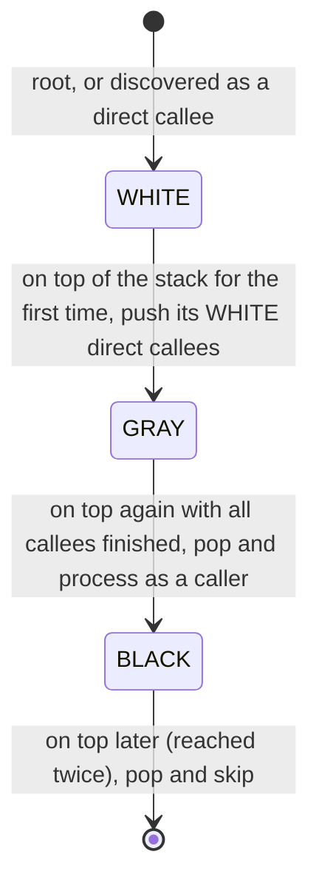
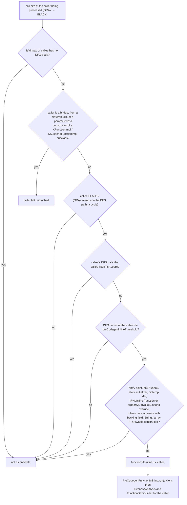

# Kotlin/Native: the pre-codegen inliner

The pre-codegen inliner is an *optimization* inliner that runs inside `runCodegen`, after all lowerings and on the whole
program, and copies small callees into their callers at the IR level. It has nothing to do with the language feature
`inline fun` (which is handled much earlier by `FunctionInlining`, see "Two inliners" below) and nothing to do with LLVM's
inliner, which runs later on the bitcode. It exists because the K/N analyses that follow it — devirtualization, escape
analysis, static-initializer elimination — are intraprocedurally precise and interprocedurally conservative, so flattening
the call graph before they run makes them see more (KT-67480: "less usages of the shadow stack, better escape analysis
results, and better devirtualization analysis results"). It is **off by default**. The surrounding pipeline is described in
[optimizations.md](optimizations.md); this page explains the pass itself.

Paths are relative to `kotlin-native/backend.native/compiler/ir/backend.native/src/org/jetbrains/kotlin/backend/konan/`
("BACKEND") unless stated otherwise.

## Switch and placement

The only knob is the binary option `preCodegenInlineThreshold`
([BinaryOptions.kt](../../native/binary-options/src/main/kotlin/org/jetbrains/kotlin/config/nativeBinaryOptions/BinaryOptions.kt),
`uintOption`), read as `configuration.get(BinaryOptions.preCodegenInlineThreshold) ?: 0U` in
[NativeSecondStageCompilationConfig.kt](../../kotlin-native/backend.native/compiler/ir/backend.native/src/org/jetbrains/kotlin/backend/konan/NativeSecondStageCompilationConfig.kt).
`runCodegen` ([TopLevelPhases.kt](../../kotlin-native/backend.native/compiler/ir/backend.native/src/org/jetbrains/kotlin/backend/konan/driver/phases/TopLevelPhases.kt))
derives

```
enablePreCodegenInliner = preCodegenInlineThreshold != 0 && runGlobalOptimizations   // runGlobalOptimizations = -opt && no static caches
```

and then runs `PreCodegenInlinerPhase` ([LTO.kt](../../kotlin-native/backend.native/compiler/ir/backend.native/src/org/jetbrains/kotlin/backend/konan/driver/phases/LTO.kt),
`-Xdisable-phases` name `PreCodegenInliner`) **twice**:

```
BuildDFG
RemoveRedundantCallsToStaticInitializers   (only if inliner enabled)       ← run A
PreCodegenInliner                          (run 1: before devirtualization)
DevirtualizationAnalysis
RemoveRedundantCallsToStaticInitializers   (only if inliner DISABLED)      ← run B, comment: "KT-72336: This is more optimal
                                                                              but contradicts with the pre-codegen inliner."
Devirtualization
RedundantCoercionsCleaner, UnboxInlineLowering
PreCodegenInliner                          (run 2: after devirtualization)
DCEPhase
```

Run 1 feeds the analyses a flatter program. Run 2 picks up calls that `Devirtualization` has just turned from virtual into
direct `IrCall`s (the inliner never touches virtual calls, see below), and `DCEPhase` right after it deletes callees that
lost their last caller ([dce-and-gha.md](dce-and-gha.md)).

**The static-initializer ordering (KT-72336).** `RemoveRedundantCallsToStaticInitializersPhase` assumes a function's
initializer calls are "the very first statements by construction" (`take(2)` in
[StaticInitializersOptimization.kt](../../kotlin-native/backend.native/compiler/ir/backend.native/src/org/jetbrains/kotlin/backend/konan/optimizations/StaticInitializersOptimization.kt))
and wants devirtualized call sites for precision — hence position B, after `DevirtualizationAnalysis`. Inlining copies a
callee's leading initializer call into the middle of the caller, where B's pattern no longer finds it. The current compromise
is position A: remove redundant calls *before* anything is inlined, at the price of not seeing devirtualized edges.
*Hypothesis:* this is the mechanism behind "contradicts"; the comment and KT-72336 ("K/N: make pre-codegen inlining phase
opt-out … rough edges … should be polished") state the conflict but not the mechanism. See
[static-initializers.md](static-initializers.md).

## Algorithm ([PreCodegenInliner.kt](../../kotlin-native/backend.native/compiler/ir/backend.native/src/org/jetbrains/kotlin/backend/konan/optimizations/PreCodegenInliner.kt))

The header comment is accurate: "A simple greedy inliner. Traverses the call graph and inlines all the callees with size
less than a specified threshold. The call graph traversal is done using the tricolor DFS algorithm to be able to detect
cycles. The DFS itself is unwrapped from a recursion to a loop to circumvent the SO exception on particular big graphs."

**Input.** The phase builds a `CallGraph` with unfold factors `-1/-1`
([CallGraphBuilder.kt](../../kotlin-native/backend.native/compiler/ir/backend.native/src/org/jetbrains/kotlin/backend/konan/optimizations/CallGraphBuilder.kt)):
no virtual call site is expanded, their candidates become extra roots, and the shared root set
(`DevirtualizationAnalysis.computeRootSet`, [dce-and-gha.md](dce-and-gha.md)) seeds the walk. The inliner only looks at call
sites with `!isVirtual && directEdges.containsKey(actualCallee)` — direct calls to functions that have a DFG body.

**Traversal.** Explicit stack initialised with `callGraph.rootSet`; node colors WHITE/GRAY/BLACK:
- WHITE → mark GRAY, push all unvisited direct callees.
- GRAY (all callees finished) → mark BLACK and **process this function as a caller**: this is a post-order, so callees are
  already final when their caller is processed. Only callees that are BLACK are candidates; a callee still GRAY is on the
  current DFS path, i.e. part of a cycle, and is skipped — that is the SCC handling. Mutual recursion is thus never inlined
  in the direction that would close the cycle, and direct self-recursion is detected separately (`isALoop`: the callee's
  DFG contains a `Call` to its own symbol; comment: "As FunctionInlining doesn't work with recursive functions").
- BLACK → pop.

Bottom-up order means that when `f` is inlined into `g`, `f` has already absorbed its own small callees, so the depth is
unbounded but the size check applies to the already-flattened `f`.

The node life cycle of that traversal, from the `when (color)` in `PreCodegenInliner.run`:



**Caller filter** (functions never modified): bridges (`bridgeTarget != null`), functions from a cinterop klib
(`moduleFragment.kotlinLibrary?.isCInteropLibrary()`), and the lowered parameterless constructors of `KFunctionImpl` /
`KSuspendFunctionImpl` subclasses ("To support IR pattern recognition in IrToBitcode.kt on IrConstantObject generation":
function references are emitted as constant objects by matching the constructor body shape,
[IrToBitcode.kt](../../kotlin-native/backend.native/compiler/ir/backend.native/src/org/jetbrains/kotlin/backend/konan/llvm/IrToBitcode.kt)
`IrConstantObject` branch).

**Callee filter** (`shouldInline`), all conditions must hold:

| Condition                                                   | Why (comment or evident purpose)                                                              |
|-------------------------------------------------------------|-----------------------------------------------------------------------------------------------|
| not `isALoop`                                               | the body copier cannot handle recursion                                                       |
| `calleeSize <= inlineThreshold`                             | size metric = number of DFG nodes over all scopes (`body.allScopes.sumOf { it.nodes.size }`), not IR nodes |
| not `symbols.entryPoint`                                    | "Might be unexpected to not see [main] in stacktraces" (KT-84000, `7de2eb6f478e`)             |
| not `isBoxOrUnbox()`                                        | box/unbox functions are recognised by codegen and devirtualization coercions                 |
| not lazy/eager static initializer                           | initializer calls are structural ([static-initializers.md](static-initializers.md))           |
| not from a cinterop klib                                    | C stubs/bridges are pattern-matched ([cinterop.md](cinterop.md))                              |
| no `@kotlin.native.NoInline` on function or its property    | user opt-out ([Annotations.kt](../../kotlin-native/runtime/src/main/kotlin/kotlin/native/Annotations.kt)) |
| does not override `invokeSuspend`                           | coroutine state machines                                                                      |
| not an inline-class property accessor with a backing field  | handled by `InlineClassPropertyAccessorsLowering`                                             |
| not a lowered constructor of `String`, an array, or a `Throwable` subclass | constructors with runtime/codegen-level special handling                       |

Externals have no DFG body and are not in `directEdges`, so they are never candidates; virtual calls are excluded on both
levels (`isVirtual` in the graph, `expression.isVirtualCall` in IR). Nothing looks at `@InlineOnly`, visibility or module
boundaries: a stdlib function is inlined into user code exactly like a local one.

Caller filter, callee filter and `shouldInline` as one decision path, in the order the `GRAY` branch of
`PreCodegenInliner.run` evaluates them:



**Rewrite.** For each caller with a non-empty candidate set, `PreCodegenFunctionInlining(context, functionsToInline).run(caller)`
([NativeIrInliner.kt](../../kotlin-native/backend.native/compiler/ir/backend.native/src/org/jetbrains/kotlin/backend/konan/lower/NativeIrInliner.kt))
walks the body and replaces every non-virtual `IrCall` whose callee is in the set by an `irBlock` that binds each argument to
a temporary (or reuses an `IrGetValue`) and appends `callee.inline(caller, arguments, moveBody = false)` from
[IrInlineUtils.kt](../../compiler/ir/backend.common/src/org/jetbrains/kotlin/backend/common/ir/IrInlineUtils.kt): a deep
copy of the body wrapped in an `IrReturnableBlock`, with the callee's `return`s retargeted to the block. This replaced the
general `FunctionInlining` machinery in `48a39a3e9bc2` ("use simpler inlining mechanism instead of general IR inliner").
The copy carries IR attributes, so `devirtualizedCallSite` marks inside a body inlined by run 2 survive.

The shape of one rewritten call site, from `PreCodegenFunctionInlining.visitCall` (`NativeIrInliner.kt`) and
`IrFunction.inline` (`IrInlineUtils.kt`):

```
before                        after
  foo(x, bar())                 BLOCK {                                   // irBlock at the call site
                                  // x is an IrGetValue: its declaration is reused as is
                                  VAR p1 = bar()                          // irTemporary per other argument, named after the parameter
                                  RETURNABLE_BLOCK type = foo's return type {
                                    <deep copy of foo's body>             // moveBody = false: foo itself stays until DCE
                                    ... RETURN@RETURNABLE_BLOCK v         // foo's returns retargeted to the block
                                  }
                                }
                                // a block with a single statement is unwrapped to that statement
```

**Repair.** After rewriting a caller: `LivenessAnalysis.run(irBody) { it is IrSuspensionPoint }` recomputes
`liveVariablesAtSuspensionPoint` (comment "KT-72336: This is not entirely correct since coroutinesLivenessAnalysisPhase could
be turned off"), then `FunctionDFGBuilder(...).build(irFunction)` replaces `moduleDFG.functions[symbol]`. Only the caller is
rebuilt; callees are untouched (they still exist until DCE) and the call graph object is *not* updated — the DFS continues on
the graph built before any inlining, which is fine because inlining only removes edges from already-processed callers.

## Two inliners, three if you count LLVM

| | Language inliner (`FunctionInlining`) | Pre-codegen inliner | LLVM inliner |
|--|--|--|--|
| What | `inline fun`, lambdas, reified generics — semantics, not optimization | small bodies by DFG size, any function | bitcode-level heuristics |
| When | lowerings: `NativePrivateFunctionInlining` early in `getLoweringsUpToAndIncludingSyntheticAccessors`, then `NativeAllFunctionInlining` at the synchronization point ([lowerings.md](lowerings.md), [NativeLoweringPhases.kt](../../kotlin-native/backend.native/compiler/ir/backend.native/src/org/jetbrains/kotlin/backend/konan/driver/phases/NativeLoweringPhases.kt)) | `runCodegen`, twice, after all lowerings | `LTOBitcodeOptimization` ([llvm-codegen.md](llvm-codegen.md)) |
| Always on | yes (per-file invariant, caches) | only with the option and `runGlobalOptimizations` | per `-opt`/`-g` pipeline |
| IR produced | `IrInlinedFunctionBlock` with `inlinedFunctionFileEntry` → `inlinedAt` debug scopes | plain `IrReturnableBlock` | n/a |

The runtime-side `performance_inline` attribute (`handlePerformanceInlineAnnotation`, marks runtime functions `alwaysinline`
when `inlineForPerformance`) and `-Xllvm-*` pass flags belong to the LLVM level; see [llvm-codegen.md](llvm-codegen.md).

**Debug info.** `IrToBitcode` builds `inlinedAt` locations only for `IrInlinedFunctionBlock` (`InlinedBlockScope`, see
[debug-info.md](debug-info.md#step-5--inline-functions-and-lambdas-the-inlinedat-model)); an `IrReturnableBlock` is a plain scope. *Unverified:* the inlined statements keep the callee's offsets, which the caller's
`FileScope` would then resolve against the caller's file entry; whether this yields wrong line tables for cross-file
inlining in `-opt -g` builds was not tested. The option is documented as experimental (KT-67480 comment), which is consistent
with this not having been addressed.

## Interactions

- **Devirtualization** gains in two ways: after run 1, receiver types that were parameters are now concrete allocations in
  the caller, so `instantiatingClasses`/type sets shrink; after `Devirtualization`, run 2 inlines the new direct calls.
  Commit `96b768cd6892`: "Improves quality of other optimization passes (like devirtualization), but also brings some
  performance improvements on its own."
- **Escape analysis** sees allocations and their uses in one function and can stack-allocate what previously escaped through
  a return value ([escape-analysis.md](escape-analysis.md)); fewer calls also means fewer shadow-stack frames.
- **DCE** removes the now-unreferenced callees; this is why the test infrastructure pins the inliner off for FileCheck tests
  (`ExtTestCaseGroupProvider` adds `-Xbinary=preCodegenInlineThreshold=0` unless the test sets it; commit `1c56325df9ee`:
  "It's very hard to make them work when every function might be inlined and DCEd afterwards").
- **Caches**: part of `runGlobalOptimizations`, hence off whenever static caches are used or produced
  ([caches.md](caches.md)); inlining across a cache boundary would bake another library's body into this one.
- **cinterop / platform libraries**: cinterop klib functions are excluded as callers and callees; their bodies are
  recognised by `InteropLowering`/C-bridge generation ([cinterop.md](cinterop.md), [platform-libraries.md](platform-libraries.md)).
- **Export**: in library mode every public function is a root and stays; inlining into it does not remove it, so exported
  ABI is unaffected. Private helpers inlined into public API disappear from the binary.
- **Stack traces**: an inlined frame is gone; only `main` is protected (KT-84000).

## Flags, tests, trade-offs

| Flag                                      | Effect                                                                          |
|-------------------------------------------|---------------------------------------------------------------------------------|
| `-Xbinary=preCodegenInlineThreshold=N`    | enable with threshold N DFG nodes; `0` (default) disables                       |
| `-Xdisable-phases=PreCodegenInliner`      | disables both runs even with a threshold                                        |
| `-Xphases-to-dump-after=PreCodegenInliner` | IR after the (last) run                                                        |
| `-opt`, no static caches                  | prerequisites via `runGlobalOptimizations`                                      |

Tests:
- `native/native.tests/testData/codegen/fileCheck/inline.kt` and `inline_property.kt`: `-Xbinary=preCodegenInlineThreshold=40`,
  `CHECK-OPT-NOT: define ptr @"kfun:#foo…"` proves the callee is inlined and then DCE'd; ignored with static caches.
- `compiler/testData/codegen/box/inline/coercionToUnitBoxing.kt` (threshold 40) and
  `compiler/testData/codegen/boxInline/complex/kt44429.kt` (explicit `=0`): regression tests around boxing/coercions.
- Run: `./gradlew :native:native.tests:test --tests "org.jetbrains.kotlin.konan.test.blackbox.FirNativeCodegenLocalTestGenerated\$FileCheck*" -Pkn.optimizationMode=OPT -Pkn.cacheMode=NO`
  (see [optimizations.md](optimizations.md) for the test-mode details; a dist rebuild is needed after compiler changes).
- Performance: the `kotlin-native/performance` benchmarks; KT-72336 reports "~9.5% overall" with threshold 40 and up to
  6–8× on `Ring::Lambda`.

Trade-offs recorded in the tree and the tracker:
- Code size and compile time grow (KT-67480: "The downsides might be increased binary size and increased compilation
  time"); 40 is "a good compromise from our experiments" (KT-67480 comment), but no size budget or per-site heuristic exists
  — the threshold is the whole policy.
- Default off because of "rough edges" (KT-72336, open): the static-initializer ordering above, the liveness-analysis
  dependency (`invokeSuspend` overrides are never inlined and coroutine liveness is re-run after inlining, see
  [coroutines.md](coroutines.md#step-5--liveness-and-spilling)), and FileCheck fragility. Nothing in the code caps total growth, so a hot helper of size 39 called from 10,000
  sites is copied 10,000 times.
- Symptoms when enabled: functions missing from stack traces (inlined bodies have no frame of their own, see
  [exceptions.md](exceptions.md#step-7--stack-traces-capture-symbolication-format)) and from LLVM IR; a top-level `val` observed uninitialized in
  release (static-initializer interplay, compare with `-Xdisable-phases=PreCodegenInliner`); any analysis bug amplified by
  larger bodies (EA/devirtualization) — bisect with the phase name first since it is the least mature pass.

## Open questions

- The exact failure mode behind "KT-72336: … contradicts with the pre-codegen inliner" is not recorded; the `take(2)`
  assumption is the most plausible, unconfirmed.
- Debug line tables for bodies inlined across files (no `IrInlinedFunctionBlock`, no `inlinedAt`).
- Whether run 1 should also re-run `RemoveRedundantCallsToStaticInitializersPhase` afterwards — today inlined initializer
  calls are left where they land.
- The call graph is not refreshed between callers; a callee inlined into all its callers is still processed as a caller
  itself (harmless, wasted work) — intended?
- Whether KGP should expose the option; today it is reachable only through free compiler arguments.
