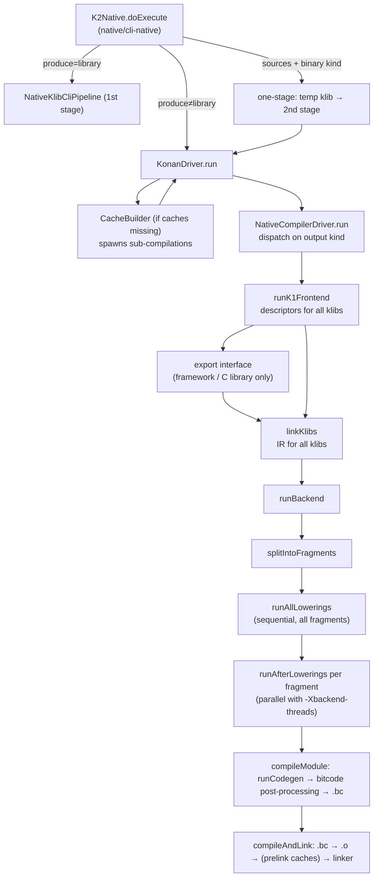

# Second-stage pipeline: from klibs to a binary

The second stage is the part of the Kotlin/Native compiler that turns a set of klibs into a program, library, framework or
compiler cache. [architecture.md](architecture.md#compiler-execution-path) gives the one-screen summary; this page explains the
driver in enough detail to follow a stack trace, find where a phase runs, and understand what state each phase can see.

All paths below are relative to `kotlin-native/backend.native/compiler/ir/backend.native/src/org/jetbrains/kotlin/backend/konan/`
unless written otherwise.

## Key concepts

| Term | Meaning |
|------|---------|
| **Second stage** | Everything after klibs exist: library resolution, IR deserialization, lowerings, codegen, LLVM, linking. Selected in the CLI by `produce != "library"` (`isNativeSecondStage()` in `compiler/cli/cli-base/src/org/jetbrains/kotlin/cli/common/arguments/argumentUtils.kt`). |
| **One-stage mode** | Sources plus a binary output kind on one command line. The CLI compiles the sources to a temporary klib first, then runs the second stage on it ([oneStageMode.kt](../../native/cli-native/src/org/jetbrains/kotlin/cli/bc/oneStageMode.kt)). |
| **Output kind** | `CompilerOutputKind` (`native/utils`): `PROGRAM`, `STATIC`, `DYNAMIC`, `FRAMEWORK`, `TEST_BUNDLE`, and the cache kinds `STATIC_CACHE`, `DYNAMIC_CACHE`, `HEADER_CACHE`. The driver dispatches on it. |
| **Fragment** | A unit of codegen: one IR module fragment plus the state needed to emit one LLVM module (`BackendJobFragment` in [TopLevelPhases.kt](../../kotlin-native/backend.native/compiler/ir/backend.native/src/org/jetbrains/kotlin/backend/konan/driver/phases/TopLevelPhases.kt)). A normal compilation has one fragment; per-file caches have one per file. |
| **LLVM module specification** | Decides which IR modules and declarations are compiled into *this* LLVM module and which come from caches ([LlvmModuleSpecification.kt](../../kotlin-native/backend.native/compiler/ir/backend.native/src/org/jetbrains/kotlin/backend/konan/LlvmModuleSpecification.kt)). See [caches.md](caches.md). |
| **Phase** | A `NamedCompilerPhase`. Lowering phases take their name from the lowering class (`loweringClass.simpleName` in [PhaseFactories.kt](../../compiler/ir/backend.common/src/org/jetbrains/kotlin/backend/common/phaser/PhaseFactories.kt)); other phases are named explicitly (`"LinkKlibs"`, `"addEntryPoint"`, …). Names are what `-Xlist-phases`, `-Xdisable-phases` and the dump flags use. |
| **Phase context** | The object a phase runs against. Different parts of the pipeline use different contexts; see [Contexts](#contexts-what-each-phase-can-see). |

## The flow



### 1. CLI entry: choosing the stage

[K2Native.kt](../../native/cli-native/src/org/jetbrains/kotlin/cli/bc/K2Native.kt), `doExecute`:

- `isOneStageCompilation`: `produce != "library"` **and** there are source files **and** not `-Xcompile-from-bitcode`. The CLI
  writes an intermediate klib to the JVM temp dir, runs `NativeKlibCliPipeline` on it, then rewrites the configuration for the
  second stage: source roots are dropped, `useFir = false`, and the klib is added to both `-Xinclude` and the library list
  (`adjustConfigurationForSecondStage`). The code comment states the reason: the backend needs descriptors deserialized from a
  klib and cannot consume FIR output directly.
- Otherwise `produce != "library"` runs `KonanDriver` directly, and `produce=library` runs the first stage only.

`runKonanDriver` builds a `KonanDriver` with a `CompilationSpawner` lambda that re-enters `runKonanDriver` with a new
configuration. This is how `CacheBuilder` compiles dependency caches in-process.

### 2. `KonanDriver.run`: preparing the compilation

[KonanDriver.kt](../../kotlin-native/backend.native/compiler/ir/backend.native/src/org/jetbrains/kotlin/backend/konan/KonanDriver.kt),
in order:

1. **Per-file cache file list.** With `-Xadd-cache` and `-Xmake-per-file-cache`, it reads the klib's IR file table to list the
   files to cache (`filesToCache`).
2. **`NativeSecondStageCompilationConfig`** is created from the `CompilerConfiguration`. It resolves the distribution
   (`konanHome`, `-Xoverride-konan-properties`), target, `phaseConfig`, debug/optimization flags, and every `-Xbinary=` option with
   its default (for example the default GC is `CONCURRENT_MARK_AND_SWEEP`, `genericSafeCasts` defaults to `!optimizationsEnabled`).
   When you need to know "what does option X default to", read this class
   ([NativeSecondStageCompilationConfig.kt](../../kotlin-native/backend.native/compiler/ir/backend.native/src/org/jetbrains/kotlin/backend/konan/NativeSecondStageCompilationConfig.kt)).
3. **Early exit** if there is no input (no sources, no `-Xinclude`, no `-Xexport-library`, no bitcode, not an executable from
   libraries) and nothing to cache.
4. **`ensureModuleName`**: with no sources, if the module name collides with a library's `uniqueName`, the module is renamed
   `<name>_kexe`. This is why executables built from klibs sometimes show a `_kexe` module name.
5. **Caches**: `CacheBuilder.needToBuild()` → `build()` → `config.reloadCacheSupport()`; then `cacheSupport.checkConsistency()`
   (not for header caches). Details in [caches.md](caches.md).
6. **Partial linkage replay**: issues recorded when caches were built are reported again (KT-78253), because cached code is not
   re-inspected by the partial linkage engine ([PartialLinkageIssuesReplay.kt](../../kotlin-native/backend.native/compiler/ir/backend.native/src/org/jetbrains/kotlin/backend/konan/PartialLinkageIssuesReplay.kt)).
7. `NativeCompilerDriver(performanceManager).run(config, environment)`.

### 3. `NativeCompilerDriver.run`: one flow per output kind

[NativeCompilerDriver.kt](../../kotlin-native/backend.native/compiler/ir/backend.native/src/org/jetbrains/kotlin/backend/konan/driver/NativeCompilerDriver.kt)
wraps everything in `usingNativeMemoryAllocator` and `usingJvmCInteropCallbacks` (the compiler itself calls LLVM through
cinterop-generated JVM bindings) and starts the top-level phase `"Compiler"` (`PhaseEngine.startTopLevel` in
[Machinery.kt](../../kotlin-native/backend.native/compiler/ir/backend.native/src/org/jetbrains/kotlin/backend/konan/driver/Machinery.kt)).

| Output kind | Function | Extra steps beyond the common skeleton |
|-------------|----------|----------------------------------------|
| `PROGRAM`, `*_CACHE` | `produceBinary` | none |
| `STATIC`, `DYNAMIC` | `produceCLibrary` | C export model: `BuildCExports` (K1 descriptors) during `linkKlibs`, or `BuildCExportsFromIr` after it, depending on `cExportUseIrDiscovery`; skipped when `cInterfaceGenerationMode` is not `V1`. See [export.md](export.md). |
| `FRAMEWORK` | `produceObjCFramework` | `ProduceObjCExportInterfacePhase` and `CreateObjCFrameworkPhase` (header, Info.plist) right after the K1 frontend; returns before IR linking with `-Xomit-framework-binary`; otherwise `CreateObjCExportCodeSpecPhase` during `linkKlibs`. |
| `TEST_BUNDLE` | `produceBundle` | Apple only; `CreateTestBundlePhase` writes the bundle layout. |
| `-Xcompile-from-bitcode` | `produceBinaryFromBitcode` | No frontend, no IR: parses a `.bc`, reads dependencies from `-Xread-dependencies-from`, runs bitcode post-processing and linking only. |
| `LIBRARY`, `BITCODE` | — | `error(...)`: klibs are produced by the first stage; bitcode output is obsolete. |

The common skeleton is `runK1Frontend` → `linkKlibs` → `createBackendContext` → `runBackend`.

**`runK1Frontend`** ([TopLevelPhases.kt](../../kotlin-native/backend.native/compiler/ir/backend.native/src/org/jetbrains/kotlin/backend/konan/driver/phases/TopLevelPhases.kt),
`K1FrontendPhase` in [K1Frontend.kt](../../kotlin-native/backend.native/compiler/ir/backend.native/src/org/jetbrains/kotlin/backend/konan/driver/phases/K1Frontend.kt))
builds `ModuleDescriptor`s for every klib. It throws `"Attempt to run K1 from unsupported LV"` if there are source roots and the
language version uses K2: the second stage must never see sources. What the descriptors are still needed for is covered in
[klib-linking.md](klib-linking.md).

**`linkKlibs`** runs `LinkKlibsPhase` in a `LinkKlibsContextImpl` (which owns the `SymbolTable` with `KonanIdSignaturer`), then
`SpecialBackendChecksPhase` on every module to compile. `LinkKlibsPhase` cannot be disabled (`outputIfNotEnabled` errors). Its
output (`LinkKlibsOutput`) carries `irModules` (all), `irModulesToCompile`, `irBuiltIns`, `symbols` (`BackendNativeSymbols`),
`symbolTable` and the `KonanIrLinker`; `createBackendContext` turns these into the `NativeBackendContext`.

### 4. `runBackend`: fragments, lowerings, codegen

All in `TopLevelPhases.kt`.

1. `FunctionsWithoutBoundCheckGenerator` runs once, on the first module only, because it adds declarations to the shared
   built-ins (comment in `runBackend`).
2. **`splitIntoFragments`.** Normally one fragment holding the whole input module. With `producePerFileCache`, one fragment per
   file of the library being cached, each with its own `CacheLlvmModuleSpecification`, `DependenciesTracker` and
   `PerformanceManager`. Stdlib special cases: function-interface files are appended to the fragment that contains
   `KFunctionImpl`, and files referenced by the runtime (`@ExportTypeInfo`, `@ExportForCppRuntime`) are recorded as dependencies of
   the fragment that contains the runtime part.
3. **`createGenerationState`** per fragment: `OutputFiles`, a `NativeGenerationState`, then `BuildAdditionalCacheInfoPhase` for
   caches (header caches stop here) and `EntryPointPhase` for programs. `EntryPointPhase`
   ([BackendPhases.kt](../../kotlin-native/backend.native/compiler/ir/backend.native/src/org/jetbrains/kotlin/backend/konan/driver/phases/BackendPhases.kt))
   adds the generated entry point to the file that owns `main`, or, if `main` lives in another LLVM module (for example the test
   runner's `main` in stdlib), to a synthetic file in package `kotlin.native.internal.abi`.
4. **`runAllLowerings`** lowers *all* fragments, sequentially, list by list, with validation phases at the synchronization points.
   Each lowering list is applied to the fragment's module *and* to every dependency module that the LLVM module specification
   says is compiled into this LLVM module (`partiallyLowerModuleWithDependencies`; dependencies are passed as
   `dependenciesToCompile.reversed()`, where the module order comes from `KlibDAG` (`reverseTopoSortUsingKlibDAG` in
   [linkKlibs.kt](../../kotlin-native/backend.native/compiler/ir/backend.native/src/org/jetbrains/kotlin/backend/konan/linkKlibs.kt)).
   The two TODOs there mention `KonanLibraryResolver.TopologicalLibraryOrder`, which no longer exists; see
   [klib-linking.md](klib-linking.md)). The lists, the synchronization points and the invariants are the subject of
   [lowerings.md](lowerings.md).
5. **`finalizeLowerings`** merges the dependency modules' files into the fragment module (`mergeDependencies`, prepending them
   "in reverse topological order so library initializers are emitted in the correct order").
6. **`runAfterLowerings`** per fragment, sequentially when `threadsCount == 1`, otherwise on a fixed thread pool
   (`-Xbackend-threads`). The comment explains the split: lowerings need cross-file access and stay sequential; everything after
   them is independent per fragment. For a header cache this only saves cache info and creates an empty binary file. Otherwise:
   - `compileModule` = `runBackendCodegen` → `runPostCodegen` → entry-point alias → `WriteBitcodeFilePhase`;
   - `collectAndMaybeSerializeDependencies` (`-Xwrite-dependencies-to`);
   - `compileAndLink`.

**`runBackendCodegen`** = `runCodegen` (below), then for C libraries `CExportGenerateApiPhase` + `CExportCompileAdapterPhase`,
then `CStubsPhase` (C stubs produced by interop lowerings, compiled by clang; see [cinterop.md](cinterop.md)),
`VerifyBitcodePhase` (`-Xverify-bitcode` or `-Xverify-compiler`), `PrintBitcodePhase` (`-Xprint-bitcode`), and
`LinkBitcodeDependenciesPhase`, which links the generated adapter/stub bitcode into the module.

**`runCodegen`** is the order that matters when debugging an optimization or codegen issue:

```
PropertyAccessorInlineLowering, InlineClassPropertyAccessorsLowering   (only with -opt)
BuildDFGPhase                                                           (only with global optimizations)
RemoveRedundantCallsToStaticInitializersPhase, PreCodegenInlinerPhase   (only with pre-codegen inliner)
DevirtualizationAnalysisPhase, [RemoveRedundantCallsToStaticInitializersPhase], DevirtualizationPhase
RedundantCoercionsCleaner, UnboxInlineLowering (-opt)
PreCodegenInlinerPhase (2nd run)
DCEPhase
CoroutinesVarSpillingLowering
CreateLLVMDeclarationsPhase
GHAPhase                                                                (global optimizations, not for caches)
RTTIPhase (uses the DCE result)
EscapeAnalysisPhase → lifetimes
CodegenPhase (IR → LLVM IR, uses lifetimes)
```

`runGlobalOptimizations = optimize && !cachedLibraries.hasStaticCaches` — whole-program analyses are off as soon as a static
cache is involved. [optimizations.md](optimizations.md) explains each analysis; [llvm-codegen.md](llvm-codegen.md) explains
`CreateLLVMDeclarationsPhase`, `RTTIPhase` and `CodegenPhase`.

**`runPostCodegen`** runs the bitcode post-processing (linking the runtime bitcode, LLVM optimization pipeline; see
[llvm-codegen.md](llvm-codegen.md)) and, for full caches, `SaveAdditionalCacheInfoPhase`.

**`compileAndLink`**: `ObjectFilesPhase` (`.bc` → `.o`), then either no prelink (producing a static cache), `PreLinkCachesPhase`
(static caches merged into one object first), or direct linking; then `LinkerPhase` and, for caches, `FinalizeCachePhase`.

## Contexts: what each phase can see

The pipeline switches context as it goes; a phase's context type tells you which state it may touch.

| Context | Lifetime | Holds |
|---------|----------|-------|
| `BasicNativeBackendPhaseContext` ([Machinery.kt](../../kotlin-native/backend.native/compiler/ir/backend.native/src/org/jetbrains/kotlin/backend/konan/driver/Machinery.kt)) | whole compilation | `config`, diagnostics reporter, logging. Used by the frontend, export-interface and bitcode-only phases. |
| `LinkKlibsContextImpl` ([LinkKlibs.kt](../../kotlin-native/backend.native/compiler/ir/backend.native/src/org/jetbrains/kotlin/backend/konan/driver/phases/LinkKlibs.kt)) | IR linking | `SymbolTable`, `KonanBuiltIns` from the module descriptor. |
| `NativeBackendContext` ([NativeBackendContext.kt](../../kotlin-native/backend.native/compiler/ir/backend.native/src/org/jetbrains/kotlin/backend/konan/NativeBackendContext.kt)) | from `runBackend` to the end; shared by all fragments | `irModules`, `irLinker`, `symbols`, `irBuiltIns`; lowering "supports" (bridges, enums, caches ABI, inner classes); `moduleDeserializerProvider` and the lazy inline-function / trivial-getter deserializers that pull bodies from klibs on demand; `globalHierarchyAnalysisResult`; export models (`objCExportedInterface`, `objCExportCodeSpec`, `cAdapterExportedElements`); partial linkage support. |
| `NativeGenerationState` ([NativeGenerationState.kt](../../kotlin-native/backend.native/compiler/ir/backend.native/src/org/jetbrains/kotlin/backend/konan/NativeGenerationState.kt)) | one per fragment | `cacheInfo`, `dependenciesTracker`, `llvmModuleSpecification`, `outputFiles`; the LLVM context and module (created lazily, always named `"out"`); `runtime` (declarations parsed from the runtime's `compiler_interface` bitcode); `debugInfo`; `cStubsManager`; `llvmDeclarations`; `fileLowerState` (per-file counters used to name synthetic function references, coroutines and C stubs); the lists serialized into caches (`inlineFunctionBodies`, `classFields`, `eagerInitializedFiles`, `trivialGetters`, `objCAdapters`). |
| `BitcodePostProcessingContext` | post-codegen and `-Xcompile-from-bitcode` | the LLVM module only. |

Phase definitions live next to the step they belong to: `driver/phases/K1Frontend.kt`, `LinkKlibs.kt`, `BackendPhases.kt`,
`NativeLoweringPhases.kt`, `BitcodeGeneration.kt`, `Bitcode.kt`, `LTO.kt`, `ObjectFiles.kt`, `Linker.kt`, `CacheBuilding.kt`,
`ObjCExport.kt`, `CExport.kt`.

## Invariants and assumptions

- **The second stage never compiles Kotlin sources.** `runK1Frontend` throws if sources reach it under K2. Anything that must be
  computed from source happens in the first stage and is read back from the klib.
- **Lowerings are sequential and shared; codegen is per fragment.** A lowering may mutate dependency modules that are compiled
  into the same LLVM module; after `finalizeLowerings` the fragment module owns those files. Anything run in `runAfterLowerings`
  must not touch IR of other fragments (it runs on a thread pool).
- **`FunctionsWithoutBoundCheckGenerator` runs exactly once** because it mutates shared built-ins.
- **Whole-program optimizations assume a closed world without static caches** (`runGlobalOptimizations`), and GHA additionally
  never runs when producing a cache.
- **All LLVM modules are named `out`** (a TODO notes possible collisions).
- **`LinkKlibsPhase` cannot be disabled**; most other phases can be (`-Xdisable-phases`), but disabling a lowering usually
  breaks later ones. Disabling is safe mainly for optimizations and verification phases.
- **The `_kexe` module rename** happens only when compiling without sources and the module name collides with a library.

## Making changes

- **Adding a backend phase**: define it with `createSimpleNamedCompilerPhase` in the matching `driver/phases/*.kt` file, pass
  `preactions`/`postactions = getDefaultIrActions()` if it works on IR (that enables dumps and validation for it), and call it
  from `TopLevelPhases.kt` with `runAndMeasurePhase` so it shows up in `-Xprofile-phases`. Choose the context deliberately: a phase
  on `NativeGenerationState` runs per fragment, one on `NativeBackendContext` runs once.
- **Adding a lowering**: see [lowerings.md](lowerings.md).
- **Adding a binary option** that the backend reads: add it in `native/binary-options` `BinaryOptions.kt`, give it a default in
  `NativeSecondStageCompilationConfig`, and, if the runtime must see it, follow [compiler-runtime-contract.md](compiler-runtime-contract.md).
- **Changing what goes into caches** touches `NativeGenerationState`'s serialized lists, `CacheBuilding.kt` and
  `serialization/CacheSerializationSupport.kt`; see [caches.md](caches.md).

## Investigating problems here

**A compiler crash.** The stack trace names the phase (lowering class names *are* phase names). Lowering failures are wrapped as
`"Internal error in file lowering"` with the file attached (`runLowerings` in
[NativeLoweringPhases.kt](../../kotlin-native/backend.native/compiler/ir/backend.native/src/org/jetbrains/kotlin/backend/konan/driver/phases/NativeLoweringPhases.kt)).
Then:

| Goal | Flag(s) |
|------|---------|
| See the phase names and order | `-Xlist-phases` |
| Dump IR around a phase | `-Xphases-to-dump-before=X`, `-Xphases-to-dump-after=X`, `-Xphases-to-dump=X`, with `-Xdump-directory=<dir>`; `-Xdump-fqname` |
| Validate IR around a phase | `-Xphases-to-validate-before/after=X`, `-Xverify-ir=warning|error`; `-Xverify-compiler` turns on the backend's own checks (`needCompilerVerification`), including `VerifyBitcodePhase` |
| Dump IR before the backend starts / list files | `-Xprint-ir`, `-Xprint-files` |
| Skip a phase to bisect | `-Xdisable-phases=X` (safe for optimizations, DCE, GHA, escape analysis; not for most lowerings) |
| Keep intermediate `.bc`/`.o` files | `-Xtemporary-files-dir=<dir>` |
| See LLVM IR | `-Xprint-bitcode`, `-Xsave-llvm-ir-after=<phase>` with `-Xsave-llvm-ir-directory` (see [llvm-codegen.md](llvm-codegen.md)) |
| Time per phase | `-Xprofile-phases`, `-Xreport-perf`, `-Xdump-perf` |
| Rule out threading | `-Xbackend-threads=1` |

These flags are defined in `compiler/cli/cli-base/gen/.../CommonCompilerArguments.kt` (phase machinery) and
`K2NativeCompilerArguments.kt` (Native-specific); the generated classes come from
[NativeCompilerArguments.kt](../../compiler/arguments/src/org/jetbrains/kotlin/arguments/description/NativeCompilerArguments.kt).

**Behaviour differs between a program and a cached build, or between `-opt` and debug.** Compare the `runCodegen` gating above;
the first suspects are the optimizations ([optimizations.md](optimizations.md)) and the cache ABI ([caches.md](caches.md)).

**Reproducing outside Gradle.** The test infrastructure runs this exact driver from `kotlin-native/dist`; take the compiler
arguments from a failing test's log (or `-Xprint-configuration`) and run `kotlin-native/dist/bin/kotlinc-native` with them.

**Tests.** There is no unit test of the driver itself; the flows are exercised end to end by `native/native.tests` (every tag)
and the lowering lists by the test in [lowerings.md](lowerings.md). For cache flows use `-Pkn.cacheMode=...`, for optimizations
`-Pkn.optimizationMode=OPT` (see [HACKING.md](../../kotlin-native/HACKING.md#testing)).

## Open questions

- Which phases are safe to disable with `-Xdisable-phases` beyond the optimization and verification ones is not documented in
  code; the list above is based on the gating in `runCodegen` and should be treated as a starting point.
- The TODOs in `partiallyLowerModuleWithDependencies` ask whether file order still matters "with the new MM"; no test pins the
  order, so treat the "reverse topological order for initializers" comment in `mergeDependencies` as the current contract.
