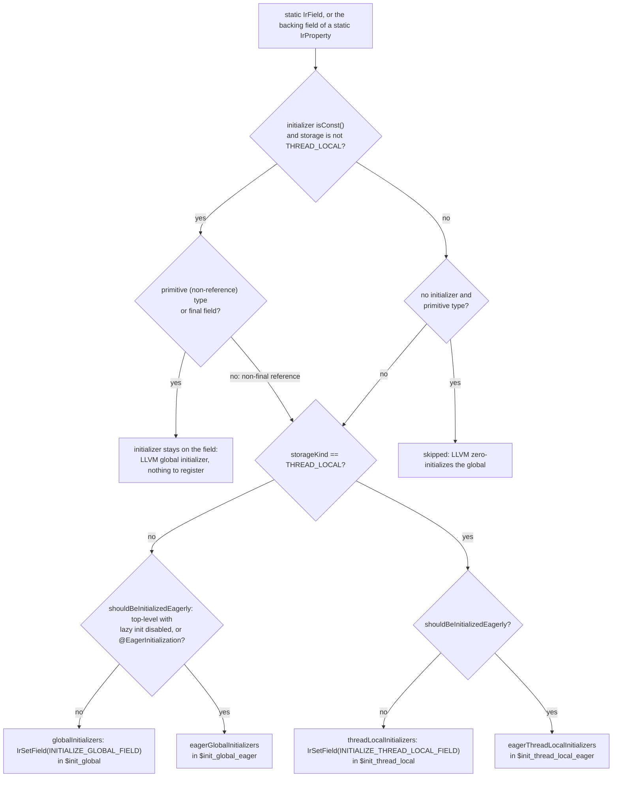
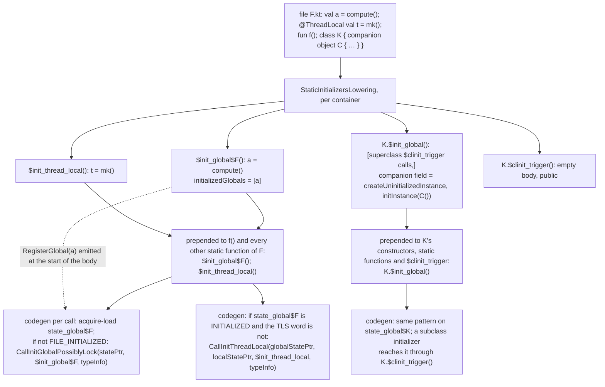
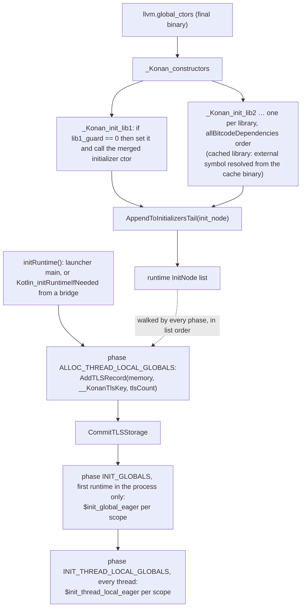
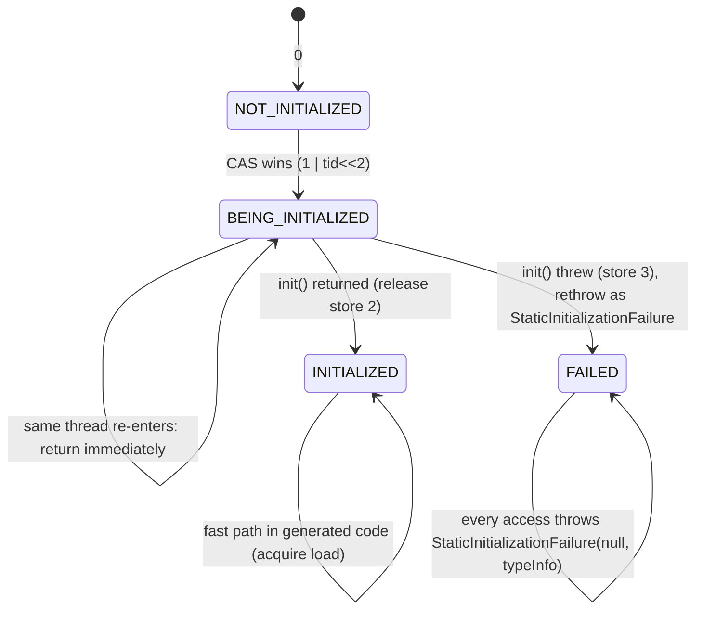
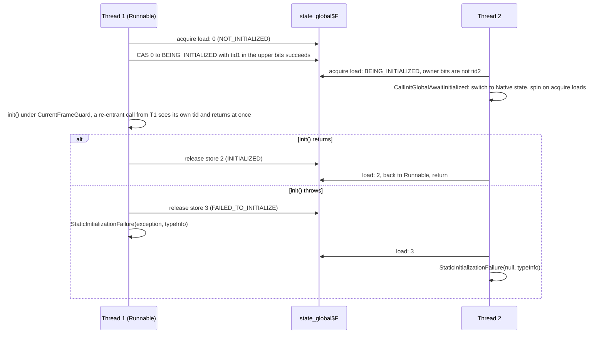

# Kotlin/Native: static initialization

How global state comes to life in a K/N binary: top-level properties, `object`s and companions, enum entries, `@ThreadLocal`
globals, the per-container initializers that run them lazily, the eager exception, the runtime state machine that makes first
access thread-safe, the constant folding that avoids running code at all, and the `-opt` analysis that deletes redundant
initializer calls. The pieces are spread over three lowerings, codegen, the C++ runtime, the optimizer and the cache machinery;
this page tells the story once. Subsystem details stay on their pages: [lowerings.md](lowerings.md),
[optimizations.md](optimizations.md) (DFG, call graph, gating), [compiler-runtime-contract.md](compiler-runtime-contract.md),
[llvm-codegen.md](llvm-codegen.md), [caches.md](caches.md), [runtime.md](runtime.md).

Paths are relative to `kotlin-native/backend.native/compiler/ir/backend.native/src/org/jetbrains/kotlin/backend/konan/`
("BACKEND") unless stated otherwise.

## Key concepts

| Term | Meaning |
|------|---------|
| Container | An `IrDeclarationContainer` that owns static fields: an `IrFile` or an `IrClass` (objects, enums and ordinary classes with companions all count). Initialization state is tracked **per container**, not per property. |
| Static initializer | A synthesized parameterless `Unit` function holding the field initializers of one container: `$init_global`, `$init_thread_local` (lazy) or `$init_global_eager`, `$init_thread_local_eager` (eager). Identified by origins in `StaticInitializersOrigins` ([StaticInitializersLowering.kt]). |
| `$clinit_trigger` | Public no-op per class whose only purpose is to carry the lazy initializer calls, so that another class's initializer can force this class's initialization (new companion order). |
| State word | `state_global$<container>` (an `intptr` LLVM global) and `state_thread_local$<container>` (a TLS slot) holding `FILE_NOT_INITIALIZED=0`, `FILE_BEING_INITIALIZED=1 \| threadId<<2`, `FILE_INITIALIZED=2`, `FILE_FAILED_TO_INITIALIZE=3` ([RuntimePrivate.hpp], [IrToBitcode.kt]). |
| `InitNode` / `Initializer` | Runtime linked list of `void(int phase, MemoryState*)` callbacks registered by global ctors (`AppendToInitializersTail`) and walked by `initRuntime` with phases `ALLOC_THREAD_LOCAL_GLOBALS=0`, `INIT_GLOBALS=1`, `INIT_THREAD_LOCAL_GLOBALS=2` ([Runtime.h], [Runtime.cpp]). This is the **eager** path only. |
| `_Konan_init_<lib>` | One ctor function per library (or per cached file) that appends that library's `InitNode`; `_Konan_constructors` calls them in reverse topological order from `llvm.global_ctors` ([IrToBitcode.kt] `appendStaticInitializers`). |
| `initializedGlobals` | IR attribute on a static initializer listing the reference-typed fields it owns; codegen emits `RegisterGlobal` for each at the **start** of the initializer so the GC sees them before any store ([StaticInitializersLowering.kt], KT-89416). |
| Constant object | An `IrConstantValue` (`IrConstantObject`/`IrConstantPrimitive`/`IrConstantArray`) emitted as a permanent, pre-built LLVM constant with the `OBJECT_TAG_PERMANENT` header bit; never needs an initializer ([KotlinStaticData.kt]). |

## What the user sees

- **Laziness is per container.** A top-level property is initialized the first time *any* static function of its file runs
  (a top-level function, a property accessor, an object getter). A class's static state (companion, `object` instance, enum
  entries, `@ThreadLocal` fields of the class) is initialized the first time any constructor or static function of that class
  runs. Within a container, initializers run in declaration order; companion state follows program order only when the klib was
  built with `CompanionBlocks` (`newCompanionInitializationEnabled`, see below).
- **Across containers there is no implicit order.** File B's globals are initialized when B is first touched, regardless of where
  B sits in the module. Dependencies propagate naturally: if A's initializer calls into B, B is initialized first. Two tests pin
  this down: [files/workers1.kt] (cross-file dependency) and [files/globalInitedBeforeThreadLocal.kt].
- **Eager is the exception.** `@EagerInitialization` on a top-level property (or `-Xir-property-lazy-initialization=disable`
  for every top-level property) runs the container's eager initializer during runtime start, before `main` or the first
  exported call, in reverse topological library order. The stdlib annotation is `@ExperimentalStdlibApi` and `@Deprecated`
  "temporal migration assistance" ([Annotations.kt (kotlin.native)]); the FIR checker reports `INAPPLICABLE_EAGER_INITIALIZATION`
  off top-level or on a property without an initializer ([FirNativeEagerInitializationChecker.kt]).
- **Thread-locals** (`@ThreadLocal` on a top-level property or an object, [concurrent/Annotations.kt]) are initialized once per
  thread, after the container's shared globals; a thread-local may read a global, a global must not read a thread-local
  (comment in `addInitializersCall`). `@SharedImmutable` is a no-op since 1.7.20 and an error since 2.1. `@EagerInitialization`,
  `@ThreadLocal` and `@CanBePrecreated` are catalogued with the other backend annotations in
  [intrinsics.md](intrinsics.md#initialization-threads-debugger).
- **Failure is sticky.** If an initializer throws, the state becomes `FILE_FAILED_TO_INITIALIZE` and this and every later access
  throws via `StaticInitializationFailure(reason, typeInfo)` → the Kotlin `staticInitializationFailure` with the class name when
  the container is a class ([RuntimeUtils.kt], `staticInitializerTypeInfo` in [IrToBitcode.kt]).
- **Re-entrancy is allowed on the same thread.** A thread that re-enters a container it is initializing proceeds and observes
  partially initialized state (an `object` already points at its allocated-but-unconstructed instance). Other threads block.
- **Constants cost nothing.** `const val`, final fields with literal initializers and objects whose state is all-constant are
  materialized in the data section; accessing them never triggers an initializer (and does not count as "touching" the file).

## The algorithm, step by step

### 1. Classify every static field (`StaticInitializersLowering`)

`StaticInitializersLowering.processDeclarationContainter` ([StaticInitializersLowering.kt]) runs per file after
`ObjectClassLowering` and before the second `ComputeTypesPass` ([NativeLoweringPhases.kt]); it visits the file and then every
class in it. For each static `IrField` (or property backing field):

| Case | Decision |
|------|----------|
| Initializer `isConst()` (an `IrConst`/`IrConstantValue`, possibly wrapped in a block of empty composites), not thread-local, and (primitive type or `final`) | **Skip**: the initializer stays on the field and becomes the LLVM global's initializer (`visitField` in [IrToBitcode.kt]). Non-final reference fields are excluded because the GC must be told about them (`RegisterGlobal`). |
| No initializer and primitive type | **Skip**: LLVM zero-initializes the global (commit `dcf4c604c14b`, KT-89416, which fixed `lateinit var` getting a spurious `null` initializer). |
| Otherwise | Routed to one of four lists by `storageKind` (thread-local iff `@ThreadLocal` on the property or field) × `shouldBeInitializedEagerly` (file-level field with lazy init disabled, or `@EagerInitialization`). The initializer is removed from the field and becomes `IrSetField(origin = INITIALIZE_GLOBAL_FIELD / INITIALIZE_THREAD_LOCAL_FIELD)`. |

Fields without initializers but with reference type are still listed (`field to null`) so they are registered with the GC.

The same decision as a flowchart, following the `for (declaration in container.declarations)` loop of `processDeclarationContainter`
and `shouldBeInitializedEagerly` in [StaticInitializersLowering.kt]:

When the container is a non-interface class from a klib with `newCompanionInitializationEnabled`, the lists are prefixed with
calls to `$clinit_trigger` of the superclass (unless it is an external ObjC class, KT-90352/KT-90390) and of every superinterface
that declares a non-abstract, non-static member, in the JVMS §5.5 order quoted in the code (commit `bdf25efdaaf4`, KT-87412).
The manifest flag is written by `serializeModuleIntoKlib` when `LanguageFeature.CompanionBlocks` is on
([serializeModuleIntoKlib.kt], [KotlinLibrary.kt]), so initialization order is a **per-klib** property decided at the first stage.

### 2. Synthesize the initializer functions

`buildInitFunction` creates up to four private functions per container, inserted at index 0 of its declarations:

| Function | Origin | Body |
|----------|--------|------|
| `$init_global` (`$init_global$<file>` for files) | `STATIC_GLOBAL_INITIALIZER` | super triggers, then the global `IrSetField`s in declaration order |
| `$init_thread_local` | `STATIC_THREAD_LOCAL_INITIALIZER`, or `STATIC_STANDALONE_THREAD_LOCAL_INITIALIZER` when there is no global one | thread-local `IrSetField`s |
| `$init_global_eager`, `$init_thread_local_eager` | `EAGER_STATIC_*` | the eager subsets |

Each carries `initializedGlobals` = its reference-typed fields. The file name suffix exists only to keep LLVM symbol names
predictable across same-named private functions in one package (comment in the code).

### 3. Insert the trigger calls

If the container has a lazy initializer, `addInitializersCall` prepends `$init_global()` then `$init_thread_local()` to the body
of every `IrSimpleFunction` of the container that has no dispatch receiver (top-level functions, property accessors, object
`<get-instance>`, enum `getEnumAt`, `$clinit_trigger`) and to every constructor of a class (commit `12455451fc27`, KT-59058).
Skipped: the `Konan_start` wrapper (`DECLARATION_ORIGIN_ENTRY_POINT`, [EntryPoint.kt]) and the initializers themselves.
Eager initializers get **no** trigger calls inserted anywhere: the runtime calls them.

These two leading statements are a contract: `StaticInitializersOptimization` finds them with `take(2)`, and the DFG builder and
codegen recognise them by origin.

What one file turns into, from the lowering (`buildInitFunction`, `addInitializersCall`, `getClinitTriggerFunction` in
[StaticInitializersLowering.kt]) to the lazy-path code that codegen emits for it (`evaluateFileGlobalInitializerCall`,
`evaluateFileThreadLocalInitializerCall`, `getGlobalInitStateFor` in [IrToBitcode.kt]):

### 4. Objects, companions, enums, instance initializers

- `ObjectClassLowering` ([ObjectClassLowering.kt]) gives every `object` an `<instance>` property with a `final static` backing
  field (companions: `<companion>` placed in the *outer* class, right after the companion class under the new order, at the end
  otherwise) and a getter that returns the field; `IrGetObjectValue` becomes a call to that getter. Three initializer shapes:
  - `hasConstStateAndNoSideEffects()` (all fields `isConst` and only an auto-generated `Any()` constructor, or
    `@CanBePrecreated`) and not `@ThreadLocal`: `irConstantObject` — a permanent constant, no runtime init.
  - otherwise: `field = createUninitializedInstance<T>(); initInstance(field, T()); field` — the field is published **before**
    the constructor runs ("make object available for rereading from the same thread while initializing").
  - companion of an ObjC class: `interopInterpretObjCPointer(getObjCClass<Outer>())`.
  `@ThreadLocal` objects get the annotation copied to the property, so step 1 routes the field to thread-local storage.
- `EnumClassLowering` ([EnumClassLowering.kt]) adds private static `VALUES` (array of `createUninitializedInstance` per entry,
  stored first, then `initInstance` with each entry's constructor call) and `ENTRIES`; the static `getEnumAt(id)` getter reads
  `VALUES`. Both fields are static fields of the enum class, so the enum's `$init_global` owns them and `getEnumAt` triggers it.
- `InitializersLowering` ([InitializersLowering.kt]) handles *instance* state (moves field initializers and `init` blocks into
  the primary constructor or an `INITIALIZER` method) and keeps `const` initializers on the field so that
  `hasConstStateAndNoSideEffects` and codegen can read them.
- `InteropLowering` adds eager synthetic top-level fields for Kotlin subclasses of ObjC classes (`addTopLevelInitializer(eager =
  true)`, [InteropLowering.kt]); `TestsInitializer` turns `@TestInitializer` functions into eager thread-local fields
  ([TestsInitializer.kt]). Both reuse the generic machinery by annotating the field.

### 5. Codegen: state words, fast path, ctor chain

[IrToBitcode.kt]:

- `handleStaticInitializer` (from `visitSimpleFunction`) records, in the current `ScopeInitializersGenerationState`, either the
  state word for a lazy initializer (`getGlobalInitStateFor` creates `state_global$<pkg$file | class fqName>`, internal linkage,
  initialised to 0; `getThreadLocalInitStateFor` allocates a TLS slot via `addKotlinThreadLocal`) or the LLVM function of an
  eager one. `require`s enforce at most one of each per scope and the parameterless-`Unit` shape.
- `handleStaticInitializerBody` emits `RegisterGlobal(&field)` for each `initializedGlobals` entry before the body of a global
  initializer (thread-locals are rooted through the TLS record instead).
- A call to a lazy initializer is not a call: `evaluateFileGlobalInitializerCall` inlines `load acquire state; if (state ==
  FILE_INITIALIZED) skip; else CallInitGlobalPossiblyLock(&state, init, typeInfo)`. `evaluateFileThreadLocalInitializerCall`
  first checks the *global* word (volatile load): if the container's globals are not fully initialized — including "being
  initialized by this very thread" — the thread-local init is **skipped**, otherwise it checks the TLS word and calls
  `CallInitThreadLocal(&globalState, &localState, init, typeInfo)`. The standalone variant passes `null` for the global word.
- Static field storage: `kvar:` globals via `addKotlinGlobal`, or TLS slots via `addKotlinThreadLocal` ([LlvmDeclarations.kt]);
  TLS access is a `LookupTLS(__KonanTlsKey, index)` call ([LlvmUtils.kt] `TLSAddressAccess`).
- Per scope (file or class, `runAndProcessInitializers`), if the scope registered anything, `createInitBody` builds an
  `Initializer` that switches on the phase: `INIT_GLOBALS` → call `$init_global_eager`; `INIT_THREAD_LOCAL_GLOBALS` → call
  `$init_thread_local_eager`; `ALLOC_THREAD_LOCAL_GLOBALS` → `AddTLSRecord(memory, __KonanTlsKey, tlsCount)`.
- `appendStaticInitializers` groups these per library in `dependenciesTracker.allBitcodeDependencies` order (reverse topological,
  [DependenciesTracker.kt] comment: "a library must go after all the libraries it depends on"), merges them in chunks of 100
  (KT-74774: one huge function compiled slowly), wraps each library's merged initializer in an `InitNode` plus a ctor calling
  `AppendToInitializersTail`, and emits `_Konan_init_<lib>` with a `_guard` word (idempotent). For cached libraries no body is
  emitted: the ctor is declared external and resolved from the cache binary (per-file caches: one ctor per file,
  `fileCtorName`). For final binaries `_Konan_constructors` calls all ctors and is the single `llvm.global_ctors` entry
  (priority 65535 on MinGW, KT-39548).

The eager path end to end, from `appendStaticInitializers` / `createInitBody` in [IrToBitcode.kt] to `initRuntime` in [Runtime.cpp]:

### 6. Runtime: the state machine

`CallInitGlobalPossiblyLock` ([Runtime.cpp]): acquire-load; return on `INITIALIZED`; throw on `FAILED`; if `BEING_INITIALIZED` by
another thread, spin in `CallInitGlobalAwaitInitialized` **in the Native thread state** ("to avoid dead-locks": the initializing
thread may hit a safepoint and the GC must not wait for the spinner; covered by `ThreadSuspensionTest.FileInitializationWithSuspend`
in [ThreadSuspensionTest.cpp]); otherwise CAS `0 → 1 | threadId<<2` and run `init()` under a `CurrentFrameGuard`. There is no
mutex: the word is the lock, and the low two bits carry the state while the rest carries the owner. Two threads initializing
containers that depend on each other in opposite order therefore **deadlock** (each spins waiting for the other) — the same
hazard as JVM class-init deadlocks, with no detection.

Two threads touching the same container for the first time, as sequenced by `CallInitGlobalPossiblyLock` and
`CallInitGlobalAwaitInitialized` in [Runtime.cpp]:

`CallInitThreadLocal` is single-threaded by construction: it sets `localState = INITIALIZED` *before* running `init()` (so
re-entrant access on this thread sees "done"), and flips to `FAILED` on exception; it also throws if the global word is `FAILED`.

Eager initialization rides on `initRuntime` ([Runtime.cpp]): each thread's runtime start walks the `InitNode` list with
`ALLOC_THREAD_LOCAL_GLOBALS`, then `CommitTLSStorage`, then `INIT_GLOBALS` (first runtime in the process only), then
`INIT_THREAD_LOCAL_GLOBALS` — all under `kRunnable`. Eager initializers run with `ExceptionHandler.Caller`, i.e. an exception
escapes `initRuntime` as a C++ exception; there is no `FAILED` state for them.

### 7. Constant folding into static data

Three producers decide at lowering time that a value needs no run-time construction, and codegen (`evaluateConstantValue` in
[IrToBitcode.kt] → `KotlinStaticData.createConstKotlinObject/Array`, [KotlinStaticData.kt]) emits a permanent object:
`ConstEvaluationLowering` (common; folds `const`-evaluable expressions into `IrConst`, [ConstEvaluationLowering.kt]),
`PostInlineLowering` (constructor calls of `classesToTransformToConstants` with all-constant arguments, `KClass` values,
[PostInlineLowering.kt]) and `ObjectClassLowering` (all-constant objects). Function references, varargs of constants and
reflection data use the same `irConstantObject` builders. Step 1 then sees an `isConst()` initializer and leaves it to the LLVM
global initializer. `IrConstantObject` fields are filled from constructor arguments, `const` field initializers kept by
`InitializersLowering`, and constants passed through a lowered delegating constructor call (`LOWERED_DELEGATING_CONSTRUCTOR_CALL`;
a `TODO(KT-89893)` notes that other statements in that block, such as an `$init_global` call, are ignored). The fileCheck test
[delegated_references_are_const.kt] asserts that a file with only constant state has no `CallInitGlobalPossiblyLock`.

### 8. Removing redundant initializer calls (`RemoveRedundantCallsToStaticInitializersPhase`)

[StaticInitializersOptimization.kt] is a whole-program dataflow analysis over IR, driven by the DFG call graph built in
[LTO.kt] with the escape-analysis unfold factors (`DFG_DEVIRTUALIZED_CALL` / `DFG_NON_DEVIRTUALIZED_CALL`; commit `2e090e8df8a3`,
KT-87570, after full unfolding produced gigantic SCCs). It runs only with global optimizations (`-opt`, no static caches); its
position relative to the pre-codegen inliner is the KT-72336 compromise described in [optimizations.md](optimizations.md).

Data structures: containers that have a lazy initializer and are reached from the call graph get ids 1..n; every set is a
`CustomBitSet` over those ids. `InitializedContainers` keeps three maps per function: `afterCall` (definitely initialized when the
function returns), `beforeCallGlobal` and `beforeCallThreadLocal` (definitely initialized at every entry). `calledInitializer`
reads which container a function triggers from its first statement.

The three phases, each an intraprocedural forward walk (`intraproceduralAnalysis`) that threads a bit set through the IR:

1. **After-call sets**, SCCs in reverse topological order: a call to `$init_global` sets its bit; a direct call adds the callee's
   `afterCall` (or just the callee's own container bit when the callee is unanalysed); devirtualized call sites intersect over
   all candidates; non-devirtualized calls contribute nothing beyond argument evaluation. Merges are intersections at `when`
   joins, `break`/`continue`/`return` targets and `do..while` back edges; `while` bodies may not execute; `try` returns the
   pre-`try` set ("conservative but correct"); `throw` returns its input. SCCs iterate to a fixpoint, which converges because bits
   only ever get cleared.
2. **Before-call sets**, topological order: roots start empty ("each function from the root set can be called as the first one");
   every call site intersects the callee's entry set with the current set. `Worker.execute` is modelled specially: the producer
   lambda runs here, the job runs on a new thread with the globals known so far but **no thread-locals**.
3. **Call sites**: for every direct call to a non-overridable callee whose own initializer call survives, decide whether the
   container is already initialized at *this* call site; if yes for some sites and not for others, the call is "extractable".

`removeRedundantCalls` then (a) deletes the leading `$init_global`/`$init_thread_local` statement of every function not in
`functionsRequiring*InitializerCall` — a function keeps it if it is a root or its entry set lacks the bit, unless it is a default
property accessor ("extract calls to file initializers off of default accessors to simplify their inlining") or all its call sites
cover it; (b) wraps call sites in `callSitesRequiring*InitializerCall` into `{ $init_global(); call }` blocks; (c) rebuilds the DFG
of every changed declaration (the DFG-mirrors-IR invariant). `context.log` prints "Removed N% global initializers".

Soundness relies on: trigger calls being the first two statements; devirtualization results (`devirtualizedCallSite`) being
correct; roots including every externally callable function (program: entry point; otherwise all exported functions, static field
initializers and eager initializers, `computeRootSet` in [DevirtualizationAnalysis.kt]). Eager initializers are roots but have
no trigger calls, so the analysis never removes anything eagerness depends on.

## Eager initialization and caches

A cache stores which of its files have `@EagerInitialization` properties (`eager_init`, `SerializedEagerInitializedFile`,
collected before lowering by [CacheInfoBuilder.kt], written by [CacheStorage.kt]) because the consumer must link and *construct*
those files even when nothing references them: `DependenciesTrackerImpl` adds every `CachedEagerInitializedFiles` entry as a
non-weak file dependency ([DependenciesTracker.kt], [CacheSerializationSupport.kt]), so per-file caches include their object
files and `appendStaticInitializers` declares their `_Konan_init_<lib>:<file>` ctors. Nothing else about laziness is recorded:
lazy initializers live entirely inside the cached object file (state word, `$init_global`, trigger calls in the cached
functions) and are triggered by ordinary calls into the cache. The cache flavor encodes `-lazy_initDISABLE` when
`propertyLazyInitialization` differs from the default, and `CacheBuilder` rejects a cache built with a different
`newCompanionInitialization` ([NativeSecondStageCompilationConfig.kt], [CacheBuilder.kt]).

One cache-ABI path bypasses initializers: `ExportCachesAbiVisitor` runs *after* `StaticInitializersLowering` and generates
`<field>_get` accessors for non-private top-level fields whose body is a bare `IrGetField` (workaround for KT-68797, to be dropped
in KT-68916, [CachesAbiLowering.kt]). `ImportCachesAbiTransformer` redirects foreign `IrGetField`s to them. Hypothesis: this is
only reachable for `IrGetField`s that exist before `PropertyAccessorInlineLowering` (which runs later, in `runCodegen`), so in
practice such reads already sit behind a getter that triggers the initializer; not verified.

## Programs, libraries, frameworks, platform libraries

- **Program**: `Konan_start` (`EntryPointPhase`) calls `main`; `main` is a top-level function and carries its file's trigger
  calls like any other, so the user's file is initialized on entry; nothing else is, except eager files which ran in
  `initRuntime` before `main` ([runtime.md](runtime.md)).
- **Static/dynamic library, framework, test bundle**: no entry point; every exported function is a root for the optimizer and a
  trigger for its own container. Runtime init (and therefore eager initializers) happens on the first bridge call via
  `Kotlin_initRuntimeIfNeeded` ([export.md](export.md); C export emits the call in its adapters, [CAdapterApiExporter.kt]).
  `_Konan_constructors` is private except for programs, so a host process cannot rely on it being a symbol.
- **cinterop klibs and platform libraries** carry no IR and so no static initializers; `appendStaticInitializers` `check`s
  that no initializer was recorded for a library outside the LLVM module. Their Kotlin-side companions of ObjC classes are
  materialized through `interopGetObjCClass`, never through a state word. Kotlin subclasses of ObjC classes do add eager fields
  (step 4) to the *user's* file.

## Flags and binary options

| Flag | Effect | Where |
|------|--------|-------|
| `-Xir-property-lazy-initialization={enable\|disable}` | `PROPERTY_LAZY_INITIALIZATION`; default `true`; `disable` makes every top-level property eager and prints "Eager property initialization is deprecated" | [SetupConfiguration.kt], [NativeSecondStageCompilationConfig.kt], `ConfigChecks.useLazyFileInitializers` ([ConfigChecks.kt]) |
| `-Xbinary=globalDataLazyInit=` | Deprecated: `false` is a hard error ("Eager Global Data initialization is no longer supported"), `true` a strong warning; the runtime's own `GlobalData` is always lazy (commits `7d35c1087ef5` KT-64313, `54d434478dbf` KT-80005). Unrelated to Kotlin globals. | [SetupConfiguration.kt], [BinaryOptions.kt] |
| `-Xcompanion-blocks` (language feature `CompanionBlocks`) | First stage: sets `new_companion_initialization=true` in the klib manifest → JVM-like class init order | [serializeModuleIntoKlib.kt] |
| `-opt` | enables `RemoveRedundantCallsToStaticInitializersPhase` (with no static caches) and `PropertyAccessorInlineLowering` | [TopLevelPhases.kt] |
| `-Xdisable-phases=RemoveRedundantCallsToStaticInitializersPhase` | first bisection step for "uninitialized in release only" | |
| `-Xverbose-phases=RemoveRedundantCallsToStaticInitializersPhase` | dumps call graph, condensation, per-function IR and the removal percentages | |
| `-Xphases-to-dump-after=StaticInitializersLowering` / `ObjectClassLowering` | see the synthesized `$init_*` functions and trigger calls | |
| `-Xsave-llvm-ir-after=Codegen` | grep `state_global$`, `CallInitGlobalPossiblyLock`, `_Konan_init_`, `init_node` | |

## Tests

| What | Where / how |
|------|-------------|
| Lazy order, cross-file and cross-module dependencies, loops/`when`/returns in initializers, GC registration, eager global/thread-local, workers | `native/native.tests/testData/codegen/initializers/` (`FirNativeCodegenLocalTestGenerated$Initializers*`, run via `./gradlew :native:native.tests:test --tests "org.jetbrains.kotlin.konan.test.blackbox.FirNativeCodegenLocalTestGenerated\$Initializers*"`; add `-Pkn.optimizationMode=OPT -Pkn.cacheMode=NO` to exercise the optimizer); `gcRegistrationEager*.kt` are `KIND: STANDALONE` because their `GC.collect()` interferes with other tests |
| Objects and enums | `testData/codegen/object`, `objectDeclaration`, `enum`, `associatedObjects` in the same tree |
| `@EagerInitialization` semantics shared with JS/Wasm | `compiler/testData/codegen/box/properties/eagerInitialization*.kt`, `kt78962.kt` (`FirNativeCodegenBoxTestGenerated`) |
| Diagnostics | `compiler/testData/diagnostics/nativeTests/eagerInitialization.kt`, `FirNativeThreadLocalChecker` messages |
| No initializer for constant-only files | [delegated_references_are_const.kt] (`FILECHECK_STAGE: CStubs`, `CHECK-NOT: @CallInitGlobalPossiblyLock`) |
| Runtime: spinning in Native state while suspended | `ThreadSuspensionTest.FileInitializationWithSuspend` (`./gradlew :kotlin-native:runtime:hostRuntimeTests -Pgtest_filter='*FileInitialization*'`; skipped on Linux, KT-83220) |
| Not tested | `-Xir-property-lazy-initialization=disable` (string appears only in `nativeExtraHelp.out`); KGP merely reports the flag as a usage metric |

## Trade-offs and limitations

- **Granularity is the file, not the property.** One state word per container means a single acquire-load per function entry in
  the common case, but a file with one expensive property pays it on first access to anything in the file. Splitting files is the
  user-level workaround.
- **Every static function pays the check** unless the optimizer proves it redundant, and the optimizer runs only in `-opt`
  without static caches, so debug builds and cache-enabled release builds (`enableReleaseBinaryCache`) keep all checks.
- **Deadlock on cyclic cross-thread initialization** is undetected (see step 6).
- **Thread-local init silently skipped while globals initialize**: a thread-local accessed from inside the same container's global
  initializer is seen uninitialized (null/zero), by design of `evaluateFileThreadLocalInitializerCall`.
- **Eager initializers cannot fail gracefully** (an exception propagates out of `initRuntime`) and **eager files are always
  linked and constructed** from per-file caches, used or not.
- **Order across libraries exists only for eager initializers** and depends on `allBitcodeDependencies` keeping RTO; lazy
  initializers have no inter-library order (hence the TODO in `partiallyLowerModuleWithDependencies`, [lowerings.md](lowerings.md)).

## Invariants and implied contracts

- **Trigger calls are the first two statements** of a function body, global before thread-local. The optimizer, `calledInitializer`
  and `evaluateConstantValue`'s delegating-call scan all assume it. A lowering that prepends statements after
  `StaticInitializersLowering` breaks the optimizer silently (it just stops removing).
- **Static initializers are recognised by origin**, not by name: `isLazyStaticInitializer`/`isEagerStaticInitializer` gate the DFG
  attributes (`IS_EAGER_STATIC_INITIALIZER`, [DataFlowIR.kt]), the pre-codegen inliner's exclusions ([PreCodegenInliner.kt]),
  DCE's special-casing of static field initializers ([DCE.kt]) and codegen's `handleStaticInitializer`.
- **`initializedGlobals` contract**: no access to a listed field anywhere in the program before its initializer starts (comment on
  the attribute). Codegen registers them with the GC first; a field reached earlier would be an unrooted heap reference.
- **Compiler ⇄ runtime constants**: `ALLOC_THREAD_LOCAL_GLOBALS/INIT_GLOBALS/INIT_THREAD_LOCAL_GLOBALS` and `FILE_*` are
  duplicated in [IrToBitcode.kt] and [Runtime.cpp]/[RuntimePrivate.hpp] ("Must be synchronized"). The `InitNode` struct layout
  comes from `llvm.runtime.initNodeType`, i.e. from `compiler_interface.bc`.
- **Caches**: a cached library's lazy initializers are opaque machine code; a consumer must not assume anything about them, which
  is one reason `runGlobalOptimizations` is off with static caches. Eager files are the only initialization fact a cache exports
  (`eager_init`), and the ctor naming scheme (`<lib>:<file>` → `moduleConstructorName`) is part of the cache ABI: renaming it
  invalidates every prebuilt cache. Companion initialization order is a klib manifest property and part of the cache staleness
  check.
- **Klib compatibility / migration**: the switch to lazy-by-default happened in the second stage (`b11201be819b`, 2021), so old
  klibs get lazy semantics when compiled by a new compiler; the only opt-out left is per-property `@EagerInitialization`, itself
  deprecated. The new class initialization order is opt-in per klib via the language feature and mixes freely with old klibs in
  one binary (the lowering checks the owning klib's manifest per class). KGP users relying on globals being initialized at
  startup (e.g. registering plugins in a top-level `val`) depend on `@EagerInitialization` or on something reachable from `main`
  touching the file.
- **Platform libraries / cinterop**: never have initializers; code that iterates `allBitcodeDependencies` must tolerate libraries
  with no `RuntimeInitializer` (the `check(initializer == null)` branch).

## Investigating

| Symptom | Where to look |
|---------|---------------|
| Top-level `val` is null/zero only in `-opt` | `-Xdisable-phases=RemoveRedundantCallsToStaticInitializersPhase`; if that fixes it, compare `-Xdisable-phases=Devirtualization` (the analysis trusts devirtualized call sites) and check whether something prepends statements before trigger calls. `-Xverbose-phases=...` shows per-function decisions. |
| Property initialized "too late" or never | Expected under lazy init unless the file is touched; use `@EagerInitialization` or check that the access really goes through a function of that container (constant-folded values do not count). |
| Wrong order between two files/classes | Lazy: order is first-touch only. Eager: `allBitcodeDependencies` RTO and `_Konan_init_<lib>` order in `-Xsave-llvm-ir-after=Codegen`. Class order: check the klib's `new_companion_initialization` manifest entry. |
| Hang on first access | Two threads initializing mutually dependent containers (one spins in `CallInitGlobalAwaitInitialized`, Native state). Dump threads; look for both in `CallInitGlobalPossiblyLock`. |
| `StaticInitializationFailure` / "Static initialization failed" | A previous initializer threw; the first failure is the real one. With a class name, the container is a class (companion/object/enum). |
| GC crash involving a global | `RegisterGlobal` ordering (KT-89416, `gcRegistration*.kt` tests); a field accessed before its initializer started. |
| Behaviour differs with caches | Eager files missing from `eager_init`; stale cache after changing companion order or lazy mode (`staleCacheReason`). |
| TLS assert "Attempt to add TLS record with the same key, but different size" / "Out of bounds TLS access" | `AddTLSRecord` is emitted per scope with the `tlsCount` at that moment; see open questions. |

[StaticInitializersLowering.kt]: ../../kotlin-native/backend.native/compiler/ir/backend.native/src/org/jetbrains/kotlin/backend/konan/lower/StaticInitializersLowering.kt
[InitializersLowering.kt]: ../../kotlin-native/backend.native/compiler/ir/backend.native/src/org/jetbrains/kotlin/backend/konan/lower/InitializersLowering.kt
[ObjectClassLowering.kt]: ../../kotlin-native/backend.native/compiler/ir/backend.native/src/org/jetbrains/kotlin/backend/konan/lower/ObjectClassLowering.kt
[EnumClassLowering.kt]: ../../kotlin-native/backend.native/compiler/ir/backend.native/src/org/jetbrains/kotlin/backend/konan/lower/EnumClassLowering.kt
[InteropLowering.kt]: ../../kotlin-native/backend.native/compiler/ir/backend.native/src/org/jetbrains/kotlin/backend/konan/lower/InteropLowering.kt
[TestsInitializer.kt]: ../../kotlin-native/backend.native/compiler/ir/backend.native/src/org/jetbrains/kotlin/backend/konan/lower/TestsInitializer.kt
[CacheInfoBuilder.kt]: ../../kotlin-native/backend.native/compiler/ir/backend.native/src/org/jetbrains/kotlin/backend/konan/lower/CacheInfoBuilder.kt
[CachesAbiLowering.kt]: ../../kotlin-native/backend.native/compiler/ir/backend.native/src/org/jetbrains/kotlin/backend/konan/lower/CachesAbiLowering.kt
[PostInlineLowering.kt]: ../../kotlin-native/backend.native/compiler/ir/backend.native/src/org/jetbrains/kotlin/backend/konan/lower/PostInlineLowering.kt
[StaticInitializersOptimization.kt]: ../../kotlin-native/backend.native/compiler/ir/backend.native/src/org/jetbrains/kotlin/backend/konan/optimizations/StaticInitializersOptimization.kt
[DataFlowIR.kt]: ../../kotlin-native/backend.native/compiler/ir/backend.native/src/org/jetbrains/kotlin/backend/konan/optimizations/DataFlowIR.kt
[DevirtualizationAnalysis.kt]: ../../kotlin-native/backend.native/compiler/ir/backend.native/src/org/jetbrains/kotlin/backend/konan/optimizations/DevirtualizationAnalysis.kt
[DCE.kt]: ../../kotlin-native/backend.native/compiler/ir/backend.native/src/org/jetbrains/kotlin/backend/konan/optimizations/DCE.kt
[PreCodegenInliner.kt]: ../../kotlin-native/backend.native/compiler/ir/backend.native/src/org/jetbrains/kotlin/backend/konan/optimizations/PreCodegenInliner.kt
[LTO.kt]: ../../kotlin-native/backend.native/compiler/ir/backend.native/src/org/jetbrains/kotlin/backend/konan/driver/phases/LTO.kt
[TopLevelPhases.kt]: ../../kotlin-native/backend.native/compiler/ir/backend.native/src/org/jetbrains/kotlin/backend/konan/driver/phases/TopLevelPhases.kt
[NativeLoweringPhases.kt]: ../../kotlin-native/backend.native/compiler/ir/backend.native/src/org/jetbrains/kotlin/backend/konan/driver/phases/NativeLoweringPhases.kt
[IrToBitcode.kt]: ../../kotlin-native/backend.native/compiler/ir/backend.native/src/org/jetbrains/kotlin/backend/konan/llvm/IrToBitcode.kt
[KotlinStaticData.kt]: ../../kotlin-native/backend.native/compiler/ir/backend.native/src/org/jetbrains/kotlin/backend/konan/llvm/KotlinStaticData.kt
[LlvmDeclarations.kt]: ../../kotlin-native/backend.native/compiler/ir/backend.native/src/org/jetbrains/kotlin/backend/konan/llvm/LlvmDeclarations.kt
[LlvmUtils.kt]: ../../kotlin-native/backend.native/compiler/ir/backend.native/src/org/jetbrains/kotlin/backend/konan/llvm/LlvmUtils.kt
[SetupConfiguration.kt]: ../../kotlin-native/backend.native/compiler/ir/backend.native/src/org/jetbrains/kotlin/backend/konan/SetupConfiguration.kt
[NativeSecondStageCompilationConfig.kt]: ../../kotlin-native/backend.native/compiler/ir/backend.native/src/org/jetbrains/kotlin/backend/konan/NativeSecondStageCompilationConfig.kt
[ConfigChecks.kt]: ../../kotlin-native/backend.native/compiler/ir/backend.native/src/org/jetbrains/kotlin/backend/konan/ConfigChecks.kt
[EntryPoint.kt]: ../../kotlin-native/backend.native/compiler/ir/backend.native/src/org/jetbrains/kotlin/backend/konan/EntryPoint.kt
[CacheStorage.kt]: ../../kotlin-native/backend.native/compiler/ir/backend.native/src/org/jetbrains/kotlin/backend/konan/CacheStorage.kt
[CacheBuilder.kt]: ../../kotlin-native/backend.native/compiler/ir/backend.native/src/org/jetbrains/kotlin/backend/konan/CacheBuilder.kt
[DependenciesTracker.kt]: ../../kotlin-native/backend.native/compiler/ir/backend.native/src/org/jetbrains/kotlin/backend/konan/DependenciesTracker.kt
[CacheSerializationSupport.kt]: ../../kotlin-native/backend.native/compiler/ir/backend.native/src/org/jetbrains/kotlin/backend/konan/serialization/CacheSerializationSupport.kt
[CAdapterApiExporter.kt]: ../../kotlin-native/backend.native/compiler/ir/backend.native/src/org/jetbrains/kotlin/backend/konan/cexport/CAdapterApiExporter.kt
[Runtime.cpp]: ../../kotlin-native/runtime/src/main/cpp/Runtime.cpp
[Runtime.h]: ../../kotlin-native/runtime/src/main/cpp/Runtime.h
[RuntimePrivate.hpp]: ../../kotlin-native/runtime/src/main/cpp/RuntimePrivate.hpp
[ThreadSuspensionTest.cpp]: ../../kotlin-native/runtime/src/main/cpp/mm/ThreadSuspensionTest.cpp
[RuntimeUtils.kt]: ../../kotlin-native/runtime/src/main/kotlin/kotlin/native/internal/RuntimeUtils.kt
[Annotations.kt (kotlin.native)]: ../../kotlin-native/runtime/src/main/kotlin/kotlin/native/Annotations.kt
[concurrent/Annotations.kt]: ../../kotlin-native/runtime/src/main/kotlin/kotlin/native/concurrent/Annotations.kt
[BinaryOptions.kt]: ../../native/binary-options/src/main/kotlin/org/jetbrains/kotlin/config/nativeBinaryOptions/BinaryOptions.kt
[ConstEvaluationLowering.kt]: ../../compiler/ir/backend.common/src/org/jetbrains/kotlin/backend/common/lower/ConstEvaluationLowering.kt
[serializeModuleIntoKlib.kt]: ../../compiler/ir/serialization.common/src/org/jetbrains/kotlin/backend/common/serialization/serializeModuleIntoKlib.kt
[KotlinLibrary.kt]: ../../compiler/util-klib/src/org/jetbrains/kotlin/library/KotlinLibrary.kt
[FirNativeEagerInitializationChecker.kt]: ../../compiler/fir/checkers/checkers.native/src/org/jetbrains/kotlin/fir/analysis/native/checkers/FirNativeEagerInitializationChecker.kt
[files/workers1.kt]: ../../native/native.tests/testData/codegen/initializers/files/workers1.kt
[files/globalInitedBeforeThreadLocal.kt]: ../../native/native.tests/testData/codegen/initializers/files/globalInitedBeforeThreadLocal.kt
[delegated_references_are_const.kt]: ../../native/native.tests/testData/codegen/fileCheck/delegated_references_are_const.kt

## Open questions

- **`AddTLSRecord` size per scope.** `createInitBody` embeds `llvm.tlsCount` as a constant into each scope's runtime initializer,
  but `state_thread_local$…` slots are allocated lazily while files are visited, so two files with lazy thread-local initializers
  seem to register `__KonanTlsKey` with different sizes; `ThreadLocalStorage::AddRecord` asserts equal sizes and `Lookup` asserts
  bounds (debug runtime only). Unverified whether the slot order (field slots first, from `CreateLLVMDeclarations`; state words
  later) makes this harmless in practice or whether it is a latent bug; needs a two-file `@ThreadLocal` test under the debug runtime.
- Whether the `KT-68797` top-level field accessor (`<field>_get`, no trigger call) can ever be reached for a lazily initialized
  field; if yes, a consumer of a cache reads an uninitialized global. Hypothesis above says no; not verified.
- `evaluateFileThreadLocalInitializerCall` skips thread-local init while the global word is not `INITIALIZED`, including while
  the *same* thread is running the global initializer. The lowering comment only states the global→thread-local direction; no
  test covers a global initializer that reads a thread-local of its own file.
- `Worker.execute` is the only cross-thread construct the optimizer models (`processExecuteImpl`); other ways to start threads
  (ObjC dispatch, `pthread` via cinterop) are covered only because their callbacks are roots. Not traced further.
- Eager initializer exceptions leave `initRuntime` as C++ exceptions with no `FAILED` state; the observable behaviour (terminate?
  partially initialized later files?) was not traced through the launcher. The unhandled-exception path they would reach is in
  [exceptions.md](exceptions.md#step-6--unhandled-exceptions-and-termination).
- `IrStatementOriginFieldPreInit` ("hack to avoid early freezing, should be removed when freezing is removed") is still set by
  `ObjectClassLowering` and `EnumClassLowering` but no consumer reads it; it looks dead since the legacy MM removal
  (`a464c8e9a311`). KT-72336 (phase placement vs the inliner) is tracked in [optimizations.md](optimizations.md).
