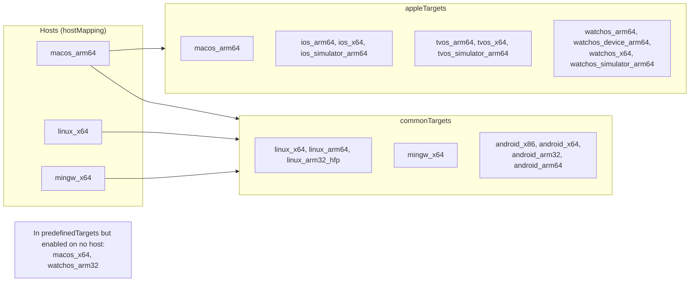
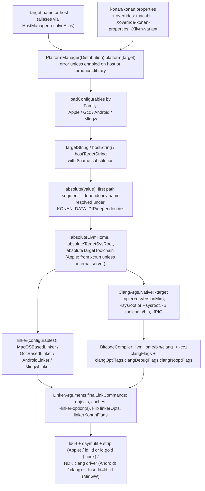

# Targets and toolchains

How Kotlin/Native knows what a target *is* and what it takes to produce a binary for it: the `KonanTarget` model and the
host → target support matrix, the per-target property schema in `konan.properties`, the dependency downloader that
materializes sysroots, LLVM and linkers under `$KONAN_DATA_DIR/dependencies`, the per-family Clang and linker drivers, the
Xcode / NDK / GCC / MinGW couplings, the distribution layout, and the procedures for adding, bumping and removing a target.
Everything here lives outside the IR pipeline: it is the configuration layer that the second stage
([second-stage-pipeline.md](second-stage-pipeline.md)), cinterop ([cinterop.md](cinterop.md)), the runtime build and KGP share.

**Read this when…** a build fails before or after codegen with a missing sysroot, a wrong `ld`, an Xcode complaint or a
`TargetSupportException`; you need to add a `-Xoverride-konan-properties` knob; you are bumping Xcode, LLVM, a GCC toolchain
or `osVersionMin`; or you are adding or retiring a target.

Related pages: [llvm-codegen.md](llvm-codegen.md) (what runs between bitcode and the linker command),
[platform-libraries.md](platform-libraries.md) (what is built on top of the sysroots), [tooling-integration.md](tooling-integration.md)
(how KGP provisions the distribution and downloads dependencies), [compatibility-and-migration.md](compatibility-and-migration.md)
§5 (the compatibility contract of targets and toolchains), [caches.md](caches.md) (`cacheableTargets`).

Source layout: the model and the drivers are in `native/utils` (`UTILS` = `native/utils/src/org/jetbrains/kotlin/konan`),
the property file is [kotlin-native/konan/konan.properties][props], the compiler-side glue is in
`kotlin-native/backend.native/.../backend/konan` and the build-side glue in `kotlin-native/build-tools`.

[props]: ../../kotlin-native/konan/konan.properties
[kt]: ../../native/utils/src/org/jetbrains/kotlin/konan/target/KonanTarget.kt
[hm]: ../../native/utils/src/org/jetbrains/kotlin/konan/target/HostManager.kt
[ext]: ../../native/utils/src/org/jetbrains/kotlin/konan/target/KonanTargetExtenstions.kt
[cfg]: ../../native/utils/src/org/jetbrains/kotlin/konan/target/Configurables.kt
[cfgimpl]: ../../native/utils/src/org/jetbrains/kotlin/konan/target/ConfigurablesImpl.kt
[kprops]: ../../native/utils/src/org/jetbrains/kotlin/konan/target/KonanProperties.kt
[tprops]: ../../native/utils/src/org/jetbrains/kotlin/konan/target/TargetProperties.kt
[pfu]: ../../compiler/util-io/src/org/jetbrains/kotlin/io/PropertyFileUtils.kt
[dist]: ../../native/utils/src/org/jetbrains/kotlin/konan/target/Distribution.kt
[platform]: ../../native/utils/src/org/jetbrains/kotlin/konan/target/Platform.kt
[apple]: ../../native/utils/src/org/jetbrains/kotlin/konan/target/Apple.kt
[xcode]: ../../native/utils/src/org/jetbrains/kotlin/konan/target/Xcode.kt
[windows]: ../../native/utils/src/org/jetbrains/kotlin/konan/target/Windows.kt
[clang]: ../../native/utils/src/org/jetbrains/kotlin/konan/target/ClangArgs.kt
[linker]: ../../native/utils/src/org/jetbrains/kotlin/konan/target/Linker.kt
[dp]: ../../native/utils/src/org/jetbrains/kotlin/konan/util/DependencyProcessor.kt
[dd]: ../../native/utils/src/org/jetbrains/kotlin/konan/util/DependencyDownloader.kt
[de]: ../../native/utils/src/org/jetbrains/kotlin/konan/util/DependencyExtractor.kt
[ddir]: ../../native/utils/src/org/jetbrains/kotlin/konan/util/DependencyDirectories.kt
[xp]: ../../native/utils/src/org/jetbrains/kotlin/konan/util/XcodeProvisioner.kt
[llvmvariant]: ../../native/utils/src/org/jetbrains/kotlin/backend/konan/LlvmVariant.kt
[ssc]: ../../kotlin-native/backend.native/compiler/ir/backend.native/src/org/jetbrains/kotlin/backend/konan/NativeSecondStageCompilationConfig.kt
[driver]: ../../kotlin-native/backend.native/compiler/ir/backend.native/src/org/jetbrains/kotlin/backend/konan/KonanDriver.kt
[setup]: ../../kotlin-native/backend.native/compiler/ir/backend.native/src/org/jetbrains/kotlin/backend/konan/SetupConfiguration.kt
[blinker]: ../../kotlin-native/backend.native/compiler/ir/backend.native/src/org/jetbrains/kotlin/backend/konan/Linker.kt
[bcc]: ../../kotlin-native/backend.native/compiler/ir/backend.native/src/org/jetbrains/kotlin/backend/konan/BitcodeCompiler.kt
[optpipe]: ../../kotlin-native/backend.native/compiler/ir/backend.native/src/org/jetbrains/kotlin/backend/konan/OptimizationPipeline.kt
[cachebuilder]: ../../kotlin-native/backend.native/compiler/ir/backend.native/src/org/jetbrains/kotlin/backend/konan/CacheBuilder.kt
[confphase]: ../../compiler/cli/cli-native-klib/src/main/kotlin/org/jetbrains/kotlin/native/pipeline/NativeConfigurationPhase.kt
[firstcfg]: ../../compiler/cli/cli-native-klib/src/main/kotlin/org/jetbrains/kotlin/native/NativeFirstStageCompilationConfig.kt
[paths]: ../../compiler/util/src/org/jetbrains/kotlin/utils/KotlinNativePaths.kt
[args]: ../../compiler/cli/cli-base/gen/org/jetbrains/kotlin/cli/common/arguments/K2NativeCompilerArguments.kt
[enabled]: ../../kotlin-native/build-tools/src/main/kotlin/org/jetbrains/kotlin/konan/target/EnabledTargets.kt
[tws]: ../../kotlin-native/build-tools/src/main/kotlin/org/jetbrains/kotlin/konan/target/TargetWithSanitizer.kt
[tdoc]: ../../kotlin-native/build-tools/src/main/kotlin/org/jetbrains/kotlin/konan/target/TargetDomainObjectContainer.kt
[pkp]: ../../kotlin-native/build-tools/src/main/kotlin/org/jetbrains/kotlin/nativeDistribution/PrepareKonanProperties.kt
[llvmsrc]: ../../kotlin-native/build-tools/src/main/kotlin/org/jetbrains/kotlin/nativeDistribution/LLVMDistributionSource.kt
[nd]: ../../kotlin-native/build-tools/src/main/kotlin/org/jetbrains/kotlin/nativeDistribution/NativeDistribution.kt
[pmp]: ../../kotlin-native/build-tools/src/main/kotlin/org/jetbrains/kotlin/PlatformManagerProvider.kt
[pinfo]: ../../kotlin-native/build-tools/src/main/kotlin/org/jetbrains/kotlin/PlatformInfo.kt
[bitcode]: ../../kotlin-native/build-tools/src/main/kotlin/org/jetbrains/kotlin/bitcode/CompileToBitcodePlugin.kt
[execclang]: ../../kotlin-native/build-tools/src/main/kotlin/org/jetbrains/kotlin/ExecClang.kt
[rtbuild]: ../../kotlin-native/runtime/build.gradle.kts
[knbuild]: ../../kotlin-native/build.gradle
[gradleprops]: ../../gradle.properties
[presets]: ../../libraries/tools/kotlin-gradle-plugin-dsl-codegen/src/main/kotlin/org/jetbrains/kotlin/generators/gradle/dsl/presetEntries.kt
[kgppreset]: ../../libraries/tools/kotlin-gradle-plugin/src/common/kotlin/org/jetbrains/kotlin/gradle/targets/native/KotlinNativeTargetPreset.kt
[kgpdeprecated]: ../../libraries/tools/kotlin-gradle-plugin/src/common/kotlin/org/jetbrains/kotlin/gradle/plugin/diagnostics/checkers/DeprecatedKotlinNativeTargetsChecker.kt
[kgphost]: ../../libraries/tools/kotlin-gradle-plugin/src/common/kotlin/org/jetbrains/kotlin/gradle/plugin/diagnostics/checkers/DeprecatedNativeHostChecker.kt
[kgpprops]: ../../libraries/tools/kotlin-gradle-plugin/src/common/kotlin/org/jetbrains/kotlin/gradle/targets/native/KonanPropertiesBuildService.kt
[kgpxcode]: ../../libraries/tools/kotlin-gradle-plugin/src/common/kotlin/org/jetbrains/kotlin/gradle/plugin/mpp/apple/XcodeVersionService.kt
[kgpsdk]: ../../libraries/tools/kotlin-gradle-plugin/src/common/kotlin/org/jetbrains/kotlin/gradle/plugin/mpp/apple/AppleSdk.kt
[kgptarget]: ../../libraries/tools/kotlin-gradle-plugin/src/common/kotlin/org/jetbrains/kotlin/gradle/targets/native/KotlinNativeTarget.kt
[ctarget]: ../../native/commonizer-api/src/org/jetbrains/kotlin/commonizer/CommonizerTarget.kt
[toolcfg]: ../../kotlin-native/Interop/StubGenerator/src/org/jetbrains/kotlin/native/interop/gen/jvm/ToolConfig.kt
[abstracttool]: ../../native/utils/src/org/jetbrains/kotlin/konan/target/AbstractToolConfig.kt

## Key concepts

| Term | Meaning |
|------|---------|
| `KonanTarget` | A sealed-class object `(name, Family, Architecture)`; the name (`ios_arm64`) is the identity used by the CLI, klib manifests, directory names, KGP and the commonizer ([KonanTarget.kt][kt]). |
| `Family`, `Architecture` | `OSX, IOS, TVOS, WATCHOS, LINUX, MINGW, ANDROID` (with binary prefixes/suffixes) and `X64, X86, ARM64, ARM32`; capabilities are derived from them by the extension functions in [KonanTargetExtenstions.kt][ext]. |
| Host | The `KonanTarget` the compiler runs on: `macos_arm64`, `linux_x64` or `mingw_x64` (`HostManager.hostMapping`, [HostManager.kt][hm]). `macos_x64` is no longer a host. |
| Enabled target | A target buildable *into a binary* on the current host: `HostManager.enabledByHost[host]`. Klibs can be produced for any target on any host. |
| `konan.properties` | The per-target toolchain database: flat Java properties with `key.<target>`, `key.<host>` and `key.<host>-<target>` suffixes and `$name` substitution ([konan.properties][props], [PropertyFileUtils.kt][pfu]). |
| `Configurables` | A typed, per-target view over the properties (`targetTriple`, `llvmHome`, `targetSysRoot`, flag lists); one interface per family: `AppleConfigurables`, `GccConfigurables` (Linux), `AndroidConfigurables`, `MingwConfigurables` ([Configurables.kt][cfg]). |
| `Platform`, `PlatformManager` | `Platform` = `Configurables` + lazily built `ClangArgs` + `LinkerFlags`; `PlatformManager(distribution)` eagerly loads one `Configurables` per *enabled* target ([Platform.kt][platform]). |
| Dependency | A named archive (`llvm-21-aarch64-macos-essentials-97`, `target-sysroot-xcode_26.4_17E192-iphoneos`, …) downloaded into `$KONAN_DATA_DIR/dependencies/<name>`; relative paths in properties are resolved against it ([DependencyProcessor.kt][dp]). |
| `targetToolchain`, `targetSysRoot`, `llvmHome` | The three roots everything else derives from: where `ld`/`clang` drivers live, where headers and libraries live, where the bundled LLVM lives. |
| `TargetTriple` | `arch-vendor-os[-environment]`, parsed from `targetTriple.<target>`; `environment == "simulator"` / `"macabi"` drives Apple decisions ([TargetTriple.kt](../../native/utils/src/org/jetbrains/kotlin/konan/target/TargetTriple.kt)). |
| Distribution (`konanHome`) | The directory with `konan/konan.properties`, the compiler jar, runtime bitcode and klibs; `Distribution` resolves all paths inside it and the data dir ([Distribution.kt][dist]). |
| `TargetWithSanitizer` | Build-side key `target[_tsan|_asan]` under which the runtime bitcode is compiled and published ([TargetWithSanitizer.kt][tws]). |

## Design in one paragraph

The target model is deliberately small: a closed list of objects, each a `(name, family, architecture)` triple, plus a host
table saying which of them a host can *link* for. Everything variable per target — triples, CPU, flags, sysroot, toolchain,
linker, SDK and OS versions, what to download — is data in one properties file rather than code, so that a toolchain bump is
usually a properties edit. The compiler, cinterop, the runtime build, the platform-library build and KGP all read the same file
through the same `Configurables` layer, and all download the same artifacts through the same `DependencyProcessor`, so the
only things that distinguish a developer checkout, a CI agent and a user's machine are (a) the LLVM "variant" and (b) whether
Apple/Windows SDK parts come from the locally installed Xcode / Visual Studio or from JetBrains' internal server. Family-specific
behaviour (how to call `ld64` vs `ld.lld` vs the NDK clang driver) is the one place where code, not data, branches.

## The target model

### `KonanTarget`, `Family`, `Architecture`

[KonanTarget.kt][kt] declares 21 objects. `predefinedTargets` is the name → object map (guarded by
`KonanTargetTest.allPredefinedTargetsRegistered`, which compares it with `sealedSubclasses`); `equals`/`hashCode` are
structural because the objects cross classloader and Gradle-serialization boundaries (`Serializable`; `PlatformManager.Serialized`
documents why `serialVersionUID` does not matter for Gradle's configuration cache). `visibleName` is just `name`
(`Named`, [VisibleNamed.kt](../../native/utils/src/org/jetbrains/kotlin/konan/util/VisibleNamed.kt)), and `presetName`
([utils.kt](../../native/utils/src/org/jetbrains/kotlin/konan/target/utils.kt)) derives the KGP DSL name (`ios_arm64` → `iosArm64`,
Android targets special-cased to `androidNativeArm64`).

Capabilities are not stored on the object; they are computed per target in [KonanTargetExtenstions.kt][ext]: `binaryFormat()`
(Mach-O / ELF / PE-COFF by family), `pointerBits()` (32 for `watchos_arm64` although its `Architecture` is `ARM64` — it is
`arm64_32`), `supports64BitAtomics()`/`supportsUnalignedAccess()` (false on ARM32 and `watchos_arm64`),
`supportsObjcInterop()`, `needSmallBinary()` (all watchOS), `supportedSanitizers()` (ASan+TSan on `linux_x64`, TSan on macOS,
nothing elsewhere), `supportsCoreSymbolication()`, `supportsIosCrashLog()`, GCC vs WinAPI unwind. These feed both the runtime
build defines (`KONAN_NO_64BIT_ATOMIC`, `KONAN_OBJC_INTEROP`, `USE_GCC_UNWIND`, … in [runtime/build.gradle.kts][rtbuild]) and
compiler decisions (`smallBinary` default in [NativeSecondStageCompilationConfig.kt][ssc]).

Two deprecation lists live on the companion: `deprecatedTargets` (`linux_arm32_hfp`, `watchos_x64`, `tvos_x64`, `macos_x64`,
`watchos_arm32`, the four Android targets) and `toleratedDeprecatedTargets` (`linux_arm32_hfp` and Android). Both are `lazy`
to break a class-initialization cycle (KT-82886, `ClinitDeadlockTest`). The messages `DEPRECATED_TARGET_MESSAGE` /
`DEPRECATED_TARGET_AS_ERROR_MESSAGE` point at `https://kotl.in/native-targets-tiers`; the *tier* assignment itself is not encoded
anywhere in the repository — it is external documentation.

### Hosts and the support matrix

[HostManager.kt][hm] determines the host from `os.name`/`os.arch` (`hostMapping`: `osx/aarch64`, `linux/x86_64`,
`windows/x86_64`; anything else throws `TargetSupportException`, and `hostOrNull`/`hostIsSupported` are the lenient variants KGP
uses). `enabledByHost` is the whole cross-compilation policy: every host gets `commonTargets` (three Linux, MinGW, four Android);
only `macos_arm64` additionally gets `appleTargets`. There is no Linux → Apple or Windows → Apple binary compilation, and
`macos_x64` and `watchos_arm32` are in `predefinedTargets` but in no host's enabled set. `targetByName`/`toKonanTargets` accept
`host` and the aliases in `targetAliasResolutions` (`ios` → `ios_arm64`, `iphone_sim` → `ios_x64`,
`raspberrypi` → `linux_arm32_hfp`, …).

Which targets each host may link for, as encoded in `HostManager.enabledByHost` and `hostMapping` ([HostManager.kt][hm]):



The compiler enforces the matrix once, in the `init` block of [NativeSecondStageCompilationConfig.kt][ssc]: producing anything
but `LIBRARY` for a target that is not `platformManager.isEnabled` is an error ("NB: producing LIBRARY is enabled on any
combination of hosts/targets"). The first stage only needs the target *name* (`predefinedTargets[targetName]` in
[NativeFirstStageCompilationConfig.kt][firstcfg]) and never builds a `PlatformManager`, which is what makes klib cross-compilation
possible: KGP's `kotlin.native.enableKlibsCrossCompilation` (default `true`, [KotlinNativeTargetPreset.kt][kgppreset]) relies on
exactly this. Note that `PlatformManager` eagerly loads `Configurables` for every enabled target, so a property missing for *any*
enabled target breaks every compilation on that host — which is why `konan.properties` keeps a block for the removed
`watchos_arm32` "until the bootstrap advances" (comment in the file, KT-78078).

### Target-derived decisions elsewhere

The second stage asks the target for: debug defaults (`lightDebug` defaults to `true` on Apple), `smallBinary`, `disableMmap`
(forced on MinGW), the sanitizer check, the output-kind flags of [backend Linker.kt][blinker] (`-bundle`, `-install_name`,
framework layout `Versions/A/` on macOS), and the list of runtime modules ([gc.md](gc.md), [llvm-codegen.md](llvm-codegen.md)).
Nothing in the IR pipeline branches on a concrete `KonanTarget` object except through these helpers.

## `konan.properties`: the schema

### Lookup rules

[KonanPropertiesLoader][kprops] exposes six accessors; the suffix is appended to the key, and a key *without* suffix is the
fallback for all targets ([PropertyFileUtils.kt][pfu] `propertyList`: `getProperty("$key.$suffix") ?: getProperty(key)`):

| Accessor | Suffix | Examples |
|----------|--------|----------|
| `targetString`/`targetList` | `<target>` | `targetTriple`, `targetSysRoot`, `clangFlags`, `linkerKonanFlags`, `osVersionMin` |
| `hostString`/`hostList` | `<host>` | `llvmHome`, `llvmVersion`, `libffiDir`, `cacheableTargets`, `additionalToolsDir`, `windowsKitParts` |
| `hostTargetString`/`hostTargetList` | `<host>-<target>`, or just `<host>` when host == target (`hostTargetSuffix`) | `targetToolchain`, `dependencies`, `linker`, `linkerHostSpecificFlags`, `emulatorDependency` |

Values are space-separated lists with `$name` / `${name}` substitution (`String.resolveValue`):
`$gccToolchain.linux_x64/x86_64-unknown-linux-gnu` appends a path to the resolved value, a prefix is allowed, a multi-valued
reference may take neither, and cycles raise "Circular dependency". `findValueByResolvableKey` additionally lets a *key* contain `$` (unused in the current file). The global
defaults in the file (`llvmInlineThreshold = 100`, `clangDebugFlags = -O0`, `linkerGccFlags`, `minVersion.<family>`,
`sdkVersion.<family>`, `toolchainDependency.<target>`) exist only to be referenced or to act as suffix-less fallbacks.

### Categories of keys

| Category | Keys (reader) |
|----------|---------------|
| Downloading | `dependenciesUrl`, `dependencyProfiles` (`default alt`), `airplaneMode`, `downloadingAttempts`, `downloadingAttemptIntervalMs` ([DependencyProcessor.kt][dp]); `<dependency>.<profile>` candidate lists (`remote:public`, `remote:public:<subdir>`, `remote:internal`, or a local path) |
| LLVM | `llvmHome.<host>` (= `$llvm.<host>.dev` in the template), `llvmVersion.<host>`, `predefinedLlvmDistributions`, `llvm.<host>.{dev,user,dev-with-asserts}` and `<llvm-name>.default` — all appended at build time by [PrepareKonanProperties][pkp] from [gradle.properties][gradleprops] `kotlin.native.llvm.*`; `libffiDir.<host>`, `predefinedLibffiVersions` |
| Roots | `targetSysRoot.<target>`, `targetToolchain.<host>-<target>`, `gccToolchain.<target>`, `additionalToolsDir.<host>` (Apple `xcode-addon-*`), `windowsKitParts.<host>`, `msvcParts.<host>` |
| Codegen | `targetTriple`, `targetCpu`, `targetCpuFeatures`, `llvmInlineThreshold` ([OptimizationPipeline.kt][optpipe], `LlvmAttributes.kt`); `clangFlags`, `clangNooptFlags`, `clangOptFlags`, `clangDebugFlags` ([BitcodeCompiler.kt][bcc]); `*RelocationMode` |
| Linking | `linkerKonanFlags`, `linkerOptimizationFlags`, `linkerNoDebugFlags`, `linkerDynamicFlags`, `linker.<host>-<target>`, `linkerHostSpecificFlags`; Gcc: `libGcc`, `dynamicLinker`, `abiSpecificLibraries`, `crtFilesLocation`, `linkerGccFlags`; Apple: `stripFlags`, `osVersionMin`, `sdkVersion` ([Linker.kt][linker]) |
| Apple/Xcode | `minimalXcodeVersion`, `ignoreXcodeVersionCheck`, `xcodeVersion`, `xcodeBuild`, `xcodeArtifactUrl`, `useProvisionedXcode` (override only) ([Apple.kt][apple], [XcodeProvisioner.kt][xp]) |
| Caches / KGP | `cacheableTargets.<host>`, `optInCacheableTargets.<host>`, `additionalCacheFlags.<target>` ([KonanPropertiesBuildService.kt][kgpprops], [CacheBuilder.kt][cachebuilder]); `compilerVersion` (`@compilerVersion@` token replaced at dist time) |
| Tests | `emulatorDependency` / `emulatorExecutable.<host>-<target>` (QEMU for Linux ARM from a Linux host, `ConfigurablesWithEmulator`) |
| Runtime | `runtimeDefinitions.<target>` is declared in `Configurables` but has no entries and no reader was found |

Keys present in the file with no reader found in this tree: `osVersionMinFlagLd.*` (superseded by `-platform_version`,
see [compatibility-and-migration.md](compatibility-and-migration.md) §5) and `reducedLlvmAppendix`. Declared in code with no
entries: `lld` (`LldFlags`). Note also that the file sets `downloadingAttemptIntervalMs` while the reader asks for
`downloadingAttemptPauseMs` — the default (3000 ms) happens to equal the configured value.

### Where the effective property set comes from

`Distribution.properties` ([Distribution.kt][dist]) loads `<konanHome>/konan/konan.properties` and then `putAll`s
`propertyOverrides`. The compiler builds that map in [NativeSecondStageCompilationConfig.kt][ssc] in this order, later entries
winning: (1) the Mac Catalyst rewrite when `-Xbinary=macabi=true` (`targetTriple.ios_x64 = x86_64-apple-ios-macabi`,
`targetSysRoot.ios_x64 = $targetSysRoot.macos_x64`); (2) every `-Xoverride-konan-properties=k=v;…` pair
([SetupConfiguration.kt][setup] `parseKeyValuePairs`, split on the first `=`); (3) the `-Xllvm-variant` entry, which is nothing
more than `llvmHome.<host> = $llvm.<host>.{user|dev|dev-with-asserts}` or an absolute path ([LlvmVariant.kt][llvmvariant]).
Spawned cache compilations inherit the override map (`K2Native.kt`). The build uses the same mechanism to point the proto
distribution at the Gradle-selected LLVM and to turn on `useProvisionedXcode` ([PlatformManagerProvider.kt][pmp]). cinterop takes
the same flag ([ToolConfig.kt][toolcfg] via [AbstractToolConfig][abstracttool]). KGP has no dedicated property for overrides:
users pass `-Xoverride-konan-properties` through `freeCompilerArgs` (the only in-tree example is an integration test overriding
`stripFlags`). `Distribution.additionalPropertyFiles` (reading `konan/platforms/<name>` and `~/.konan/platforms/<name>`) has no
callers and no corresponding directory in a shipped distribution.

### From properties to `Configurables`

`loadConfigurables(target, properties, dependenciesRoot)` ([ConfigurablesImpl.kt][cfgimpl]) picks the implementation by
`Family`: `GccConfigurablesImpl` (Linux; also `ConfigurablesWithEmulator`), `AppleConfigurablesImpl` ([Apple.kt][apple]),
`AndroidConfigurablesImpl`, `MingwConfigurablesImpl` ([Windows.kt][windows]). All extend `KonanPropertiesLoader`, whose
`absolute(value)` is the bridge to the file system: an absolute value is taken as is, a relative one is split on its first
segment, that segment is looked up as a *dependency name*, and the rest is appended. This is how `targetSysRoot.linux_x64 =
$gccToolchain.linux_x64/x86_64-unknown-linux-gnu/sysroot` becomes
`~/.konan/dependencies/x86_64-unknown-linux-gnu-gcc-8.3.0-glibc-2.19-kernel-4.9-2/x86_64-unknown-linux-gnu/sysroot` — and why an
absolute path in `-Xoverride-konan-properties=llvmHome.macos_arm64=/opt/llvm` bypasses the downloader entirely.

## Dependencies: naming, resolution, download

The list for one `(host, target)` is `dependencies.<host>[-<target>]` plus `compilerDependencies()`: `llvmHome.<host>` and
`libffiDir.<host>` are added only if they are members of `predefinedLlvmDistributions` / `predefinedLibffiVersions` (so a custom
LLVM path is never downloaded). Family implementations append more: Apple adds the sysroot, toolchain and `xcode-addon`
archives only when the internal server is reachable and `useProvisionedXcode` is off; MinGW adds `windowsKitParts`/`msvcParts`
on a Windows host with the internal server; Gcc adds the QEMU `emulatorDependency`.

What is actually downloaded, from [konan.properties][props] (host `macos_arm64` unless stated; LLVM names from
[gradle.properties][gradleprops]):

| Target(s) | Dependencies |
|-----------|--------------|
| any (per host) | `llvm-21-<arch>-<os>-{essentials\|dev}-<build>` (`user` vs `dev` variant), `libffi-3.3-1-macos-arm64` / `libffi-3.2.1-2-linux-x86-64` / `libffi-3.3-windows-x64-1`, `lldb-4-macos` / `lldb-4-linux` / `lldb-2-windows` (host = target only) |
| Apple targets | locally installed Xcode (default); with `KONAN_USE_INTERNAL_SERVER`: `target-sysroot-xcode_26.4_17E192-<platform>`, `target-toolchain-xcode_26.4_17E192`, `xcode-addon-xcode_26.4_17E192`; with `useProvisionedXcode=true`: `xcode_27.0_27A266a` (a whole Xcode, `.xip`) |
| `linux_x64` / `linux_arm64` / `linux_arm32_hfp` | `x86_64-unknown-linux-gnu-gcc-8.3.0-glibc-2.19-kernel-4.9-2` / `aarch64-…-glibc-2.25-kernel-4.9-2` / `arm-unknown-linux-gnueabihf-gcc-8.3.0-glibc-2.12.1-kernel-4.9-1` (crosstool-ng toolchain *and* sysroot in one archive); from a Windows host also `msys2-mingw-w64-x86_64-2` (its `ld.gold`); from a Linux host `qemu-{arm,aarch64}-static-5.1.0-linux-2` for the ARM targets |
| Android | `target-sysroot-1-android_ndk` + `target-toolchain-2-{osx,linux,windows}-android_ndk` (NDK split in two; API level 21 is hard-coded in `ClangArgs.Android`) |
| `mingw_x64` | `msys2-mingw-w64-x86_64-2` (sysroot; the linker is the bundled LLVM's `ld.lld`); Windows host only: `windows-kit-x64-v1-alpha2`, `msvc-x64-v1-alpha2` for JNI builds |

Resolution and download ([DependencyProcessor.kt][dp]): for each dependency the candidates are `<dep>.<profile>` for each
profile in `dependencyProfiles` (`default`, then `alt`); an absent `<dep>.default` means `remote:public`. The first viable
candidate wins — a local path only if it exists, `remote:internal` only if [`InternalServer.isAvailable`][dp]
(`KONAN_USE_INTERNAL_SERVER` = `0`/unset, `1`, or `auto` = hostname ends in `labs.intellij.net` and DNS resolves). Apple and
Windows SDK parts are `remote:internal` only, so outside JetBrains they are never downloaded and the local Xcode / Visual Studio is
used instead. `run()` then, under a JVM-wide lock in a system property (KT-39781) *and* a file lock on
`dependencies/cache/.lock`, downloads `<dependenciesUrl>[/<subdir>]/<name>.{tar.gz|zip}` into `dependencies/cache/` (resumable,
`.part` suffix, 10 attempts with growing back-off, only HTTP 5xx and I/O errors retried — [DependencyDownloader.kt][dd]),
extracts with the system `tar -xzf` / an in-JVM unzip / `xip --expand` ([DependencyExtractor.kt][de]), deletes the archive and
appends the name to `dependencies/.extracted`. A dependency is considered present when it is listed in `.extracted` *and* its
directory exists and is non-empty; deleting a directory without editing `.extracted` therefore still triggers a re-download, but a
half-written directory that is listed does not. `airplaneMode = true` turns a missing archive into `FileNotFoundException`.
`-Xoverride-konan-properties=dependenciesUrl=https://mirror/…` redirects public downloads (the URL layout is `<base>/<name>.<ext>`
or `<base>/<subdir>/<name>.<ext>` for `remote:public:<subdir>`, which is how LLVM lives under `resources/llvm/<ver>-<arch>-<os>/`).

Where the data dir is: `DependencyDirectories.getLocalKonanDir` ([DependencyDirectories.kt][ddir]) = explicit argument
(`-Xkonan-data-dir`, cinterop `-Xkonan-data-dir`, KGP `konan.data.dir`), else `$KONAN_DATA_DIR`, else `~/.konan`. The archive
cache is `getDependencyCacheDir(dependenciesRoot)`, i.e. `<data dir>/dependencies/cache` — the `dependencies` root is passed as the
"data dir" argument, which is why `cache/` sits *inside* `dependencies/`.

When the compiler downloads: `platform` is lazy and calls `downloadDependencies()` only if `configuration.checkDependencies`
([NativeSecondStageCompilationConfig.kt][ssc]); that flag is computed in [NativeConfigurationPhase.kt][confphase] as "there is
something to compile" (sources, `-Xinclude`, `-Xexport-library`, a program linked from libraries, a cache output kind) or
`-Xcheck-dependencies`. Spawned cache builds force it on (KT-67547, [CacheBuilder.kt][cachebuilder]). cinterop always downloads in
`AbstractToolConfig.prepare()`. KGP downloads itself before starting any compiler (`downloadNativeDependencies`,
[tooling-integration.md](tooling-integration.md#where-the-distribution-comes-from)), with the same `loadConfigurables(...)`.

## Toolchains

### Resolving the toolchain at link time

How one `-target` turns into clang and linker commands, traced through `HostManager`, `PlatformManager`, `KonanPropertiesLoader`,
`DependencyProcessor`, `ClangArgs`, `BitcodeCompiler` and both `Linker.kt` files:



### Clang (`ClangArgs`)

[ClangArgs.kt][clang] builds two flavours: `Native` (code that runs on the target: runtime, cinterop stubs, `BitcodeCompiler`) and
`Jni` (host code loaded into the compiler JVM; on `mingw_x64` it switches to the `x86_64-pc-windows-msvc` triple, `-fuse-ld=lld`
and the `msvcParts`/`windowsKitParts` search roots, see the long comments in [Windows.kt][windows]). The common part is
`-B<toolchain>/bin`, `-fno-stack-protector`, `--gcc-toolchain=` on Linux, `-target <triple>` — with `osVersionMin` folded into the
OS component on Apple (`arm64-apple-ios15.0`) — then `-isysroot` (Apple; "parses SDKSettings.json") or `--sysroot`, `-fPIC`
except on MinGW (KT-43502). Target specifics: `-mfpu=vfp -mfloat-abi=hard` for `linux_arm32_hfp`; for Android the NDK sysroot
layout `android-21/arch-<arch>`, libc++ include dirs from the toolchain and `-mno-outline-atomics` on `android_arm64` (KT-73559).
`libclangArgs` adds `-isystem <llvmHome>/lib/clang/<llvmVersion>/include` because libclang's default search path differs from the
driver's — this is why `llvmVersion.<host>` must match the directory name inside the LLVM archive (the warning in
[gradle.properties][gradleprops] says the same). `clangPaths` (`<llvmHome>/bin`, `<toolchain>/bin`) is prepended to `PATH` by the
build's JNI tasks. Object-file emission itself — `clangFlags.<target>` (`-cc1 -emit-obj -disable-llvm-passes -x ir`) plus one of
the opt-level lists, `-Xoverride-clang-options` replacing the whole list — is in
[llvm-codegen.md](llvm-codegen.md#object-files-and-the-platform-linker).

### Linkers (`LinkerFlags`)

[Linker.kt][linker] (native/utils) has one subclass per family, selected by `linker(configurables)`; the backend's
[Linker.kt][blinker] only assembles `LinkerArguments` (objects, static/dynamic cache binaries, `-include-binary`s, the
output-kind flags, `-linker-option(s)` with `-Wl,` unwrapped when the driver is `ld` itself — `asLinkerArgs`) and calls
`finalLinkCommands()`. Flag order inside each command: `linkerOptimizationFlags` (if `-opt`), `linkerNoDebugFlags` (if not `-g`),
`linkerDynamicFlags` (shared output), then `linkerKonanFlags`, libraries, user `linkerArgs`.

| Family | Driver | Notable mechanics |
|--------|--------|-------------------|
| Apple (`MacOSBasedLinker`) | `<toolchain>/bin/ld` (ld64), `libtool -static` for static libs, `dsymutil` when debug, `strip $stripFlags` when debug *and* opt | `-platform_version <macos\|ios\|…>[-simulator\|mac-catalyst] <osVersionMin>.0 <sdkVersion>`, `-syslibroot`, compiler-rt from `<toolchain>/lib/clang/*/lib/darwin/libclang_rt.<os>[sim].a`, `-rpath @executable_path/Frameworks` (`../Frameworks` on macOS), `-filelist` response files, `-r` pre-link for caches ([caches.md](caches.md)); `dsymutil` stderr is filtered for the `_main` alias warning |
| Linux (`GccBasedLinker`) | `linker.<host>-<target>`: `ld.lld` from the bundled LLVM (Linux and macOS hosts), `ld.gold` from `msys2-mingw-w64` (Windows host), GNU `ld` of the GCC toolchain for `linux_x64 → linux_arm32_hfp` | hand-written crt sequence `crt1.o crti.o crtbegin[S].o … crtend[S].o crtn.o` from `crtFilesLocation` and `libGcc`, `--sysroot`, `-dynamic-linker $dynamicLinker`, `-L` for each `abiSpecificLibraries`, `linkerGccFlags`, compiler-rt from `<llvmHome>/lib/clang/*/lib/*/libclang_rt.{asan,tsan}[_cxx].a`; GNU-quoted response files (KT-89637) |
| Android (`AndroidLinker`) | NDK clang driver `<toolchain>/bin/<triple>21-clang[.cmd]` (`useCompilerDriverAsLinker`) | `--sysroot=<sysroot>/android-21/arch-<arch>`, `-fPIE -pie` / `-fPIC -shared -Wl,-soname`, `-target` without vendor |
| MinGW (`MingwLinker`) | `<llvmHome>/bin/clang++ -fuse-ld=<linker.<host>-<target>>` (= `ld.lld[.exe]`) | `--sysroot <msys2>`, `--rsp-quoting=windows` + `@file` for libraries (Windows command-line limit, CreateProcess error 206) |
| static library, all non-Apple | `<llvmHome>/bin/llvm-ar qcsDL @rsp` | one tool for every target and host, flattening `.a` members (KT-84037, KT-84035) |

### Apple: Xcode coupling

`AppleConfigurablesImpl` ([Apple.kt][apple]) chooses an `XcodePartsProvider` once per `Configurables`: `useProvisionedXcode=true`
→ the Xcode under `<dependencies>/xcode_<xcodeVersion>_<xcodeBuild>` (via `DEVELOPER_DIR`); else internal server available →
the downloaded `target-sysroot-*`/`target-toolchain-*`/`xcode-addon-*` archives (toolchain root is `<archive>/usr`); else the
*currently selected* Xcode. `InstalledXcode` ([Xcode.kt][xcode]) shells out to `xcrun -f ld` (toolchain = two levels up),
`xcrun --sdk <name> --show-sdk-path` per platform (`platformName()` maps family+simulator to `iPhoneOS`, `iPhoneSimulator`, …;
Mac Catalyst uses the macOS SDK), `xcrun -f bitcode-build-tool` for `additionalTools`, and reads the version from `Info.plist`
with `xcodebuild -version` as fallback. Nothing is cached across invocations on purpose ("the compiler might be executed in a
Gradle daemon process, so current Xcode might actually change").

The version check is a *minimum*: `minimalXcodeVersion=15.4` in the properties, compared with `XcodeVersion(major, minor)` unless
`ignoreXcodeVersionCheck=true` (both overridable per invocation with `-Xoverride-konan-properties`). The *maximum* is advisory and
lives in KGP: `XcodeVersion.maxTested = 27.0` ([Xcode.kt][xcode]) is reported by [XcodeVersionService.kt][kgpxcode] as
`XcodeVersionTooHighWarning` unless `kotlin.apple.xcodeCompatibility.nowarn` (`appleIgnoreXcodeVersionCompatibility`); the
compiler itself never refuses a newer Xcode. The repository build has a third check, `xcodeMajorVersion=27` in
[gradle.properties][gradleprops], enforced by `PlatformInfo.checkXcodeVersion` ([PlatformInfo.kt][pinfo]) only with
`-PcheckXcodeVersion=true` and no internal server. `sdkVersion.<family>` (27.0) and `minVersion.<family>` (iOS/tvOS 15.0,
macOS 12.0, watchOS 8.0; `watchos_device_arm64` hard-codes 9.0) are data, not probed from the SDK: a user on a newer Xcode still
links with `-platform_version ios 15.0 27.0`.

Whole-Xcode provisioning ([XcodeProvisioner.kt][xp]) is the newest path: it symlinks the current Xcode if its
`ProductBuildVersion` equals `xcodeBuild`, refuses to download on TeamCity, otherwise downloads `xcodeArtifactUrl` (a `.xip`,
internal) through the same `DependencyProcessor` and validates the build id afterwards — "the directory name is the only thing
tying a provisioned Xcode to a build". The build side turns it on through `PlatformManagerProvider` (`useProvisionedXcode=true`,
also passed to spawned `konanc`/`cinterop` via `-Xoverride-konan-properties`).

### Linux, Android, MinGW

Linux targets use crosstool-ng toolchains built by
[kotlin-native/tools/toolchain_builder](../../kotlin-native/tools/toolchain_builder/README.md) (`toolchains/<triple>/<version>`, Docker; the archive name encodes `gcc-8.3.0-glibc-2.19-kernel-4.9`, i.e. the glibc floor of
every Linux binary). `gccToolchain.<target>` is the archive, `targetToolchain` and `targetSysRoot` are subdirectories of it, and
`libGcc` is sysroot-relative. Android uses a split NDK (`target-sysroot-1-android_ndk`, `target-toolchain-2-<host>-android_ndk`)
with API 21 fixed in `ClangArgs.Android`; there is no NDK discovery on the user's machine. MinGW uses `msys2-mingw-w64-x86_64-2`
as sysroot and the bundled LLVM for everything else; Windows *host* builds of the compiler's own JNI libraries additionally need
the internal-only `windows-kit`/`msvc` parts, documented in the properties comment (YouTrack article KT-A-945).

### LLVM selection

The LLVM version is chosen at *build* time: [gradle.properties][gradleprops] `kotlin.native.llvm = default | next | <abs path>`
and `kotlin.native.llvm.<slot>.<host>.{version,dev,dev-with-asserts,essentials}` ([LLVMDistributionSource.kt][llvmsrc]).
`distKonanProperties` ([PrepareKonanProperties][pkp], [kotlin-native/build.gradle][knbuild]) replaces `$llvm.<host>.dev` with
`$llvm.<host>.user` for the host of the distribution being built, replaces `@compilerVersion@`, and appends the
"LLVM Version configuration" block (`predefinedLlvmDistributions`, `llvm.<host>.{dev,user}`, `llvmVersion.<host>`,
`<name>.default = remote:public:resources/llvm/…`). At *run* time `-Xllvm-variant=user|dev|dev-with-asserts|<path>` swaps
`llvmHome.<host>` ([LlvmVariant.kt][llvmvariant]; HACKING.md's "LLVM" section). `dev` differs from `user`/`essentials` only in
which components the archive contains (`llvm_builder/README.md`: the user set is `clang libclang lld llvm-cov llvm-profdata
llvm-ar clang-resource-headers`, plus `compiler-rt` on Linux). Building a distribution is
[kotlin-native/tools/llvm_builder/package.py](../../kotlin-native/tools/llvm_builder/README.md) and
[BUILDING_LLVM.md](../../kotlin-native/BUILDING_LLVM.md).

## The distribution: layout and discovery

Layout of a shipped distribution, derived from [NativeDistribution.kt][nd], the `dist*` tasks in
[kotlin-native/build.gradle][knbuild], [Distribution.kt][dist] and a listing of a KGP-provisioned `kotlin-native-prebuilt-macos-aarch64-2.5.20-dev-953`:

```
<konanHome>/                     kotlin-native/dist, or ~/.konan/kotlin-native-prebuilt-<os>-<arch>-<version> (KGP)
├── bin/                         konanc, cinterop, klib, run_konan, kotlinc-native, generate-platform, konan-lldb (from cmd/)
├── konan/
│   ├── konan.properties         template + compilerVersion + appended "LLVM Version configuration" block
│   ├── compiler.fingerprint     hash of jars + nativelib + konan.properties (cache invalidation, caches.md)
│   ├── lib/kotlin-native-compiler-embeddable.jar     its location defines konan.home (KotlinNativePaths)
│   ├── nativelib/               JNI libraries loaded by the compiler (distNativeLibs)
│   ├── platformDef/<target>/*.def                   platform-library definitions (platform-libraries.md)
│   ├── swift_export/kotlin_runtime/module.modulemap
│   └── targets/<target>/native/*.bc                  runtime bitcode: runtime, compiler_interface, launcher, xctest_launcher,
│                                                     objc, debug, exceptionsSupport, libbacktrace, source_info_*, breakpad,
│                                                     custom_alloc|legacy_alloc, {concurrent_ms,pmcs,same_thread_ms,noop}_gc,
│                                                     {adaptive,aggressive,manual}_gcScheduler,
│                                                     {impl,noop}_crashHandler, {impl,noop}_externalCallsChecker
├── klib/
│   ├── common/stdlib/
│   ├── platform/<target>/<lib>/                      absent in the "regular" (light) bundle
│   └── cache/<target>-{g|opt}STATIC[-assertsDISABLE]-system/<lib>-cache     platform-lib caches absent in the light bundle
├── sources/kotlin-stdlib-native-sources.zip
├── tools/env_blacklist, konan_lldb.py                env vars unset by run_konan and KGP before launching the compiler
├── licenses/
└── provisioned.ok                                    written by KGP after unpacking

$KONAN_DATA_DIR (default ~/.konan; -Xkonan-data-dir, cinterop -Xkonan-data-dir, KGP konan.data.dir)
├── dependencies/
│   ├── .extracted                one dependency name per line
│   ├── cache/                    <name>.tar.gz|zip while downloading (.part), deleted after extraction; .lock
│   ├── llvm-21-aarch64-macos-essentials-97/  llvm-21-aarch64-macos-dev-97/  libffi-3.3-1-macos-arm64/  lldb-4-macos/
│   ├── x86_64-unknown-linux-gnu-gcc-8.3.0-glibc-2.19-kernel-4.9-2/   aarch64-…/   arm-unknown-linux-gnueabihf-…/
│   ├── target-sysroot-1-android_ndk/  target-toolchain-2-osx-android_ndk/  msys2-mingw-w64-x86_64-2/
│   └── xcode_27.0_27A266a -> xcode_27.0_27A266a.app/   (whole-Xcode provisioning only)
└── kotlin-native-prebuilt-<os>-<arch>-<version>/     distributions provisioned by KGP
```

Discovery: `run_konan` computes `KONAN_HOME` from its own location and passes `-Dkonan.home`; inside the JVM
[KotlinNativePaths.kt][paths] honours `kotlin.native.home`, `org.jetbrains.kotlin.native.home`, `konan.home` or
`kotlin.internal.native.test.nativeHome`, else walks up from the jar and *requires* it to be at
`konan/lib/kotlin-native[-compiler-embeddable].jar`. The common `-kotlin-home` argument overrides this (`konanHome` in
[NativeConfigurationPhase.kt][confphase], inherited by spawned cache builds), which is how the tests point a compiler at a
different distribution. The "regular" bundle (`bundleRegular`) excludes `klib/platform` and the platform-library caches;
`bundlePrebuilt` includes them after `crossDistPlatformLibs` or the cross-bundle merge — the `light` vs `prebuilt` choice KGP exposes as
`kotlin.native.distribution.type` ([platform-libraries.md](platform-libraries.md), [tooling-integration.md](tooling-integration.md)).
`Distribution.compilerVersion` falls back to guessing the version from a `-1…` substring of `konanHome` when the property is absent
(only relevant for hand-made distributions).

## Runtime build per target

The build applies `PlatformManagerPlugin` (a `PlatformManager` over the proto distribution with the LLVM and Xcode overrides from
[PlatformManagerProvider.kt][pmp]) and enumerates `enabledTargets(platformManager)` ([EnabledTargets.kt][enabled]): the host's
enabled set minus `unsupportedTargetNames` (`watchos_arm32`, `macos_x64`, matched by *name* so the code compiles against a bootstrap
that still has the constants) minus non-tolerated deprecated targets. `allTargetsWithSanitizers` ([TargetWithSanitizer.kt][tws])
expands each to `target` plus `target_tsan`/`target_asan` where `supportedSanitizers()` allows, and the `bitcode` extension
([CompileToBitcodePlugin.kt][bitcode], a [TargetDomainObjectContainer][tdoc]) creates one `clangFrontend<Module><SourceSet><Target>`
and one `llvmLink…` task per module and source set, publishing the `.bc` under the Gradle attribute
`org.jetbrains.kotlin.target = TargetWithSanitizer`. Compiler flags are `platformManager.clangArgs(target, "clang++")`
([ExecClang.kt][execclang] → `Platform.clang.clangXXArgs`, i.e. the same `ClangArgs.Native` the compiler uses for stubs) plus
the per-target defines computed in [runtime/build.gradle.kts][rtbuild] (`KONAN_<ARCH>`, `KONAN_<FAMILY>`, `KONAN_NO_64BIT_ATOMIC`,
`USE_ELF_SYMBOLS`, `MACHSIZE`, `TARGET_OS_*` workarounds for Xcode 15.3, `-Wno-unknown-attributes` for Xcode 27) and
`-std=c++17 -Werror -O2 -fno-aligned-allocation`. `targetCpu`/`targetCpuFeatures` are *not* applied to the runtime bitcode; they
reach the final module through `LlvmAttributes.kt` and the optimization pipeline ([llvm-codegen.md](llvm-codegen.md)).
`<target>CrossDistBitcodeCopy` copies the artifacts of the *unsanitized* variant (`new TargetWithSanitizer(target, null)`) into
`konan/targets/<target>/native`; the shipped distribution therefore contains no `_tsan`/`_asan` bitcode — the sanitizer variants
serve the runtime's own gtest targets. The compiler's `-Xbinary=sanitizer` accepts only `thread`, only for non-static outputs and
only on `supportedSanitizers()` targets ([NativeSecondStageCompilationConfig.kt][ssc]); how it is honoured at link time is the
`sanitizer` argument of `LinkerArguments` (compiler-rt `tsan` library) and is **Unverified** on the codegen side here.

## Adding a target: a checklist from history

Traced from the addition of `watchos_device_arm64` (`0b4a4ca42b96` and the KGP follow-ups `3fe5601a70b9`, `02c9cf74b47d`,
`1b7f673e9464`, `1b3cc0dfaab1`, `fe2ee9886d86`, `efa331feed48`) and inverted from the removal of `watchos_arm32` (`4a29b1b5566c`):

1. **Model** — add the object to [KonanTarget.kt][kt] and to `predefinedTargets`; add it to `commonTargets`/`appleTargets` in
   [HostManager.kt][hm]; extend the capability helpers in [KonanTargetExtenstions.kt][ext] if the defaults are wrong (the file still
   carries "TODO: Add explicit WATCHOS_DEVICE_ARM64" notes for `supportsCoreSymbolication`/`supportsIosCrashLog`).
2. **Properties** — a full block in [konan.properties][props]: `targetTriple`, `targetSysRoot`, `targetToolchain.<host>-<target>`
   for every host that may link it, `targetCpu`/`targetCpuFeatures`, the four `clang*Flags`, the `linker*Flags`, Apple's
   `osVersionMin`/`sdkVersion`/`stripFlags`, Gcc's `libGcc`/`dynamicLinker`/`crtFilesLocation`/`abiSpecificLibraries`/`linker.*`,
   `dependencies.<host>-<target>`, and `<dependency>.default` sources for anything new. `PlatformManager` loads all of it eagerly,
   so a missing key fails every host build at once.
3. **Dependencies** — a new sysroot/toolchain archive published to `dependenciesUrl` (or internal); Linux toolchains via
   `toolchain_builder`, Apple sysroots via `tools/scripts/update_xcode.sh` (**Unverified**: the script was not read).
4. **Runtime** — nothing per target unless defines or `fixBrokenMacroExpansionInXcode15_3` need a case; the bitcode tasks are
   generated from `enabledTargets`.
5. **Platform libraries** — `.def` files per family in `kotlin-native/platformLibs/src/platform/<family>/`; the watchOS addition
   touched `posix.def` and `set_depends.sh`, the removal touched `Accelerate.def`, `builtin.def`, `posix.def` and `AbiSpecific.kt`
   in the stub generator ([platform-libraries.md](platform-libraries.md)).
6. **KGP** — the DSL and presets are *generated* from `HostManager().targets` by [presetEntries.kt][presets] (host-test vs
   simulator-test preset chosen by two hand-maintained sets there — "modifying these sets should also be reflected in the MPP
   plugin code"); hand edits were needed in `KotlinTargetContainerWithPresetFunctions`, source-set conventions,
   `KotlinHierarchyBuilder`, [AppleSdk.kt][kgpsdk] (Xcode `SDK_NAME`/`ARCHS` → `KonanTarget`), `FatFrameworkTask`, `XCFrameworkTask`,
   `KotlinArtifactsExtension`, the commonizer registration, statistics, and the `.api` dumps.
7. **Commonizer / ABI tools** — `LeafCommonizerTarget(name)` resolves through `predefinedTargets` ([CommonizerTarget.kt][ctarget]);
   `PlatformWidthIndex`, `KlibTarget`/`TargetHierarchy` in `abi-tools` list targets explicitly.
8. **Tests** — `kn.target=<name>` selects the test target (`ClassLevelProperty.TEST_TARGET`); add the target to
   `nativeTargetsWithSimulatorTests` or the emulator properties if tests should run; FileCheck tests may be target-specific.
9. **Bootstrap** — build scripts compile against the *bootstrap* compiler's `KonanTarget`, so constants that the bootstrap lacks
   must be referenced by name ([EnabledTargets.kt][enabled] does this), and removed targets keep their properties block until the
   bootstrap advances (KT-78078).

## Deprecating and removing a target

The lifecycle visible in history (`37ab139139da` deprecate → `1ef198ead4f4` error in KGP → `4a29b1b5566c` remove →
`e0b13048f847` re-add as "empty target with deprecation error"):

1. **Soft deprecation (compiler)** — add to `softDeprecatedTargets` in [KonanDriver.kt][driver]: a `KONAN_ARGUMENT_STRONG_WARNING`
   for every non-`LIBRARY` compilation. Today: `linux_arm32_hfp`, `macos_x64`, `tvos_x64`, `watchos_x64`.
2. **Deprecation (KGP)** — add to `KonanTarget.deprecatedTargets`; the generated DSL function gets `@Deprecated(WARNING)` if the
   target is also in `toleratedDeprecatedTargets`, else `@Deprecated(ERROR)` ([presetEntries.kt][presets]), and
   [DeprecatedKotlinNativeTargetsChecker][kgpdeprecated] reports the `ERROR`-level `DeprecatedKotlinNativeTargetsDiagnostic` for
   non-tolerated ones. A deprecated *host* (none today, since `macos_x64` is no longer a host) yields
   `DeprecatedNativeHostDiagnostic` ([DeprecatedNativeHostChecker][kgphost]). `-list-targets` marks these `(deprecated)`.
3. **Build drop** — [EnabledTargets.kt][enabled] stops building runtime, platform libs and caches for non-tolerated deprecated
   targets even while the compiler still enables them.
4. **Removal** — delete from `HostManager`'s sets first (the target is then "known but enabled nowhere": binaries fail with
   "not available for output kind", klibs still compile), then from `KonanTarget` once the bootstrap no longer needs it, then the
   properties block, the KGP DSL (`.api` dumps), platform-lib `.def` entries, commonizer/abi-tools lists. `7dc64f62cf20` shows the
   final step: dropping the error-deprecated placeholder objects that were kept only for a readable message.

The two compiler-side and KGP-side lists are maintained by hand and disagree (recorded in
[compatibility-and-migration.md](compatibility-and-migration.md) §5 and [status.md](status.md)).

## Connections to other subsystems

- **Codegen and LLVM** — `targetTriple`, `targetCpu`, `targetCpuFeatures`, `llvmInlineThreshold`, `clang*Flags` and the
  `-platform_version`/`-target` OS version are the parameters of [llvm-codegen.md](llvm-codegen.md); an LLVM bump changes
  `gradle.properties`, the CPU-feature strings (`e82e7c8a7beb` for LLVM 21) and the runtime bitcode at once.
- **Runtime** — the per-target defines above; the runtime module list is duplicated in `RuntimeModule.kt` ([gc.md](gc.md)).
- **Caches** — `cacheableTargets.<host>` decides which targets ship system caches and get `STATIC` caches by default in KGP
  (`KonanPropertiesBuildService.defaultCacheKindForTarget`); `additionalCacheFlags.<target>` is appended to spawned cache builds
  ([caches.md](caches.md)).
- **cinterop and platform libraries** — `ToolConfig` is an `AbstractToolConfig`: same `Distribution`, `PlatformManager`,
  `downloadDependencies()`, `libclang` from `llvmHome`, `libclangArgs` with the target sysroot; `HeaderToIdMapper` makes manifest
  header ids sysroot-relative ([cinterop.md](cinterop.md)); platform libraries are generated against `targetSysRoot`
  ([platform-libraries.md](platform-libraries.md)).
- **KGP** — target names via `presetName`; `HostManager.isEnabled` / `hostIsSupported` for `DisabledKotlinNativeTargets` and
  cross-compilation; `KonanPropertiesBuildService` reads `cacheableTargets`, `optInCacheableTargets`, `additionalCacheFlags` and
  `tools/env_blacklist`; `AppleSdk` maps Xcode build settings to `KonanTarget`; dependency download before every compiler start
  ([tooling-integration.md](tooling-integration.md)).
- **Commonizer and klibs** — `native_targets` in a klib manifest (`KLIB_PROPERTY_NATIVE_TARGETS`) and `LeafCommonizerTarget`
  names are `KonanTarget.name` strings ([klib-linking.md](klib-linking.md), [platform-libraries.md](platform-libraries.md)).
- **Tests** — `native.tests` builds its own `PlatformManager(distribution).platform(testTarget).configurables` to find
  toolchains for running binaries (simulators, QEMU through `emulatorExecutable`).

## Flags and options

| Flag / property | Default | Where read | Effect |
|-----------------|---------|------------|--------|
| `-target <name>` | host | `TargetManagerImpl.determineCurrent`, first stage `predefinedTargets[name]` | selects the target; aliases resolved; unknown → `TargetSupportException` |
| `-list-targets` | off | [KonanDriver.kt][driver] → `TargetManager.list()` | prints enabled targets with `(default)` / `(deprecated)` |
| `-Xoverride-konan-properties=k=v;…` | — | [SetupConfiguration.kt][setup], `Distribution.propertyOverrides` | overrides any key for this invocation (and spawned cache builds, cinterop) |
| `-Xllvm-variant=user\|dev\|dev-with-asserts\|<path>` | `user` (dist default) | [LlvmVariant.kt][llvmvariant] | rewrites `llvmHome.<host>` |
| `-Xkonan-data-dir <dir>` | `$KONAN_DATA_DIR`, else `~/.konan` | `Distribution.konanDataDir`, [DependencyDirectories.kt][ddir] | where dependencies are stored |
| `-Xcheck-dependencies` | computed ([NativeConfigurationPhase.kt][confphase]) | `NativeSecondStageCompilationConfig.platform` | forces `downloadDependencies()`; useful alone to pre-populate |
| `-Xoverride-clang-options` | — | [BitcodeCompiler.kt][bcc] | replaces the whole clang flag list ([llvm-codegen.md](llvm-codegen.md)) |
| `-linker-option` / `-linker-options` | — | [backend Linker.kt][blinker] `LINKER_ARGS` | appended last; `-Wl,` unwrapped unless the driver is clang |
| `-Xbinary=macabi=true` | false | [NativeSecondStageCompilationConfig.kt][ssc] | Mac Catalyst: overrides triple and sysroot of `ios_x64`/`ios_simulator_arm64` |
| `-Xbinary=sanitizer=thread` | none | same | TSan on supported targets; `address` is rejected with a warning |
| `-Xbinary=compileBitcodeWithXcodeLlvm` | false | [BitcodeCompiler.kt][bcc] | use Xcode's clang instead of the bundled one for object emission |
| `KONAN_USE_INTERNAL_SERVER=0\|1\|auto` | unset | `InternalServer.isAvailable` | enables `remote:internal` candidates (Apple/Windows SDK parts) |
| `airplaneMode`, `dependenciesUrl`, `minimalXcodeVersion`, `ignoreXcodeVersionCheck`, `useProvisionedXcode` | see file | properties | offline failure, mirror, Xcode floor, skip floor, whole-Xcode mode |
| KGP `kotlin.native.enableKlibsCrossCompilation` | true | [KotlinNativeTargetPreset.kt][kgppreset] | compile klibs for targets the host cannot link |
| KGP `kotlin.apple.xcodeCompatibility.nowarn` | false | [XcodeVersionService.kt][kgpxcode] | silence the `maxTested` warning |
| Gradle `kotlin.native.llvm`, `kotlin.native.llvm.<slot>.<host>.*`, `xcodeMajorVersion`, `-PcheckXcodeVersion` | see [gradle.properties][gradleprops] | build only | which LLVM the distribution is built with; repository Xcode check |

## Tests and how to run them

- `native/utils` unit tests (`./gradlew :native:utils:test`): `KonanTargetTest` (all objects registered, Java serialization
  round-trip), `HostManagerTest` (unknown OS behaviour), `ClinitDeadlockTest` (KT-82886), `PropertySubstitutionTest`,
  `XcodeVersionTest`, `InstalledXcodeTest`, `GccResponseFileQuotingTest`, `CommandEnvironmentTest`.
- Target and toolchain changes are otherwise validated only end-to-end: `./gradlew :kotlin-native:dist` (exercises
  `PlatformManager` for every enabled target and the dependency downloader), `:kotlin-native:runtime:hostRuntimeTests`,
  `:native:native.tests:test -Pkn.target=<name>` (cross targets run through simulators/QEMU as `SettingsExecutor` allows), and
  `:kotlin-native:distPlatformLibs` for sysroot bumps ([platform-libraries.md](platform-libraries.md#tests)).
- KGP: `UnsupportedKotlinNativeHostTest`, the deprecated-target diagnostics tests, `XCFrameworkIT` (uses
  `-Xoverride-konan-properties`).
- There is no test that `konan.properties` keys are consumed, that every enabled target has a complete block, or that the
  dependency archives exist at `dependenciesUrl`.

## Typical bugs and how to investigate

| Symptom | Where to look |
|---------|---------------|
| `Target X is not available for output kind 'Y' on the Z host` | `HostManager.enabledByHost`; a klib (`-produce library`) is always allowed; KGP cross-compilation only covers klibs |
| `Unknown target: …` / `TargetSupportException` | name vs alias (`HostManager.targetAliasResolutions`); `predefinedTargets` vs a bootstrap mismatch |
| `quadruple for X is not set`, `Undefined LLVM home!`, NPE on `targetSysRoot!!` | a missing key for an *enabled* target; remember `PlatformManager` loads all enabled targets, not just the requested one |
| `Cannot find a dependency locally` / endless re-download | `airplaneMode`; `dependencies/.extracted` vs the directory; the `.lock` file under `dependencies/cache`; `KONAN_USE_INTERNAL_SERVER` selecting `remote:internal` off-site |
| `Unsupported Xcode version` / `An error occurred during an xcrun execution` | `xcode-select -p`, `minimalXcodeVersion`, `ignoreXcodeVersionCheck`; with `useProvisionedXcode`, the `xcode_<ver>_<build>` symlink and its `ProductBuildVersion` |
| Wrong SDK or deployment target in a framework | `osVersionMin`/`sdkVersion` are data: check `-platform_version` in the `ld` command (`runLinkerCommands` logs every command through the phase log, `Command.logWith`; enable it with the linker phase's verbose flag, see [llvm-codegen.md](llvm-codegen.md)); `InfoPListBuilder` uses the same values |
| Linker found at the wrong path, `ld.gold` vs `ld.lld` differences on Windows | `linker.<host>-<target>` is host-specific; compare the row in the table above |
| `libclang` cannot find builtin headers in cinterop | `llvmVersion.<host>` must equal the `lib/clang/<version>` directory of the LLVM archive |
| Behaviour differs between CLI and Gradle | KGP downloads dependencies itself and passes `-Xkonan-data-dir`; the CLI downloads only when `checkDependencies` is computed true; `tools/env_blacklist` is applied by both |
| A property override seems ignored | precedence: file < macabi < `-Xoverride-konan-properties` < `-Xllvm-variant`; suffix-less key is only a fallback, `key.<target>` wins |

## Trade-offs and known limitations

- Data over code keeps bumps cheap but unchecked: nothing validates `konan.properties` beyond `!!` at first use, keys can go
  stale silently (`osVersionMinFlagLd`, the `downloadingAttemptPauseMs` mismatch), and the suffix fallback means a typo in
  `key.<target>` turns into "use the global default" rather than an error.
- Eager loading of all enabled targets gives early failure for inconsistent files, at the price of coupling every host build
  to every target (the `watchos_arm32` leftover block).
- Apple toolchains are taken from the user's Xcode, so output depends on a machine-local, unversioned component; the
  `minimalXcodeVersion` floor and the KGP `maxTested` warning bracket it only loosely. Internal-server sysroots exist to make CI
  reproducible, not users.
- Linux binaries are pinned to the glibc of the crosstool-ng sysroot (2.19 for `linux_x64`), Android to API 21, Apple to the
  `minVersion.*` floors; raising any of them is a user-visible event (`ae4e0f75baaf` records the Swift-concurrency reason for
  the latest Apple bump).
- The dependency downloader is single-threaded, keeps no checksums, and trusts the directory name.

## Implied contracts

- **Target names are a public API.** `KonanTarget.name` is the CLI value, the `native_targets` manifest string, the commonizer
  leaf name, the `klib/platform/<name>`, `konan/targets/<name>` and `klib/cache/<name>-…` directory names, the `kn.target`
  value and (through `presetName`) the KGP DSL; enforced by: nothing — renaming an object breaks all of them.
- **Every enabled target has a complete properties block on every host that enables it**; enforced by: `:kotlin-native:dist`
  failing, no unit test.
- **`llvmVersion.<host>` equals the resource directory of the LLVM archive** (`lib/clang/<ver>`), and the LLVM bundled with the
  distribution is the one the runtime bitcode and `compiler_interface.bc` were produced with; enforced by: the same build producing
  both; a user `-Xllvm-variant=<path>` to a different LLVM is unchecked.
- **`cacheableTargets.<host>` (data) matches the system caches actually shipped** under `klib/cache`; enforced by: the build
  deriving both from the same property ([caches.md](caches.md)), nothing at run time.
- **`minimalXcodeVersion`, `sdkVersion.*`, `minVersion.*` and the platform-library sysroot (`xcode_26.4_17E192`) move together**;
  enforced by: review (`99fbf3330b02`, `0942a97af9da` touched them in one commit), no check.
- **`softDeprecatedTargets` (compiler) and `KonanTarget.deprecatedTargets`/`toleratedDeprecatedTargets` (KGP, build) describe one
  policy**; enforced by: nothing; they differ today.
- **The first stage never needs `PlatformManager`**, so klibs can be produced on any host for any target; enforced by: the
  `init` check in the second stage only. A future first-stage use of `Configurables` would silently end klib cross-compilation.
- **Dependency directory names are stable identifiers**: once listed in `.extracted` they are never re-validated, and KGP, the
  compiler and cinterop share `$KONAN_DATA_DIR/dependencies`; enforced by: nothing (except the whole-Xcode build check).
- **`tools/env_blacklist` is applied by both `run_konan` and KGP** before any toolchain runs; a tool started another way (IDE,
  tests) sees Xcode's environment; enforced by: nothing.
- **`konan.properties` keys read by KGP** (`cacheableTargets`, `optInCacheableTargets`, `additionalCacheFlags`, `compilerVersion`)
  must keep their names across the `kotlin.native.version` skew KGP allows; enforced by: nothing.

## Open questions

- `osVersionMinFlagLd.*`, `reducedLlvmAppendix` and the `lld` list have no readers in this tree; are they kept for an
  external consumer or can they be deleted?
- `DependencyProcessor` reads `downloadingAttemptPauseMs` while the file sets `downloadingAttemptIntervalMs`; which name is intended?
- `Distribution.additionalPropertyFiles` (per-platform property files under `konan/platforms` and `~/.konan/platforms`) has no
  callers; is the user-override directory a feature anyone relies on?
- `runtimeDefinitions.<target>` is declared in `Configurables` with no entries and no reader found; dead?
- The `watchos_arm32` properties block and `removedTargetNames` are tied to the bootstrap (KT-78078); what is the planned
  final state — removal from `KonanTarget`, or a permanent "known but enabled nowhere" placeholder as `e0b13048f847` suggests?
- `supportsCoreSymbolication()` / `supportsIosCrashLog()` carry "TODO: Add explicit WATCHOS_DEVICE_ARM64 after compiler update"
  — is the update done, and are the lists intentionally excluding it?
- How `-Xbinary=sanitizer=thread` obtains a TSan-instrumented runtime, given that the distribution ships only unsanitized
  bitcode, was not traced (see [llvm-codegen.md](llvm-codegen.md), [gc.md](gc.md)).
- Whether `tools/scripts/update_xcode.sh` / `update_apple_frameworks.sh` are the canonical procedure for producing new Apple
  sysroot archives (the scripts were not read for this page).
