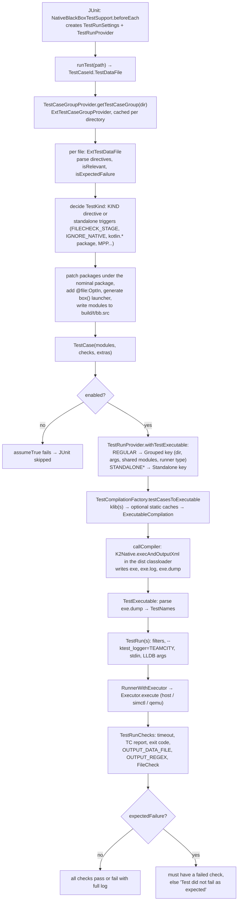
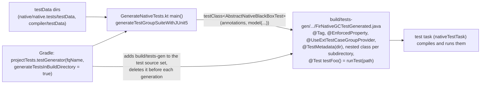

# Kotlin/Native: the compiler test infrastructure from the inside

The Kotlin/Native integration tests do not run the compiler from the test classpath: they load the compiler from a built
distribution (`kotlin-native/dist`), turn test data files into Kotlin modules, group compatible tests into one executable, compile
them through the real `K2Native` CLI entry point, run the binary through a target-specific executor (host process, Xcode
simulator, QEMU, XCTest) and check the result against directives in the test file. This page explains how that machinery is
built — the settings hierarchy, how a `-Pkn.*` property becomes a compiler flag, how test cases are grouped and cached, what the
compiler itself contributes (the test runner lowering and the test dump), how `IGNORE_NATIVE`/`DISABLE_NATIVE` are evaluated, how
FileCheck and cache modes are realized, how test classes are generated, and what the other test families (test-infrastructure-based
tests, runtime gtests, compiler unit tests) share with it. The *usage* view (which Gradle task, which property, which tag) is in
[HACKING.md#testing](../../kotlin-native/HACKING.md#testing) and [native/native.tests/README.md](../../native/native.tests/README.md);
this page does not repeat it.

Read this when: a test fails for an infrastructure reason ("Test did not fail as expected", "No tests have been found", a wrong
executor, a stale cache), you need to add a test kind or a directive, you want to know exactly which compiler command a test ran,
or you need to run the compiler tests in a configuration the documentation does not list.

Related pages: [debugging.md](debugging.md) (symptom → test to run), [caches.md](caches.md) (what the cache modes exercise),
[second-stage-pipeline.md](second-stage-pipeline.md) (where the test-runner lowerings sit), [gc.md](gc.md#tests) and
[allocator.md](allocator.md) (runtime gtests), [tooling-integration.md](tooling-integration.md#tests).

Paths below use `TF` = [`native/native.tests/testFixtures/org/jetbrains/kotlin/konan/test/blackbox`](../../native/native.tests/testFixtures/org/jetbrains/kotlin/konan/test/blackbox)
and `SUPPORT` = `TF/support`.

## Key concepts

| Term | Meaning | Source |
|------|---------|--------|
| Test data file | One `.kt` under a test root; may declare several `// MODULE:`/`// FILE:` sections. Its directory is the natural grouping unit. | [TestCase.kt](../../native/native.tests/testFixtures/org/jetbrains/kotlin/konan/test/blackbox/support/TestCase.kt) `TestCaseId.TestDataFile` |
| `TestCase` | One test data file after preprocessing: a set of `TestModule.Exclusive`, a `TestKind`, free compiler args, the nominal package name, `TestRunChecks`, `Extras`, `expectedFailure`. | [TestCase.kt](../../native/native.tests/testFixtures/org/jetbrains/kotlin/konan/test/blackbox/support/TestCase.kt) |
| `TestModule` | `Exclusive` (belongs to one test case), `Shared` (a support module reused by many tests, compiled once to a klib), `Given` (an external klib, e.g. `-Pkn.customKlibs`). | same |
| `TestKind` | `REGULAR` (joins a shared executable, needs `@kotlin.test.Test`), `STANDALONE` (own executable, test runner), `STANDALONE_NO_TR` (own executable, `main`), `STANDALONE_LLDB`, `STANDALONE_STEPPING`. | [TestDirectives.kt](../../native/native.tests/testFixtures/org/jetbrains/kotlin/konan/test/blackbox/support/TestDirectives.kt) |
| `TestCaseGroup` | All test cases of one test data directory (or one `MetaGroup` per test root in eager mode); `getRegularOnly(args, sharedModules, runnerType)` selects what can share one executable. | [TestCase.kt](../../native/native.tests/testFixtures/org/jetbrains/kotlin/konan/test/blackbox/support/TestCase.kt) |
| Nominal package name | A package derived from the test data path (`codegen/box/foo/bar.kt` → `codegen.box.foo.bar`); regular tests are re-packaged under it so they can coexist in one binary and be selected with `--ktest_filter=<pkg>.*`. | [PackageNames.kt](../../native/native.tests/testFixtures/org/jetbrains/kotlin/konan/test/blackbox/support/util/PackageNames.kt) `computePackageName` |
| `TestCompilation` | A lazily executed compiler/cinterop/swiftc invocation producing a `TestCompilationArtifact` (`KLIB`, `KLIBStaticCache`, `Executable`, `ObjCFramework`, `BinaryLibrary`, `XCTestBundle`); results are cached per key in `TestCompilationFactory`. | [TestCompilation.kt](../../native/native.tests/testFixtures/org/jetbrains/kotlin/konan/test/blackbox/support/compilation/TestCompilation.kt), [TestCompilationFactory.kt](../../native/native.tests/testFixtures/org/jetbrains/kotlin/konan/test/blackbox/support/compilation/TestCompilationFactory.kt) |
| Test dump file | `<exe>.dump`, written by the compiler (`-Xdump-tests-to=`) with one `pkg.Suite:function` line per registered test (see `testData/infrastructure/testListing/expected-test-listing.dump`); the infrastructure reads it to know which JUnit dynamic tests to create. | [TestsDumper.kt](../../kotlin-native/backend.native/compiler/ir/backend.native/src/org/jetbrains/kotlin/backend/konan/lower/TestsDumper.kt), [TestListing.kt](../../native/native.tests/testFixtures/org/jetbrains/kotlin/konan/test/blackbox/support/util/TestListing.kt) |
| `TestRun` | One execution of one `TestExecutable` with `TestRunParameter`s (filters, TC logger, stdin, LLDB commands) and `TestRunChecks`. | [TestRun.kt](../../native/native.tests/testFixtures/org/jetbrains/kotlin/konan/test/blackbox/support/runner/TestRun.kt) |
| `Executor` | Runs a binary for the test target: `HostExecutor`, `XcodeSimulatorExecutor`, `EmulatorExecutor`, `RosettaExecutor`, XCTest executors, `NoOpExecutor`. | [native/executors](../../native/executors/src/main/kotlin/org/jetbrains/kotlin/native/executors) |
| `Settings` | A typed, class-keyed map with a parent: process → class → run. | [SettingsContainers.kt](../../native/native.tests/testFixtures/org/jetbrains/kotlin/konan/test/blackbox/support/settings/SettingsContainers.kt) |
| TC logger | The `--ktest_logger=TEAMCITY` output format of the in-binary test runner; parsed back by `TCTestOutputFilter` into passed/failed/ignored sets. | [TestOutput.kt](../../native/native.tests/testFixtures/org/jetbrains/kotlin/konan/test/blackbox/support/util/TestOutput.kt) |

## The test families

| Family | Base class / entry | What it compiles and checks | Where |
|--------|--------------------|-----------------------------|-------|
| Blackbox (test-data driven) | `AbstractNativeBlackBoxTest` + a `@TestConfiguration` provider (`@UseExtTestCaseGroupProvider`, `@PredefinedTestCases`) | Directories of `.kt` files → grouped executables → run + directive checks. Used for `compiler/testData/codegen/{box,boxInline}` (`codegen-box` project), `native/native.tests/testData/{codegen,standalone,gc,lldb,samples}`, `compiler/testData/debug/stepping`. | [AbstractNativeBlackBoxTest.kt](../../native/native.tests/testFixtures/org/jetbrains/kotlin/konan/test/blackbox/AbstractNativeBlackBoxTest.kt), [GenerateNativeTests.kt](../../native/native.tests/testFixtures/org/jetbrains/kotlin/generators/tests/GenerateNativeTests.kt) |
| Simple (hand-written) | `AbstractNativeSimpleTest` + helpers in `NativeSimpleTestUtils.kt` (`compileToLibrary`, `cinteropToLibrary`, `compileToExecutableInOneStage`, `generateTestCaseWithSingleFile`, …) | A test method builds its own `TestCase`s and compilations; reuses the same settings, compilation and runner layers but no grouping (`SimpleTestRunProvider` rejects `REGULAR`). cinterop goldens, ObjC export goldens, C export, caches, IC, klib tests, `StdlibTest`. | [AbstractNativeSimpleTest.kt](../../native/native.tests/testFixtures/org/jetbrains/kotlin/konan/test/blackbox/AbstractNativeSimpleTest.kt), [NativeSimpleTestUtils.kt](../../native/native.tests/testFixtures/org/jetbrains/kotlin/konan/test/blackbox/NativeSimpleTestUtils.kt) |
| Compiler-invocation | `AbstractNativeCompilerInvocationTest` → `AbstractNativePartialLinkageTest`, klib compatibility | Shared klib test structure (`KlibCompilerInvocationTestUtils`) with a Native `ArtifactBuilder` that builds klibs, optional static caches and the final binary from `TestCase`s. | [AbstractNativeCompilerInvocationTest.kt](../../native/native.tests/testFixtures/org/jetbrains/kotlin/konan/test/blackbox/AbstractNativeCompilerInvocationTest.kt), [AbstractNativePartialLinkageTest.kt](../../native/native.tests/testFixtures/org/jetbrains/kotlin/konan/test/blackbox/AbstractNativePartialLinkageTest.kt) |
| `compiler/test-infrastructure`-based | `AbstractKotlinCompilerTest` configured with Native facades: `FirCliNativeFacade`, `Fir2IrCliNativeFacade`, `NativePreSerializationLoweringCliFacade`, `KlibSerializerNativeCliFacade`, `NativeCompilerSecondStageFacade` | Diagnostics (`compiler/testData/diagnostics/{nativeTests,klibSerializationTests,…}`), irText, klib dumps, synthetic accessors, and a second implementation of codegen-box (`NativeCodegenBoxTestGenerated`) with batched second-stage compilation. Lives in `:native:native.tests:klib-ir-inliner`. | [NativeCliBasedFacades.kt](../../native/native.tests/testFixtures/org/jetbrains/kotlin/konan/test/NativeCliBasedFacades.kt), [AbstractDiagnosticsNativeTest.kt](../../native/native.tests/klib-ir-inliner/testFixtures/org/jetbrains/kotlin/konan/test/diagnostics/AbstractDiagnosticsNativeTest.kt), [AbstractNativeCodegenBoxCoreTest.kt](../../native/native.tests/klib-ir-inliner/testFixtures/org/jetbrains/kotlin/konan/test/blackbox/AbstractNativeCodegenBoxCoreTest.kt) |
| Runtime gtests | `testsGroup("…")` in `runtime/build.gradle.kts` → `RunGTest` tasks | C++ googletest binaries linked from runtime bitcode modules. `:kotlin-native:runtime:hostRuntimeTests`. | [CompileToBitcodePlugin.kt](../../kotlin-native/build-tools/src/main/kotlin/org/jetbrains/kotlin/bitcode/CompileToBitcodePlugin.kt) `testsGroup`, [RunGTest.kt](../../kotlin-native/build-tools/src/main/kotlin/org/jetbrains/kotlin/cpp/RunGTest.kt) |
| Compiler unit tests | plain JUnit 5 in `kotlin-native/backend.native/compiler/ir/backend.native/test` | No distribution needed: `NativeLoweringPrerequisitesTest`, `CustomBitSetTest`, `FunctionalInterfaceClassSortingTest`. `:kotlin-native:backend.native:check`. | [build.gradle.kts](../../kotlin-native/backend.native/compiler/ir/backend.native/build.gradle.kts) `projectTests { testTask() }` |

Everything in the first four rows shares `SUPPORT/settings`, `SUPPORT/compilation` and `SUPPORT/runner`; the rest of this page
describes those layers through the blackbox family and then says what the others do differently.

## From Gradle property to compiler flag

The chain has four hops: a Gradle property, a JVM system property on the test worker, a setting object in a `Settings` container,
and a compiler argument added by `BasicCompilation.applyCommonArgs`. The diagram shows it as implemented in
[nativeTest.kt](../../repo/gradle-build-conventions/project-tests-convention/src/main/kotlin/nativeTest.kt),
[ConfigurationProperties.kt](../../native/native.tests/testFixtures/org/jetbrains/kotlin/konan/test/blackbox/support/ConfigurationProperties.kt),
[NativeTestSupport.kt](../../native/native.tests/testFixtures/org/jetbrains/kotlin/konan/test/blackbox/support/NativeTestSupport.kt) and
[TestCompilation.kt](../../native/native.tests/testFixtures/org/jetbrains/kotlin/konan/test/blackbox/support/compilation/TestCompilation.kt):

```mermaid
flowchart LR
  P["-Pkn.optimizationMode=OPT<br/>(alias of -Pkotlin.internal.native.test.optimizationMode)"] --> NA["NativeArgsProvider.asArguments()<br/>nativeTest.kt"]
  NA -->|"-Dkotlin.internal.native.test.optimizationMode=OPT"| SP["JVM system property<br/>of the Gradle test worker"]
  SP --> CLP["ClassLevelProperty.OPTIMIZATION_MODE.readValue()<br/>EnforcedProperty on the class wins"]
  CLP --> S["OptimizationMode.OPT<br/>in TestClassSettings"]
  S --> AC["BasicCompilation.applyCommonArgs()"]
  AC -->|"-opt"| CLI["K2Native.execAndOutputXml(args)"]
  D["-Pkn.nativeHome (or :kotlin-native:dist task)"] --> NA
  NA -->|"-Dkotlin.internal.native.test.nativeHome, .compilerClasspath"| PS["TestProcessSettings:<br/>KotlinNativeHome, KotlinNativeClassLoader"]
  PS --> AC
```

**Hop 1 — Gradle.** `nativeTestTask(name, tag, requirePlatformLibs, …)` in `nativeTest.kt` registers a JUnit Platform `Test` task.
`ProviderFactory.testProperty` reads `kotlin.internal.native.test.<short>` and falls back to `kn.<short>`; the `-Pkn.` prefix is
nothing more than this alias. `NativeArgsProvider` turns each property into a `-D` system property (so each one is a tracked
Gradle input and changes invalidate the task). Two properties are special: `forceStandalone=true` is rewritten to
`testKind=STANDALONE`, and `nativeHome` decides the distribution. Without it the task depends on `:kotlin-native:dist` (or
`:kotlin-native:<target>CrossDist` when `target` is set) plus `distPlatformLibs`/`<target>PlatformLibs` when the task declares
`requirePlatformLibs = true` or XCTest is on; the compiler classpath then comes from
`:kotlin-native:prepare:kotlin-native-compiler-embeddable`. With `-Pkn.nativeHome=<dir>` the classpath is
`<dir>/konan/lib/kotlin-native-compiler-embeddable.jar` and nothing is rebuilt. The task also exports `GRADLE_TASK_NAME`,
`PROJECT_BUILD_DIR` (read as `EnvironmentVariable` in `ConfigurationProperties.kt`), sets `LIBCLANG_DISABLE_CRASH_RECOVERY=1`,
`-Xss2m`, Parallel GC, and `includeTags("(<tag>)&(<kotlin.native.tests.tags>)")`. Each `nativeTestTask("gcTest", "gc")` call in
[native.tests/build.gradle.kts](../../native/native.tests/build.gradle.kts) is therefore just the default `test` task with a tag filter.

**Hop 2 — reading.** `ProcessLevelProperty` (`nativeHome`, `compilerClasspath`, `teamcity`, `customNativeHome`, `minidumpAnalyzer`,
`useProvisionedXcode`) are mandatory and read once per JVM. `ClassLevelProperty` values are read per *enclosing* test class and can
be overridden by `@EnforcedProperty(property, value)` on the generated class (`@EnforcedHostTarget` additionally forces
`target=<host>` and clears `binaryOptions`); `@AcceptablePropertyValues` ignores a system property outside an allowed set. Unknown
enum values fail with a list of the allowed ones.

**Hop 3 — settings.** `NativeTestSupport.addCommonTestClassSettingsTo` builds the `TestClassSettings` once per enclosing class and
caches it in the JUnit `ExtensionContext` store; `TestRunSettings` is created per test method (not cached) and adds the test
instances, the `ExternalSourceTransformersProvider` and default `RegisteredDirectives`. `Settings.get<T>()` walks up the parent
chain and fails on a missing setting, so a class that needs e.g. `TestRoots` must say so in its provider's
`@TestConfiguration(requiredSettings = [...])`.

| `-Pkn.*` | Setting (`SUPPORT/settings/TestProcessSettings.kt`) | Default | Compiler effect (`applyCommonArgs`, `applyDependencies`) |
|---|---|---|---|
| `nativeHome`, `compilerClasspath` | `KotlinNativeHome`, `KotlinNativeClassLoader` | `kotlin-native/dist`, embeddable jar | `-kotlin-home <dir>`; the compiler classes are loaded by a `URLClassLoader(classpath, parent = null)` |
| `target` | `KotlinNativeTargets(testTarget, hostTarget)` | host | `-target <name>`; chooses the executor and `cacheableTargets` lookup |
| `optimizationMode` | `OptimizationMode` | `DEBUG` | `-g` / `-opt` / nothing; `OPT` also disables assertions and the default cache mode |
| `mode` | `TestMode` | `TWO_STAGE_MULTI_MODULE` | one-stage: sources → program; two-stage: sources → klib, then `-Xinclude=<klib>` → program |
| `testKind` / `forceStandalone` | `TestKind` | `REGULAR` | the default when the file has no `// KIND:` |
| `compileOnly` | `ForcedNoopTestRunner` | `false` | `NoopTestRunner` and `NoOpExecutor`: compile, never run |
| `useThreadStateChecker` | `ThreadStateChecker` | `DISABLED` | `-Xbinary=checkStateAtExternalCalls=true`; asserted to need `DEBUG` |
| `sanitizer` | `Sanitizer` | `NONE` | `-Xbinary=sanitizer=thread` |
| `gcType` | `GCType` | `GC.CONCURRENT_MARK_AND_SWEEP` | `-Xbinary=gc=<enum name lowercased>`; the property value is the GC *shortcut* (`cms`, `pmcs`, `stwms`, `noop`, case-insensitive) |
| `gcScheduler` | `GCScheduler` | `null` (unspecified) | `-Xbinary=gcSchedulerType=…`; `AGGRESSIVE` doubles `Timeouts` |
| `alloc`, `pagedAllocator` | `Allocator` | `UNSPECIFIED` | `-Xbinary=pagedAllocator=…` or the legacy `-Xallocator=std|custom` (KT-75914); both at once is an error |
| `binaryOptions` | `ExplicitBinaryOptions` | empty | each `-Xbinary=k=v`; `runtimeAssertionsMode=panic` is added when assertions are on unless given explicitly; `smallBinary=true` is dropped in `DEBUG` |
| `cacheMode` | `CacheMode` | see [Cache modes](#cache-modes) | `-Xauto-cache-from=<dist>/klib`, `-Xbackend-threads=1`, `-Xbinary=enableReleaseBinaryCache=true`, `-Xcache-directory=…` |
| `executionTimeout` | `Timeouts` | `10.minutes` | run timeout per `TestRun` |
| `sharedTestExecution`, `eagerGroupCreation` | `SharedExecutionTestRunner`, `TestGroupCreation` | `false` | see [Grouping](#step-3--grouping-and-compilation-caching) |
| `xctest` | `XCTestRunner` | `false` | `-produce test_bundle`, XCTest executors; implies platform libs |
| `dependOnPlatformLibs` (set by Gradle from `requirePlatformLibs`/`xctest`) | `PlatformLibs` | `NO_DEFAULT_LIBS` | `-no-default-libs` unless the test says `// WITH_PLATFORM_LIBS` |
| `compilerPlugins`, `customKlibs` | `CompilerPlugins`, `CustomKlibs` | empty | `-Xplugin=…`; given klibs become `TestModule.Given` dependencies of every module |

Always added regardless of properties: `-Xverify-ir=error -Xphases-to-validate-after=all` (XCTest bundles: `warning`),
`-Xallow-kotlin-package`, `-Xllvm-variant=dev` (the dev LLVM has `FileCheck`), `-enable-assertions` when assertions are on, and for
final binaries `-Xbinary=minidumpLocation=<artifact dir>` (+ `minidumpOnSIGTERM=true` on macOS) so crashes leave a minidump that
`RunnerWithExecutor` symbolicates with `minidump-analyzer` into stderr. The `Settings.configurables` accessor rebuilds a
`Distribution` with `llvmHome.<host>` overridden to `$llvm.<host>.dev` for the same reason.

**Hop 4 — the command line.** `BasicCompilation.getCompilerArgs()` concatenates `applyCommonArgs`, the subclass's
`applySpecificArgs` (`-produce`, `-output`, test-runner flags, `-entry`, PL log level, FileCheck flags), `applyDependencies`
(`-friend-modules`, `-Xinclude=`, `-l`, cache directories), the test's free args (with `-Xstatic-framework` and
`-Xemit-lazy-objc-header=` filtered out of the stages they do not apply to), `-Xplugin`, `-module-name` (only for standalone kinds
with a single main module) and finally the source paths. The exact list is written to `<artifact>.log` as `COMPILER ARGUMENTS:`
by [LoggedData.kt](../../native/native.tests/testFixtures/org/jetbrains/kotlin/konan/test/blackbox/support/LoggedData.kt)
(`CompilerParameters`), prefixed with `<dist>/bin/kotlinc-native` so it can be pasted into a shell, followed by the captured
environment, the exit code and the raw compiler output. Stdout/stderr of a test run are truncated to `MAX_PRINTED_OUTPUT_LENGTH =
8 * 1024` characters in failure messages; compiler output is never truncated.

## The life of one blackbox test

The flow for one `@Test fun testFoo() = runTest("…/foo.kt")` (or the `@TestFactory` variant `dynamicTest`), as implemented across
`AbstractNativeBlackBoxTest`, `NativeTestSupport`, `ExtTestCaseGroupProvider`, `TestRunProvider`, `TestCompilationFactory`,
`RunnerWithExecutor` and `ResultHandler`:

### Step 1 — JUnit wiring and the settings hierarchy

`AbstractNativeBlackBoxTest` is annotated `@ExtendWith(NativeBlackBoxTestSupport::class)`. The extension works in `beforeEach`
(not `beforeAll`) because the generated suites use nested classes and only `beforeEach` can see all instances. It stores
`TestProcessSettings` (once per JVM: home, classloader, `BaseDirs`, `LLDB`, `CustomNativeCompiler`), `TestClassSettings` and the
`TestRunProvider` in the JUnit root store keyed by the enclosing class name. `TestRunProvider` owns the `TestCaseGroupProvider`
and a `TestCompilationFactory`, so compilation results are shared by all test methods of one generated class but never across
classes. Output directories are per class and per target: sources in `build/t/bb.src/<target>_<class>/`, binaries in
`build/t/bb.out/<target>_<class>/` (simple tests: `build/t/s/<target>_<classes>/<method>/`), and they are wiped when the class
settings are created (`ensureExistsAndIsEmptyDirectory`). Artifact names are `<compressed package>.kexe` for one test case and
`NNNN-<common package>-<hash>.kexe` for a group (`NNNN` = number of files), with `<name>.log` and `<name>.dump` next to it.

The provider class comes from a `@TestConfiguration` meta-annotation found on the generated class or one of its nested classes
(`computeTestConfiguration`); the provider is instantiated by reflection with the annotation instance as its only constructor
argument. `-Pkn.eagerGroupCreation=true` silently swaps `ExtTestCaseGroupProvider` for `EagerExtTestCaseGroupProvider`.

### Step 2 — from a test data file to a `TestCase`

`ExtTestCaseGroupProvider.getTestCaseGroup` is called with the test data *directory* and processes every `.kt` in it at once, so
the first test of a directory pays for all of them (and so grouping can see its siblings). Per file, `ExtTestDataFile` does:

1. **Structure.** `TestFiles.createTestFiles` from the common infrastructure splits `// MODULE:` / `// FILE:` sections and parses
   directives from `TestDirectives`, `ConfigurationDirectives`, `LanguageSettingsDirectives`, `CodegenTestDirectives`,
   `AdditionalFilesDirectives`. Module-level directives (`EXPORT_TO_SWIFT`, `SWIFT_EXPORT_CONFIG`, `HIDE_FROM_SWIFT_EXPORT`) are
   recorded on the module, everything else globally. A module named `support` becomes a `TestModule.Shared` named
   `support_<hash of its files>` compiled once per hash into `bb.out/<class>/__shared_modules__`; `CoroutineUtil.kt` is routed there
   automatically. Each non-support file is parsed into a PSI `KtFile` with a private `KtPsiFactory` (`METADATA_CONFIG_FILES`
   environment) so that packages can be rewritten structurally. Mandatory source transformer: `DiagnosticsRemovingSourceTransformer`
   strips `<!DIAG!>…<!>` markup; `AbstractNativeCodegenBoxTest` adds the `WORKS_WHEN_VALUE_CLASS`/`@JvmInline` transformer and
   `BACKEND_UNDER_TEST → "NATIVE"`.
2. **Relevance** (`isRelevant`): `TARGET_BACKEND`/`DONT_TARGET_EXACT_BACKEND` must admit `NATIVE`; no matching `DISABLE_NATIVE`;
   none of `FULL_JDK`, `JVM_TARGET`, `DIAGNOSTICS`; no `API_VERSION: 1.4` / `LANGUAGE_VERSION: 1.3|1.4`; not a FileCheck test under a
   cache mode that caches user libraries; not an MPP test in `ONE_STAGE_MULTI_MODULE`; every embedded `.def` supported on the
   target. Irrelevant files become disabled test case ids → `assumeTrue` → JUnit "skipped".
3. **Kind.** `// KIND:` wins; otherwise the class default (`TestKind` setting). A `REGULAR` test is promoted to `STANDALONE` when
   `determineIfStandaloneTest` says so: `NATIVE_STANDALONE`, `FILECHECK_STAGE`, `ASSERTIONS_MODE`, any `IGNORE_NATIVE` (comment: "to
   make the debug of possible failed testruns easier"), an expected failure from `IGNORE_BACKEND*`, `+MultiPlatformProjects`
   (commit `f9ea353b60af`: K2 MPP needs exactly one leaf platform module, which grouping would break), or any file in a `kotlin.*`
   package (packages there cannot be patched without signature clashes).
4. **Patching.** Non-standalone tests get every package `p` rewritten to `<nominal>.p` (`BatchingPackageInserter.PackageNamePatcher`,
   shared with the JVM batching infrastructure), `@file:OptIn(...)` for each `OPT_IN` except the ones that must go to the compiler
   (`kotlin.native.SymbolNameIsInternal`, `kotlin.RequiresOptIn`), and, if a `fun box()` exists, a generated launcher file
   (`generateBoxFunctionLauncher`) that wraps it in a `@kotlin.test.Test` so the shared test runner can call it; stepping tests get a
   `main` instead. The module containing `box` is marked main; `addFileToMainModule` fails if there is not exactly one.
5. **Compiler args** (`assembleFreeCompilerArgs`): class-default directives + `FREE_COMPILER_ARGS` + `-XXLanguage:` for every
   `LANGUAGE` entry (plus `+IrIntraModuleInlinerBeforeKlibSerialization`/`+IrCrossModuleInlinerBeforeKlibSerialization`, always on
   per KT-81022) + `-opt-in=` for compiler-only opt-ins + `-Xdisable-ir-checkers=`/`-Xadditional-ir-checkers=` derived from the
   shared `CodegenTestDirectives` + `-opt-in=kotlin.native.internal.InternalForKotlinNative` + `-no-default-libs` (unless platform libs
   are required or `WITH_PLATFORM_LIBS`) + `-Xreturn-value-checker=` + `-Xbinary=preCodegenInlineThreshold=0` for FileCheck tests
   (commit `1c56325df9ee`, KT-84000: "very hard to make them work when every function might be inlined and DCEd afterwards").
   `FREE_CINTEROP_ARGS` are split on spaces with `$generatedSourcesDir` substituted. `TestCompilerArgs` equality ignores order and
   duplicates, which is what makes two files with the same args groupable.
6. **Checks and extras** (`doCreateTestCase`): `OUTPUT_DATA_FILE`, `OUTPUT_REGEX` (all regexes must match the whole output,
   `DOT_MATCHES_ALL`), `EXIT_CODE` (only honoured for `STANDALONE_NO_TR`; others expect 0), `EXPECTED_TIMEOUT_FAILURE`,
   `INPUT_DATA_FILE`, `PROGRAM_ARGS`, `ENTRY_POINT`, `TEST_RUNNER`, FileCheck. LLDB kinds get the `lldb` command line built here
   (`--no-lldbinit -b -o "settings set …" -o "command script import konan_lldb.py" …` plus the lines of the input data file) and the
   output whitespace normalized (`normalizeLldbWhitespace`). LLDB test cases are disabled as a group when the mode is not `DEBUG`,
   `lldb -version` fails, or the target is not the host.
7. `TestCase.initialize` writes the files to disk, resolves `MODULE: a(b)(c)` dependency symbols (friends must also be dependencies;
   `dependsOn` for MPP fragments), and adds every `TestModule.Given` as a regular dependency of every module.

### Step 3 — grouping and compilation caching

`TestRunProvider.withTestExecutable` picks the compilation cache key:

- `STANDALONE*`: `Standalone(testCaseId)` — one executable per test case.
- `REGULAR`: `Grouped(groupId, freeCompilerArgs, sharedModules, runnerType)` and
  `testCaseGroup.getRegularOnly(...)` collects every regular test case of the directory with identical args, shared modules and
  `TEST_RUNNER` type. All of them are compiled into one executable the first time any of them is requested; the others find the
  `TestCompilation` in `cachedCompilations`. Nothing bounds the group size except the directory.

With `-Pkn.eagerGroupCreation=true` the group id becomes the *test root* (`TestCaseGroup.MetaGroup` over all directories, commit
`3cc117336a8a`), so a whole `codegen/box` tree with equal args shares one binary; because JUnit instances do not exist yet during
eager walking, the eager provider keeps its own copy of the codegen source transformers (`NativeCodegenSourceTransformers`) that
must be kept in sync with `AbstractNativeCodegenBoxTest` by hand.

`TestCompilationFactory` is a second cache layer keyed by *modules*: `KlibCacheKey(sourceModules, args, useHeaders)`,
`ExecutableCacheKey(rootModules)`, and so on. `testCasesToExecutable` takes the union of the test cases' root modules (modules with
no incoming edge), asserts that FileCheck tests are alone, and then, depending on `TestMode`:

| | `ONE_STAGE_MULTI_MODULE` | `TWO_STAGE_MULTI_MODULE` (default) |
|---|---|---|
| Dependencies (`MODULE: a(b)` → `b`) | each compiled to a klib (`LibraryCompilation`, `-produce library`), optionally a static cache | same |
| Root modules | passed as sources to `ExecutableCompilation` (`-produce program`) with `-l <dep>` | compiled to one klib first (`modulesToKlib(rootModules)`), optionally a static cache, then `ExecutableCompilation` with **no sources** and `-Xinclude=<klib>` |
| What it exercises | source → binary in one driver run | the klib ABI round trip and the `-Xinclude` path KGP uses |

A module whose files are a `.def` (+ `.c/.cpp/.m/.mm`) is compiled by `CInteropCompilation` instead: C sources are first built with
clang into a static library (`compileWithClangToStaticLibrary`), then `Interop.interopViaReflection("native", args, …)` runs in the
dist classloader with `-def`, `-target`, `-no-default-libs`, `-libraryPath/-staticLibrary`, and a per-artifact `-fmodules-cache-path`
(KT-68254, KT-85815). Its stdout is not captured (a TODO in `invokeCInterop`); failures come back as a `Throwable` result.

Compilation itself is `BasicCompilation.result`, a `lazy` that first checks `CategorizedDependencies.failures` (a failed dependency
short-circuits into `DependencyFailures` without calling the compiler) and then `doCompile()`. `callCompiler` loads
`org.jetbrains.kotlin.cli.bc.K2Native` from the dist classloader and calls `execAndOutputXml(PrintStream, Services, args)`
reflectively; the XML message stream is replayed through `NativeTestGroupingMessageCollector` + `PrintingMessageCollector` so that
`toolOutputHasErrors` is known even when the exit code is `OK`. The classloader has **no parent** on purpose (comment in
`computeNativeClassLoader`: with a parent, `K2Native` and `CLICompiler` would be loaded by different loaders and
`doExecute` would throw `AbstractMethodError`); `CastCompatibleKotlinNativeClassLoader` with the application parent exists only for
irText tests that need to cast a mangler across loaders. The class-level property `compilerOutputInterceptor=NONE` (not forwarded
by `nativeTest.kt`; only reachable through `@EnforcedProperty` or a raw `-D`) switches to `execFullPathsInMessages` and approximates
errors by exit code.

### Step 4 — what the compiler contributes: the test runner and the dump

For `REGULAR`/`STANDALONE` kinds `ExecutableCompilation.applyTestRunnerSpecificArgs` adds `-generate-test-runner` (or
`-generate-no-exit-test-runner` for `// TEST_RUNNER: NO_EXIT`) and `-Xdump-tests-to=<exe>.dump`. In the compiler:

- `SetupConfiguration.kt` maps `-tr`/`-trw`/`-trn` to `TestRunnerKind.MAIN_THREAD | WORKER | MAIN_THREAD_NO_EXIT`
  ([SetupConfiguration.kt](../../kotlin-native/backend.native/compiler/ir/backend.native/src/org/jetbrains/kotlin/backend/konan/SetupConfiguration.kt)).
  The entry point then becomes `kotlin.native.internal.test.main | worker | mainNoExit`
  ([Ir.kt](../../compiler/ir/backend.native/src/org/jetbrains/kotlin/backend/konan/ir/Ir.kt) `entryPoint`), defined in the stdlib
  [Launcher.kt](../../kotlin-native/runtime/src/main/kotlin/kotlin/native/internal/test/Launcher.kt): `main` exits with the runner's
  code, `mainNoExit` ignores it, `worker` runs the tests on a `Worker`.
- [TestProcessor.kt](../../compiler/ir/backend.native/src/org/jetbrains/kotlin/backend/konan/lower/TestProcessor.kt) is the first
  file lowering of the second stage (`getLoweringsUpToAndIncludingSyntheticAccessors` in
  [NativeLoweringPhases.kt](../../kotlin-native/backend.native/compiler/ir/backend.native/src/org/jetbrains/kotlin/backend/konan/driver/phases/NativeLoweringPhases.kt)).
  Per file it collects functions annotated `kotlin.test.Test|BeforeTest|AfterTest|BeforeClass|AfterClass` (+ `kotlin.test.Ignore`),
  synthesizes a `ClassTestSuite` subclass per test class and a `TopLevelSuite` per file (`<FileKt>` suite name), emits
  `registerTestCase(name, fn, ignored)` calls, and puts them into a synthetic `createTestSuites` function annotated with
  `@TestInitializer`. Only files of `sourcesModules` are processed, which is why with `-Xinclude` the tests of the included klib are
  registered while those of `-l` libraries are not (and why `KonanDriver` warns "Use `-Xinclude=<path-to-klib>` to pass libraries that
  contain tests" when a program is built from libraries with a runner but without `-Xinclude`).
- After inlining, [TestsInitializer.kt](../../kotlin-native/backend.native/compiler/ir/backend.native/src/org/jetbrains/kotlin/backend/konan/lower/TestsInitializer.kt)
  turns that function into a `@EagerInitialization @ThreadLocal` top-level field, so suite registration runs at startup; the file
  comment explains why a field cannot be created in the first pass (IR serialization signature validation, and eager properties in
  dependencies would run dependency tests). [TestsDumper.kt](../../kotlin-native/backend.native/compiler/ir/backend.native/src/org/jetbrains/kotlin/backend/konan/lower/TestsDumper.kt)
  then reads those initializers back and *appends* `suite:function` lines to `testDumpFile` (`NativeSecondStageCompilationConfig.testDumpFile`).
- With static caches for user libraries, the included klib's cache is where the runner is generated:
  [CacheBuilder.kt](../../kotlin-native/backend.native/compiler/ir/backend.native/src/org/jetbrains/kotlin/backend/konan/CacheBuilder.kt)
  sets `generateTestRunner`, `konanIncludedLibraries` and `testDumpOutputPath` for a library that is in `includedLibraries`, excludes
  it from batch cache builds, and the test infrastructure correspondingly passes `-Xdump-tests-to` to the `StaticCacheCompilation`
  (`Options.ForIncludedLibraryWithTests`) and **not** to the executable compilation (`testDumpFile = null` when there are no sources,
  an included library and `useStaticCacheForUserLibraries`).

At run time the stdlib [TestRunner.kt](../../kotlin-native/runtime/src/main/kotlin/kotlin/native/internal/test/TestRunner.kt)
parses `--ktest_*`/`--gtest_*` arguments: `--ktest_filter=POS[-NEG]` (gtest glob syntax, `:`-separated; `fromGTestPattern` is
duplicated in [TestRun.kt](../../native/native.tests/testFixtures/org/jetbrains/kotlin/konan/test/blackbox/support/runner/TestRun.kt)
and must stay in sync), `--ktest_regex_filter`, `--ktest_gradle_filter`, `--ktest_repeat`, `--ktest_list_tests`,
`--ktest_logger=GTEST|TEAMCITY|SIMPLE|SILENT`, `--ktest_no_exit_code`. The infrastructure always passes
`--ktest_logger=TEAMCITY --ktest_no_exit_code` (`TestRunParameter.WithTCTestLogger`) so that the binary's exit code is 0 even when
tests fail and the verdict comes from parsing `##teamcity[...]` service messages.

### Step 5 — running

`TestExecutable.fromCompilationResult` reads `<exe>.dump` (`DumpedTestListing.parse`; the actual format is dotted,
`pkg.Suite:function`, and `TestName` splits the suite into package and file-facade class with the `isPackagePartClassName`
heuristic — the `pkg/Suite` example in the parser's KDoc is stale) into `TestName`s; a missing or unparsable dump fails the test with
the compiler log attached. `getTestRuns` (dynamic tests) then creates one
`TestRun` per test name that belongs to the test case (`filterIrrelevant`: package starts with the nominal package), each with
`--ktest_filter=<fqn>`; `getSingleTestRun` (`@Test` style) creates one run with `--ktest_filter=<nominal package>.*` for `REGULAR`
or no filter for `STANDALONE`. The JUnit tree is flattened to one level because Gradle/TeamCity cannot render nested dynamic
containers (comment in `buildJUnitDynamicNodes`).

`TestRunners.createProperTestRunner` chooses `NoopTestRunner` (`compileOnly`), `SharedExecutionBuilder` (`sharedTestExecution`:
run the grouped executable once without filters, cache the `RunResult`, and let each test case's `ResultHandler` evaluate its
own slice; test cases with expected failures, expected timeouts or output matchers are excluded and run separately; timeout =
per-test timeout × number of tests), or `RunnerWithExecutor`. The latter builds an `ExecuteRequest` (working directory = the
artifact directory, stdin from `INPUT_DATA_FILE`, `GLOG_log_dir` for LLDB runs, `timeout` from the `ExecutionTimeout` check), runs
it through `Settings.testProcessExecutor` and wraps the result in a `RunResult` (`exitCode == null` means killed by timeout).
`AbstractRunner.run` retries the attempt `maxRetries` times (`WithRetriesOnFailure(1)` for LLDB kinds, KT-84923/KT-87414) but never
for `TestInfrastructureException`.

`testProcessExecutor` ([SettingsExecutor.kt](../../native/native.tests/testFixtures/org/jetbrains/kotlin/konan/test/blackbox/support/settings/SettingsExecutor.kt))
is cached per target: `NoOpExecutor` when `compileOnly`; `HostExecutor` for macabi and when target == host; XCTest executors when
`xctest`; `EmulatorExecutor` when the target's `Configurables` are `ConfigurablesWithEmulator` (QEMU from `konan.properties`
`emulatorExecutable.<host>-<target>`, run as `qemu-<arch> -L <sysroot> <exe> args…`); `XcodeSimulatorExecutor` for Apple simulator
triples (`xcrun simctl spawn --standalone <device> <exe>`, creating the device if needed, environment passed as `SIMCTL_CHILD_*`);
`RosettaExecutor` for x64 Apple binaries on arm64 hosts; otherwise "not supported yet". Device targets (e.g. `ios_arm64`) are
therefore compile-only unless XCTest + Firebase is configured.

### Step 6 — checks and the expected-failure protocol

`ResultHandler.handle` applies every `TestRunCheck` of the test case
([TestRunChecks.kt](../../native/native.tests/testFixtures/org/jetbrains/kotlin/konan/test/blackbox/support/runner/TestRunChecks.kt)):

| Check | Passes when |
|---|---|
| `ExecutionTimeout.ShouldNotExceed` / `ShouldExceed` | finished in time / did **not** finish in time (`EXPECTED_TIMEOUT_FAILURE`) |
| `TestFiltering(TCTestOutputFilter)` | the TC report parses, is non-empty, contains no failed test of this test case, and with a filter no *excessive* passed/ignored tests; if every test of the case is ignored and none passed, the JUnit test is *aborted* ("Test case is disabled") rather than failed |
| `ExitCode.Expected(n)` / `AnyNonZero` | matches; skipped when the exit code is unknown (timeout) |
| `OutputDataFile` | stdout (TC messages removed) + stderr equals the file (`doesEqualToFile`, so `-Pkotlin.test.update.test.data=true` rewrites it); the failure carries expected/actual for IDE diff |
| `OutputMatcher` | the `OUTPUT_REGEX` lambda (or the LLDB session spec) returns true; a `TestAbortedException` from inside propagates as a skip |
| `FileCheckMatcher` | see [FileCheck](#filecheck-tests) |

If `expectedFailure` is false any failed check fails the JUnit test with the whole `LoggedData` (compiler command, run arguments,
stdout/stderr). If it is true (`IGNORE_NATIVE` matched, or `IGNORE_BACKEND`/`IGNORE_BACKEND_K2` names `NATIVE`/`ANY`), the handler
requires **at least one** failed check and otherwise fails with "Test did not fail as expected" — so an ignored test that starts
passing is reported. Expected failures during *compilation* are handled one level up: `AbstractNativeBlackBoxTest.runTest` catches
`CompilationToolException`, re-parses the file and prints "There was an expected failure" when the directives say it is ignored.

## Directives

All Native-specific directives are declared in
[TestDirectives.kt](../../native/native.tests/testFixtures/org/jetbrains/kotlin/konan/test/blackbox/support/TestDirectives.kt);
the shared ones (`TARGET_BACKEND`, `IGNORE_BACKEND*`, `LANGUAGE`, `OPT_IN`, `API_VERSION`, `LANGUAGE_VERSION`, `WITH_STDLIB`,
`DIAGNOSTICS`, `FULL_JDK`, `JVM_TARGET`, IR-checker toggles) come from `compiler/tests-common-new`.

| Directive | Applies to | Semantics (where read) |
|---|---|---|
| `KIND: REGULAR\|STANDALONE\|STANDALONE_NO_TR\|STANDALONE_LLDB\|STANDALONE_STEPPING` | blackbox | overrides the class default `TestKind` (`Settings.testKind`) |
| `TEST_RUNNER: DEFAULT\|NO_EXIT` | `REGULAR`, `STANDALONE` | `-generate-test-runner` vs `-generate-no-exit-test-runner`; part of the grouping key; `NO_EXIT` is rejected under XCTest |
| `ENTRY_POINT: fqn` | `STANDALONE_NO_TR`, LLDB kinds | `-entry fqn`; also the JUnit display name |
| `MODULE: name[(deps)[(friends)[(dependsOn)]]]`, `FILE: x.kt` | all | module structure; friends must be a subset of deps; `dependsOn` turns into `-Xfragments`/`-Xfragment-refines`/`-Xfragment-sources` when `+MultiPlatformProjects` is on |
| `OUTPUT_DATA_FILE: f`, `OUTPUT_REGEX: r` (multi-line) | all | `OutputDataFile` / `OutputMatcher` checks over stdout+stderr |
| `INPUT_DATA_FILE: f`, `PROGRAM_ARGS: …`, `EXIT_CODE: n\|!0` | `STANDALONE_NO_TR` | stdin, argv, exit code check (`EXIT_CODE` is ignored for other kinds) |
| `EXPECTED_TIMEOUT_FAILURE: 30s` | all | the run must exceed this timeout |
| `FREE_COMPILER_ARGS: …`, `FREE_CINTEROP_ARGS: …` | all | appended verbatim; a forbidden-args list (`-tr`, `-produce`, `-output`, `-target`, `-g`, `-opt`, `-Xinclude`, `-Xgc=`, …) exists but is only enforced for `@PredefinedTestCases` |
| `FILECHECK_STAGE: <LLVM stage>` | blackbox, forces standalone | see below; incompatible with user-library caches |
| `ASSERTIONS_MODE: always-enable\|always-disable\|jvm\|legacy` | blackbox, forces standalone | overrides the default (assertions on unless `OPT`): `-enable-assertions` and `runtimeAssertionsMode=panic` |
| `WITH_PLATFORM_LIBS` | all | do not pass `-no-default-libs` (needs a dist with platform libs); the `compiler/test-infrastructure` family has a same-named directive in `NativeEnvironmentConfigurationDirectives` |
| `NATIVE_STANDALONE` | blackbox | forces standalone without changing the kind |
| `IGNORE_NATIVE[: cond]`, `DISABLE_NATIVE[: cond]` | all | expected failure / not compiled at all; see below |
| `MUTED` | simple tests only | `muteTestIfNecessary` → `assumeFalse` (skipped, never "unexpected pass") |
| `EXPORT_TO_SWIFT`, `SWIFT_EXPORT_CONFIG`, `HIDE_FROM_SWIFT_EXPORT` | module-level | Swift export tests; the module directive mechanism is the only one with `DirectiveApplicability.Module` |
| `LLDB_TRACE` | — | **Unverified:** not declared in `TestDirectives`; LLDB sessions are driven by `INPUT_DATA_FILE` commands and `SteppingLLDBSessionSpec` |

`MUTED_WHEN` and `tests/mute-common.csv` belong to the common infrastructure (`MutedTestsIsolator` in the two-stage grouping
runner); the blackbox family does not read them.

### How `IGNORE_NATIVE: a=b && c=d` is evaluated

[IgnoreDisableHelper.kt](../../native/native.tests/testFixtures/org/jetbrains/kotlin/konan/test/blackbox/support/group/IgnoreDisableHelper.kt)
`Settings.evaluate(directives, directive)`: a directive with no value is unconditional; each line is a conjunction of
`property=value` terms; lines are OR-ed. Supported properties and the actual value they are compared with:

| Property | Compared with | Validated values |
|---|---|---|
| `cacheMode` | `CacheMode.alias.name` (`NO`, `STATIC_ONLY_DIST`, …) | yes |
| `mode` | `TestMode.name` | yes |
| `optimizationMode` | `OptimizationMode.name` | yes |
| `target` | `testTarget.name` | **no** — a typo never matches and is not reported |
| `gcType` | `GC.shortcut.uppercase()` (`CMS`, `PMCS`, `STWMS`, `NOOP`) | yes |
| `gcScheduler` | `GCSchedulerType.name`; never matches when the scheduler is unspecified | yes |
| `alloc` | `Allocator.name` (`UNSPECIFIED`, `PAGED`, `NOT_PAGED`, `STD`, `CUSTOM`) | yes |
| `useThreadStateChecker` | `ENABLED`/`DISABLED` | yes |
| `targetFamily`, `targetArchitecture`, `isAppleTarget`, `targetSupportsCoreSymbolication` | derived from the target | yes |

Any other property name is an `AssertionError`. The same evaluator serves `DISABLE_NATIVE`, the `compiler/test-infrastructure`
family (`NativeTestsSuppressor.testIsMuted`, `DisabledNativeTestSkipper`) and the two-stage grouping isolator, so the semantics are
identical across families — with one difference: the suppressor family reports an unmuted test as "Looks like this test can be
unmuted" from `checkIfTestShouldBeUnmuted`, the blackbox family as "Test did not fail as expected".

## FileCheck tests

`// FILECHECK_STAGE: <name>` (one value; `CStubs`, `Codegen`, … — any name `-Xsave-llvm-ir-after` accepts) makes the test standalone
and adds `-Xsave-llvm-ir-after=<name> -Xsave-llvm-ir-directory=<artifact dir>` to the final compilation
(`applyFileCheckArgs`, also applied to static-cache compilations). The compiler writes `out.<name>.ll` next to the executable
(`Executable.fileCheckDump`). After the binary has run, `FileCheckMatcher` executes `<llvmHome>/bin/FileCheck <test file>
--input-file out.<stage>.ll --check-prefixes <list> --allow-unused-prefixes --allow-deprecated-dag-overlap`; `FileCheck` exists only
in the *dev* LLVM distribution, which is why `configurables` overrides `llvmHome` and the compiler gets `-Xllvm-variant=dev`. The
prefix list is the cross product of `CHECK`, `CHECK-<abi>` (`DEFAULTABI`, `AAPCS` for non-Apple arm64, `WINDOWSX64`),
`CHECK-<TARGET_NAME>`, `CHECK-APPLE`, `CHECK-SMALLBINARY`/`CHECK-BIGBINARY` with the suffixes `-DEBUG` (both `DEBUG` and `NO` modes)
/ `-OPT` and `-CACHE_<alias>` — e.g. `CHECK-OPT`, `CHECK-AAPCS-DEBUG`, `CHECK-CACHE_STATIC_ONLY_DIST`. Any FileCheck output at all
(stdout or stderr) is a failure; the first 100 lines are shown. FileCheck tests are skipped entirely in cache modes that cache user
libraries (the IR of the test would live in the cache, not in `out.<stage>.ll`) and get `-Xbinary=preCodegenInlineThreshold=0`.

## Cache modes

`computeCacheMode` ([NativeTestSupport.kt](../../native/native.tests/testFixtures/org/jetbrains/kotlin/konan/test/blackbox/support/NativeTestSupport.kt)):
the default is `CacheMode.defaultForTestTarget` = `STATIC_ONLY_DIST` when the test target is listed in `konan.properties`
`cacheableTargets.<host>` (and for `mingw_x64`, stdlib only), else `NO`; with `optimizationMode=OPT` the default is `NO`. An explicit
alias on a non-cacheable target silently degrades to `WithoutCache`. `mingw_x64` rejects anything but `NO`/`STATIC_ONLY_DIST`.

| Alias | Dist libs | User klibs | Flags added |
|---|---|---|---|
| `NO` | — | — | none |
| `STATIC_ONLY_DIST` | yes | no | final binaries: `-Xauto-cache-from=<dist>/klib` (`…/klib/common` on MinGW), `-Xbackend-threads=1`, `-Xbinary=enableReleaseBinaryCache=true` (commit `a088782f1d12`, KT-63944: let the compiler pick the system cache directory for the current flavor instead of the tests computing it) |
| `STATIC_EVERYWHERE` | yes | every produced klib (and `Given` klibs) gets a `StaticCacheCompilation`: `-produce static_cache -Xadd-cache=<klib> -Xcache-directory=<klib dir>/__static_cache__`, plus `additionalCacheFlags.<target>` from `konan.properties`; consumers get `-Xcache-directory=` per cache dir | |
| `STATIC_PER_FILE_EVERYWHERE` | yes | as above plus `-Xmake-per-file-cache` (not for cinterop klibs, not for given klibs) | |
| `STATIC_USE_HEADERS_EVERYWHERE` | yes | as above plus `-Xheader-klib-path=` on library compilation, a second `-produce header_cache` compilation, and `-l <header klib>` / `-friend-modules <header klib>` where a header exists | |

The dist caches the tests rely on are built by `:kotlin-native:dist` → `distStdlibCache` → `:kotlin-native:runtime:<target>StdlibCache{,Opt}`
([runtime/build.gradle.kts](../../kotlin-native/runtime/build.gradle.kts), a `KonanCacheTask` with `-g` per-file or `-opt`
monolithic) copied into `klib/cache/<target>-gSTATIC-system/stdlib-per-file-cache` (`cacheFlavor` in
[Utils.kt](../../kotlin-native/build-tools/src/main/kotlin/org/jetbrains/kotlin/Utils.kt), `cacheDirectoryName` in
[NativeDistribution.kt](../../kotlin-native/build-tools/src/main/kotlin/org/jetbrains/kotlin/nativeDistribution/NativeDistribution.kt));
platform-library caches come from `:kotlin-native:platformLibs:<target>Cache` and are only pulled in with `requirePlatformLibs`.
`nativeTest.kt` lists exactly `klib/cache/<target>-gSTATIC-system/stdlib-per-file-cache/` as a task input when platform libs are not
required — the `-opt` stdlib cache is not an input, which is consistent with `OPT` defaulting to `NO`. How the compiler maps a
flavor to that directory is in [caches.md](caches.md).

## Test class generation

Each test project has its own generator `main` ([GenerateNativeTests.kt](../../native/native.tests/testFixtures/org/jetbrains/kotlin/generators/tests/GenerateNativeTests.kt),
[GenerateNativeCodegenBoxTests.kt](../../native/native.tests/codegen-box/testFixtures/org/jetbrains/kotlin/generators/tests/GenerateNativeCodegenBoxTests.kt),
[GenerateKlibNativeTests.kt](../../native/native.tests/klib-ir-inliner/testFixtures/org/jetbrains/kotlin/generators/tests/GenerateKlibNativeTests.kt))
using the shared `generateTestGroupSuiteWithJUnit5`. The class-level annotations are where the per-suite configuration lives:
`provider<UseExtTestCaseGroupProvider>()`, `@Tag` (`codegen`, `codegen-box`, `gc`, `standalone`, `debugger`, `infrastructure`, …; the
base classes add `cinterop`, `objcexport`, `partial-linkage`, `caches`), `@EnforcedProperty` (`forceDebugMode`, `standaloneNoTR`,
`binaryLibraryKind`, `cinterfaceMode`), `@EnforcedHostTarget`, `@DisabledTestsIfProperty`. `testGenerator(…,
generateTestsInBuildDirectory = true)` in [ProjectTestsExtension.kt](../../repo/gradle-build-conventions/project-tests-convention/src/main/kotlin/ProjectTestsExtension.kt)
writes to `build/tests-gen`, wires that directory into the `test` source set, deletes it before regenerating, passes
`allowGenerationOnTeamCity skipTestAllFilesCheck`, and sets `registerInAggregateGenerateSources = false` — which is why the root
`generateTests` does not include these projects.

Checklist for a new test kind:

1. Test data under `native/native.tests/testData/<kind>` (or a shared root) and, if it is a new Gradle project, `testData(...)`
   registrations in its `build.gradle.kts` so the `test-inputs-check` plugin accepts the paths.
2. A base class: subclass `AbstractNativeBlackBoxTest` (directive-driven) or `AbstractNativeSimpleTest` (programmatic); add
   `@Tag("<kind>")` and, if needed, `@EnforcedProperty`/`@UsePartialLinkage`.
3. A `testGroup { testClass<Base>(suiteTestClassName, annotations) { model(...) } }` block in the project's generator; include
   `provider<UseExtTestCaseGroupProvider>()` for blackbox suites (its `requiredSettings` bring `TestRoots`, `GeneratedSources`,
   `DisabledTestDataFiles`).
4. Optionally `nativeTestTask("<kind>Test", "<kind>")` in `build.gradle.kts` and an entry in the root `nativeCompilerTest` aggregate
   if it is a new project.
5. New directives go into `TestDirectives` and must be read in `ExtTestDataFile`/`doCreateTestCase`; if they change the compiled
   output they must also enter the grouping key (`TestCompilerArgs`) or force standalone (`determineIfStandaloneTest`), otherwise
   the first test of a group decides for all.
6. New `-Pkn.*` properties need all four hops: `TestProperty` + `NativeArgsProvider` in `nativeTest.kt`, `ClassLevelProperty`, a
   setting class + `compute*` in `NativeTestSupport`, and a consumer; add it to `IgnoreDisableHelper.evaluate` if tests should be able
   to ignore on it.

## The `compiler/test-infrastructure` family

[NativeEnvironmentConfigurator](../../compiler/tests-common-new/testFixtures/org/jetbrains/kotlin/test/services/configuration/NativeEnvironmentConfigurator.kt)
reads the same two system properties (`kotlin.internal.native.test.nativeHome`, `.target`) and configures a `CompilerConfiguration`
directly (`konanHome`, `konanNoStdlib`, `konanNoDefaultLibs`, `konanTarget`), with a `NativeFirstStageEnvironmentConfigurator`
(klib output, direct dependencies only) and a `NativeSecondStageEnvironmentConfigurator` (transitive dependencies, the module's own
klib as `konanIncludedLibraries`, `-produce program`). The facades in
[NativeCliBasedFacades.kt](../../native/native.tests/testFixtures/org/jetbrains/kotlin/konan/test/NativeCliBasedFacades.kt) run the
real first-stage pipeline phases (`NativeFrontendPipelinePhase`, `NativeFir2IrPipelinePhase`, `NativePreSerializationPipelinePhase`,
`NativeIrSerializationPipelinePhase`, `NativeKlibWritingPipelinePhase`) **in the test JVM**, so FIR/IR handlers can inspect
artifacts; the second stage, which needs LLVM, goes through `NativeCompilerSecondStageFacade.runCli`, i.e. again the dist classloader,
and the resulting binary is executed by `NativeBoxRunner`/`NativeBoxRunnerGroupingStage` with the same `createProperTestRunner`.
Diagnostics tests (`AbstractDiagnosticsNativeTestBase`) stop after the frontend or after klib serialization
(`KlibBackendDiagnosticsHandler`), with platform-libs tests aborted on non-Mac hosts. The grouping variant
(`AbstractNativeCodegenBoxCoreTest`, `NativeGroupingTestIsolator`) re-implements the standalone rules of
`determineIfStandaloneTest` as `BatchToken`s and carries a TODO (KT-84713) to converge with `TestRunProvider`. These tests inherit
`Settings` through `testServices.testRunSettings`, so the same `-Pkn.*` properties apply.

## Runtime gtests and compiler unit tests

`testsGroup("<name>") { testedModules; testSupportModules }` in [runtime/build.gradle.kts](../../kotlin-native/runtime/build.gradle.kts)
(groups such as `runtime_test`, `custom_alloc_test`, `stms_gc_test`, `cms_gc_custom_test`, `adaptive_gcScheduler_test`) creates, per
target, a `CompileToExecutable` task `<name><Target>Compile` that links the tested modules' bitcode, their `testFixtures`/`test`
source sets, `googletest`/`googlemock` and the `test_support` launcher into `build/bin/test/<target>/<name>.kexe`, and a `RunGTest`
task `<name><Target>` that runs it through `ExecutorsCLI` (`--dist`, `--target`, `--timeout`) with `--gtest_output=xml` into
`build/testReports/<name>/`, decorating suite names with the group name. `-Pgtest_filter=` and `-Pgtest_timeout=` (default 5 min)
are read there; a shared `RunGTestSemaphore` serializes test binaries (max 1 at a time) and `kotlin.native.runtimeTestsCompilationParallelism`
limits compilation. `hostRuntimeTests` depends on `<host>RuntimeTests`, which aggregates all groups except Linux TSAN (KT-70409).
The gtests use the same executors as the compiler tests, so cross-target runtime tests run under QEMU/simulators too.

The compiler unit tests are ordinary JUnit 5 tests under
[backend.native/test](../../kotlin-native/backend.native/compiler/ir/backend.native/test/org/jetbrains/kotlin/backend/konan) that
link against the backend on the test classpath (no dist, no classloader tricks): `NativeLoweringPrerequisitesTest` instantiates the
lowering lists for both values of `generateTestDumper` and checks phase prerequisites. `nativeCompilerUnitTest` in the root
[build.gradle.kts](../../build.gradle.kts) aggregates them with the `Interop`, `llvmInterop`, `libllvmext`, `kdumputil` and
`kotlin-native-utils` checks.

## CI

The root `testLifecycleTask`s are the TeamCity entry points: `nativeCompilerTest` (`:native:native.tests:test`, `codegen-box`,
`cli-tests`, `driver`, `stress`, `litmus-tests`, `gc-fuzzing-tests:engine`, `ir.serialization.native`, atomicfu and plugin-sandbox
`nativeTest`), `nativeCompilerTestXCTestEnabled`, `nativeAppleSpecificTests`, `nativeCompilerUnitTest`, `nativeHostRuntimeTest`,
`nativeKlibCompatibilityTest_{first,second}Stage`, `klibIrTest`. Configurations differ only in `-Pkn.*` values and the tag filter;
there is no CI-only code path except `-Dkotlin.internal.native.test.teamcity=true`, which disables the per-second
`MemoryTracker` log ("TeamCity tracks memory by itself"). `kn.ignoreFailures` does not exist in `nativeTest.kt`; failures propagate
as ordinary Gradle test failures and `--continue` is what keeps the aggregate going.

## Connections to other subsystems

- **Driver and lowerings** ([second-stage-pipeline.md](second-stage-pipeline.md), [lowerings.md](lowerings.md)): `TestProcessor`,
  `TestsInitializer`, `TestsDumper` are second-stage lowerings; `-Xverify-ir=error -Xphases-to-validate-after=all` means every test
  also runs the IR validator after each phase — a validator regression shows up as a test-wide failure.
- **Caches** ([caches.md](caches.md)): the test cache modes are the only automated coverage of `-Xauto-cache-from`, per-file caches
  and header caches for user libraries; `CacheBuilder`'s test-runner special case exists only for this infrastructure.
- **Klib linking / partial linkage** ([klib-linking.md](klib-linking.md)): every final compilation passes
  `-Xpartial-linkage-loglevel=<mode>`; the default for all tests is `ERROR` (`UsedPartialLinkage` default), PL tests override with
  `@UsePartialLinkage(DEFAULT)`.
- **cinterop and export** ([cinterop.md](cinterop.md), [export.md](export.md)): `CInteropCompilation`, `ObjCFrameworkCompilation`,
  `BinaryLibraryCompilation`, `SwiftCompilation` (`swiftc -Xcc -Werror`, debug/opt flags mimicking Xcode) and `codesign` live in the
  same compilation layer; cinterop goldens are metadata dumps (`contents.gold.txt`, per-architecture for builtins).
- **Runtime** ([runtime.md](runtime.md), [gc.md](gc.md)): GC/scheduler/allocator properties are binary options; `runtimeAssertionsMode=panic`
  is on in every non-`OPT` test run, so runtime asserts are a test failure by default.
- **Platform libraries** ([platform-libraries.md](platform-libraries.md)): `-no-default-libs` is the norm; only tasks with
  `requirePlatformLibs` (the default `test` task of `native.tests`, `klib-ir-inliner`) and `WITH_PLATFORM_LIBS` tests see them.
- **Tooling** ([tooling-integration.md](tooling-integration.md)): `TWO_STAGE_MULTI_MODULE` with `-Xinclude` mirrors KGP's test
  binaries; the `--ktest_*` protocol and the TEAMCITY logger are also what KGP's `KotlinNativeTest` task relies on (**Unverified**
  here; see that page).

## Flags and options the infrastructure depends on

| Flag | Who adds it | Effect |
|---|---|---|
| `-generate-test-runner` / `-tr`, `-generate-no-exit-test-runner` / `-trn`, `-generate-worker-test-runner` / `-trw` | `applyTestRunnerSpecificArgs` (worker variant unused by the infrastructure) | entry point `kotlin.native.internal.test.{main,mainNoExit,worker}`, `TestProcessor` active |
| `-Xdump-tests-to=<file>` | same | `TestsDumper` appends `suite:function` lines |
| `-Xinclude=<klib>` | two-stage executables, static caches of included klibs | tests of that klib are registered (`sourcesModules`) |
| `-Xsave-llvm-ir-after=<stage>`, `-Xsave-llvm-ir-directory=<dir>` | FileCheck tests | `out.<stage>.ll` |
| `-Xauto-cache-from=<dir>`, `-Xcache-directory=<dir>`, `-Xadd-cache=<klib>`, `-Xmake-per-file-cache`, `-Xheader-klib-path=`, `-produce static_cache|header_cache` | cache modes | see [Cache modes](#cache-modes) |
| `-Xverify-ir=error`, `-Xphases-to-validate-after=all` | every compilation | IR validation; `warning` for XCTest bundles |
| `-Xllvm-variant=dev` | every compilation | dev LLVM (FileCheck, clang) |
| `-Xbinary=minidumpLocation=`, `minidumpOnSIGTERM=true` | final binaries | minidumps analysed by `minidump-analyzer` on macOS |
| `-Xbinary=runtimeAssertionsMode=panic`, `-enable-assertions` | when assertions are on | runtime and Kotlin asserts fail tests |
| `-Xpartial-linkage-loglevel=` | final binaries and caches | `error` by default |
| `-Xbackend-threads=1`, `-Xbinary=enableReleaseBinaryCache=true` | dist cache modes | no nested parallelism; release caches allowed |
| `-Xoverride-konan-properties=useProvisionedXcode=true` | when Gradle says `kotlin.native.internalServer.wholeXcode` | whole-Xcode toolchain resolution |

## Tests and how to run them

The infrastructure tests itself: `FirInfrastructureTestGenerated` (`testData/samples`, `samples2`, tag `infrastructure`) and the
hand-written `Infrastructure*Test` classes in [native.tests/tests](../../native/native.tests/tests/org/jetbrains/kotlin/konan/test/blackbox)
(`InfrastructureDumpedTestListingTest`, `InfrastructureGTestListingTest`, `InfrastructureOutputFilterTest`,
`InfrastructureCompressedNamesTest`, `InfrastructureGlobsExpansionTest`, `InfrastructureNamedEntitiesTest`), plus
`CompilerTestRunnerTest` and `KotlinTestLibraryTest` for the runner protocol. Run `./gradlew :native:native.tests:infrastructureTest`
and `./gradlew :native:native.tests:test --tests "*Infrastructure*"`. Everything else is in
[HACKING.md#testing](../../kotlin-native/HACKING.md#testing); the properties table there is the user-level view of the mapping above.

## Typical bugs and how to investigate

| Symptom | Likely cause | First thing to try |
|---|---|---|
| "Test did not fail as expected" | an `IGNORE_NATIVE`/`IGNORE_BACKEND` test now passes in this configuration | remove or narrow the directive; the message prints kind, id, exit code and the TC report |
| "No tests have been found. Test report is empty" | the binary registered no suite: `@Test` functions in a module compiled with `-l` instead of `-Xinclude`, or the package filter does not match after patching | look at `<exe>.dump`; run `<exe> --ktest_list_tests` |
| "Failed to parse TC test output" / "Unexpected TC test message" | the program printed something that looks like a service message, or crashed mid-test (last state `TestStarted` is reported as failed) | read the raw stdout in the failure message; a `.dmp` next to the binary means a crash |
| "Test dump file is empty" | `-Xdump-tests-to` produced nothing: the runner was requested but no test functions survived (e.g. all in a dependency) | check `sourcesModules` logic: tests must be in the included klib or in sources |
| "Excessive tests have been executed" | the per-test `--ktest_filter` matched more than one test (name collision after package patching) | make the test standalone or rename the function |
| "NOTE: this compilation includes multiple test data files!" in a failing compilation | a sibling in the same group broke the shared executable | rerun with `-Pkn.forceStandalone=true` (the log says so) |
| "FileCheck … does not exist" | the LLVM home resolved is the user variant | check `~/.konan/dependencies` for the `-dev` LLVM and `llvmHome.<host>` in `konan.properties` |
| "Running tests for X on Y is not supported yet" | no executor for the target/host pair | `-Pkn.compileOnly=true` or XCTest for device targets |
| Only one of many test files fails but the compiler command in the log has dozens of sources | normal for `REGULAR` tests | paste `COMPILER ARGUMENTS:` from `<artifact>.log` into a shell; add `-Pkn.forceStandalone=true` to isolate |
| Test hangs then "Timeout exceeded during test execution" | 10-minute default, doubled for `AGGRESSIVE` | `-Pkn.executionTimeout=…`; a timeout kills the process with SIGTERM, which on macOS also writes a minidump |
| "Thread state checker can be enabled only with debug optimization mode" | `-Pkn.useThreadStateChecker=true -Pkn.optimizationMode=OPT` | drop one of them |
| "Cache mode … is not supported for MinGW x64 target." | `STATIC_*EVERYWHERE` on Windows | use `NO` or `STATIC_ONLY_DIST` |
| Tests pass with `-Pkn.nativeHome` but not with a fresh dist (or vice versa) | the external dist and the test classpath disagree (compiler jar, `konan.properties`, stdlib cache flavor) | compare `<home>/konan/lib/kotlin-native-compiler-embeddable.jar` and `klib/cache/<target>-gSTATIC-system` |

The single most useful artifact is `<artifact>.log`: it contains the exact `kotlinc-native` command, the environment, the raw
compiler output, and for runs the `TEST RUN ARGUMENTS:` (with `--ktest_filter` quoted for copy-paste) and the truncated
stdout/stderr. Logs of dependency klibs and caches are next to their artifacts under `build/t/bb.out/<target>_<class>/`.

## Trade-offs and known limitations

- **Grouping trades isolation for time.** One broken file fails the compilation of its whole directory group; standalone triggers
  exist exactly to keep risky tests (ignored, FileCheck, custom assertion modes) out of groups. The grouping key does not include
  `LANGUAGE`/`OPT_IN` separately — they are folded into `TestCompilerArgs`, so two files with different language flags never share a
  binary.
- **The dist classloader** gives fidelity (the compiler under test is the shipped jar) at the cost of a dist rebuild per compiler
  change and of reflection-only access to compiler internals; tests that need compiler classes (irText manglers) use the second,
  parent-having loader and must cast across loaders.
- **Two providers for the same test data.** The blackbox `ExtTestCaseGroupProvider` and the two-stage
  `AbstractNativeCodegenBoxCoreTest` both run `compiler/testData/codegen/box`; their standalone/isolation rules are maintained
  separately (KT-84713).
- **Executors are best effort.** Device targets cannot be run outside XCTest+Firebase; QEMU emulation is Linux-host only;
  `RosettaExecutor` depends on `arch -x86_64` availability.
- **Shared execution (`sharedTestExecution`) changes failure attribution**: a crash in one test hides the result of the others in the
  same binary, and expected-failure tests are pulled out of the shared run.
- Dump files are *appended* per IR file by `TestsDumper`; the infrastructure relies on per-class directory cleaning to never see a
  stale dump.

## Implied contracts

- The test infrastructure assumes the distribution layout `bin/`, `konan/konan.properties`, `konan/lib/kotlin-native-compiler-embeddable.jar`,
  `klib/common/stdlib`, `klib/cache/<target>-gSTATIC-system/...`, `tools/konan_lldb.py`; enforced by: nothing beyond the
  `nativeTest.kt` input list and failures at use.
- `-Pkn.nativeHome` assumes a dist built by a compatible revision (same `konan.properties` keys such as `cacheableTargets`,
  `additionalCacheFlags`, `emulatorExecutable`, and a `K2Native.execAndOutputXml(PrintStream, Services, Array<String>)` entry
  point); enforced by: nothing (a mismatch is a reflection error or a flag the compiler does not know).
- The test runner protocol — `--ktest_filter`, `--ktest_logger=TEAMCITY`, `--ktest_no_exit_code`, the service-message grammar
  parsed by `TCTestOutputFilter`, the `pkg.Suite:function` dump format, the gtest glob syntax duplicated in `fromGTestPattern` —
  is shared between the stdlib (`kotlin.native.internal.test`), the compiler (`TestsDumper`) and the infrastructure; enforced by:
  `CompilerTestRunnerTest`, `InfrastructureDumpedTestListingTest`, `InfrastructureOutputFilterTest` (one side each; the
  `fromGTestPattern` duplication has no test).
- `kotlin.test` annotations resolve to `kotlin.test.Test|BeforeTest|AfterTest|BeforeClass|AfterClass|Ignore` by FQ name in
  `TestProcessor`; enforced by: the tests themselves (a renamed annotation silently registers nothing → "No tests have been found").
- The nominal package patching assumes test files do not reference their own package by string (reflection, `qualifiedName`
  assertions) — `ReflectionPackageNameAnnotation` covers the annotated cases only; enforced by: nothing; failing tests are made
  standalone by hand.
- `IGNORE_NATIVE` matching assumes `gcType`/`gcScheduler` are compared against the explicit setting, so a directive on
  `gcScheduler` never fires in the default (unspecified) configuration, and `gcType=CMS` fires by default because the default is
  explicit CMS; enforced by: nothing.
- `EagerExtTestCaseGroupProvider.NativeCodegenSourceTransformers` mirrors `AbstractNativeCodegenBoxTest.getSourceTransformers`;
  enforced by: a comment.
- Static caches of an included klib must be built by the same compiler invocation shape the executable will use (runner kind,
  friends, dump path), which `CacheBuilder` and `StaticCacheCompilation.Options.ForIncludedLibraryWithTests` encode independently;
  enforced by: the `STATIC_*EVERYWHERE` CI configurations only.
- Platform-dependent FileCheck prefixes (`CHECK-AAPCS`, `CHECK-WINDOWSX64`, `CHECK-SMALLBINARY`) duplicate `KonanTarget.abiInfo`
  and `needSmallBinary()` from the backend ("shameless borrowing" comment); enforced by: nothing.

## Open questions

- `IGNORE_NATIVE: target=<name>` is the only property whose value is not validated; is that deliberate (future targets) or an
  omission?
- `computeKlibIrInlinerMode(tags)` ignores its `tags` argument and always returns `ON` (KT-81022); should the setting and the
  `-XXLanguage:` flags it injects be removed now that the inliner is the default?
- `TestCompilerArgs.findForbiddenArgs` documents itself as the guard for `FREE_COMPILER_ARGS` but is only applied to
  `@PredefinedTestCases`; a test data file can pass `-opt` or `-target` and silently change the configuration — intended?
- HACKING.md documents the `gcType` default as `UNSPECIFIED`, while `computeGCType` defaults to CMS and always passes
  `-Xbinary=gc=…`; which is the intended behaviour (test the dist default or pin CMS)?
- HACKING.md says the thread state checker requires `cacheMode=NO`; only the `DEBUG` requirement is asserted. Does the combination
  with `STATIC_ONLY_DIST` work or fail late?
- `invokeCInterop` cannot capture cinterop's stdout/stderr (TODO in code); is a structured result from `interopViaReflection` planned?
- `TestRun.kt`'s "must be in sync" comment points to `native/native.tests/tests/...`, but the file lives under `testFixtures/`;
  stale since `bdc7e7afbaff`.
