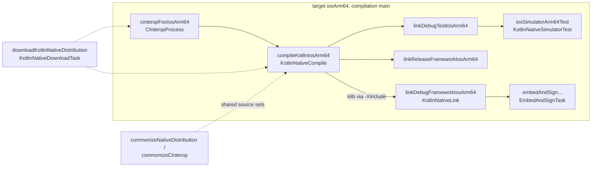
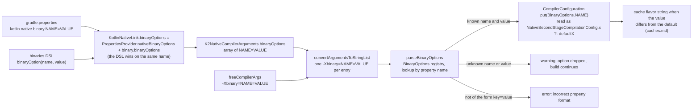
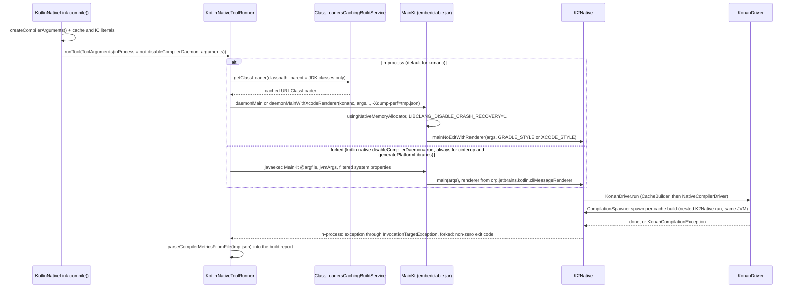
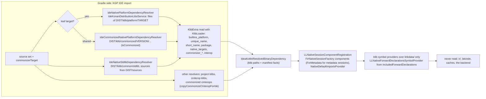

# Kotlin/Native: how tooling drives the compiler

How the K/N compiler is invoked by, and exposes itself to, the tools around it: the Kotlin Gradle Plugin (KGP), the IDE through the
Analysis API, the KLIB commonizer, the `klib` CLI tool, the launcher scripts, and Xcode/CocoaPods integration. The emphasis is on
the *contracts*: which flags are passed, which outputs are read, which files and directories each side owns, and what silently
breaks when the compiler changes a path, a flag, a manifest key or a message format. The task model itself is canonical in
[compilation-model.md](compilation-model.md) ("Kotlin/Native compilation in Gradle"); the distribution layout is in
[architecture.md](architecture.md#distribution); cache flags on the KGP side are in [caches.md](caches.md#kgp-side).

KGP paths below are under `libraries/tools/kotlin-gradle-plugin/src/common/kotlin/org/jetbrains/kotlin/gradle/` unless they start
with another repository directory.

## Role and fit

Every front door ends up in the same place: the `MainKt` dispatcher of the distribution jar, which routes a tool name to a
`main`. The compiler never knows who called it; what differs is *how* the JVM is set up, which arguments are built, and what the
caller reads back.

| Front door | Entry point | Runs in | Consumes from the compiler |
|------------|-------------|---------|----------------------------|
| KGP tasks (`compileKotlin*`, `link*`, `cinterop*`) | `org.jetbrains.kotlin.cli.utilities.MainKt.daemonMain` ([main.kt](../../kotlin-native/utilities/cli-runner/src/org/jetbrains/kotlin/cli/utilities/main.kt)) | cached isolated classloader in the Gradle daemon, or a forked JVM | output files, thrown exception / exit code, rendered messages, `-Xdump-perf` JSON |
| Launcher scripts (`konanc`, `kotlinc-native`, `cinterop`, `klib`, `generate-platform`) | `MainKt.main` via [run_konan](../../kotlin-native/cmd/run_konan) | fresh JVM | stdout/stderr, exit code |
| IDE (IntelliJ Kotlin plugin, Analysis API) | KGP import model + klib metadata; `FirNativeSessionFactory` components | IDE process | klib metadata and manifests only, never IR |
| Commonizer | `org.jetbrains.kotlin.commonizer.cli.CommonizerCLI` from `kotlin-klib-commonizer-embeddable` | forked JVM | platform-lib and cinterop klibs (metadata) |
| Build Tools API | none for Native (see "Other front doors") | — | — |

## KGP

### Target model

`KotlinNativeTarget` ([KotlinNativeTarget.kt](../../libraries/tools/kotlin-gradle-plugin/src/common/kotlin/org/jetbrains/kotlin/gradle/targets/native/KotlinNativeTarget.kt))
wraps one `KonanTarget` and owns compilations (`main`, `test`) and a `binaries` container. The subclasses
`KotlinNativeTargetWithHostTests` and `KotlinNativeTargetWithSimulatorTests` decide how test executables run. A `NativeBinary`
([NativeBinaries.kt](../../libraries/tools/kotlin-gradle-plugin/src/common/kotlin/org/jetbrains/kotlin/gradle/targets/native/NativeBinaries.kt))
is one of `Executable`, `TestExecutable`, `StaticLibrary`, `SharedLibrary`, `Framework`; each maps to a `CompilerOutputKind`
and carries `baseName`, `linkerOpts`, `binaryOptions`, `freeCompilerArgs`, and for libraries an `export(...)` configuration.
Each binary gets one `KotlinNativeLink` task
([KotlinNativeConfigureBinariesSideEffect.kt](../../libraries/tools/kotlin-gradle-plugin/src/common/kotlin/org/jetbrains/kotlin/gradle/targets/native/KotlinNativeConfigureBinariesSideEffect.kt)
`registerLinkTask`), whose only source is the compilation's klib (`task.source(compilation.compileTaskProvider.flatMap { it.outputFile })`).

The task graph KGP creates for one binary-producing target, as registered in `KotlinNativeConfigureBinariesSideEffect.kt`
(`registerLinkTask`), `KotlinNativeTasks.kt` and the commonizer/download task files linked below:

### What each task asks the compiler to do

Both compile and link build a `K2NativeCompilerArguments`
([K2NativeCompilerArguments.kt](../../native/cli-native/src/org/jetbrains/kotlin/cli/bc/K2NativeCompilerArguments.kt)) and
serialize it with `ArgumentUtils.convertArgumentsToStringList`, so the flag spelling is owned by the compiler's argument class,
not by KGP. Fields are named below; a few extra flags are appended as raw strings and *are* spelled in KGP.

| Task | Compiler call | Arguments (field or literal) | Source |
|------|---------------|------------------------------|--------|
| `KotlinNativeCompile` | `konanc`, first stage | `produce = library`, `nopack`, `nostdlib`, `multiPlatform`, `moduleName`/`shortModuleName`, `outputName`, `exportKDoc`, `libraries` (dependency klibs **minus** the distribution's `klib/platform/<target>` entries), `friendModules`, K2 `fragments`/`fragmentRefines`/`fragmentSources`/`fragmentDependencies`, `konanDataDir`, plugin classpaths/options; for shared (metadata) compilations `metadataKlib`, `nodefaultlibs`, `refinesPaths` | [KotlinNativeTasks.kt](../../libraries/tools/kotlin-gradle-plugin/src/common/kotlin/org/jetbrains/kotlin/gradle/targets/native/tasks/KotlinNativeTasks.kt) `KotlinNativeCompile.createCompilerArguments` |
| `KotlinNativeLink` | `konanc`, second stage | `includes` = the compilation klib, `produce`, `optimization`/`debug`/`enableAssertions`, `libraries` (minus platform libs), `exportedLibraries` (the `export(...)` configuration, validated against the API dependencies), `friendModules`, `generateTestRunner` for `TestExecutable`, `mainPackage` = `entryPoint`, `singleLinkerArguments` = `linkerOpts` + `additionalLinkerOpts`, `binaryOptions` = `kotlin.native.binary.*` properties + DSL, `staticFramework`, `exportKDoc` (frameworks), `konanDataDir`, then literals `-Xexternal-dependencies=<tmp .deps>`, `-Xauto-cache-from=<Gradle user home>`, `-Xbackend-threads=N`, `-Xenable-incremental-compilation`, `-Xic-cache-dir=<build>/kotlin-native-ic-cache/<binary>` | [KotlinNativeLink.kt](../../libraries/tools/kotlin-gradle-plugin/src/common/kotlin/org/jetbrains/kotlin/gradle/targets/native/tasks/KotlinNativeLink.kt) `createCompilerArguments`, `compile()` |
| `CInteropProcess` | `cinterop` | literals: `-o`, `-target`, `-def`, `-pkg`, `-header`, `-compiler-option`, `-linker-option`, `-library`, `-headerFilterAdditionalSearchPrefix`, `-Xmodule-name`, `-Xkonan-data-dir`, `-nopack`, `-Xmacro-collection-impl`, then `extraOpts` verbatim | [KotlinNativeTasks.kt](../../libraries/tools/kotlin-gradle-plugin/src/common/kotlin/org/jetbrains/kotlin/gradle/targets/native/tasks/KotlinNativeTasks.kt) `CInteropProcess.processInterop` |
| platform-libs generation (`light` distribution only) | `generatePlatformLibraries` | `-target`, `-verbose`, `-Xkonan-data-dir`, `-cache-kind <produce>`, `-cache-directory <dist>/klib/cache/<target>-g<KIND>`, `-cache-arg -g`, `-cache-arg <additionalCacheFlags.<target>>` | [PlatformLibrariesGenerator.kt](../../libraries/tools/kotlin-gradle-plugin/src/common/kotlin/org/jetbrains/kotlin/gradle/targets/native/internal/PlatformLibrariesGenerator.kt) `runGenerationTool` |
| commonizer tasks | `CommonizerCLI` | see "Commonizer" | [GradleCliCommonizer.kt](../../libraries/tools/kotlin-gradle-plugin/src/common/kotlin/org/jetbrains/kotlin/compilerRunner/GradleCliCommonizer.kt) |

Notes on the link task:

- `freeCompilerArgs`, `-Werror`, `-nowarn`, `-verbose` come from `toolOptions` (`KotlinCommonCompilerToolOptionsHelper`); the
  compile task adds language/API version and opt-ins through `KotlinNativeCompilerOptionsHelper`
  ([KotlinNativeCompilerOptionsHelper.kt](../../libraries/tools/kotlin-gradle-plugin/src/common/kotlin/org/jetbrains/kotlin/gradle/dsl/KotlinNativeCompilerOptionsHelper.kt)).
  Anything not modelled (e.g. `-Xpartial-linkage`) reaches the compiler only through `freeCompilerArgs`; KGP contains no
  partial-linkage flags.
- Cache flags are added only when `KonanPropertiesBuildService.defaultCacheKindForTarget` is not `NONE` (from
  `cacheableTargets.<host>` minus `optInCacheableTargets.<host>` in `konan.properties`), the binary is not optimized (or
  `kotlin.internal.native.enableReleaseBinaryCache=true`), and `cacheWorksFor(target)`. IC is on by
  default except for Linux targets (KT-81760) and is controlled by `kotlin.incremental.native`
  ([nativeCacheKindProperties.kt](../../libraries/tools/kotlin-gradle-plugin/src/common/kotlin/org/jetbrains/kotlin/compilerRunner/nativeCacheKindProperties.kt)).
  `-Xbackend-threads` is `kotlin.native.parallelThreads` or 4.
- `-Xexternal-dependencies` points to a temporary file serialized by `KResolvedDependenciesSupport`
  ([ResolvedDependencies.kt](../../compiler/util/src/org/jetbrains/kotlin/utils/ResolvedDependencies.kt)) describing the Gradle
  resolution graph (`ExternalDependenciesBuilder`). The compiler stores it in `NativeConfigurationKeys.EXTERNAL_DEPENDENCIES`
  ([SetupConfiguration.kt](../../kotlin-native/backend.native/compiler/ir/backend.native/src/org/jetbrains/kotlin/backend/konan/SetupConfiguration.kt)).
  **Unverified:** I found no reader of that key in the backend in this checkout; it may be consumed only by diagnostics
  rendering or be vestigial.
- Output file names are computed on *both* sides from the same `CompilerOutputKind.prefix/suffix`
  ([CompilerOutputKind.kt](../../native/utils/src/org/jetbrains/kotlin/konan/target/CompilerOutputKind.kt)): KGP builds
  `prefix + baseName + suffix`, replaces `-` by `_` for frameworks and static/dynamic libraries (`asValidFrameworkName`), and
  passes the result as `outputName`. The compiler's [OutputFiles.kt](../../kotlin-native/backend.native/compiler/ir/backend.native/src/org/jetbrains/kotlin/backend/konan/OutputFiles.kt)
  must agree, otherwise Gradle's declared outputs do not match what was written.
- `buildKotlinNativeBinaryLinkerArgs` in [KotlinNativeCompilerArgBuilder.kt](../../libraries/tools/kotlin-gradle-plugin/src/common/kotlin/org/jetbrains/kotlin/gradle/targets/native/tasks/KotlinNativeCompilerArgBuilder.kt)
  spells the same flags as literals (`-p`, `-l`, `-tr`, `-entry`, `-Xexport-library=`, `-Xinclude=`, `-Xstatic-framework`), but
  it has no callers in KGP main sources. **Hypothesis:** retained for tests or external plugins.
- Cross-compilation: compile tasks run on any host when `kotlin.native.enableKlibsCrossCompilation` (default true) and every
  dependency supports it (`KotlinNativeCompilation.crossCompilationOnCurrentHostSupported`); link tasks only when
  `konanTarget.enabledOnCurrentHostForBinariesCompilation`, otherwise `libraries` is empty and the task is effectively disabled.

How a binary option travels from a Gradle build into `CompilerConfiguration`, following `PropertiesProvider.nativeBinaryOptions`,
`KotlinNativeLink.binaryOptions`, `K2NativeCompilerArguments.binaryOptions` and `parseBinaryOptions`
(`SetupConfiguration.kt`, `native/binary-options` `parsing.kt`):

### How the compiler process is started

All K/N tools go through `KotlinNativeToolRunner`
([KotlinNativeToolRunner.kt](../../libraries/tools/kotlin-gradle-plugin/src/common/kotlin/org/jetbrains/kotlin/internal/compilerRunner/native/KotlinNativeToolRunner.kt)),
configured by a `ToolSpec` per tool ([nativeCompilerRunner.kt](../../libraries/tools/kotlin-gradle-plugin/src/common/kotlin/org/jetbrains/kotlin/internal/compilerRunner/native/nativeCompilerRunner.kt),
[cinteropRunner.kt](../../libraries/tools/kotlin-gradle-plugin/src/common/kotlin/org/jetbrains/kotlin/internal/compilerRunner/native/cinteropRunner.kt),
[nativeRunnerHelpers.kt](../../libraries/tools/kotlin-gradle-plugin/src/common/kotlin/org/jetbrains/kotlin/internal/compilerRunner/native/nativeRunnerHelpers.kt)):

| Aspect | Value |
|--------|-------|
| Classpath | `<dist>/konan/lib/kotlin-native-compiler-embeddable.jar` (+ `trove4j.jar` for K/N < 2.2.0) |
| Main class | `org.jetbrains.kotlin.cli.utilities.MainKt`; first argument is the tool name (`konanc`, `cinterop`, `generatePlatformLibraries`) |
| In-process mode (default for `konanc`) | `ClassLoadersCachingBuildService` returns a `URLClassLoader` cached by classpath (Guava, `expireAfterAccess`, soft values) whose parent is the JDK-classes loader (KT-65761); KGP reflectively calls `daemonMain` or `daemonMainWithXcodeRenderer`. In the compiler, `inProcessMain` wraps the call in `usingNativeMemoryAllocator` and sets `LIBCLANG_DISABLE_CRASH_RECOVERY=1`. Failure surfaces as `KonanCompilationException` thrown through `InvocationTargetException`, not as an exit code |
| Forked mode | `kotlin.native.disableCompilerDaemon=true` (`NativeProperties.forceDisableRunningInProcess`) runs `javaexec` with arguments in an `@argfile` (`ARGFILE_ARGUMENT`, [preprocessCommandLineArguments.kt](../../compiler/cli/cli-base/src/org/jetbrains/kotlin/cli/common/arguments/preprocessCommandLineArguments.kt)); system properties of the daemon are forwarded except `java.endorsed.dirs`, `user.dir`, `java.system.class.loader`. `cinterop`, platform-libs generation and the commonizer always fork |
| JVM options | `kotlin.native.jvmArgs` (whitespace-split) plus `-XX:TieredStopAtLevel=1` on HotSpot, `-ea`, `-Xmx3g` unless an `-Xmx` is given |
| Environment | `<dist>/tools/env_blacklist` ([env_blacklist](../../kotlin-native/utilities/env_blacklist), mostly Xcode build-setting variables) is removed from the forked process; `KonanPropertiesBuildService.environmentBlacklist` |
| Message format | system property / env `org.jetbrains.kotlin.cliMessageRenderer` (`MessageRenderer.PROPERTY_KEY`) set to `GradleStyle` or `XcodeStyle`; `CLICompiler.defaultMessageRenderer` ([CLICompiler.kt](../../compiler/cli/src/org/jetbrains/kotlin/cli/common/CLICompiler.kt)) honours it. In-process the renderer is chosen by entry point instead (`mainNoExitWithGradleRenderer` / `...XcodeRenderer` in [K2Native.kt](../../native/cli-native/src/org/jetbrains/kotlin/cli/bc/K2Native.kt)). Xcode style is on with `kotlin.native.useXcodeMessageStyle` or automatically when an `embedAndSign*`-type task is requested ([XcodeMessageReporting.kt](../../libraries/tools/kotlin-gradle-plugin/src/common/kotlin/org/jetbrains/kotlin/gradle/plugin/mpp/apple/XcodeMessageReporting.kt)) |
| Metrics | for K/N ≥ `2.2.0-dev-13610` KGP appends `-Xdump-perf=<tmp>.json` and parses it as `UnitStats` (`compiler/util`) into Gradle build-report/FUS metrics (`parseCompilerMetricsFromFile`) |

One `KotlinNativeLink` invocation from the task action to the compiler's driver, as sequenced in `KotlinNativeLink.compile()`,
`KotlinNativeToolRunner.runTool`, `cli-runner/main.kt` (`daemonMain`, `mainImpl`) and `K2Native.kt`:

Because `konanc` runs in-process by default, the compiler must be re-entrant inside one JVM across many compilations and across
different projects in the same Gradle daemon; the classloader is shared by all tasks with the same distribution path.
`KotlinNativePaths.homePath` ([KotlinNativePaths.kt](../../compiler/util/src/org/jetbrains/kotlin/utils/KotlinNativePaths.kt))
locates the distribution from the jar's location (`konan/lib/...`) unless `kotlin.native.home`,
`org.jetbrains.kotlin.native.home` or `konan.home` is set as a system property, which is why KGP needs the jar to be loaded from
inside a real distribution directory.

### Where the distribution comes from

[NativeProperties.kt](../../libraries/tools/kotlin-gradle-plugin/src/common/kotlin/org/jetbrains/kotlin/gradle/internal/properties/NativeProperties.kt),
[KotlinNativeProvider.kt](../../libraries/tools/kotlin-gradle-plugin/src/common/kotlin/org/jetbrains/kotlin/gradle/targets/native/toolchain/KotlinNativeProvider.kt),
[NativeVersionValueSource.kt](../../libraries/tools/kotlin-gradle-plugin/src/common/kotlin/org/jetbrains/kotlin/gradle/targets/native/toolchain/NativeVersionValueSource.kt),
[NativeCompilerDownloader.kt](../../libraries/tools/kotlin-gradle-plugin/src/common/kotlin/org/jetbrains/kotlin/gradle/targets/native/NativeCompilerDownloader.kt),
[KotlinNativeBundleBuildService.kt](../../libraries/tools/kotlin-gradle-plugin/src/common/kotlin/org/jetbrains/kotlin/gradle/targets/native/toolchain/KotlinNativeBundleBuildService.kt):

| Property / env | Effect |
|----------------|--------|
| `kotlin.native.home` (deprecated `org.jetbrains.kotlin.native.home`) | use this directory as the distribution; disables toolchain provisioning |
| `kotlin.native.version` (deprecated `org.jetbrains.kotlin.native.version`) | bundle version; default is `kotlin.native.version` from KGP's `project.properties` resource |
| `kotlin.native.toolchain.enabled` (default true) and `kotlin.native.distribution.downloadFromMaven` (default true) | resolve `org.jetbrains.kotlin:kotlin-native[-prebuilt]:<ver>:<os>@tar.gz|zip` through the `kotlinNativeBundleConfiguration` configuration (`NativeVersionValueSource`), unpack into `<konan data dir>/kotlin-native-prebuilt-<os>-<ver>` under `KotlinInterprocessDirectoryLock`, mark with `provisioned.ok`; snapshot versions are always reinstalled |
| `kotlin.native.distribution.baseDownloadUrl` (default `https://download.jetbrains.com/kotlin/native/builds`) | legacy downloader URL `<base>/{dev|releases}/<ver>/<os>/<name>.tar.gz` used when Maven download is off |
| `kotlin.native.distribution.type` = `prebuilt` (default) or `light` | `light` has no platform libs; KGP generates them per target (`mustGeneratePlatformLibs`, [NativeDistributionType.kt](../../libraries/tools/kotlin-gradle-plugin/src/common/kotlin/org/jetbrains/kotlin/gradle/targets/native/internal/NativeDistributionType.kt)) |
| `konan.data.dir` Gradle property, else `KONAN_DATA_DIR`, else `~/.konan` | root for bundles and `dependencies/` ([DependencyDirectories.kt](../../native/utils/src/org/jetbrains/kotlin/konan/util/DependencyDirectories.kt)); passed to the compiler as `-Xkonan-data-dir` |
| `kotlin.native.reinstall` | delete and re-provision the bundle once per build |
| `kotlin.native.ignoreDisabledTargets` | silence the diagnostic for targets not buildable on this host ([NativeDisabledTargetDiagnostics.kt](../../libraries/tools/kotlin-gradle-plugin/src/common/kotlin/org/jetbrains/kotlin/gradle/targets/native/NativeDisabledTargetDiagnostics.kt)) |
| `kotlin.native.ignoreIncorrectDependencies` | skip dependency-shape checks for Native source sets ([PropertiesProvider.kt](../../libraries/tools/kotlin-gradle-plugin/src/common/kotlin/org/jetbrains/kotlin/gradle/plugin/PropertiesProvider.kt)) |
| `kotlin.native.useEmbeddableCompilerJar` | deprecated, no effect (`GradleDeprecatedPropertyChecker`); the embeddable jar is the only option |

Toolchain downloads (LLVM, sysroots) are done by KGP ahead of the compiler: `downloadNativeDependencies` calls
`loadConfigurables(target, distribution.properties, ...).downloadDependencies(...)` from `native/utils`, i.e. the same
`konan.properties` dependency lists the compiler uses. The compiler itself also downloads whatever is missing when
`checkDependencies` is set (any compilation with sources, `-Xinclude`, exported libraries, a program with libraries, or a cache
build; [NativeConfigurationPhase.kt](../../compiler/cli/cli-native-klib/src/main/kotlin/org/jetbrains/kotlin/native/pipeline/NativeConfigurationPhase.kt),
`platform` in `NativeSecondStageCompilationConfig.kt`), so KGP's step only moves the download to a dedicated task; the
mechanics are in [targets-and-toolchains.md](targets-and-toolchains.md#dependencies-naming-resolution-download). `KotlinNativeDownloadTask` (`downloadKotlinNativeDistribution`,
[KotlinNativeDownloadTask.kt](../../libraries/tools/kotlin-gradle-plugin/src/common/kotlin/org/jetbrains/kotlin/gradle/targets/native/internal/KotlinNativeDownloadTask.kt))
forces provisioning and writes the resolved home path to a file that other tasks read instead of depending on the directory.

### Directories and files KGP owns or assumes

| Path | Owner | Used for |
|------|-------|----------|
| `<build>/classes/kotlin/<target>/<compilation>/klib/<module>` | KGP (`klibOutputDirectory`) | unpacked klib (`-nopack`) produced by `KotlinNativeCompile` |
| `<build>/classes/kotlin/<target>/<compilation>/cinterop/<name>` | KGP | cinterop klib; `cinterop_error.out` marks a failed IDE-sync run; `<name>/cinterop-headers-hash.json` is the header up-to-date check |
| `binary.outputDirectory` | KGP | link output, name from `CompilerOutputKind.prefix/suffix` |
| `<build>/kotlin-native-ic-cache/<binary>` | KGP creates, compiler fills | `-Xic-cache-dir` |
| Gradle user home | KGP passes as `-Xauto-cache-from`; compiler decides cache location | only repository klibs are "external" ([caches.md](caches.md#kgp-side)) |
| `<konan data dir>/kotlin-native-prebuilt-<os>-<ver>` | KGP (provisioning) | the distribution; `provisioned.ok` marker |
| `<konan data dir>/dependencies` | KGP downloads, compiler reads | LLVM, sysroots |
| `<dist>/klib/platform/<target>` | distribution | listed by KGP to *exclude* platform libs from `-library` and to feed the IDE |
| `<dist>/klib/cache/<target>-g<KIND>` | KGP for `light` distributions | `-cache-directory` of `generatePlatformLibraries`; the name is computed in KGP (`getRootCacheDirectory`) |
| `<dist>/klib/commonized/<url-encoded KGP version>/` | KGP commonizer task | commonized platform libs; `.success` marker per directory, interprocess lock |
| `<dist>/konan/konan.properties`, `<dist>/tools/env_blacklist`, `<dist>/sources` | distribution | cache-kind decisions, env filtering, IDE stdlib sources |

### Tests, Xcode and CocoaPods

- `KotlinNativeHostTest` / `KotlinNativeSimulatorTest`
  ([KotlinNativeTest.kt](../../libraries/tools/kotlin-gradle-plugin/src/common/kotlin/org/jetbrains/kotlin/gradle/targets/native/tasks/KotlinNativeTest.kt))
  run the `TestExecutable` with `--ktest_logger=TEAMCITY`, `--ktest_no_exit_code`, `--ktest_gradle_filter=` and
  `--ktest_negative_gradle_filter=`, and parse TeamCity service messages; K/N stack traces are converted to JVM-like frames by
  [KotlinNativeStackTraceParser.kt](../../libraries/tools/kotlin-gradle-plugin/src/common/kotlin/org/jetbrains/kotlin/gradle/targets/native/internal/KotlinNativeStackTraceParser.kt);
  this makes the runtime's printed stack-trace format a contract even though its KDoc calls it unstable
  ([exceptions.md](exceptions.md#step-7--stack-traces-capture-symbolication-format)).
  Simulator tests run `/usr/bin/xcrun simctl spawn [--standalone] <device> <binary>`. The test-runner CLI (`--ktest_*`) is
  therefore a KGP contract on the generated test runner ([runtime.md](runtime.md)).
- `embedAndSign*` ([AppleXcodeTasks.kt](../../libraries/tools/kotlin-gradle-plugin/src/common/kotlin/org/jetbrains/kotlin/gradle/plugin/mpp/apple/AppleXcodeTasks.kt),
  [XcodeEnvironment.kt](../../libraries/tools/kotlin-gradle-plugin/src/common/kotlin/org/jetbrains/kotlin/gradle/plugin/mpp/apple/XcodeEnvironment.kt))
  reads `CONFIGURATION`, `SDK_NAME`, `ARCHS`, `TARGET_BUILD_DIR`, `FRAMEWORKS_FOLDER_PATH`, `BUILT_PRODUCTS_DIR`,
  `EXPANDED_CODE_SIGN_IDENTITY`, `ENABLE_USER_SCRIPT_SANDBOXING` and `KOTLIN_FRAMEWORK_BUILD_TYPE`, selects the `Framework`
  binaries whose build type and `KonanTarget` match (`isRequestedBinary`), depends on their link tasks, copies and runs
  `codesign --force --sign`. The link tasks themselves see nothing Xcode-specific except the message renderer.
- CocoaPods ([KotlinCocoapodsPlugin.kt](../../libraries/tools/kotlin-gradle-plugin/src/common/kotlin/org/jetbrains/kotlin/gradle/targets/native/cocoapods/KotlinCocoapodsPlugin.kt)):
  `podspec` writes a spec with `vendored_frameworks`, `pod_target_xcconfig { KOTLIN_PROJECT_PATH }` and a `script_phases` entry
  running `./gradlew $KOTLIN_PROJECT_PATH:syncFramework` ([PodspecTask.kt](../../libraries/tools/kotlin-gradle-plugin/src/common/kotlin/org/jetbrains/kotlin/gradle/targets/native/cocoapods/tasks/PodspecTask.kt));
  `podInstall`/`podGen`/`podSetupBuild`/`podBuild`/`podImport` build the pods with Xcode, and each pod becomes a `DefFileTask` →
  `CInteropProcess` pair. CocoaPods therefore depends on cinterop `.def` semantics and on framework output layout, not on new
  compiler flags.

## IDE and the Analysis API

The IDE never runs the K/N backend. It gets two things from KGP's import model (`kotlin-gradle-plugin-idea`) and reads
everything else from klibs:

1. **Dependencies as klib paths plus manifest facts.** `IdeNativeStdlibDependencyResolver`, `IdeNativePlatformDependencyResolver`,
   `IdeCommonizedNativePlatformDependencyResolver`, `IdeCommonizedCinteropDependencyResolver` and friends
   ([dependencyResolvers/](../../libraries/tools/kotlin-gradle-plugin/src/common/kotlin/org/jetbrains/kotlin/gradle/plugin/ide/dependencyResolvers/IdeNativeStdlibDependencyResolver.kt))
   produce `IdeaKotlinResolvedBinaryDependency` objects whose classpath is `<dist>/klib/common/stdlib`, the files of
   `<dist>/klib/platform/<target>`, or commonizer outputs. Each carries a `KlibExtra`
   ([factories.kt](../../libraries/tools/kotlin-gradle-plugin/src/common/kotlin/org/jetbrains/kotlin/gradle/plugin/ide/factories.kt))
   filled by loading the klib with `KlibLoader` and reading manifest keys `builtins_platform`, `unique_name`, `short_name`,
   `package`, `native_targets`, `commonizer_native_targets`, `commonizer_target`, `interop`
   ([KotlinLibrary.kt](../../compiler/util-klib/src/org/jetbrains/kotlin/library/KotlinLibrary.kt)). Stdlib sources come from
   `<dist>/sources`. Renaming any of these keys changes what the IDE shows without any compiler test failing.
2. **Resolution from metadata only.** The Native FIR session used by the IDE is assembled by
   [LLNativeSessionComponentRegistration.kt](../../analysis/low-level-api-fir/src/org/jetbrains/kotlin/analysis/low/level/api/fir/sessions/factory/components/LLNativeSessionComponentRegistration.kt)
   from the same `FirNativeSessionFactory` components the compiler's first stage uses
   ([FirNativeSessionFactory.kt](../../compiler/fir/entrypoint/src/org/jetbrains/kotlin/fir/session/FirNativeSessionFactory.kt)),
   plus `NativeDefaultImportsProvider`. Forward declarations (`cnames.structs.*`, `objcnames.*`) are synthesized from the
   `includedForwardDeclarations` manifest entry of cinterop and commonized klibs by
   [NativeForwardDeclarationsSymbolProvider.kt](../../compiler/fir/entrypoint/src/org/jetbrains/kotlin/fir/session/NativeForwardDeclarationsSymbolProvider.kt)
   in the compiler and by
   [LLNativeForwardDeclarationsSymbolProvider.kt](../../analysis/low-level-api-fir/src/org/jetbrains/kotlin/analysis/low/level/api/fir/symbolProviders/LLNativeForwardDeclarationsSymbolProvider.kt)
   in the IDE. Nothing on this path touches IR, so **klib metadata (not IR) is the IDE contract**: a first-stage change that is
   invisible in metadata (a pre-serialization lowering, an IR-only annotation) is invisible to the IDE, and a metadata change
   is visible even if the backend ignores it.
3. **Export tooling shared with the IDE.** `native/analysis-api-based-export-common`
   ([build.gradle.kts](../../native/analysis-api-based-export-common/build.gradle.kts), "Common part of Swift and Objective-C
   exports"), the Analysis-API implementation of the ObjC header generator
   (`native/objcexport-header-generator/impl/analysis-api`, next to the K1 `impl/k1` used by the backend; see
   [export.md](export.md)), and Swift export's `swift-export-ide` / `swift-export-standalone` / `swift-export-embeddable`
   under [native/swift](../../native/swift/README.md). KGP runs Swift export in a process-isolated Gradle worker on the
   `swift-export-embeddable` classpath with `kotlin.native.swiftExportWorkerJvmArgs`
   ([SwiftExportTask.kt](../../libraries/tools/kotlin-gradle-plugin/src/common/kotlin/org/jetbrains/kotlin/gradle/plugin/mpp/apple/swiftexport/tasks/SwiftExportTask.kt)).
4. **`native/utils` is on everybody's classpath**: `KonanTarget`, `HostManager`, `Distribution`, `DefFile`, `CompilerOutputKind`
   are used by KGP, the commonizer and the IDE import. Changing `KonanTarget` names or `Distribution` paths is a tooling change.

What the IDE's model of a Native source set is built from, following the KGP IDE resolvers
(`IdeNativeStdlibDependencyResolver`, `IdeNativePlatformDependencyResolver`, `IdeCommonizedNativePlatformDependencyResolver`,
`KlibExtra` in `factories.kt`) and `LLNativeSessionComponentRegistration`:

**Unverified:** how the IDE learns the distribution root itself; the resolvers only hand over absolute klib paths, so the IDE
may not need it.

## Commonizer

The algorithm, the CLI tasks and the cache layout are in [commonizer.md](commonizer.md) (the README in
[native/commonizer](../../native/commonizer/README.md) is partly stale). For a source set shared between several native targets it
produces one "common" klib with `expect` declarations for the platform libraries and (optionally) for cinterop klibs; only that
common slot is serialized, the leaves stay the original per-target klibs. It works on klib **metadata** only and writes ordinary
klibs whose manifests carry `commonizer_target` and `commonizer_native_targets`.

KGP side ([CommonizerTasks.kt](../../libraries/tools/kotlin-gradle-plugin/src/common/kotlin/org/jetbrains/kotlin/gradle/targets/native/internal/CommonizerTasks.kt),
[NativeDistributionCommonizerTask.kt](../../libraries/tools/kotlin-gradle-plugin/src/common/kotlin/org/jetbrains/kotlin/gradle/targets/native/internal/NativeDistributionCommonizerTask.kt),
[CInteropCommonizerTask.kt](../../libraries/tools/kotlin-gradle-plugin/src/common/kotlin/org/jetbrains/kotlin/gradle/targets/native/internal/CInteropCommonizerTask.kt)):

| Task | Command (built by `CliCommonizer`, [CliCommonizer.kt](../../native/commonizer-api/src/org/jetbrains/kotlin/commonizer/CliCommonizer.kt)) | Output |
|------|------|--------|
| `commonizeNativeDistribution` | `native-dist-commonize -<distribution-path> <dist> -<output-path> ... -<output-targets> a;b -<log-level> ...` | `<dist>/klib/commonized/<KGP version>/<target id>/`, cached across builds by `NativeDistributionCommonizerCache` (`.success` markers, directory lock) |
| `commonizeCInterop` (when `kotlin.mpp.enableCInteropCommonization` or separate KMP compilation is on) | `native-klib-commonize -<distribution-path> -<input-libraries> a;b -<output-commonizer-targets> ... -<output-path> -<dependency-libraries> ...` | `<build>/classes/kotlin/commonizer/` (`cInteropCommonizerOutputRoot`), one directory per `CInteropCommonizerGroup` |
| `copyCommonizeCInteropForIde`, aggregator `commonize` (`runCommonizer` for old IDEs) | copies | the project's persistent Kotlin metadata dir, wired with `ideaImportDependsOn` |

The tool runs in a forked JVM from the `kotlin-klib-commonizer-embeddable` artifact resolved by a Gradle configuration
(`maybeCreateCommonizerClasspathConfiguration`), main class `org.jetbrains.kotlin.commonizer.cli.CommonizerCLI`, arguments via
argfile, JVM args from `kotlin.mpp.commonizerJvmArgs`.

The outputs are used twice. For compilation, `KotlinCompilationK2MultiplatformConfigurator`
([KotlinCompilationK2MultiplatformConfigurator.kt](../../libraries/tools/kotlin-gradle-plugin/src/common/kotlin/org/jetbrains/kotlin/gradle/plugin/mpp/compilationImpl/KotlinCompilationK2MultiplatformConfigurator.kt))
adds, for every intermediate native fragment, the stdlib, the commonized platform libs for the fragment's `commonizerTarget`
and the commonized cinterops as fragment dependencies of the *platform* compile tasks (K2 `-Xfragment-dependencies`), and
`setupCInteropCommonizerDependencies` adds commonized cinterops to shared-native (metadata) compilations. For the IDE, the
resolvers above return the same files. The compiler itself is unaware of commonization except through
`isCommonizedCInteropLibrary()` (manifest `commonizer_target`) in forward-declaration handling and klib loading
([klib-linking.md](klib-linking.md)). Commonizer flags are `kotlin.mpp.enableCInteropCommonization`,
`kotlin.mpp.enableOptimisticNumberCommonization`, `kotlin.mpp.enablePlatformIntegerCommonization`, `kotlin.mpp.commonizerLogLevel`.

## Other front doors

- **Launcher scripts** ([kotlin-native/cmd](../../kotlin-native/cmd/run_konan)): `konanc`, `kotlinc-native`, `cinterop`, `klib`,
  `generate-platform` all exec `run_konan <tool>`, which runs
  `java -ea -Xmx3G -XX:TieredStopAtLevel=1 -Dfile.encoding=UTF-8 -Dkonan.home=<dist> $JAVA_OPTS -cp konan/lib/kotlin-native-compiler-embeddable.jar MainKt <tool> ...`
  after unsetting every variable listed in `tools/env_blacklist`; `-D*`/`-J*` go to the JVM, `--time` adds `-Dkonan.profile=true`,
  JDK 24 gets `--enable-native-access` / `--sun-misc-unsafe-memory-access=allow`. The dispatcher
  ([main.kt](../../kotlin-native/utilities/cli-runner/src/org/jetbrains/kotlin/cli/utilities/main.kt)) knows `konanc`,
  `cinterop` (runs the interop tool, then `konanc` on its output in the same process), `klib`, `defFileDependencies`,
  `generatePlatformLibraries`, `llvm`, `clang`.
- **`klib` tool** ([kotlin-native/klib](../../kotlin-native/klib/src/org/jetbrains/kotlin/cli/klib/KlibToolArgumentsParser.kt)):
  commands `info`, `dump-abi`, `dump-ir`, `dump-ir-inlinable-functions`, `dump-signatures`, `dump-metadata`; the dump formats
  are what `native.tests` and ABI-compatibility tooling compare against.
- **Embeddable jar** ([kotlin-native/prepare/kotlin-native-compiler-embeddable](../../kotlin-native/prepare/kotlin-native-compiler-embeddable/build.gradle.kts)):
  a shadow jar of `Interop:{Runtime,Indexer,StubGenerator}`, `backend.native`, `utilities:cli-runner`, `kotlin-native:klib`,
  `native:cli-native` and `kotlinx.cli`, with JNA excluded and `META-INF/services` merged. It is the only compiler artifact
  KGP loads, so anything the compiler needs at run time must be inside it or in the distribution directory.
- **Build Tools API** (`compiler/build-tools`): there is no Native operation. The API defines JVM, JS and Wasm operations
  (e.g. [WasmKlibCompilationOperation.kt](../../compiler/build-tools/kotlin-build-tools-api/src/main/kotlin/org/jetbrains/kotlin/buildtools/api/wasm/operations/WasmKlibCompilationOperation.kt));
  "native" appears only in `BuildTimeMetric` names. KGP's K/N path bypasses the BTA and the Kotlin daemon entirely.

## Contracts and pitfalls

Things tooling relies on that no compiler test enforces directly:

| Contract | Who relies on it | What breaks if changed |
|----------|------------------|------------------------|
| Tool names accepted by `MainKt` and the `daemonMain` / `daemonMainWithXcodeRenderer` entry points | KGP `ToolSpec` | every K/N task fails to start |
| Jar name `konan/lib/kotlin-native-compiler-embeddable.jar` and location inside the distribution | KGP classpath, `KotlinNativePaths` | classpath empty, "Cannot determine a compiler distribution directory" |
| Output naming `CompilerOutputKind.prefix/suffix`, `-`→`_` for frameworks and C libraries, `.klib`/unpacked dirs with `-nopack` | KGP outputs, Xcode copy, CocoaPods `vendored_frameworks` | tasks report success but outputs are "missing"/stale |
| `K2NativeCompilerArguments` field → flag mapping (`-Xinclude`, `-Xexport-library`, `-Xbinary=`, `-Xkonan-data-dir`, …) and the literal flags `-Xauto-cache-from`, `-Xbackend-threads`, `-Xenable-incremental-compilation`, `-Xic-cache-dir`, `-Xexternal-dependencies`, `-Xdump-perf`; cinterop literals in `CInteropProcess` | KGP | renamed flag → unknown-argument error or silently ignored behaviour |
| Message rendering: `e: file:///path:line:col msg` (Gradle style, [GradleStyleMessagerRenderer.kt](../../compiler/cli/src/org/jetbrains/kotlin/cli/common/messages/GradleStyleMessagerRenderer.kt)) and `path:line:col: error: msg` (Xcode style); selection via `org.jetbrains.kotlin.cliMessageRenderer` | Gradle problem reporting, Xcode build log | diagnostics not clickable / not shown as errors in Xcode |
| Failure = `KonanCompilationException` in-process; exit codes `0/1/2/3/137` ([ExitCode.java](../../compiler/cli/cli-base/src/org/jetbrains/kotlin/cli/common/ExitCode.java)) when forked | KGP, scripts, CI | a compiler error that returns normally is reported as success |
| Re-entrancy: no process-global mutable state, no `System.exit`, no reliance on `user.dir`, cleanup of native memory | in-process mode | daemon leaks, flaky second compilation, crashes in `usingNativeMemoryAllocator` |
| `UnitStats` JSON written by `-Xdump-perf` | KGP build metrics | metrics silently dropped (parsing errors are reported via `FusMetricRetrievalException`) |
| `konan.properties` keys `cacheableTargets.<host>`, `optInCacheableTargets.<host>`, `additionalCacheFlags.<target>`, dependency lists; `tools/env_blacklist` | `KonanPropertiesBuildService`, `PlatformLibrariesGenerator`, dependency download | wrong cache kind, missing LLVM, Xcode env leaking into clang |
| Platform-lib cache dir name `<target>[-g]<KIND>` under `klib/cache` for `light` distributions | KGP computes it | generated caches land where the compiler does not look (see `appendCommonCacheFlavor` in [caches.md](caches.md)) |
| Caches are built on demand by the compiler; KGP only passes roots | KGP | if the compiler stops auto-building, KGP has no fallback |
| klib manifest keys (`unique_name`, `short_name`, `package`, `builtins_platform`, `native_targets`, `commonizer_*`, `interop`, `includedForwardDeclarations`, `ir_provider`) | IDE import, forward declarations, commonizer | IDE shows wrong module names, loses forward declarations, commonizer rejects inputs |
| `klib/platform/<target>` listing | KGP excludes these from `-library`; IDE lists them | duplicate libraries on the command line or missing IDE dependencies |
| `KONAN_DATA_DIR` / `konan.data.dir` precedence and the `kotlin-native-prebuilt-<os>-<ver>` directory name | provisioning, `-Xkonan-data-dir` | compiler and KGP disagree about where dependencies live |
| Test-runner CLI `--ktest_logger=TEAMCITY`, `--ktest_no_exit_code`, `--ktest_gradle_filter`, service-message format, stack trace format | `KotlinNativeTest` | tests "pass" with no results, or filters stop working |
| `.def` file grammar (`headers`, `compilerOpts`, `staticLibraries`, `libraryPaths`) parsed by KGP via `DefFile` from `native/utils` | cinterop up-to-date checks, CocoaPods | stale cinterop outputs |

## Tests

The compiler-side test infrastructure (`native/native.tests`, the `-Pkn.*` properties, how tests invoke the compiler from a
distribution) is described in [test-infrastructure.md](test-infrastructure.md); this section is about the tooling side.

- **KGP integration tests** (`libraries/tools/kotlin-gradle-plugin-integration-tests`, [AGENTS.md](../../libraries/tools/kotlin-gradle-plugin-integration-tests/AGENTS.md)):
  `./gradlew :kotlin-gradle-plugin-integration-tests:kgpNativeTests [--tests "org.jetbrains.kotlin.gradle.native.KotlinNativeLinkIT"]`.
  Tests are tagged `@NativeGradlePluginTests`; the ones most relevant to compiler changes live in
  [src/test/kotlin/org/jetbrains/kotlin/gradle/native](../../libraries/tools/kotlin-gradle-plugin-integration-tests/src/test/kotlin/org/jetbrains/kotlin/gradle/native/KotlinNativeLinkIT.kt)
  (`GeneralNativeIT`, `CinteropIT`, `NativeIncrementalCompilationIT`, `KotlinNativeDisableCacheIT`,
  `KotlinNativeIsolatedClassloaderIT` for KT-65761, `NativeEmbeddableCompilerJarIT`, `NativeExternalDependenciesIT`,
  `KotlinNativeCompilerDownloadIT`, `AppleFrameworkIT`, `CocoaPods*IT`, `SwiftExport*IT`). The distribution comes from a shared
  konan dir `<repo>/.kotlin/konan-for-gradle-tests` (system property `konanDataDirForIntegrationTests`, passed to builds as
  `-Pkonan.data.dir`; `KONAN_DATA_DIR` is removed from the environment) and the version from `kotlinNativeVersion`
  (`kotlinNativeVersionForGradleIT` on CI); with `kotlin.native.enabled` the test task depends on `:kotlin-native:install`
  ([build.gradle.kts](../../libraries/tools/kotlin-gradle-plugin-integration-tests/build.gradle.kts) `applyKotlinNativeConfiguration`).
  `BuildOptions.NativeOptions` ([BuildOptions.kt](../../libraries/tools/kotlin-gradle-plugin-integration-tests/src/test/kotlin/org/jetbrains/kotlin/gradle/testbase/BuildOptions.kt))
  sets `kotlin.native.version`, `distributionType`, `distributionDownloadFromMaven`.
- **KGP functional tests** (`./gradlew :kotlin-gradle-plugin:functionalTest`): argument and wiring checks without running the
  compiler — [KotlinNativeCompileArgumentsTest.kt](../../libraries/tools/kotlin-gradle-plugin/src/functionalTest/kotlin/org/jetbrains/kotlin/gradle/unitTests/compilerArguments/KotlinNativeCompileArgumentsTest.kt)
  (platform libs excluded, stdlib present, K2 fragments), [KotlinNativeLinkTest.kt](../../libraries/tools/kotlin-gradle-plugin/src/functionalTest/kotlin/org/jetbrains/kotlin/gradle/unitTests/KotlinNativeLinkTest.kt),
  [KotlinNativeToolchainTest.kt](../../libraries/tools/kotlin-gradle-plugin/src/functionalTest/kotlin/org/jetbrains/kotlin/gradle/unitTests/KotlinNativeToolchainTest.kt),
  `DisabledNativeCacheTest`, `EmbedAndSignTaskTests`.
- **Commonizer tests** ([native/commonizer/tests](../../native/commonizer/tests/org/jetbrains/kotlin/commonizer/CommonizerCliTest.kt)):
  `CommonizerCliTest` for the CLI contract, `*CommonizationFromSourcesTest` and `hierarchical/` for semantics.
- **Embeddable-jar tests** in `kotlin-native/prepare/kotlin-native-compiler-embeddable/tests`, run with
  `-Dkotlin.native.home=<dist>` and the embeddable classpath.
- The compiler's own tests ([native/native.tests](../../native/native.tests/README.md)) do not exercise KGP; only the integration
  tests above check the end-to-end contract, and they run against an installed distribution, so a compiler change is tested
  there only after `:kotlin-native:install`.

## Investigating

| Symptom | Where to look |
|---------|---------------|
| "Flag X in `freeCompilerArgs` is ignored in Gradle" | Is it a `K2NativeCompilerArguments` field KGP also sets (e.g. `-produce`, `-g`, `-opt`, `-Xbinary`)? The field wins over the free arg or they conflict. Check the logged command line (`kotlin.internal.compiler.arguments.log.level`: the runner logs `Arguments = [...]`). For link-only flags added in `compile()` (`-Xauto-cache-from`, IC) check the cache-kind conditions |
| IDE shows an API the compiler rejects, or vice versa | Compare klib *metadata* (`klib dump-metadata`) with what the backend sees in IR; check forward declarations in the manifest; check whether the IDE got commonized libs (`commonizer_target`) while the compiler got platform libs |
| Distribution download fails / wrong version | `kotlin.native.version` resolution (`NativeProperties`), `kotlinNativeBundleConfiguration` repository, `provisioned.ok` marker and lock in `<konan data dir>`, `kotlin.native.reinstall`; LLVM/sysroot failures are `downloadNativeDependencies` with `konan.properties` dependency lists |
| Behaviour differs between Gradle and `konanc` | In-process vs forked: try `kotlin.native.disableCompilerDaemon=true`; check system properties forwarded to the fork, `env_blacklist`, `-Xmx3g`/`TieredStopAtLevel`, classloader parent (JDK only) |
| "Cannot determine a compiler distribution directory" | `KotlinNativePaths.homePath`: jar not under `konan/lib` or none of `kotlin.native.home`/`konan.home` set |
| Second compilation in the same daemon fails or leaks | re-entrancy of the backend (global state, `Disposer`, native memory); reproduce with two tasks in one build |
| Xcode build log shows no errors | renderer selection (`useXcodeMessageStyle`), `env_blacklist` filtering of Xcode variables, `embedAndSign` environment |

## Open questions

- Where (if anywhere) does the backend consume `NativeConfigurationKeys.EXTERNAL_DEPENDENCIES` written from
  `-Xexternal-dependencies`? No reader was found in this checkout.
- Is `buildKotlinNativeBinaryLinkerArgs` still used by anything (tests, external plugins), or is it dead code?
- Which exact CLI aliases (`NATIVE_DISTRIBUTION_PATH_ALIAS` etc.) does `CommonizerCLI` accept, and are they versioned together
  with `kotlin-klib-commonizer-embeddable` (KGP always uses its own plugin version)?
- How does the IDE learn the distribution root for features beyond dependency paths (e.g. running `klib` or debugger
  helpers), given the import model only exposes klib files?
- Platform-lib caches for `light` distributions are placed by KGP under `klib/cache/<target>-g<KIND>`; does this still match the
  compiler's system-cache flavor directory, or is the `light` path effectively unmaintained?
- Is there any test that pins the `UnitStats` JSON schema consumed by KGP's `parseCompilerMetricsFromFile`?
