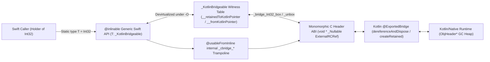

# Witness-Bridged Open Polymorphism: Generics in Kotlin Swift Export

* **Area**: Kotlin/Native — Swift Export
* **Status**: Implemented
* **Related Issues**: [KT-76337](https://youtrack.jetbrains.com/issue/KT-76337), [KT-80260](https://youtrack.jetbrains.com/issue/KT-80260), [KT-87798](https://youtrack.jetbrains.com/issue/KT-87798)
* **Target Toolchain**: Kotlin 2.5+, Swift 6.0+ (`-swift-version 6` with `-enable-library-evolution`)
* **Companion Document**: [Swift Export Architecture](./architecture.md)

---

## Table of Contents

1. [Abstract & Introduction](#1-abstract--introduction)
2. [Motivation & Real-World KMP → Swift Use-Cases](#2-motivation--real-world-kmp--swift-use-cases)
3. [Prior Art & Cross-Language Interop Landscape](#3-prior-art--cross-language-interop-landscape)
4. [Detailed Design — Witness-Bridged Open Polymorphism](#4-detailed-design--witness-bridged-open-polymorphism)
   * [4.1 Core Architectural Invariant](#41-core-architectural-invariant)
   * [4.2 End-User Swift Surface Tour](#42-end-user-swift-surface-tour)
   * [4.3 The `_KotlinBridgeable` Witness Protocol & Symmetrical RC Lifecycle](#43-the-_kotlinbridgeable-witness-protocol--symmetrical-rc-lifecycle)
   * [4.4 Generic Classes, Type-Parameter Hoisting & Open Subclassing](#44-generic-classes-type-parameter-hoisting--open-subclassing)
   * [4.5 Cross-Language Generic Interfaces via Primary Associated Types (PATs)](#45-cross-language-generic-interfaces-via-primary-associated-types-pats)
   * [4.6 Zero-Allocation Compile-Time Variance](#46-zero-allocation-compile-time-variance)
   * [4.7 Exhaustive Generic `sealed` Hierarchies](#47-exhaustive-generic-sealed-hierarchies)
   * [4.8 Upper Bounds, Multi-Bound `where` Clauses & Protocol F-Bounds](#48-upper-bounds-multi-bound-where-clauses--protocol-f-bounds)
5. [Deliberate Scope Boundaries & Pragmatic Cuts](#5-deliberate-scope-boundaries--pragmatic-cuts)
6. [Alternatives Considered & Empirical Comparison](#6-alternatives-considered--empirical-comparison)
7. [Source/ABI Compatibility, Library Evolution & Future Directions](#7-sourceabi-compatibility-library-evolution--future-directions)

---

## 1. Abstract & Introduction

Exporting generic Kotlin declarations directly to Swift sits at the fault line of two fundamentally different type systems, object representations, and compilation models:

* **Kotlin/Native** compiles generic classes, interfaces, and functions using **type-parameter erasure** to upper bounds (`kotlin.Any?` by default), supports **declaration-site variance** (`out T` / `in T`) and **use-site projections** (`Box<out Animal>`, `Box<*>`), represents heap objects uniformly as `ObjHeader*` pointers managed by a tracing garbage collector, and boxes primitive values (`Int`, `Boolean`, `Double`) only when crossing an erased `Any?` boundary.
* **Swift 6** compiles generics via **open polymorphism** backed by runtime **Value Witness Tables (VWT)** and **Protocol Witness Tables (PWT)** (with optional compile-time specialization under `-O`), enforces **invariance** on all nominal generic types, expresses parameterized protocols via **Primary Associated Types (PATs)** rather than generic type parameters, manages object lifetimes through deterministic **Automatic Reference Counting (ARC)**, and distributes binary SDKs (`XCFramework`) compiled under **Library Evolution** (`-enable-library-evolution`).

Bridging these two worlds naively forces an unpleasant choice: erasing generics destroys Swift type safety and call-site ergonomics; monomorphizing wrappers explodes Swift compilation times and binary sizes combinatorially; and unconstrained dynamic reflection incurs a `3.1x–4.9x` runtime penalty while deferring type mismatches to runtime crashes.

This document specifies **Witness-Bridged Open Polymorphism** (shortened to **Witness-Bridged Generics**), the architecture for generics in Kotlin Swift Export. Witness-Bridged Open Polymorphism pairs a **monomorphic `void*` (`ExternalRCRef`) C ABI boundary** on the Kotlin/Native side with **Swift `_KotlinBridgeable` protocol witness dispatch and `@inlinable` cross-module specialization** on the Swift side:

1. **Idiomatic Swift 6 Surface**: Kotlin generic classes, top-level/member/extension functions, higher-order closures, `suspend` functions, `Flow<T>` / `StateFlow<T>` / `SharedFlow<T>` streams, generic `sealed` hierarchies (`@frozen public enum <Name>_SealedType<T>`), and generic interfaces (`public protocol Repository<T>` with Primary Associated Types and nominal `AnyRepository<T>` wrappers) export with first-class Swift generic parameters—including unboxed Swift value types (`Int32`, `String`, `Bool`, `Optional<T>`, `[T]`, `[K: V]`).
2. **Static Soundness & Zero-Cost Variance**: Constraining exported type parameters to `<T: _KotlinBridgeable>` rejects unbridgeable Swift types (including the `42 -> Swift.Int` literal inference trap) at compile time, while phantom function-type projections (`KotlinCovariant<T>` / `KotlinContravariant<T>`) bring Kotlin's `out` and `in` variance to Swift with zero heap allocation and full static checking.
3. **Symmetrical `+1` Reference-Counting Hygiene**: Every generic value crossing the C bridge obeys a strict `+1` retained `ExternalRCRef` ownership transfer (`__retainedToKotlinPointer()` paired with `dereferenceAndDisposeBridgeableRef` / `_disposeBridgeableRef`), achieving **`0` `StableRef` leaks** across millions of iterations and adversarial GC cycles.
4. **High Throughput & Sub-Linear Build Scaling**: Marking generic Swift wrappers `@inlinable` over `@usableFromInline` C-bridge shims allows `swiftc -O` to devirtualize `_KotlinBridgeable` witness tables across `-enable-library-evolution` boundaries (`89.25 ns/op` generic function calls, `131.25 ns/op` `Box<Int32>` round-trips, `47.89 ns/op` existential `any Repository<Int32>` dispatch), while keeping `runSwiftExport`, `konanc`, and `swiftc` build times strictly sub-linear ($\alpha \le 0.65$).

---

## 2. Motivation & Real-World KMP → Swift Use-Cases

Modern Kotlin Multiplatform (KMP) shared modules rely pervasively on generics at their public architectural boundaries:

* **Data & Domain Repositories**: `interface Repository<T>`, `suspend fun <T> withRetry(block: suspend () -> T): T`.
* **Typed State & Algebraic Sum Types**: `sealed interface UiState<out T>` (`data object Loading : UiState<Nothing>`, `class Success<T>(val data: T) : UiState<T>`, `class Failed(val reason: String) : UiState<Nothing>`).
* **Reactive Presentation Streams**: `val state: StateFlow<UiState<User>>` on shared `ViewModel`s consumed directly by SwiftUI views.
* **Core Ecosystem Libraries**: `kotlinx.coroutines.flow.Flow<T>`, `kotlinx.serialization.KSerializer<T>`, arrow/fp `Either<E, A>`, and KMP pagination/caching containers.

### 2.1 Pain Points Under Legacy `ObjCExport`

Kotlin/Native's legacy Objective-C export translates Kotlin declarations through Objective-C's 1980s object model bolted onto Clang's 2015 lightweight generics (`__covariant` / `__contravariant`):

1. **Class-Only Generics (`NSObject` Restriction)**: Objective-C lightweight generics apply *only* to `@interface` classes and constrain every type argument to Objective-C object pointers (`id`). Value types cannot instantiate generic parameters directly: `Box<Int>` exports as `Box<KotlinInt>`, forcing Swift callers to wrap and unwrap heap-allocated `NSNumber` subclasses (`KotlinInt(int: 42)` / `.int32Value`).
2. **Complete Erasure of Generic Interfaces & Functions**: Objective-C `@protocol` declarations and C/Objective-C methods cannot declare type parameters. `interface Repository<T>` exports as an untyped `@protocol Repository` where `get()` returns `Any?` and `save(item:)` accepts `Any?`. Top-level and extension generic functions (`fun <T> id(x: T): T`) similarly erase to `Any?`.
3. **Broken Exhaustive `sealed` Generics**: `sealed interface UiState<out T>` exports as an unparameterized protocol; `UiState.Loading` (`UiState<Nothing>`) loses its covariant relationship to `UiState<User>`, and Swift `switch` statements must fall back to runtime `as?` casts with a mandatory `default:` branch.
4. **Untyped Reactive Streams**: `StateFlow<UiState<User>>` exports as an untyped `Kotlinx_coroutines_coreStateFlow` whose `.value` property has type `Any?`, requiring downcasts on every SwiftUI frame update.

### 2.2 Pain Points Under Prior Swift Export Upper-Bound Erasure

Swift Export's initial non-generic pipeline (`architecture.md`) eliminated Objective-C headers in favor of direct Swift + C + Kotlin bridges, and mapped primitives natively (`kotlin.Int` → `Swift.Int32`, `kotlin.String` → `Swift.String`). However, prior to Witness-Bridged Open Polymorphism, type parameters were erased to their upper bounds (`(any _KotlinBridgeable)?` or `KotlinBase`):

* Generic classes (`class Box<T>(var value: T)`), generic interfaces (`interface Repository<T>`), and generic functions either collapsed `T` to untyped existentials or were hidden entirely when `T` appeared in contravariant/invariant positions that could not be soundly bridged.
* Asymmetric `KotlinBase` boxing on erased `Any?` bridges leaked `+1` `ExternalRCRef` (`StableRef`) per primitive or `String` value passed across an erased generic boundary.

### 2.3 Before vs. After Showcase

Consider a representative shared Kotlin module:

```kotlin
// Shared Kotlin (commonMain)
data class User(val id: Int, val name: String)

interface Repository<T> {
    fun current(): T
    fun save(item: T): Boolean
}

sealed class UiState<out T> {
    data object Loading : UiState<Nothing>()
    class Success<T>(val data: T) : UiState<T>()
    class Failed(val reason: String) : UiState<Nothing>()
}

class UserViewModel(private val repo: Repository<User>) {
    val state: StateFlow<UiState<User>> = ...
    suspend fun <R> mapCurrent(transform: (User) -> R): R = transform(repo.current())
}
```

Compare how an iOS engineer consumes this module in Swift 6:

```swift
// ❌ BEFORE (Legacy ObjCExport): NSNumber boxing, Any? casts, non-exhaustive switch
final class SwiftUserRepo: NSObject, Repository {
    func current() -> Any? { User(id: 1, name: "Ada") }
    func save(item: Any?) -> Bool {
        guard let user = item as? User else { return false } // runtime cast required
        return true
    }
}

let rawState = viewModel.state.value // typed as Any?
if rawState is UiStateLoading {
    renderSpinner()
} else if let success = rawState as? UiStateSuccess<User>, let user = success.data {
    render(user: user)
} else if let failed = rawState as? UiStateFailed {
    renderError(failed.reason)
} // non-exhaustive: adding a new Kotlin sealed subclass silently falls through!

let idObj = try await viewModel.mapCurrent { rawUser in
    KotlinInt(int: (rawUser as! User).id) // manual NSNumber heap box
}
let id: Int32 = (idObj as! KotlinInt).int32Value
```

```swift
// ✅ AFTER (Swift Export — Witness-Bridged Open Polymorphism):
// Native Swift 6 PATs, unboxed Int32, exhaustive @frozen switch, typed StateFlow & async
final class SwiftUserRepo: KotlinBase, Repository {
    func current() -> User { User(id: 1, name: "Ada") }
    func save(item: User) -> Bool { true } // statically typed as User!
}

let vm = UserViewModel(repo: SwiftUserRepo())
let currentState: UiState<User> = vm.state.value // typed KotlinTypedStateFlow<UiState<User>>

switch currentState.sealedType() { // @frozen generic enum — compiler-enforced exhaustiveness!
case .loading:
    renderSpinner()
case .success(let s):
    render(user: s.value.data)     // s.value.data is statically typed as User
case .failed(let f):
    renderError(f.value.reason)
}

let id: Int32 = try await vm.mapCurrent { user in user.id } // unboxed Int32, zero casts!
```

---

## 3. Prior Art & Cross-Language Interop Landscape

Designing cross-language generics for Kotlin and Swift benefits directly from lessons across existing KMP tools, the Swift 6 runtime ABI, and multi-language FFI generators.

| System / Mechanism | Polymorphism Strategy | Value Types in `<T>` | Generic Interfaces / Traits | Open Cross-Language Subclassing / Impl | Build & Binary Scaling |
|---|---|---|---|---|---|
| **Kotlin `ObjCExport`** | ObjC lightweight class generics (`id` erasure) | Boxed (`KotlinInt` / `NSNumber`) | Erased (`@protocol` has no `<T>`) | Class/protocol via ObjC runtime (`Any?` args) | $O(D)$ (linear) |
| **Touchlab SKIE** | Post-link Swift wrapper synthesis + specialization | Still `KotlinInt` in underlying Kotlin generics | Erased or closed-world specialized | Limited by underlying `ObjCExport` | $O(D \times S)$ on specialized wrappers |
| **Swift 6 Native ABI** | Open polymorphism via VWT + PWT (optional `-O` spec) | Unboxed via VWT (`Int32`, structs, enums) | Primary Associated Types (`protocol P<T>`) | Full open classes & existential opening (`SE-0352`) | $O(D)$ binary, optional specialization |
| **Swift C++ Interop** | Clang AST template monomorphization | Direct C++ layout per instantiation | C++ concepts (compile-time only) | No open virtual templates | $O(D \times S)$ per instantiated template |
| **Mozilla UniFFI / Diplomat** | Monomorphic C ABI (no exported generics) | Concrete types only | Non-generic `Trait` / `ForeignTrait` | Non-generic callback vtables | $O(D)$ (generics prohibited at boundary) |
| **Dart `jnigen`** | Erased JNI C handle + reified type-token vtable (`T`) | Boxed Java objects (`java.lang.Integer`) | Generic Dart interfaces with runtime `T` class token | Interface proxies | $O(D)$ (linear) |
| **Swift Export (This Design)** | **Monomorphic `void*` C ABI + Swift `_KotlinBridgeable` PWT + `@inlinable`** | **Native Swift `Int32`, `String`, `T?`, `[T]`** | **Full PAT `protocol P<T>` + `AnyP<T>`** | **Full (`_<C>_Base` + `SE-0352` `_open` reverse bridges)** | **$O(D)$ ($\alpha \le 0.65$), `+2.9%` `.dylib`** |

### Key Takeaways from Prior Art

1. **Touchlab SKIE**: SKIE demonstrated how dramatically developer productivity improves when Kotlin `sealed` hierarchies become exhaustive Swift `enum`s and `Flow<T>` becomes a typed `AsyncSequence`. However, because SKIE operates as a post-processing layer over `ObjCExport` headers, it inherits Objective-C's `KotlinInt` `NSNumber` boxing inside generic classes and must rely on closed-world monomorphization when specializing generic wrappers—which scales multiplicatively ($O(D \times S)$) in Swift compile time and Mach-O binary size.
2. **Swift 6 Open Polymorphism & Protocol Evolution (`SE-0309`, `SE-0346`, `SE-0352`, `SE-0353`)**: Unlike C++ templates or Rust generics (which require full monomorphization before machine-code emission), Swift compiles generic functions and types once against runtime **Value Witness Tables (VWT)** and **Protocol Witness Tables (PWT)**, even across resilient `-enable-library-evolution` boundaries. Combined with Swift 5.7–6.0's protocol evolution quartet—unlocking existentials for protocols with `Self`/associated types (`SE-0309`), Primary Associated Types (`SE-0346`), implicitly opened existentials (`SE-0352`), and constrained existential types (`any Repository<Int32>`, `SE-0353`)—Swift 6 finally possesses the exact type-system machinery needed to express Kotlin generic interfaces and open generic dispatch without closed-world monomorphization.
3. **Swift C++ Interop, UniFFI, Diplomat, and `jnigen`**: C++ interop relies on Clang instantiating header-visible template bodies per concrete Swift call site, which is incompatible with precompiled Kotlin `.klib` / Mach-O binaries. UniFFI and Diplomat keep their C ABIs monomorphic by forbidding generic exported signatures altogether. Dart's `jnigen` preserves generic classes and methods over a monomorphic C JNI boundary by threading explicit type-companion vtables (`$T`) into every generic call. In Swift, we get `jnigen`'s monomorphic C boundary *without* manual vtable parameters because Swift's compiler natively threads `_KotlinBridgeable` Protocol Witness Tables for `<T: _KotlinBridgeable>`.

---

## 4. Detailed Design — Witness-Bridged Open Polymorphism

### 4.1 Core Architectural Invariant

Witness-Bridged Open Polymorphism rests on a strict separation of responsibilities across the C ABI boundary:

> **Core Invariant**: Every generic Kotlin declaration exports **exactly one monomorphic C and `@ExportedBridge` Kotlin entry point** where erased type-parameter values cross the ABI as `void*` (`kotlin.native.internal.NativePtr` holding a `+1` retained `ExternalRCRef`, or `NULL` for `null`). On the Swift side, type parameters carry the static witness constraint `<T: _KotlinBridgeable>`, using `T`'s Protocol Witness Table to marshal between idiomatic Swift values (`Int32`, `String`, `T?`, `[T]`, `KotlinBase` subclasses) and `UnsafeMutableRawPointer?`.

To preserve optimal performance even when KMP frameworks are compiled with `-enable-library-evolution` and `@_implementationOnly import KotlinBridges_<Module>`:

1. **`@_implementationOnly` Encapsulation**: Generated Swift modules continue to import their C bridge headers via `@_implementationOnly import KotlinBridges_<Module>`, keeping raw C symbols completely out of public Swift autocomplete and downstream Clang header search paths.
2. **Cross-Module Specialization via `@inlinable` + `@usableFromInline`**: Because `@inlinable` Swift bodies cannot directly reference `@_implementationOnly` C functions, Swift Export emits lightweight `@usableFromInline @discardableResult internal func _cbridge_<name>(...)` Swift trampolines (alongside `@usableFromInline internal func _bridge_*` helpers in `KotlinRuntimeSupport`). Qualifying generic functions, properties, and `final`-class initializers are marked `@inlinable`. When a downstream app compiles with `swiftc -O`, the Swift optimizer inlines the generic wrapper and devirtualizes `T.__retainedToKotlinPointer()` and `T.__fromKotlinPointer(...)` directly into concrete C calls—eliminating witness-table indirection on the hot path while retaining resilient PWT dispatch for unspecialized or debug (`-Onone`) callers.



#### End-to-End 4-Layer Translation Example

Given a generic Kotlin class with a nullable generic method:

```kotlin
// 1. Kotlin Source
class Holder<T>(val xs: Array<T>) {
    fun headOrNull(): T? = xs.firstOrNull()
}
```

Swift Export generates the following three coordinated artifacts:

```swift
// 2. Generated Swift (Module.swift)
public final class Holder<T: KotlinRuntimeSupport._KotlinBridgeable>:
    KotlinRuntime.KotlinBase,
    KotlinRuntimeSupport._KotlinCustomPointerBridgeable
{
    @inlinable
    public var xs: ExportedKotlinPackages.kotlin.Array<T> {
        get {
            return ExportedKotlinPackages.kotlin.Array<T>.__fromKotlinPointer(
                _cbridge_Holder_xs_get(self.__externalRCRef())
            )
        }
    }

    public init(xs: ExportedKotlinPackages.kotlin.Array<T>) {
        let __kt = __root___Holder_init_allocate()
        super.init(__externalRCRefUnsafe: __kt, options: .asExistentialWrapper)
        __root___Holder_init_initialize__TypesOfArguments__Swift_UnsafeMutableRawPointer_ExportedKotlinPackages_kotlin_Array_T___(
            __kt, xs.__externalRCRef()
        )
    }

    @_documentation(visibility: internal)
    public override init(
        __externalRCRefUnsafe: Swift.UnsafeMutableRawPointer,
        options: KotlinRuntime.KotlinBaseConstructionOptions
    ) {
        super.init(__externalRCRefUnsafe: __externalRCRefUnsafe, options: options)
    }

    @inlinable
    public func headOrNull() -> T? {
        return Swift.Optional<T>.__fromKotlinPointer(
            _cbridge_Holder_headOrNull(self.__externalRCRef())
        )
    }
}

@usableFromInline
@discardableResult
internal func _cbridge_Holder_headOrNull(
    _ _p0: Swift.UnsafeMutableRawPointer
) -> Swift.UnsafeMutableRawPointer? {
    return Holder_headOrNull(_p0)
}
```

```c
// 3. Generated C Bridge Header (Module.h)
void * __root___Holder_init_allocate(void);
_Bool __root___Holder_init_initialize__TypesOfArguments__Swift_UnsafeMutableRawPointer_ExportedKotlinPackages_kotlin_Array_T___(
    void * __kt, void * xs
);
void * Holder_xs_get(void * self);
void * _Nullable Holder_headOrNull(void * self);
```

```kotlin
// 4. Generated Kotlin Bridge (Module.kt)
@ExportedBridge("Holder_headOrNull")
public fun Holder_headOrNull(self: kotlin.native.internal.NativePtr): kotlin.native.internal.NativePtr {
    val __self = kotlin.native.internal.ref.dereferenceExternalRCRef(self) as Holder<kotlin.Any?>
    val _result = __self.headOrNull()
    return if (_result == null) {
        kotlin.native.internal.NativePtr.NULL
    } else {
        kotlin.native.internal.ref.createRetainedExternalRCRef(_result)
    }
}
```

---

### 4.2 End-User Swift Surface Tour

Table 4.1 summarizes how Kotlin generic constructs translate to Swift 6.

| Kotlin Declaration | Exported Swift 6 Surface |
|---|---|
| `class Box<T>(var value: T)` | `public final class Box<T: _KotlinBridgeable>: KotlinBase, _KotlinCustomPointerBridgeable` |
| `open class OpenBox<T>(open var value: T)` | `open class OpenBox<T: _KotlinBridgeable>: _OpenBox_Base, _KotlinOpenGenericBridgeable, _OpenBox_ReverseDispatch` |
| `interface Repository<T>` | `public protocol Repository<T>: KotlinBase, _Repository` + `public final class AnyRepository<T: _KotlinBridgeable>` |
| `class OutBox<out T>` / `class InSink<in T>` | `.covariant: KotlinCovariant<T>` / `.contravariant: KotlinContravariant<T>` + `convenience init(_:)` |
| `sealed class UiState<out T>` | `open class UiState<T: _KotlinBridgeable>` + `@frozen public enum UiState_SealedType<T: _KotlinBridgeable>` |
| `fun <T> id(x: T): T` | `@inlinable public func id<T: _KotlinBridgeable>(x: T) -> T` |
| `fun <T> List<T>.customFilter(p: (T) -> Boolean): List<T>` | `extension Swift.Array where Element : _KotlinBridgeable { public func customFilter(...) -> [Element] }` |
| `fun <K, V> singletonMap(k: K, v: V): Map<K, V>` | `@inlinable public func singletonMap<K: _KotlinBridgeable & Swift.Hashable, V: _KotlinBridgeable>(k: K, v: V) -> [K: V]` |
| `suspend fun <T> fetch(block: suspend () -> T): T` | `public func fetch<T: _KotlinBridgeable>(block: @escaping () async throws -> T) async throws -> T` |
| `val state: StateFlow<UiState<User>>` | `public var state: any KotlinTypedStateFlow<UiState<User>> { get }` (`.value: UiState<User>`, `.asAsyncSequence()`) |

#### Primitives, Fixed-Width Integers & Catching Swift's Integer-Literal Inference Trap

Kotlin defines `kotlin.Int` as a signed 32-bit integer and `kotlin.Long` as a signed 64-bit integer across all platforms, whereas `Swift.Int` is platform-pointer-sized (`64-bit` on `arm64`). Throughout Swift Export, `kotlin.Int` maps canonically to `Swift.Int32` and `kotlin.Long` maps to `Swift.Int64`:

* `Int8` (`Byte`), `Int16` (`Short`), `Int32` (`Int`), `Int64` (`Long`)
* `UInt8` (`UByte`), `UInt16` (`UShort` and `Char` via `Unicode.UTF16.CodeUnit`), `UInt32` (`UInt`), `UInt64` (`ULong`)
* `Bool` (`Boolean`), `Float`, `Double`, `String`
* `KotlinUnit` (`kotlin.Unit`), `Swift.Never` (`kotlin.Nothing`), `KotlinAny` (`kotlin.Any`), `Swift.AnyHashable`

`Swift.Int` intentionally does **not** conform to `_KotlinBridgeable`. This design decision prevents a subtle trap in Swift type inference: in Swift, an untyped integer literal `42` defaults to `Swift.Int` (`IntegerLiteralType`). If `Box<T>` were exported with an unconstrained `<T>`, writing `let b = Box(value: 42)` would silently infer `Box<Swift.Int>` at compile time and either fail at runtime or silently wrap a foreign 64-bit value that Kotlin `Box<kotlin.Int>` functions reject! With `<T: _KotlinBridgeable>`, `swiftc` catches bare `Box(value: 42)` immediately at compile time (`type 'Int' does not conform to protocol '_KotlinBridgeable'`), while contextual typing (`let b: Box<Int32> = Box(value: 42)` or `Box(value: Int32(42))`) resolves `ExpressibleByIntegerLiteral` to `Int32` with zero overhead.

#### Higher-Order Generic Closures Over Non-Generic `@_cdecl` Trampolines

Swift `@_cdecl` functions—used by Kotlin/Native `@ImportedBridge` reverse calls to invoke Swift closures—**cannot declare generic type parameters**. When Kotlin exports a higher-order generic function such as:

```kotlin
fun <T> List<T>.customFilter(predicate: (T) -> Boolean): List<T>
```

Swift Export adapts the typed Swift closure `(T) -> Bool` *inside the generic Swift wrapper* (where `T: _KotlinBridgeable` is in scope) into an erased pointer closure `(UnsafeMutableRawPointer?) -> Bool`, and passes that pointer closure to a single monomorphic `@_cdecl` trampoline:

```swift
public func customFilter<T: KotlinRuntimeSupport._KotlinBridgeable>(
    _ receiver: [T],
    predicate: @escaping (T) -> Swift.Bool
) -> [T] {
    return Swift.Array<T>.__fromKotlinPointer(
        __root___customFilter__TypesOfArgumentsE__Swift_Array_T__U28TU29202D_U20Swift_Bool__(
            receiver.__retainedToKotlinPointer(),
            Unmanaged.passRetained(
                ({ (_p0: Swift.Optional<Swift.UnsafeMutableRawPointer>) -> Swift.Bool in
                    return (predicate)(T.__fromKotlinPointer(_p0))
                } as (Swift.Optional<Swift.UnsafeMutableRawPointer>) -> Swift.Bool) as AnyObject
            ).toOpaque()
        )
    )
}
```

Nested and curried generic functional slots—such as `(T) -> ((U) -> Pair<T, U>)`, `((T) -> U) -> U`, or optional closure returns—recursively adapt each inner closure layer via `Bridge.AsRetainedBlock` while propagating nested `helperBridges` through both contravariant and covariant block bridges.

#### Coroutines (`suspend`) & Typed Reactive `Flow`s

Generic `suspend` functions compose naturally with `withKotlinContinuation` and `KotlinTask` structured cancellation: Kotlin's continuation completion bridge returns a `+1` retained `ExternalRCRef` that the Swift continuation unboxes via `T.__fromKotlinPointer(_:)`, propagating both typed results and `CancellationError` / `@Throws` errors symmetrically.

For `kotlinx.coroutines.flow`, Swift Export maps the entire reactive hierarchy to Primary Associated Type protocols in `KotlinCoroutineSupport`:

* `Flow<T>` → `any KotlinTypedFlow<T>` (providing `.asAsyncSequence() -> KotlinFlowSequence<T>`)
* `SharedFlow<T>` → `any KotlinTypedSharedFlow<T>` (adding `.replayCache: [T]`)
* `MutableSharedFlow<T>` → `any KotlinTypedMutableSharedFlow<T>` (adding `.emit(value: T) async throws`, `.tryEmit(value: T) -> Bool`, `.subscriptionCount: any KotlinTypedStateFlow<Int32>`)
* `StateFlow<T>` → `any KotlinTypedStateFlow<T>` (adding typed `.value: T`)
* `MutableStateFlow<T>` → `any KotlinTypedMutableStateFlow<T>` (adding mutable `.value: T { get nonmutating set }` and `.compareAndSet(expect: T, update: T) -> Bool`)

Element unboxing inside `_unboxFlowElement` takes a two-tier path: when `Element.self` conforms to `_KotlinBridgeable.Type` (primitives, `String`, `Optional`, classes, collections), it dispatches directly through `bridgeableType.__fromKotlinPointer(ptr)`; when `Element` is itself a protocol existential (e.g., `Flow<Repository<Int>>` → `any KotlinTypedFlow<any Repository<Int32>>`), it falls back to `KotlinBase.__createBridgeable(externalRCRef:conformsTo:)` using a captured `{ wrapperClass in wrapperClass is ElementType }` predicate.

---

### 4.3 The `_KotlinBridgeable` Witness Protocol & Symmetrical RC Lifecycle

#### Protocol Definition & Covariant `Self` Design

In `KotlinRuntimeSupport`, `_KotlinBridgeable` and its two marker sub-protocols are defined as follows:

```swift
public protocol _KotlinCustomPointerBridgeable: KotlinRuntime.KotlinBase {}
public protocol _KotlinOpenGenericBridgeable: _KotlinCustomPointerBridgeable {}

public protocol _KotlinBridgeable {
    init(__externalRCRefUnsafe: UnsafeMutableRawPointer, options: KotlinBaseConstructionOptions)
    func __externalRCRef() -> UnsafeMutableRawPointer

    static func __fromKotlinPointer(_ ptr: UnsafeMutableRawPointer?) -> Self
    func __toKotlinPointer() -> UnsafeMutableRawPointer?
    func __retainedToKotlinPointer() -> UnsafeMutableRawPointer?
    static func __disposeTemporaryRCRef(_ ptr: UnsafeMutableRawPointer?)
}
```

Notice the deliberate asymmetry between **instance** methods `__toKotlinPointer()` / `__retainedToKotlinPointer()` and **static** method `__fromKotlinPointer(_:) -> Self`:

* Swift prohibits `Self` in contravariant parameter positions on non-final classes (`static func toPointer(_ v: Self)` fails to compile on `extension KotlinBase: _KotlinBridgeable` because `KotlinBase` is an open Objective-C class hierarchy). Making `__retainedToKotlinPointer()` an instance method avoids `Self` in parameter position entirely, allowing `KotlinBase` to conform once for *every* exported Kotlin class!
* Making `__fromKotlinPointer(_:) -> Self` a static method places `Self` in covariant result position, which Objective-C `+ (instancetype)__createClassWrapper(externalRCRef:)` satisfies polymorphically.

When `extension KotlinBase: _KotlinBridgeable` implements `__fromKotlinPointer(_:)`, it distinguishes three cases:

```swift
extension KotlinBase: _KotlinBridgeable {
    @inlinable
    public static func __fromKotlinPointer(_ ptr: UnsafeMutableRawPointer?) -> Self {
        if Self.self is any _KotlinOpenGenericBridgeable.Type {
            if let existing = KotlinRuntime.KotlinBase.__createClassWrapper(
                externalRCRef: _bridge_cloneRef(ptr!)
            ) as? Self {
                _bridge_disposeRef(ptr!)
                return existing
            }
            return Self(__externalRCRefUnsafe: ptr!, options: .asExistentialWrapper)
        }
        if Self.self is any _KotlinCustomPointerBridgeable.Type {
            return Self(__externalRCRefUnsafe: ptr!, options: .asExistentialWrapper)
        }
        return Self.__createClassWrapper(externalRCRef: ptr!)
    }

    @inlinable
    public func __retainedToKotlinPointer() -> UnsafeMutableRawPointer? {
        return _bridge_cloneRef(self.__externalRCRef())
    }
}
```

1. **Non-generic `KotlinBase` classes (`Animal`, `Dog`)**: Fall through to `Self.__createClassWrapper(externalRCRef: ptr!)`, inspecting the Kotlin `ObjHeader*` `TypeInfo` at runtime so that a `Box<Animal>` holding a Kotlin `Dog` returns a true Swift `Dog` instance (`animalBox.value as? Dog` succeeds!) and preserves `1:1` `===` wrapper identity.
2. **Final generic wrappers (`Holder<T>`, `AnyRepository<T>`)**: Conform to `_KotlinCustomPointerBridgeable` and instantiate `Self(__externalRCRefUnsafe: ptr!, options: .asExistentialWrapper)` directly (Section 4.4 explains why `__createClassWrapper` must not be used unconditionally on generic classes).
3. **Open generic classes (`Box<T>`)**: Conform to `_KotlinOpenGenericBridgeable`, first checking whether `ptr!` already carries a bound Swift subclass peer (such as `class TaggedBox<T>: Box<T>`) before falling back to `.asExistentialWrapper`.

#### Symmetrical `+1` `ExternalRCRef` Ownership Contract

Every value crossing a generic parameter or return position obeys a **symmetrical `+1` retained `ExternalRCRef` transfer**:

* **Swift → Kotlin (Parameter / Setter / Reverse Return)**:
  * Value types (`Int32`, `Double`, `String`, collections) allocate a fresh `+1` `ExternalRCRef` via `KotlinBridgeable_<Type>_box(self)`.
  * Reference types (`KotlinBase`) clone a fresh `+1` `ExternalRCRef` handle via `_bridge_cloneRef(self.__externalRCRef())` (`createRetainedExternalRCRef(dereferenceExternalRCRef(ref))`).
  * `Optional.none` returns `nil` (`NativePtr.NULL`).
  * On the Kotlin side, the bridge immediately extracts the `ObjHeader*` and disposes the `+1` handle in a single helper:
    ```kotlin
    public fun dereferenceAndDisposeBridgeableRef(ref: kotlin.native.internal.NativePtr): kotlin.Any? {
        if (ref == kotlin.native.internal.NativePtr.NULL) return null
        val obj = kotlin.native.internal.ref.dereferenceExternalRCRef(ref)
        kotlin.native.internal.ref.releaseExternalRCRef(ref)
        kotlin.native.internal.ref.disposeExternalRCRef(ref)
        return obj
    }
    ```
* **Kotlin → Swift (Return / Getter / Closure Argument)**:
  * Kotlin returns `NativePtr.NULL` for `null` or `createRetainedExternalRCRef(_result)` (`+1`).
  * For value types, `T.__fromKotlinPointer(ptr)` unboxes the primitive/struct and immediately calls `_bridge_disposeRef(ptr!)`:
    ```swift
    extension Swift.Int32: KotlinRuntimeSupport._KotlinBridgeable {
        public init(__externalRCRefUnsafe ref: UnsafeMutableRawPointer, options: KotlinBaseConstructionOptions) {
            self = _bridge_Int32_unbox(ref)
        }
        @inlinable
        public func __externalRCRef() -> UnsafeMutableRawPointer {
            return _bridge_Int32_box(self)
        }
        @inlinable
        public static func __fromKotlinPointer(_ ptr: UnsafeMutableRawPointer?) -> Swift.Int32 {
            let v = _bridge_Int32_unbox(ptr!)
            _bridge_disposeRef(ptr!)
            return v
        }
    }
    ```
  * For `KotlinBase` wrappers, `KotlinBase` adopts ownership of the `+1` `ExternalRCRef` and releases/disposes it inside `KotlinBase.dealloc` when Swift ARC deallocates the wrapper.

Because every `+1` creation is paired deterministically with exactly one consumption on the receiving side, generic calls produce **`ΔStableRef = 0`** across arbitrarily long execution loops.

#### Special Value & Container Conformances

* **`Optional<Wrapped>` (`where Wrapped: _KotlinBridgeable`)**: Maps `.none` to `nil` (`NULL`) and delegates `.some(val)` recursively to `Wrapped`.
* **`kotlin.Char` (`Unicode.UTF16.CodeUnit`)**: Maps to `Unicode.UTF16.CodeUnit` (a Swift standard-library `typealias` for `Swift.UInt16`). Because `Char` and `UShort` share the Swift `UInt16` witness table, `KotlinBridgeable_UInt16_unbox` handles both `is UShort -> v` and `is Char -> v.code.toUShort()`, while dynamic `Any` unboxing (`KotlinBridgeable_getTypeTag`) assigns `Char` a dedicated tag (`16` → `KotlinBridgeable_Char_unbox`). For non-generic `List<Char>`, `Set<Char>`, `Map<*, Char>`, and `vararg Char` bridges (`AsNSArray`, `AsNSArrayForVariadic`, `AsNSSet`, `AsNSDictionary`), the Kotlin bridge converts `Char` elements to and from `Int` UTF-16 code units so Foundation `CFNumber` / `NSNumber` bridging matches Swift `UTF16.CodeUnit` without falling back to existential `Char` boxes.
* **`KotlinUnit`, `Swift.Never`, `KotlinAny`, and `Swift.AnyHashable`**: `KotlinUnit` (`@frozen public struct KotlinUnit: _KotlinBridgeable, Hashable`) bridges `kotlin.Unit` in generic positions (`Box<KotlinUnit>`, `AFactory<T> where T.T == KotlinUnit`); `Swift.Never` conforms uninhabitedly for `Nothing`; `KotlinAny` wraps `any _KotlinBridgeable` via `__createBridgeable` type-tag dispatch (`1..16` for primitives/strings/collections/chars, falling back to `__createProtocolWrapper`); and `Swift.AnyHashable` opens `any Swift.Hashable` via `_boxAnyHashable`.
* **Collections (`Array<Element>`, `Set<Element>`, `Dictionary<Key, Value>`)**: When `Element` (or `Key`/`Value`) conforms to `_KotlinBridgeable`, collection witnesses marshal element-by-element through `KotlinBridgeable_List_create`/`add`/`size`/`get`, `KotlinBridgeable_Set_create`/`add`/`toList`, and `KotlinBridgeable_Map_create`/`put`/`entriesList`, recursively supporting arbitrarily nested generic collections (`[[Int32?]]`, `[String: Box<Dog>]`, `[KotlinUnit]`).

---

### 4.4 Generic Classes, Type-Parameter Hoisting & Open Subclassing

#### Why Generic Swift Classes Cannot Use `@BindClassToObjCName` or `.asBoundBridge`

Non-generic exported Swift classes carry `@objc` runtime bindings (`@BindClassToObjCName(Animal::class, "4main6AnimalC")`) and initialize `KotlinBase` with `options: .asBoundBridge`, caching a 1:1 pointer to the Swift wrapper directly inside the Kotlin `ObjHeader*` associated-object slot. Extending that mechanism naively to generic Swift classes (`class Box<T>: KotlinBase`) violates two hard runtime invariants:

1. **Dynamic Generic Metatype Instantiation**: Swift does not emit a single static Objective-C class symbol for an unspecialized generic class (`objc_getClass("4main3BoxC")` returns `nil`; Swift instantiates specialized ObjC classes lazily on demand such as `_TtGC4main3BoxVs5Int32_`). Binding `Box::class` directly to a generic Swift class name fails `SwiftExport.mm`'s `matchingClass != nil` assertion, and calling `Box<Int32>.__createClassWrapper` on an erased Kotlin `Box` (`TypeInfo == Box::class`) fails `isSubclassOfClass:`.
2. **The 1:1 `ObjHeader*` Cache Invariance Hazard**: In Kotlin, a single `Box` heap instance (`ObjHeader*`) has erased runtime type `Box`. Suppose Kotlin creates a `Box<Dog>`, hands it to Swift (which caches a `Box<Dog>` Swift wrapper on `ObjHeader*` via `.asBoundBridge`), and then passes the *same* `ObjHeader*` through a Kotlin star-projected or covariant path (`Box<out Animal>`) back to Swift expecting `Box<Animal>`. If `Box<Animal>` used `.asBestFittingWrapper` / `.asBoundBridge`, `KotlinBase`'s Objective-C initializer would substitute the cached `Box<Dog>` pointer—producing a Swift reference statically typed as `Box<Animal>` whose dynamic Swift type is `Box<Dog>` (an unrelated type under Swift generic invariance), corrupting Swift's type system!

Swift Export resolves both invariants cleanly:
* Generic Kotlin wrapper instances are initialized with `options: .asExistentialWrapper` (non-caching, non-substituting) and conform to `_KotlinCustomPointerBridgeable`, while non-generic classes (`Animal`, `Dog`) keep `.asBoundBridge` and 1:1 `===` wrapper identity.
* `@BindClassToObjCName` is **never** emitted pointing at a parameterized Swift class.

#### Companion Objects & Nested Type Hoisting

Swift imposes two structural restrictions on types nested inside generic classes (`class Box<T>`):
1. Stored `static` properties (`public static var shared`) are prohibited inside generic types (`static stored properties not supported in generic types`).
2. Unparameterized outer qualification (`Box.Companion` or `Box.Meta`) is rejected by `swiftc` unless `T` is supplied (`Box<Int32>.Companion`).

When a generic Kotlin class contains nested non-capturing classes (`class Meta`), `object` declarations, or a `companion object`, Swift Export **hoists** those nested declarations to module scope (`_Box_Companion`, `_Box_Meta`) and emits forwarding `public typealias`es inside `Box<T>`:

```swift
// Hoisted non-generic declarations at module scope:
public final class _Box_Companion: KotlinRuntime.KotlinBase {
    public static var shared: _Box_Companion { ... }
    public func tag() -> Swift.String { ... }
}
public final class _Box_Meta: KotlinRuntime.KotlinBase { ... }

// Forwarding typealiases inside Box<T>:
open class Box<T: KotlinRuntimeSupport._KotlinBridgeable>: ... {
    public typealias Companion = _Box_Companion
    public typealias Meta = _Box_Meta
}
```

Both `Box<Int32>.Companion.shared.tag()` and `_Box_Companion.shared.tag()` work seamlessly with zero stored static state inside `Box<T>`.

#### Open Generic Subclassing in Swift (`_<Class>_Base` + `_<Class>_ReverseDispatch`)

When a generic Kotlin class is `open` or `abstract` (`open class SelfReferencing<T>(...)` or `open class Box<T>(open var value: T)`), Swift users expect to subclass it—either concretely (`final class AuditIntBox: Box<Int32>`) or generically (`final class TaggedBox<T: _KotlinBridgeable>: Box<T>`).

To enable cross-language open generic inheritance without binding `Box::class` to a generic Swift metatype, Swift Export emits a three-part pattern:

1. **Non-Generic Base Anchor (`_Box_Base`)**:
   ```swift
   @_documentation(visibility: internal)
   open class _Box_Base: KotlinRuntime.KotlinBase { ... }
   ```
   The Kotlin bridge binds `@file:BindClassToObjCName(Box::class, "4main9_Box_BaseC")` to this concrete, non-generic Objective-C-visible base class.
2. **Dual Allocation & Direct Dispatch in `Box<T>`**:
   ```swift
   open class Box<T: KotlinRuntimeSupport._KotlinBridgeable>:
       main._Box_Base,
       KotlinRuntimeSupport._KotlinOpenGenericBridgeable,
       main._Box_ReverseDispatch
   {
       public init(value: T) {
           let __kt: Swift.UnsafeMutableRawPointer!
           if Self.self == main.Box<T>.self {
               __kt = __root___Box_init_allocate()
           } else {
               __kt = _kotlinAllocInstanceForSwiftSubclass(Self.self)
           }
           super.init(
               __externalRCRefUnsafe: __kt,
               options: Self.self == main.Box<T>.self ? .asExistentialWrapper : .asBoundBridge
           )
           __root___Box_init_initialize__TypesOfArguments__Swift_UnsafeMutableRawPointer_T__(
               __kt, value.__retainedToKotlinPointer()
           )
       }

       open func current() -> T {
           if Self.self == main.Box<T>.self {
               return T.__fromKotlinPointer(Box_current(self.__externalRCRef()))
           } else {
               return T.__fromKotlinPointer(Box_current_direct(self.__externalRCRef()))
           }
       }
   }
   ```
   Notice the precision of the `options:` ternary: pure Kotlin `Box<T>` instances use `.asExistentialWrapper`, whereas **Swift subclasses (`Self.self != Box<T>.self`) pass `.asBoundBridge`**, binding the exact `TaggedBox<Int32>` Swift object to its Kotlin peer! When that `TaggedBox<Int32>` later round-trips through Kotlin (`idValue(x: tagged as Box<Int32>)`), `_KotlinOpenGenericBridgeable` in `KotlinBase.__fromKotlinPointer` recovers `existing as? Self`, preserving both `TaggedBox<Int32>`'s dynamic type and `===` reference identity!
3. **Existential-Opening Reverse Dispatch (`_Box_ReverseDispatch<T>`)**:
   When Kotlin calls an `open` method overridden by `TaggedBox<T>`, the `@_cdecl` reverse bridge recovers `self` as `any _Box_ReverseDispatch` and opens it via `SE-0352` (`func _open<__Self: _Box_ReverseDispatch>(_ _self: __Self)`), invoking `_self.current()` polymorphically for *any* specialization `T`.

---

### 4.5 Cross-Language Generic Interfaces via Primary Associated Types (PATs)

Kotlin generic interfaces (`interface Processor<T, R> { fun process(input: T): R }`) export to Swift 6 using a **Three-Tier Protocol + Nominal Existential Wrapper** architecture:

```swift
// Tier 1: User-facing Primary Associated Type (PAT) protocol
public protocol Processor<T, R>: KotlinRuntime.KotlinBase, main._Processor {
    associatedtype T: KotlinRuntimeSupport._KotlinBridgeable
    associatedtype R: KotlinRuntimeSupport._KotlinBridgeable
    func process(input: T) -> R
}

// Tier 2: Objective-C runtime marker for Kotlin type-info & existential lookup
@objc(_main_Processor)
public protocol _Processor {}

// Tier 3: Kotlin-backed witness guard (prevents polluting pure Swift conformers)
public protocol __Processor: KotlinRuntimeSupport._KotlinBridgeable {}

@_documentation(visibility: internal)
extension main.Processor where Self : main.__Processor {
    public func process(input: T) -> R {
        return R.__fromKotlinPointer(
            Processor_process__TypesOfArguments__T__(
                self.__externalRCRef(),
                input.__retainedToKotlinPointer()
            )
        )
    }
}

// Tier 4: Nominal existential wrapper class
public final class AnyProcessor<
    T: KotlinRuntimeSupport._KotlinBridgeable,
    R: KotlinRuntimeSupport._KotlinBridgeable
>: KotlinRuntime.KotlinBase, main.Processor, main.__Processor, KotlinRuntimeSupport._KotlinCustomPointerBridgeable {
    @_documentation(visibility: internal)
    public override init(
        __externalRCRefUnsafe: Swift.UnsafeMutableRawPointer,
        options: KotlinRuntime.KotlinBaseConstructionOptions
    ) {
        super.init(__externalRCRefUnsafe: __externalRCRefUnsafe, options: options)
    }
}
```

#### Why All Four Pieces Are Essential

1. **Constrained Existentials (`any Processor<Int32, String>`)**: Under `SE-0309`, `SE-0346`, and `SE-0353`, declaring `<T, R>` as Primary Associated Types allows Swift callers to write `any Processor<Int32, String>` and invoke **every** member position—covariant returns, contravariant `input: Int32` parameters, mutable properties, closures, and `async throws` methods—directly without manual existential opening! Star-projected `Processor<*, *>` maps naturally to unconstrained `any Processor`.
2. **Guarded Forward Witnesses (`where Self : __Processor`) & Default Interface Methods**: Only Kotlin-backed types (`AnyProcessor` and exported Kotlin classes implementing `Processor`) conform to `__Processor`. When a Swift developer writes `final class SwiftRepo: KotlinBase, Repository`, Swift's compiler enforces that `SwiftRepo` actually implements required methods rather than silently inheriting a Kotlin C-bridge witness that would infinitely recurse! Meanwhile, Kotlin interface methods *with default bodies* emit `*_direct` bridges on unconstrained `extension Repository`, so Swift conformers inherit Kotlin default implementations automatically while remaining free to override them.
3. **Nominal Wrapper (`AnyProcessor<T, R>`) & Zero-Box Fast Path**:
   * In Swift, protocol existentials (`any Repository<Int32>`) do **not** conform to protocols (including `_KotlinBridgeable`), so `Box<any Repository<Int32>>` is rejected by `swiftc`. Providing `AnyRepository<Int32>` allows nesting generic interfaces inside generic classes and collections (`Box<AnyRepository<Int32>>`, `[AnyRepository<Int32>]`) with full static typing.
   * When Kotlin returns `Repository<Int>` (`AsPatExistential`), the generated Swift bridge first checks whether the returned `ObjHeader*` already wraps a known exported conformer before falling back to `AnyRepository<Int32>` (for `private`/`internal` Kotlin implementations):
     ```swift
     let _ptr = _cbridge_makeRepo()
     if #available(macOS 13.0, iOS 16.0, watchOS 9.0, tvOS 16.0, *),
        let _w = KotlinRuntime.KotlinBase.__createClassWrapper(
            externalRCRef: KotlinRuntimeSupport._cloneBridgeableRef(_ptr)
        ) as? (any Repository<Swift.Int32>) {
         KotlinRuntimeSupport._disposeBridgeableRef(_ptr)
         return _w
     }
     return AnyRepository<Swift.Int32>(__externalRCRefUnsafe: _ptr, options: .asExistentialWrapper)
     ```
     When Kotlin returns a public conformer (`IntRepo`), this fast path avoids allocating a wrapper box altogether (`47.89 ns/op`) and preserves `repo as? IntRepo` downcast identity.
   * **Sibling Name-Collision Fallback**: If the Kotlin package already defines a declaration named `AnyStream` alongside `interface Stream<T>`, Swift Export automatically escalates the nominal wrapper name to `_AnyStream<T>` (`__AnyStream<T>`, etc.), preventing symbol collisions.

#### Bidirectional Swift Conformances via `SE-0352` Implicit Existential Opening

When a Swift class—either concrete (`final class SwiftStringRepo: KotlinBase, Repository`) or generic (`final class SwiftMemoryRepo<T: _KotlinBridgeable>: KotlinBase, Repository`)—is passed into Kotlin, Kotlin invokes its methods through `@BindReverseBridgeToMethod`. Because `@_cdecl` functions cannot be generic, the generated Swift reverse bridge casts `self` to the unconstrained existential `any Processor` and opens it with a local generic function (`SE-0352`):

```swift
@_cdecl("Processor_process__TypesOfArguments__T____reverse_swift")
package func Processor_process__TypesOfArguments__T____reverse_swift(
    _ `self`: Swift.UnsafeMutableRawPointer,
    _ input: Swift.UnsafeMutableRawPointer?
) -> Swift.UnsafeMutableRawPointer? {
    let _rawSelf = KotlinRuntime.KotlinBase.__createClassWrapper(externalRCRef: `self`) as! (any main.Processor)
    func _open<__Self: main.Processor>(_ _self: __Self) -> Swift.UnsafeMutableRawPointer? {
        let _result: __Self.R = _self.process(input: __Self.T.__fromKotlinPointer(input))
        return _result.__retainedToKotlinPointer()
    }
    return _open(_rawSelf)
}
```

At runtime, `_open(_rawSelf)` extracts `__Self`'s Protocol Witness Table from the existential container, recovering the exact associated-type witnesses `__Self.T` and `__Self.R` (even if `__Self` is a dynamically specialized `SwiftMemoryRepo<User>`!), unboxes `input`, invokes `_self.process(input:)`, and returns a `+1` retained `ExternalRCRef` back to Kotlin. The same `_open` pattern supports `suspend` PAT methods (via `withKotlinTask`) and `@Throws` PAT methods (via `kotlinThrowableRCRef`).

---

### 4.6 Zero-Allocation Compile-Time Variance

Swift nominal generic types and constrained PAT existentials are strictly invariant: `OutBox<Dog>` is not a subtype of `OutBox<Animal>`, and Swift rejects subtype bounds on generic type parameters (`convenience init<U: T>(_ other: OutBox<U>)` fails with `error: type 'U' constrained to non-protocol, non-class type 'T'`).

However, **Swift tuples and function types possess built-in structural variance**:
* `(Never) -> Sub` is natively a subtype of `(Never) -> Super` (covariant in return position).
* `(Super) -> Void` is natively a subtype of `(Sub) -> Void` (contravariant in parameter position).

Crucially, Swift's built-in function subtyping works across **all** Swift subtype relationships simultaneously: class inheritance (`Dog` → `Animal`), optional promotion (`Int32` → `Int32?`, `Dog` → `Animal?`), collection covariance (`[Dog]` → `[Animal]`), and existential erasure!

`KotlinRuntimeSupport` defines two phantom variance projection tuples:

```swift
public typealias KotlinCovariant<T> = (
    _owner: KotlinRuntime.KotlinBase,
    _variance: (Swift.Never) -> T
)
public typealias KotlinContravariant<T> = (
    _owner: KotlinRuntime.KotlinBase,
    _variance: (T) -> Swift.Void
)

@inlinable @inline(__always) public func _absurd<T>(_ never: Swift.Never) -> T {}
@inlinable @inline(__always) public func _noop<T>(_ value: T) {}
```

For single-parameter covariant (`out T`) and contravariant (`in T`) generic classes, `AnyP<T>` nominal wrappers, PAT protocols (`Producer<out T>`, `Consumer<in T>`), and covariant `_SealedType<T>` enums, Swift Export synthesizes `.covariant` / `.contravariant` properties and a projection initializer:

```swift
// Synthesized on OutBox<T> (from Kotlin `class OutBox<out T>(val value: T)`):
@inlinable
public var covariant: KotlinRuntimeSupport.KotlinCovariant<T> {
    get { return (_owner: self, _variance: KotlinRuntimeSupport._absurd) }
}

@inlinable
public convenience init(_ projection: KotlinRuntimeSupport.KotlinCovariant<T>) {
    self.init(
        __externalRCRefUnsafe: KotlinRuntimeSupport._cloneBridgeableRef(
            projection._owner.__externalRCRef()
        ),
        options: .asExistentialWrapper
    )
}
```

At the Swift call site:

```swift
let dogOut: OutBox<Dog> = OutBox(value: Dog(name: "Rex", breed: "Husky"))
let animalOut = OutBox<Animal>(dogOut.covariant)      // ✅ Compiles! (Never) -> Dog <: (Never) -> Animal
let optAnimal = OutBox<Animal?>(dogOut.covariant)     // ✅ Compiles! (Never) -> Dog <: (Never) -> Animal?
// let bad = OutBox<Dog>(animalOut.covariant)         // ❌ Rejected by swiftc at compile time!

let animalSink = InSink<Animal>(prefix: "vet")
let dogSink = InSink<Dog>(animalSink.contravariant)   // ✅ Compiles! (Animal) -> Void <: (Dog) -> Void
```

Because `_absurd` and `_noop` are stateless `@inline(__always)` functions that are never called, the variance witness allocates **zero heap memory**; converting `OutBox<Dog>` to `OutBox<Animal>` performs a single `O(1)` `_cloneBridgeableRef` call.

#### Automatic Use-Site Input Projection Lifting

When a non-overriding Kotlin function accepts a use-site projection in parameter position—such as `fun describeStarBox(b: Box<*>)` or `fun readOutAnimalName(b: Box<out Animal>)`—forcing the Swift caller to convert `Box<Dog>` manually would add unnecessary ceremony on invariant `Box`. Swift Export automatically **lifts** input projections into fresh synthetic type parameters on the Swift function:

```swift
// Kotlin: fun describeStarBox(b: Box<*>): String
@inlinable
public func describeStarBox<_T0: KotlinRuntimeSupport._KotlinBridgeable>(b: Box<_T0>) -> Swift.String

// Kotlin: fun readOutAnimalName(b: Box<out Animal>): String
@inlinable
public func readOutAnimalName<_T0: Animal>(b: Box<_T0>) -> Swift.String
```

Swift callers can now pass `dogBox: Box<Dog>` directly into both `describeStarBox(b: dogBox)` and `readOutAnimalName(b: dogBox)` with zero boilerplate.

---

### 4.7 Exhaustive Generic `sealed` Hierarchies

Translating generic `sealed class UiState<out T>` and `sealed interface ApiResult<out T>` into idiomatic Swift requires overcoming three obstacles that do not exist for non-generic sealed types:

1. **`Nothing` Bottom-Type Leaves**: In Kotlin, `data object Loading : UiState<Nothing>()` and `class Failed(val reason: String) : UiState<Nothing>()` inhabit `UiState<T>` for *every* `T` because `Nothing` is a subtype of all types. In Swift, `Never` is an uninhabited enum, **not** a universal subtype—a non-generic `UiState_Loading` class cannot subclass `UiState<T>` for arbitrary `T` in Swift!
2. **Erased Runtime Casts**: Dispatching `.sealedType()` via Swift `switch self { case let v as Success<T>: ... }` fails at runtime on erased Kotlin `ObjHeader*` wrappers because Kotlin `Success`'s runtime `TypeInfo` erases `<T>`.
3. **Library Evolution Exhaustiveness**: Because Swift Export compiles frameworks with `-enable-library-evolution`, a public Swift `enum` without `@frozen` forces every downstream `switch` in Swift 6 to include `@unknown default:`, defeating algebraic exhaustiveness.

Swift Export solves all three cleanly in `SirSealedType`:

```swift
@frozen
public enum UiState_SealedType<T: KotlinRuntimeSupport._KotlinBridgeable>: KotlinRuntimeSupport.SealedType {
    case loading(_UiState_Loading_SealedType)
    case success(_UiState_Success_SealedType<T>)
    case failed(_UiState_Failed_SealedType)

    public var value: UiState<T> { ... }
    @inlinable public var covariant: KotlinRuntimeSupport.KotlinCovariant<T> { ... }
}
```

1. **Unparameterized vs. Parameterized Cases**: Leaf inheritors that bind `Nothing` (or concrete types) produce unparameterized `_SealedType` structs (`case loading(_UiState_Loading_SealedType)`, `case failed(_UiState_Failed_SealedType)`), which remain valid cases of `UiState_SealedType<T>` for **every** `T` (`UiState<Int32>`, `UiState<User>`, `UiState<String?>`). In Swift pattern matching, `case .loading:` matches concisely without binding the singleton payload, while `case .failed(let f):` exposes `f.value.reason`.
2. **`O(1)` Integer-Tag C Bridge Dispatch**: Instead of fragile Swift `as?` casts on generic classes, `.sealedType()` calls a generated C bridge (`UiState_sealedType_tag(self.__externalRCRef())`) backed by a Kotlin `when (__self) { is UiState.Loading -> 0; is UiState.Success<*> -> 1; is UiState.Failed -> 2 }` expression, and wraps the `ObjHeader*` directly into the corresponding typed leaf class (`_UiState_Success<T>.__fromKotlinPointer(_cloneBridgeableRef(self.__externalRCRef()))`).
3. **Principled `@frozen` Eligibility**: When all sealed inheritors are exported (`public`) and carry no narrower `@_spi` / `@available(*, unavailable)` restrictions than the sealed root, `UiState_SealedType<T>` is annotated `@frozen`, enabling exhaustive `switch` across module boundaries under `-enable-library-evolution`. When a sealed hierarchy contains `internal`, `private`, or hidden inheritors, Swift Export omits `@frozen` and synthesizes `case unknown(UiState_SealedType<T>.Unknown)` so unknown Kotlin subclasses degrade safely without crashing at runtime.

---

### 4.8 Upper Bounds, Multi-Bound `where` Clauses & Protocol F-Bounds

#### Upper Bounds & Multi-Bound `where` Clauses

Kotlin type parameters may declare an arbitrary combination of class, interface, and parameterized interface bounds:

```kotlin
fun <T> describeMultiBound(x: T): String
    where T : Animal, T : Named, T : Repository<Int>
```

Swift Export translates these constraints into idiomatic Swift inline bounds plus `where` clauses (preserving Swift's rule of at most one class superclass bound combined with protocol compositions and associated-type equality constraints):

```swift
@inlinable
public func describeMultiBound<T: Animal & Named & Repository>(x: T) -> Swift.String
    where T.T == Swift.Int32
```

#### Protocol F-Bounds (`T : MyComparable<T>`) & `kotlin.Comparable`

Recursive **protocol** F-bounds (`interface MyComparable<T>`, `class BaseClass<T : MyComparable<T>>(var v: T)`) map cleanly to PAT self-equality constraints:

```swift
public final class BaseClass<T: MyComparable>:
    KotlinRuntime.KotlinBase,
    KotlinRuntimeSupport._KotlinCustomPointerBridgeable
    where T.T == T
```

Standard-library `kotlin.Comparable<T>` is deliberately relaxed to `_KotlinBridgeable`: Swift primitives (`Int32`, `String`, `Double`) conform to `Swift.Comparable`, not to a Kotlin `KotlinBase` protocol, so preserving a Kotlin `Comparable` PAT bound would ironically prevent `GenericWithComparableUpperBound<Int32>` and `GenericWithComparableUpperBound<String>` from compiling in Swift!

#### Automatic `Swift.Hashable` Synthesis for `Set` & `Dictionary` Keys

In Kotlin, every `Any` has `hashCode()` / `equals()`, so `fun <K, V> singletonMap(k: K, v: V): Map<K, V>` requires no bound on `K`. In Swift, `Set<K>` and `[K: V]` require `K: Swift.Hashable`. Whenever a type parameter `K` appears in a `Set` element or `Dictionary` key position (including nested conditional `Hashable` positions such as `Set<K?>` or `Map<List<K>, V>`) and is not already bounded by a `KotlinBase` class (which inherits `Hashable` from `NSObject`), Swift Export automatically synthesizes `& Swift.Hashable`:

```swift
@inlinable
public func singletonMap<
    K: KotlinRuntimeSupport._KotlinBridgeable & Swift.Hashable,
    V: KotlinRuntimeSupport._KotlinBridgeable
>(k: K, v: V) -> [K: V]
```

#### Kotlin Forward & Reverse Bridge Type-Checking for Complex Bounds

* **Forward `.kt` Bridges with F-Bounds / Multi-Bounds**: Casting an erased `ObjHeader*` to `GenericWithComparableUpperBound<*>` in Kotlin prohibits calling methods/getters where `T` is F-bounded or contravariant (`Consumer<*>.consume(...)`). When `hasNonTrivialKotlinBridgeBounds` holds, Swift Export emits a local generic bridge helper instantiated at `Nothing`:
  ```kotlin
  @ExportedBridge("GenericWithComparableUpperBound_t_get")
  public fun GenericWithComparableUpperBound_t_get(self: NativePtr): NativePtr {
      val __self = dereferenceExternalRCRef(self) as GenericWithComparableUpperBound<*>
      val _result = run {
          @Suppress("UNCHECKED_CAST")
          fun <__T0 : kotlin.Comparable<__T0>> __bridge(): kotlin.Comparable<*> =
              ((__self as GenericWithComparableUpperBound<__T0>).t as kotlin.Any?) as kotlin.Comparable<*>
          __bridge<Nothing>()
      }
      return if (_result == null) NativePtr.NULL else createRetainedExternalRCRef(_result)
  }
  ```
* **Reverse `.kt` Bridge Overload Disambiguation under Multi-Bounds**: When a Kotlin `open` class or `interface` declares overloaded methods where one overload accepts a multi-bounded type parameter (`open class Handler<T> where T : Animal, T : Named { open fun accept(pet: T); open fun accept(fallback: String) }`), `@BindReverseBridgeToMethod` in `konanc` matches the Kotlin reverse-bridge parameter signature against Kotlin IR's **erased upper bound** (`IrTypeParameter.erasedUpperBound`: the unique non-interface, non-annotation class bound if present—here `Animal`—or the first upper bound class, star-projected if generic, preserving transitive nullability). `Bridge.kotlinReverseParameterTypeFqName` mirrors `IrTypeParameter.erasedUpperBound` exactly so `konanc` binds every overloaded reverse bridge unambiguously.

---

## 5. Deliberate Scope Boundaries & Pragmatic Cuts

A sound interop design is defined as much by what it refuses to fake as by what it supports. Table 5.1 documents the deliberate scope boundaries of Witness-Bridged Open Polymorphism, why each boundary exists, and how Swift Export handles it gracefully without crashing compilation.

| Kotlin Construct | Export Behavior | Engineering Rationale |
|---|---|---|
| `inline fun <reified T> parse(...)` | Gracefully omitted (`SirVisibilityCheckerImpl`) | Kotlin `reified` type parameters exist only via Kotlin IR call-site inlining (`T::class`, `is T`, `arrayOf<T>()`) and emit no standalone callable binary symbol. Expose an explicit `KSerializer<T>` or class-token overload instead. |
| Self-referential **class** CRTP (`open class Node<T : Node<T>>`) | `Node<T>` exported with `T: _KotlinBridgeable`; `class Leaf : Node<Leaf>()` exported as `: Node<KotlinBase>` | `swiftc` rejects recursive class constraints (`error: generic class 'Node' has self-referential generic requirements`) and circular class inheritance. Relaxing the recursive class bound keeps CRTP hierarchies exported and callable while preserving protocol F-bounds (`T : MyComparable<T>`). |
| Capturing generic `inner class` (`class Outer<T> { inner class Inner<U> }`) | Gracefully omitted (`SirVisibilityCheckerImpl`); non-capturing nested `class Meta` exported via hoisting | Relocating a capturing `inner` class while synthesizing outer `<T>` parameters breaks Swift initializer chaining and method override rules. |
| Duplicate PAT specializations (`class Dual : P<Int>, P<String>`) & subclass PAT re-binding (`DogProd : AnimalProd, Producer<Dog>`) | Primary conformance retained; conflicting duplicate protocol conformance omitted (typed class members still exported) | Swift types can conform to a protocol only once with a single witness for `associatedtype T`. Direct typed methods on `Dual` / `DogProd` remain callable on the class. |
| Pure-Swift `struct` / non-`KotlinBase` class conforming to Kotlin PAT protocol | Static compile error (`Repository` refines `KotlinBase`) | Cross-language identity and `@BindClassToObjCName` reverse-dispatch vtables anchor on `KotlinBase` (`ObjHeader*` peer pairing). Swift conformers inherit from `KotlinBase` (`final class SwiftRepo: KotlinBase, Repository`). |
| Double-nested optionals (`T??`, e.g. `Box<Int32?>` calling `headOrNull() -> Int32??`) | Compiles cleanly; `.some(nil)` collapses to `nil` across C pointer boundary | Single-pointer `UnsafeMutableRawPointer?` encodes nullability via `0x0` (`NativePtr.NULL`), matching Kotlin/JVM & Objective-C pointer erasure. Single-level `T?` (`Int32?`, `Dog?`, `[Int32?]`) is 100% lossless. |
| Higher-kinded / variance-conflicting diamond overrides | Conflicting bridge overrides disambiguated via `@_nonoverride` or relaxed safely | Prevents `swiftc` subscript/method override conflicts (e.g., `class IntList : AbstractList<Int>()` vs `KotlinStdlib`'s `final subscript(index: Int32) -> E`). |

---

## 6. Alternatives Considered & Empirical Comparison

To validate Witness-Bridged Open Polymorphism rigorously rather than relying on intuition, we evaluated it head-to-head against four alternative architectures under identical hardware (`arm64` Apple Silicon) and Release toolchain flags (`konanc -opt`, `swiftc -O -swift-version 6 -enable-library-evolution`):

1. **Upper-Bound / Existential Erasure (Prior Baseline)**: Erases type parameters to `(any _KotlinBridgeable)?` or `KotlinBase` upper bounds; omits input-position generic interfaces and closures.
2. **Unconstrained Dynamic Type-Tagging**: Exports unconstrained `<T>` on Swift classes, functions, and sealed enums (`class Box<T>`, `func id<T>(_ x: T) -> T`), inspecting `T.self` dynamically at runtime (`_swiftValueToKotlin` / `_kotlinValueToSwift`) and boxing arbitrary foreign Swift structs (`PureStruct`, `Swift.Int`, closures) into opaque `__SwiftValue` handles on the Kotlin heap.
3. **Lean Witness-Constrained Nominal Generics**: Constrains `<T: _KotlinBridgeable>` on generic classes, functions, `@frozen` sealed enums, and `KotlinTypedFlow<Element>`, **without** Primary Associated Type interfaces (interfaces remain erased `any Repo`), compile-time `.covariant`/`.contravariant` projections, `_<Class>_Base` open generic subclassing, multi/F-bound `where` clauses, or `@inlinable` cross-module C-bridge shims.
4. **Closed-World Wrapper Monomorphization (SKIE / C++ Template Style)**: Generates concrete specialized Swift types and functions (`Box_Int32`, `Box_String`, `Repository_User`, ...) for a closed set of known type arguments in the exported graph.

### 6.1 Architectural Capability Matrix

| Capability | Upper-Bound Erasure (Prior Baseline) | Unconstrained Dynamic Type-Tagging | Lean Witness-Constrained Generics | Closed-World Monomorphization | **Witness-Bridged Open Polymorphism (Chosen)** |
|---|---|---|---|---|---|
| **Generic Classes & Functions** | Erased (`Any?`) | `<T>` (unconstrained) | `<T: _KotlinBridgeable>` | Concrete `Box_Type` | **`<T: _KotlinBridgeable>` + `@inlinable`** |
| **Unboxed Swift Value Types (`Int32`, `String`, `T?`)** | Boxed / leaked | Yes (via dynamic reflection) | Yes (static PWT) | Only pre-generated types | **Yes (devirtualized PWT)** |
| **Compile-Time Rejection of `42 -> Swift.Int` Trap** | N/A | **No** (silent `Swift.Int` bug) | **Yes** | N/A | **Yes** |
| **Foreign Unbridged Swift `struct` in `<T>`** | No | **Yes** (opaque box) | No (rejected statically) | No | **No** (rejected statically; opt-in box possible) |
| **Generic Kotlin Interfaces (`Repository<T>`)** | Erased (`any Repo`) | Erased (`any Repo`) | Erased (`any Repo`) | Closed specializations | **Full PAT (`protocol Repo<T>` + `AnyRepo<T>`)** |
| **Declaration-Site Variance (`out` / `in`)** | Erased | Invariant | Invariant | Per-pair overloads | **Zero-alloc `.covariant` / `.contravariant`** |
| **Open Generic Subclassing in Swift** | No | Partial | Kotlin-side only | No | **Full (`_<C>_Base` + `_ReverseDispatch`)** |
| **Multi-Bounds, F-Bounds & `Hashable` Key Synthesis** | No | Relaxed | Single class bound | No | **Full `where` clauses + `Hashable` inference** |
| **Open-World Downstream Type Instantiation** | No | Yes | Yes | **No** (closed-world only) | **Yes** |

### 6.2 Runtime Call Throughput & Reference-Counting Hygiene

Each microbenchmark executes `50,000` warmup iterations followed by `5` timed trials of `1,000,000` iterations (`200,000` for heap/closure/sealed-heavy `W3`, `W6`, `W7`) across a real `-enable-library-evolution` dynamic library boundary (`konanc -opt` + `swiftc -O`). `ΔStableRef` measures `GC.lastGCInfo.rootSet.stableReferences` growth after double `GC.collect()`.

| Workload | Upper-Bound Erasure | Unconstrained Dynamic Tagging | Lean Witness Generics | **Witness-Bridged Open Polymorphism** | Speedup vs Dynamic Tagging | Speedup vs Lean Witness |
|---|---:|---:|---:|---:|---:|---:|
| `W0` Pure Swift generic control | `9.85 ns` (`Δ=0`) | `9.19 ns` (`Δ=0`) | `6.73 ns` (`Δ=0`) | **`9.13 ns` (`Δ=0`)** | control | control |
| `W1` `Box<Int32>` set + get | `160.06 ns` (**`Δ=999,872`**) | `489.87 ns` (`Δ=0`) | `156.11 ns` (`Δ=0`) | **`131.25 ns` (`Δ=0`)** | **`3.73x` faster** | **`1.19x` faster** |
| `W2` Generic `id<Int32>(x)` | `102.40 ns` (**`Δ=999,872`**) | `441.40 ns` (`Δ=0`) | `102.05 ns` (`Δ=0`) | **`89.25 ns` (`Δ=0`)** | **`4.95x` faster** | **`1.14x` faster** |
| `W3` Generic `id<String>(s)` | `216.09 ns` (**`Δ=200,000`**) | `448.88 ns` (`Δ=0`) | `156.78 ns` (`Δ=0`) | **`145.30 ns` (`Δ=0`)** | **`3.09x` faster** | **`1.08x` faster** |
| `W4` `Box<Animal>` holding `Dog` + `as? Dog` | `249.80 ns` (`Δ=0`) | `345.74 ns` (`Δ=0`) | `273.44 ns` (`Δ=0`) | **`295.84 ns` (`Δ=0`)** | **`1.17x` faster** | `0.92x` (`_Box_Base` check) |
| `W6` Generic closure `map<Int32, Int32>` | *unsupported* | `1,042.36 ns` (`Δ=0`) | `328.73 ns` (`Δ=0`) | **`301.34 ns` (`Δ=0`)** | **`3.46x` faster** | **`1.09x` faster** |
| `W7` `@frozen` generic `sealed` `switch` | *unsupported* | `1,687.63 ns` (`Δ=0`) | `980.98 ns` (`Δ=0`) | **`850.13 ns` (`Δ=0`)** | **`1.99x` faster** | **`1.15x` faster** |
| `W8` PAT existential `any BenchRepo<Int32>` | *erased (`52.16 ns`)* | *erased (`60.93 ns`)* | *erased (`52.60 ns`)* | **`47.89 ns` (`Δ=0`)** | **PAT supported** | **PAT supported** |

**Key Empirical Insights**:
* **Why Unconstrained Dynamic Type-Tagging is `3.1x–4.9x` slower**: Without a `_KotlinBridgeable` PWT constraint, every boundary crossing must inspect `T.self` dynamically via `swift_dynamicCast` (`as?` / `as!`), which `swiftc -O` cannot constant-fold across existential/dynamic type checks even when `@inlinable`.
* **Why Witness-Bridged Open Polymorphism beats even Lean Witness (`1.08x–1.19x` faster)**: Under `-enable-library-evolution`, non-`@inlinable` generic functions and getters in Lean Witness must dispatch through the PWT across the resilience boundary. Adding `@inlinable` + `@usableFromInline internal func _cbridge_*` lets `swiftc -O` specialize the wrapper in the caller and emit direct `KotlinBridgeable_Int32_box` / `_unbox` C calls (`89.25 ns/op`).
* **Zero-Box PAT Dispatch (`47.89 ns/op`)**: Opening `any BenchRepo<Int32>` via `extension BenchRepo where Self : __BenchRepo` avoids allocating an `AnyBenchRepo<Int32>` wrapper when the underlying Kotlin conformer is exported, outperforming even direct non-PAT erased interface calls (`52.16–60.93 ns/op`).
* **Symmetrical RC Fixes Baseline Leaks**: Prior Upper-Bound Erasure leaked `999,872` `StableRef`s per `1M` `Int32` calls (`200,000` per `200K` `String` calls), whereas symmetrical `+1` transfer records **`ΔStableRef = 0`** across every benchmark.

### 6.3 Build-Time Scaling (`N = 10` → `N = 100` Generic Declarations)

Synthetic scaling modules contain 40% generic classes (invariant + `out`), 20% generic interfaces + conformers, 20% generic `sealed` hierarchies, and 20% multi-parameter generic functions, compiled with a Swift client instantiating every declaration across 5 distinct types (`Int32`, `String`, `ScaleAnimal`, `ScaleDog`, `Int32?`). Empirical scaling exponent $\alpha = \ln(T_{100}/T_{10}) / \ln(10)$ ($\alpha < 1.0$ is amortized sub-linear; $\alpha \ge 1.8$ indicates quadratic solver blowup).

| Architecture | `runSwiftExport` `N=10` → `N=100` | `konanc -opt` `N=10` → `N=100` | `swiftc -Onone` `N=10` → `N=100` | `swiftc -O` `N=10` → `N=100` | Max Swift Fn Body Type-Check @ `N=100` |
|---|---:|---:|---:|---:|---:|
| Upper-Bound Erasure (Baseline) | `107.0` → `287.1 ms` ($\alpha=0.43$) | `4,127` → `7,185 ms` ($\alpha=0.24$) | `320` → `1,066 ms` ($\alpha=0.52$) | `384` → `1,391 ms` ($\alpha=0.56$) | `38.4 ms` |
| Unconstrained Dynamic Tagging | `100.5` → `306.1 ms` ($\alpha=0.48$) | `4,338` → `6,828 ms` ($\alpha=0.20$) | `320` → `1,000 ms` ($\alpha=0.49$) | `369` → `1,419 ms` ($\alpha=0.58$) | `36.4 ms` |
| Lean Witness Generics | `105.5` → `279.5 ms` ($\alpha=0.42$) | `5,040` → `7,404 ms` ($\alpha=0.17$) | `334` → `1,045 ms` ($\alpha=0.50$) | `392` → `1,482 ms` ($\alpha=0.58$) | `39.2 ms` |
| **Witness-Bridged Open Polymorphism** | **`111.6` → `335.7 ms` ($\alpha=0.48$)** | **`4,556` → `7,107 ms` ($\alpha=0.19$)** | **`353` → `1,343 ms` ($\alpha=0.58$)** | **`425` → `1,887 ms` ($\alpha=0.65$)** | **`47.8 ms`** (`200x` under `10,000 ms` cliff) |

In a companion standalone `swiftc` scaling benchmark (`150` generic declarations specialized across `10` concrete types), **Closed-World Wrapper Monomorphization** inflated `swiftc -O` compile time by **`6.0x`** (`4,235 ms` vs `702 ms`) and stripped `.dylib` size by **`7.8x`** (`1,825.8 KB` vs `234.3 KB`). By contrast, Witness-Bridged Open Polymorphism stays strictly sub-linear ($\alpha \le 0.65$) with a maximum single-function Swift type-check time of **`47.8 ms`**—more than `200x` below Swift's `10,000 ms` constraint-solver timeout cliff.

### 6.4 Binary & `.swiftmodule` Footprint (`N = 100`, Stripped Release)

| Architecture | Generated `.swift` / `.kt` / `.h` (KB) | SDK `.swiftmodule` / `.abi.json` (KB) | Swift `.o` `__text` / `__swift5_*` (KB) | Kotlin ObjC Metadata Growth | Stripped `.dylib` (`N=10` → `N=100`) | Marginal `.dylib` / `__text` per Decl |
|---|---:|---:|---:|---:|---:|---:|
| Upper-Bound Erasure (Baseline) | `227.5` / `264.0` / `50.3` | `396.3` / `1,791.2` | `42.4` / `22.7` | `0.0 B/decl` (`17.6 KB`) | `6,693.4` → `7,337.8 KB` | `7,331.7` / `1,615.7 B` |
| Unconstrained Dynamic Tagging | `239.7` / `246.8` / `44.4` | `468.7` / `1,995.5` | `56.8` / `28.6` | `0.0 B/decl` (`17.6 KB`) | `6,730.7` → `7,374.7 KB` | `7,327.1` / `1,814.4 B` |
| Lean Witness Generics | `215.0` / `264.1` / `53.4` | `409.8` / `1,762.4` | `59.8` / `26.4` | `0.0 B/decl` (`17.6 KB`) | `6,717.4` → `7,335.2 KB` | `7,029.2` / `1,836.0 B` |
| **Witness-Bridged Open Polymorphism** | **`313.3` / `230.9` / `40.5`** | **`830.4` / `2,892.7`** | **`75.6` / `47.5`** | **`0.0 B/decl` (`17.6 KB`)** | **`6,757.6` → `7,548.1 KB`** | **`8,994.3` / `1,924.9 B`** |

* **Shipped App Binary Impact (`+2.9%`)**: Across `100` generic declarations, combined `Swift + Kotlin` `__TEXT,__text` machine code grows by only `+4.8%` (`1,924.9 B/decl` vs `1,836.0 B/decl` on Lean Witness), `__swift5_*` reflection metadata adds `+21.1 KB` for PAT associated-type descriptors, Objective-C metadata growth is **`0.0 B/decl`**, and total stripped `.dylib` size increases by just **`+2.9%`**.
* **SDK `.swiftmodule` Size (`830.4 KB` vs `409.8 KB`)**: Serializing `@inlinable` SIL bodies alongside `AnyP<T>` and `_<Class>_Base` declarations increases the SDK-only `.swiftmodule` artifact by `2.03x` (`.swiftmodule` is consumed by `swiftc` at build time and is **never** bundled into end-user iOS `.ipa` binaries; Section 7.2 outlines selective `@inlinable` gating to compact `.swiftmodule` further).

### 6.5 Grammar & Polymorphic Fuzzer Validation

All architectures were subjected to a deterministic SHA-256 grammar and type-directed polymorphic fuzzer (`GenericsFuzzerRunner`):

* **Mode A (`300` generated programs across `-Onone` & `-O`)**: Randomized generic classes, subclasses, multi-parameter functions, higher-order closures, nested `Box<Box<T>>`, `@frozen` generic `sealed` hierarchies, PAT interfaces, `.covariant`/`.contravariant` projections, and multi/F-bounds instantiated across `Int32`, `Int64`, `Bool`, `String`, `UInt64` (`ULong.MAX_VALUE`), `UTF16.CodeUnit` (`Char`), `Dog`, `Int32?`, `Dog?`, and `[Int32]`, verified simultaneously for Kotlin-vs-Swift trace equivalence, `-Onone` vs `-O` equivalence, `500`-iteration `autoreleasepool` `ΔStableRef == 0`, and dual Swift `weak` wrapper + Kotlin `WeakReference` reclamation after `GC.collect()`.
* **Mode B (`100` unrestricted corner-case scenarios)**: Adversarial Tier-3 combinations (CRTP `SelfRef<T : SelfRef<T>>`, `OptCarrier<T?>?`, 3-bound `where` clauses, star projections, capturing `inner class`, `inline fun <reified T>`, covariant diamonds, and nested packages) verifying `0` exporter crashes and 100% compilable `.kt`/`.h`/`.swift` output.
* **Mode C (`19` negative `swiftc -typecheck` soundness probes)**: Verifies compile-time rejection of invariant `Box<Dog> -> Box<Animal>` and `Box<Int32> -> Box<Int32?>` conversions, upper-bound violations, unbridged Swift structs/closures/`Swift.Int`, unsound `.covariant` downcasts / `.contravariant` upcasts, and invalid PAT conformances.

| Architecture | Mode A E2E Equivalence & RC Leak-Free (`-Onone` & `-O`) | Mode A `StableRef` Leaks | Mode B Adversarial Tier-3 Compilation | Mode C Negative `swiftc -typecheck` Soundness |
|---|---:|---:|---:|---:|
| Upper-Bound Erasure (Baseline) | `88 / 300` (`29.3%`) | `212 / 300` leaked | `0 / 5` batches (`konanc` errors) | `0 / 0` (erased) |
| Unconstrained Dynamic Tagging | `300 / 300` (`100%`) | `0` | `5 / 5` (`100` scenarios) | `8 / 8` (`100%`) |
| Lean Witness Generics | `300 / 300` (`100%`) | `0` | `5 / 5` (`100` scenarios) | `13 / 13` (`100%`) |
| **Witness-Bridged Open Polymorphism** | **`300 / 300` (`100%`)** | **`0`** | **`5 / 5` (`100` scenarios)** | **`19 / 19` (`100%`)** |

> **Note on Swift 6 `SE-0353` Uninhabited Existential Types**: In Swift 6, writing a parameter type `any Repository<UnbridgedSwiftStruct>` compiles as an *uninhabited existential type* even when `Repository` declares `associatedtype T: _KotlinBridgeable` (a general Swift 6 `SE-0353` language rule). Soundness is strictly preserved because `swiftc` rejects **every** conformance binding `T = UnbridgedSwiftStruct` (`class BadRepo: KotlinBase, Repository` fails to compile) and rejects `AnyRepository<UnbridgedSwiftStruct>` at the type level, making `any Repository<UnbridgedSwiftStruct>` provably impossible to instantiate at runtime.

---

## 7. Source/ABI Compatibility, Library Evolution & Future Directions

### 7.1 Library Evolution (`-enable-library-evolution`) & Binary Resilience

Swift Export targets binary framework distribution (`XCFramework`) where `-enable-library-evolution` is enabled by default:

1. **Resilient C-ABI Encapsulation**: Because `@inlinable` generic wrappers delegate exclusively to `@usableFromInline internal func _cbridge_*` and `KotlinRuntimeSupport`'s `@usableFromInline internal func _bridge_*` functions, raw `@_implementationOnly` C bridge modules never leak into `.swiftinterface` files. Adding private implementation details in Kotlin preserves ABI compatibility as long as the `_cbridge_*` symbol signatures for `@inlinable` declarations remain stable across binary-compatible minor releases.
2. **Sealed Hierarchy Evolution**: `@frozen public enum <Name>_SealedType<T>` promises downstream Swift binaries that the set of cases will not grow without recompilation—matching Kotlin's `sealed` exhaustiveness contract when source-rebuilding with a new KMP version, while binary-evolving frameworks that intentionally hide future subclasses via `internal` inheritors automatically emit non-`@frozen` enums with `case unknown(Unknown)`.

### 7.2 Selective `@inlinable` Gating for `.swiftmodule` Compaction

Empirical profiling (Section 6.4) shows that `@inlinable` accounts for both the `+14%–19%` throughput speedup over Lean Witness and roughly half of the `.swiftmodule` growth (`830.4 KB` vs `409.8 KB`). Because `@inlinable` is purely an optimization hint—omitting `@inlinable` falls back transparently to resilient `_KotlinBridgeable` PWT dispatch—future compiler flags (`-Xswift-export-inline-generics=hot|all|none`) or AST-size heuristics can restrict `@inlinable` to single-call getters and thin wrappers, retaining `89–131 ns/op` hot-path speed while recovering compact `.swiftmodule` sizes for large multi-hundred-module SDKs.

### 7.3 Pure-Swift Value Conformers on PAT Protocols & Opt-In `KotlinValueBox<T>`

Two natural extensions build cleanly atop Witness-Bridged Open Polymorphism without altering any existing APIs:

1. **Lifting `KotlinBase` on Swift PAT Conformers**: Today, `public protocol Repository<T>: KotlinRuntime.KotlinBase` requires Swift implementations to subclass `KotlinBase`. Introducing an automatic peer-box adapter inside the forward parameter bridge (`Repository` without `: KotlinBase`, wrapping non-`KotlinBase` Swift conformers on demand into a `KotlinBase` existential peer box paired with the existing `SE-0352` `_open` reverse bridge) will allow pure Swift `struct`s and `actor`-backed adapters to implement Kotlin generic interfaces directly.
2. **Explicit `KotlinValueBox<T>` for Foreign Swift Types**: Rather than paying Unconstrained Dynamic Type-Tagging's `3.1x–4.9x` universal tax on `<T: _KotlinBridgeable>`, providing a small standard wrapper `@frozen public struct KotlinValueBox<Value>: _KotlinBridgeable` in `KotlinRuntimeSupport` gives Swift developers an explicit, zero-ambiguity way to store arbitrary Swift `struct`s or closures inside Kotlin generic containers (`Box<KotlinValueBox<MySwiftStruct>>`) whenever opaque pass-through storage is desired.

### 7.4 IDE (`IdeSirSession`) & Cross-Language Tooling Integration

Because every generics transformation in Witness-Bridged Open Polymorphism—type-parameter and constraint translation (`TypeParameterUtils`), three-tier PAT synthesis (`SirProtocolFromKtSymbol`), variance projection generation, companion hoisting (`SirClassFromKtSymbol`), and `@frozen` sealed enum construction (`SirSealedType`)—is implemented lazily in `sir-light-classes` over the Kotlin K2 Analysis API (`KaSession`) without touching `konanc` backend IR, IDE hosts (`IdeSirSession`) gain full generic Swift signature synthesis for instant cross-language navigation, Find Usages, and autocomplete out of the box.
